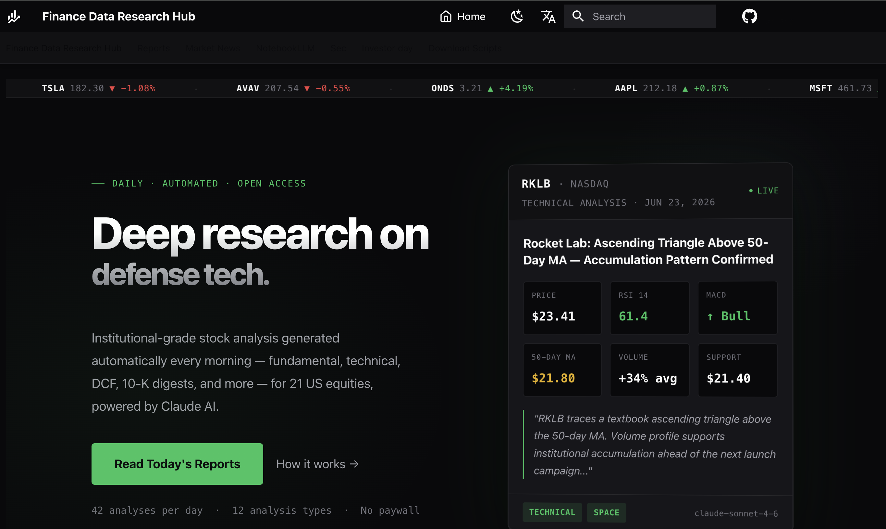
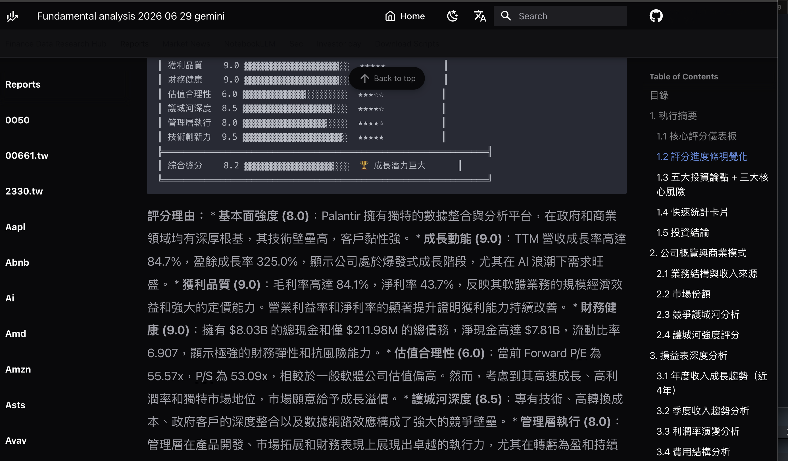
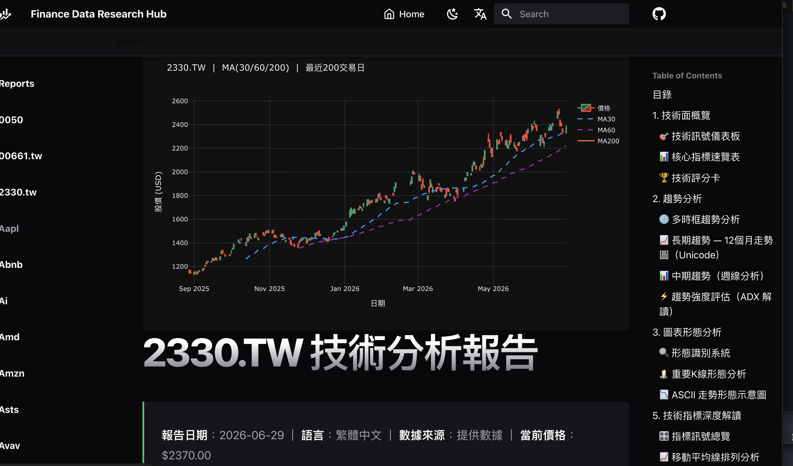

# Finance Data Research Hub

> AI 驅動的美股投資研究平台 — 基本面分析、技術分析、市場數據、SEC 文件，全部繁體中文。

<p align="center">
  
</p>

<p align="center">
  
  
</p>

**Live site:** [yennanliu.github.io/finance_data](https://yennanliu.github.io/finance_data/) (English + 繁體中文)

An automated research pipeline for US (and Taiwan) equities. Scheduled jobs fetch
market and SEC data, an LLM writes structured reports in Traditional Chinese, a
nightly audit checks every figure it can, and the results are published as a
static MkDocs site.

---

## Features

| | |
|---|---|
| **AI reports** | 12 analysis types. Fundamental and technical reports run daily; earnings-call, insider, 13F, valuation and more run on demand |
| **Checked figures** | Derived numbers (TTM, FCF, WACC, multiples) are computed in Python and quoted by the model. The §8.8 fair-value sum is recomputed and corrected after generation |
| **Market Data** | 10-year daily OHLCV plus SEC quarterly fundamentals per ticker: candles, drawdown, volatility, financial statements, valuation bands, DCF and reverse DCF. Downloadable as CSV / JSON |
| **Market news** | Daily per-ticker digest from Yahoo, RSS feeds and Perplexity Discover |
| **QA audit** | Nightly rule-based checks plus a cross-provider LLM review, committed to [`qa/`](qa/README.md) |
| **SEC filings** | 10-K, 10-Q, 13-F and 6-K archives (`10-k/`, `10-q/`, `13-f/`, `6-k/`) |
| **Research notes** | NotebookLM deep dives (`notebook_llm/`) and investor-day materials (`investor_day/`) |

### Coverage

- **Daily fundamental (36):** 0050, 2330.TW, TSLA, PL, GRAB, TSM, GOOG, AMZN,
  MSFT, SOFI, PLTR, RKLB, ONDS, AVAV, KTOS, META, AMD, NVDA, NU, VST, ORCL, INTC,
  SPCX, AVGO, NBIS, MU, SKHY, WDC, SNDK, MRVL, SOXQ, SOXX, WQTM, VTI, QQQ, ROBO
- **Daily technical (25):** the first 25 of the above (0050 … NBIS)
- **Analysis types (12):** `fundamental-analysis`, `technical-analysis`,
  `stock-eval`, `stock-valuation`, `financial-report-analyst`,
  `earnings-call-analysis`, `insider-trading`, `institutional-ownership`,
  `sector-analysis`, `economics-analysis`, `portfolio-review`, `report-generator`

The schedule is data-driven: [`scripts/.ticker_schedule.json`](scripts/.ticker_schedule.json).

---

## How it works

```
┌──────────────┐    ┌──────────────────┐    ┌──────────────┐    ┌──────────────┐
│  Data fetch  │───▶│   LLM analysis   │───▶│   QA audit   │───▶│   Publish    │
│  yfinance    │    │ Gemini → OpenAI  │    │ rules + LLM  │    │ MkDocs       │
│  SEC XBRL    │    │ (Claude opt-in)  │    │ judge        │    │ GitHub Pages │
│  scrapers    │    │ 繁中 reports      │    │ nightly      │    │ nightly      │
└──────────────┘    └──────────────────┘    └──────────────┘    └──────────────┘
```

1. **Fetch.** `yfinance`, Finviz / StockAnalysis / Roic.ai scrapers and SEC
   companyfacts. Prices and fundamentals are kept as committed CSV stores in
   `data/`.
2. **Analyse.** `scripts/generate_analysis.py` builds a context per analysis type
   and calls the LLM chain (Gemini `gemini-3.8-flash` first, OpenAI as fallback).
   Reports land in `ai_gen_report/`.
3. **Audit.** `qa_report_quality.yml` checks reports nightly. See
   [`docs/QA_AUDIT.md`](docs/QA_AUDIT.md).
4. **Publish.** `scripts/build_docs.py` turns reports and stores into the site;
   `deploy.yml` builds and deploys it at 04:00 UTC.

---

## Quick start

Requires [uv](https://docs.astral.sh/uv/). It installs the pinned Python (3.11)
for you.

### Clone (lightweight)

The full history is ~1 GB, mostly PDFs. A partial clone with sparse checkout
skips the PDF folders:

```bash
git clone --filter=blob:none --no-checkout git@github.com:yennanliu/finance_data.git
cd finance_data
git sparse-checkout set --no-cone '/*' '!notebook_llm/' '!10-k/' '!10-q/'
git checkout main
```

Set the sparse patterns *before* the first checkout. `git sparse-checkout disable`
brings the PDFs back.

### Generate a report

```bash
uv sync --extra dev

export GEMINI_API_KEY="..."       # default provider
export OPENAI_API_KEY="sk-..."    # fallback
export ANTHROPIC_API_KEY="sk-..." # optional: --provider claude

uv run python scripts/generate_analysis.py AAPL     # fundamental-analysis
uv run python scripts/generate_analysis.py MSFT --analysis-type technical-analysis
uv run python scripts/generate_analysis.py NVDA --analysis-type stock-valuation --provider openai
```

Output goes to `ai_gen_report/fundamental/<ticker>/`,
`ai_gen_report/technical/<ticker>/` or `ai_gen_report/stock/<ticker>/`.

### Run the tests

```bash
uv run pytest tests/ -v    # offline, no API keys needed
```

### Build the site locally

```bash
uv pip install "mkdocs-material==9.5.*" mkdocs-awesome-pages-plugin minify-html
uv run python scripts/build_docs.py
uv run mkdocs serve
```

### Download SEC filings

```bash
uv run python scripts/download_10k_edgar.py AAPL --years 5    # 10-K PDFs from EDGAR
uv run python scripts/download_10q_edgar.py AAPL              # 10-Q PDFs from EDGAR
uv run python scripts/download_10k_pdf.py meta-platforms-inc  # from annualreports.com
```

### Trigger CI runs

```bash
gh workflow run daily_analysis.yml -f ticker=MSFT -f analysis_type=technical-analysis
make analyze TICKERS="NVDA TSLA" TYPES="fundamental-analysis,technical-analysis"
make deep-dive TICKERS="NVDA"    # earnings-call, insider, 13F and HTML report
make help                        # all targets
```

---

## Repository layout

```
finance_data/
├── ai_gen_report/          # Generated reports (source of truth for the site)
│   ├── fundamental/<ticker>/
│   ├── technical/<ticker>/
│   ├── stock/<ticker>/     #   all other analysis types
│   └── market_news/<ticker>/
├── data/
│   ├── prices/             # Committed 10-year daily OHLCV, one CSV per ticker
│   └── fundamentals/       # Committed SEC quarterly statements, one CSV per ticker
├── qa/                     # Nightly QA audit output (last 10 runs)
├── scripts/
│   ├── analysis/           # Library: config, data, context, llm, pipeline, validate
│   ├── generate_analysis.py
│   ├── generate_market_news.py
│   ├── build_docs.py
│   └── …                   # store updaters, QA, SEC downloaders, release tools
├── tests/                  # pytest suite (offline)
├── docs/                   # MkDocs source; mostly generated by build_docs.py
├── okf/, llms.txt          # Agent-readable dataset descriptions
├── 10-k/ 10-q/ 13-f/ 6-k/  # SEC filings
├── notebook_llm/           # NotebookLM research notes
├── investor_day/           # Investor-day decks and transcripts
├── ws/                     # Daily pre-market watchlists
└── mkdocs.yml
```

---

## Automation

| Workflow | When (UTC) | What it does |
|----------|------------|--------------|
| `daily_analysis.yml` | 17:00–03:00, 61 slots | One fundamental or technical report per slot |
| `daily_market_news.yml` | 17:00–23:10, 38 slots | One news digest per ticker |
| `daily_stock_watchlist.yml` | 22:00 | Pre-market watchlist → `ws/` |
| `qa_report_quality.yml` | 02:00 | Rule-based + LLM audit → `qa/` |
| `cleanup_refusals.yml` | 02:00 | Removes refusal posts |
| `update_kline_data.yml` | 03:30 | Refreshes `data/prices/` |
| `update_fundamentals.yml` | Sun 03:00 | Refreshes `data/fundamentals/` |
| `deploy.yml` | 04:00 | Builds and deploys the site |
| `prune_old_reports.yml` | 1st of month | Deletes reports older than 90 days |
| `release.yml` | manual | Version bump + GitHub Release + deploy |

Full list and details: [`docs/ARCHITECTURE.md`](docs/ARCHITECTURE.md#cicd).

---

## Documentation

| Doc | What it covers |
|-----|----------------|
| [Architecture](docs/ARCHITECTURE.md) | Package layout, analysis types, providers, CI, how to add a type or ticker |
| [Report pipeline](docs/REPORT_PIPELINE.md) | How a report is generated and how its figures are checked |
| [Site build](docs/SITE_BUILD.md) | `build_docs.py`, page anatomy, styling, release, bilingual site |
| [QA audit](docs/QA_AUDIT.md) | The nightly two-stage report audit |
| [Runbook](docs/RUNBOOK.md) | Re-running failed crons, provider outages |
| [Price store design](docs/PRICE_STORE_DESIGN.md) | OHLCV store and Market Data section |
| [Fundamentals store](docs/FUNDAMENTALS_STORE_EVAL.md) | SEC fundamentals store |
| [`docs/history/`](docs/history/) | Superseded write-ups, kept for context |

---

## Data sources

- **Prices and quotes:** [Yahoo Finance](https://finance.yahoo.com/) via yfinance
- **Fundamentals and filings:** [SEC EDGAR](https://www.sec.gov/cgi-bin/browse-edgar) (XBRL companyfacts, 10-K / 10-Q)
- **Supplementary metrics:** Finviz, StockAnalysis, Roic.ai
- **Annual reports:** [annualreports.com](https://www.annualreports.com/)
- **LLMs:** [Gemini](https://ai.google.dev/), [OpenAI](https://openai.com/), [Claude](https://www.anthropic.com/)

## For AI agents (OKF)

The project publishes an [Open Knowledge Format](https://github.com/GoogleCloudPlatform/knowledge-catalog/tree/main/okf)
bundle: vendor-neutral, agent-readable Markdown describing every dataset. Its
source is [`okf/`](okf/index.md), published verbatim alongside
[`llms.txt`](llms.txt):

- `https://yennanliu.github.io/finance_data/llms.txt`
- `https://yennanliu.github.io/finance_data/okf/index.md`

## Further reading

- [finance_data 是怎麼運作的 — 用 Cron + LLM 全自動生成股票研究報告](https://yennj12.js.org/yennj12_blog_V4/posts/finance-data-ai-pipeline-how-it-works-zh/)
- [把站台從 3.1GB 砍到 503MB：finance_data 部署效能調校全紀錄](https://yennj12.js.org/yennj12_blog_V4/posts/mkdocs-site-size-deploy-perf-tuning-zh/)

---

## Disclaimer

All analysis is for **educational and research purposes only**. Nothing on this
site or in this repository is investment advice. Invest at your own risk.
