# 0050 基本面深度分析報告
> **報告日期**：2026-11-13 ｜ **語言**：繁體中文 ｜ **數據來源**：Yahoo Finance ｜ **分析師**：CFA 級機構研究

> **標的性質與資料限制**：0050 為元大台灣50 ETF，屬基金而非營運公司。它沒有可直接套用的公司損益表、資產負債表、營業現金流、資本支出、ROIC 或公司 WACC。因此，下文依 ETF 框架分析持股、費用、追蹤、配息及市場價格；資料包未提供的項目均標示 **N/A**，不以假設值冒充實際數據。題示價格為 **2026-11-13 收盤新台幣 102.50 元**。

---

## 目錄

| # | 章節 | 核心結論 |
|---|------|----------|
| 1 | 執行摘要 | 估值資料不足，暫列持有觀察；加權合理價值與 MOS 為 N/A |
| 2 | 公司概覽與商業模式 | 0050 是台灣大型股指數 ETF，持股明細及費用資料未提供 |
| 3 | 損益表深度分析 | ETF 無公司損益表；營收、EPS、利潤率與季度盈餘均 N/A |
| 4 | 資產負債表分析 | 基金資產、負債、流動性及 AUM 未提供 |
| 5 | 現金流量深度分析 | 公司式 FCF 不適用；基金配息與現金流明細未提供 |
| 6 | 獲利能力與資本效率 | ROIC、ROE、ROA、WACC 不適用，應看追蹤品質與持股報酬 |
| 7 | 相對估值分析 | 報價資料列出 Trailing P/E 26.802526；同業與歷史估值資料缺漏 |
| 8 | DCF 內在價值評估 | 對 ETF 直接做公司 DCF 不適用；無法可靠計算每股內在價值與 MOS |
| 9 | 成長催化劑 | 報酬主要取決於台灣大型股獲利、估值、股利與資金流 |
| 10 | 風險矩陣 | 主要風險為市場回檔、權值股集中及估值／資料透明度不足 |
| 11 | 投資建議 | 暫列持有觀察；價格參考區間是技術觀察，不是基本面目標價 |

---

## 1. 執行摘要

0050 的報價數據顯示，**2026-11-13 收盤價為新台幣 102.50 元**，Trailing P/E 欄位為 **26.802526 倍**，52 週區間為 **58.27–116.60 元**。然而，資料包沒有基金持股權重、AUM、費用率、追蹤誤差、NAV、配息明細，也沒有可供估值的成分股財務預測。因此，不能把 0050 當成單一營運公司做 DCF、ROIC/WACC 或 EPS 預測。依目前可核實資料，本報告採**暫定持有／觀察**，而非因估值便宜或昂貴下達買入或賣出結論。

以月收盤價作純價格觀察，2024-11 的 44.94 元至 2026-11 的 102.50 元上升 **128.0%**；同期間年化價格漲幅約 **51.0%**。這不是含息總報酬，也未調整 ETF 配息、拆分或其他公司行動，不能直接視為投資人實際報酬。由 2026-09 月收盤高點 112.05 元至最新收盤 102.50 元，回落 **8.5%**，顯示近期價格已從高點修正，但僅憑價格不能判斷估值是否合理。

### 1.0 一頁式投資儀表板

| 項目 | 內容 |
|------|------|
| **投資論點（3 句）** | ① 0050 提供台灣大型股一籃子曝險，適合以單一基金參與台股大型企業。② 最新收盤 102.50 元，較 2024-11 月收盤 44.94 元高 128.0%，但此為價格變動、不含息。③ 資料包列示 Trailing P/E 26.802526 倍，但成分股明細、費用率與估值方法缺漏，不能據此單獨判定便宜或昂貴。 |
| **護城河評分** | 6/10；指數化產品與規模可能帶來便利，但本次缺 AUM、費用率及追蹤誤差，無法確認相對優勢 |
| **管理層／資本配置評分** | 5/10；基金治理及資本配置不是公司式管理層評分，基金操作與費用資料 N/A |
| **財務健康** | 🟡 N/A；基金資產負債及流動性資料缺漏 |
| **ROIC vs WACC** | N/A；ETF 不適用公司 ROIC/WACC 分析 |
| **FCF 趨勢** | N/A；公司式營業現金流減資本支出不適用基金 |
| **估值** | Trailing P/E 26.802526x ｜ Forward P/E N/A ｜ EV/EBITDA N/A ｜ FCF Yield N/A |
| **DCF 內在價值（基準）** | N/A；缺少成分股預測與可稽核現金流模型 |
| **安全邊際（MOS）** | N/A；加權合理價值不可計算，故 `(加權合理價值 − 102.50) ÷ 加權合理價值` 無法求值 |
| **預期報酬（基準情境 12M）** | N/A；沒有可核實的總報酬假設 |
| **關鍵風險（前二）** | 台股系統性下跌；大型成分股集中與估值回落 |
| **評級 + 信心度** | 🟡 暫定持有／觀察 ｜ 信心：低；評級不代表 MOS 門檻結論，因 MOS 無法計算 |

### 1.1 核心評分儀表板

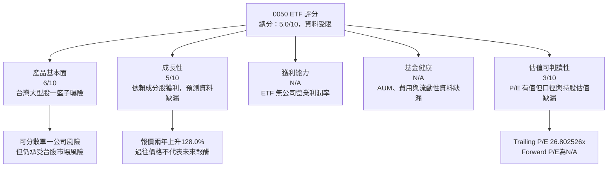

### 1.2 評分進度條視覺化

```
╔══════════════════════════════════════════════════════════════╗
║                 0050 ETF 評分儀表板（1-10分）               ║
╠══════════════════════════════════════════════════════════════╣
║ 產品基本面   6.0 ▓▓▓▓▓▓▓▓▓▓▓▓░░░░░░░░  ★★★☆☆             ║
║ 成長可見度   5.0 ▓▓▓▓▓▓▓▓▓▓░░░░░░░░░░  ★★★☆☆             ║
║ 獲利能力     N/A  ETF 非公司，不適用                         ║
║ 基金健康     N/A  AUM、費用率、追蹤誤差未提供                ║
║ 估值可判讀性 3.0 ▓▓▓▓▓▓░░░░░░░░░░░░░░  ★★☆☆☆             ║
║ 護城河       6.0 ▓▓▓▓▓▓▓▓▓▓▓▓░░░░░░░░  ★★★☆☆             ║
║ 基金管理評估 5.0 ▓▓▓▓▓▓▓▓▓▓░░░░░░░░░░  ★★★☆☆             ║
╠══════════════════════════════════════════════════════════════╣
║ 綜合可判讀度 5.0 ▓▓▓▓▓▓▓▓▓▓░░░░░░░░░░  🟡 資料受限觀察     ║
╚══════════════════════════════════════════════════════════════╝
```

### 1.3 五大投資論點與三大核心風險

| 類型 | 項目 | 具體依據 | 信心度 |
|------|------|----------|--------|
| 🟢 投資論點① | 大型股一籃子曝險 | 產品名稱為台灣50 ETF；分散單一公司風險，但持股權重未提供 | 🟡 中 |
| 🟢 投資論點② | 投資工具簡潔 | 單一 ETF 可取得一籃子台灣大型股曝險；實際費用與追蹤品質須另查 | 🟡 中 |
| 🟢 投資論點③ | 長期價格動能曾正向 | 44.94 元至 102.50 元，價格升幅 128.0%，但不含息且不代表未來 | 🟡 中 |
| 🟡 投資論點④ | 可用市場價格觀察風險區間 | 52 週高低為 116.60／58.27 元；歷史區間不等於合理價 | 🟡 中 |
| 🟡 投資論點⑤ | 報價提供有限估值訊號 | Trailing P/E 26.802526 倍；資料來源口徑與成分股加權方式未提供 | 🔴 低 |
| 🟡 風險① | 市場回檔 | 52 週區間振幅達 58.33 元；基金仍承受台股整體波動 | 🟡 中 |
| 🔴 風險② | 權值股集中 | 台灣大型股指數通常受大型成分股影響，惟本次持股權重 N/A | 🟡 中 |
| 🔴 風險③ | 資料完整度不足 | 費用率、追蹤誤差、AUM、NAV、配息明細均 N/A | 🔴 高 |

### 1.4 快速統計卡片

| 指標 | 0050 數據 | 同類基金／市場基準 | 狀態 |
|------|------------|-------------------|------|
| 基金收入 YoY | N/A；ETF 不適用公司營收 | N/A | 🟡 |
| 毛利率／淨利率 | N/A | N/A | 🟡 |
| ROE／ROIC | N/A | N/A | 🟡 |
| Trailing P/E | **26.802526x** | 同業倍數未提供 | 🟡 |
| Forward P/E | N/A | N/A | 🟡 |
| 52 週價格區間 | **58.27–116.60 元** | — | 🟡 |
| 最新收盤價 | **102.50 元，2026-11-13** | — | — |
| 費用率／追蹤誤差 | N/A | 同類基金比較資料未提供 | 🔴 |
| 資料包列示股息殖利率 | **153.0%** | — | 🔴 異常值，不採用 |

> **配息資料警示**：資料包列示股息殖利率 **153.0%**，此數值與常見 ETF 殖利率解讀顯著不協調，且缺乏配息金額、計算期間及 NAV 說明。本報告原值揭露，但視為未驗證資料，不用於收益預測或估值。

### 1.5 投資結論

```
╔══════════════════════════════════════════════════════════════════╗
║                    📊 投資結論摘要                               ║
╠══════════════════════════════════════════════════════════════════╣
║  評級：🟡 暫定持有／觀察；不是依 MOS 門檻推導的標準評級          ║
║  價格（2026-11-13 收盤）：新台幣 102.50 元                       ║
║  DCF 內在價值（基準）：N/A；ETF 公司式 DCF 不適用                ║
║  安全邊際 MOS：N/A；加權合理價值無法計算                          ║
║  目標價區間：基本面目標價 N/A；不以歷史價格冒充內在價值           ║
║  悲觀／基準／樂觀情境：N/A；缺成分股預測、基金持股與費用          ║
║  投資評分：5.0/10（資料可判讀度受限）                             ║
║  適合投資人：接受台股波動、希望取得大型股指數曝險的長期投資人     ║
╚══════════════════════════════════════════════════════════════════╝
```

---

## 2. 公司概覽與商業模式

### 2.1 業務結構與收入來源

0050 是基金，不是靠銷售商品取得營收的企業。其投資結果主要來自持有成分股的價格變動、成分股股息，以及基金費用與追蹤結果。資料包沒有市值、基金規模、成分股權重或實際費用資料；不能把基金市場價格乘上未知單位數推算 AUM。

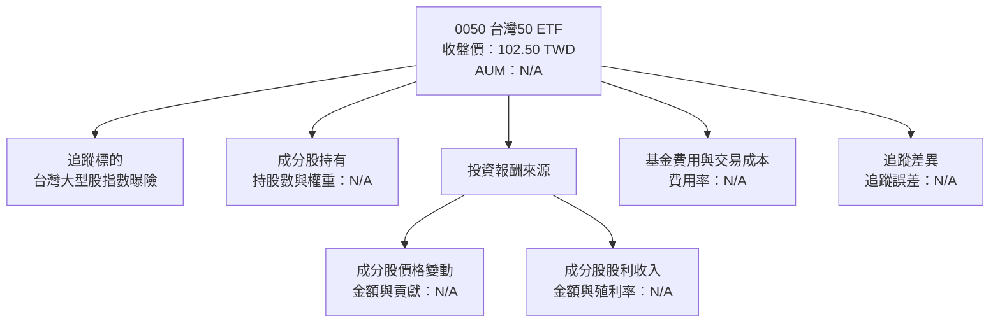

### 2.2 市場份額

0050 在台灣 ETF 市場的 AUM、市占及同類產品比較資料未提供，因此不繪製以推測數字構成的市占圓餅圖。產品層面可比較的同類基金包括 006208 等台灣大型股 ETF；其費用、持股權重、AUM、追蹤誤差與估值數據本次皆為 N/A。

| 比較項目 | 0050 | 006208 | 其他台灣大型股 ETF |
|---|---:|---:|---:|
| 追蹤指數／策略 | 台灣50 ETF，完整追蹤資料未提供 | N/A | N/A |
| AUM | N/A | N/A | N/A |
| 費用率 | N/A | N/A | N/A |
| 追蹤誤差 | N/A | N/A | N/A |
| 成分股權重 | N/A | N/A | N/A |

### 2.3 競爭護城河分析

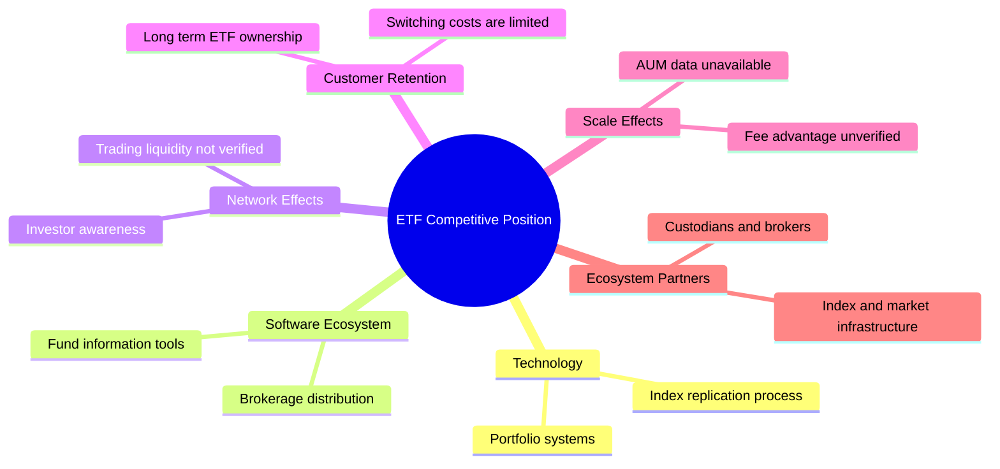

### 2.4 護城河強度評分

```
╔══════════════════════════════════════════════════════════════╗
║                  0050 ETF 競爭優勢評分                       ║
╠══════════════════════════════════════════════════════════════╣
║ 指數化投資便利   7/10  ▓▓▓▓▓▓▓▓▓▓▓▓▓▓░░░░░░  🟢 一籃子曝險 ║
║ 費用競爭力       N/A   費用率未提供                         ║
║ 流動性           N/A   成交量與買賣價差未提供               ║
║ 追蹤品質         N/A   追蹤差異及追蹤誤差未提供             ║
║ 規模效應         N/A   AUM 未提供                           ║
║ 客戶鎖定         3/10  ▓▓▓▓▓▓░░░░░░░░░░░░░░  🟡 ETF轉換成本低║
╠══════════════════════════════════════════════════════════════╣
║ 可確認的產品優勢  5.0/10；基金效率與成本尚待數據驗證          ║
╚══════════════════════════════════════════════════════════════╝
```

---

## 3. 損益表深度分析

### 3.1 年度收入成長趨勢（近 4 年）

ETF 沒有企業營收，題示資料亦未提供基金年度總收益或基金淨資產變化。不得以基金市場價格漲幅代替營收成長。

```
╔══════════════════════════════════════════════════════════════╗
║              0050 年度營收趨勢：不適用                        ║
╠══════════════════════════════════════════════════════════════╣
║ FY2023 基金營收／損益：N/A                                    ║
║ FY2024 基金營收／損益：N/A                                    ║
║ FY2025 基金營收／損益：N/A                                    ║
║ FY2026 基金營收／損益：N/A                                    ║
║ TTM 營收與 YoY：N/A；ETF 無公司營收定義                       ║
╠══════════════════════════════════════════════════════════════╣
║ 可觀察替代指標：價格 44.94 → 102.50 元，期間價格漲幅 128.0%    ║
║ 此價格變動不含息，不等於基金營收或投資人總報酬                 ║
╚══════════════════════════════════════════════════════════════╝
```

### 3.2 季度收入趨勢分析

| 期間 | 基金營收／EPS | QoQ | YoY | 備註 |
|------|---------------|-----|-----|------|
| 最近一季 | N/A | N/A | N/A | ETF 不適用公司季度營收與 EPS；基金財報未提供 |
| 前一季 | N/A | N/A | N/A | 同上 |
| 前兩季 | N/A | N/A | N/A | 同上 |
| 前三季 | N/A | N/A | N/A | 同上 |

因此，不能計算題目要求的單季營收、EPS 或淨利 YoY／QoQ，也不能推論利潤率改善或惡化。

### 3.3 利潤率演變分析

| 利潤率指標 | FY2023 | FY2024 | FY2025 | FY2026／TTM | 評估 |
|------------|--------|--------|--------|-------------|------|
| 毛利率 | N/A | N/A | N/A | N/A | ETF 無公司毛利率 |
| 營業利益率 | N/A | N/A | N/A | N/A | 不適用 |
| 淨利率 | N/A | N/A | N/A | N/A | 不適用 |
| 變化原因 | — | — | — | — | 需以成分股獲利與基金費用資料分析 |

基金報酬的推動因素是成分股價格、股利、基金費用、交易成本及追蹤差異，而非本基金自身的毛利率或營業槓桿。缺少持股報酬貢獻與成本資料，不能把價格上漲歸因於特定產業或利潤率。

### 3.4 費用結構分析

管理費、保管費、交易成本、指數授權費及其他費用率均未提供，故不繪製缺少根據的費用比例圖。

| 費用項目 | 0050 資料 | 投資含義 |
|---|---|---|
| 經理費／總費用率 | N/A | 長期持有時會累積侵蝕報酬，須查基金公開說明書 |
| 保管費 | N/A | 應納入總持有成本 |
| 交易成本與買賣價差 | N/A | 影響實際進出場報酬 |
| 指數追蹤差異 | N/A | 用以判斷實際績效與指數差距 |

### 3.5 季度 EPS 趨勢與盈餘品質

0050 本身沒有可套用的公司 EPS surprise 記錄；題示資料中最近四季 EPS beat/miss、SBC、OCF、Capex、一次性損益與稅率均為 N/A。這些指標若要分析，應下鑽至基金持股公司並按權重合併，而非把 ETF 當單一企業。

| 盈餘品質項目 | 數值／佔比 | 評估 |
|--------------|-----------|------|
| EPS 超預期／不及預期 | N/A | ETF 無公司財報 EPS；成分股一致預期資料缺漏 |
| SBC／營收 | N/A | 需按持股公司加權，不能以基金自身計算 |
| SBC／營業現金流 | N/A | N/A |
| FCF／淨利 | N/A | 公司盈餘品質指標不適用基金 |
| 一次性／非經常性損益 | N/A | 成分股財報未提供 |
| 有效稅率 | N/A | 成分股加權稅率未提供 |
| 資本化支出 vs 費用化 | N/A | 需分析成分股財務報表 |

**盈餘品質結論**：本報告不能判定成分股 GAAP 獲利是否高估或低估經濟盈餘。基金投資人應檢視主要成分股的現金流轉換率、SBC 稀釋及一次性項目，再結合各成分股權重評估。

---

## 4. 資產負債表分析

### 4.1 資產結構分解

基金資產通常包括投資證券、現金及應收款項等，但本次沒有基金資產負債表及持股明細，不能提供比例或金額。

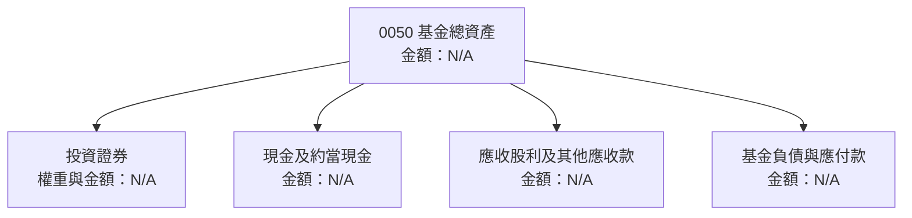

### 4.2 流動性指標分析

| 指標 | 0050 | 歷史趨勢 | 同類基金比較 | 評估 |
|------|------|----------|--------------|------|
| AUM／淨資產 | N/A | N/A | N/A | 規模效應不可判定 |
| 現金比率 | N/A | N/A | N/A | 基金資產負債表缺漏 |
| 買賣價差 | N/A | N/A | N/A | 應以實際成交資料核實 |
| 日均成交量 | N/A | N/A | N/A | 市場數據未提供 |
| 折溢價／NAV | N/A | N/A | N/A | 無 NAV 與盤中估值資料 |

### 4.3 債務結構分析

ETF 不應套用企業 Debt/EBITDA 或利息保障倍數；基金可能有短期應付款或交易結算項目，但本次資料不足以確認。

```
╔══════════════════════════════════════════════════════════════╗
║                   0050 基金負債診斷                           ║
╠══════════════════════════════════════════════════════════════╣
║  總債務：             N/A；基金負債明細未提供                  ║
║  總現金及短期投資：   N/A；資產負債表未提供                    ║
║  淨現金／淨負債：     資料包顯示 0.00，但不能視為已核實基金數據 ║
║  Debt/EBITDA：        不適用；ETF 無公司 EBITDA                ║
║  利息保障倍數：       不適用／N/A                              ║
║  財務健康結論：       🟡 資料不足，不能據此判定基金槓桿狀態     ║
╚══════════════════════════════════════════════════════════════╝
```

### 4.4 股東權益趨勢

ETF 持有人權益會受基金淨資產、申購贖回及投資損益影響，但資料包沒有歷年基金淨資產及單位數，無法繪製權益趨勢。基金淨值與市場價格亦可能不同，需搭配 NAV、溢折價及申贖資料判讀。

---

## 5. 現金流量深度分析

### 5.1 現金流量瀑布圖

公司式「淨利 → 營業現金流 → Capex → FCF」不適用於 ETF。基金投資報酬通常由成分股價格變動、股利收入、基金費用與申贖資金流共同形成。

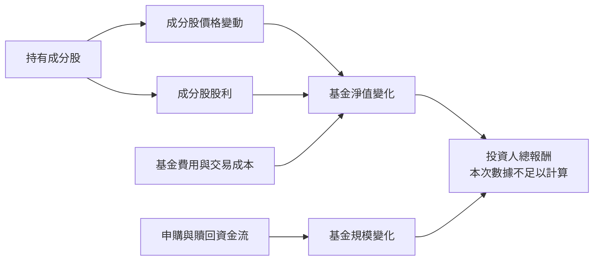

### 5.2 FCF 轉換率趨勢

| 年度 | FCF／Net Income | 營業現金流 | Capex | 評估 |
|------|------------------|------------|-------|------|
| FY2023 | N/A | N/A | N/A | ETF 公司式指標不適用 |
| FY2024 | N/A | N/A | N/A | 同上 |
| FY2025 | N/A | N/A | N/A | 同上 |
| TTM | N/A | N/A | N/A | 資料包 TTM FCF 為 N/A |

### 5.3 自由現金流趨勢

```
╔══════════════════════════════════════════════════════════════╗
║             0050：公司式自由現金流不適用                      ║
╠══════════════════════════════════════════════════════════════╣
║ TTM OCF：N/A       TTM Capex：N/A       TTM FCF：N/A          ║
║ FCF Yield：N/A     基金股利收益：N/A    配息明細：N/A         ║
║                                                              ║
║ 價格觀察：2024-11 44.94 元 → 2026-11 102.50 元               ║
║ 價格升幅：128.0%，不含息，不能代替 FCF 或總報酬              ║
╚══════════════════════════════════════════════════════════════╝
```

### 5.4 資本配置評估

基金不是將企業自由現金流配置於回購、研發或資本支出的公司。投資人應關注成分股股利如何處理、基金配息政策及費用。資料包列示股息殖利率 **153.0%**，但由於計算口徑及配息明細皆缺漏，判定為異常未驗證值，不能據此推估收入。

| 配置／現金流項目 | 數據 | 判讀 |
|---|---|---|
| 基金配息 | 金額、頻率均 N/A | 查核基金公告及歷史配息 |
| 股利再投資／保留 | N/A | 需依基金政策確認 |
| 基金費用 | N/A | 需納入長期持有成本 |
| 申購／贖回淨流量 | N/A | 影響基金規模與交易需求 |

---

## 6. 獲利能力與資本效率

### 6.1 ROE／ROA／ROIC 趨勢

| 指標 | 0050 | 歷年趨勢 | 同類基金均值 | 評估 |
|------|------|----------|--------------|------|
| ROE | N/A | N/A | N/A | ETF 無公司式股東權益回報指標 |
| ROA | N/A | N/A | N/A | 不適用公司營運分析 |
| ROIC | N/A | N/A | N/A | 應下鑽至成分股分析 |
| ETF 替代評估 | 追蹤報酬與指數差異 N/A | N/A | N/A | 費用、追蹤誤差資料缺漏 |

### 6.2 ROIC vs WACC 分析

```
╔══════════════════════════════════════════════════════════════╗
║                ROIC vs WACC：不適用於 ETF                    ║
╠══════════════════════════════════════════════════════════════╣
║  無風險利率 Rf：        N/A；本基金不採企業 WACC 模型          ║
║  Beta：                 N/A；基金 Beta 未提供                  ║
║  股權成本 Ke：          N/A                                     ║
║  債務成本 Kd：          N/A；基金計息負債未提供                ║
║  資本結構權重：         N/A                                     ║
║  WACC：                 N/A                                     ║
║  ROIC：                 N/A                                     ║
║  EVA = ROIC − WACC：    不適用，不能據此判斷 0050 創造或摧毀價值║
║                                                              ║
║  ETF 應評估：總報酬、費用率、追蹤差異、NAV 溢折價及流動性      ║
╚══════════════════════════════════════════════════════════════╝
```

因此，本報告不以「ROIC 高於或低於 WACC」作為 ETF 買賣判斷，也不填入虛構折現率。0050 的持有價值，應由成分股風險與報酬、基金費用、指數追蹤品質及買入估值共同判斷。

### 6.3 杜邦三因素分解

杜邦分析適用公司 ROE，不適用基金自身。對成分股可使用「淨利率 × 資產週轉率 × 財務槓桿」，但成分股財務數據與權重皆未提供。

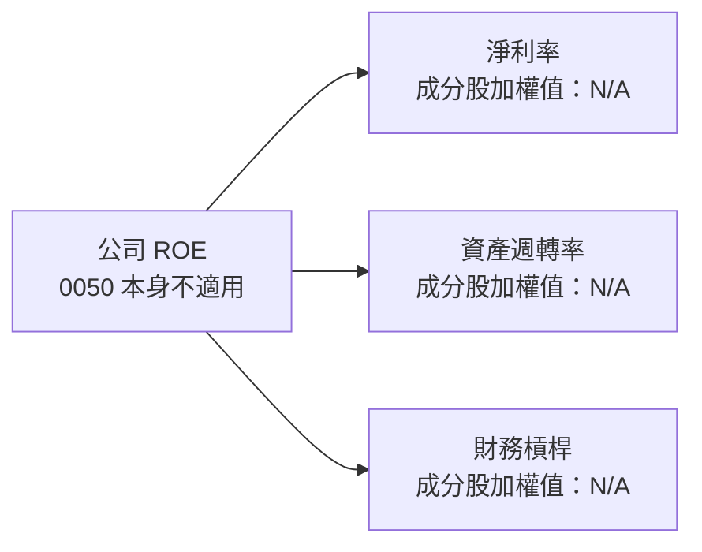

### 6.4 獲利能力儀表板

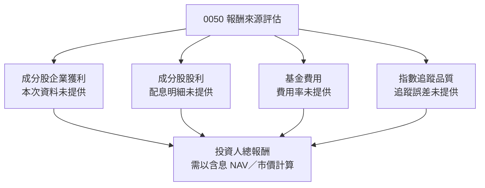

---

## 7. 相對估值分析

### 7.1 同業估值比較表格

資料包沒有 Peer multiples。以下同類 ETF 名稱可作產品比較對象，但沒有提供可引用倍數，故不以外部估值數字填表。0050 的 P/E 是資料包提供值；其計算口徑及加權方法未說明。

| 估值指標 | **0050** | **006208** | **0056** | **其他台灣大型股 ETF** | 本公司評估 |
|----------|---------:|----------:|--------:|----------------------:|-----------|
| **Trailing P/E** | **26.802526x** | N/A | N/A | N/A | 🟡 有數值但口徑未明 |
| **Forward P/E** | N/A | N/A | N/A | N/A | 🟡 無法比較未來獲利 |
| **P/S** | N/A | N/A | N/A | N/A | 🟡 ETF 不以基金營收作一般 P/S |
| **EV/EBITDA** | N/A | N/A | N/A | N/A | 不適用基金企業估值 |
| **費用率** | N/A | N/A | N/A | N/A | 🔴 產品成本比較缺資料 |
| **追蹤誤差** | N/A | N/A | N/A | N/A | 🔴 追蹤品質比較缺資料 |
| **AUM** | N/A | N/A | N/A | N/A | 🟡 無法比較規模 |

### 7.2 歷史估值區間分析

資料包沒有「Valuation vs own history」估值歷史百分位，不自行估算 P/E 分位。以下僅呈現價格歷史，不是估值區間：

```
╔══════════════════════════════════════════════════════════════╗
║              0050 價格歷史觀察（非估值區間）                  ║
╠══════════════════════════════════════════════════════════════╣
║ 2024-11 月收盤  44.94 元                                      ║
║ 2025-04 月收盤  41.02 元                                      ║
║ 2026-09 月收盤 112.05 元                                      ║
║ 2026-11-13      102.50 元                                     ║
║ 52 週低／高      58.27／116.60 元                             ║
║ 歷史 P/E 百分位  N/A；不得由股價序列反推                       ║
╚══════════════════════════════════════════════════════════════╝
```

2026-11-13 收盤價相對 52 週高點低 **12.1%**；相對 52 週低點高 **75.9%**。計算分別為 `(102.50 ÷ 116.60) − 1` 與 `(102.50 ÷ 58.27) − 1`。這些只是價格位置，不能替代估值判斷。

### 7.3 情境目標價（假設驅動，Bear / Base / Bull）

未提供基金持股明細、成分股預測、NAV、未來盈餘或可用同業估值倍數，故無法用營收 CAGR、營業利潤率及退出倍數建立可稽核目標價。

| 情境 | 營收 CAGR | 營業利潤率 | 退出倍數 | 隱含目標價 | 相對現價 |
|------|-----------|-----------|----------|------------|----------|
| 🔴 悲觀 | N/A | N/A | N/A | N/A | N/A |
| 🟡 基準 | N/A | N/A | N/A | N/A | N/A |
| 🟢 樂觀 | N/A | N/A | N/A | N/A | N/A |

**估值方法選擇說明**：基金不是單一企業，不應直接套用企業 EV/EBITDA 或 P/E 退出倍數。合理比較應採用基金費用率、追蹤差異、持股估值、NAV 溢折價、配息與同類 ETF 總報酬；上述資料目前不足。

### 7.4 相對估值隱含價格區間

| 方法 | 隱含價格 | 能否計算 | 缺漏資料 |
|------|----------|----------|----------|
| 同業 Forward P/E | N/A | 否 | 0050 與同類基金 Forward P/E、成分股預測 |
| EV/EBITDA | N/A | 不適用 | ETF 不是營運企業 |
| EV/Sales | N/A | 不適用 | ETF 無企業營收 |
| FCF Yield | N/A | 不適用／資料缺漏 | 基金 FCF 與可比估值未提供 |
| NAV 溢折價 | N/A | 否 | 同日 NAV、收盤市價與單位資料缺漏 |

---

## 8. DCF 內在價值評估（Discounted Cash Flow）

> **方法適用性結論**：0050 是持有多檔股票的 ETF，不是單一企業。對基金直接建立「公司營收 → EBIT → FCFF → EV → 每股價值」模型會把基金與底層成分股混為一談。要做穿透式估值，至少需要成分股權重、各公司預測現金流、基金費用、現金、負債、NAV 與單位數；題示資料皆不足。因此，本章依要求完整列示不可計算項目與計算邏輯，不以虛構輸入產生黑箱估值。

### 8.0 估值推理鏈（Thinking Logic）

**Step 1 — 價值來源**：0050 的價值主要來自成分股組合的總報酬、成分股股利，以及基金費用與追蹤差異；持股及權重均 N/A，無法量化各來源占比。主導變數是底層成分股的未來獲利與市場估值，而不是 ETF 自身營業利潤率。

**Step 2 — 模型選擇**

| 決策點 | 本報告採用 | 理由 | 曾考慮但否決 | 否決理由 |
|--------|-----------|------|--------------|----------|
| 現金流定義 | 不建立公司 FCFF | ETF 無公司式營業現金流與 Capex | 公司 FCFF DCF | 缺成分股持倉與逐家公司預測 |
| 預測期 N | N/A | 缺可核實基礎預測 | 任意設定 5–10 年 | 會製造未經數據支持的估值 |
| 終值方法 | N/A | 缺逐年現金流及可適用企業基礎 | Gordon Growth | 無 FCFF 基礎 |
| EBIT 基礎 | N/A | 基金沒有 EBIT | GAAP／非 GAAP EBIT | 不適用基金 |

**Step 3 — 假設推導鏈**：營收 CAGR、期末營業利潤率、Capex/營收、D&A/營收、營運資金、SBC、稀釋率、WACC 與永續成長率均不適用或 N/A。由於沒有基金穿透持股及公司財報，不能提供「錨點 → 調整 → 採用值」而不憑空編造。

**Step 4 — 最脆弱環節**：若未取得成分股權重及未來獲利預期，估值不確定性無法量化；任何單一「每股內在價值」都會依賴未揭露假設。

**Step 5 — 計算路徑**


### 8.1 模型假設總表

| 假設項目 | 採用值 | 依據／來源 | 敏感度 |
|----------|--------|-------------|--------|
| 預測期長度 N | N/A | 基金本身不是營運公司；缺穿透式預測 | 🔴 高 |
| 營收 CAGR | N/A | ETF 無公司營收 | 🔴 高 |
| 營業利潤率 | N/A | ETF 無 EBIT | 🔴 高 |
| 有效稅率 | N/A | 成分股加權稅率未提供 | 🟢 低 |
| Capex／營收 | N/A | 不適用 ETF；成分股資料未提供 | 🟡 中 |
| D&A／營收 | N/A | 不適用 ETF；成分股資料未提供 | 🟢 低 |
| ΔWC／營收增額 | N/A | 不適用 ETF；成分股資料未提供 | 🟢 低 |
| EBIT 基礎 | N/A | 基金無 EBIT | 🟡 中 |
| SBC 處理 | N/A | 基金自身無公司 SBC | 🟡 中 |
| 年稀釋率 | N/A | ETF 單位數及申贖資料未提供 | 🟡 中 |
| 永續成長率 g | N/A | 無 FCFF／WACC 可供比較 | 🔴 高 |
| 終值方法 | N/A | 不適用公司 DCF | 🔴 高 |
| WACC | N/A | VERIFIED FIGURES 明示 ETF 無 WACC | 🔴 高 |
| FCFF | N/A | 基金公司式 OCF−Capex 資料未提供 | 🔴 高 |

**FCF 定義**：資料包將自由現金流定義為營業現金流減資本支出，但 0050 的公司式 OCF、Capex、FCF 均為 N/A。本報告不把成分股 FCF 假設成基金 FCF。  
**SBC 防呆**：不建立公司 DCF，因此不套用 A／B／C 模型組合，也不對基金單位數套用公司股權稀釋模型。

### 8.2 折現率推導（WACC）

```
╔══════════════════════════════════════════════════════════════╗
║                WACC 推導：不適用於 ETF                       ║
╠══════════════════════════════════════════════════════════════╣
║  無風險利率 Rf：N/A；VERIFIED FIGURES 未提供適用輸入           ║
║  ERP：N/A；不建立企業 CAPM                                   ║
║  Beta：N/A；資料包市場 Beta 為 N/A                            ║
║  股權成本 Ke：N/A                                            ║
║  債務成本 Kd：N/A；基金計息負債及利息費用未提供               ║
║  股權／債務權重：N/A                                          ║
║  WACC：N/A；不得用假設值冒充經核實的基金折現率                 ║
╚══════════════════════════════════════════════════════════════╝
```

五步演算無法完成：Ke、Kd、資本結構、市值及計息負債均缺漏或不適用。第 6.2 節與本節一致，均不使用 WACC。

### 8.3 逐年自由現金流預測（基準情境）

| 年度 | FY+1 | FY+2 | FY+3 | FY+4 | FY+5 |
|------|------|------|------|------|------|
| 基金營收 | N/A | N/A | N/A | N/A | N/A |
| 成分股營收 YoY | N/A | N/A | N/A | N/A | N/A |
| 基金營業利潤率 | N/A | N/A | N/A | N/A | N/A |
| EBIT | N/A | N/A | N/A | N/A | N/A |
| 稅 | N/A | N/A | N/A | N/A | N/A |
| NOPAT | N/A | N/A | N/A | N/A | N/A |
| D&A | N/A | N/A | N/A | N/A | N/A |
| Capex | N/A | N/A | N/A | N/A | N/A |
| ΔWC | N/A | N/A | N/A | N/A | N/A |
| FCFF | N/A | N/A | N/A | N/A | N/A |
| 折現因子 | N/A | N/A | N/A | N/A | N/A |
| FCFF 現值 PV | N/A | N/A | N/A | N/A | N/A |

預測期 FCF 現值合計：N/A，不能把 N/A 數值相加為具意義的企業價值。

**代表年度演算**：FY+1 營收、EBIT、稅、NOPAT、D&A、Capex、ΔWC、FCFF 與折現因子均無可核實輸入，因此公式不可代入實際數字。填入任意金額會違反「不得編造價格、營收、現金流與資本支出」原則。

**合理性自檢**：
- 預測 FCF CAGR vs 歷史實際 FCF CAGR：N/A；ETF 公司式 FCF 不適用。
- FY+N FCF 利潤率與目前及同業比較：N/A。
- FCFF 正負及折現結果：N/A。

```
╔══════════════════════════════════════════════════════════════╗
║       自由現金流：歷史實際與模型預測均無可用基金資料          ║
╠══════════════════════════════════════════════════════════════╣
║ TTM FCF：N/A；FY歷史 FCF：N/A；FY+1 至 FY+5 FCFF：N/A        ║
║ 不以市場價格漲幅代替自由現金流或基金總報酬                   ║
╚══════════════════════════════════════════════════════════════╝
```

### 8.4 終值計算（Terminal Value）

適用性檢查：`WACC N/A vs g N/A → WACC > g？無法判定；不適用基金 DCF。`

| 方法 | 計算式 | 終值 TV | TV 現值 | 佔總 EV 比重 |
|------|--------|---------|---------|--------------|
| Gordon Growth | N/A；缺 FCFF、WACC、g | N/A | N/A | N/A |
| 退出倍數法 | N/A；基金無可用 EBITDA 基礎 | N/A | N/A | N/A |

無法進行終值演算，亦不能判斷終值占比。這不是公式失效，而是模型對象與資料均不適用。

### 8.5 企業價值 → 每股內在價值（Bridge）

```
╔══════════════════════════════════════════════════════════════╗
║             企業價值 → 每股內在價值：不適用                   ║
╠══════════════════════════════════════════════════════════════╣
║  預測期 FCF 現值合計        N/A                               ║
║  終值現值 PV(TV)            N/A                               ║
║  企業價值 EV                N/A                               ║
║  現金及短期投資             N/A                               ║
║  總債務                     N/A                               ║
║  股權價值                   N/A                               ║
║  稀釋後流通股數             N/A                               ║
║  每股 DCF 內在價值          N/A                               ║
║  當前價格                   102.50 TWD，2026-11-13 收盤        ║
║  折溢價                     N/A；DCF 內在價值不可得            ║
║  本節不計算 MOS             依規則以 8.8 加權價值為分母；目前亦N/A║
╚══════════════════════════════════════════════════════════════╝
```

EV、股權價值及每股內在價值均不可演算。最新收盤價依要求固定使用 **2026-11-13 的 102.50 元**；因缺 DCF 值，`現價 ÷ DCF 內在價值 − 1` 無法計算。

### 8.6 敏感性分析（WACC × 永續成長率）

Gordon Growth 敏感性矩陣需要有效 WACC 與 g。兩者均 N/A，不能建立可複算的 5×5 每股價值矩陣，也不能把任何缺值填成數字。

| g／WACC | N/A | N/A | N/A | N/A | N/A |
|---|---|---|---|---|---|
| N/A | N/A | N/A | N/A | N/A | N/A |
| N/A | N/A | N/A | N/A | N/A | N/A |
| N/A | N/A | N/A | N/A | N/A | N/A |
| N/A | N/A | N/A | N/A | N/A | N/A |
| N/A | N/A | N/A | N/A | N/A | N/A |

- g 每 +1pp 的價值彈性：N/A。
- WACC 每 +1pp 的價值彈性：N/A。
- 期末營業利潤率每 +1pp 的價值彈性：N/A。
- 三情境 DCF 與機率加權：N/A，缺成分股營運假設及可用估值基礎。

### 8.7 反推 DCF（Reverse DCF）

以 102.50 元反推營收 CAGR、營業利潤率或 g，需要固定其他 DCF 參數並求解一條模型方程。但 WACC、基金現金流、成分股預測、股數與基金資產負債資料缺漏，無法求解任何單一未知數。

| 求解變數 | 固定輸入 | 市場隱含值 | 歷史實際 | 判斷 |
|----------|----------|------------|----------|------|
| 成分股營收 CAGR | WACC／費用／現金流均 N/A | N/A | N/A | 無法判斷 |
| 期末營業利潤率 | 成分股利潤率及其他參數 N/A | N/A | N/A | 無法判斷 |
| 永續成長率 g | WACC 與 FCFF N/A | N/A | — | 無法求解 |
| 高成長持續年數 N | CAGR、利潤率、g 均 N/A | N/A | N/A | 無法求解 |

**反推結論**：市場價格 102.50 元本身不能唯一識別市場對未來獲利的假設；需先取得持股與估值模型輸入，不宜宣稱現價隱含某個特定成長率。

### 8.8 估值三角驗證與安全邊際

| 估值方法 | 隱含每股價值 | 上行空間（÷現價） | 權重 | 說明 |
|----------|--------------|-------------------|------|------|
| DCF 機率加權 | N/A | N/A | N/A | ETF 公司式 DCF 不適用 |
| 同業估值 | N/A | N/A | N/A | 同業估值倍數未提供 |
| NAV／追蹤與費用比較 | N/A | N/A | N/A | NAV、費用與追蹤誤差缺漏 |
| 分析師共識目標價 | N/A | N/A | N/A | 題示共識資料 N/A |
| **加權合理價值** | **N/A** | **N/A** | **無法配置** | 不以未驗證估值生成 MOS |

加權合理價值的標準公式為「各估值方法價值 × 權重」加總；但所有可用估值方法均缺少輸入，因此不能設定權重並計算。基於此，MOS 也不可計算，不能依評級門檻將 0050 判為買入或賣出。

```
╔══════════════════════════════════════════════════════════════╗
║                 估值區間與安全邊際                           ║
╠══════════════════════════════════════════════════════════════╣
║  基本面悲觀值：N/A   現價：102.50   加權合理值：N/A           ║
║  基準 DCF：N/A       樂觀 DCF：N/A                           ║
║                                                              ║
║  MOS = (加權合理價值 − 現價) ÷ 加權合理價值：N/A              ║
║  上行空間 = (合理價值 − 現價) ÷ 現價：N/A                     ║
║  折溢價 = 現價 ÷ DCF 內在價值 − 1：N/A                        ║
║                                                              ║
║  建議買入區間：不提供基本面區間；可參考第 11 章技術觀察位     ║
╚══════════════════════════════════════════════════════════════╝
```

### 8.9 DCF 模型的局限與失效條件

- **終值依賴度**：N/A，無法建立企業價值或終值。
- **最脆弱的假設**：持股權重與成分股未來獲利；若集中度、估值與預測錯誤，基金合理價可能明顯不同，但幅度無法量化。
- **不適用情境**：ETF 不應用單一公司 DCF；應優先使用穿透式成分股估值、ETF NAV 溢折價、費用率、追蹤誤差及含息總報酬比較。
- **與第 10 章風險矩陣連結**：市場修正直接影響成分股價格；大型成分股盈利下修會影響指數權重報酬；費用與追蹤誤差則造成基金相對指數的長期報酬差異。

### 8.10 複算檢核表（Audit Trail）

| # | 檢核項目 | 檢查方式 | 結果 |
|---|----------|----------|------|
| 1 | 高／中敏感度輸入四段式推導 | DCF 模型不適用，無可驗證營運假設 | N/A |
| 2 | 每個假設有來歷 | 缺漏值均明示 N/A，未填假設數字 | ✅ |
| 3 | WACC 五步算式 | ETF 不建立 WACC | N/A |
| 4 | Kd 與債務範圍一致 | 基金債務資料未提供 | N/A |
| 5 | WACC 與第 6.2 同值 | 兩處均為 N/A | ✅ |
| 6 | 逐年表格年度數與 N 一致 | 未宣告 DCF 預測期 N；表格僅列 N/A 示意年度 | N/A |
| 7 | FY+1 FCFF 與 PV 可複算 | 缺可用輸入 | N/A |
| 8 | 預測期 PV 加總 | 各期 PV 均 N/A | N/A |
| 9 | WACC > g | WACC 與 g 均 N/A | N/A |
| 10 | 終值基於 FY+N 並折現 N 期 | 無有效終值 | N/A |
| 11 | EV 至每股價值橋接 | 基金資產、負債、單位數缺漏 | N/A |
| 12 | SBC 三要素組合 | 不建立公司 DCF／SBC 模型 | N/A |
| 13 | 敏感性矩陣基準格與 DCF 一致 | 無有效矩陣 | N/A |
| 14 | 矩陣有效格符合 WACC > g | WACC、g 均 N/A | N/A |
| 15 | 三情境機率加總 100% | 不提供未經支持的情境機率 | N/A |
| 16 | 反推 DCF 每列只放開一變數 | 模型輸入不足，無法求解 | N/A |
| 17 | MOS 與 1.0 儀表板一致 | 兩處均列 N/A；以加權合理價為分母原則不變 | ✅ |
| 18 | 完整至第 11 章 | 本報告包含 11 章 | ✅ |
| 19 | 加權合理價等於各估值加權和 | 估值與權重不可得，未輸出虛假總和 | N/A |
| 20 | 評級符合 MOS 門檻 | MOS 不可計算；明示暫定持有，不冒稱依 MOS 得出 | N/A |

---

## 9. 成長催化劑

### 9.1 催化劑時間軸

以下為 ETF 報酬可能受到影響的觀察項目，不是對特定成分股的未經證實預測。

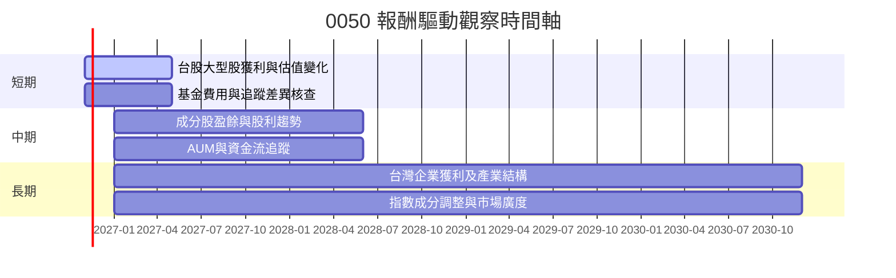

### 9.2 TAM 市場規模分析

0050 並非單一公司，沒有可直接套用的公司 TAM 或營收貢獻。其可投資市場為台灣大型股及其成分公司，市場規模、基金滲透率及0050自身市占資料未提供。

```
╔══════════════════════════════════════════════════════════════╗
║                 0050 可投資市場觀察                          ║
╠══════════════════════════════════════════════════════════════╣
║ 台灣大型股市值：N/A       0050 AUM：N/A                       ║
║ ETF市場滲透率：N/A        成分股權重：N/A                     ║
║ 基金收入貢獻：不適用      基金費用率：N/A                     ║
║ 可追蹤催化劑：成分股獲利、指數調整、股利與資金流              ║
╚══════════════════════════════════════════════════════════════╝
```

### 9.3 成長驅動力結構圖

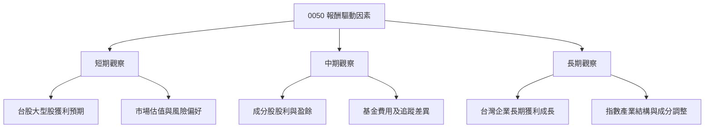

---

## 10. 風險矩陣

### 10.1 風險評分矩陣

機率與衝擊座標屬定性風險分類，不是歷史統計估計。Mermaid 圖中節點名稱依語法要求使用英文。

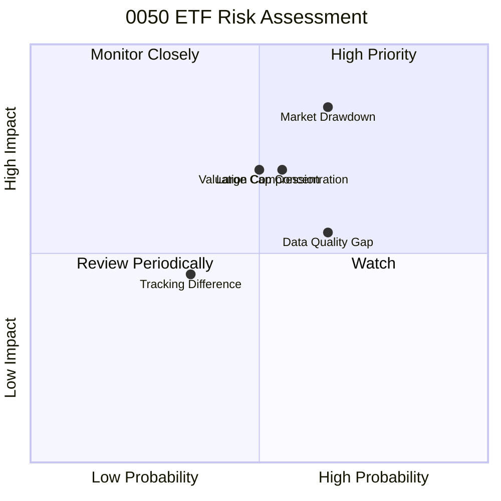

### 10.2 風險清單詳細分析

| # | 風險項目 | 發生機率 | 潛在衝擊 | 風險評分 | 緩解措施 |
|---|----------|----------|----------|----------|----------|
| 1 | 🔴 台股市場回檔 | 中高；定性判斷 | 價格可跌破 52 週低點 58.27 元；跌幅無法可靠預測 | 🔴 8/10 | 分批投入、控制台股總曝險、避免借款買入 |
| 2 | 🔴 大型成分股集中 | 中；持股權重 N/A | 少數權值股下跌可能拖累指數 | 🔴 7/10 | 查核最新前十大持股與產業權重，避免重複集中 |
| 3 | 🔴 估值下修 | 中；Trailing P/E 為 26.802526x | 市場給予較低倍數時，即使盈利穩定，價格也可能回落 | 🔴 7/10 | 以成分股預測本益比、盈餘修正與市場利率交叉檢視 |
| 4 | 🟡 費用與追蹤差異 | 機率 N/A | 長期費用及追蹤落差會侵蝕指數報酬 | 🟡 5/10 | 核實總費用率、追蹤差異及成交價差 |
| 5 | 🟡 配息數據錯誤或口徑不清 | 已存在資料異常 | 報價包列示殖利率 153.0%，可能造成收益判斷錯誤 | 🟡 6/10 | 以基金公告核實每次配息與計算期間，不採用未驗證殖利率 |

---

## 11. 投資建議

### 11.1 最終綜合評級雷達圖

```
╔══════════════════════════════════════════════════════════════╗
║                0050 ETF 綜合評分（1-10）                     ║
╠══════════════════════════════════════════════════════════════╣
║ 產品基本面       6.0 ▓▓▓▓▓▓▓▓▓▓▓▓░░░░░░░░  ★★★☆☆           ║
║ 成長可見度       5.0 ▓▓▓▓▓▓▓▓▓▓░░░░░░░░░░  ★★★☆☆           ║
║ 獲利能力         N/A  ETF 本身不適用公司獲利能力指標          ║
║ 財務健康         N/A  基金資產負債與AUM未提供                 ║
║ 估值可判讀性     3.0 ▓▓▓▓▓▓░░░░░░░░░░░░░░  ★★☆☆☆           ║
║ 基金成本與追蹤   N/A  費用率及追蹤誤差未提供                  ║
║ 綜合評分         5.0 ▓▓▓▓▓▓▓▓▓▓░░░░░░░░░░  🟡 資料受限       ║
╚══════════════════════════════════════════════════════════════╝
```

### 11.2 目標價與隱含報酬率

由於缺乏基金 NAV、持股明細、成分股盈餘預測、費用率及追蹤資料，無法給出基本面目標價、機率加權報酬或 12 個月預期報酬。價格參考區間只能用於觀察，不代表合理價。

| 情境／價格參考 | 價格 | 相對 102.50 元變動 | 性質 |
|------|------:|------------------:|------|
| 52 週低點 | 58.27 元 | -43.2% | 已提供的歷史價格，不是悲觀目標價 |
| 近期歷史觀察位 | 89.95 元 | -12.2% | 2026-04 月收盤；不是基本面支持價 |
| 最新收盤 | 102.50 元 | — | 2026-11-13 |
| 52 週高點 | 116.60 元 | +13.8% | 已提供的歷史價格，不是樂觀目標價 |
| DCF 基準／加權合理價值 | N/A | N/A | 無法計算 |
| 12 個月基準報酬 | N/A | N/A | 無可靠預測輸入 |

### 11.3 買入時機與觸發因素

以下價格是依已提供歷史月收盤與 52 週區間作**技術觀察點**，並非基本面估值或保證支撐位。基本面買入區間仍為 N/A；如要採定期定額，宜依風險承受度分批執行。

```
╔══════════════════════════════════════════════════════════════╗
║                  ✅ 0050 操作觀察 Checklist                   ║
╠══════════════════════════════════════════════════════════════╣
║  增加研究信心的條件：                                          ║
║  ☐ 取得最新持股、前十大權重與產業分布                          ║
║  ☐ 核實總費用率、追蹤差異、成交量與買賣價差                    ║
║  ☐ 核實 NAV、折溢價及配息明細；釐清 153.0% 殖利率異常值         ║
║  ☐ 成分股盈利預期未大幅下修，估值回到可接受區間                ║
║                                                              ║
║  分批投入觀察：                                                ║
║  ☐ 價格回落至 89.95 元附近時，重新檢查基本面與持股              ║
║  ☐ 跌近 52 週低點 58.27 元時，先檢驗是否為市場制度或盈利風險    ║
║  ☐ 價格不是唯一加碼條件；同時核對基金折溢價與成分股展望         ║
║                                                              ║
║  減碼／重新評估條件：                                          ║
║  ☐ 成分股盈利預測連續下修或大型權值股風險升高                  ║
║  ☐ 基金費用、追蹤差異或流動性明顯劣於可比 ETF                  ║
║  ☐ 指數集中度超出投資人預設上限，或台股曝險過度集中             ║
╚══════════════════════════════════════════════════════════════╝
```

### 11.4 投資人適配度分析

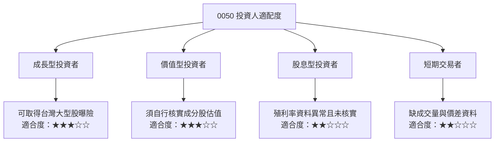

### 11.5 每季監控清單（Quarterly Watch List）

| 監控指標 | 目前數值 | 加碼／正向觀察 | 減碼／負向觀察 |
|----------|----------|----------------|----------------|
| 基金 AUM | N/A | AUM 穩定且流動性充足 | 規模快速流失或流動性轉差 |
| 總費用率 | N/A | 長期費用具競爭力 | 高於同類基金且無追蹤優勢 |
| 追蹤差異／追蹤誤差 | N/A | 持續接近追蹤指數 | 長期落後指數且差異擴大 |
| NAV 折溢價 | N/A | 交易價格接近 NAV | 溢價擴大或折溢價波動異常 |
| 前十大持股權重 | N/A | 集中度符合風險承受度 | 單一產業／成分股集中加劇 |
| 成分股盈餘與財測 | N/A | 盈利預期穩定或上修 | 盈利連續下修、現金流轉弱 |
| 配息金額與殖利率口徑 | 殖利率資料包列示 153.0%，未核實 | 以官方配息公告核實後再評估 | 無法核實或數值口徑不一致 |
| 市場價格與 52 週區間 | 58.27–116.60 元；現價 102.50 元 | 回落時基本面未惡化，分批評估 | 突破區間後伴隨估值與盈利惡化 |

### 11.6 反面論證：什麼會證明論點錯誤（What Would Change My Mind）

```
╔══════════════════════════════════════════════════════════════╗
║              ⚠️ 論點失效條件（Disconfirming Evidence）         ║
╠══════════════════════════════════════════════════════════════╣
║  本報告的中性觀察論點在下列情況成立時應重新檢視：              ║
║  ☐ 最新成分股權重顯示集中度顯著高於投資人可接受上限             ║
║  ☐ 追蹤誤差持續擴大，且同類 ETF 長期追蹤品質更佳               ║
║  ☐ 總費用率高於可比基金，且沒有流動性或追蹤優勢補償             ║
║  ☐ 成分股盈利預測連續兩季下修，且大型權值股獲利轉弱             ║
║  ☐ 官方配息公告無法支持資料包列示的 153.0% 股息殖利率           ║
║  ☐ 市價相對 NAV 出現持續且擴大的溢價或折價                     ║
╚══════════════════════════════════════════════════════════════╝
```

> **免責聲明**：本報告為 AI 自動生成，僅供研究參考，不構成投資建議。投資有風險，入市需謹慎。