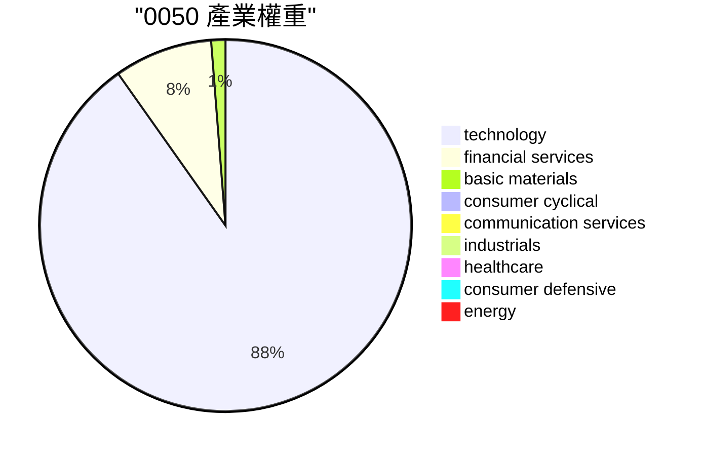

# 0050 ETF 分析報告

> **報告日期**：2026-11-15 ｜ **語言**：繁體中文 ｜ **數據來源**：Yahoo Finance ｜ **類型**：ETF／指數基金

## 目錄

| # | 章節 | 核心結論 |
|---|------|----------|
| 1 | 執行摘要 | 台灣大型股曝險明確，但持股與產業集中度高，較適合作為衛星配置。 |
| 2 | 基金概況 | 基金名稱與持股顯示其投資台灣大型股；指數編製規則未提供。 |
| 3 | 成本與規模 | 費用率為 0.32%，資產規模為 2.44T TWD；同類平均未提供。 |
| 4 | 持股與集中度 | 前十大合計 78.4%，最大持股 56.45%，集中度偏高。 |
| 5 | 產業配置 | 科技業權重 87.5%，投資結果高度受科技產業影響。 |
| 6 | 績效與風險 | 各期間價格報酬有提供；基準報酬與超額報酬未提供。 |
| 7 | 估值與配息 | 投資組合 P/E 為 29.3x、P/B 為 6.7x，配息殖利率為 1.53%。 |
| 8 | 適合對象、風險與觀察重點 | 適合能承受集中度與波動的投資人，並應持續檢視持股及產業曝險。 |

---

## 1. 執行摘要

0050 的基金名稱為 Yuanta/P-shares Taiwan Top 50 ETF，持股資料以台灣上市公司為主；資料未提供可核對的指數編製規則或基準報酬。  
基金淨費用率為 0.32%，同類平均為 N/A；前十大持股合計 78.4%，最大持股為台積電，持股表列權重為 56.45%。  
本基金 1 年、3 年、5 年價格報酬分別為 +59.8%、+236.3%、+188.9%，但相對基準的超額報酬為 N/A（資料未提供）。  
最近一個完整交易日為 2026-11-13，收盤價為 102.50 TWD；年化波動率為 30.1%，歷史最大回撤為 -36.4%，整體較適合作為衛星配置，而非僅憑這些資料視為分散型核心配置。

### 1.1 一頁式摘要

| 項目 | 內容 |
|------|------|
| 追蹤標的／類別 | 基金名稱為 Yuanta/P-shares Taiwan Top 50 ETF；基金類別為 N/A（資料未提供）；追蹤標的或指數編製規則為 N/A（資料未提供） |
| 費用率（同類平均） | 0.32%（同類平均：N/A，資料未提供） |
| 資產規模 | 2.44T TWD |
| 前十大合計權重／最大持股 | 前十大合計 78.4%；最大持股為台積電，持股表列權重 56.45% |
| 1 年／3 年／5 年價格報酬 | +59.8%／+236.3%／+188.9% |
| 相對基準的超額報酬（1 年／3 年／5 年） | N/A（資料未提供）／N/A（資料未提供）／N/A（資料未提供） |
| 年化波動率／最大回撤 | 30.1%／-36.4% |
| 折溢價 | +0.22%（價格高於 NAV） |
| 定位 | **衛星配置**；主要考量為前十大合計 78.4%、最大持股 56.45%，且年化波動率為 30.1% |

### 1.2 五項評分

| 評分項目 | 分數（0–10） | 依據（引用數字） |
|----------|-------------:|------------------|
| 成本 | 7 | 淨費用率為 0.32%；同類平均為 N/A，因此依費用率絕對水準評分，不能據此判定相對同類的成本高低。 |
| 規模與流動性 | 9 | 資產規模為 2.44T TWD，依資產規模評分；成交量與買賣價差資料未提供，並非直接的交易流動性評估。 |
| 分散度 | 2 | 前十大合計 78.4%，最大持股權重為 56.45%；資料標示為 Concentrated，因此分數不高於 5 分。 |
| 相對績效 | 8 | 基準報酬未提供，改依本基金價格報酬評分：1 年 +59.8%、3 年 +236.3%、5 年 +188.9%；不能據此判斷相對基準的表現。 |
| 風險 | 3 | 年化波動率為 30.1%，最大回撤為 -36.4%；兩項風險指標均顯示持有期間可能有明顯波動與跌幅。 |

## 2. 基金概況

| 項目 | 資料 |
|------|------|
| 代號 | 0050 |
| 基金名稱 | Yuanta/P-shares Taiwan Top 50 ETF |
| 基金公司 | Yuanta Securities Inv Trust Co., Ltd |
| 基金類別 | N/A（資料未提供） |
| 基金性質 | ETF／基金 |
| 基金投資市場或主題 | 依基金名稱與已列持股，呈現台灣大型股曝險；更細的指數規則與成分股選取方法為 N/A（資料未提供） |
| 最近完整交易日收盤價 | 102.50 TWD（2026-11-13） |

0050 是基金，不是營運公司；不適用公司損益表、現金流量表、WACC、DCF、安全邊際或 ROIC 分析。  
本報告不以基金市價推算合理價值，也不提供買入或賣出目標價。  
從已列出的持股可以看出，基金曝險集中於台灣大型上市公司，並以科技相關持股為主。  
不過，資料沒有提供完整追蹤指數名稱、指數規則、成分股數量或追蹤誤差，因此不對這些項目作推定。  
在投資組合中，0050 可用來取得台灣大型股市場曝險；是否適合作為核心持有，仍須考量投資人的其他持股、集中度容忍度與風險承受能力。

## 3. 成本與規模

### 3.1 費用、資產規模與週轉率

| 項目 | 數值 | 解讀 |
|------|------:|------|
| 淨費用率 | 0.32% | 同類平均為 N/A（資料未提供），無法比較本基金相對同類基金的費用高低。 |
| 10 年費用試算 | 32,000 TWD | 以 1,000,000 TWD 為例，假設費用率維持目前水準且不計投資報酬；這是不計報酬的簡化試算。 |
| 淨資產 | 2.44T TWD | 可作為基金規模參考；不等同於每日成交量或買賣價差。 |
| 年度持股週轉率 | 3.6% | 描述持股更替程度；單憑週轉率不能推論交易成本或追蹤品質。 |

費用試算資料為：「Fees over 10 years at today's expense ratio, no return assumed (amount × ratio × years): 32,000 TWD」。  
本報告照列該試算，不另行計算；實際費用及投資結果會受基金費用、持有期間與報酬變動影響。  
同類基金平均費用率為 N/A（資料未提供），因此不能宣稱 0.32% 高於或低於同類平均。  
基金資產規模為 2.44T TWD，顯示基金規模大；但成交量、買賣價差與盤中流動性資料均為 N/A（資料未提供）。  
年度持股週轉率為 3.6%，這項數字反映持股週轉資訊，不代表基金交易成本或追蹤誤差。

### 3.2 折溢價

| 項目 | 數值 |
|------|------:|
| 收盤價 | 102.50 TWD（2026-11-13） |
| NAV | 102.28 TWD |
| 價格相對 NAV 折溢價 | +0.22% |

截至 2026-11-13，價格相對 NAV 為 +0.22%，表示收盤價略高於同日資料所列 NAV。  
這是特定日期的折溢價資訊，不代表其他交易日的價格與 NAV 關係；資料未提供更長期間的折溢價序列。

## 4. 持股與集中度

### 4.1 前十大持股

| 排序 | 代號 | 名稱 | 權重 |
|------|------|------|-----:|
| 1 | 2330.TW | Taiwan Semiconductor Manufacturing Co | 56.45% |
| 2 | 2454.TW | MediaTek Inc | 6.74% |
| 3 | 2308.TW | Delta Electronics Inc | 3.40% |
| 4 | 2317.TW | Hon Hai Precision Industry Co Ltd | 2.86% |
| 5 | 3711.TW | ASE Technology Holding Co Ltd | 2.17% |
| 6 | 2303.TW | United Microelectronics Corp | 1.68% |
| 7 | 3037.TW | Unimicron Technology Corp | 1.44% |
| 8 | 2383.TW | Elite Material Co Ltd | 1.34% |
| 9 | 2881.TW | Fubon Financial Holdings Co Ltd | 1.17% |
| 10 | 1303.TW | Nan Ya Plastics Corp | 1.17% |

前十大持股合計占基金資產 78.4%；資料另標示最大持股為 56.4%，而持股表列台積電權重為 56.45%。  
本報告保留資料區塊中的原始精度與表述，不自行重算或調整這些數值。  
最大持股台積電在持股表中的權重為 56.45%，代表基金報酬可能明顯受到單一公司股價影響。  
前十大占比為 78.4%，表示基金資產主要配置於少數已列出的持股。  
因此，投資人持有 0050，不應只把它理解為平均分散到許多台灣公司；其實際報酬也會受到大型成分股的個別表現左右。  
前十大以外的持股明細為 N/A（資料未提供），本報告不列示或推測其他持股。  
資料將基金集中度標示為「Concentrated」，與前十大占比及最大持股權重所呈現的集中風險一致。

## 5. 產業配置

### 5.1 產業權重

| 產業 | 權重 |
|------|-----:|
| technology | 87.5% |
| financial services | 8.3% |
| basic materials | 1.2% |
| consumer cyclical | 0.8% |
| communication services | 0.7% |
| industrials | 0.7% |
| healthcare | 0.4% |
| consumer defensive | 0.3% |
| energy | 0.1% |

### 5.2 配置解讀

technology 權重為 87.5%，是資料列出的最大產業曝險。  
因此，持有 0050 的投資人，除了取得台灣大型股曝險，也承受明顯的科技產業集中風險。  
financial services 權重為 8.3%；其餘所列產業權重各為 1.2% 或以下。  
當科技產業景氣、估值或主要持股表現變動時，基金可能受到較大影響；產業分類的詳細口徑未提供，不另作調整或重分類。

## 6. 績效與風險

### 6.1 各期間價格報酬

| 期間 | 本基金價格報酬 | 基準報酬 | 相對基準超額報酬 |
|------|---------------:|---------:|-----------------:|
| 1 個月 | -9.3% | N/A（資料未提供） | N/A（資料未提供） |
| 3 個月 | -3.9% | N/A（資料未提供） | N/A（資料未提供） |
| 6 個月 | +7.4% | N/A（資料未提供） | N/A（資料未提供） |
| 1 年 | +59.8% | N/A（資料未提供） | N/A（資料未提供） |
| 3 年 | +236.3% | N/A（資料未提供） | N/A（資料未提供） |
| 5 年 | +188.9% | N/A（資料未提供） | N/A（資料未提供） |

上表報酬均為價格報酬，不含配息。  
基準報酬及超額報酬均為 N/A（資料未提供），因此無法判斷基金相對基準的表現，也不據此推測基金追蹤指數的績效。  
區塊另列存檔期間 CAGR 為 19.3%；此數字為存檔歷史期間的資料，不代表未來報酬。  
近期價格歷史顯示逐月收盤價，但本報告不從月資料自行推算其他期間報酬。

### 6.2 波動與回撤

| 風險指標 | 數值 | 解讀 |
|----------|------:|------|
| 年化波動率（1Y） | 30.1% | 描述過去一年價格波動程度；不代表未來波動必然相同。 |
| 最大回撤 | -36.4% | 存檔歷史期間為 10.0 年，谷底日期為 2022-10-25。 |
| 追蹤誤差 | N/A（資料未提供） | 無法由現有資料評估基金相對追蹤指數的偏離程度。 |

在區塊提供的最大回撤情境下，1,000,000 TWD 的帳面減少金額為 363,700 TWD。  
這是依資料區塊所列最大回撤情境的試算，不是對未來損失的預測，也不代表投資人實際持有期間一定會出現相同結果。  
基金回報可能受市場價格波動、持股集中度與產業曝險影響；過去報酬及回撤均不能保證未來表現。

## 7. 估值與配息

| 項目 | 數值 |
|------|------:|
| 投資組合 P/E | 29.3x |
| 投資組合 P/B | 6.7x |
| 配息殖利率 | 1.53% |

P/E 與 P/B 為 Yahoo Finance 報告的加權投資組合數據，反映成分股整體評價，不是基金本身的合理價值。  
這些倍數不能直接轉換為基金目標價，也不構成未來報酬的保證。  
配息殖利率為 1.53%；配息紀錄、配息頻率、配息來源及未來配息金額均為 N/A（資料未提供）。  
報酬表採價格報酬口徑，不含配息，解讀歷史價格報酬時應留意這項口徑差異。

## 8. 適合對象、風險與觀察重點

### 8.1 適合與不適合的投資人

| 投資人類型 | 適合度 | 原因（引用數字） |
|------------|--------|------------------|
| 希望配置台灣大型股的投資人 | 可考慮 | 基金名稱為 Taiwan Top 50 ETF，所列持股包含台灣上市公司；但完整指數規則未提供。 |
| 能承受單一大型持股集中風險的投資人 | 較適合 | 最大持股表列權重為 56.45%，投資人需能承受個別持股對基金的顯著影響。 |
| 可承受較大價格波動的投資人 | 較適合 | 年化波動率為 30.1%，歷史最大回撤為 -36.4%。 |
| 期待高度分散於不同產業的投資人 | 較不適合 | technology 權重為 87.5%，前十大持股合計占 78.4%。 |
| 主要追求穩定配息的投資人 | 資料不足，宜審慎 | 配息殖利率為 1.53%，但配息紀錄、頻率及未來配息資料未提供。 |
| 需要以基準績效比較基金的投資人 | 資料不足，宜審慎 | 基準報酬、相對基準超額報酬與追蹤誤差均為 N/A（資料未提供）。 |

### 8.2 主要風險

| 風險 | 數據依據 | 對投資人的意義 |
|------|----------|----------------|
| 單一持股集中 | 台積電持股表列權重為 56.45%；資料另列最大持股為 56.4%。 | 若最大持股價格大幅波動，基金表現可能受到明顯影響。 |
| 前十大持股集中 | 前十大持股合計為 78.4%。 | 基金資產主要落在少數持股；個別公司風險可能影響整體基金表現。 |
| 科技產業集中 | technology 權重為 87.5%。 | 科技產業景氣、估值或市場風格變化可能對基金造成較大影響。 |
| 市場波動與回撤 | 年化波動率為 30.1%；最大回撤為 -36.4%。 | 投資人可能經歷明顯帳面波動；最大回撤是歷史資料，不代表未來回撤上限。 |
| 匯率與投資人本位幣 | 收盤價以 TWD 報價；持股為台灣公司。基金匯率避險資訊為 N/A（資料未提供）。 | 本位幣不同於 TWD 的投資人，換算回本位幣時可能受到匯率變動影響；避險安排不能由現有資料確認。 |
| 成分股評價變動 | 投資組合 P/E 為 29.3x、P/B 為 6.7x。 | 成分股評價變動可能影響基金價格；這些倍數不等同基金合理價值。 |

### 8.3 什麼情況下要重新評估

| 可查核情況 | 觀察方式 |
|------------|----------|
| 最大持股權重明顯變動 | 定期檢視持股更新，並與目前持股表列的台積電 56.45% 權重比較。 |
| 前十大集中度改變 | 檢視前十大合計權重是否相對目前公布的 78.4% 有明顯變化。 |
| 科技產業曝險改變 | 定期核對 technology 權重是否相對目前公布的 87.5% 有明顯變化。 |
| 費用率調整 | 檢查淨費用率是否仍為 0.32%；若有變動，重新評估持有成本。 |
| 資產規模明顯縮減 | 將最新淨資產規模與目前公布的 2.44T TWD 比較，並留意變化是否持續。 |
| 基準或追蹤資訊公布 | 若取得基準報酬、超額報酬或追蹤誤差資料，再評估相對績效及追蹤品質；目前相關資料為 N/A（資料未提供）。 |
| 波動與回撤風險變化 | 更新年化波動率及歷史最大回撤資料，並重新檢視自身可承受的價格波動。 |

### 8.4 結論定位

**定位：衛星配置。**

主要理由是前十大持股合計為 78.4%，台積電持股表列權重為 56.45%，technology 權重為 87.5%；此外，年化波動率為 30.1%，歷史最大回撤為 -36.4%。  
本定位是依資料所示集中度與風險特徵作出的基金配置觀察，不是買入、賣出或個人化投資建議。

---

> **免責聲明**：本報告為 AI 自動生成，僅供研究與教育參考，不構成投資建議。報酬為價格報酬，未計入配息、稅負與交易成本；投資有風險。

---

## 資料與來源

| 項目 | 內容 |
|------|------|
| 價格 | 102.50 TWD，2026-11-13 收盤（Yahoo Finance 日線） |
| 基金資料 | Yahoo Finance（持股、費用率、規模）；績效與回撤由價格資料庫計算 |
| 有回應的資料來源 | Yahoo Finance |
| 未回應的資料來源 | SEC 申報資料 (XBRL)、Finviz、StockAnalysis、Roic.ai |
| 由程式計算 | 基金的集中度、績效、費用與回撤試算 |
| 撰寫模型 | openai / gpt-6-luna |

> 本區塊由產生報告的程式依實際取得的資料填寫，非模型撰寫。「由程式計算」的數字不是模型的估計；其餘判斷（評分、情境、策略）是模型的分析。
