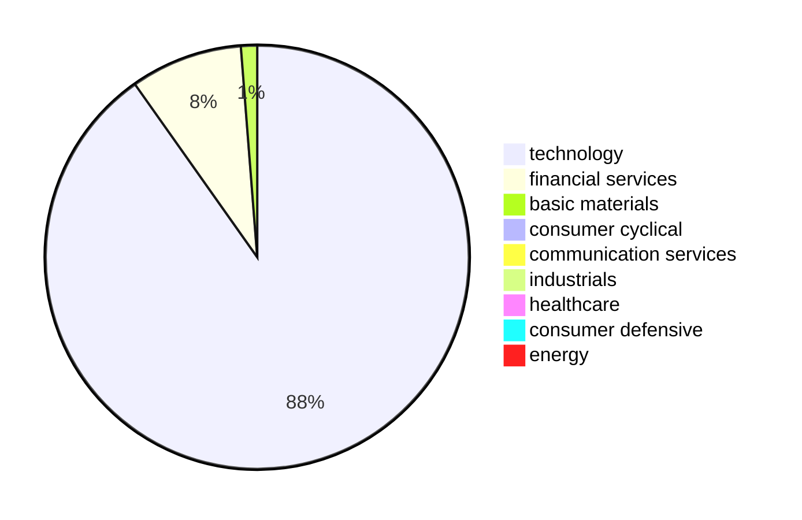

# 0050 ETF 分析報告

> **報告日期**：2026-11-21 ｜ **語言**：繁體中文 ｜ **數據來源**：Yahoo Finance ｜ **類型**：ETF／指數基金

## 目錄

| # | 章節 | 核心結論 |
|---|------|----------|
| 1 | 執行摘要 | 台灣大型股曝險，但持股與產業集中度高，較適合作為衛星配置。 |
| 2 | 基金概況 | 名稱與持股反映台灣大型股取向；追蹤指數及編製規則資料未提供。 |
| 3 | 成本與規模 | 費用率為 0.32%，資產規模為 2.44T TWD；同類平均與交易流動性資料未提供。 |
| 4 | 持股與集中度 | 前十大合計 78.4%，最大持股台積電權重 56.45%。 |
| 5 | 產業配置 | 科技業權重 87.5%，基金表現對科技產業變化較敏感。 |
| 6 | 績效與風險 | 價格報酬期間差異大；1 年年化波動率 31.7%，最大回撤 -36.4%。 |
| 7 | 估值與配息 | 投資組合 P/E 為 29.3x、P/B 為 6.7x，配息殖利率為 1.53%。 |
| 8 | 適合對象、風險與觀察重點 | 可供接受集中度及波動的投資人評估；應持續追蹤持股權重、費用及相對績效。 |

---

## 1. 執行摘要

0050 是 Yuanta/P-shares Taiwan Top 50 ETF，持股資料顯示其主要曝險為台灣大型股，但基金的指數編製規則及正式基準資料為 N/A（資料未提供）。  
淨費用率為 0.32%；前十大持股合計 78.4%，最大單一持股台積電占 56.45%，集中度高。  
1 年、3 年及 5 年價格報酬分別為 +33.3%、+166.1%及 +138.6%；相對基準的超額報酬為 N/A（資料未提供）。  
截至 2026-11-20，收盤價為 84.45 TWD，年化波動率為 31.7%，歷史最大回撤為 -36.4%；本報告定位為「衛星配置」，不是買賣建議。

### 1.1 一頁式摘要

| 項目 | 內容 |
|------|------|
| 追蹤標的／類別 | 名稱為 Yuanta/P-shares Taiwan Top 50 ETF；基金類別及正式追蹤標的資料為 N/A（資料未提供）。持股反映台灣股票曝險。 |
| 費用率（同類平均） | 0.32%；同類平均 N/A（資料未提供）。 |
| 資產規模 | 2.44T TWD。 |
| 前十大合計權重／最大持股 | 78.4%／台積電 56.45%。 |
| 1 年／3 年／5 年價格報酬 | +33.3%／+166.1%／+138.6%；不含配息。 |
| 相對基準的超額報酬（1 年／3 年／5 年） | N/A（資料未提供）；沒有基準報酬可供比較。 |
| 年化波動率／最大回撤 | 31.7%／-36.4%。 |
| 折溢價 | -0.26%，即市價相對 NAV 為折價。 |
| 定位 | **衛星配置**：持股集中，且科技業權重高；適合搭配其他資產分散曝險。 |

### 1.2 五項評分

| 評分項目 | 分數（0–10） | 依據（引用數字） |
|----------|-------------:|------------------|
| 成本 | 7 | 費用率為 0.32%；同類平均 N/A（資料未提供），依費用率絕對水準評分，無法判斷相對同類基金的成本位置。 |
| 規模與流動性 | 9 | 資產規模為 2.44T TWD，依資產規模評分。實際成交量、買賣價差及流動性數據 N/A（資料未提供），本項不代表對交易流動性的量化判斷。 |
| 分散度 | 2 | 前十大合計 78.4%，最大持股為 56.45%；標示為 Concentrated，因此分數不高於 5 分。 |
| 相對績效 | 7 | 基準報酬及超額報酬 N/A（資料未提供）；依絕對價格報酬評分，1 年 +33.3%、3 年 +166.1%、5 年 +138.6%，但報酬不含配息，且不能據此判斷相對基準表現。 |
| 風險 | 3 | 年化波動率為 31.7%，最大回撤為 -36.4%；波動及回撤幅度反映持有人可能面對較大淨值起伏。 |

## 2. 基金概況

| 項目 | 資料 |
|------|------|
| 基金名稱 | Yuanta/P-shares Taiwan Top 50 ETF |
| 代號 | 0050 |
| 基金公司 | Yuanta Securities Inv Trust Co., Ltd |
| 基金類別 | N/A（資料未提供） |
| 追蹤指數及編製規則 | N/A（資料未提供） |
| 基金持有內容 | 台灣股票曝險；前十大持股及產業權重見第 4、5 章。 |
| 基金收益分配方式 | 配息紀錄 N/A（資料未提供）；配息殖利率見第 7 章。 |

0050 的基金名稱指向 Taiwan Top 50；持股清單則列出多家台灣上市公司。這些資訊可用來辨識其市場與大型股取向，但不能據此補寫未提供的指數成分篩選、加權方式或定期審核規則。

若投資人希望在投資組合中加入台灣股票部位，0050 可作為其中一項工具；不過，持股集中度及產業配置意味著它並非等權或跨產業分散的配置。是否作為核心部位，應連同個人原有持股、風險承受度與其他資產配置一併考量。

## 3. 成本與規模

### 3.1 費用與規模資料

| 指標 | 數值 | 解讀 |
|------|------:|------|
| 淨費用率 | 0.32% | 基金日常費用的指標；實際投資成本仍可能受交易及其他費用影響。 |
| 同類基金平均費用率 | N/A（資料未提供） | 無法比較 0050 與同類基金的費用差距。 |
| 資產規模 | 2.44T TWD | 顯示基金資產規模；不等同於每日成交量或買賣價差資料。 |
| 年度持股週轉率 | 3.6% | 反映持股調整情形；不代表基金未來的交易成本。 |
| 折溢價 | -0.26% | 市價相對 NAV 為折價；單一時點數據不代表長期折溢價狀況。 |

### 3.2 費用試算

以下為資料列出的試算，並非投資報酬預測：

| 試算項目 | 金額 | 說明 |
|----------|-----:|------|
| 以 1,000,000 TWD 持有 10 年的費用 | 32,000 TWD | 依目前費用率計算，假設沒有報酬；這是不計報酬的簡化試算。 |

費用率會影響長期持有成本，但僅有 0050 的費用率、沒有同類平均資料，因此無法評斷其相對成本優勢。若費用率調整，長期持有成本也應重新檢視。

資產規模可以協助理解基金的整體規模，但並不能單獨證明投資人下單時一定能以低成本成交。成交量、委託簿深度及買賣價差資料均為 N/A（資料未提供），投資人交易前仍應查看當時市場報價。

## 4. 持股與集中度

### 4.1 前十大持股

| 排名 | 代號 | 名稱 | 權重 |
|-----:|------|------|-----:|
| 1 | 2330.TW | Taiwan Semiconductor Manufacturing Co | 56.45% |
| 2 | 2454.TW | MediaTek Inc | 6.74% |
| 3 | 2308.TW | Delta Electronics Inc | 3.40% |
| 4 | 2317.TW | Hon Hai Precision Industry Co Ltd | 2.86% |
| 5 | 3711.TW | ASE Technology Holding Co Ltd | 2.17% |
| 6 | 2303.TW | United Microelectronics Corp | 1.68% |
| 7 | 3037.TW | Unimicron Technology Corp | 1.44% |
| 8 | 2383.TW | Elite Material Co Ltd | 1.34% |
| 9 | 2881.TW | Fubon Financial Holdings Co Ltd | 1.17% |
| 10 | 1303.TW | Nan Ya Plastics Corp | 1.17% |

### 4.2 集中度解讀

| 指標 | 數值 | 對投資人的意義 |
|------|------:|----------------|
| 前十大持股合計 | 78.4% | 大部分基金資產集中於少數大型持股。 |
| 最大單一持股 | 56.45% | 台積電的股價變動可能對基金表現產生顯著影響。 |
| 集中度標記 | Concentrated | 不應只因持股名稱多，就把基金視為高度分散。 |

台積電一檔持股占 56.45%，而前十大合計占 78.4%。因此，基金報酬會受到少數主要成分股影響；若大型持股走弱，即使其他持股表現不同，基金仍可能承受明顯波動。持股清單以外的公司資料為 N/A（資料未提供），本報告不列出前十大以外的持股。

## 5. 產業配置

### 5.1 產業權重

| 產業 | 權重 |
|------|-----:|
| technology | 87.5% |
| financial services | 8.3% |
| basic materials | 1.2% |
| consumer cyclical | 0.8% |
| communication services | 0.7% |
| industrials | 0.7% |
| healthcare | 0.4% |
| consumer defensive | 0.3% |
| energy | 0.1% |

### 5.2 產業配置圖

technology 權重為 87.5%，是最主要的產業曝險。持有 0050 不只是配置台灣大型股，也代表投資人承受較高的科技業集中風險；當科技業成分股表現與其他產業分歧時，基金可能無法充分由較低權重產業抵銷波動。

## 6. 績效與風險

### 6.1 各期間價格報酬

| 期間 | 0050 價格報酬 | 基準報酬 | 相對基準超額報酬 |
|------|--------------:|----------:|------------------:|
| 1 個月 | -21.9% | N/A（資料未提供） | N/A（資料未提供） |
| 3 個月 | -18.6% | N/A（資料未提供） | N/A（資料未提供） |
| 6 個月 | -13.2% | N/A（資料未提供） | N/A（資料未提供） |
| 1 年 | +33.3% | N/A（資料未提供） | N/A（資料未提供） |
| 3 年 | +166.1% | N/A（資料未提供） | N/A（資料未提供） |
| 5 年 | +138.6% | N/A（資料未提供） | N/A（資料未提供） |
| 儲存歷史期間年化報酬率 | 17.0% | N/A（資料未提供） | N/A（資料未提供） |

以上為價格報酬，不含配息。基準報酬及超額報酬均為 N/A（資料未提供），因此不能據此判斷基金相對於追蹤指數或同類基金的表現。

### 6.2 風險指標

| 指標 | 數值 | 說明 |
|------|------:|------|
| 年化波動率（1 年） | 31.7% | 描述價格波動程度，不代表未來波動必然維持相同水準。 |
| 最大回撤 | -36.4% | 價格資料庫儲存歷史期間的最大回撤；低點日期為 2022-10-25。 |
| 最大回撤期間帳面減少試算 | 363,700 TWD | 以 1,000,000 TWD 投資金額對應最大回撤的資料列示金額。 |

最大回撤試算是歷史回撤情境，不代表每位投資人都會在相同時間進場或承受相同損失，也不代表未來最大回撤會維持在相同幅度。投資人應評估自己是否能承受基金價格下跌期間的帳面波動。

### 6.3 月收盤價紀錄

以下列出價格資料庫提供的月收盤價；本表只呈現紀錄，不另行計算報酬。

| 月份 | 收盤價 |
|------|-------:|
| 2024-11 | 44.94 |
| 2024-12 | 46.98 |
| 2025-01 | 48.98 |
| 2025-02 | 46.84 |
| 2025-03 | 42.03 |
| 2025-04 | 41.02 |
| 2025-05 | 43.74 |
| 2025-06 | 47.07 |
| 2025-07 | 50.53 |
| 2025-08 | 51.46 |
| 2025-09 | 56.65 |
| 2025-10 | 63.46 |
| 2025-11 | 61.11 |
| 2025-12 | 64.30 |
| 2026-01 | 72.16 |
| 2026-02 | 80.66 |
| 2026-03 | 71.91 |
| 2026-04 | 89.95 |
| 2026-05 | 104.76 |
| 2026-06 | 107.15 |
| 2026-07 | 102.85 |
| 2026-08 | 106.25 |
| 2026-09 | 112.05 |
| 2026-10 | 104.95 |
| 2026-11 | 84.45 |

## 7. 估值與配息

| 指標 | 數值 | 解讀 |
|------|------:|------|
| 投資組合 P/E | 29.3x | Yahoo Finance 提供的加權投資組合本益比，反映成分股整體評價指標。 |
| 投資組合 P/B | 6.7x | Yahoo Finance 提供的加權投資組合股價淨值比，反映成分股整體評價指標。 |
| 配息殖利率 | 1.53% | 基金資料列示的配息殖利率；配息紀錄 N/A（資料未提供）。 |

P/E 與 P/B 是成分股加權後的投資組合指標，不是基金本身的合理價值，也不能單獨用來推算基金目標價。配息殖利率亦不代表未來配息金額或殖利率必然維持相同水準。本報告不據此估算合理價值或目標價。

## 8. 適合對象、風險與觀察重點

### 8.1 適合與不適合的投資人

| 投資人類型 | 適合度 | 原因（引用數字） |
|------------|--------|------------------|
| 希望配置台灣大型股、且能接受集中度的投資人 | 有條件適合 | 前十大合計 78.4%，最大持股權重為 56.45%；應理解基金表現可能受少數成分股影響。 |
| 已有其他分散資產、希望增加台灣股票曝險的投資人 | 可評估 | 科技業權重為 87.5%，加入組合後仍需檢視整體產業曝險。 |
| 希望以單一基金取得高度產業分散的投資人 | 較不適合 | 科技業權重為 87.5%，且最大持股占 56.45%。 |
| 無法承受較大價格起伏的投資人 | 較不適合 | 1 年年化波動率為 31.7%，歷史最大回撤為 -36.4%。 |
| 主要依賴穩定配息作為現金流的投資人 | 資料不足以判斷 | 配息殖利率為 1.53%，但配息紀錄及未來配息資料 N/A（資料未提供）。 |

### 8.2 主要風險

| 風險 | 資料依據 | 可能影響 |
|------|----------|----------|
| 單一持股集中 | 台積電權重為 56.45%；前十大合計 78.4%。 | 最大持股或主要持股走弱時，可能對基金價格造成明顯影響。 |
| 產業集中 | technology 權重為 87.5%。 | 科技產業景氣、評價或市場情緒變動，可能對基金表現有較大影響。 |
| 市場波動與回撤 | 1 年年化波動率為 31.7%，最大回撤為 -36.4%。 | 投資人可能面對較大短期波動與帳面減損。 |
| 成分股評價風險 | 投資組合 P/E 為 29.3x，P/B 為 6.7x。 | 成分股評價變化可能影響基金價格；這些倍數本身不能用來判定合理價值。 |
| 匯率與海外營收風險 | 基金報價以 TWD 表示；成分股外幣營收及避險資料 N/A（資料未提供）。 | 無法由現有資料量化匯率或海外營收對基金的影響，應避免將此項風險視為已知或已避險。 |

### 8.3 什麼情況下要重新評估

| 可查核條件 | 重新評估方向 |
|------------|--------------|
| 最大持股權重高於目前資料列示的 56.45%，或前十大合計權重高於目前資料列示的 78.4%。 | 檢視單一公司及前十大持股對整體基金風險的影響，並確認是否仍符合個人分散需求。 |
| 費用率不再是目前的 0.32%。 | 查看基金公告或更新後的基金資料，重新評估持有成本。 |
| 可取得正式基準報酬後，基金在多個相同期間持續落後基準。 | 以相同期間、相同報酬口徑比較；目前基準報酬及超額報酬為 N/A（資料未提供）。 |
| 資產規模相較後續可查得的資料明顯縮減。 | 重新檢視基金規模變化；現有資料只提供 2.44T TWD，沒有過往規模序列可供量化比較。 |
| 波動率或最大回撤顯著高於投資人原先可承受範圍。 | 依個人風險承受度重新檢視持有角色與整體資產配置。 |
| 買賣價差、成交量或市場報價狀況不符合預期。 | 下單前查看即時市場資訊；目前成交量及買賣價差資料為 N/A（資料未提供）。 |

---

> **免責聲明**：本報告為 AI 自動生成，僅供研究與教育參考，不構成投資建議。報酬為價格報酬，未計入配息、稅負與交易成本；投資有風險。

---

## 資料與來源

| 項目 | 內容 |
|------|------|
| 價格 | 84.45 TWD，2026-11-20 收盤（Yahoo Finance 日線） |
| 基金資料 | Yahoo Finance（持股、費用率、規模）；績效與回撤由價格資料庫計算 |
| 有回應的資料來源 | Yahoo Finance |
| 未回應的資料來源 | SEC 申報資料 (XBRL)、Finviz、StockAnalysis、Roic.ai |
| 由程式計算 | 基金的集中度、績效、費用與回撤試算 |
| 撰寫模型 | openai / gpt-6-luna |

> 本區塊由產生報告的程式依實際取得的資料填寫，非模型撰寫。「由程式計算」的數字不是模型的估計；其餘判斷（評分、情境、策略）是模型的分析。
