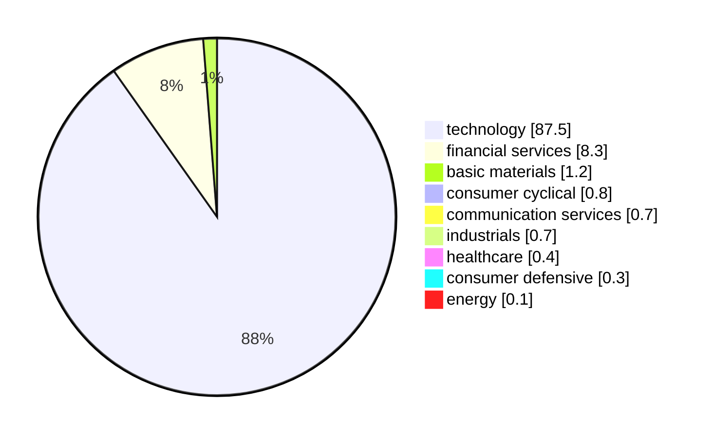

# 0050 ETF 分析報告

> **報告日期**：2026-11-24 ｜ **語言**：繁體中文 ｜ **數據來源**：Yahoo Finance ｜ **類型**：ETF／指數基金

## 目錄

| # | 章節 | 核心結論 |
|---|------|----------|
| 1 | 執行摘要 | 台灣大型股曝險明確，但持股集中，適合作為有意承擔集中風險的配置工具。 |
| 2 | 基金概況 | 名稱與持股顯示以台灣股票為主；實際追蹤指數與編製規則未提供。 |
| 3 | 成本與規模 | 費用率為 0.32%，資產規模為 2.44T TWD；同類平均未提供。 |
| 4 | 持股與集中度 | 前十大持股合計 78.4%，最大持股為台積電，權重 56.45%。 |
| 5 | 產業配置 | 科技業權重為 87.5%，產業曝險集中。 |
| 6 | 績效與風險 | 各期間價格報酬可查；基準報酬、追蹤誤差未提供。 |
| 7 | 估值與配息 | 投資組合 P/E 為 29.3x、P/B 為 6.7x，配息殖利率為 1.53%。 |
| 8 | 適合對象、風險與觀察重點 | 可作為衛星配置；需留意單一持股、產業集中與價格波動。 |

---

## 1. 執行摘要

0050 為元大投信旗下 ETF，名稱為 Yuanta/P-shares Taiwan Top 50 ETF；持股資料顯示其主要曝險為台灣上市公司，但實際追蹤指數名稱與編製規則未提供。  
基金淨費用率為 0.32%，淨資產為 2.44T TWD；費用率同類平均未提供，無法直接比較同類成本。  
前十大持股合計占資產 78.4%，最大單一持股台積電權重為 56.45%，因此基金表現明顯受少數大型持股影響。  
截至 2026-11-23，價格為 87.00 TWD；1 年、3 年、5 年價格報酬分別為 +38.3%、+175.7%、+147.2%，但相對基準的超額報酬為 N/A（資料未提供）。

### 1.1 一頁式摘要

| 項目 | 內容 |
|------|------|
| 追蹤標的／類別 | 名稱為 Yuanta/P-shares Taiwan Top 50 ETF；基金類別為 N/A（資料未提供）；追蹤指數名稱與規則為 N/A（資料未提供）。 |
| 費用率（同類平均） | 0.32%；同類平均為 N/A（資料未提供）。 |
| 資產規模 | 2.44T TWD。 |
| 前十大合計權重／最大持股 | 78.4%／台積電 56.45%。 |
| 1 年／3 年／5 年價格報酬 | +38.3%／+175.7%／+147.2%；價格報酬不含配息。 |
| 相對基準的超額報酬（1 年／3 年／5 年） | N/A（資料未提供）；基準報酬與超額報酬皆無資料。 |
| 年化波動率／最大回撤 | 31.8%／-36.4%。 |
| 折溢價 | +0.50%，為相對 NAV 的溢價。 |
| 定位 | **衛星配置**；主要考量是台積電權重 56.45%、科技業權重 87.5%，且年化波動率為 31.8%。 |

### 1.2 五項評分

| 評分項目 | 分數（0–10） | 依據（引用數字） |
|----------|-------------:|------------------|
| 成本 | 8 | 費用率為 0.32%；同類平均為 N/A（資料未提供），因此依費用率絕對水準評分，不代表相對同類較低。 |
| 規模與流動性 | 10 | 淨資產為 2.44T TWD，資產規模大；成交量與買賣價差資料為 N/A（資料未提供），故分數主要反映資產規模，不等同於對場內流動性的完整評估。 |
| 分散度 | 2 | 前十大持股合計 78.4%，最大持股為台積電 56.45%；資料標示 Concentrated，分數不高於 5。 |
| 相對績效 | 8 | 基準與超額報酬為 N/A（資料未提供）；依絕對價格報酬評分，1 年、3 年、5 年報酬為 +38.3%、+175.7%、+147.2%。 |
| 風險 | 3 | 年化波動率為 31.8%，最大回撤為 -36.4%；波動及回撤幅度顯示持有人需能承受較大的價格起伏。 |

## 2. 基金概況

| 項目 | 資料 |
|------|------|
| 代號 | 0050 |
| 名稱 | Yuanta/P-shares Taiwan Top 50 ETF |
| 基金公司／家族 | Yuanta Securities Inv Trust Co., Ltd |
| 基金類別 | N/A（資料未提供） |
| 國家／地區欄位 | N/A（資料未提供） |
| 追蹤指數名稱 | N/A（資料未提供） |
| 指數編製規則 | N/A（資料未提供） |
| 基金性質 | ETF／指數基金 |
| 年度持股週轉率 | 3.6% |

0050 的基金名稱包含 Taiwan Top 50，且所列持股均為台灣公司代號；據此可將其理解為以台灣股票為主要曝險的 ETF。  
不過，資料未提供正式追蹤指數名稱、指數選股條件或權重調整規則，因此本報告不推定其指數編製細節，也不據此延伸判斷成分股數量。

對一般投資人而言，這類 ETF 可用來取得一籃子台灣股票的市場曝險。  
但從持股權重看，0050 並非平均分散於多檔公司；台積電占比過半，持有時應同時視為對台積電及科技產業的集中配置。

基金持有人的實際結果會受成分股價格、基金費用、基金市價與 NAV 差異等因素影響。  
基金本身不是營運公司，因此不適用公司損益表、現金流量表、WACC、DCF、ROIC 或安全邊際等分析。

## 3. 成本與規模

### 3.1 費用與資產規模

| 指標 | 數值 | 解讀 |
|------|------:|------|
| 淨費用率 | 0.32% | 為基金持續性費用指標；同類平均未提供。 |
| 同類平均費用率 | N/A（資料未提供） | 無法判斷相對同類基金的費用高低。 |
| 淨資產 | 2.44T TWD | 顯示基金資產規模；不直接代表特定交易時點的成交量或買賣價差。 |
| 年度持股週轉率 | 3.6% | 反映持股交易頻率；不代表基金的完整交易成本。 |
| 成交量／買賣價差 | N/A（資料未提供） | 無法據此量化場內流動性與交易成本。 |

### 3.2 費用試算

| 試算項目 | 金額 | 說明 |
|----------|-----:|------|
| 投入金額 | 1,000,000 TWD | 試算基礎金額。 |
| 10 年費用試算 | 32,000 TWD | 依目前費用率、不假設報酬的簡化試算；金額照錄資料。 |

此試算不納入投資報酬、費用率變動、稅負或交易成本，不應視為實際帳戶費用的精確預測。  
同類平均費用率為 N/A（資料未提供），因此不能僅憑費用率判定 0050 相對同類基金較便宜或較昂貴。

### 3.3 折溢價

| 指標 | 數值 | 解讀 |
|------|------:|------|
| 2026-11-23 收盤價 | 87.00 TWD | 價格資料庫的最近完整交易日收盤價。 |
| NAV | 86.57 TWD | Yahoo Finance 提供的基金淨值。 |
| 相對 NAV 折溢價 | +0.50% | 市價相對 NAV 為溢價；此為資料提供值，不代表未來折溢價方向。 |

## 4. 持股與集中度

### 4.1 前十大持股

| 排序 | 代號 | 名稱 | 權重 |
|------|------|------|------:|
| 1 | 2330.TW | Taiwan Semiconductor Manufacturing Co | 56.45% |
| 2 | 2454.TW | MediaTek Inc | 6.74% |
| 3 | 2308.TW | Delta Electronics Inc | 3.40% |
| 4 | 2317.TW | Hon Hai Precision Industry Co Ltd | 2.86% |
| 5 | 3711.TW | ASE Technology Holding Co Ltd | 2.17% |
| 6 | 2303.TW | United Microelectronics Corp | 1.68% |
| 7 | 3037.TW | Unimicron Technology Corp | 1.44% |
| 8 | 2383.TW | Elite Material Co Ltd | 1.34% |
| 9 | 2881.TW | Fubon Financial Holdings Co Ltd | 1.17% |
| 10 | 1303.TW | Nan Ya Plastics Corp | 1.17% |

前十大持股合計占資產 78.4%；最大單一持股台積電權重為 56.45%。  
因此，基金並非僅以少數持股提供名義上的分散：單一公司權重已超過半數，台積電的價格變動對基金整體結果有顯著影響。

第二大持股 MediaTek Inc 權重為 6.74%，與最大持股權重有明顯差距。  
其他前十大持股的權重介於 1.17% 至 3.40%，但資料沒有提供其餘持股明細，本報告不列出前十大以外的公司。

集中度對投資人的實際含義包括：

- 當台積電股價上漲或下跌時，基金淨值及市價可能受到較大影響。
- 前十大持股合計權重高，其他持股對整體走勢的分散效果有限。
- 持有 0050 不宜簡化理解為對台灣所有產業或公司平均分散投資。
- 成分股權重可能隨市場價格或基金調整而變化；未來持股與權重資料未提供，應以最新公開資料重新確認。

## 5. 產業配置

### 5.1 產業權重

| 產業 | 權重 |
|------|------:|
| technology | 87.5% |
| financial services | 8.3% |
| basic materials | 1.2% |
| consumer cyclical | 0.8% |
| communication services | 0.7% |
| industrials | 0.7% |
| healthcare | 0.4% |
| consumer defensive | 0.3% |
| energy | 0.1% |

科技業權重為 87.5%，是最大的產業曝險；金融服務業權重為 8.3%。  
持有這檔基金，主要是在承擔台灣大型股票的市場風險，同時承擔明顯的科技產業曝險。

台積電本身權重為 56.45%，而科技業權重為 87.5%；兩者合併觀察，說明基金集中風險不只來自單一公司，也與產業配置高度集中有關。  
產業分類採用資料提供的標籤；分類方法與產業歸屬規則為 N/A（資料未提供）。

## 6. 績效與風險

### 6.1 各期間價格報酬

| 期間 | 本基金價格報酬 | 基準報酬 | 相對基準超額報酬 |
|------|----------------:|---------:|------------------:|
| 1 個月 | -18.6% | N/A（資料未提供） | N/A（資料未提供） |
| 3 個月 | -16.9% | N/A（資料未提供） | N/A（資料未提供） |
| 6 個月 | -13.7% | N/A（資料未提供） | N/A（資料未提供） |
| 1 年 | +38.3% | N/A（資料未提供） | N/A（資料未提供） |
| 3 年 | +175.7% | N/A（資料未提供） | N/A（資料未提供） |
| 5 年 | +147.2% | N/A（資料未提供） | N/A（資料未提供） |

以上為價格報酬，不含配息；基準報酬與相對基準超額報酬皆為 N/A（資料未提供）。  
因此可以描述基金過去的絕對價格變化，但無法判斷它在相同期間是否跑贏或落後於追蹤基準。

### 6.2 風險指標

| 指標 | 數值 | 解讀 |
|------|------:|------|
| 年化波動率（1Y） | 31.8% | 反映該計算期間內價格波動程度；不代表未來波動必然相同。 |
| 最大回撤 | -36.4% | 儲存歷史期間為 10.0 年；谷底日期為 2022-10-25。 |
| 歷史區間 CAGR | 17.1% | 對應資料庫儲存歷史區間；不代表未來報酬承諾。 |
| 追蹤誤差 | N/A（資料未提供） | 無法量化基金報酬與追蹤指數報酬之間的波動差異。 |

若以 1,000,000 TWD 作為例子，最大回撤對應的帳面減少金額為 363,700 TWD。  
這是依資料提供的最大回撤試算，不是對未來虧損幅度的預測，也不是保本或風險上限。

### 6.3 月末價格資料

以下為價格資料庫提供的月末收盤價。此表照錄歷史價格，不另計算期間報酬。

| 月份 | 收盤價（TWD） |
|------|--------------:|
| 2024-11 | 44.94 |
| 2024-12 | 46.98 |
| 2025-01 | 48.98 |
| 2025-02 | 46.84 |
| 2025-03 | 42.03 |
| 2025-04 | 41.02 |
| 2025-05 | 43.74 |
| 2025-06 | 47.07 |
| 2025-07 | 50.53 |
| 2025-08 | 51.46 |
| 2025-09 | 56.65 |
| 2025-10 | 63.46 |
| 2025-11 | 61.11 |
| 2025-12 | 64.30 |
| 2026-01 | 72.16 |
| 2026-02 | 80.66 |
| 2026-03 | 71.91 |
| 2026-04 | 89.95 |
| 2026-05 | 104.76 |
| 2026-06 | 107.15 |
| 2026-07 | 102.85 |
| 2026-08 | 106.25 |
| 2026-09 | 112.05 |
| 2026-10 | 104.95 |
| 2026-11 | 87.00 |

這組月末價格呈現期間內價格有升有跌，且 2026 年後段出現回落。  
歷史月末價格僅供回顧；不應以單一歷史區間推定未來報酬，也不能替代含配息總報酬資料。

## 7. 估值與配息

| 指標 | 數值 | 說明 |
|------|------:|------|
| 投資組合 P/E | 29.3x | Yahoo Finance 提供的投資組合加權 P/E。 |
| 投資組合 P/B | 6.7x | Yahoo Finance 提供的投資組合加權 P/B。 |
| 配息殖利率 | 1.53% | Yahoo Finance 提供的基金配息殖利率。 |
| 配息紀錄 | N/A（資料未提供） | 無法列出過往配息日期、金額或頻率。 |

P/E 與 P/B 是基金持股所反映的加權評價指標，描述的是投資組合成分股的整體特徵，不是對基金本身的合理價值估算。  
這些倍數不能單獨用來判定基金市價合理或不合理，本報告不據此推算合理價值或目標價。

配息殖利率為 1.53%，但完整配息紀錄與配息政策資料未提供。  
投資人不應只依殖利率判斷實際可領金額或未來配息，亦需注意本報告列示的歷史價格報酬不含配息。

## 8. 適合對象、風險與觀察重點

### 8.1 適合與不適合的投資人

| 投資人類型 | 適合度 | 原因（引用數字） |
|------------|--------|------------------|
| 希望取得台灣大型股票曝險，且可接受集中持股者 | 有條件適合 | 前十大持股合計 78.4%，其中台積電權重 56.45%；需能接受個股對基金表現的影響。 |
| 能承受較大價格波動、採長期配置者 | 有條件適合 | 年化波動率為 31.8%，最大回撤為 -36.4%；過往最大回撤對應的 1,000,000 TWD 帳面減少金額為 363,700 TWD。 |
| 想以單一基金取得跨產業平均分散者 | 較不適合 | 科技業權重為 87.5%，且前十大持股合計占資產 78.4%。 |
| 不希望單一公司主導投資結果者 | 較不適合 | 台積電權重為 56.45%，單一公司曝險超過基金資產的一半。 |
| 以穩定配息作為主要目標者 | 需審慎評估 | 配息殖利率為 1.53%，但完整配息紀錄與配息頻率為 N/A（資料未提供）。 |
| 需要可直接比較基準超額報酬者 | 需補充資料 | 基準報酬、超額報酬與追蹤誤差皆為 N/A（資料未提供）。 |

### 8.2 主要風險

#### 1. 單一公司集中風險

台積電占基金資產 56.45%，前十大持股合計占 78.4%。  
若台積電股價或其所屬產業遭遇不利變化，基金可能受到顯著影響；持有人需評估是否已有其他投資部位造成相同公司曝險。

#### 2. 科技產業集中風險

科技業權重為 87.5%。  
基金價格可能受到科技產業景氣、企業獲利預期與市場風險偏好變化影響；其他產業權重相對有限，不能將其視為產業平均分散配置。

#### 3. 市場波動與回撤風險

年化波動率為 31.8%，歷史最大回撤為 -36.4%。  
過往回撤顯示基金價格可能出現大幅下跌；投資人應確認自身資金用途與風險承受能力，不以短期必須使用的資金承受此類波動。

#### 4. 評價變化風險

投資組合 P/E 為 29.3x、P/B 為 6.7x。  
若市場對成分股的評價改變，即使公司營運沒有同步惡化，基金價格仍可能受到估值收縮影響；資料不足以判定目前評價是否合理。

#### 5. 匯率與外幣曝險資料不足

基金價格以 TWD 表示，但資料未提供基金的外幣曝險明細或避險狀況。  
以非 TWD 作為投資基準的投資人，需自行確認換匯與匯率變動對實際報酬的影響；現有資料無法量化該影響。

#### 6. 基準與追蹤資訊不足

基準報酬、相對基準超額報酬與追蹤誤差均為 N/A（資料未提供）。  
因此，僅依本報告資料不能完整評估基金相對追蹤指數的表現或追蹤品質。

### 8.3 什麼情況下要重新評估

| 可查核條件 | 重新評估的原因 |
|------------|----------------|
| 台積電持股權重相較最新公開持股資料出現明顯變化 | 最大持股目前為 56.45%；權重變動會改變單一公司集中程度。 |
| 前十大持股合計權重或最大單一持股權重出現重大變化 | 目前前十大合計為 78.4%，可用來對照集中度是否改變。 |
| 基金淨費用率調整 | 目前淨費用率為 0.32%；費用變動會影響長期持有成本。 |
| 基金淨資產明顯縮減，或成交量、買賣價差出現不利變化 | 淨資產為 2.44T TWD；成交量與價差目前為 N/A（資料未提供），需另行查核場內流動性。 |
| 基金相對基準在可比期間持續落後 | 目前基準報酬及超額報酬為 N/A（資料未提供）；須先取得一致期間的基準資料再判斷。 |
| 折溢價相對 NAV 出現持續或明顯變化 | 目前折溢價為 +0.50%；可持續追蹤市價與 NAV 的差異。 |
| 投資人的持股組合已高度曝險於台積電或科技業 | 基金台積電權重為 56.45%，科技業權重為 87.5%；需重新檢視整體組合的集中風險。 |
| 投資目標改為以穩定配息或低波動為主 | 配息殖利率為 1.53%，年化波動率為 31.8%；是否符合目標需依投資人實際需求判斷。 |

### 8.4 最終定位

**定位：衛星配置。**

前十大持股合計 78.4%，台積電權重 56.45%，科技業權重 87.5%；年化波動率為 31.8%，最大回撤為 -36.4%。  
這些數字顯示 0050 能提供台灣大型股票曝險，但分散程度有限且價格波動風險不可忽視。對一般投資人而言，將其定位為衛星配置，並定期檢視整體組合的台積電與科技業曝險，較能反映其持股特性。

---

> **免責聲明**：本報告為 AI 自動生成，僅供研究與教育參考，不構成投資建議。報酬為價格報酬，未計入配息、稅負與交易成本；投資有風險。

---

## 資料與來源

| 項目 | 內容 |
|------|------|
| 價格 | 87.00 TWD，2026-11-23 收盤（Yahoo Finance 日線） |
| 基金資料 | Yahoo Finance（持股、費用率、規模）；績效與回撤由價格資料庫計算 |
| 有回應的資料來源 | Yahoo Finance |
| 未回應的資料來源 | SEC 申報資料 (XBRL)、Finviz、StockAnalysis、Roic.ai |
| 由程式計算 | 基金的集中度、績效、費用與回撤試算 |
| 撰寫模型 | openai / gpt-6-luna |

> 本區塊由產生報告的程式依實際取得的資料填寫，非模型撰寫。「由程式計算」的數字不是模型的估計；其餘判斷（評分、情境、策略）是模型的分析。
