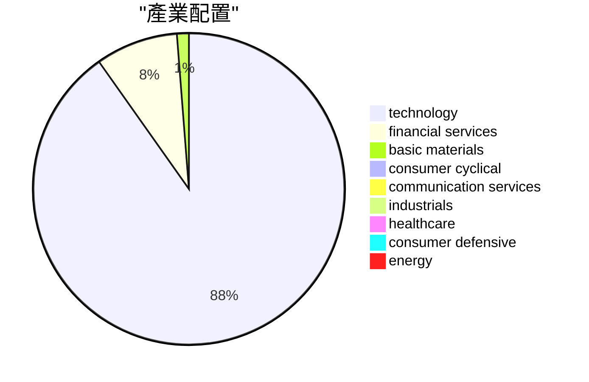

# 0050 ETF 分析報告

> **報告日期**：2026-11-25 ｜ **語言**：繁體中文 ｜ **數據來源**：Yahoo Finance ｜ **類型**：ETF／指數基金

## 目錄

| # | 章節 | 核心結論 |
|---|------|----------|
| 1 | 執行摘要 | 台灣大型股曝險明確，但持股集中且缺少基準比較資料；定位為衛星配置。 |
| 2 | 基金概況 | 以台灣大型股為主要投資方向；實際指數編製規則未提供。 |
| 3 | 成本與規模 | 費用率為 0.32%，淨資產為 2.44T TWD；同類平均未提供。 |
| 4 | 持股與集中度 | 前十大持股合計 78.4%，最大單一持股權重為 56.45%。 |
| 5 | 產業配置 | technology 權重為 87.5%，整體曝險高度偏向科技產業。 |
| 6 | 績效與風險 | 1 年價格報酬為 +51.4%，年化波動率為 33.3%，歷史最大回撤為 -36.4%。 |
| 7 | 估值與配息 | 投資組合 P/E 為 29.3x、P/B 為 6.7x，配息殖利率為 1.53%。 |
| 8 | 適合對象、風險與觀察重點 | 較適合作為可承受集中風險投資人的衛星配置。 |

---

## 1. 執行摘要

0050 是台灣股票 ETF；基金名稱為 Yuanta/P-shares Taiwan Top 50 ETF，前十大持股中台積電占 56.45%，前十大合計占基金資產 78.4%。  
基金淨費用率為 0.32%，淨資產為 2.44T TWD；同類型基金平均費用率未提供，因此無法比較其相對成本。  
截至 2026-11-24，基金 1 年、3 年及 5 年價格報酬分別為 +51.4%、+202.5% 及 +173.3%；基準報酬與相對基準超額報酬均為 N/A（資料未提供）。  
2026-11-24 收盤價為 95.70 TWD；年化波動率為 33.3%，歷史最大回撤為 -36.4%，並且價格相對 NAV 溢價 10.55%。

### 1.1 一頁式摘要

| 項目 | 內容 |
|------|------|
| 追蹤標的／類別 | Yuanta/P-shares Taiwan Top 50 ETF；基金類別為 N/A（資料未提供）。基金名稱及已列持股顯示其主要為台灣股票曝險；實際追蹤指數與編製規則為 N/A（資料未提供）。 |
| 費用率（同類平均） | 淨費用率 0.32%；同類平均 N/A（資料未提供）。 |
| 資產規模 | 2.44T TWD。 |
| 前十大合計權重／最大持股 | 78.4%／56.4%；單一持股清單中台積電權重為 56.45%。 |
| 1 年／3 年／5 年價格報酬 | +51.4%／+202.5%／+173.3%；價格報酬不含配息。 |
| 相對基準的超額報酬（1 年／3 年／5 年） | N/A（資料未提供）；基準報酬與超額報酬均未列示。 |
| 年化波動率／最大回撤 | 33.3%／-36.4%；最大回撤依存檔歷史資料計算，谷底日期為 2022-10-25。 |
| 折溢價 | 相對 NAV 溢價 10.55%；NAV 為 86.57 TWD。 |
| 2026-11-24 收盤價 | 95.70 TWD。 |
| 定位 | **衛星配置**；主要考量是最大單一持股占 56.45%、年化波動率為 33.3%，且價格相對 NAV 溢價 10.55%。 |

### 1.2 五項評分

| 評分項目 | 分數（0–10） | 依據（引用數字） |
|----------|-------------:|------------------|
| 成本 | 7 | 淨費用率為 0.32%，但同類平均為 N/A（資料未提供），故依費用率絕對水準評估，不代表相對同類排名。 |
| 規模與流動性 | 10 | 淨資產為 2.44T TWD，規模指標充足；成交量、買賣價差等直接流動性資料為 N/A（資料未提供）。 |
| 分散度 | 1 | 前十大合計 78.4%，最大持股權重為 56.4%；列示持股中台積電為 56.45%。區塊標示為 Concentrated，因此評分不高於 5 分。 |
| 相對績效 | 8 | 基準報酬與超額報酬為 N/A（資料未提供）；依絕對價格報酬評估，1 年為 +51.4%、3 年為 +202.5%、5 年為 +173.3%，不代表未來績效。 |
| 風險 | 3 | 年化波動率為 33.3%，最大回撤為 -36.4%；兩項數據顯示價格波動與歷史跌幅均需留意。 |

## 2. 基金概況

| 項目 | 資料 |
|------|------|
| 代號 | 0050 |
| 基金名稱 | Yuanta/P-shares Taiwan Top 50 ETF |
| 基金公司／家族 | Yuanta Securities Inv Trust Co., Ltd |
| 基金類別 | N/A（資料未提供） |
| 國家／市場 | 國家欄位為 N/A（資料未提供）；基金名稱與已列持股顯示主要為台灣股票曝險。 |
| 追蹤指數及編製規則 | N/A（資料未提供）。 |
| 年度持股週轉率 | 3.6% |
| 最近完成交易日收盤價 | 2026-11-24 收盤價為 95.70 TWD。 |

0050 是基金而非營運公司，因此本報告不以公司損益表、現金流量、WACC、DCF、安全邊際或 ROIC 評估。  
基金名稱含 Taiwan Top 50，持股清單也列出多檔台灣上市公司；據此可將其理解為台灣大型股投資工具，但實際指數名稱、選股條件、加權方式與調整規則均為 N/A（資料未提供）。  
投資組合常見用途是取得台灣股票市場曝險。由於最大持股與科技產業權重均偏高，配置時宜同時考量投資人既有台股、科技股及單一公司曝險。  
基金成立日期、完整持股數、追蹤誤差、成交量及買賣價差均為 N/A（資料未提供），本報告不以記憶或外部資料補值。

## 3. 成本與規模

| 項目 | 數值 | 解讀 |
|------|------:|------|
| 淨費用率 | 0.32% | 為持有基金的經常性費用指標；同類平均為 N/A（資料未提供），無法判斷相對同業高低。 |
| 同類平均費用率 | N/A（資料未提供） | 不以其他基金數據或記憶補入比較值。 |
| 淨資產 | 2.44T TWD | 顯示基金規模；單一時間點規模不能代表未來規模或流動性。 |
| 年度持股週轉率 | 3.6% | 描述持股變動程度；週轉率本身不等同投資報酬，也不代表實際交易成本。 |
| 折溢價 | 溢價 10.55% | 市價高於 NAV；折溢價可能變動，投資人下單時應確認當時市價與淨值資訊。 |

### 費用試算

| 試算項目 | 區塊提供數值 |
|----------|--------------|
| 投入金額 | 1,000,000 TWD |
| 試算期間 | 10 年 |
| 費用假設 | 以目前費用率計算，不假設投資報酬 |
| 10 年費用試算 | 32,000 TWD |

以上為不計投資報酬的簡化試算，數字依提供的試算結果引用，並非對實際未來費用的保證。實際投資成本還可能受到基金費用率變動、交易成本、稅費與買賣價差影響；相關個別數值為 N/A（資料未提供）。

## 4. 持股與集中度

### 前十大持股

| 排名 | 代號 | 名稱 | 權重 |
|-----:|------|------|-----:|
| 1 | 2330.TW | Taiwan Semiconductor Manufacturing Co | 56.45% |
| 2 | 2454.TW | MediaTek Inc | 6.74% |
| 3 | 2308.TW | Delta Electronics Inc | 3.40% |
| 4 | 2317.TW | Hon Hai Precision Industry Co Ltd | 2.86% |
| 5 | 3711.TW | ASE Technology Holding Co Ltd | 2.17% |
| 6 | 2303.TW | United Microelectronics Corp | 1.68% |
| 7 | 3037.TW | Unimicron Technology Corp | 1.44% |
| 8 | 2383.TW | Elite Material Co Ltd | 1.34% |
| 9 | 2881.TW | Fubon Financial Holdings Co Ltd | 1.17% |
| 10 | 1303.TW | Nan Ya Plastics Corp | 1.17% |

提供的前十大合計權重為 78.4%，最大單一持股權重摘要值為 56.4%；持股明細中的台積電權重為 56.45%。  
這代表基金報酬對少數大型持股的變動相當敏感。即使其他成分股表現不同，台積電的股價波動仍可能對基金整體表現有顯著影響。  
基金其餘持股名單及完整持股數為 N/A（資料未提供），因此不推估前十大以外持股，也不據此估計其餘持股的個別權重。  
集中度較高不等於必然表現較差；它表示基金結果更依賴大型成分股的表現，投資人應確認自己能否接受單一公司與相關產業風險。

## 5. 產業配置

| 產業 | 權重 |
|------|-----:|
| technology | 87.5% |
| financial services | 8.3% |
| basic materials | 1.2% |
| consumer cyclical | 0.8% |
| communication services | 0.7% |
| industrials | 0.7% |
| healthcare | 0.4% |
| consumer defensive | 0.3% |
| energy | 0.1% |

technology 權重為 87.5%，是最大的產業曝險；financial services 權重為 8.3%。  
因此，持有 0050 不只是取得廣泛的台灣股票曝險，也包含明顯的科技產業與大型科技成分股風險。當科技產業或相關大型持股波動時，基金淨值可能受到較大影響。  
各產業分類依提供的基金資料列示；更細分的產業定義及分類方法為 N/A（資料未提供）。

## 6. 績效與風險

### 各期間價格報酬

| 期間 | 本基金價格報酬 | 基準報酬 | 相對基準超額報酬 |
|------|---------------:|---------:|-----------------:|
| 1 個月 | -10.5% | N/A（資料未提供） | N/A（資料未提供） |
| 3 個月 | -7.8% | N/A（資料未提供） | N/A（資料未提供） |
| 6 個月 | -4.4% | N/A（資料未提供） | N/A（資料未提供） |
| 1 年 | +51.4% | N/A（資料未提供） | N/A（資料未提供） |
| 3 年 | +202.5% | N/A（資料未提供） | N/A（資料未提供） |
| 5 年 | +173.3% | N/A（資料未提供） | N/A（資料未提供） |

以上為價格報酬，不含配息。因基準報酬未提供，無法計算或判斷各期間相對基準的超額報酬；本報告不以其他指數報酬替代。  
價格報酬是特定期間的歷史結果，不等同總報酬，也不代表未來績效。配息紀錄與再投入後的總報酬為 N/A（資料未提供）。

### 風險指標

| 指標 | 數值 | 資料範圍／說明 |
|------|------:|----------------|
| 年化波動率 | 33.3% | 1 年年化波動率。 |
| 最大回撤 | -36.4% | 存檔歷史資料期間為 10.0 年；谷底日期為 2022-10-25。 |
| 存檔歷史期間 CAGR | 18.3% | 依存檔歷史期間提供；不代表未來年化報酬。 |
| 追蹤誤差 | N/A（資料未提供） | 不推估或引用其他來源數值。 |

最大回撤情境的提供試算如下：

| 試算項目 | 區塊提供數值 |
|----------|--------------|
| 假設金額 | 1,000,000 TWD |
| 最大回撤情境下帳面減少金額 | 363,700 TWD |

這是依歷史最大回撤對應的帳面減少試算，不代表未來損失上限，也不代表每位投資人實際會遭遇相同結果。

### 24 個月月收盤價

| 月份 | 收盤價（TWD） |
|------|--------------:|
| 2024-11 | 44.94 |
| 2024-12 | 46.98 |
| 2025-01 | 48.98 |
| 2025-02 | 46.84 |
| 2025-03 | 42.03 |
| 2025-04 | 41.02 |
| 2025-05 | 43.74 |
| 2025-06 | 47.07 |
| 2025-07 | 50.53 |
| 2025-08 | 51.46 |
| 2025-09 | 56.65 |
| 2025-10 | 63.46 |
| 2025-11 | 61.11 |
| 2025-12 | 64.30 |
| 2026-01 | 72.16 |
| 2026-02 | 80.66 |
| 2026-03 | 71.91 |
| 2026-04 | 89.95 |
| 2026-05 | 104.76 |
| 2026-06 | 107.15 |
| 2026-07 | 102.85 |
| 2026-08 | 106.25 |
| 2026-09 | 112.05 |
| 2026-10 | 104.95 |
| 2026-11 | 95.70 |

月收盤價資料呈現期間內價格有升有跌；僅憑月收盤價無法判斷完整期間的盤中波動、配息影響或未來走勢。

## 7. 估值與配息

| 項目 | 數值 | 解讀 |
|------|------:|------|
| 投資組合 P/E | 29.3x | Yahoo Finance 提供的加權投資組合倍數。 |
| 投資組合 P/B | 6.7x | Yahoo Finance 提供的加權投資組合倍數。 |
| 配息殖利率 | 1.53% | 基金資料所列殖利率；計算期間及配息紀錄為 N/A（資料未提供）。 |
| NAV | 86.57 TWD | 基金淨值。 |
| 2026-11-24 收盤價 | 95.70 TWD | 最近完成交易日收盤價。 |
| 價格相對 NAV 溢價 | 10.55% | 資料所列市價相對淨值溢價。 |

P/E 與 P/B 是基金所持成分股的加權投資組合指標，反映成分股整體評價，不是基金本身的合理價值。  
配息殖利率不代表固定收益，也不表示未來配息金額或配息頻率有保證；完整配息紀錄為 N/A（資料未提供）。  
本章僅整理所提供的評價與配息指標，不據此推算基金合理價值或目標價。

## 8. 適合對象、風險與觀察重點

### 8.1 適合與不適合的投資人

| 投資人類型 | 適合度 | 原因（引用數字） |
|------------|--------|------------------|
| 想取得台灣大型股曝險，且能接受持股集中者 | 較適合 | 基金名稱為 Taiwan Top 50 ETF，前十大持股合計 78.4%；但指數編製規則為 N/A（資料未提供）。 |
| 已持有台積電或科技股，並希望檢視整體集中曝險者 | 需審慎評估 | 台積電權重為 56.45%，technology 權重為 87.5%，可能與既有持股曝險重疊。 |
| 重視低波動或短期資金穩定者 | 不適合度較高 | 年化波動率為 33.3%，歷史最大回撤為 -36.4%。 |
| 希望透過單一 ETF 取得高度分散曝險者 | 不適合度較高 | 前十大合計 78.4%，最大單一持股權重為 56.45%。 |
| 需要穩定配息現金流者 | 需審慎評估 | 配息殖利率為 1.53%，但完整配息紀錄與配息規則為 N/A（資料未提供）。 |
| 以非 TWD 作為主要生活或投資計價貨幣者 | 需審慎評估 | 基金價格與 NAV 以 TWD 列示；個人實際匯兌影響取決於投資人本位幣及匯率變化。 |

### 8.2 主要風險

| 風險 | 與基金資料的關聯 | 投資人可留意之處 |
|------|------------------|------------------|
| 單一持股集中 | 台積電權重為 56.45%，前十大合計 78.4%。 | 若最大持股價格大幅波動，基金報酬可能受到顯著影響；持倉比例亦可能隨市場變化。 |
| 科技產業集中 | technology 權重為 87.5%。 | 科技產業景氣、估值變化及成分股表現可能主導基金表現；其他產業權重相對較低。 |
| 市場波動與回撤 | 年化波動率為 33.3%，歷史最大回撤為 -36.4%。 | 投資人應評估自身的投資期限與承受帳面虧損的能力。 |
| 評價與折溢價 | 投資組合 P/E 為 29.3x、P/B 為 6.7x；價格相對 NAV 溢價 10.55%。 | 倍數反映成分股評價，溢價亦可能變動；下單前宜確認最新市價與 NAV。 |
| 匯率與計價貨幣 | 基金價格與 NAV 以 TWD 列示；投資人本位幣可能不同。 | 非 TWD 本位投資人的實際投資結果會受到匯率影響；基金持股的外幣營收曝險比例為 N/A（資料未提供）。 |

### 8.3 什麼情況下要重新評估

| 可查核條件 | 重新評估方式 |
|------------|--------------|
| 最大持股權重高於目前列示的 56.45% | 檢視單一持股集中度是否超出自己的風險承受範圍，並確認持股變化是否改變原先配置目的。 |
| 前十大合計權重偏離目前列示的 78.4% | 檢視基金集中度與其他資產配置的重疊情形；是否採取調整行動，應依個人投資政策判斷。 |
| 費用率不再是目前的 0.32% | 查核更新後費用率、適用日期及費用項目；同類平均仍需取得可比較資料，才能判斷相對差異。 |
| 1 年、3 年或 5 年報酬資料更新，且基準報酬可查核 | 以相同期間比較基金與基準；目前基準報酬及超額報酬為 N/A（資料未提供），不宜據此宣稱領先或落後。 |
| 淨資產與目前的 2.44T TWD 相較出現明顯變化 | 查核更新後基金規模與交易流動性資料；目前未提供歷史資產規模序列，無法量化變化幅度。 |
| 折溢價與目前的溢價 10.55% 有明顯差異 | 查核下單時的市價與 NAV，並評估價格偏離淨值對交易成本的影響。 |
| 個人投資目標、資金用途或可承受回撤程度改變 | 重新檢視是否仍能接受年化波動率 33.3%、歷史最大回撤 -36.4%及集中持股風險。 |

> **免責聲明**：本報告為 AI 自動生成，僅供研究與教育參考，不構成投資建議。報酬為價格報酬，未計入配息、稅負與交易成本；投資有風險。

---

## 資料與來源

| 項目 | 內容 |
|------|------|
| 價格 | 95.70 TWD，2026-11-24 收盤（Yahoo Finance 即時報價（該交易日已收盤）） |
| 基金資料 | Yahoo Finance（持股、費用率、規模）；績效與回撤由價格資料庫計算 |
| 有回應的資料來源 | Yahoo Finance |
| 未回應的資料來源 | SEC 申報資料 (XBRL)、Finviz、StockAnalysis、Roic.ai |
| 由程式計算 | 基金的集中度、績效、費用與回撤試算 |
| 撰寫模型 | openai / gpt-6-luna |

> 本區塊由產生報告的程式依實際取得的資料填寫，非模型撰寫。「由程式計算」的數字不是模型的估計；其餘判斷（評分、情境、策略）是模型的分析。
