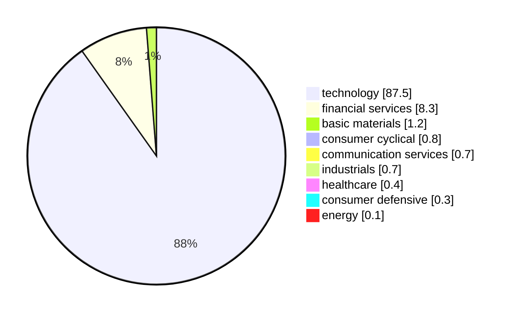

# 0050 ETF 分析報告

> **報告日期**：2026-11-27 ｜ **語言**：繁體中文 ｜ **數據來源**：Yahoo Finance ｜ **類型**：ETF／指數基金

## 目錄

| # | 章節 | 核心結論 |
|---|------|----------|
| 1 | 執行摘要 | 以台灣大型股為主，但持股與產業集中度高，定位為衛星配置。 |
| 2 | 基金概況 | 基金名稱指向台灣前 50 大股票，實際指數規則與類別資料未提供。 |
| 3 | 成本與規模 | 費用率為 0.32%，淨資產為 2.44T TWD；同類平均未提供。 |
| 4 | 持股與集中度 | 前十大合計占資產 78.4%，最大持股為台積電。 |
| 5 | 產業配置 | 科技業占 87.5%，整體曝險高度偏向科技產業。 |
| 6 | 績效與風險 | 多期間價格報酬為正，但年化波動率與最大回撤均顯示價格波動不低。 |
| 7 | 估值與配息 | 投資組合 P/E 為 29.3x、P/B 為 6.7x；配息殖利率為 1.53%。 |
| 8 | 適合對象、風險與觀察重點 | 適合能承受集中與波動風險、並看好台灣大型股的投資人。 |

---

## 1. 執行摘要

0050 的基金名稱為 Yuanta/P-shares Taiwan Top 50 ETF，持股資料顯示其投資重心在台灣股票；基金類別與追蹤指數規則為 N/A（資料未提供）。  
基金淨費用率為 0.32%，淨資產為 2.44T TWD；同類平均費用率為 N/A（資料未提供）。  
前十大持股合計占資產 78.4%，最大持股為台積電；相對基準的報酬與超額報酬均為 N/A（資料未提供）。  
2026-11-26 收盤價為 92.85 TWD；本基金 1 年、3 年、5 年價格報酬分別為 +50.5%、+197.5%、+170.7%，均不含配息。

### 1.1 一頁式摘要

| 項目 | 內容 |
|------|------|
| 追蹤標的／類別 | 基金名稱為 Yuanta/P-shares Taiwan Top 50 ETF；基金類別為 N/A（資料未提供）；指數名稱與編製規則為 N/A（資料未提供）。 |
| 費用率（同類平均） | 0.32%（同類平均：N/A，資料未提供）。 |
| 資產規模 | 2.44T TWD。 |
| 前十大合計權重／最大持股 | 前十大合計 78.4%；最大持股 56.4%（彙總資料所列）。 |
| 1 年／3 年／5 年價格報酬 | +50.5%／+197.5%／+170.7%；價格報酬不含配息。 |
| 相對基準的超額報酬（1 年／3 年／5 年） | N/A／N/A／N/A（資料未提供基準報酬及超額報酬）。 |
| 年化波動率／最大回撤 | 33.9%／-36.4%。 |
| 折溢價 | +2.65%（市價相對 NAV 為溢價）。 |
| 定位 | **衛星配置**；主要考量為前十大持股占比高、科技業權重高，且歷史波動與回撤幅度不低。 |

### 1.2 五項評分

| 評分項目 | 分數（0–10） | 依據（引用數字） |
|----------|-------------:|------------------|
| 成本 | 7 | 費用率為 0.32%；同類平均為 N/A，因此依費用率絕對水準評分，不代表相對同類基金的成本排名。 |
| 規模與流動性 | 10 | 淨資產為 2.44T TWD，依資產規模評分；成交量、買賣價差等直接流動性資料為 N/A（資料未提供）。 |
| 分散度 | 2 | 前十大合計占資產 78.4%，最大持股權重為 56.4%；資料標示為 Concentrated，分數不高於 5。 |
| 相對績效 | 8 | 基準報酬與超額報酬為 N/A，改依絕對價格報酬評分：1 年 +50.5%、3 年 +197.5%、5 年 +170.7%；報酬不含配息，也不代表相對基準表現。 |
| 風險 | 3 | 年化波動率為 33.9%，最大回撤為 -36.4%；波動與回撤幅度顯示投資人須承受較大的價格起伏。 |

## 2. 基金概況

| 項目 | 資料 |
|------|------|
| 代號 | 0050 |
| 基金名稱 | Yuanta/P-shares Taiwan Top 50 ETF |
| 基金公司／家族 | Yuanta Securities Inv Trust Co., Ltd |
| 基金類別 | N/A（資料未提供） |
| 國家／地區欄位 | N/A（資料未提供） |
| 追蹤指數名稱 | N/A（資料未提供） |
| 指數編製與調整規則 | N/A（資料未提供） |
| 成分股數量 | N/A（資料未提供） |
| 追蹤誤差 | N/A（資料未提供） |
| 2026-11-26 收盤價 | 92.85 TWD |
| 近期消息 | 無新聞資料。 |

基金名稱包含 Taiwan Top 50，所列持股亦以台灣公司為主，因此可將它理解為台灣股票型 ETF。  
但資料未提供實際追蹤指數名稱、指數編製規則、成分股數量或追蹤誤差，不宜據此推定基金的納入條件、定期審核方式或追蹤品質。  
依持股結構，基金可在投資組合中扮演台灣大型股曝險工具；不過，持股集中於少數公司與科技產業，並不等同於涵蓋各產業且均衡分散。  
此基金的收盤價、NAV、持股權重及績效資料，應分別依其所列日期與欄位解讀；基金沒有公司個體的損益表或現金流量表。

## 3. 成本與規模

| 指標 | 數值 | 解讀 |
|------|------:|------|
| 淨費用率 | 0.32% | 為基金資料所列費用率；同類平均為 N/A（資料未提供），無法比較其相對同類基金的成本高低。 |
| 同類平均費用率 | N/A | 資料未提供。 |
| 淨資產 | 2.44T TWD | 反映基金資產規模；不等同於成交量或買賣價差。 |
| 年持股週轉率 | 3.6% | 顯示資料所列的年度持股週轉率；不代表投資人個人帳戶的交易頻率。 |
| NAV | 90.45 TWD | 基金資料所列淨值。 |
| 市價相對 NAV 折溢價 | +2.65% | 市價相對 NAV 為溢價；為資料所列數值。 |

### 費用試算

| 試算情境 | 金額 | 說明 |
|----------|------:|------|
| 投入金額 | 1,000,000 TWD | 資料所列試算本金。 |
| 期間 | 10 年 | 資料所列試算期間。 |
| 費用估算 | 32,000 TWD | 依目前費用率、不假設投資報酬的簡化試算；金額照列資料數值。 |

費用試算不包含報酬變化、交易成本、稅負或費用率未來調整，因此不能視為投資人的實際總成本。  
資產規模可以反映基金所管理資產的量體，但本資料沒有成交量、買賣價差或市場深度資訊，不能只憑資產規模判斷實際交易流動性。  
折溢價是市價相對 NAV 的差異；投資人下單時的市價可能與 NAV 不同，資料未提供折溢價的歷史區間。

## 4. 持股與集中度

### 前十大持股

| 排名 | 代號 | 名稱 | 權重 |
|-----:|------|------|-----:|
| 1 | 2330.TW | Taiwan Semiconductor Manufacturing Co | 56.45% |
| 2 | 2454.TW | MediaTek Inc | 6.74% |
| 3 | 2308.TW | Delta Electronics Inc | 3.40% |
| 4 | 2317.TW | Hon Hai Precision Industry Co Ltd | 2.86% |
| 5 | 3711.TW | ASE Technology Holding Co Ltd | 2.17% |
| 6 | 2303.TW | United Microelectronics Corp | 1.68% |
| 7 | 3037.TW | Unimicron Technology Corp | 1.44% |
| 8 | 2383.TW | Elite Material Co Ltd | 1.34% |
| 9 | 2881.TW | Fubon Financial Holdings Co Ltd | 1.17% |
| 10 | 1303.TW | Nan Ya Plastics Corp | 1.17% |

資料所列前十大持股合計占基金資產 78.4%；彙總欄所列最大持股權重為 56.4%。前十大合計與最大持股權重均引用基金資料中的彙總值。  
前十大明細表中，台積電的個別持股權重列為 56.45%；明細與彙總欄的顯示位數不同，兩者均依原資料呈現，未自行調整。  
這種持股結構代表基金整體表現會明顯受少數大型成分股影響。最大持股若有較大漲跌，可能對基金報酬造成較大影響；前十大以外的持股資料未提供，本報告不列示或推測其他持股。  
持股明細的日期與更新頻率未在資料中說明；權重可能隨股價變化及基金持倉調整而改變，閱讀時應留意實際持股公告日期。

## 5. 產業配置

| 產業 | 權重 |
|------|-----:|
| technology | 87.5% |
| financial services | 8.3% |
| basic materials | 1.2% |
| consumer cyclical | 0.8% |
| communication services | 0.7% |
| industrials | 0.7% |
| healthcare | 0.4% |
| consumer defensive | 0.3% |
| energy | 0.1% |

科技業是最大產業曝險，權重為 87.5%；金融服務業權重為 8.3%，其餘所列產業權重較低。  
因此，持有 0050 不只是押注台灣大型股整體表現，也代表承受科技產業及其主要成分股的集中風險。產業權重不能直接等同於個別公司的營收來源或海外市場曝險。  
資料未提供產業分類方法與分類日期；此處僅按基金所列產業權重呈現，不推測分類細節。

## 6. 績效與風險

### 各期間價格報酬

| 期間 | 本基金價格報酬 | 基準報酬 | 超額報酬 |
|------|---------------:|---------:|---------:|
| 1 個月 | -14.5% | N/A（資料未提供） | N/A（資料未提供） |
| 3 個月 | -12.3% | N/A（資料未提供） | N/A（資料未提供） |
| 6 個月 | -7.6% | N/A（資料未提供） | N/A（資料未提供） |
| 1 年 | +50.5% | N/A（資料未提供） | N/A（資料未提供） |
| 3 年 | +197.5% | N/A（資料未提供） | N/A（資料未提供） |
| 5 年 | +170.7% | N/A（資料未提供） | N/A（資料未提供） |

以上報酬為價格報酬，不含配息；資料未提供基準報酬，因此無法判斷各期間相對基準的超額報酬。  
不同期間的價格報酬涵蓋不同市場階段，不宜只以單一期間判斷未來表現。配息、稅負與交易成本均未納入上述價格報酬。

### 波動與回撤

| 風險指標 | 數值 | 資料範圍／說明 |
|----------|------:|----------------|
| 年化波動率 | 33.9% | 1 年。 |
| 最大回撤 | -36.4% | 存檔歷史涵蓋 10.0 年；谷底日期為 2022-10-25。 |
| 存檔期間 CAGR | 17.9% | 依資料所列存檔歷史計算；該欄未另列起訖日期。 |

最大回撤描述歷史區間內從高點至谷底的最大跌幅，不代表未來最大損失上限，也不代表基金會在特定時間內回復原有淨值。  
資料所列 1,000,000 TWD 最大回撤帳面減少金額為 363,700 TWD。此為對應最大回撤的試算值，不是對未來虧損的預測。  
下表列出價格資料庫的月收盤價，供檢視所列歷史區間的價格變化；月收盤價不是基金 NAV，也不含配息。

| 月份 | 收盤價（TWD） |
|------|--------------:|
| 2024-11 | 44.94 |
| 2024-12 | 46.98 |
| 2025-01 | 48.98 |
| 2025-02 | 46.84 |
| 2025-03 | 42.03 |
| 2025-04 | 41.02 |
| 2025-05 | 43.74 |
| 2025-06 | 47.07 |
| 2025-07 | 50.53 |
| 2025-08 | 51.46 |
| 2025-09 | 56.65 |
| 2025-10 | 63.46 |
| 2025-11 | 61.11 |
| 2025-12 | 64.30 |
| 2026-01 | 72.16 |
| 2026-02 | 80.66 |
| 2026-03 | 71.91 |
| 2026-04 | 89.95 |
| 2026-05 | 104.76 |
| 2026-06 | 107.15 |
| 2026-07 | 102.85 |
| 2026-08 | 106.25 |
| 2026-09 | 112.05 |
| 2026-10 | 104.95 |
| 2026-11 | 92.85 |

## 7. 估值與配息

| 指標 | 數值 | 解讀 |
|------|------:|------|
| 投資組合 P/E | 29.3x | Yahoo Finance 所列加權投資組合倍數。 |
| 投資組合 P/B | 6.7x | Yahoo Finance 所列加權投資組合倍數。 |
| 配息殖利率 | 1.53% | Yahoo Finance 所列殖利率。 |
| 配息紀錄 | N/A | 資料未提供。 |
| 配息金額與頻率 | N/A | 資料未提供。 |

P/E 與 P/B 是投資組合成分股的加權倍數，不是基金本身的合理價值，也不能直接用來推導基金目標價。  
配息殖利率為資料所列數值；資料未提供配息紀錄、金額與發放頻率，因此無法評估配息穩定性或推估未來配息。  
基金的收盤價與 NAV 反映不同交易與計價資訊；本報告不將市價視為合理價值，也不據此提出目標價。

## 8. 適合對象、風險與觀察重點

### 8.1 適合與不適合的投資人

| 投資人類型 | 適合度 | 原因（引用數字） |
|------------|--------|------------------|
| 看好台灣大型股、可承受持股集中風險者 | 較適合 | 基金名稱指向 Taiwan Top 50，前十大持股合計為 78.4%，最大持股彙總權重為 56.4%；投資人須能接受少數持股影響整體表現。 |
| 已有多元資產配置、希望增加台股曝險者 | 可考慮作為衛星配置 | 科技業權重為 87.5%，若投資組合其他部位已有不同地區或產業，可用來補充台股曝險；仍須留意基金自身集中度。 |
| 重視廣泛分散、希望單一產業權重均衡者 | 不適合 | 科技業權重為 87.5%，前十大合計占資產 78.4%，與廣泛均衡分散的需求不一致。 |
| 無法承受明顯價格波動者 | 不適合 | 年化波動率為 33.9%，歷史最大回撤為 -36.4%；基金價格可能出現顯著起伏。 |
| 期待配息金額與頻率穩定者 | 資料不足，需審慎 | 配息殖利率為 1.53%，但配息紀錄、金額與頻率均為 N/A（資料未提供）。 |
| 需要依基準追蹤品質挑選基金者 | 資料不足，需審慎 | 基準報酬、超額報酬與追蹤誤差均為 N/A（資料未提供）。 |
| 短期需要資金、不能承受回撤者 | 不適合 | 歷史最大回撤為 -36.4%；歷史資料不代表未來損失上限，但可說明曾出現較大幅度回撤。 |

### 8.2 主要風險

| 風險項目 | 對應資料 | 對投資人的可能影響 |
|----------|----------|----------------------|
| 個股集中風險 | 前十大合計占資產 78.4%；彙總資料所列最大持股權重為 56.4%。 | 少數大型持股的價格變化可能主導基金短期表現，基金報酬未必能平均反映多家公司走勢。 |
| 科技產業集中風險 | 科技業權重為 87.5%。 | 科技產業景氣、評價或市場風險偏好的變化，可能對基金造成較大的影響。 |
| 歷史波動與回撤風險 | 年化波動率為 33.9%；最大回撤為 -36.4%。 | 不適合將歷史報酬視為穩定收益，也不適合忽略可能出現的帳面虧損。 |
| 評價風險 | 投資組合 P/E 為 29.3x，P/B 為 6.7x。 | 成分股整體評價變化可能影響基金價格；資料不足以據此判斷估值是否偏高或合理。 |
| 匯率與海外營運曝險 | 基金收盤價以 TWD 計價；持股幣別與匯率曝險資料為 N/A（資料未提供）。 | 無法依本資料量化匯率對基金報酬的影響；持股公司營運收入的幣別曝險也未提供。 |
| 基準比較與追蹤風險 | 基準報酬、超額報酬與追蹤誤差為 N/A（資料未提供）。 | 無法判斷基金相對於基準的績效，也無法評估追蹤偏離程度。 |
| 折溢價風險 | 市價相對 NAV 的溢價為 +2.65%。 | 買進價格可能高於 NAV；資料未提供歷史折溢價區間，無法判斷目前水準相對過去的位置。 |

### 8.3 什麼情況下要重新評估

| 可查核條件 | 重新評估的理由 |
|------------|----------------|
| 最大持股權重較本報告列示的 56.45% 明顯上升 | 單一持股對基金報酬的影響可能進一步增加，應重新檢視集中度是否符合個人風險承受度。 |
| 前十大持股合計權重較本報告列示的 78.4% 明顯上升 | 代表前十大之外的分散程度可能降低，需重新評估持股集中風險。 |
| 科技業權重較本報告列示的 87.5% 明顯上升 | 基金產業曝險可能更集中，應確認投資組合是否仍符合原先配置目的。 |
| 費用率不再維持本報告列示的 0.32% | 應重新檢查持有成本，並確認費用調整是否影響長期持有考量。 |
| 淨資產較本報告列示的 2.44T TWD 明顯縮減 | 可重新檢視基金規模變化；另應查核成交量與買賣價差，因本報告資料未提供直接流動性指標。 |
| 基金公開新的基準報酬、超額報酬或追蹤誤差資料 | 可補足目前無法進行的相對績效與追蹤品質評估。 |
| 取得更新的持股、產業權重及折溢價資料 | 本報告中的配置與折溢價為特定資料時點的資訊，應以更新資料確認目前狀況。 |
| 個人投資期限、資金需求或風險承受度改變 | 即使基金資料沒有變動，基金的集中度與歷史回撤仍可能不適合新的個人狀況。 |

**結論定位：衛星配置。** 前十大持股合計占資產 78.4%、科技業權重為 87.5%；年化波動率為 33.9%，歷史最大回撤為 -36.4%。這些數字顯示基金具台灣大型股曝險，但集中與波動特性明顯；定位僅為基金研究分類，不是買入或賣出建議。

---

> **免責聲明**：本報告為 AI 自動生成，僅供研究與教育參考，不構成投資建議。報酬為價格報酬，未計入配息、稅負與交易成本；投資有風險。

---

## 資料與來源

| 項目 | 內容 |
|------|------|
| 價格 | 92.85 TWD，2026-11-26 收盤（Yahoo Finance 即時報價（該交易日已收盤）） |
| 基金資料 | Yahoo Finance（持股、費用率、規模）；績效與回撤由價格資料庫計算 |
| 有回應的資料來源 | Yahoo Finance |
| 未回應的資料來源 | SEC 申報資料 (XBRL)、Finviz、StockAnalysis、Roic.ai |
| 由程式計算 | 基金的集中度、績效、費用與回撤試算 |
| 撰寫模型 | openai / gpt-6-luna |

> 本區塊由產生報告的程式依實際取得的資料填寫，非模型撰寫。「由程式計算」的數字不是模型的估計；其餘判斷（評分、情境、策略）是模型的分析。
