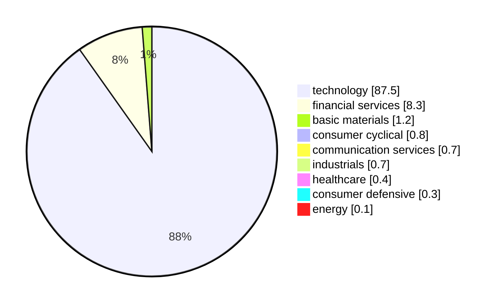

# 0050 ETF 分析報告

> **報告日期**：2026-11-28 ｜ **語言**：繁體中文 ｜ **數據來源**：Yahoo Finance ｜ **類型**：ETF／指數基金

## 目錄

| # | 章節 | 核心結論 |
|---|------|----------|
| 1 | 執行摘要 | 台灣大型股取向，但持股與產業集中，績效需一併考量波動與回撤。 |
| 2 | 基金概況 | 由元大投信管理，名稱與成分股顯示其投資台灣股票；指數編製細節未提供。 |
| 3 | 成本與規模 | 費用率為 0.32%，資產規模為 2.44T TWD；同類平均與交易量資料未提供。 |
| 4 | 持股與集中度 | 前十大持股合計 78.4%，最大持股權重為 56.4%，集中度高。 |
| 5 | 產業配置 | 科技業權重為 87.5%，整體表現高度受科技產業影響。 |
| 6 | 績效與風險 | 1 年價格報酬為 +49.3%，年化波動率為 33.9%，最大回撤為 -36.4%。 |
| 7 | 估值與配息 | 投資組合 P/E 為 29.3x、P/B 為 6.7x，配息殖利率為 1.53%。 |
| 8 | 適合對象、風險與觀察重點 | 適合能承受台灣股票及科技股集中風險的投資人；定位為「衛星配置」。 |

---

## 1. 執行摘要

0050 為台灣股票 ETF，基金名稱為 Yuanta/P-shares Taiwan Top 50 ETF；截至 2026-11-27，價格為 92.40 TWD，追蹤指數及其編製規則資料未提供。  
基金淨費用率為 0.32%，資產規模為 2.44T TWD；前十大持股合計 78.4%，最大持股為 56.4%，持股集中度偏高。  
本基金 1 年、3 年及 5 年價格報酬分別為 +49.3%、+194.7% 及 +167.8%；基準指數報酬與相對基準超額報酬皆為 N/A（資料未提供）。  
年化波動率為 33.9%，最大回撤為 -36.4%；依集中度及波動風險，本文定位為「衛星配置」，並非買賣建議。

### 1.1 一頁式摘要

| 項目 | 內容 |
|------|------|
| 追蹤標的／類別 | Yuanta/P-shares Taiwan Top 50 ETF；台灣股票 ETF。追蹤指數名稱及編製規則：N/A（資料未提供） |
| 費用率（同類平均） | 0.32%；同類平均：N/A（資料未提供） |
| 資產規模 | 2.44T TWD |
| 前十大合計權重／最大持股 | 78.4%／56.4% |
| 1 年／3 年／5 年價格報酬 | +49.3%／+194.7%／+167.8% |
| 相對基準的超額報酬（1 年／3 年／5 年） | N/A（資料未提供）／N/A（資料未提供）／N/A（資料未提供） |
| 年化波動率／最大回撤 | 33.9%／-36.4% |
| 折溢價 | +0.34%（溢價） |
| 定位 | 衛星配置 |

### 1.2 五項評分

| 評分項目 | 分數（0–10） | 依據（引用數字） |
|----------|-------------:|------------------|
| 成本 | 7 | 淨費用率為 0.32%；同類平均為 N/A（資料未提供），因此依費用率絕對水準評分，不代表已證明低於同類。 |
| 規模與流動性 | 9 | 資產規模為 2.44T TWD；評分依資產規模。實際成交量與買賣價差為 N/A（資料未提供），不能單憑資產規模判定交易流動性。 |
| 分散度 | 2 | 前十大持股合計 78.4%，最大持股權重為 56.4%；資料標示為 Concentrated，依規定分數不高於 5 分。 |
| 相對績效 | 7 | 基準與超額報酬為 N/A（資料未提供），依絕對價格報酬評分：1 年 +49.3%、3 年 +194.7%、5 年 +167.8%。 |
| 風險 | 3 | 年化波動率為 33.9%，最大回撤為 -36.4%；波動與回撤均顯示需承受明顯價格起伏。 |

## 2. 基金概況

| 項目 | 資料 |
|------|------|
| 基金名稱 | Yuanta/P-shares Taiwan Top 50 ETF |
| 基金公司 | Yuanta Securities Inv Trust Co., Ltd |
| 類別 | N/A（資料未提供） |
| 基金性質 | ETF／指數基金 |
| 投資市場或主題 | 台灣股票；基金名稱含 Taiwan Top 50，且所列持股為台灣上市公司 |
| 追蹤指數名稱 | N/A（資料未提供） |
| 指數編製規則 | N/A（資料未提供） |
| 成分股數量 | N/A（資料未提供） |

依基金名稱與已列持股，0050 可視為台灣股票市場取向的 ETF。  
但目前沒有提供追蹤指數的完整名稱、選股條件、調整頻率或成分股數量，不能據此補充指數規則細節。  
本基金持有的上市公司包含半導體、電子零組件及金融業公司；產業與持股權重詳見第 4、5 章。

在投資組合中的角色，宜先視為台灣股票曝險工具，而非跨市場或跨產業的完整分散方案。  
其核心特徵是持股集中：最大持股占基金資產 56.4%，科技業占 87.5%。  
因此，投資人持有0050時，實際上需要接受台灣股市、科技產業及最大持股變動對基金報酬的顯著影響。

## 3. 成本與規模

### 3.1 費用與資產規模

| 項目 | 數值 | 解讀 |
|------|------|------|
| 淨費用率 | 0.32% | 基金資料列示的淨費用率。 |
| 同類平均費用率 | N/A（資料未提供） | 無法計算或判斷本基金相對同類平均的費用差距。 |
| 資產規模 | 2.44T TWD | 資產規模提供基金規模資訊；不等同於成交量或買賣價差。 |
| 年度持股週轉率 | 3.6% | 反映資料所列的年度持股週轉率；不能直接替代交易成本或追蹤誤差。 |
| 追蹤誤差 | N/A（資料未提供） | 無法評估基金報酬與追蹤指數報酬間的偏離程度。 |

基金費用試算如下，為依現行費用率、不假設投資報酬的簡化試算：

| 試算情境 | 金額 |
|----------|------:|
| 投入 1,000,000 TWD，按目前費用率持有 10 年，不假設報酬 | 32,000 TWD |

此試算直接引用提供的金額，實際持有成本仍可能受到基金費用變動、投資期間及其他交易成本影響。  
交易量、買賣價差及實際下單成本資料未提供，不能以資產規模代替這些流動性資訊。

### 3.2 市價與淨值折溢價

| 項目 | 數值 |
|------|------:|
| 最近完成交易日收盤價 | 92.40 TWD（2026-11-27） |
| 淨值（NAV） | 92.09 TWD |
| 對淨值折溢價 | +0.34%（溢價） |

目前資料顯示市價相對淨值為溢價。  
折溢價數值僅反映資料所列時點，不能據此推論未來交易時的折溢價，也不代表基金本身的合理價值。

## 4. 持股與集中度

### 4.1 前十大持股

| 排序 | 代號 | 名稱 | 權重 |
|-----:|------|------|-----:|
| 1 | 2330.TW | Taiwan Semiconductor Manufacturing Co | 56.45% |
| 2 | 2454.TW | MediaTek Inc | 6.74% |
| 3 | 2308.TW | Delta Electronics Inc | 3.40% |
| 4 | 2317.TW | Hon Hai Precision Industry Co Ltd | 2.86% |
| 5 | 3711.TW | ASE Technology Holding Co Ltd | 2.17% |
| 6 | 2303.TW | United Microelectronics Corp | 1.68% |
| 7 | 3037.TW | Unimicron Technology Corp | 1.44% |
| 8 | 2383.TW | Elite Material Co Ltd | 1.34% |
| 9 | 2881.TW | Fubon Financial Holdings Co Ltd | 1.17% |
| 10 | 1303.TW | Nan Ya Plastics Corp | 1.17% |

### 4.2 集中度解讀

| 指標 | 數值 | 投資意涵 |
|------|------:|----------|
| 前十大持股合計 | 78.4% | 基金資產有相當比重配置於前十大持股，其他持股合計占比相對有限。 |
| 最大持股權重 | 56.4% | 最大單一持股占基金資產過半，基金表現可能高度受該持股價格影響。 |
| 集中度標記 | Concentrated | 基金資料明確標示為集中型持股配置。 |

最大持股在持股明細中列為 56.45%，集中度摘要列為 56.4%；兩者均依原始呈現方式引用。  
資料中未提供前十大以外的持股，因此本報告不列出或推測其他成分股。  
前十大合計權重與最大持股權重顯示，0050雖持有多檔股票，仍不能視為權重平均分散的台灣市場組合。

## 5. 產業配置

| 產業 | 權重 |
|------|-----:|
| technology | 87.5% |
| financial services | 8.3% |
| basic materials | 1.2% |
| consumer cyclical | 0.8% |
| communication services | 0.7% |
| industrials | 0.7% |
| healthcare | 0.4% |
| consumer defensive | 0.3% |
| energy | 0.1% |

科技業權重為 87.5%，是最主要的產業曝險。  
因此，持有0050不只是押注台灣股票市場，也高度曝險於科技產業的景氣、評價與成分股表現。  
金融服務業權重為 8.3%；其餘列示產業各自占比均較低。  
產業分類的細項定義與分類方法為 N/A（資料未提供）。

## 6. 績效與風險

### 6.1 各期間價格報酬

下表為價格報酬，未包含配息。基準報酬及超額報酬資料均未提供。

| 期間 | 本基金價格報酬 | 基準報酬 | 相對基準超額報酬 |
|------|----------------:|---------:|------------------:|
| 1 個月 | -13.8% | N/A（資料未提供） | N/A（資料未提供） |
| 3 個月 | -12.9% | N/A（資料未提供） | N/A（資料未提供） |
| 6 個月 | -12.3% | N/A（資料未提供） | N/A（資料未提供） |
| 1 年 | +49.3% | N/A（資料未提供） | N/A（資料未提供） |
| 3 年 | +194.7% | N/A（資料未提供） | N/A（資料未提供） |
| 5 年 | +167.8% | N/A（資料未提供） | N/A（資料未提供） |

本基金各期間報酬均為價格報酬，未計入配息。  
由於沒有提供基準報酬，不能判斷本基金在上述期間是否跑贏或落後其追蹤基準。  
追蹤誤差亦為 N/A（資料未提供），不能以基金價格報酬替代追蹤品質分析。

### 6.2 風險指標與歷史資料

| 指標 | 數值 | 說明 |
|------|------:|------|
| 年化波動率（1 年） | 33.9% | 顯示近一年價格變動幅度；數值較高時，投資期間內的價格起伏可能較明顯。 |
| 最大回撤 | -36.4% | 依所列 10.0 年歷史資料；谷底日期為 2022-10-25。 |
| 歷史資料期間 CAGR | 17.8% | 依所列歷史資料計算期間呈現；不代表未來報酬。 |

依最大回撤試算，投入 1,000,000 TWD 時，對應的帳面減少金額為 363,700 TWD。  
這是資料所列最大回撤情境的帳面金額說明，不代表未來最大損失上限，也不是實際投資損失預測。

| 價格資料時間 | 收盤價 |
|--------------|-------:|
| 2024-11 | 44.94 |
| 2024-12 | 46.98 |
| 2025-01 | 48.98 |
| 2025-02 | 46.84 |
| 2025-03 | 42.03 |
| 2025-04 | 41.02 |
| 2025-05 | 43.74 |
| 2025-06 | 47.07 |
| 2025-07 | 50.53 |
| 2025-08 | 51.46 |
| 2025-09 | 56.65 |
| 2025-10 | 63.46 |
| 2025-11 | 61.11 |
| 2025-12 | 64.30 |
| 2026-01 | 72.16 |
| 2026-02 | 80.66 |
| 2026-03 | 71.91 |
| 2026-04 | 89.95 |
| 2026-05 | 104.76 |
| 2026-06 | 107.15 |
| 2026-07 | 102.85 |
| 2026-08 | 106.25 |
| 2026-09 | 112.05 |
| 2026-10 | 104.95 |
| 2026-11 | 92.40 |

以上為所列月收盤價資料，價格走勢呈現期間內有升有跌。  
單憑這段價格序列，不宜推論未來走勢；報酬比較也仍需考慮配息、交易成本與個人持有期間。

## 7. 估值與配息

| 項目 | 數值 | 解讀 |
|------|------:|------|
| 投資組合 P/E | 29.3x | Yahoo Finance 所列加權投資組合本益比。 |
| 投資組合 P/B | 6.7x | Yahoo Finance 所列加權投資組合股價淨值比。 |
| 配息殖利率 | 1.53% | 基金資料所列殖利率；不代表未來配息水準。 |
| 配息紀錄 | N/A（資料未提供） | 未提供歷次配息金額、日期或頻率。 |

P/E 與 P/B 是基金持有成分股的整體加權評價指標，不是基金本身的合理價值。  
這些倍數會隨成分股價格與基本面變動，不能單獨用來推導基金合理價值或目標價。  
配息殖利率為資料所列數值，配息紀錄與未來配息金額均為 N/A（資料未提供）。  
本報告不以配息殖利率推估未來現金收入。

## 8. 適合對象、風險與觀察重點

### 8.1 適合與不適合的投資人

| 投資人類型 | 適合度 | 原因（引用數字） |
|------------|--------|------------------|
| 可接受台灣股票集中曝險、並能承受明顯價格波動的投資人 | 較適合 | 科技業權重為 87.5%，年化波動率為 33.9%，最大回撤為 -36.4%；應能承受相應波動。 |
| 希望以台灣股票 ETF 作為投資組合其中一項配置的投資人 | 可考慮 | 資產規模為 2.44T TWD；但前十大持股合計 78.4%，須一併評估集中風險。 |
| 需要高度分散於多國或多產業的投資人 | 不宜單獨依賴本基金 | 科技業權重為 87.5%，最大持股權重為 56.4%；這些數字顯示基金集中於特定產業及單一持股。 |
| 不能接受明顯帳面回撤的投資人 | 不適合 | 歷史最大回撤為 -36.4%；投入 1,000,000 TWD 的對應帳面減少金額為 363,700 TWD。 |
| 以穩定配息作為主要需求的投資人 | 資料不足以判定 | 配息殖利率為 1.53%，但配息紀錄、頻率與金額為 N/A（資料未提供）。 |
| 需要依基準比較追蹤表現的投資人 | 資料不足以判定 | 基準報酬、超額報酬及追蹤誤差均為 N/A（資料未提供）。 |

### 8.2 主要風險

| 風險 | 對應資料 | 對投資人的可能影響 |
|------|----------|--------------------|
| 單一持股集中風險 | 最大持股權重為 56.4%；持股明細列示 2330.TW 權重為 56.45%。 | 最大持股若大幅波動，可能對基金整體報酬造成顯著影響。 |
| 前十大持股集中風險 | 前十大持股合計 78.4%。 | 基金表現可能較容易受少數大型成分股影響，與持股權重平均的組合不同。 |
| 產業集中風險 | 科技業權重為 87.5%。 | 科技產業景氣、評價變化或產業事件可能對基金報酬產生較大影響。 |
| 市場波動與回撤風險 | 年化波動率為 33.9%；最大回撤為 -36.4%。 | 投資人可能經歷明顯價格起伏及帳面損失；歷史回撤不等於未來損失上限。 |
| 評價變動風險 | 投資組合 P/E 為 29.3x、P/B 為 6.7x。 | 成分股評價變化可能影響基金價格；這些倍數本身不能判斷未來報酬方向。 |
| 匯率與海外營運影響 | 基金所列持股為台灣公司；各公司海外營收、外幣資產及匯率敏感度資料為 N/A（資料未提供）。 | 無法依現有資料量化直接或間接匯率影響；台灣公司營運受外幣因素影響的程度亦未提供。 |
| 配息與總報酬理解風險 | 價格報酬不含配息；配息殖利率為 1.53%。 | 僅看價格報酬可能與含配息總報酬不同；配息紀錄未提供，不能完整還原歷史總報酬。 |

### 8.3 什麼情況下要重新評估

| 可查核條件 | 重新評估的理由 |
|------------|----------------|
| 最大持股權重高於目前持股明細列示的 56.45%，或集中度持續加深 | 單一持股目前已占基金資產過半，權重上升會增加單一公司風險。 |
| 前十大持股合計權重高於目前列示的 78.4% | 前十大集中程度上升，可能使基金報酬更依賴少數成分股。 |
| 科技業權重高於目前列示的 87.5%，或其他產業配置出現重大變化 | 產業風險與投資人原先預期的曝險可能不同。 |
| 淨費用率相較目前的 0.32% 有調整 | 費用變化會改變持有成本；同類平均目前為 N/A（資料未提供），屆時仍需另行比較。 |
| 資產規模相較目前的 2.44T TWD 明顯縮減 | 基金規模變化值得追蹤；實際成交量及買賣價差仍須另行查核。 |
| 可取得基準報酬、超額報酬或追蹤誤差資料後 | 目前相關資料為 N/A（資料未提供），補足後才能評估相對績效與追蹤品質。 |
| 年化波動率或最大回撤相較目前的 33.9% 與 -36.4% 出現明顯變化 | 風險特徵可能改變，投資人應重新檢視自身承受度。 |
| 配息政策或配息紀錄有更新 | 目前配息紀錄為 N/A（資料未提供），以配息為需求的投資人應確認最新資訊。 |

---

> **免責聲明**：本報告為 AI 自動生成，僅供研究與教育參考，不構成投資建議。報酬為價格報酬，未計入配息、稅負與交易成本；投資有風險。

---

## 資料與來源

| 項目 | 內容 |
|------|------|
| 價格 | 92.40 TWD，2026-11-27 收盤（Yahoo Finance 即時報價（該交易日已收盤）） |
| 基金資料 | Yahoo Finance（持股、費用率、規模）；績效與回撤由價格資料庫計算 |
| 有回應的資料來源 | Yahoo Finance |
| 未回應的資料來源 | SEC 申報資料 (XBRL)、Finviz、StockAnalysis、Roic.ai |
| 由程式計算 | 基金的集中度、績效、費用與回撤試算 |
| 撰寫模型 | openai / gpt-6-luna |

> 本區塊由產生報告的程式依實際取得的資料填寫，非模型撰寫。「由程式計算」的數字不是模型的估計；其餘判斷（評分、情境、策略）是模型的分析。
