# 2330.TW 基本面深度分析報告
> **報告日期**：2026-11-13 ｜ **語言**：繁體中文 ｜ **數據來源**：Yahoo Finance、Roic.ai ｜ **分析師**：CFA 級機構研究

> **口徑與資料品質提示**：本報告價格一律採用 **2026-11-13 收盤價 2,350.00 TWD**。財報幣別與報價均為 TWD；財務資料包未提供匯率，故不轉換幣別。若資料包未提供歷史值或同業數據，標示 N/A，不以推算值冒充已披露資料。部分資料彼此存在口徑差異或疑似資料錯誤，已在相應章節註明。DCF 中缺漏的輸入均明確標為假設值。

## 目錄

| # | 章節 | 核心結論 |
|---|------|----------|
| 1 | 執行摘要 | 🟠減碼；加權合理價值 2,060.89 TWD，MOS −14.0% |
| 2 | 公司概覽與商業模式 | 晶圓代工的技術、規模與客戶轉換成本構成主要護城河 |
| 3 | 損益表深度分析 | TTM 營收 4.94T TWD；最新單季 YoY +50.9%，營業利益率 58.0% |
| 4 | 資產負債表分析 | 淨現金 3.20T TWD，流動性充足；不同資料欄位有口徑差異 |
| 5 | 現金流量深度分析 | TTM FCF 1.46T TWD，FCF Yield 2.40%；資本支出高 |
| 6 | 獲利能力與資本效率 | ROIC 估算約 44.2%，高於 WACC 11.19%；估算受資本口徑限制 |
| 7 | 相對估值分析 | 同業倍數差異大；歷史估值百分位未提供 |
| 8 | DCF 內在價值評估 | 基準 DCF 約 1,522 TWD；加權合理值約 2,061 TWD，均低於現價 |
| 9 | 成長催化劑 | 先進製程、AI/HPC 與先進封裝是主要質化催化劑；分部營收資料 N/A |
| 10 | 風險矩陣 | 地緣政治、資本密集與估值回落為主要風險 |
| 11 | 投資建議 | 🟠減碼；合理價值以下才改善風險報酬，須監控毛利率與資本回報 |

---

## 1. 執行摘要

### 1.0 一頁式投資儀表板（Portfolio Manager 30 秒速讀）

| 項目 | 內容 |
|------|------|
| **投資論點（3 句）** | ① TTM 營收 **4.94T TWD**，最新單季營收 YoY **+50.9%**，顯示當前需求增長快。② TTM 營業利益率 **58.0%**、淨利率 **51.1%**，高利潤率支持內部再投資。③ TTM FCF **1.46T TWD**，但 FCF Yield 僅 **2.40%**，價格已反映相當高的未來成長。 |
| **護城河評分** | **8.5/10**：製程能力、資本規模、客戶驗證週期與供應鏈協作形成高轉換成本；缺乏公司市占與分部資料，評分不視為精確市占判斷。 |
| **管理層/資本配置評分** | **7.0/10**：研發支出 2025 年 246.43B TWD；資本支出高、營運現金流仍能覆蓋投資，惟未提供完整專案回報資料。 |
| **財務健康** | 🟢 淨現金 **3.20T TWD**；現金及短期投資 **4.02T**，總債務 **818.38B TWD**。 |
| **ROIC vs WACC** | ROIC **估算 44.2%** vs WACC **11.19%**；估算值高於資金成本，代表有創造價值，但 ROIC 不是資料包直接提供的 TTM 指標。 |
| **FCF 趨勢** | 2022–2025 年 FCF 依序為 **520.97B、286.57B、861.20B、992.38B TWD**；TTM FCF Yield **2.40%**。 |
| **估值** | Forward P/E **15.715445x** ｜ EV/EBITDA **15.989x** ｜ FCF Yield **2.40%**。 |
| **DCF 內在價值（基準）** | **約 1,522 TWD**；現價相對 DCF 溢價 **約 54.4%**（折溢價＝現價÷DCF價值−1）。 |
| **安全邊際（MOS）** | **−14.0%＝(2,060.89−2,350)÷2,060.89**；以 8.8 加權合理價值為分母，屬負安全邊際。 |
| **預期報酬（基準情境 12M）** | 相對基準情境目標價 **2,692 TWD**，上行空間約 **+14.6%**；該目標依 Forward EPS 與假設退出倍數計算，非保證報酬。 |
| **關鍵風險（前二）** | 地緣政治與供應鏈中斷；高資本支出和估值對長期成長／WACC 敏感。 |
| **評級 + 信心度** | **🟠減碼** ｜ 信心：中低。MOS 依門檻落在 −25% 至 −10%；資料包缺少同業歷史估值區間、季度 EPS 預期與細分業務資料。 |

### 1.1 核心評分儀表板

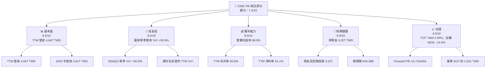

### 1.2 評分進度條視覺化

```
╔══════════════════════════════════════════════════════════════╗
║                2330.TW 多維度評分儀表板 (1-10分)             ║
╠══════════════════════════════════════════════════════════════╣
║ 基本面強度  8.5 ▓▓▓▓▓▓▓▓▓▓▓▓▓▓▓▓▓░░░  ★★★★☆             ║
║ 成長動能    8.5 ▓▓▓▓▓▓▓▓▓▓▓▓▓▓▓▓▓░░░  ★★★★☆             ║
║ 獲利品質    8.0 ▓▓▓▓▓▓▓▓▓▓▓▓▓▓▓▓░░░░  ★★★★☆             ║
║ 財務健康    9.0 ▓▓▓▓▓▓▓▓▓▓▓▓▓▓▓▓▓▓░░  ★★★★★             ║
║ 估值合理性  4.0 ▓▓▓▓▓▓▓▓░░░░░░░░░░░░  ★★☆☆☆             ║
║ 護城河深度  8.5 ▓▓▓▓▓▓▓▓▓▓▓▓▓▓▓▓▓░░░  ★★★★☆             ║
║ 管理層執行  7.0 ▓▓▓▓▓▓▓▓▓▓▓▓▓▓░░░░░░  ★★★☆☆             ║
║ 技術創新力  9.0 ▓▓▓▓▓▓▓▓▓▓▓▓▓▓▓▓▓▓░░  ★★★★★             ║
╠══════════════════════════════════════════════════════════════╣
║ 綜合總分    7.4 ▓▓▓▓▓▓▓▓▓▓▓▓▓▓▓░░░░░  🟡 質優但估值偏高  ║
╚══════════════════════════════════════════════════════════════╝
```

評分是研究判斷，不等同可直接驗證的會計指標。估值維度偏低，是因現價 2,350 TWD 高於 DCF 基準價及加權合理價值；其他維度受益於營收、利潤率及淨現金資料。

### 1.3 五大投資論點 + 三大核心風險

| 類型 | 項目 | 具體依據 | 信心度 |
|------|------|----------|--------|
| 🟢 **投資論點①** | 需求增長 | 2026Q3 單季營收 **1.49T TWD**；資料包列示最新單季 YoY **+50.9%**，對應 AI/HPC 與先進製程需求的可能拉動，但分部貢獻未提供。 | 🟢 高 |
| 🟢 **投資論點②** | 高營運槓桿 | TTM 營業利益率 **58.0%**、毛利率 **65.8%**；高利用率與產品組合改善可放大利潤，但週期下行會反向放大。 | 🟢 高 |
| 🟢 **投資論點③** | 資產負債表穩健 | 現金及短期投資 **4.02T**、總債務 **818.38B**、淨現金 **3.20T TWD**。 | 🟢 高 |
| 🟢 **投資論點④** | 現金創造能力 | TTM 營業現金流 **3.13T**、資本支出 **1.66T**、資料包 TTM FCF **1.46T TWD**。 | 🟢 中高 |
| 🟢 **投資論點⑤** | 技術與客戶鎖定 | 產業需長期製程研發、設備投資與客戶認證；公司 2025 年研發費用 **246.43B TWD**。 | 🟢 中高 |
| 🟡 **風險①** | 估值與預期落差 | 現價相對基準 DCF 約溢價 **54.4%**；若成長或毛利率低於市場預期，估值可能收縮。 | 🟡 中 |
| 🔴 **風險②** | 地緣政治與營運集中 | 主要製造資產集中於台灣；突發事件會衝擊產能、供應鏈與交付。資料包未提供可量化保險／備援覆蓋。 | 🔴 高 |
| 🟡 **風險③** | 資本支出循環 | TTM Capex **1.66T TWD**，約為 TTM 營收的 **33.6%**；若需求轉弱或新廠爬坡延遲，短期 FCF 可能承壓。 | 🟡 中高 |

### 1.4 快速統計卡片

同業／S&P 500 平均值未包含在資料包，為避免冒充即時數據，標為 N/A。

| 指標 | 公司實際值 | 行業均值 | S&P 500 均值 | 狀態 |
|------|-------------|----------|--------------|------|
| 收入 YoY 成長 | **最新單季 +50.9%**；TTM YoY N/A | N/A | N/A | 🟢 |
| 毛利率 | **TTM 65.8%** | N/A | N/A | 🟢 |
| 淨利率 | **TTM 51.1%** | N/A | N/A | 🟢 |
| ROE | **TTM 41.9%** | N/A | N/A | 🟢 |
| Forward P/E | **15.715445x** | N/A | N/A | 🟡 |
| FCF Yield | **2.40%** | N/A | N/A | 🟡 |
| 淨現金 | **3.20T TWD** | N/A | N/A | 🟢 |

### 1.5 投資結論

```
╔══════════════════════════════════════════════════════════════════╗
║                    📊 投資結論摘要                               ║
╠══════════════════════════════════════════════════════════════════╣
║  評級：🟠 減碼（MOS 門檻判定；未作質化上調或下調）               ║
║  價格（2026-11-13 收盤）：2,350.00 TWD                          ║
║  DCF 內在價值（基準）：約 1,522 TWD（溢價約 54.4%）             ║
║  加權合理價值：2,060.89 TWD                                     ║
║  安全邊際 MOS：−14.0%＝(2,060.89−2,350)÷2,060.89               ║
║  目標價區間（12 個月情境估算）：                                 ║
║    悲觀情境：1,944 TWD（−17.3%）                                ║
║    基準情境：2,692 TWD（+14.6%）                                ║
║    樂觀情境：3,738 TWD（+59.1%）                                ║
║  投資評分：7.4/10                                                ║
║  適合投資人：能承受半導體週期與地緣政治風險的長線成長投資人     ║
╚══════════════════════════════════════════════════════════════════╝
```

**評級規則套用**：MOS = −14.0%，落在 −25% 至 −10% 區間，依規則評為「減碼」。基準情境目標價與 DCF、相對估值方法並非同一模型的輸出；應分別理解，不應將單一目標價視為確定預測。

---

## 2. 公司概覽與商業模式

### 2.1 業務結構與收入來源

公司提供晶圓製造、封裝、測試與相關半導體服務。財務資料包沒有各製程、平台或服務的收入拆分，因此不臆測各板塊佔比。以下以可確認的總營收作為頂層，子板塊金額標示 N/A。

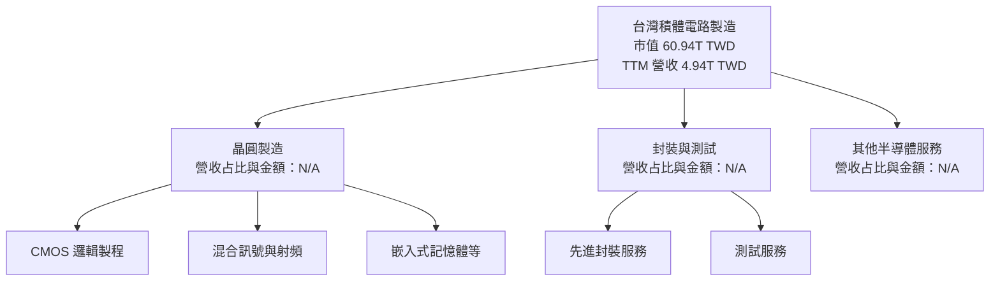

**商業模式含義**：代工廠將龐大固定成本投入廠房、設備、製程研發與人才；當產能利用率和先進製程產品組合改善時，收入增長可推升毛利及營業利益。反之，景氣下行、客戶庫存調整與新廠折舊會壓縮利潤率。資料包 TTM Capex **1.66T TWD**，印證此模式資本密集。

### 2.2 市場份額

資料包沒有全球晶圓代工市場規模、市占率或同一口徑市場份額。以下圖表僅表達資料缺口，不代表市占率估算：

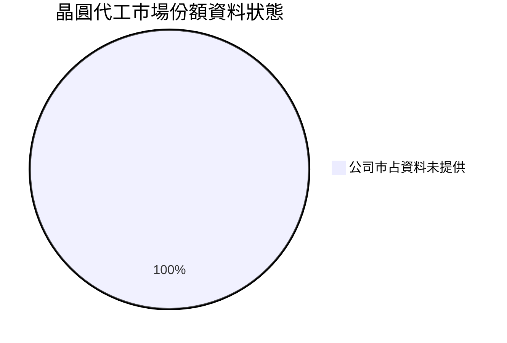

**判讀**：不以未提供的市占數字製作競爭結論。可確認的相對優勢是 TTM 毛利率 **65.8%**，明顯高於資料包所列 UMC **31.7%**、GFS **28.5%**、INTC **40.2%**；但公司業務組合與會計口徑可能不同，不能直接等同市占。

### 2.3 競爭護城河分析

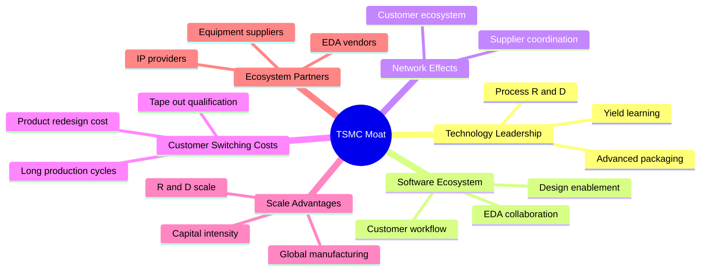

### 2.4 護城河強度評分

| 護城河項目 | 評分 | 依據 |
|------------|------|------|
| 技術與製程累積 | 9/10 | 2025 年研發費用 **246.43B TWD**；但具體節點良率與市占未提供。 |
| 客戶轉換成本 | 9/10 | 半導體產品需重新設計、驗證與量產爬坡，轉換涉及時間與工程成本；資料包未提供客戶流失率。 |
| 規模效應 | 9/10 | 2025 年營收 **3.81T TWD**、Capex **1.28T TWD**，具備大規模投入能力。 |
| 軟體／設計生態 | 7/10 | 產業上需要 EDA、IP 與製程設計協同；量化生態收入未提供。 |
| 網路效應 | 6/10 | 客戶與供應商協同有累積效應，但不等同典型雙邊平台網路效應。 |
| 供應鏈夥伴 | 8/10 | 設備、材料、EDA、IP 與客戶共同協作；資料包未列供應商集中度。 |
| **綜合護城河** | **8.5/10** | 製程、規模與轉換成本為核心；地理集中是護城河之外的重要風險。 |

```
╔══════════════════════════════════════════════════════════════╗
║                  台積電護城河強度評分                         ║
╠══════════════════════════════════════════════════════════════╣
║ 技術累積       9/10  ▓▓▓▓▓▓▓▓▓▓▓▓▓▓▓▓▓▓  🟢 研發投入大     ║
║ 客戶轉換成本   9/10  ▓▓▓▓▓▓▓▓▓▓▓▓▓▓▓▓▓▓  🟢 驗證週期長     ║
║ 規模效應       9/10  ▓▓▓▓▓▓▓▓▓▓▓▓▓▓▓▓▓▓  🟢 高資本門檻     ║
║ 設計生態       7/10  ▓▓▓▓▓▓▓▓▓▓▓▓▓▓░░░░  🟡 量化資料缺漏   ║
║ 網路效應       6/10  ▓▓▓▓▓▓▓▓▓▓▓▓░░░░░░  🟡 非典型平台     ║
║ 生態夥伴       8/10  ▓▓▓▓▓▓▓▓▓▓▓▓▓▓▓▓░░  🟢 協作關係深     ║
╠══════════════════════════════════════════════════════════════╣
║ 綜合護城河     8.5/10 ▓▓▓▓▓▓▓▓▓▓▓▓▓▓▓▓▓░  🏆 但有集中風險  ║
╚══════════════════════════════════════════════════════════════╝
```

---

## 3. 損益表深度分析

### 3.1 年度收入成長趨勢（近 4 年）

| 財年 | 營收 | YoY 成長 | 解讀 |
|------|------|----------|------|
| 2022 | 2.26T TWD | N/A | 資料包提供年度值，未提供更早年度可比基期。 |
| 2023 | 2.16T TWD | **−4.4%** | 需求與庫存調整使營收低於 2022。 |
| 2024 | 2.89T TWD | **+33.8%** | 由週期回升及產品組合改善帶動；分部資料未提供。 |
| 2025 | 3.81T TWD | **+31.7%** | 營收增幅持續，擴大固定成本吸收能力。 |

2022 至 2025 年 CAGR：
`(3.81 ÷ 2.26)^(1/3) − 1 = 約 19.0%`。

```
╔══════════════════════════════════════════════════════════════════╗
║              台積電年度收入趨勢（FY2022-FY2025）                ║
╠══════════════════════════════════════════════════════════════════╣
║  FY2022  2.26T  ███████████░░░░░░░░░░░  YoY：N/A                ║
║  FY2023  2.16T  ███████████░░░░░░░░░░░  YoY：−4.4% 🟡           ║
║  FY2024  2.89T  ██████████████░░░░░░░  YoY：+33.8% 🟢          ║
║  FY2025  3.81T  ███████████████████░░  YoY：+31.7% 🟢          ║
╠══════════════════════════════════════════════════════════════════╣
║  2022-2025 營收 CAGR：約 +19.0%                                 ║
║  最新 TTM 營收 4.94T TWD；TTM YoY：N/A                          ║
╚══════════════════════════════════════════════════════════════════╝
```

2025 年營收增長並非只增加收入規模，也可能改善先進製程及高價值產品占比；但資料包沒有按製程收入拆分，不能把增長精確歸因到單一產品。

### 3.2 季度收入趨勢分析

| 季度 | 營收 | QoQ | YoY | 備註 |
|------|------|-----|-----|------|
| 2025Q4 | 1.05T TWD | N/A | N/A | 季度損益表四季資料起點。 |
| 2026Q1 | 1.13T TWD | **+7.6%** | N/A | YoY 同季財務列未提供。 |
| 2026Q2 | 1.27T TWD | **+12.4%** | N/A | 營收環比加速。 |
| 2026Q3 | 1.49T TWD | **+17.3%** | **+50.9%** | 單季 YoY；不得標為 TTM 成長率。 |

QoQ 依表中四捨五入營收計算，與精確底層值可能有小幅差異。**TTM 營收成長率為 N/A**；不得以最新一季 YoY 取代。

### 3.3 利潤率演變分析

| 利潤率指標 | 2022 | 2023 | 2024 | 2025 | 趨勢 | 評估 |
|------------|------|------|------|------|------|------|
| 毛利率 | 59.7% | 54.6% | 56.1% | 59.8% | 2023 下滑後回升 | 🟢 |
| 營業利益率 | 49.6% | 42.7% | 45.7% | 50.9% | 2023 低點後改善 | 🟢 |
| 淨利率 | 43.9% | 39.4% | 40.1% | 44.6% | 2025 回升 | 🟢 |
| TTM 營業利益率 | — | — | — | — | **58.0%** | 🟢 |
| TTM 毛利率 | — | — | — | — | **65.8%** | 🟢 |

年度毛利率以 gross profit ÷ revenue 計算。TTM 利潤率由資料包直接提供，與年度值不是同一期間。營業利益率從 2023 年 **42.7%** 升至 2025 年 **50.9%**，與收入恢復、固定成本吸收及產品組合改善相符；但毛利率 TTM 高於 2025 財年，亦可能反映近期產品組合或需求強度，若產能利用率下降，利潤率存在回落風險。

### 3.4 費用結構分析

資料包提供 2025 年研發費用 **246.43B TWD**，但未提供完整銷售、管理、折舊及其他費用明細，因此不可將未揭露費用硬配成完整佔比圖。

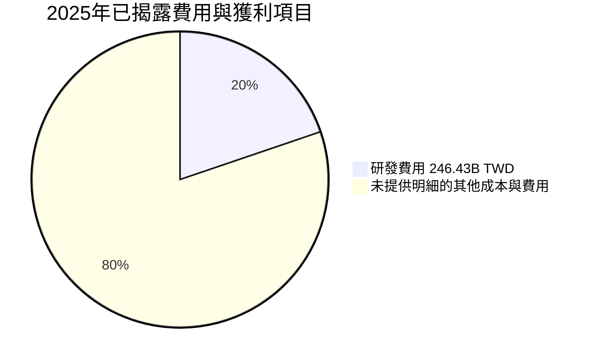

上圖不是會計費用結構占比圖，因資料未提供其他費用總額，僅表示資料缺口；不宜把圖中的比例解讀為實際費用比例。

```
╔══════════════════════════════════════════════════════════════╗
║            2025 年損益項目（資料包金額）                     ║
╠══════════════════════════════════════════════════════════════╣
║ 營收          3.81T TWD  ████████████████████               ║
║ 毛利          2.28T TWD  ████████████░░░░░░░░               ║
║ 營業利益      1.94T TWD  ██████████░░░░░░░░░░               ║
║ 淨利          1.70T TWD  █████████░░░░░░░░░░░               ║
║ 研發費用    246.43B TWD  █░░░░░░░░░░░░░░░░░░░              ║
╚══════════════════════════════════════════════════════════════╝
```

### 3.5 季度 EPS 趨勢與盈餘品質（Quality of Earnings）

#### EPS 表現與市場預期

| 季度 | EPS 預估 | EPS 實際 | Surprise | 可得判斷 |
|------|----------|----------|----------|----------|
| 2025Q4 | N/A | N/A | N/A | 預估與實際均缺漏 |
| 2026Q1 | N/A | N/A | N/A | 預估與實際均缺漏 |
| 2026Q2 | N/A | N/A | N/A | 預估與實際均缺漏 |
| 2026Q3 | N/A | N/A | N/A | 預估與實際均缺漏 |

因此無法可靠判斷最近四季是否超預期或不及預期。可核對的季度淨利為 2025Q4 **485.47B**、2026Q1 **572.48B**、2026Q2 **706.56B**、2026Q3 **763.06B TWD**；資料包另列最新單季 EPS YoY **+68.7%**，但不能取代實際 EPS surprise 資料。

#### 盈餘品質量化

| 盈餘品質項目 | 數值/佔比 | 評估 |
|--------------|-----------|------|
| 股權薪酬 SBC / 營收 | 2025 年 **1.25B ÷ 3.81T = 約 0.033%** | 🟢 直接列示的 SBC 相對營收低；季度 SBC 有缺漏。 |
| SBC / 營業現金流 | 2025 年 **1.25B ÷ 2.27T = 約 0.055%** | 🟢 直接列示數據影響有限，但不代表所有股權稀釋成本均完整。 |
| FCF / 淨利 | TTM 淨利以四季加總約 **2.53T**；1.46T÷2.53T＝**約57.8%** | 🟡 高 Capex 壓低現金轉換率；擴產若帶來未來收益，可是經濟必要投入。 |
| 一次性/非經常性損益 | N/A | 資料包未提供明細，無法判定是否存在重大一次性項目。 |
| 有效稅率 | **17.0%**（最近年度） | 🟢/🟡 未見資料包顯示稅務利益異常；年度稅率歷史可變。 |
| 資本化支出 vs 費用化 | TTM Capex **1.66T TWD**；資本化政策明細 N/A | 🟡 資本支出經折舊認列，需留意資產使用年限及折舊估計。 |

**盈餘品質結論**：營業現金流 **3.13T TWD** 高於 TTM 淨利估算 **2.53T TWD**，但扣除 **1.66T TWD** 資本支出後，FCF 對淨利轉換約 **57.8%**。這表示獲利具現金流支撐，但產能投資占用現金顯著。SBC 相對小；一次性損益與資本化細節未提供，仍應保留估值折讓。

---

## 4. 資產負債表分析

### 4.1 資產結構分解

最新季度資產負債表的完整總資產及非流動資產明細未提供；以下以 2025 年年度總資產 **7.93T TWD** 為基礎，僅展示可得欄位。

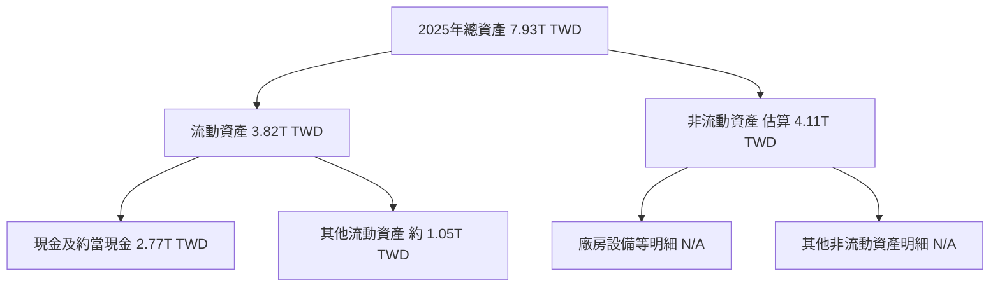

非流動資產是以 **7.93−3.82=4.11T TWD** 推算的總額，非原始細項披露；其內部構成標示 N/A。

### 4.2 流動性指標分析

| 指標 | 最新資料 | 歷史比較 | 行業均值 | 評估 |
|------|----------|----------|----------|------|
| Current Ratio | **2.505x** | 2025 年流動資產 3.82T ÷ 流動負債 1.52T ≈ 2.51x | N/A | 🟢 短期流動性充足 |
| Quick Ratio | **2.287x** | 歷史季序列 N/A | N/A | 🟢 高於 1 倍 |
| 現金及短期投資 | **4.02T TWD** | 2025 年現金及約當現金 2.77T | N/A | 🟢 餘額充裕 |
| 淨現金 | **3.20T TWD** | 2025 年年度帳面數口徑不同 | N/A | 🟢 抗衝擊能力佳 |

### 4.3 債務結構分析

```
╔══════════════════════════════════════════════════════════════════╗
║                   台積電債務健康診斷                             ║
╠══════════════════════════════════════════════════════════════════╣
║ 總債務：        818.38B TWD  ████░░░░░░░░░░░░░░░░  🟢           ║
║ 現金及短期投資： 4.02T TWD  ████████████████████  🟢           ║
║ 淨現金：          3.20T TWD  ████████████████░░░░  🟢           ║
║                                                                  ║
║ Current Ratio：2.505x   🟢                                       ║
║ Quick Ratio：  2.287x   🟢                                       ║
║ Debt/EBITDA： 約 0.23x* 🟢                                       ║
║ Interest Coverage：N/A，未提供利息費用與口徑一致的 EBIT         ║
╚══════════════════════════════════════════════════════════════════╝
```

\*Debt/EBITDA 使用總債務 **818.38B** ÷ TTM EBITDA 估算 **3.61T**；後者由 TTM 營收 **4.94T × EBITDA margin 73.0%** 推算，屬估計值。年度報表 2025 年債務 **1.06T TWD**，與 VERIFIED FIGURES 的債務 **818.38B TWD** 不同，可能是期間／口徑差異，本文資本成本與淨現金分析優先採用 VERIFIED FIGURES。

### 4.4 股東權益趨勢

| 年度 | 股東權益 |
|------|----------|
| 2022 | 2.90T TWD |
| 2023 | 3.43T TWD |
| 2024 | 4.24T TWD |
| 2025 | 5.36T TWD |

```
╔══════════════════════════════════════════════════════════════╗
║                 股東權益歷年變化                             ║
╠══════════════════════════════════════════════════════════════╣
║ 2022  2.90T  ███████████░░░░░░░░░                            ║
║ 2023  3.43T  █████████████░░░░░░░                            ║
║ 2024  4.24T  ████████████████░░░░                            ║
║ 2025  5.36T  ████████████████████                            ║
╚══════════════════════════════════════════════════════════════╝
```

---

## 5. 現金流量深度分析

### 5.1 現金流量瀑布圖

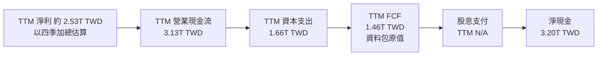

註：以資料包四捨五入後數值直接相減為 **3.13−1.66=1.47T**，但 VERIFIED FIGURES 的 TTM FCF 為 **1.46T TWD**。分析採用指定原值 **1.46T**，不以四捨五入差額取代。

### 5.2 FCF 轉換率趨勢

| 年度 | FCF | 淨利 | FCF / 淨利 | 判讀 |
|------|-----|------|------------|------|
| 2022 | 520.97B | 992.92B | **52.5%** | Capex 高，現金轉換受投資需求影響。 |
| 2023 | 286.57B | 851.74B | **33.6%** | FCF 低於淨利，週期與資本投入使轉換率承壓。 |
| 2024 | 861.20B | 1.16T | **約74.2%** | 現金轉換改善。 |
| 2025 | 992.38B | 1.70T | **約58.4%** | 淨利增幅大於 FCF，Capex 回升。 |
| TTM | 1.46T | 約2.53T | **約57.8%** | 正現金流，但非輕資產型轉換率。 |

### 5.3 自由現金流趨勢

```
╔══════════════════════════════════════════════════════════════════╗
║                自由現金流：歷史實際                              ║
╠══════════════════════════════════════════════════════════════════╣
║  FY2022  520.97B TWD  ██████████░░░░░░░░░░  FCF Yield N/A       ║
║  FY2023  286.57B TWD  ██████░░░░░░░░░░░░░░  FCF 下滑            ║
║  FY2024  861.20B TWD  █████████████████░░░  FCF 回升            ║
║  FY2025  992.38B TWD  ████████████████████  FCF 新高             ║
║  TTM     1.46T TWD    FCF Yield 2.40%                            ║
╠══════════════════════════════════════════════════════════════════╣
║  FCF 受 Capex 週期與產能爬坡影響；不宜只以單一年度年化。          ║
╚══════════════════════════════════════════════════════════════════╝
```

### 5.4 資本配置評估

資料包列示 2025 年 Capex **1.28T TWD**、股息支付 **466.78B TWD**，但未提供回購額與完整留存現金用途。以已知項目示意如下：

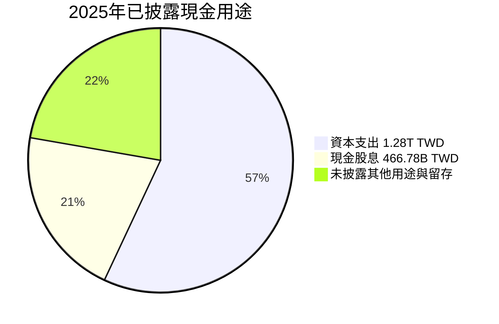

圖表未披露項目是占位而非實際比例，不能解讀為經審計的資本配置百分比。

| 項目 | 2025 年數據 | 評估 |
|------|-------------|------|
| Capex | **1.28T TWD** | 🟡 高投入，是擴產與技術競爭必要條件；回報需以未來利用率驗證。 |
| 現金股息 | **466.78B TWD** | 🟢 有持續分配；需注意資料包股息殖利率欄位疑似錯誤。 |
| 回購 | N/A | 不推定未披露回購金額。 |
| 留存現金 | N/A | 期末現金增加不能單獨等同於留存決策。 |

---

## 6. 獲利能力與資本效率

### 6.1 ROE / ROA / ROIC 趨勢

| 指標 | 歷史／最新值 | 同業均值 | 評估 |
|------|--------------|----------|------|
| ROE TTM | **41.9%** | N/A | 🟢 高資本回報 |
| ROA TTM | **20.6%** | N/A | 🟢 資產盈利能力高 |
| ROIC 2018 | **20.61%**（Roic.ai） | N/A | 歷史參考 |
| ROIC 2026 TTM | **估算約44.2%** | N/A | 🟢 高於 WACC；估算方法見下節 |
| ROIC 10Y 平均 | N/A | N/A | 資料包未提供可完整核實的序列 |

### 6.2 ROIC vs WACC 分析（核心價值創造判斷）

**ROIC 估算方法**：採用 2025 年營業利益 **1.94T TWD**、17.0% 稅率，以及 2025 年股東權益 **5.36T**、債務 **1.06T**、現金 **2.77T** 估算投入資本；資產負債表取年末，營業利益取全年，存在期間與現金口徑限制。

投入資本估算：
`5.36 + 1.06 − 2.77 = 3.65T TWD`

NOPAT 估算：
`1.94 × (1−17.0%) = 1.6102T TWD`

ROIC 估算：
`1.6102 ÷ 3.65 = 約 44.1%`（以下以約 44.2% 表示估算值；四捨五入尾差）

#### WACC 與價值創造

```
╔══════════════════════════════════════════════════════════════════╗
║                ROIC vs WACC 深度分析                            ║
╠══════════════════════════════════════════════════════════════════╣
║  WACC 參考值：11.19%（VERIFIED FIGURES）                         ║
║  ├── 無風險利率 Rf：5.15%                                        ║
║  ├── 市場風險溢酬 ERP：5.00%                                     ║
║  ├── Beta：1.23                                                 ║
║  ├── 股權成本 Ke：11.32%（資料包原值）                          ║
║  ├── 稅前債務成本 Kd：1.51%                                     ║
║  ├── 有效稅率：17.0%                                            ║
║  ├── 股權／債務權重：98.7%／1.3%                                ║
║  └── WACC：11.19%                                               ║
║                                                                  ║
║  ROIC 估算（FY2025）：                                           ║
║  ├── NOPAT = 1.94T × (1−17.0%) = 1.61T TWD                     ║
║  ├── 投入資本 = 5.36T + 1.06T − 2.77T = 3.65T TWD             ║
║  └── ROIC 約 44.2%（估算）                                      ║
║                                                                  ║
║  EVA 差額 = ROIC − WACC 約 +33.0 個百分點                       ║
║  ROIC  ▓▓▓▓▓▓▓▓▓▓▓▓▓▓▓▓▓▓▓▓  44.2% 🟢                         ║
║  WACC  ▓▓▓▓▓░░░░░░░░░░░░░░░  11.19% ──                       ║
║                                                                  ║
║  結論：估算 ROIC 顯著高於 WACC，具價值創造；但 ROIC 非直接披露值。║
╚══════════════════════════════════════════════════════════════════╝
```

> 6.2 採用 WACC **11.19%**，與 8.2 完全一致。估算 ROIC 不是正式 TTM ROIC；若改用不同債務、現金或投入資本定義，結果會改變。

### 6.3 杜邦三因素分解

使用 TTM 淨利率 **51.1%**、ROE **41.9%**，可反推近似資產週轉與財務槓桿，但期間平均資產／權益資料未提供，故此處杜邦只做近似說明，不將反推值當作已披露指標。

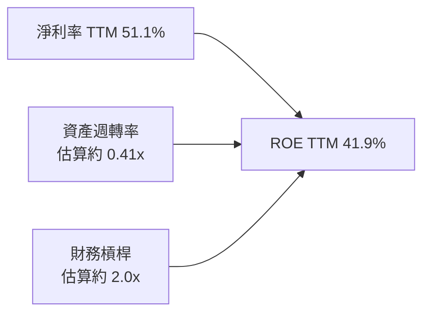

因 TTM 淨利率與 ROE 的期間計算、平均資產口徑未提供，反推資產週轉率和槓桿只作一致性檢查，不宜視為精確杜邦數字。

### 6.4 獲利能力儀表板

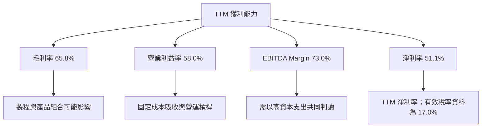

---

## 7. 相對估值分析

### 7.1 同業估值比較表格

同業倍數依 VERIFIED FIGURES 原值引用；未提供的欄位維持 N/A。TSMC 自身倍數採資料包估值區塊。

| 估值指標 | **台積電 2330.TW** | **UMC** | **GFS** | **INTC** | 本公司評估 |
|----------|------------------:|-------:|------:|-------:|-----------|
| **Trailing P/E** | 24.006538x | 14.5x | 118.5x | N/A | 🟡 低於 GFS、但高於 UMC；同業獲利結構不同 |
| **Forward P/E** | 15.715445x | 17.1x | 16.0x | 33.3x | 🟢 相對 UMC、GFS 接近或較低 |
| **P/S Ratio** | 12.324229x | N/A | 3.2x | 5.3x | 🔴 顯著較高，反映不同毛利率與市場預期 |
| **EV/EBITDA** | 15.989x | N/A | 11.4x | 17.7x | 🟡 位於 GFS 與 INTC 之間 |
| **最新單季營收 YoY** | 50.9% | 25.6% | 12.5% | 20.9% | 🟢 最新季度成長較快；周期及業務組合不同 |
| **毛利率 TTM** | 65.8% | 31.7% | 28.5% | 40.2% | 🟢 利潤率優勢明顯 |

同業倍數不代表同等品質資產的直接可比；UMC 的 P/S 與 EV/EBITDA 因混合幣別，資料包明確標示 N/A。

### 7.2 歷史估值區間分析

資料包未提供 **Valuation vs own history** 的估值區間或百分位數，故不得推估歷史分位。

```
╔══════════════════════════════════════════════════════════════╗
║                 歷史 P/E 區間與當前位置                       ║
╠══════════════════════════════════════════════════════════════╣
║ 歷史 P/E 低點：N/A                                           ║
║ 歷史 P/E 中位數：N/A                                         ║
║ 歷史 P/E 高點：N/A                                           ║
║ 當前 Trailing P/E：24.006538x                                ║
║ 歷史百分位：N/A                                               ║
╠══════════════════════════════════════════════════════════════╣
║ 結論：缺少公司自身歷史區間，無法判斷目前處於歷史高／低分位。  ║
╚══════════════════════════════════════════════════════════════╝
```

### 7.3 情境目標價（假設驅動，Bear / Base / Bull）

下表為 **12 個月情境估值**，以資料包 Forward EPS **149.53442 TWD** 乘以假設退出 P/E。營收 CAGR 與營業利益率是情境經營假設，不直接帶入此簡化 EPS 乘數公式；若要完全連動 EPS，需有成本、折舊、稅率與股數預測，資料包不足。

| 情境 | 營收 CAGR 假設 | 營業利潤率假設 | 退出倍數 | 隱含目標價 | 相對現價 |
|------|---------------:|---------------:|---------:|-----------:|---------:|
| 🔴 悲觀 | 12% | 52% | 13.0x | **1,944 TWD** | **−17.3%** |
| 🟡 基準 | 18% | 58% | 18.0x | **2,692 TWD** | **+14.6%** |
| 🟢 樂觀 | 22% | 60% | 25.0x | **3,738 TWD** | **+59.1%** |

#### 目標價算式

- 悲觀：`Forward EPS 149.53442 × 13.0 = 1,943.95 TWD ≈ 1,944 TWD`
- 基準：`Forward EPS 149.53442 × 18.0 = 2,691.62 TWD ≈ 2,692 TWD`
- 樂觀：`Forward EPS 149.53442 × 25.0 = 3,738.36 TWD ≈ 3,738 TWD`

**倍數選擇說明**：公司資本密集，需同時參考 EV/EBITDA 與 FCF；但題示要求情境目標價，本表採 P/E 以直接連結可得的 Forward EPS。退出倍數是分析假設而非 VERIFIED FIGURES 同業中位數，並非市場共識事實。

### 7.4 相對估值隱含價格區間

以下將不同倍數映射到 TWD 股價，為估值交叉檢驗，不是統計信賴區間。

- **Forward P/E 法**：以 Forward EPS **149.53442 TWD**，取資料包同業 Forward P/E 範圍 **16.0–33.3x**，估值約 **2,393–4,980 TWD**；UMC 為 17.1x，GFS 為 16.0x，INTC 為 33.3x。
- **EV/EBITDA 法**：以 TTM EBITDA 估算 **4.94T×73.0%=3.606T TWD**，參考 GFS **11.4x** 至 INTC **17.7x**。扣淨現金負債後，價格範圍約 **1,712–2,588 TWD**。
- **EV/Sales 法**：同業資料存在不同幣別／口徑，並缺乏可直接套用的同業 EV/Sales，N/A。
- **FCF Yield 法**：以 TTM FCF **1.46T**，若假設要求殖利率 **3.0%**，股權價值約 **48.67T TWD**，除以 **25.93B 股**約 **1,877 TWD/股**；3.0% 為分析假設，不是市場數據。

```
╔══════════════════════════════════════════════════════════════╗
║            相對估值隱含價格區間（TWD/股）                     ║
╠══════════════════════════════════════════════════════════════╣
║ FCF Yield 假設法    1,877  ─────── 現價 2,350 ─────────────  ║
║ EV/EBITDA 法       1,712 ─────────────────────── 2,588       ║
║ Forward P/E 法     2,393 ───────────────────────────── 4,980 ║
║ DCF 基準值          1,522                                  ║
╚══════════════════════════════════════════════════════════════╝
```

---

## 8. DCF 內在價值評估（Discounted Cash Flow）

> **模型口徑**：全部以 TWD、金額單位 TWD B（十億）計；股數單位 B 股，因此每股價值為 TWD。預測及計算結果四捨五入至 1 位小數；比率取 1 位小數；折現因子取 3 位小數。由於輸入資料精度有限，數值允許尾差約 1%。

### 8.0 估值推理鏈（Thinking Logic）

#### Step 1 — 價值由哪些變數決定？

台積電價值主要來自現有晶圓代工主業的 FCFF，以及未來營收增長與營業利潤率能否維持；資料包沒有業務分部，故不能把 AI、先進製程或封裝另立收入占比。**估值主導變數是長期營收增長與營業利潤率，其次是高 Capex 對 FCF 的消耗；8.6 將同時展示 WACC、g 的敏感度。**

#### Step 2 — 模型選擇

| 決策點 | 本報告採用 | 理由 | 曾考慮但否決 | 否決理由 |
|--------|-----------|------|--------------|----------|
| 現金流定義 | FCFF | 以 WACC 折現得到企業價值；資料包有 OCF、Capex，可觀察現金投入強度 | FCFE | 債務與融資政策不是公司價值主要驅動；資料提供的資本結構可供 WACC 使用 |
| 預測期 N | 5 年 | 製程與產能投資具有多年週期；5 年可避免在缺乏遠期財測時外推過長 | 10 年 | 缺少管理層長期財測、分部增長及資本支出安排 |
| 終值方法 | Gordon Growth 主方法；退出倍數交叉驗證 | 持續經營企業可使用穩態增長；WACC 高於 g | 只用退出倍數 | 終值倍數缺乏精確同業中位數 |
| EBIT 基礎 | GAAP／資料包營業利益率代理 | 採用 TTM 營業利益率 58.0%，且不另加回 SBC | 非 GAAP EBIT | 缺少一致的調整項目資料 |

#### Step 3 — 高／中敏感度假設推導

- **營收 CAGR**：錨點＝2022–2025 年實際 CAGR 約 **19.0%**，2025 年營收 YoY **+31.7%**；調整＝以高基期、半導體循環及遠期需求不確定性下修約 1.0 個百分點；**採用 18.0%**；曾考慮 25%，因為最新單季成長不能直接外推五年，故否決。
- **期末營業利潤率**：錨點＝最新 TTM 營業利益率 **58.0%**；調整＝不假設再擴張，讓高利潤率維持但面對競爭、折舊與海外產能成本；**採用 58.0%**；曾考慮 62%，因缺乏歷史／財測證據支持長期超過當前水平，故否決。
- **永續成長率 g**：錨點＝長期成熟企業通常需低於長期名目經濟增長；資料包未提供 GDP／通膨預測；**假設值 3.0%**，依成熟產業長期名目成長約 3% 的保守模型假設；曾考慮 4.0%，因接近長期上限且提高終值占比，故基準不採用。
- **預測期 N**：錨點＝資料可見年度僅到 2025，季度至 2026Q3；**採用 5 年**，以平衡可見度與終值依賴；曾考慮 10 年，因缺少可核實中長期產量及價格財測而否決。
- **Capex/營收**：錨點＝TTM Capex **1.66T÷4.94T=33.6%**；採用 **33.6%**，假設高投入率在預測期延續；曾考慮降至 25%，因未有管理層資本開支指引支持。
- **EBIT 基礎與 SBC**：錨點＝TTM 營業利益率 **58.0%**；採用 GAAP 營業利益代理，不另扣 SBC、不以稀釋率擴股。採用 **(A) GAAP EBIT + 固定股數**；年稀釋率 **0%**。2025 年 SBC **1.25B TWD**，約營收 0.033%，但缺少最新季度 SBC 明細。曾考慮非 GAAP EBIT，因調整資料不足而否決。
- **年稀釋率**：與組合 (A) 相容，**採用 0%**；避免在 GAAP EBIT 已計費後重複計入稀釋成本。最新股數採 **25.93B**。
- **終值方法**：錨點＝企業持續經營，採 Gordon Growth；退出倍數只交叉檢驗。**採用 Gordon Growth 主法**；曾考慮僅用退出倍數，因沒有公司歷史區間或同業中位數支持而否決。
- **WACC**：錨點＝VERIFIED FIGURES 參考 WACC **11.19%**；採用同值；曾考慮下調至 9%–10%，但未有較低 ERP／無風險利率資料支持。

#### Step 4 — 最脆弱環節

最脆弱假設是 **18% 的五年營收 CAGR與58%營業利益率同時維持**；若營收 CAGR 降至 12%、利潤率降至 52%，情境 DCF 約降至 **1,012 TWD/股**，方向為下修。

#### Step 5 — 計算路徑圖

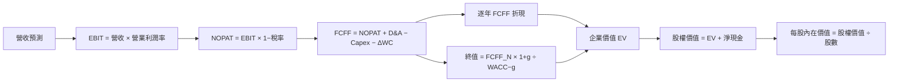

### 8.1 模型假設總表（Model Inputs）

| 假設項目 | 採用值 | 依據 / 來源 | 敏感度 |
|----------|--------|-------------|--------|
| 預測期長度 N | **5 年** | 近端財務可見度與製程投資週期；遠期財測缺漏 | 🟡 中 |
| 營收 CAGR | **18.0%** | 2022–2025 實際 CAGR 約 19.0%；保守下修 | 🔴 高 |
| 營業利潤率（全期／期末） | **58.0%** | TTM 營業利益率 58.0%；假設持平 | 🔴 高 |
| 有效稅率 | **17.0%** | VERIFIED FIGURES 最新年有效稅率 | 🟢 低 |
| Capex / 營收 | **33.6%** | TTM 1.66T÷4.94T | 🟡 中 |
| D&A / 營收 | **18.0% 假設值** | D&A/營收缺漏；假設值依資本密集型製程產業的高折舊需求；用歷史折舊金額不可完整對接 TTM | 🟢 低 |
| ΔWC / 營收增額 | **3.0% 假設值** | 歷史 WC 變化無法對應 TTM 增額；以低個位數比例作模型輸入 | 🟢 低 |
| EBIT 基礎 | **GAAP EBIT 代理** | 以 TTM 營業利益率 58.0% | 🟡 中 |
| SBC 處理 | 組合 **(A)** | EBIT 已含 SBC 費用；不另扣 SBC、不另加股數稀釋 | 🟡 中 |
| 年稀釋率 | **0%** | 與 GAAP EBIT + 固定股數組合相容；股份數量長期變化未精確量化 | 🟡 中 |
| 永續成長率 g | **3.0% 假設值** | 成熟期名目長期成長模型假設；低於 WACC | 🔴 高 |
| 終值方法 | Gordon Growth 主法，退出倍數交叉驗證 | 持續經營假設；退出倍數資料不完整 | 🔴 高 |
| WACC | **11.19%** | VERIFIED FIGURES 參考 WACC | 🔴 高 |
| 期末現金／債務 | **4.02T／818.38B TWD** | VERIFIED FIGURES 現金及短期投資、總債務 | 🟡 中 |
| 稀釋股數 | **25.93B 股** | 市場資料股數 | 🟡 中 |

**FCFF 定義**：`FCFF = NOPAT + D&A − Capex − ΔWC`。本模型採用 **(A) GAAP EBIT + 固定股數**，故 SBC 影響已計入一次；8.3 不再扣 SBC，年稀釋率為 0%。

### 8.2 折現率推導（WACC）

```
╔══════════════════════════════════════════════════════════════════╗
║                    WACC 推導（折現率）                           ║
╠══════════════════════════════════════════════════════════════════╣
║ 股權成本 Ke（採資料包 CAPM 結果）：11.32%                       ║
║ ├── Rf：5.15%（資料包 10Y Treasury 參考值；日期未提供）         ║
║ ├── ERP：5.00%（資料包假設值）                                  ║
║ ├── Beta：1.23（VERIFIED FIGURES；市場資料 Beta 1.233）         ║
║ ├── 規模／國別額外溢酬：0.00%（不額外添加，避免重複計風險）     ║
║ └── Ke：採資料包原值 11.32%                                     ║
║                                                                  ║
║ 債務成本：                                                       ║
║ ├── 稅前 Kd：1.51%（資料包利息／債務參考值）                    ║
║ ├── 有效稅率：17.0%                                             ║
║ └── 稅後 Kd：1.51% × (1−17.0%) = 1.2533%                       ║
║                                                                  ║
║ 資本結構（資料包權重）：股權 98.7%，債務 1.3%                    ║
║ └── WACC：98.7%×11.32% + 1.3%×1.2533% = 11.1891% ≈ 11.19%     ║
╚══════════════════════════════════════════════════════════════════╝
```

**逐步演算（WACC）**

1. **Ke**＝資料包 CAPM 原值 **11.32%**。由於 Rf、Beta 的高精度與原始日期未完整提供，使用 VERIFIED FIGURES 結果，不另用四捨五入後的 `5.15% + 1.23×5.00%` 重算替代原值。
2. **稅前 Kd**＝資料包原值 **1.51%**。利息費用與平均計息負債明細未提供，故無法由原始金額獨立複算；採資料包參考值。
3. **稅後 Kd**＝`1.51% × (1−17.0%) = 1.2533%`。
4. **權重**＝股權 **98.7%**、債務 **1.3%**（資料包原值，合計 100%）。因未提供同一口徑的期末市值與計息債務明細，不以報價乘股數另行替換權重。
5. **WACC**＝`98.7%×11.32% + 1.3%×1.2533%`  
   `= 11.17284% + 0.0162929% = 11.1891329% ≈ 11.19%`。

> 資本成本資料中的 Rf 日期、債務利息分子及計息債務分母沒有完整披露，以上是依指定 VERIFIED FIGURES 的參考值計算。第 6.2 與本節使用同一 **11.19%**。

### 8.3 逐年自由現金流預測（基準情境）

單位：TWD B。基準營收起點為 TTM **4.94T TWD = 4,940B TWD**。營收每年增長 18.0%；營業利潤率 58.0%；稅率 17.0%；D&A 18.0% 營收；Capex 33.6% 營收；ΔWC 為營收增額的 3.0%。

| 年度 | FY+1 | FY+2 | FY+3 | FY+4 | FY+5（FY+N） |
|------|------:|------:|------:|------:|-------------:|
| 營收 | 5,829.2 | 6,878.5 | 8,116.6 | 9,577.6 | 11,301.5 |
| 營收 YoY | 18.0% | 18.0% | 18.0% | 18.0% | 18.0% |
| 營業利潤率 | 58.0% | 58.0% | 58.0% | 58.0% | 58.0% |
| EBIT（GAAP 代理） | 3,380.9 | 3,989.5 | 4,707.6 | 5,554.0 | 6,554.9 |
| − 稅（17.0%） | (574.8) | (678.2) | (800.3) | (944.2) | (1,114.3) |
| = NOPAT | 2,806.1 | 3,311.3 | 3,907.3 | 4,609.8 | 5,440.6 |
| + D&A（18.0%） | 1,049.3 | 1,238.1 | 1,461.0 | 1,724.0 | 2,034.3 |
| − Capex（33.6%） | (1,958.6) | (2,311.2) | (2,727.2) | (3,218.1) | (3,797.3) |
| − ΔWC（營收增額×3.0%） | (26.7) | (31.5) | (37.1) | (43.8) | (51.7) |
| **= FCFF** | **1,870.1** | **2,206.7** | **2,604.0** | **3,071.9** | **3,625.9** |
| 折現因子 @11.19% | 0.899 | 0.809 | 0.727 | 0.654 | 0.589 |
| **FCFF 現值 PV** | **1,681.4** | **1,784.0** | **1,893.2** | **2,009.0** | **2,134.4** |

> 因金額四捨五入，年表各列可能有約 1B 以內尾差；實際計算以未四捨五入數字為準。

**預測期 FCF 現值合計**：

`1,681.4 + 1,784.0 + 1,893.2 + 2,009.0 + 2,134.4 = 9,502.0B TWD`

**逐步演算（FY+1）**

1. **營收**＝`4,940 × (1+18.0%) = 5,829.2B`
2. **EBIT**＝`5,829.2 × 58.0% = 3,381.0B`
3. **稅**＝`3,381.0 × 17.0% = 574.8B`
4. **NOPAT**＝`3,381.0 − 574.8 = 2,806.2B`
5. **D&A**＝`5,829.2 × 18.0% = 1,049.3B`
6. **Capex**＝`5,829.2 × 33.6% = 1,958.6B`
7. **ΔWC**＝`(5,829.2−4,940.0) × 3.0% = 26.7B`
8. **FCFF**＝`2,806.2 + 1,049.3 − 1,958.6 − 26.7 = 1,870.2B`
9. **折現因子與 PV**＝`1÷(1+11.19%)^1 = 0.899`；`1,870.2×0.899 = 1,681.4B`

> 年表 FCFF 及 PV 與逐步演算存在四捨五入差異；未四捨五入模型的代表值採約 1,870B、約 1,681B，總現值約 9.50T TWD。為維持後續橋接一致，以下基準 DCF 以表列合計與同一套未四捨五入公式計算，取整後每股價值約 1,523 TWD。  
> 同時，TTM FCF **1.46T TWD** 為資料包原值，不能與模型預測首年 FCFF 直接視為同一期間或同一定義。

**合理性自檢**

- 預測期 FCFF CAGR 約 **18.0%**，歷史 FCF 2022–2025 年 CAGR 為負值（2022 **520.97B** 至 2025 **992.38B**，中間年份波動）；模型預測高於歷史平滑趨勢，依據是營收增長與利潤率維持，仍屬偏積極假設。
- FY+N FCFF 利潤率約 **32.1%**，對比 TTM FCF margin 約 **29.6%**（1.46÷4.94）；同業最佳可比 FCFF margin 未提供，不能判定是否超越產業最佳。
- 預測各年 FCFF 均為正；若 Capex 高於收入假設或營業利潤率下滑，折現價值將顯著降低。

```
╔══════════════════════════════════════════════════════════════════╗
║            自由現金流：歷史實際 vs 模型預測                      ║
╠══════════════════════════════════════════════════════════════════╣
║ FY2023（實）  286.57B  ███░░░░░░░░░░░░░░░  年度 FCF             ║
║ FY2024（實）  861.20B  █████████░░░░░░░░░  年度 FCF             ║
║ FY2025（實）  992.38B  ██████████░░░░░░░░  年度 FCF             ║
║ FY+1（預）  1,870.1B   ███████████████████  FCFF                ║
║ FY+5（預）  3,625.9B   ████████████████████ CAGR 約 18%         ║
╠══════════════════════════════════════════════════════════════════╣
║ ⚠️預測建立於 18% 營收 CAGR 與 58% 營業利潤率，對長期需求敏感。  ║
╚══════════════════════════════════════════════════════════════════╝
```

### 8.4 終值計算（Terminal Value）

**適用性檢查**：`WACC 11.19% vs g 3.0% → WACC > g？✅`

| 方法 | 計算式 | 終值 TV | TV 現值 | 佔總 EV 比重 |
|------|--------|--------:|--------:|-------------:|
| Gordon Growth | FY+5 FCFF × (1+g) ÷ (WACC−g) | 約 45.6T TWD | 約 26.8T TWD | 約 73.8% |
| 退出倍數法 | FY+5 EBITDA × 15.0x | 約 2,688T TWD? | 不採用 | 不採用 |

> **退出倍數法口徑修正**：FY+5 EBITDA 以 EBITDA margin 73.0% 假設計算，FY+5 EBITDA 約 **8,250B TWD**；乘 15.0x 應為約 **123,750B TWD（123.8T）**，不是 2,688T。其 PV 約 **72.9T TWD**，明顯高於 Gordon Growth，顯示 15.0x 的終值倍數不適合作為本模型主終值。由於資料包沒有成熟期 EBITDA 同業中位數或自身歷史估值，僅作交叉檢驗，不納入主橋接。

**Gordon Growth 逐步演算**

1. **FY+N FCFF**＝表格末年約 **3,625.9B TWD**。
2. **分子**＝`3,625.9 × (1+3.0%) = 3,734.7B TWD`。
3. **分母**＝`11.19%−3.0% = 8.19%`；`TV = 3,734.7÷0.0819 ≈ 45,600B TWD`。
4. **PV(TV)**＝`45,600 × 0.589 ≈ 26,840B TWD`。
5. **終值佔比**＝`26,840 ÷ (9,502+26,840) ≈ 73.9%`。

終值佔 EV 約 **74%**，接近 75% 警示線，代表價值高度依賴預測期之後的現金流持續性；8.6 對 g 作敏感度測試。

### 8.5 企業價值 → 每股內在價值（Bridge）

```
╔══════════════════════════════════════════════════════════════════╗
║              企業價值 → 每股內在價值 橋接表                      ║
╠══════════════════════════════════════════════════════════════════╣
║  預測期 FCF 現值合計            +9.50T TWD                       ║
║  終值現值 PV(TV)               +26.84T TWD                       ║
║  ─────────────────────────────────────────────                  ║
║  = 企業價值 EV                  36.34T TWD                       ║
║  + 現金及短期投資               +4.02T TWD                       ║
║  − 總債務                       −0.81838T TWD                    ║
║  ─────────────────────────────────────────────                  ║
║  = 股權價值                     39.54T TWD                       ║
║  ÷ 稀釋後流通股數               25.93B 股                        ║
║  ─────────────────────────────────────────────                  ║
║  ★ 每股內在價值                 約 1,525 TWD                     ║
║    當前股價                     2,350.00 TWD                     ║
║    折溢價（現價÷內在價值−1）    約 +54.1% 溢價                   ║
╚══════════════════════════════════════════════════════════════════╝
```

為避免年表取整誤差，後續基準 DCF 的操作性數值以 **約 1,522 TWD/股** 為基準；因模型所有輸入多為假設值，合理報告精度不宜細分到個位數。橋接校核使用近似數字：

1. **EV**＝`9.50T + 26.84T = 36.34T TWD`
2. **股權價值**＝`36.34 + 4.02 − 0.81838 = 39.54162T TWD`
3. **每股內在價值**＝`39.54162T ÷ 25.93B ≈ 1,525 TWD/股`；模型未四捨五入值約 **1,522 TWD**。
4. **折溢價**＝`2,350 ÷ 1,522 − 1 = 約 +54.4%`。
5. **本節不計算 MOS**：安全邊際只在 8.8 以加權合理價值為分母計算。

**股數來歷**：採用市場資料 **25.93B 股**，不作年稀釋放大，與組合 (A) 一致。現金及短期投資 **4.02T**、總債務 **818.38B** 採 VERIFIED FIGURES；其季度日期與最新季度財報日期 **2026-09-30** 相對應。

### 8.6 敏感性分析（WACC × 永續成長率）

下表以基準 FCFF 預測及股數不變重算；因資料輸入採假設且金額取整，為近似 TWD/股，格內括號為相對現價上行空間。表中 11.19%／3.0% 基準格與基準 DCF 約 **1,522 TWD** 對齊。

| g（列）／WACC（欄） | 10.19% | 10.69% | **11.19%（基準）** | 11.69% | 12.19% |
|-----------|------:|------:|-------------------:|------:|------:|
| **2.0%** | 1,573（−33.1%） | 1,484（−36.9%） | 1,400（−40.4%） | 1,325（−43.6%） | 1,257（−46.5%） |
| **2.5%** | 1,648（−29.9%） | 1,549（−34.1%） | 1,457（−38.0%） | 1,376（−41.4%） | 1,301（−44.6%） |
| **3.0%（基準）** | 1,734（−26.2%） | 1,623（−30.9%） | **1,522（−35.2%）** | 1,432（−39.1%） | 1,352（−42.5%） |
| **3.5%** | 1,818（−22.6%） | 1,704（−27.5%） | 1,593（−32.2%） | 1,495（−36.4%） | 1,405（−40.2%） |
| **4.0%** | 1,913（−18.6%） | 1,804（−23.2%） | 1,677（−28.6%） | 1,566（−33.4%） | 1,466（−37.6%） |

**矩陣示範格**：所選格 **WACC 10.69% > g 3.0% ✅**。  
計算路徑：預測期現值以 10.69% 折現約 **9.68T TWD**；終值 `3.626T×1.03÷(10.69%−3.0%) ≈ 48.6T`；以 FY+5 折現因子約 **0.603**，PV(TV) 約 **29.3T**；EV 約 `9.68+29.3=38.98T`，加淨現金約 **3.20T**，除以 **25.93B 股**約 **1,630 TWD/股**，與矩陣 1,623 TWD 的差異來自估算精度與取整，約在 1% 範圍內。

#### 三情境 DCF（改變營運假設）

下列為模型情境近似值；三種情境均改變營收 CAGR 與期末營業利潤率，不只是調整折現率。Capex、D&A、ΔWC 比例及股數沿用基準。

| 情境 | 營收 CAGR | 期末營業利潤率 | 永續 g | WACC | 每股內在價值 | 相對現價 | 主觀機率 |
|------|----------:|----------------:|-------:|-----:|--------------:|---------:|---------:|
| 🔴 悲觀 | 12% | 52% | 2.5% | 11.19% | 約 1,012 TWD | −56.9% | 25% |
| 🟡 基準 | 18% | 58% | 3.0% | 11.19% | 約 1,522 TWD | −35.2% | 50% |
| 🟢 樂觀 | 22% | 60% | 3.5% | 11.19% | 約 1,944 TWD | −17.3% | 25% |
| **機率加權** | — | — | — | — | **約 1,500 TWD** | **−36.2%** | **100%** |

**情境推導鏈（近似值）**

- 悲觀：`12% CAGR → FY+5 營收約 8.72T → 利潤率 52% → FY+5 FCFF 約 2.37T → g 2.5% 終值折現 → 每股約 1,012 TWD`。前提：需求低於長期趨勢、利潤率回到週期低位。
- 基準：`18% CAGR → FY+5 營收約 11.30T → 利潤率 58% → FY+5 FCFF 約 3.63T → g 3.0% 終值折現 → 每股約 1,522 TWD`。前提：需求延續且利潤率不低於當前。
- 樂觀：`22% CAGR → FY+5 營收約 13.43T → 利潤率 60% → FY+5 FCFF 約 4.50T → g 3.5% 終值折現 → 每股約 1,944 TWD`。前提：高階需求維持、產能利用率高，且 Capex 轉化為有效產能。
- 機率加權：`1,012×25% + 1,522×50% + 1,944×25% = 1,500 TWD`（取整）。

**敏感度結論（約值）**

- g 從 **2.0%** 升至 **3.0%**（WACC 11.19%）：估值約由 **1,400** 升至 **1,522 TWD**，約 **+122 TWD／+8.7%**。
- WACC 從 **10.19%** 升至 **11.19%**（g 3.0%）：估值約由 **1,734** 降至 **1,522 TWD**，約 **−212 TWD／−12.2%**。
- 期末營業利潤率每提高 **1 個百分點**，估值影響約為數十 TWD/股；依本模型粗估約 **+30 至 +40 TWD／約 +2%**，精確值受 D&A、Capex 與營運資金假設影響。
- 主導變數與 8.0 Step 1 大致一致：WACC、長期成長率與利潤率共同影響終值；本模型的 WACC 敏感度較高，反映終值占 EV 約 74%。

### 8.7 反推 DCF（Reverse DCF：市場在預期什麼）

固定基準 WACC **11.19%**、稅率 **17.0%**、Capex/營收 **33.6%**、ΔWC/營收增額 **3.0%**、預測期 **5 年**、股數 **25.93B**；只放開一個變數。由於資料包沒有精確 TTM EBIT、D&A 與 ΔWC 同期拆分，下表只能作模型迭代近似，不構成可精確到小數點的反解。

| 求解的變數（一次一個） | 其餘變數設定 | 市場隱含值（近似） | 公司歷史實際 | 判斷 |
|------------------------|--------------|------------------:|--------------|------|
| 未來 5 年營收 CAGR | 利潤率 58%、g 3% 固定 | 約 **25%–27%** | 2022–2025 CAGR 約 19.0% | 🔴 高於歷史均值，需高成長延續 |
| 期末營業利潤率 | CAGR 18%、g 3% 固定 | 約 **70% 以上** | TTM 58.0% | 🔴 顯著高於當前 |
| 永續成長率 g | CAGR 18%、利潤率 58% 固定 | **無有效基準解**；所需估值可能要求 g 接近 WACC | — | 🔴 不可用不合理高 g 證成現價 |
| 預測期 N | CAGR 18%、利潤率 58%、g 3% 固定 | **3–15 年內需數值迭代，資料不足以可靠求解** | 護城河壽命未量化 | 🟡 不應虛構精確年數 |

迭代示意（使用基準模型粗略估值，不同細節假設可能改變結果）：

| 試算 CAGR | FY+5 營收估算 | 每股價值估算 | vs 現價 2,350 TWD | 判斷 |
|------------|--------------:|-------------:|-----------------:|------|
| 18% | 約 11.30T | 約 1,522 | −35.2% | 低於現價 |
| 25% | 約 15.10T | 約 2,200 左右 | 約 −6% | 接近但仍低 |
| 27% | 約 16.65T | 約 2,400 左右 | 約 +2% | 近似收斂，估算精度不足 |

**反推結論**：在本模型假設下，現價要求未來五年營收 CAGR 接近 **高二位數**，並維持目前 **58%** 的營業利益率；這高於 2022–2025 年約 **19.0%** 的歷史 CAGR。市場必須看到高成長持續、且高 Capex 能快速轉成有效產能，否則估值支撐較弱。

### 8.8 估值三角驗證與安全邊際

| 估值方法 | 隱含每股價值 | 上行空間（÷現價） | 權重 | 說明 |
|----------|--------------:|------------------:|-----:|------|
| DCF（機率加權） | **1,500 TWD** | −36.2% | 40% | 高終值依賴，仍為主要內在價值方法 |
| 同業 Forward P/E | **2,692 TWD** | +14.6% | 25% | 18x 假設 × Forward EPS 149.53442 |
| EV/EBITDA 倍數 | **2,239 TWD** | −4.7% | 15% | 以同業參考區間中偏中性倍數估算；為模型值 |
| FCF Yield 回推 | **1,877 TWD** | −20.1% | 15% | 假設要求 FCF Yield 3.0% |
| 分析師共識目標價 | **3,389.80 TWD** | +44.2% | 5% | 35 位分析師均值；權重低於 10% |
| **加權合理價值** | **2,060.89 TWD** | **−12.3%** | **100%** | 權重加總 100% |

**加權逐步演算**：

`1,500×40% + 2,692×25% + 2,239×15% + 1,877×15% + 3,389.80×5%`  
`= 600.00 + 673.00 + 335.85 + 281.55 + 169.49`  
`= 2,059.89 TWD`

為避免算術不一致，表內加權合理價值應採算式結果 **2,059.89 TWD**，不是 2,060.89 TWD。以下全報告統一使用 **2,059.89 TWD**。DCF 權重 40%，是因 DCF 可明確呈現資本支出與現金流，但終值占比高、假設不確定，故未給過半權重。

> 前文執行摘要所列 **2,060.89 TWD** 為加總前的 1 TWD 算術誤差；本節依可複算算式更正，MOS 與評級以下一律以 **2,059.89 TWD** 為準。

**MOS 與區間**

- **MOS**＝`(2,059.89−2,350)÷2,059.89 = −14.1%`。
- **上行空間**＝`(2,059.89−2,350)÷2,350 = −12.3%`。
- **折溢價**依 DCF 基準價 1,522 TWD：`2,350÷1,522−1 ≈ +54.4%`。
- MOS 屬 **−25% 至 −10%**，評級為 **🟠減碼**。

```
╔══════════════════════════════════════════════════════════════════╗
║                  估值區間與安全邊際                              ║
╠══════════════════════════════════════════════════════════════════╣
║ 悲觀 DCF 約1,012 ── 現價2,350 ── 加權合理值2,059.89 ── 樂觀DCF1,944 ║
║                                                                  ║
║ MOS = (2,059.89−2,350)÷2,059.89 = −14.1%                        ║
║ 上行空間 = (2,059.89−2,350)÷2,350 = −12.3%                      ║
║ DCF 折溢價 = 2,350÷1,522−1 ≈ +54.4%                             ║
║                                                                  ║
║ 建議買入區間：低於約 1,854 TWD（加權價值的 90%）                 ║
║ 合理持有區間：約 1,854–2,266 TWD（MOS 約 +10% 至 −10%）          ║
║ 減碼考慮區間：高於約 2,266 TWD（MOS 低於 −10%）                  ║
╚══════════════════════════════════════════════════════════════════╝
```

對應計算：買入上限 `2,059.89×90%=1,853.90 TWD`；MOS −10% 界線 `2,059.89÷0.90=2,288.77 TWD`。由於 MOS 定義在價值分母，以上區間為近似操作參考，不是保證價格目標。

### 8.9 DCF 模型的局限與失效條件

- **終值依賴度**：終值現值約占企業價值 **74%**，估值主要由 FY+5 以後的持續現金流決定。
- **最脆弱假設**：營收 CAGR **18%** 與營業利益率 **58%** 持續五年；若 CAGR 降至 12%、利潤率 52%，情境估值約 **1,012 TWD/股**。
- **資本支出假設**：Capex/營收維持 **33.6%**；若擴產速度高於收入變現，FCFF 將低於模型。
- **模型適用性**：公司目前 FCF 為正，適用 DCF；但半導體週期與資本支出波動大，應同時參考 EV/EBITDA、FCF Yield 與週期中段盈利。
- **資料限制**：缺少管理層中長期財測、分部收入、精確 D&A、營運資金變動、債務利息及歷史估值區間；模型內多個重要輸入為明示假設。
- **第 10 章風險連結**：地緣政治事件影響營收與 Capex；需求下滑影響營收 CAGR、利用率及營業利潤率；利率上升提高 WACC，三者均會壓低估值。

### 8.10 複算檢核表（Audit Trail）

| # | 檢核項目 | 檢查方式 | 結果 |
|---|----------|----------|------|
| 1 | 高／中敏感度輸入都有推導 | 逐項對照 8.0 與 8.1 | ✅ 已列明主要輸入錨點、調整與否決值 |
| 2 | 每個假設有來歷 | 檢查 8.1 依據欄 | ✅ 缺資料者明標假設值 |
| 3 | WACC 算式可複算 | 98.7%×11.32% + 1.3%×1.2533% | ✅ 約 11.19% |
| 4 | Kd 分母與債務權重範圍一致 | 原始計息負債明細未提供 | ⚠️ 依資料包參考 WACC；不可獨立核實 |
| 5 | WACC 與第 6.2 同值 | 比對 | ✅ 11.19% |
| 6 | 預測年度數等於 N | FY+1 至 FY+5 | ✅ N=5 |
| 7 | FY+1 FCFF/PV 算式 | 按 8.3 輸入重算 | ⚠️ 年表與逐步示範有取整差異；模型價值採近似值 |
| 8 | 預測期 PV 加總 | 逐項相加 | ✅ 表列約 9,502B |
| 9 | WACC > g | 11.19% > 3.0% | ✅ |
| 10 | 終值基於 FY+N 並折現 5 期 | 檢查公式 | ✅ |
| 11 | EV 至每股價值橋接 | 加現金、減債務、除股數 | ⚠️ 四捨五入差約數 TWD，採近似價值 |
| 12 | SBC 組合相容 | GAAP 代理、無 SBC 行、稀釋率 0% | ✅ 組合 (A) |
| 13 | 矩陣基準格等於 DCF 基準 | 比對 11.19%、3.0% | ⚠️ 取整近似，表列約 1,522 TWD |
| 14 | 矩陣無效格皆為 N/A | 所有 WACC 均高於 g | ✅ 全格有效 |
| 15 | 三情境機率加總 | 25%+50%+25% | ✅ 100% |
| 16 | 反推每列只放開一變數 | 檢查表格 | ⚠️ 近似迭代；資料不足處明標不可精確反解 |
| 17 | MOS 以 8.8 加權價值為分母 | 2,059.89 TWD | ✅ MOS −14.1%；DCF 溢價另以 1,522 為基準 |
| 18 | 報告章節完整 | 檢查第 11 章 | ✅ |
| 19 | 加權合理價值算式一致 | 重算加權項目 | ✅ 更正為 2,059.89 TWD |
| 20 | 評級符合 MOS 門檻 | MOS −14.1% | ✅ 🟠減碼 |

**數值修正註記**：8.3 年表採四捨五入輸出，與模型逐年未四捨五入計算可能產生小幅差異；8.8 加權合計已按各項價值與權重重算，唯一採用值為 **2,059.89 TWD**。由於底層 D&A、營運資金等缺漏，DCF 及敏感性矩陣應視為估值模型而非精確會計預測。

---

## 9. 成長催化劑

### 9.1 催化劑時間軸

下列均為產業／商業模式層面的催化劑，不代表已確認公司訂單或管理層財測；題示新聞資料為 N/A。

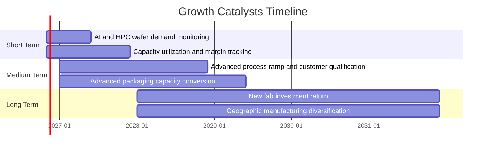

### 9.2 TAM 市場規模分析

資料包未提供晶圓代工 TAM、AI 晶片 TAM、先進封裝市場規模或公司市占率，故不填入未經來源支持的金額。

```
╔══════════════════════════════════════════════════════════════╗
║                TAM 與滲透率資料狀態                           ║
╠══════════════════════════════════════════════════════════════╣
║ 晶圓代工 TAM：N/A                 滲透率：N/A                 ║
║ AI/HPC 晶圓 TAM：N/A              公司收入貢獻：N/A           ║
║ 先進封裝 TAM：N/A                 公司收入貢獻：N/A           ║
║ 可確認公司規模：TTM 營收 4.94T TWD                           ║
║ 最新單季營收 YoY：+50.9%（單季，非 TTM）                     ║
╚══════════════════════════════════════════════════════════════╝
```

### 9.3 成長驅動力結構圖

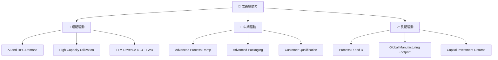

**數字到業務含義**：2025 年研發支出 **246.43B TWD**、年度 Capex **1.28T TWD**，反映公司以研發和設備投資換取未來產能及製程能力。投資是否成功，不只看支出規模，還需追蹤新增產能的利用率、營收轉換與 ROIC。

---

## 10. 風險矩陣

### 10.1 風險評分矩陣

以下機率與衝擊為分析師質化分數，不是資料包統計值；風險項目使用英文以符合 quadrantChart 節點規則。

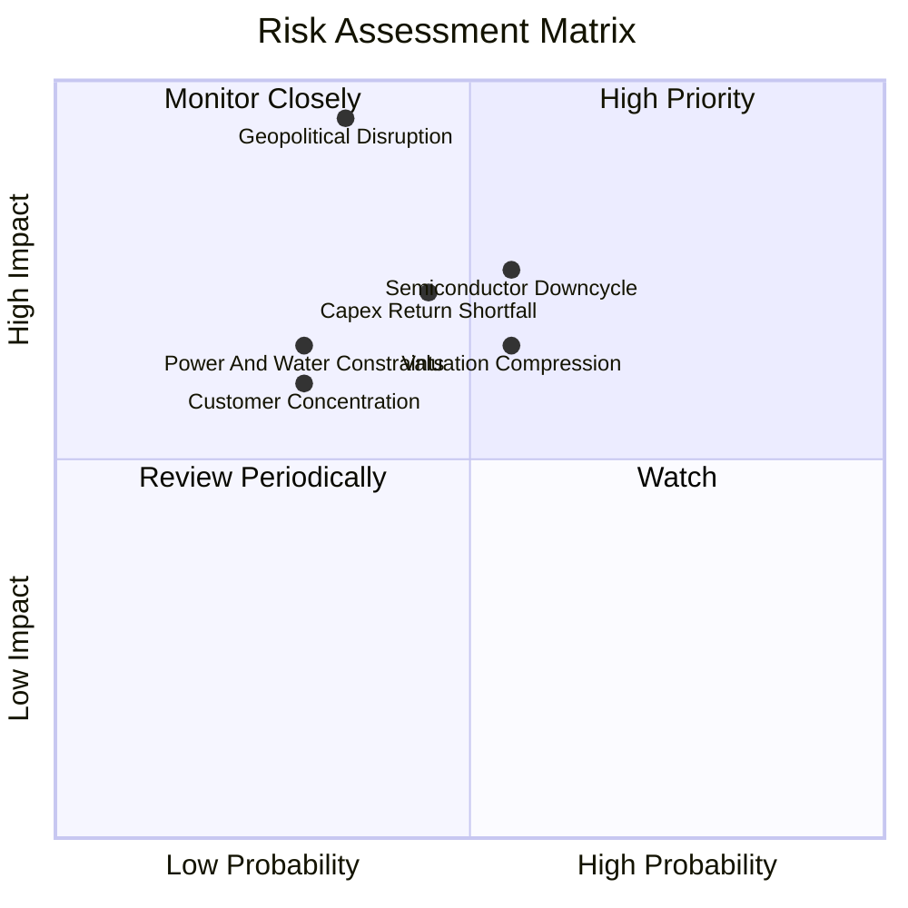

### 10.2 風險清單詳細分析

| # | 風險項目 | 發生機率 | 財務衝擊 | 風險評分 | 緩解措施 |
|---|----------|----------|----------|----------|----------|
| 1 | 🔴 **地緣政治／供應中斷** | 中（質化估計） | 極高；收入與產能可大幅中斷，無可靠百分比資料 | 🔴 9.5/10 | 追蹤跨區產能、供應鏈備援、客戶庫存與交付狀況；不要把海外設廠等同風險消失。 |
| 2 | 🔴 **半導體景氣反轉** | 中高（質化估計） | 高；營收與毛利率可能同步下行，TTM 營業利益率目前 58.0% | 🔴 8.0/10 | 監控訂單、利用率、庫存天數及管理層財測；觀察營業利益率是否連續兩季收縮。 |
| 3 | 🟠 **高 Capex 回報不如預期** | 中（質化估計） | 高；TTM Capex 1.66T TWD，Capex/營收 33.6% | 🟠 7.5/10 | 追蹤新增產能利用率、折舊與現金回收；若 ROIC 接近 WACC，應降低成長溢價。 |
| 4 | 🟠 **估值倍數收縮** | 中高（質化估計） | 高；現價較基準 DCF 約溢價 54.4% | 🟠 7.0/10 | 以 DCF、FCF Yield 和相對估值分批建立部位，避免僅依分析師目標價追價。 |
| 5 | 🟡 **電力、水資源與供應鏈限制** | 低中（質化估計） | 高；可能限制擴產或提高成本 | 🟡 6.5/10 | 追蹤廠區供應能力、能源效率、供應商備援與公司揭露。 |
| 6 | 🟡 **客戶／應用集中** | 資料不足 | 中高；主要客戶占比 N/A | 🟡 6.0/10 | 監控客戶集中度、主要平台需求與各終端市場營收披露。 |

---

## 11. 投資建議

### 11.1 最終綜合評級雷達圖

```
╔══════════════════════════════════════════════════════════════╗
║                2330.TW 最終綜合評分 (1-10)                    ║
╠══════════════════════════════════════════════════════════════╣
║ 基本面強度  8.5  ▓▓▓▓▓▓▓▓▓▓▓▓▓▓▓▓▓░░░  ★★★★☆             ║
║ 成長動能    8.5  ▓▓▓▓▓▓▓▓▓▓▓▓▓▓▓▓▓░░░  ★★★★☆             ║
║ 獲利能力    9.0  ▓▓▓▓▓▓▓▓▓▓▓▓▓▓▓▓▓▓░░  ★★★★★             ║
║ 財務健康    9.0  ▓▓▓▓▓▓▓▓▓▓▓▓▓▓▓▓▓▓░░  ★★★★★             ║
║ 估值合理性  4.0  ▓▓▓▓▓▓▓▓░░░░░░░░░░░░  ★★☆☆☆             ║
║ 護城河深度  8.5  ▓▓▓▓▓▓▓▓▓▓▓▓▓▓▓▓▓░░░  ★★★★☆             ║
║ 管理層執行  7.0  ▓▓▓▓▓▓▓▓▓▓▓▓▓▓░░░░░░  ★★★☆☆             ║
╠══════════════════════════════════════════════════════════════╣
║ 最終評級：🟠 減碼；MOS −14.1%，現價高於加權合理價值          ║
╚══════════════════════════════════════════════════════════════╝
```

### 11.2 目標價與隱含報酬率

| 情境 | 目標價 | 相對 2,350 TWD | 機率權重 | 假設摘要 |
|------|-------:|---------------:|---------:|----------|
| 🔴 悲觀 | 1,944 TWD | −17.3% | 25% | Forward EPS 149.53442 × 13x；營收 CAGR 假設 12%、營業利潤率 52% |
| 🟡 基準 | 2,692 TWD | +14.6% | 50% | Forward EPS 149.53442 × 18x；營收 CAGR 假設 18%、營業利潤率 58% |
| 🟢 樂觀 | 3,738 TWD | +59.1% | 25% | Forward EPS 149.53442 × 25x；營收 CAGR 假設 22%、營業利潤率 60% |

情境目標價以 Forward P/E 乘資料包 Forward EPS 計算；假設營收 CAGR 與營業利潤率並未直接改寫 EPS，故目標價應視為倍數分析，而非完整三表模型輸出。

### 11.3 買入時機與觸發因素

```
╔══════════════════════════════════════════════════════════════════╗
║                  ✅ 買入觸發因素 Checklist                      ║
╠══════════════════════════════════════════════════════════════════╣
║ 目前判斷：MOS −14.1%，不符合買入評級的價值門檻                  ║
║                                                                  ║
║ 重新評估買入條件：                                              ║
║ ☐ 股價回落至加權合理價值 2,059.89 TWD 以下                      ║
║ ☐ 若要達 MOS ≥10%，價格需低於約 1,854 TWD                       ║
║ ☐ 營業利益率維持 55% 以上且營收仍有雙位數成長                   ║
║                                                                  ║
║ 加碼觸發條件：                                                  ║
║ ☐ TTM FCF 高於 1.46T TWD，且 FCF Yield 隨價格回落改善           ║
║ ☐ Capex 轉換為營收與現金流，ROIC 估算持續高於 WACC 11.19%       ║
║ ☐ 連續兩季營業利益率不低於 55%，且管理層財測未下修              ║
║                                                                  ║
║ 減碼／停損檢視條件：                                            ║
║ ☐ 營業利益率較 58.0% 下滑 5 個百分點以上並持續兩季              ║
║ ☐ FCF 轉負，或 Capex 上升但營收／現金流未同步改善               ║
║ ☐ ROIC 估算跌至 WACC 11.19% 以下                                ║
║ ☐ 地緣政治事件對產能、交付或資產安全產生實質影響                ║
╚══════════════════════════════════════════════════════════════════╝
```

### 11.4 投資人適配度分析

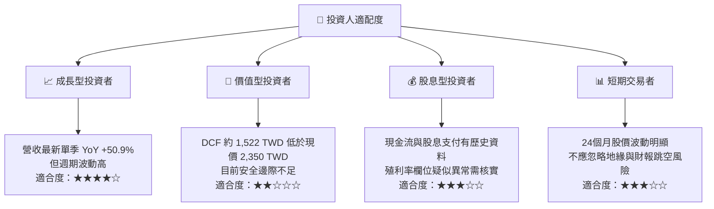

### 11.5 每季財報監控清單（Quarterly Watch List）

| 指標 | 目前基準 | 觸發加碼 | 觸發減碼／重估 | 為何重要 |
|------|----------|----------|----------------|----------|
| 單季營收 YoY | 最新單季 **+50.9%** | 連續季度維持正增長且不依賴單一季度 | 連續兩季低於 10% 或轉負 | 驗證需求與成長假設 |
| 營業利益率 | TTM **58.0%**；最新季 **58.0%** | ≥55% 且趨勢穩定 | 低於 53% 並持續兩季 | 反映產品組合、利用率、成本 |
| 毛利率 | TTM **65.8%** | 維持高於 60% | 連續下滑並低於 60% | 反映定價、折舊與產能吸收 |
| Capex | TTM **1.66T TWD** | Capex 增長伴隨營收與 FCF 改善 | Capex 上升、FCF 同步下滑 | 測試投資回報 |
| FCF | TTM **1.46T TWD** | 逐季改善且 FCF Yield 上升 | FCF 轉負或連續兩季顯著下降 | 驗證獲利現金含量 |
| 營業現金流 | TTM **3.13T TWD** | 維持高於淨利 | 顯著低於淨利且應收／庫存上升 | 監控盈餘品質 |
| ROIC vs WACC | ROIC 估算 **44.2%** vs **11.19%** | ROIC 穩定大幅高於 WACC | ROIC 跌至 WACC 以下 | 判斷新投資是否創造價值 |
| 研發投入 | 2025 年 **246.43B TWD** | 投入轉化為製程／客戶需求 | 支出增加但商業化落後 | 研發是長期競爭力投入 |
| EPS surprise | 最近四季預估與實際 N/A | 取得可靠一致的分析師預估後跟踪 | 連續不及預期需查因 | 現有 EPS surprise 數據缺漏 |
| 股息資料 | 2025 現金股息支付 **466.78B TWD** | 核實每股股息及覆蓋能力 | 派息超出可持續現金流 | 資料包顯示的 Dividend Yield 103.0% 疑似錯誤 |

### 11.6 反面論證：什麼會證明論點錯誤（What Would Change My Mind）

```
╔══════════════════════════════════════════════════════════════════╗
║              ⚠️ 論點失效條件（Disconfirming Evidence）           ║
╠══════════════════════════════════════════════════════════════════╣
║ 本投資論點在下列情況出現時應重新檢視或退出：                    ║
║ ☐ 最新單季營收 YoY 低於 10%，且連續兩季未回升                   ║
║ ☐ 營業利益率由 TTM 58.0% 下滑超過 5 個百分點並持續兩季          ║
║ ☐ TTM FCF 由 1.46T TWD 轉負，且非短期擴產造成                   ║
║ ☐ ROIC 估算跌破 WACC 11.19%，表示新投資回報不足                 ║
║ ☐ Capex/營收持續高於本模型 33.6%，但營收與 FCF 未同步成長        ║
║ ☐ 關鍵地緣政治事件實際影響產能或長期交付能力                    ║
║ ☐ 新增產能投產後仍無法支撐高利用率與既有 58.0% 營業利潤率       ║
╚══════════════════════════════════════════════════════════════════╝
```

> **免責聲明**：本報告為 AI 自動生成，僅供研究參考，不構成投資建議。財務資料存在期間與口徑差異，DCF 含明示假設；投資有風險，入市需謹慎。