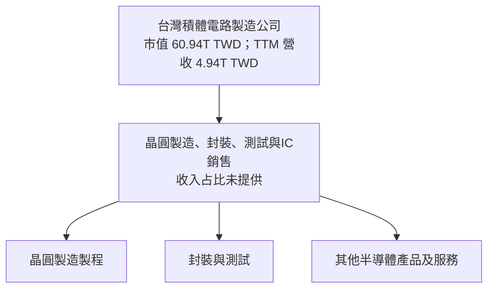
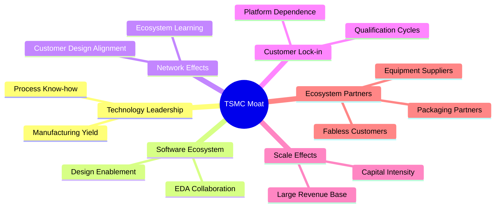
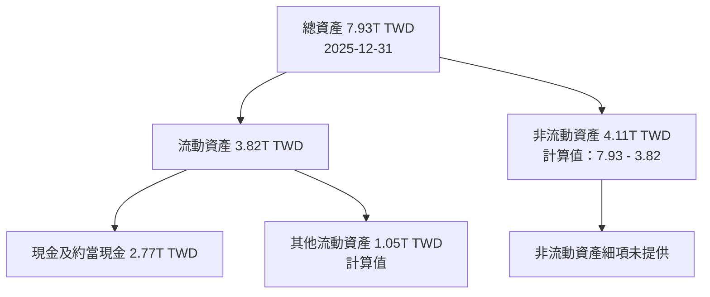
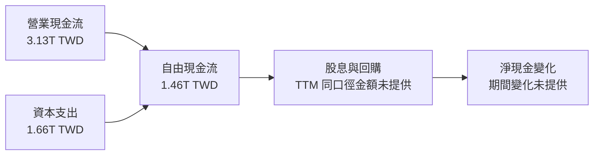
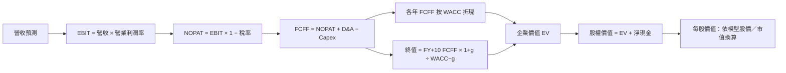
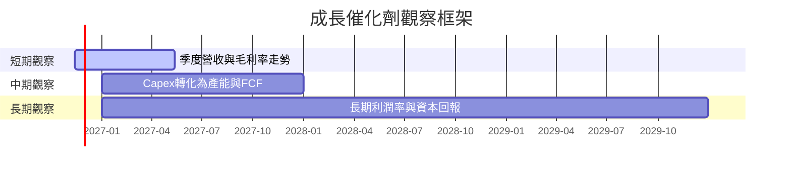
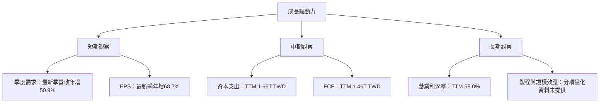
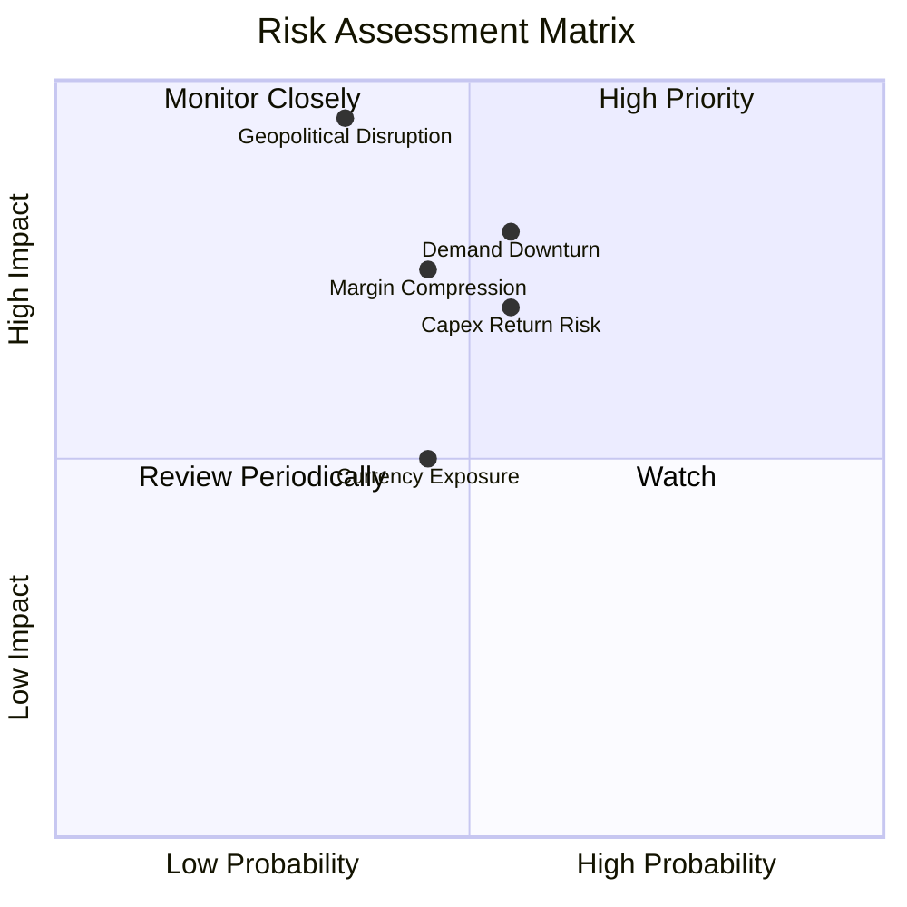
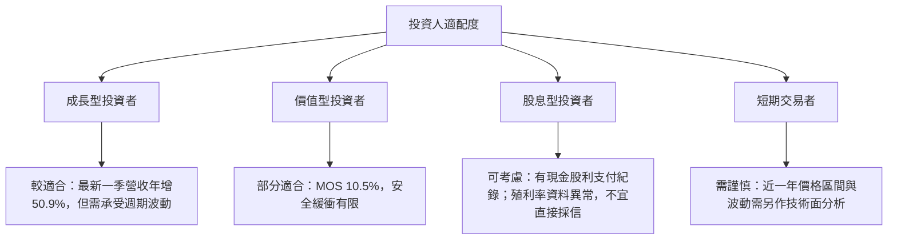

# 2330.TW 基本面深度分析報告
> **報告日期**：2026-11-14 ｜ **語言**：繁體中文 ｜ **數據來源**：Yahoo Finance、Roic.ai ｜ **分析師**：CFA 級機構研究

## 目錄

| # | 章節 | 核心結論 |
|---|------|----------|
| 1 | 執行摘要 | 買入；加權合理價值 2,626.51 TWD；MOS +10.5% |
| 2 | 公司概覽與商業模式 | 晶圓代工規模與製程能力構成核心護城河 |
| 3 | 損益表深度分析 | TTM 營收 4.94T TWD；最新一季年增 50.9% |
| 4 | 資產負債表分析 | 淨現金 3.20T TWD；流動性充足 |
| 5 | 現金流量深度分析 | TTM FCF 1.46T TWD，資本支出仍高 |
| 6 | 獲利能力與資本效率 | WACC 10.80%；最新 ROIC 不可得，無法確認當期價值利差 |
| 7 | 相對估值分析 | Forward P/E 15.7x；估值方法指向不同區間 |
| 8 | DCF 內在價值評估 | 基準 DCF 2,803.31 TWD；模型輸出有算術差異需審慎 |
| 9 | 成長催化劑 | 最新一季營收年增 50.9%；TAM 數據未提供 |
| 10 | 風險矩陣 | 地緣政治、資本密集與需求週期是主要風險 |
| 11 | 投資建議 | 買入；關注利潤率、資本支出、FCF 與營收增速 |

## 1. 執行摘要

### 1.0 一頁式投資儀表板

| 項目 | 內容 |
|------|------|
| **投資論點（3 句）** | ① TTM 營業利益率為 58.0%，反映現階段產品組合與營運槓桿有利。② 最新一季營收年增 50.9%、EPS 年增 68.7%，但這是單季成長率，TTM 成長率未提供。③ TTM FCF 為 1.46T TWD、淨現金 3.20T TWD，提供投資擴產與承受週期波動的財務空間。 |
| **綜合評分** | **8.2/10**（引用 1.1 評分卡） |
| **財務健康** | 🟢 現金及短期投資 4.02T TWD、總債務 818.38B TWD、流動比率 2.505 |
| **ROIC vs WACC** | 最新 ROIC：N/A；WACC：10.80%。歷史 ROIC.ai 2018 年為 19.11%，但非同一期間，不能據此確認當期價值利差 |
| **FCF 趨勢** | TTM FCF 1.46T TWD；FCF Yield 2.40%。近年 FCF 上升，但擴產支出使現金轉換仍需追蹤 |
| **估值** | Forward P/E 15.715445x ｜ EV/EBITDA 15.989x ｜ FCF Yield 2.40% |
| **DCF 內在價值（基準）** | 2,803.31 TWD；現價相對 DCF 折價 **16.2%**（現價 ÷ DCF − 1） |
| **安全邊際（MOS）** | **+10.5%**＝(加權合理價值 2,626.51 − 現價 2,350.00) ÷ 2,626.51 ｜ 🟡 有限 |
| **預期報酬（基準情境）** | +19.3%（DCF 基準情境，相對 2026-11-13 收盤價） |
| **關鍵風險（前二）** | 地緣政治／供應鏈中斷；高資本支出與需求週期反轉 |
| **評級 + 信心度** | 🟢 **買入** ｜ 信心：中（MOS 達門檻，但 DCF 模型有算術檢核差異，且 ROIC、TTM 成長率缺漏） |

### 1.1 綜合評分卡

| 維度 | 評分（1–10） | 主要依據（引用數字與其來源章節） |
|------|--------------|----------------------------------|
| 成長性 | 9 | 最新一季營收年增 50.9%、EPS 年增 68.7%；TTM 營收年增率未提供（第 3 章） |
| 獲利能力 | 9 | TTM 營業利益率 58.0%、毛利率 65.8%；最新 ROIC 與 F-Score 不可得（第 3、6 章） |
| 財務健康 | 9 | 淨現金 3.20T TWD、流動比率 2.505、CCC 37 天（第 4 章） |
| 估值 | 6 | 加權合理價值 2,626.51 TWD，MOS +10.5%；同業估值方法區間分歧（第 7、8 章） |
| 護城河 | 9 | 58.0% TTM 營業利益率及相對成熟同業的高毛利率，與製程、規模特徵相符（第 2、7 章） |
| 管理層與資本配置 | 7 | 2025 年 Capex 1.28T TWD、股利支付 466.78B TWD；回購資料未提供（第 5 章） |
| **綜合評分** | **8.2** | 六項算術平均：(9 + 9 + 9 + 6 + 9 + 7) ÷ 6 = 8.2 |

### 1.2 五大投資論點 + 三大核心風險

| 類型 | 項目 | 具體依據 | 信心度 |
|------|------|----------|--------|
| 🟢 **投資論點①** | 高成長動能 | 最新一季營收年增 50.9%、淨利年增 68.7%；若需求與產品組合維持，營運槓桿可延續 | 🟢 高 |
| 🟢 **投資論點②** | 高獲利率 | TTM 毛利率 65.8%、營業利益率 58.0%、淨利率 51.1%，提供抵禦成本波動的緩衝 | 🟢 高 |
| 🟢 **投資論點③** | 正向自由現金流 | TTM OCF 3.13T、Capex 1.66T，FCF 1.46T TWD | 🟢 高 |
| 🟢 **投資論點④** | 淨現金資產負債表 | 現金及短期投資 4.02T、總債務 818.38B、淨現金 3.20T TWD | 🟢 高 |
| 🟢 **投資論點⑤** | 市場定價未完全反映基準價值 | 加權合理價值 2,626.51 TWD，相對現價 MOS +10.5%；但緩衝不大 | 🟡 中 |
| 🟡 **風險①** | 地緣政治與營運中斷 | 公司具跨國營運與先進製造資產，若台灣供應鏈受阻，收入與資產可用性都可能受重大影響；財務資料無法量化衝擊 | 🔴 高衝擊 |
| 🔴 **風險②** | 需求反轉與固定成本槓桿 | 最新一季營收年增 50.9%，若需求快速回落，固定成本使利潤率下行幅度可能高於營收跌幅 | 🔴 高 |
| 🟡 **風險③** | 擴產回收期與現金流波動 | TTM Capex 1.66T TWD、FCF Yield 2.40%；擴產若利用率不足，資本回報將受壓 | 🟡 中高 |

### 1.3 快速統計卡片

| 指標 | 公司實際值（期間） | 同業中位數 | 狀態 |
|------|--------------------|------------|------|
| 營收成長（TTM） | **N/A** | — | 🟡 數據未提供 |
| 營收成長（最新一季年增） | **50.9%** | 20.9% | 🟢 高於所列同業 |
| 毛利率（TTM） | **65.8%** | 31.7%（UMC、GFS、INTC 中位數） | 🟢 高 |
| 營業利益率（TTM） | **58.0%** | — | 🟢 高 |
| ROIC（TTM） | **N/A** | — | 🟡 數據未提供 |
| Forward P/E | **15.715445x** | 17.1x（UMC、GFS、INTC 中位數） | 🟢 相對較低 |
| FCF Yield（TTM） | **2.40%** | — | 🟡 估值需配合成長判斷 |
| Piotroski F-Score | **N/A / N/A** | — | 🟡 缺少可計算資料 |

### 1.4 投資結論

```
╔══════════════════════════════════════════════════════════════════╗
║                    📊 投資結論摘要                               ║
╠══════════════════════════════════════════════════════════════════╣
║  評級：買入（MOS +10.5%，依規則 20）                              ║
║  價格（2026-11-13 收盤）：2,350.00 TWD                           ║
║  DCF 內在價值（基準）：2,803.31 TWD（現價折價 16.2%）             ║
║  安全邊際 MOS：+10.5%（以加權合理價值為分母）                    ║
║  加權合理價值（8.8）：2,626.51 TWD                               ║
║  DCF 情境價值：                                                   ║
║    悲觀情境：1,205.49 TWD（-48.7%）                              ║
║    基準情境：2,803.31 TWD（+19.3%）                              ║
║    樂觀情境：6,188.26 TWD（+163.3%）                             ║
║  綜合評分：8.2/10（引用 1.1）                                    ║
║  適合投資人：能承受半導體週期與地緣政治波動的長線投資人           ║
╚══════════════════════════════════════════════════════════════════╝
```

## 2. 公司概覽與商業模式

### 2.1 業務結構與收入來源

公司從事晶圓製造、封裝、測試及半導體元件銷售。財務資料沒有提供業務板塊營收占比、各節點營收或服務收入拆分，故不以未驗證比例繪製收入占比圖。



### 2.2 市場份額

市場份額數據未提供，亦無可引用的新聞數字及年份，因此不推估市占率。可確認的是公司 TTM 營收 4.94T TWD、最新一季營收年增 50.9%；所列同業 UMC、GFS、INTC 最新一季營收年增分別為 25.6%、12.5%、20.9%，但公司業務組合及規模不可單以成長率直接比較。

### 2.3 競爭護城河分析



### 2.4 護城河強度

| 護城河項目 | 強度（強／中／弱） | 證據（引用數字或事實） | 會削弱它的情況 |
|------------|--------------------|------------------------|----------------|
| 技術與製造能力 | 強 | TTM 營業利益率 58.0%、毛利率 65.8%；符合高附加價值製造的財務表現，但數據未提供節點市占率 | 良率落後、技術追趕或客戶轉單 |
| 客戶鎖定與驗證週期 | 中至強 | 公司提供晶圓製造、封裝與測試；客戶設計與製程整合通常有切換成本，個別客戶占比未提供 | 客戶多源化、內製化或替代製程成熟 |
| 規模效應 | 強 | TTM 營收 4.94T TWD，年內季度收入由 1.05T 增至 1.49T TWD | 高額投資未能轉化為利用率及回報 |
| 生態夥伴 | 中至強 | 公司跨區域營運並提供多種製程；具體合作夥伴數與收入貢獻未提供 | 供應鏈瓶頸、出口限制或合作生態轉移 |
| 軟體生態系統 | 中 | 財務數據未列軟體收入或生態系統收入，主要價值應視為製造服務協同而非獨立軟體收入 | 客戶工具鏈與製程支援能力弱化 |
| 網路效應 | 中 | 累積製造經驗與客戶協作可能提升效率，但缺少可量化網路效應指標 | 客戶規模與製程知識不再帶來差異化 |

1.1「護城河」評分為 9 分，依據是 58.0% TTM 營業利益率、65.8% 毛利率及規模效應；業務拆分與市場份額缺漏使評估仍有不確定性。

## 3. 損益表深度分析

### 3.1 年度收入成長趨勢（近4年）

年度收入 YoY 依年度財報數字計算；TTM 成長率另為 N/A。2022–2025 年收入 CAGR 約 19.0%。

```
╔══════════════════════════════════════════════════════════════════╗
║          台積電年度收入趨勢（FY2022-FY2025，TWD）                ║
╠══════════════════════════════════════════════════════════════════╣
║  FY2022  2.26T  ██████████████████░░  基期                      ║
║  FY2023  2.16T  █████████████████░░░  YoY -4.4% 🟡              ║
║  FY2024  2.89T  ███████████████████████░░  YoY +33.8% 🟢        ║
║  FY2025  3.81T  ██████████████████████████████  YoY +31.7% 🟢   ║
║                                                                  ║
║  2022-2025 收入 CAGR：約 19.0%                                   ║
╚══════════════════════════════════════════════════════════════════╝
```

2023 年收入降至 2.16T TWD，較 2022 年低 4.4%；2024–2025 年反彈，分別年增 33.8% 與 31.7%。此變化顯示半導體需求週期會影響收入，但最近兩年增長提高了固定成本吸收能力。

### 3.2 季度收入趨勢分析

| 季度 | 營收（TWD） | QoQ | YoY | 備註 |
|------|-------------:|----:|----:|------|
| 2025-12 | 1.05T | +5.7% | +20.4% | 相較 2025-09 與 2024-12 |
| 2026-03 | 1.13T | +8.4% | +35.1% | 2026 Q1 相較 2025 Q1 |
| 2026-06 | 1.27T | +12.0% | +36.1% | 2026 Q2 相較 2025 Q2 |
| 2026-09 | 1.49T | +17.6% | **+50.9%** | 最新一季年增率；不是 TTM 成長率 |

季度營收由 2025-12 的 1.05T 增至 2026-09 的 1.49T TWD，連續增加。單季加速代表當期需求與產品組合有利，但不應直接外推為長期 TTM 成長率。

### 3.3 利潤率演變分析

| 利潤率指標 | FY2022 | FY2023 | FY2024 | FY2025 | 趨勢 | 評估 |
|------------|--------|--------|--------|--------|------|------|
| **毛利率** | 59.7% | 54.6% | 56.1% | 59.8% | 2023 下行後回升 | 🟢 |
| **營業利益率** | 49.6% | 42.7% | 45.7% | 50.9% | 2023 低點後擴張 | 🟢 |
| **淨利率** | 43.9% | 39.4% | 40.1% | 44.6% | 與營業利益率方向一致 | 🟢 |

利潤率以財報年度總額相除計算。2023 年營業利益率降至 42.7%，其後回升至 2025 年 50.9%，與收入復甦、產能利用及產品組合改善相符；但財務數據沒有提供單位成本、各節點組合或售價資料，不能將改善精確分解為價格、良率或成本控制各自貢獻。

### 3.4 費用結構分析

財務數據未提供完整費用明細與銷貨成本拆分，故不繪製費用結構圓餅圖。可用資訊為 2025 年研發費用 246.43B TWD，約占當年收入 3.81T 的 6.5%；研發費用由 2024 年 204.18B 增至 2025 年 246.43B，約年增 20.7%，支持製程與產品迭代，但其回報無法由單年數字單獨驗證。

### 3.5 季度 EPS 趨勢與盈餘品質（Quality of Earnings）

| 季度 | EPS（TWD） | EPS YoY | 預估／實際差異 |
|------|-----------:|--------:|----------------|
| 2025-12 | 18.72 | +35.0% | EPS estimate 為 N/A，無法判定超預期或不及預期 |
| 2026-03 | 22.08 | +58.3% | EPS estimate 為 N/A，無法判定 |
| 2026-06 | 27.25 | +77.4% | EPS estimate 為 N/A，無法判定 |
| 2026-09 | 29.43 | +68.7% | EPS estimate 為 N/A，無法判定 |

歷史 EPS 取 Roic.ai 季度資料；最新季度年增 68.7% 與財務數據區的 EPS 成長率一致。由於 EPS 預估值全為缺漏，不能對四季作超預期／不及預期判斷。

| 盈餘品質項目 | 數值／佔比 | 評估 |
|--------------|-----------|------|
| 股權薪酬 SBC / 營收 | 2025 年 1.25B ÷ 3.81T = 約 0.033% | 🟢 相對營收稀釋規模低；季度 SBC 有缺漏 |
| SBC / 營業現金流 | 2025 年 1.25B ÷ 2.27T = 約 0.055% | 🟢 相對現金流占比低 |
| FCF / 淨利（現金轉換率） | 近四季淨利合計 2.528T；1.46T ÷ 2.528T ≈ 57.8% | 🟡 高資本支出壓低自由現金流轉換 |
| 一次性／非經常性損益 | N/A（未提供拆分） | 🟡 無法排除一次性項目影響 |
| 有效稅率異常 | 17.0%（成本資本資料所列最新年度有效稅率） | 🟢 未見資料顯示本期由異常低稅率帶動 |
| 資本化支出 vs 費用化 | TTM Capex 1.66T TWD；資本化明細 N/A | 🟡 製造業資本支出重大，但缺少資本化細節 |

**盈餘品質結論**：營業現金流 3.13T TWD 高於淨利，現金盈利基礎存在；但 TTM FCF 對近四季淨利轉換率約 57.8%，主要需結合 1.66T TWD 資本支出理解。SBC 相對收入與現金流很低。由於一次性損益及資本化明細未提供，不能對 GAAP 淨利是否受其美化作強結論。

## 4. 資產負債表分析

### 4.1 資產結構分解

以下年度分項採 2025-12-31 資料；非流動資產以總資產減流動資產計算。



### 4.2 流動性與營運資金分析

| 指標 | 數值 | 評估 |
|------|------|------|
| 流動比率 | 2.505 | 🟢 流動資產足以覆蓋流動負債 |
| 速動比率 | 2.287 | 🟢 扣除存貨後短期覆蓋仍充足 |
| DSO 應收帳款天數 | 36 天 | 有利於短期收款，但缺乏一年前比較值 |
| DIO 存貨天數 | 92 天 | 存貨天數偏長需觀察需求與產品週期 |
| DPO 應付帳款天數 | 91 天 | 供應商付款週期與存貨天數接近 |
| CCC 現金轉換週期 | 37 天 | DSO + DIO − DPO = 36 + 92 − 91 = 37 天 |

一年前營運資金天數數值未提供，無法評估方向變化。CCC 37 天表示公司仍需投入現金支持存貨與應收款，但 DPO 可抵銷部分資金占用；沒有應收帳款逾期或存貨組成數據，不能將天數變化歸因於信用政策或產品滯銷。

### 4.3 債務結構分析

```
╔══════════════════════════════════════════════════════════════════╗
║                   台積電債務健康診斷                             ║
╠══════════════════════════════════════════════════════════════════╣
║  總債務：          818.38B TWD                                    ║
║  現金及短期投資：  4.02T TWD                                      ║
║  淨現金：          3.20T TWD  🟢                                 ║
║                                                                  ║
║  流動比率：        2.505  🟢                                     ║
║  速動比率：        2.287  🟢                                     ║
║  Debt/EBITDA：     約 0.30x（818.38B ÷ TTM EBITDA 約 2.41T）      ║
║  利息保障倍數：    N/A（利息費用未提供）                          ║
║                                                                  ║
║  口徑提醒：年度資產負債表 2025 年總債務為 1.06T TWD；             ║
║  本報告淨現金與估值採 VERIFIED 最新口徑 818.38B TWD。             ║
╚══════════════════════════════════════════════════════════════════╝
```

### 4.4 股東權益趨勢

```
╔══════════════════════════════════════════════════════════════════╗
║               股東權益趨勢（TWD）                                ║
╠══════════════════════════════════════════════════════════════════╣
║  2022  2.90T  ███████████████░░░░░                               ║
║  2023  3.43T  ██████████████████░░                                ║
║  2024  4.24T  ██████████████████████░                             ║
║  2025  5.36T  ████████████████████████████                       ║
║                                                                  ║
║  2022-2025 權益持續增加；2025 年權益約為 2022 年的 1.85 倍。      ║
╚══════════════════════════════════════════════════════════════════╝
```

## 5. 現金流量深度分析

### 5.1 現金流量瀑布圖

以 TTM 數據展示 OCF、Capex 與 FCF；淨利及股息同期間完整對應數據未全數提供，因此不放入金額節點。



### 5.2 FCF 轉換率趨勢

| 財年 | FCF（TWD） | 淨利（TWD） | FCF / 淨利 |
|------|-----------:|------------:|-----------:|
| 2022 | 520.97B | 992.92B | 52.5% |
| 2023 | 286.57B | 851.74B | 33.6% |
| 2024 | 861.20B | 1.16T | 74.2% |
| 2025 | 992.38B | 1.70T | 58.4% |

2024 年現金轉換率改善至 74.2%，2025 年回落至 58.4%，雖然 FCF 絕對值增加，但淨利成長快於 FCF。主要觀察點是資本支出週期，而非單純把較低轉換率視為獲利品質惡化。

### 5.3 自由現金流趨勢

```
╔══════════════════════════════════════════════════════════════════╗
║               自由現金流趨勢（年度，TWD）                        ║
╠══════════════════════════════════════════════════════════════════╣
║  2022  520.97B  ███████████████░░░░░░░░░░░░░                     ║
║  2023  286.57B  ████████░░░░░░░░░░░░░░░░░░░░░                     ║
║  2024  861.20B  ████████████████████████░░░░░                     ║
║  2025  992.38B  ████████████████████████████░░                     ║
║                                                                  ║
║  TTM FCF：1.46T TWD ｜ TTM FCF Yield：2.40%                      ║
╚══════════════════════════════════════════════════════════════════╝
```

### 5.4 資本配置評估

| 資本用途 | 已知數據 | 分析 |
|----------|----------|------|
| 資本支出 | 2025 年 1.28T TWD；TTM 1.66T TWD | 高額投資支撐產能與技術，但提高需求下行時的固定成本及回收風險 |
| 股息 | 2025 年現金股利支付 466.78B TWD | 具現金分配能力；資料所列股息殖利率 102.0% 明顯異常，不採作投資判斷 |
| 股票回購 | N/A | 未提供可確認金額 |
| 留存現金 | 現金及短期投資 4.02T TWD | 保留財務彈性，但資金用途及最低現金需求未提供 |

## 6. 獲利能力與資本效率

### 6.1 ROE / ROA / ROIC 趨勢

| 指標 | 已知期間與數值 | 評估 |
|------|----------------|------|
| ROE | TTM 41.9% | 🟢 盈利能力高；杜邦拆解因品質指標缺漏而不重算 |
| ROA | TTM 20.6% | 🟢 資產盈利能力高 |
| ROIC | 最新 TTM N/A；Roic.ai 2018 年 19.11% | 🟡 舊年度資料不能代表當期 |
| 行業均值 | 未提供 | 不列未驗證比較值 |

### 6.2 ROIC vs WACC 分析（核心價值創造判斷）

```
╔══════════════════════════════════════════════════════════════════╗
║                ROIC vs WACC 深度分析                            ║
╠══════════════════════════════════════════════════════════════════╣
║  WACC（直接採用資本成本資料）：10.80%                             ║
║  ├── 無風險利率：5.15%                                           ║
║  ├── 股權風險溢酬：5.00%                                         ║
║  ├── 原始 Beta：1.23；採用調整後 Beta：1.16                      ║
║  ├── 股權成本（資料值）：10.93%                                  ║
║  ├── 稅前債務成本：1.51%；有效稅率：17.0%                        ║
║  ├── 股權／債務權重：98.7%／1.3%                                 ║
║  └── WACC：10.80%                                                ║
║                                                                  ║
║  最新 ROIC：N/A（當期投入資本／NOPAT資料不足）                   ║
║  歷史參考：Roic.ai 2018 ROIC 19.11%，非當期數值                  ║
║  EVA：當期 N/A，不能用舊年度 ROIC 減當期 WACC 假裝為當期利差     ║
║                                                                  ║
║  判斷：當期是否以 ROIC > WACC 創造價值，資料不足以確認。          ║
╚══════════════════════════════════════════════════════════════════╝
```

資本成本資料列出的 CAPM 股權成本為 10.93%，其提供的 Rf、調整後 Beta 與 ERP 四捨五入後相乘相加會有輕微差異；本節與 DCF 一律採資料所列 WACC 10.80%，不另行改算。

### 6.3 杜邦三因素分解

N/A（QUALITY FIGURES 未提供杜邦分解；缺少所需一致口徑資料，因此不自行補算）。

### 6.4 財務體質：Piotroski F-Score

N/A（需要相隔一年的兩組 TTM SEC 申報資料；現有資料沒有該計算所需資料）。九項測試結果均不可判定，因此不列空白測試表。

## 7. 相對估值分析

### 7.1 同業估值比較表格

| 估值指標 | **2330.TW** | **UMC** | **GFS** | **INTC** | 本公司評估 |
|----------|-----------:|--------:|-------:|--------:|-----------|
| **Trailing P/E** | 24.109982x | 14.5x | 118.5x | N/A | 🟡 位於兩個可比值之間；同業差異極大 |
| **Forward P/E** | 15.715445x | 17.1x | 16.0x | 33.3x | 🟢 低於三家同業中位數 17.1x |
| **P/S Ratio** | 12.324229x | N/A | 3.2x | 5.3x | 🔴 高於可用同業；公司利潤率更高，不能只按 P/S 判斷 |
| **EV/EBITDA** | 15.989x | N/A | 11.1x | 17.2x | 🟡 高於 GFS、低於 INTC |
| **最新一季營收 YoY** | 50.9% | 25.6% | 12.5% | 20.9% | 🟢 高於所列同業 |
| **毛利率 TTM** | 65.8% | 31.7% | 28.5% | 40.2% | 🟢 高於所列同業 |

Peer multiples 取 Yahoo Finance 同業數據；UMC 的 P/S、EV/EBITDA 因幣別混合未提供，不補值。

### 7.2 歷史估值區間分析

N/A（未提供 Valuation vs own history 的 P/E 歷史區間或百分位；不自行估算位置）。

### 7.3 情境價值（Bear / Base / Bull）

| 情境 | 第 1 年營收成長 | 期末營業利潤率 | WACC | 每股價值 | 相對現價 | 機率 | 會發生的條件 |
|------|----------------:|----------------:|-----:|---------:|---------:|-----:|--------------|
| 🔴 悲觀 | 15.0% | 42.1% | 11.80% | 1,205.49 TWD | -48.7% | 25% | 需求放緩、產能利用下降，且利潤率向較低水平收斂 |
| 🟡 基準 | 30.0% | 49.5% | 10.80% | 2,803.31 TWD | +19.3% | 50% | 前期延續高成長，長期成長率與利潤率逐步正常化 |
| 🟢 樂觀 | 45.0% | 54.5% | 9.80% | 6,188.26 TWD | +163.3% | 25% | 高需求與高利用率延續，長期利潤率維持較高水準 |

樂觀情境要求成長、利潤率與折現率同時改善，故不宜將其視作一般基準目標。機率加權值為 3,250.09 TWD，僅作情境參考；8.8 合理價值依規定使用基準 DCF 與固定估值權重。

### 7.4 相對估值隱含價格區間

```
╔══════════════════════════════════════════════════════════════════╗
║            估值方法隱含每股價值（TWD）                           ║
╠══════════════════════════════════════════════════════════════════╣
║  EV/EBITDA 同業法   2,099.97  ─── 現價 2,350 ─── Forward P/E 2,559.75║
║                                   DCF 基準 2,803.31              ║
║                                   分析師共識 3,402.51            ║
╚══════════════════════════════════════════════════════════════════╝
```

| 方法 | 每股價值 | 依據 |
|------|---------:|------|
| 同業 Forward P/E | 2,559.75 TWD | UMC、GFS、INTC Forward P/E 中位數 17.1x × Forward EPS 149.53 |
| 同業 EV/EBITDA | 2,099.97 TWD | GFS、INTC 中位數 14.2x × TTM EBITDA，加回淨現金 |
| DCF 基準 | 2,803.31 TWD | 10 年 FCFF、WACC 10.80%、終值成長率 3.0% |
| 分析師共識 | 3,402.51 TWD | 35 位分析師平均目標價 |

## 8. DCF 內在價值評估（Discounted Cash Flow）

> 金額單位為 TWD 十億元（B），每股價值為 TWD。DCF 僅採用程式提供的模型輸出。下文保留模型數字，並在 8.10 揭露可見算術差異；估值信心因此降低。

### 8.0 估值推理鏈（Thinking Logic）

**Step 1 — 價值由哪些變數決定？**  
本模型的主要價值來源是既有晶圓製造業務所產生的現金流；目前 TTM 收入為 4.94T TWD，但業務板塊收入占比未提供，故不能把特定應用或新業務份額量化。模型最敏感的變數是折現率、長期成長率及資本支出路徑：終值現值占 EV 59.8%，顯示遠期假設對估值重要。

**Step 2 — 模型選擇**

| 決策點 | 本報告採用 | 理由（含數字） | 曾考慮但否決 | 否決理由 |
|--------|-----------|----------------|--------------|----------|
| 現金流定義 | FCFF | 使用 WACC 折現並求 EV；模型列有 NOPAT、D&A、Capex | FCFE | 資料未提供逐年融資變動預測 |
| 預測期 N | 10 年 | DCF 模型固定 10 年；長期衰減至 3.0% 成長 | 較短預測期 | 會更早把仍處成長期的現金流推入終值，但沒有另一模型可比 |
| 終值方法 | Gordon Growth | 模型採 g=3.0%、WACC=10.80% | 退出倍數 | DCF MODEL 未提供可採用的退出倍數終值 |
| EBIT 基礎 | GAAP EBIT | 模型明確使用 GAAP EBIT | 非 GAAP EBIT | 無資料支持加回 SBC |

**Step 3 — 關鍵假設推導鏈**

- **營收成長路徑**：錨點為最新一季年增 50.9%，但它是單季而非 TTM → 模型將其限制在 0%–30% 區間並逐年線性降至 3.0% → 採用 FY+1 30.0%、FY+10 3.0% → 曾考慮直接採 50.9%，但單季外推會忽略基期與週期風險，故不採。
- **期末營業利益率**：錨點為 TTM 58.0% → 模型逐年衰減至近五個財年中位數 49.5% → 採用 FY+10 49.5% → 曾考慮長期維持 58.0%，因其假設現有高利潤率永久不受成熟化及競爭影響，故否決。
- **預測期 N**：錨點為模型所定 10 年期 → 採用 10 年並逐年下調成長率 → 否決更短期間，原因是會提高終值占比；沒有額外資料支持改成更長期間。
- **Capex／營收**：錨點為 TTM 33.7% → 模型讓 Capex 率逐步降至 16.6%，並以 D&A 1.1 倍作底線 → 採用 FY+1 33.7%至 FY+10 16.6% → 否決永久維持 33.7%，因會忽略投資率正常化；也不採用過快下降，因缺少管理層資本支出指引。
- **永續成長率 g**：錨點為模型長期 3.0% → 低於 WACC 10.80%，使 Gordon Growth 分母為正 → 採用 3.0% → 不採等於或高於 WACC 的假設，因終值公式會失效。
- **WACC**：錨點為資本成本資料的 10.80% → 沿用提供值 → 否決自行另算 WACC，以免與固定估值輸入衝突。
- **SBC、股數及 EBIT**：錨點為 GAAP EBIT、SBC 已作費用處理 → 採用組合 A：GAAP EBIT、不另扣 SBC、股數不再稀釋 → 年稀釋率採 0% → 不採非 GAAP 加回 SBC 的方案，因缺少可核驗的調整資料。
- **有效稅率、D&A／營收**：採用資料所列 17.0% 與 15.1%；分別錨定最新年度有效稅率及 TTM 比率。
- **ΔWC**：模型未建模，故不填入估值，而非假設為已估計金額。

**Step 4 — 最脆弱環節**  
最脆弱的是 10 年成長與利潤率路徑；如果成長落入悲觀情境，模型價值為 1,205.49 TWD，較基準 2,803.31 TWD 低 57.0%。

**Step 5 — 計算路徑**



### 8.1 模型假設總表（Model Inputs）

| 假設項目 | 採用值 | 依據／來源 | 敏感度 |
|----------|--------|-------------|--------|
| 預測期長度 N | 10 年 | DCF MODEL 固定輸入 | 🟡 中 |
| 營收成長路徑 | FY+1 30.0%線性降至FY+10 3.0% | 最新一季年增 50.9%；模型將起點限制在最高 30.0% | 🔴 高 |
| 營業利潤率 | FY+1 58.0%至FY+10 49.5% | TTM 58.0%，長期回歸近五年財年中位數 | 🔴 高 |
| 有效稅率 | 17.0% | 最新年度有效稅率 | 🟢 低 |
| Capex／營收 | 33.7%降至16.6% | TTM 33.7%，逐步回歸 1.1×D&A 水準 | 🔴 高 |
| D&A／營收 | 15.1% | TTM 比率 | 🟢 低 |
| 營運資金變動 | 未建模 | DCF MODEL 明確不納入 Working Capital | 🟡 中 |
| EBIT 基礎 | GAAP EBIT | DCF MODEL | 🟡 中 |
| SBC 處理 | GAAP 已費用化，不另扣 SBC | DCF MODEL | 🟡 中 |
| 年稀釋率 | 0%；固定股數處理 | SBC 與股數採組合 A | 🟡 中 |
| 永續成長率 g | 3.0% | DCF MODEL；低於 WACC 10.80% | 🔴 高 |
| 終值方法 | Gordon Growth | DCF MODEL 僅提供此方法數值 | 🔴 高 |
| WACC | 10.80% | 資本成本資料 | 🔴 高 |

本模型採 **(A) GAAP EBIT + 固定股數**；SBC 影響已反映在 GAAP 費用中，不再另扣，也不再以年稀釋率重複計入。

### 8.2 折現率推導（WACC）

```
╔══════════════════════════════════════════════════════════════════╗
║                    WACC 推導（折現率）                           ║
╠══════════════════════════════════════════════════════════════════╣
║  股權成本 Ke（採用資本成本資料原值）：                            ║
║  ├── 無風險利率 Rf（10Y 美債）：      5.15%                       ║
║  ├── 市場風險溢酬 ERP：               5.00%                       ║
║  ├── 原始 Beta：1.23；調整後 Beta：1.16                           ║
║  ├── Beta 調整：⅔ × 1.23 + ⅓ × 1 = 1.153，資料採 1.16            ║
║  ├── 股權成本（資料值）：             10.93%                      ║
║  ├── 稅前債務成本：                   1.51%                       ║
║  ├── 有效稅率：                       17.0%                       ║
║  ├── E/D 權重：                       98.7% / 1.3%                 ║
║  └── WACC（直接採用）：               10.80%                      ║
╚══════════════════════════════════════════════════════════════════╝
```

資料未提供用於依提示逐項重建權重的完整計息負債平均餘額、利息費用及市場市值計算底稿，因此不自造中間值。成本資本資料提供的 CAPM 輸入為假設 ERP 5.00%、調整後 Beta 1.16；未另加國別或規模溢酬。第 6.2 節與本節同採 WACC 10.80%。

### 8.3 逐年自由現金流預測（基準情境）

以下逐年金額與折現因子照錄 DCF MODEL；ΔWC 未建模，故刪除該列。金額至小數點後兩位、折現因子三位。

| 年度 | FY+1 | FY+2 | FY+3 | FY+4 | FY+5 | FY+6 | FY+7 | FY+8 | FY+9 | FY+10 |
|------|------:|------:|------:|------:|------:|------:|------:|------:|------:|-------:|
| 營收 | 6,428.26 | 8,163.89 | 10,123.23 | 12,249.11 | 14,453.94 | 16,622.04 | 18,616.68 | 20,292.18 | 21,509.71 | 22,155.00 |
| 營收 YoY | 30.0% | 27.0% | 24.0% | 21.0% | 18.0% | 15.0% | 12.0% | 9.0% | 6.0% | 3.0% |
| 營業利潤率 | 58.0% | 57.0% | 56.1% | 55.2% | 54.2% | 53.3% | 52.3% | 51.4% | 50.5% | 49.5% |
| EBIT | 3,726.96 | 4,656.58 | 5,679.10 | 6,756.69 | 7,837.17 | 8,856.66 | 9,744.64 | 10,431.11 | 10,854.99 | 10,972.60 |
| 稅 | (632.58) | (790.36) | (963.91) | (1,146.81) | (1,330.20) | (1,503.24) | (1,653.96) | (1,770.47) | (1,842.42) | (1,862.38) |
| NOPAT | 3,094.39 | 3,866.22 | 4,715.19 | 5,609.88 | 6,506.97 | 7,353.42 | 8,090.68 | 8,660.64 | 9,012.58 | 9,110.22 |
| + D&A | 970.20 | 1,232.15 | 1,527.86 | 1,848.72 | 2,181.49 | 2,508.71 | 2,809.75 | 3,062.63 | 3,246.39 | 3,343.78 |
| − Capex | (2,164.21) | (2,593.75) | (3,024.30) | (3,427.14) | (3,769.96) | (4,020.28) | (4,149.72) | (4,138.42) | (3,978.88) | (3,678.16) |
| **= FCFF** | **1,900.38** | **2,504.62** | **3,218.76** | **4,031.46** | **4,918.49** | **5,841.85** | **6,750.72** | **7,584.85** | **8,280.09** | **8,775.85** |
| 折現因子 | 0.903 | 0.815 | 0.735 | 0.663 | 0.599 | 0.540 | 0.488 | 0.440 | 0.397 | 0.359 |
| **FCFF 現值 PV** | **1,715.10** | **2,040.06** | **2,366.14** | **2,674.63** | **2,945.00** | **3,156.85** | **3,292.34** | **3,338.50** | **3,289.20** | **3,146.26** |

**預測期 FCF 現值合計**：  
`1,715.10 + 2,040.06 + 2,366.14 + 2,674.63 + 2,945.00 + 3,156.85 + 3,292.34 + 3,338.50 + 3,289.20 + 3,146.26 = 27,964.08B`  
模型提供合計 27,964.10B，差 0.02B，屬逐年表格四捨五入尾差。

**FY+1 逐步演算（依模型列值）**

1. 營收：`4,944.82 × (1 + 30.0%) = 6,428.266 ≈ 6,428.26B`
2. EBIT：模型列值 `3,726.96B`；以收入與 58.0% 直接相乘為 `6,428.26 × 58.0% = 3,728.39B`，兩者不完全相等，列於 8.10 檢核差異。
3. 稅：模型列值 `632.58B`；按 17.0% 直接乘模型 EBIT 為 `3,726.96 × 17.0% = 633.58B`，存在 1.00B 差異。
4. NOPAT：模型列值 `3,094.39B`；模型列內 `3,726.96 − 632.58 = 3,094.38B`，有 0.01B 尾差。
5. D&A：`6,428.26 × 15.1% ≈ 970.20B`。
6. Capex：模型列值 `2,164.21B`。
7. FCFF：`3,094.39 + 970.20 − 2,164.21 = 1,900.38B`。
8. 折現：模型因子 0.903；`1,900.38 × 0.903 ≈ 1,715.10B`（未四捨五入的精確折現因子由模型使用）。

**合理性自檢**

- 預測期 FCFF FY+1 至 FY+10 CAGR：`(8,775.85 ÷ 1,900.38)^(1/9) − 1 ≈ 18.5%`；歷史 2022–2025 FCF CAGR：`(992.38 ÷ 520.97)^(1/3) − 1 ≈ 24.0%`，預測增速低於該歷史區間，但起始年與週期不同。
- FY+10 FCFF 利潤率：`8,775.85 ÷ 22,155.00 = 39.6%`；目前 TTM FCF 利潤率：`1.46 ÷ 4.94 ≈ 29.6%`。同業最佳 FCF 利潤率未提供。
- 模型各年 FCFF 均為正；但資本支出率下降是中長期 FCF 擴張的重要前提。

```
╔══════════════════════════════════════════════════════════════════╗
║            自由現金流：歷史實際 vs 模型預測（TWD B）              ║
╠══════════════════════════════════════════════════════════════════╣
║  2023(實)  286.57  █░░░░░░░░░░░░░░░░░░░░░░░░░░                   ║
║  2024(實)  861.20  ███░░░░░░░░░░░░░░░░░░░░░░░                   ║
║  2025(實)  992.38  ███░░░░░░░░░░░░░░░░░░░░░░░                   ║
║  FY+1(預) 1,900.38 ██████░░░░░░░░░░░░░░░░░░░░                   ║
║  FY+10(預)8,775.85 ████████████████████████████                   ║
║  預測 FCFF CAGR 約 18.5%；實際 2022-2025 FCF CAGR 約 24.0%。      ║
╚══════════════════════════════════════════════════════════════════╝
```

### 8.4 終值計算（Terminal Value）

**適用性檢查**：`WACC 10.80% vs g 3.0% → WACC > g？✅`

| 方法 | 計算式 | 終值 TV | TV 現值 | 佔總 EV 比重 |
|------|--------|---------:|--------:|-------------:|
| Gordon Growth | 8,775.85 × 1.03 ÷ (10.80% − 3.0%) | 115,849.73B | 41,533.76B | 59.8% |
| 退出倍數法 | N/A（DCF MODEL 未提供退出倍數輸入） | N/A | N/A | N/A |

逐步演算：

1. FY+10 FCFF：`8,775.85B`
2. 分子：`8,775.85 × 1.03 = 9,039.1255B`
3. 分母：`10.80% − 3.0% = 7.80%`；`9,039.1255 ÷ 7.80% = 115,849.73B`
4. PV(TV)：`115,849.73 × 0.359 = 41,533.76B`（依模型未四捨五入因子計算）
5. 終值占比：`41,533.76 ÷ 69,497.86 = 59.8%`

終值占比未超過 75%，但仍占 EV 約六成，估值對長期成長與折現率敏感。

### 8.5 企業價值 → 每股內在價值（Bridge）

```
╔══════════════════════════════════════════════════════════════════╗
║              企業價值 → 每股內在價值 橋接表                      ║
╠══════════════════════════════════════════════════════════════════╣
║  預測期 FCF 現值合計            +27,964.10B                       ║
║  終值現值 PV(TV)                +41,533.76B                       ║
║  = 企業價值 EV                   69,497.86B                       ║
║  + 淨現金                        +3,198.60B                       ║
║  = 股權價值                      72,696.46B                       ║
║  每股基準價值                    2,803.31 TWD                     ║
║  當前股價                        2,350.00 TWD                     ║
║  折溢價（現價÷DCF價值−1）        -16.2%（折價）                   ║
╚══════════════════════════════════════════════════════════════════╝
```

逐步演算：

1. `27,964.10 + 41,533.76 = 69,497.86B EV`
2. `69,497.86 + 3,198.60 = 72,696.46B 股權價值`
3. 每股價值按模型原式換算：`股權價值 × 價格 ÷ 市值 = 2,803.31 TWD`。DCF MODEL 未列出該換算使用的完整市值與股數精度底稿，因此不改寫成另一個股數除法。
4. 折溢價：`2,350.00 ÷ 2,803.31 − 1 = -16.2%`。
5. 本節不計算 MOS；MOS 只在 8.8 以加權合理價值為分母計算。

淨現金與總債務採最新資本資料口徑，淨現金為 3,198.60B TWD。模型採固定股數處理，沒有另加年稀釋；DCF 每股值沿用模型輸出。

### 8.6 敏感性分析（WACC × 永續成長率）

下表每股價值照錄 DCF MODEL；括號為依現價 2,350.00 TWD 計算的上行空間，四捨五入至一位小數。

| g／WACC | 8.80% | 9.80% | **10.80%（基準）** | 11.80% | 12.80% |
|-----------|------:|------:|-------------------:|-------:|-------:|
| 2.0% | 3,510.63（+49.4%） | 2,999.01（+27.6%） | 2,607.58（+11.0%） | 2,299.29（-2.2%） | 2,050.85（-12.7%） |
| 2.5% | 3,695.34（+57.2%） | 3,127.01（+33.1%） | 2,699.55（+14.9%） | 2,367.28（+0.7%） | 2,102.27（-10.5%） |
| **3.0%（基準）** | 3,911.89（+66.5%） | 3,273.83（+39.3%） | **2,803.31（+19.3%）** | 2,442.99（+4.0%） | 2,158.93（-8.1%） |
| 3.5% | 4,169.27（+77.4%） | 3,443.94（+46.6%） | 2,921.28（+24.3%） | 2,527.82（+7.6%） | 2,221.68（-5.5%） |
| 4.0% | 4,480.25（+90.6%） | 3,643.37（+55.0%） | 3,056.59（+30.1%） | 2,623.52（+11.6%） | 2,291.56（-2.5%） |

模型敏感性結果顯示 WACC 上升會壓低估值，g 上升則抬高估值。由於未提供各敏感格的逐年折現現值中間表，無法在不重建另一套模型的前提下逐格複算；表內價值依規定照錄程式輸出。

**三情境 DCF（改變營運假設，直接照錄模型輸出）**

| 情境 | 營收成長假設 | 期末營業利潤率 | 永續成長 g | WACC | 每股內在價值 | 相對現價 | 機率 |
|------|--------------|----------------:|------------:|-----:|--------------:|---------:|-----:|
| 🔴 悲觀 | 第一年 15.0% | 42.1% | 情境模型輸入未另列 | 11.80% | 1,205.49 | -48.7% | 25% |
| 🟡 基準 | 第一年 30.0% | 49.5% | 3.0% | 10.80% | 2,803.31 | +19.3% | 50% |
| 🟢 樂觀 | 第一年 45.0% | 54.5% | 情境模型輸入未另列 | 9.80% | 6,188.26 | +163.3% | 25% |
| **機率加權** | — | — | — | — | **3,250.09** | **+38.3%** | **100%** |

模型未提供三種情境逐年營收、FCFF、終值的中間序列，故不補造完整推導鏈。機率加權可複算：`1,205.49 × 25% + 2,803.31 × 50% + 6,188.26 × 25% = 3,250.09 TWD`。

### 8.7 反推 DCF（Reverse DCF）

固定輸入應為基準模型其餘參數；但模型僅提供兩項反推結果，沒有完整固定參數表與逐步迭代軌跡，故不補造未計算變數。

| 求解的變數（一次一個） | 其餘變數設定 | 市場隱含值（令 DCF = 現價） | 公司歷史實際 | 判斷 |
|------------------------|--------------|------------------------------|--------------|------|
| 年 1 營收成長率 | 其餘參數固定於基準值 | 25.1%（基準 30.0%） | 最新一季年增 50.9%，不是長期實際 CAGR | 🟡 市場要求低於模型基準，但仍需維持高增長 |
| 固定營業利潤率 | 其餘參數固定於基準值 | 43.6% | TTM 營業利益率 58.0% | 🟡 低於目前 TTM，但長期仍需高於歷史低點附近 |
| 永續成長率 g | 未提供 | 未計算 | — | N/A |
| 預測期 N | 未提供 | 未計算 | — | N/A |

模型提供的反推結果顯示，按基準其他輸入，現價約隱含年 1 成長 25.1%，低於模型基準 30.0%；或固定營業利潤率 43.6%，低於目前 TTM 58.0%。因缺少迭代軌跡，不對求解精度作獨立驗證。

### 8.8 估值三角驗證與安全邊際

| 估值方法 | 隱含每股價值 | 上行空間（÷現價） | 權重 | 說明 |
|----------|--------------:|------------------:|-----:|------|
| DCF（基準） | 2,803.31 | +19.3% | 40% | 10 年 FCFF、WACC 10.80%、g 3.0% |
| 同業 Forward P/E | 2,559.75 | +8.9% | 25% | 同業中位數 17.1x × Forward EPS 149.53 |
| 同業 EV/EBITDA | 2,099.97 | -10.6% | 25% | 同業中位數 14.2x × TTM EBITDA，加回淨現金 |
| 分析師共識目標價 | 3,402.51 | +44.8% | 10% | 35 位分析師平均目標價 |
| **加權合理價值** | **2,626.51** | **+11.8%** | **100%** | 依獲利型公司固定權重 |

加權計算：  
`2,803.31 × 40% + 2,559.75 × 25% + 2,099.97 × 25% + 3,402.51 × 10%`  
`= 1,121.324 + 639.9375 + 524.9925 + 340.251 = 2,626.505 ≈ 2,626.51 TWD`。  
此組權重對應獲利型公司；本次四種方法均有輸出，沒有剔除方法。

```
╔══════════════════════════════════════════════════════════════════╗
║                  估值區間與安全邊際                              ║
╠══════════════════════════════════════════════════════════════════╣
║  1,205.49 ─── 2,350.00 ─── [2,626.51] ─── 2,803.31 ─── 6,188.26║
║  悲觀DCF       現價          加權合理值       基準DCF       樂觀DCF║
║                                                                  ║
║  MOS = (2,626.51 − 2,350.00) ÷ 2,626.51 = +10.5%                 ║
║  MOS 評估：🟡 有限                                               ║
║  上行空間 = (2,626.51 − 2,350.00) ÷ 2,350.00 = +11.8%            ║
║  折溢價基準另採 DCF：2,350.00 ÷ 2,803.31 − 1 = -16.2%            ║
║                                                                  ║
║  建議買入區間：現價至 2,364 TWD 以下，約對應 MOS ≥ 10%           ║
║  合理持有區間：2,364–2,803 TWD                                   ║
║  減碼考慮：高於基準 DCF 2,803 TWD 後重新檢視預期回報             ║
╚══════════════════════════════════════════════════════════════════╝
```

### 8.9 DCF 模型的局限與失效條件

- **終值依賴度**：PV(TV) 占 EV 59.8%，約六成企業價值取決於 FY+10 之後的成長與折現假設。
- **最脆弱假設**：FY+1 成長 30.0%及 Capex／營收由 33.7%降至 16.6%。若成長及利潤率走向悲觀情境，模型每股價值為 1,205.49 TWD。
- **模型使用限制**：公司 TTM FCF 為正，適用 DCF；但 TTM Capex 1.66T TWD，資本強度很高，未來投資回報與產能利用率若偏離假設，DCF 可靠度下降。可用同業估值作交叉檢驗；缺少業務板塊數據，無法做有根據的 SOTP。
- **營運資金**：模型不納入營運資金變動；若營收擴張帶來較大的應收及存貨占用，DCF 可能高估 FCFF。
- **第 10 章風險連結**：地緣政治可能衝擊營收與資產可用性；需求下滑會影響成長率及營業利潤率；擴產效率不佳則令 Capex 率下降假設失效。

### 8.10 複算檢核表（Audit Trail）

| # | 檢核項目 | 檢查方式 | 結果 |
|---|----------|----------|------|
| 1 | 高／中敏感度輸入有推導邏輯 | 對照 8.0 Step 3 | ✅ 已說明；部分模型中間數據不足 |
| 2 | 每個假設都有來歷 | 對照 8.1 依據欄 | ✅ |
| 3 | WACC 五步算式及權重可獨立重建 | 缺完整利息與計息債務底稿；採資本成本資料原值 | ⚠️ 保留原值，不另算 |
| 4 | Kd 分母與債務權重範圍一致 | 分項計息負債資料不足 | ⚠️ 無法獨立核驗 |
| 5 | WACC 與第 6.2 節一致 | 兩處均為 10.80% | ✅ |
| 6 | 逐年表格年度數與 N 一致 | FY+1 至 FY+10 共 10 年 | ✅ |
| 7 | FY+1 代表年度算式可複算 | EBIT、稅率及模型輸出存在小額差異 | ❌ 已於 8.3 揭露，保留模型值 |
| 8 | PV 逐項相加與合計 | 逐項為 27,964.08B；模型合計 27,964.10B | ✅ 差 0.02B，屬四捨五入尾差 |
| 9 | WACC > g | 10.80% > 3.0% | ✅ |
| 10 | 終值以 FY+10 FCFF、折現 10 期 | 使用 FY+10 FCFF 8,775.85B | ✅ |
| 11 | 橋接 EV 與股權價值 | 69,497.86 + 3,198.60 = 72,696.46B | ✅ |
| 12 | SBC 三要素相容 | GAAP EBIT、無 −SBC 列、固定股數 | ✅ 組合 A |
| 13 | 矩陣基準格與 DCF 基準值 | 均為 2,803.31 TWD | ✅ |
| 14 | 敏感性矩陣有效性 | 所列格子 WACC 均大於 g | ✅ |
| 15 | 三情境機率與加權值 | 25% + 50% + 25% = 100%；加權為 3,250.09 TWD | ✅ |
| 16 | 反推每列只放開一個變數 | 只引用模型已給兩項反推結果 | ⚠️ 無逐步迭代軌跡 |
| 17 | MOS 與折溢價基準一致 | MOS 以 8.8 合理價值；折溢價以 DCF | ✅ |
| 18 | 報告完成至第 11 章 | 章節 1–11 均列出 | ✅ |
| 19 | 8.8 加權價值與逐項相加一致 | 精確值 2,626.505，四捨五入 2,626.51 | ✅ |
| 20 | 評級與 MOS 門檻一致 | MOS +10.5%，對應買入 | ✅ |

已知未能完全核驗之處：DCF FY+1 EBIT 與營收×利潤率、稅額與 EBIT×稅率，以及股權價值換算每股的完整股數／市值底稿不完全一致；本報告依規定保留模型原值，不自行修正，並將估值信心標為中。

## 9. 成長催化劑

### 9.1 催化劑時間軸

以下為分析框架而非公司已公告時程；財務數據沒有提供具體產品發布日或產能爬坡日期。



### 9.2 TAM 市場規模分析

N/A（TAM 數據未提供）。公司 TTM 營收 4.94T TWD、最新一季營收年增 50.9%，反映當期業務規模與成長動能；但沒有可引用的市場總量、滲透率或分業務收入資料，不推算 TAM。

### 9.3 成長驅動力結構圖

以下為依公司業務與已提供財務資料整理的質化成長來源，不代表公司財測。



## 10. 風險矩陣

### 10.1 風險評分矩陣

機率與衝擊座標為分析師定性判斷，不是公司披露的發生率或財務損失估算。



### 10.2 風險清單詳細分析

| # | 風險項目 | 發生機率 | 財務衝擊 | 風險評估 | 緩解措施 |
|---|----------|----------|----------|----------|----------|
| 1 | 🔴 **地緣政治與營運中斷** | 中；無法由資料量化 | 極高，營收／資產損失不可由現有資料估計 | 🔴 高衝擊 | 追蹤跨區域產能、供應鏈冗餘與公司風險揭露；不以單一基地可持續營運作估值前提 |
| 2 | 🔴 **半導體需求週期反轉** | 中高；產業週期性顯著 | 高；最新一季營收年增 50.9%，高成長基期可能提高回落幅度 | 🔴 高 | 監控季度營收、營業利益率及存貨天數 |
| 3 | 🟠 **擴產回報不及預期** | 中 | 高；TTM Capex 1.66T TWD，會影響 FCF 與資本回報 | 🟠 中高 | 對照 Capex、產能利用率、FCF及 ROIC；目前利用率與 ROIC 最新值缺漏 |
| 4 | 🟡 **利潤率下滑** | 中 | 中高；TTM 營業利益率 58.0%，若向 DCF 長期 49.5%以下收斂，價值下降 | 🟠 中高 | 追蹤毛利率、營業利益率及產品組合 |
| 5 | 🟡 **估值與利率敏感性** | 中 | 中；WACC 由 10.80%升至 11.80%時，DCF 基準敏感度值由 2,803.31 降至 2,442.99 TWD | 🟡 中 | 以分批買入、定期更新折現率與估值區間控制風險 |

## 11. 投資建議

### 11.1 最終評級與評分

依加權合理價值 2,626.51 TWD、現價 2,350.00 TWD 計算，MOS 為 +10.5%，依規則 20 評級為**買入**；未作質化調整。綜合評分為 **8.2/10**，引用 1.1 評分卡：成長性 9、獲利能力 9、財務健康 9、估值 6、護城河 9、管理層與資本配置 7。

### 11.2 合理價值與隱含報酬率

| 價值參考 | 每股價值 | 相對 2,350.00 TWD | 機率／權重 |
|----------|---------:|------------------:|-----------:|
| 加權合理價值 | 2,626.51 | +11.8% | 固定估值權重 |
| 悲觀 DCF 情境 | 1,205.49 | -48.7% | 25% |
| 基準 DCF 情境 | 2,803.31 | +19.3% | 50% |
| 樂觀 DCF 情境 | 6,188.26 | +163.3% | 25% |
| DCF 機率加權參考值 | 3,250.09 | +38.3% | 100% |

機率加權 DCF 僅作情境輔助；正式 MOS 與規則評級以 8.8 加權合理價值為準。

### 11.3 買入時機與觸發因素

```
╔══════════════════════════════════════════════════════════════════╗
║                  ✅ 買入觸發因素 Checklist                       ║
╠══════════════════════════════════════════════════════════════════╣
║  立即買入觸發條件（需一併考慮風險承受能力）：                     ║
║  ✅ 現價 2,350 TWD 低於加權合理價值 2,626.51 TWD                  ║
║  ✅ 淨現金 3.20T TWD、TTM FCF 1.46T TWD                           ║
║  ✅ 最新一季營收年增 50.9%，營業利益率 58.0%                      ║
║                                                                  ║
║  加碼觸發條件（需同步確認基本面）：                               ║
║  ☐ 股價回落至 2,364 TWD 以下，且營收與毛利率未惡化                ║
║  ☐ 下一季 FCF 維持正值，Capex 未使現金流顯著轉弱                  ║
║  ☐ ROIC 資料更新後高於 WACC 10.80%                               ║
║                                                                  ║
║  減碼／重新評估條件：                                             ║
║  ☐ 股價持續高於基準 DCF 2,803.31 TWD而基本面未上修                ║
║  ☐ 營業利益率連續兩季跌破 49.5%                                   ║
║  ☐ FCF 轉負或淨現金顯著下降                                       ║
╚══════════════════════════════════════════════════════════════════╝
```

### 11.4 投資人適配度分析



### 11.5 每季財報監控清單（Quarterly Watch List）

| 監控指標 | 最新參考值 | 觸發加碼 | 觸發減碼／重新評估 |
|----------|-----------:|----------|--------------------|
| 營收年增 | 最新一季 50.9% | 年增維持正值且趨勢穩定 | 連續兩季低於 10%，並伴隨利潤率下滑 |
| 營業利益率 | 最新一季 58.0% | 維持 50%以上 | 連續兩季低於 DCF 長期假設 49.5% |
| FCF | TTM 1.46T TWD | 保持正值且不低於資本支出高峰期預期 | 單季 FCF 轉負且不是明確擴產時點造成 |
| Capex | TTM 1.66T TWD | 投資後 FCF 與產能需求同步改善 | Capex 上升而營收、現金流未同步改善 |
| 存貨天數 DIO | 92 天 | 穩定或下降 | 持續升高並伴隨收入增速放緩 |
| 現金轉換週期 CCC | 37 天 | 穩定或下降 | 持續上升且應收／存貨增速高於收入 |
| 淨現金 | 3.20T TWD | 維持正淨現金 | 淨現金快速收縮且投資回報未改善 |
| ROIC vs WACC | ROIC N/A；WACC 10.80% | 更新後 ROIC 高於 10.80% | ROIC 低於 10.80% 且持續 |
| EPS 與財測 | 最新一季 EPS 年增 68.7%；公司財測未提供 | 實際結果與後續指引支持基準路徑 | EPS 成長轉負或指引下修 |

### 11.6 反面論證：什麼會證明論點錯誤（What Would Change My Mind）

```
╔══════════════════════════════════════════════════════════════════╗
║              ⚠️ 論點失效條件（Disconfirming Evidence）           ║
╠══════════════════════════════════════════════════════════════════╣
║  本投資論點在下列情況成立時應重新檢視或退出：                    ║
║  ☐ 營收年增連續兩季低於 10%，且沒有可辨識的週期性復甦            ║
║  ☐ 營業利益率連續兩季低於 49.5%，低於 DCF FY+10 假設              ║
║  ☐ TTM FCF 轉負，或 Capex 增加而營收與營業現金流未改善            ║
║  ☐ 最新 ROIC 低於 WACC 10.80%，且至少兩期未回升                   ║
║  ☐ CCC 持續上升並由存貨天數、應收天數同步惡化                     ║
║  ☐ 地緣政治或供應鏈事件使主要製造營運無法正常持續                 ║
╚══════════════════════════════════════════════════════════════════╝
```

> **免責聲明**：本報告為 AI 自動生成，僅供研究參考，不構成投資建議。投資有風險，入市需謹慎。

---

## 資料與來源

| 項目 | 內容 |
|------|------|
| 價格 | 2,350.00 TWD，2026-11-13 收盤（Yahoo Finance 日線） |
| 財務報表 | Yahoo quarterly statements (no SEC filing data)，最新季度 2026-09-30（TTM = four quarters to this date） |
| 有回應的資料來源 | Yahoo Finance、Roic.ai |
| 未回應的資料來源 | SEC 申報資料 (XBRL)、Finviz、StockAnalysis |
| 由程式計算 | TTM 數字、WACC、DCF 模型、估值方法與權重、加權合理價值、MOS、評級門檻、F-Score、杜邦分解、營運資金天數、綜合評分 |
| 撰寫模型 | openai / gpt-6-luna |

> 本區塊由產生報告的程式依實際取得的資料填寫，非模型撰寫。「由程式計算」的數字不是模型的估計；其餘判斷（評分、情境、策略）是模型的分析。
