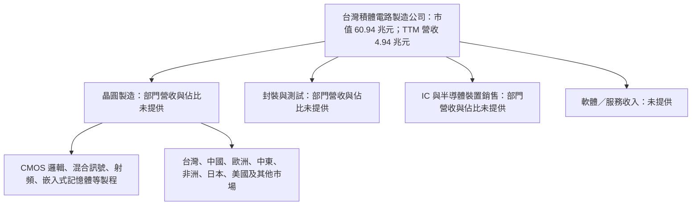
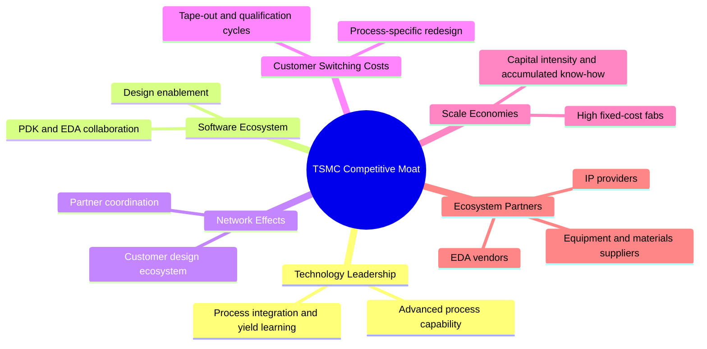
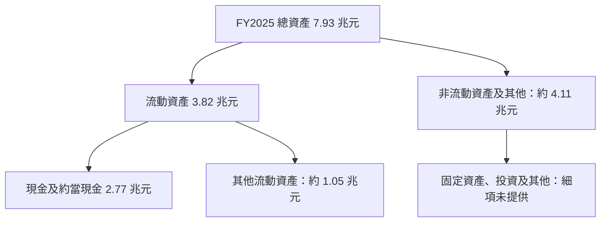
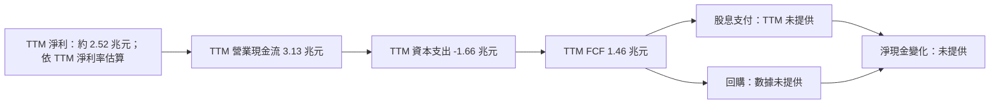
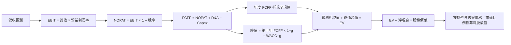
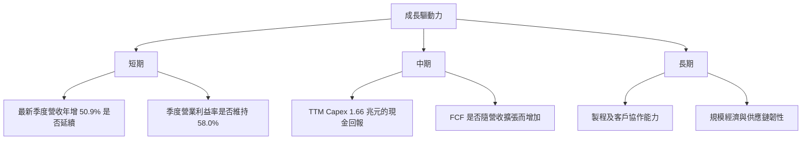
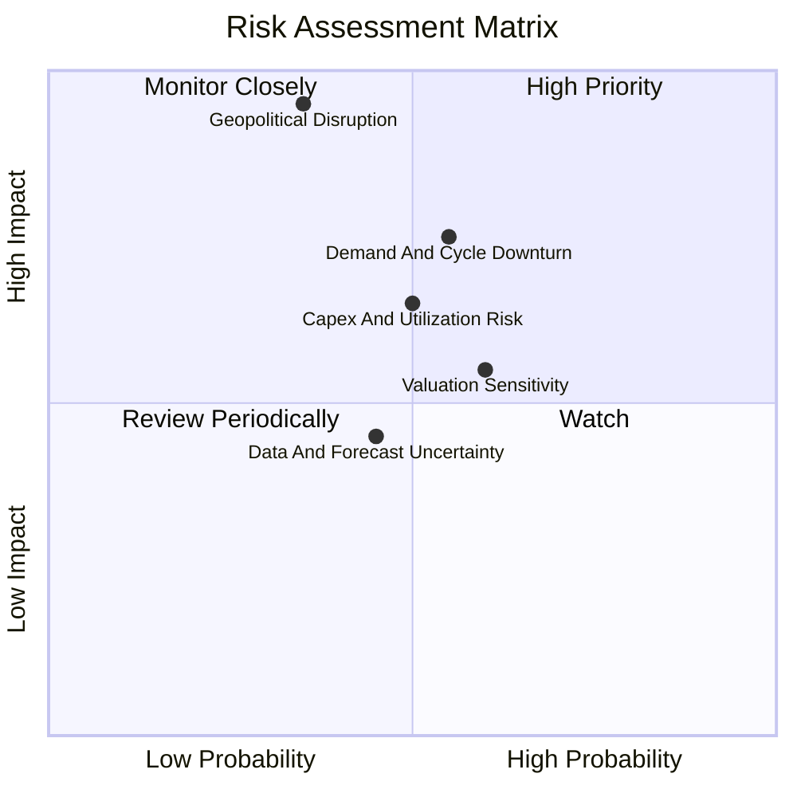
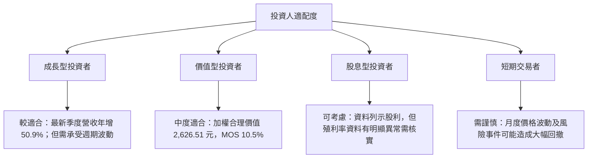

# 2330.TW 基本面深度分析報告

> **報告日期**：2026-11-15 ｜ **語言**：繁體中文 ｜ **數據來源**：Yahoo Finance、Roic.ai ｜ **分析師**：CFA 級機構研究  
> **報價幣別**：新台幣。除另有說明，金額均為 TWD。

## 目錄

| # | 章節 | 核心結論 |
|---|------|----------|
| 1 | 執行摘要 | 買入；加權合理價值 2,626.51 元；MOS +10.5% |
| 2 | 公司概覽與商業模式 | 晶圓代工與製程能力構成核心護城河，市場份額數據未提供 |
| 3 | 損益表深度分析 | TTM 營收 4.94 兆元；最新單季營收年增 50.9% |
| 4 | 資產負債表分析 | 淨現金 3.20 兆元；流動比率 2.505 |
| 5 | 現金流量深度分析 | TTM FCF 1.46 兆元，FCF Yield 2.40% |
| 6 | 獲利能力與資本效率 | WACC 10.80%；當期 ROIC 缺少可靠數據，不能直接判定利差 |
| 7 | 相對估值分析 | Forward P/E 15.72x；同業倍數呈現明顯分化 |
| 8 | DCF 內在價值評估 | 基準 DCF 2,803.31 元；與加權合理價值分開衡量 |
| 9 | 成長催化劑 | 最新季度營收年增 50.9%；TAM 與公司分部數據未提供 |
| 10 | 風險矩陣 | 主要風險為地緣政治、週期／資本支出與高估值敏感度 |
| 11 | 投資建議 | 買入；以估值區間分批布局並持續追蹤毛利率、資本支出及 FCF |

---

## 1. 執行摘要

### 1.0 一頁式投資儀表板（Portfolio Manager 30 秒速讀）

| 項目 | 內容 |
|------|------|
| **投資論點（3 句）** | ① 2026 年 9 月止 TTM 營收 4.94 兆元，最新一季年增 50.9%，反映近期需求與出貨動能。② TTM 營業利益率 58.0%、淨利率 51.1%，但與年度損益表推導的 2025 年營業利益率 50.9%不一致，需核實。③ TTM FCF 1.46 兆元、淨現金 3.20 兆元，提供資本支出與景氣波動緩衝。 |
| **綜合評分** | **8.0/10**（引用 1.1 評分卡） |
| **財務健康** | 🟢 現金 4.02 兆元、總債務 818.38 十億元、淨現金 3.20 兆元；流動比率 2.505。 |
| **ROIC vs WACC** | ROIC：N/A；WACC：10.80%。因缺少當期 ROIC，不把 ROE 代替 ROIC。 |
| **FCF 趨勢** | 年度 FCF 由 2023 年 286.57 十億元升至 2025 年 992.38 十億元；TTM FCF Yield 2.40%。 |
| **估值** | Forward P/E 15.715445x ｜ EV/EBITDA 15.989x ｜ FCF Yield 2.40% |
| **DCF 內在價值（基準）** | **2,803.31 元**；現價相對 DCF 折價 **16.2%**，即折溢價 = 現價 ÷ DCF 基準價 − 1。 |
| **安全邊際（MOS）** | **+10.5%**＝(加權合理價值 2,626.51 − 現價 2,350.00) ÷ 2,626.51；🟡 有限。 |
| **預期報酬（基準情境 12M）** | +11.8%（加權合理價值相對現價；不等同 DCF 情境報酬）。 |
| **關鍵風險（前二）** | 地緣政治／供應鏈中斷；高資本支出與需求週期反轉導致 FCF、估值下修。 |
| **評級 + 信心度** | 🟢 **買入**（MOS +10.5%，依規則 20）；信心：中。 |

### 1.1 綜合評分卡（全報告唯一）

| 維度 | 評分（1–10） | 主要依據（引用數字與其來源章節） |
|------|--------------|----------------------------------|
| 成長性 | 9.0 | 最新季度營收年增 50.9%；TTM 營收成長率 N/A，不能將單季數字誤標為 TTM（第 3 章）。 |
| 獲利能力 | 9.0 | TTM 營業利益率 58.0%、淨利率 51.1%；但當期 ROIC、Piotroski F-Score 均 N/A（第 3、6 章）。 |
| 財務健康 | 9.0 | 淨現金 3.20 兆元、流動比率 2.505、CCC 37 天（第 4 章）。 |
| 估值 | 6.0 | MOS +10.5%，同業估值分歧大；價格高於基準加權合理價值但低於基準 DCF 價值（第 7、8 章）。 |
| 護城河 | 9.0 | 製程、客戶協作、規模及資本門檻形成壁壘；分部營收與市占率數據未提供（第 2 章）。 |
| 管理層與資本配置 | 6.0 | 2025 年 Capex 1.28 兆元、股利支付 466.78 十億元；回購與資本回報率的完整系列資料不足（第 5 章）。 |
| **綜合評分** | **8.0** | 六項算術平均：(9.0 + 9.0 + 9.0 + 6.0 + 9.0 + 6.0) ÷ 6 = **8.0**。 |

### 1.2 五大投資論點 + 三大核心風險

| 類型 | 項目 | 具體依據 | 信心度 |
|------|------|----------|--------|
| 🟢 **投資論點①** | 最新季度成長加速 | 2026-09-30 季營收 1.49 兆元，年增 50.9%、季增約 17.6%。 | 🟢 高 |
| 🟢 **投資論點②** | 利潤率與定價能力 | TTM 毛利率 65.8%、營業利益率 58.0%；惟與年度資料推算不一致，須留意資料口徑。 | 🟢 中高 |
| 🟢 **投資論點③** | 現金流可支應高資本支出 | TTM 營業現金流 3.13 兆元、Capex 1.66 兆元、FCF 1.46 兆元。 | 🟢 高 |
| 🟢 **投資論點④** | 資產負債表保有彈性 | 現金與短期投資 4.02 兆元、總債務 818.38 十億元、淨現金 3.20 兆元。 | 🟢 高 |
| 🟢 **投資論點⑤** | 基準估值具正向空間 | DCF 基準價 2,803.31 元；加權合理價值 2,626.51 元，相對現價上行空間 11.8%。 | 🟡 中 |
| 🟡 **風險①** | 地緣政治與供應鏈集中 | 台灣生產與出口供應鏈面臨突發中斷風險；具體事件機率無法由現有數據量化。 | 🔴 高衝擊 |
| 🔴 **風險②** | 投資週期與產能利用率反轉 | TTM Capex 1.66 兆元；若需求弱於新增產能，折舊上升可能壓縮利潤率與 FCF。 | 🟡 中高 |
| 🟡 **風險③** | 估值對長期假設敏感 | DCF 終值現值占 EV 59.8%；WACC、永續成長與長期利潤率偏差會顯著改變估值。 | 🟡 中高 |

### 1.3 快速統計卡片

| 指標 | 公司實際值（期間） | 同業中位數 | 狀態 |
|------|--------------------|------------|------|
| 營收成長（TTM） | **N/A** | — | 🟡 |
| 營收成長（最新一季年增） | **50.9%** | 20.9%（UMC、GFS、INTC） | 🟢 |
| 毛利率（TTM） | **65.8%** | 31.7%（UMC、GFS、INTC） | 🟢 |
| 營業利益率（TTM） | **58.0%** | — | 🟢 |
| ROIC（TTM） | **N/A** | — | 🟡 |
| Forward P/E | **15.715445x** | 17.1x（UMC、GFS、INTC） | 🟢 |
| FCF Yield（TTM） | **2.40%** | — | 🟡 |
| Piotroski F-Score | **N/A** | — | 🟡 |

> 同業營收成長中位數為排序後的 12.5%、20.9%、25.6%之中位數 20.9%；毛利率中位數為 28.5%、31.7%、40.2%之中位數 31.7%。

### 1.4 投資結論

```text
╔══════════════════════════════════════════════════════════════════╗
║                    📊 投資結論摘要                               ║
╠══════════════════════════════════════════════════════════════════╣
║  評級：買入（MOS +10.5%，依規則 20）                             ║
║  價格（2026-11-13 收盤）：2,350.00 TWD                           ║
║  DCF 內在價值（基準）：2,803.31 TWD（折價 16.2%）                ║
║  安全邊際 MOS：+10.5%（以加權合理價值為分母）                    ║
║  加權合理價值（8.8）：2,626.51 TWD                               ║
║  DCF 情境價值：                                                   ║
║    悲觀情境：1,205.49 TWD（-48.7%）                              ║
║    基準情境：2,803.31 TWD（+19.3%）                              ║
║    樂觀情境：6,188.26 TWD（+163.3%）                             ║
║  綜合評分：8.0/10（引用 1.1）                                    ║
║  適合投資人：能承受半導體週期與地緣政治風險的長線投資人          ║
╚══════════════════════════════════════════════════════════════════╝
```

---

## 2. 公司概覽與商業模式

### 2.1 業務結構與收入來源

公司概要顯示其從事晶圓製造、封裝、測試與 IC 銷售，但沒有各業務板塊收入與佔比。依規則不推估部門比例或金額。



### 2.2 市場份額

市場份額數據未提供，且沒有足以核實的產業市占率來源與年份，因此不繪製市占圖。就財務規模而言，公司 TTM 營收為 4.94 兆元，最新季度營收年增 50.9%，相較同業最新季年增中位數 20.9%高；但營收規模與成長率不能直接替代市場份額。

### 2.3 競爭護城河分析



### 2.4 護城河強度

| 護城河項目 | 強度（強／中／弱） | 證據（引用數字或事實） | 會削弱它的情況 |
|------------|--------------------|------------------------|----------------|
| 技術與製程 | 強 | 公司涵蓋 CMOS 邏輯、混合訊號、射頻及嵌入式記憶體等製程；TTM 營業利益率 58.0%。 | 良率落後、技術節點失去競爭力或製程轉換成本失控。 |
| 客戶鎖定 | 強 | 晶片設計需配合製程、設計規則及量產認證，轉換代工廠通常需重新驗證。客戶別數據未提供。 | 大客戶建立替代產能、改採內製或以其他代工廠分散風險。 |
| 規模效應 | 強 | TTM 營收 4.94 兆元、TTM Capex 1.66 兆元，顯示需以巨額資本維持產能與技術。 | 新增產能利用率不足，或資本支出回報長期低於資本成本。 |
| 軟體／設計生態 | 中 | 公司概要未列設計平台、EDA 合作或軟體收入量化資料；此項以產業特性質化判斷。 | 設計工具相容性或客戶生態轉向競爭平台。 |
| 網路效應 | 中 | 客戶、IP、EDA 與設備供應商間存在協作，但缺少可量化網路效應指標。 | 生態夥伴轉向其他平台，或客戶需求集中度過高。 |
| 生態夥伴 | 中 | 業務遍及多個地區；具體夥伴名單與採購集中度未提供。 | 供應鏈中斷、出口管制或關鍵設備供應受限。 |

> 1.1「護城河」9.0 分的理由是製程、規模與客戶轉換成本具結構性優勢，但量化市占、客戶集中度及部門資料不足，仍需保留不確定性。

---

## 3. 損益表深度分析

### 3.1 年度收入成長趨勢（近 4 年）

以下百分比依年度損益表收入計算；金額取至十億元、成長率取一位小數。

```text
╔══════════════════════════════════════════════════════════════════╗
║              台積電年度收入趨勢（FY2022–FY2025）                 ║
╠══════════════════════════════════════════════════════════════════╣
║  FY2022  2,260 十億元  ██████████████████░░  基期              ║
║  FY2023  2,160 十億元  █████████████████░░░  YoY -4.4%  🟡     ║
║  FY2024  2,890 十億元  ███████████████████████░  YoY +33.8% 🟢 ║
║  FY2025  3,810 十億元  ██████████████████████████████ YoY+31.6% 🟢║
╠══════════════════════════════════════════════════════════════════╣
║  FY2022–FY2025 營收 CAGR：約 19.0%                               ║
╚══════════════════════════════════════════════════════════════════╝
```

年度收入由 2022 年 2.26 兆元增至 2025 年 3.81 兆元，三年 CAGR 約 19.0%；2023 年收縮後，2024、2025 年連續反彈。2026 年 9 月止 TTM 營收 4.94 兆元，但 TTM 對前一 TTM 成長率為 N/A，故不以最新單季 50.9%替代 TTM 成長率。

### 3.2 季度收入趨勢分析

最近四季營收取季度損益表約數；季度 QoQ 依相鄰季度營收計算。2025 年同期基數取 Roic.ai 季度收入資料。

| 季度 | 營收（十億元） | QoQ | YoY | 備註 |
|------|----------------|-----|-----|------|
| 2025-12-31 | 1,046.09 | — | — | 2025 年第四季基期。 |
| 2026-03-31 | 1,134.10 | +8.4% | +35.1% | 同比 2025 Q1 839.254 十億元。 |
| 2026-06-30 | 1,270.38 | +12.0% | +36.1% | 同比 2025 Q2 933.792 十億元。 |
| 2026-09-30 | 1,494.24 | +17.6% | +50.9% | 同比 2025 Q3 989.918 十億元；財務數據列示單季年增 50.9%。 |

單季營收連續季增，且 2026 Q3 年增加速至 50.9%。此增長可能帶來固定成本吸收與營業槓桿，但現有資料沒有出貨量、平均售價、節點組合或客戶別拆分，無法將增長精確歸因於單一產品或市場。

### 3.3 利潤率演變分析

以下 FY2022–FY2025 利潤率為年度損益表「毛利／營收」與「營業利益／營收」計算結果；TTM 指標則使用明列的 TTM 數值。口徑不同，不應混為同一序列。

| 利潤率指標 | FY2022 | FY2023 | FY2024 | FY2025 | 趨勢 | 評估 |
|------------|--------|--------|--------|--------|------|------|
| **毛利率** | 59.7% | 54.6% | 56.1% | 59.8% | 2023 下滑後回升 | 🟢 |
| **營業利益率** | 49.6% | 42.7% | 45.7% | 50.9% | 2023 收縮後恢復 | 🟢 |
| **淨利率** | 43.9% | 39.4% | 40.1% | 44.6% | 隨營業獲利回升 | 🟢 |
| **TTM 毛利率** | — | — | — | — | 最新資料列示 65.8% | 🟡 資料口徑需核實 |
| **TTM 營業利益率** | — | — | — | — | 最新資料列示 58.0% | 🟡 與年度資料差距大 |

2023 年年度毛利率、營業利益率分別降至 54.6%、42.7%，其後至 2025 年回升至 59.8%、50.9%。這與收入週期反彈相符，但現有資料不足以拆解製程組合、產能利用率、折舊與定價各自的貢獻。另一個重要資料品質問題是 TTM 營業利益率 58.0%高於 2025 年度由報表計算的 50.9%，而 2026 Q3 單季營業利益率亦列為 58.0%；因此估值與利潤率比較均須保留此口徑差異。

### 3.4 費用結構分析

完整費用明細、銷貨成本拆分及非營業項目不齊全，因此不能製作可稽核的費用結構圓餅圖或完整費用比例圖。可量化項目包括：2025 年研發費用 246.43 十億元，約為年度營收 3.81 兆元的 6.5%；資本支出屬現金流項目，不應混作當期損益費用。

### 3.5 季度 EPS 趨勢與盈餘品質（Quality of Earnings）

最近四季 EPS Est、EPS Act 均為 nan，無法判斷實際盈餘是否超預期或不及預期。季度淨利年增 68.7%為已提供值，但不等同市場盈餘驚喜。

| 盈餘品質項目 | 數值/佔比 | 評估 |
|--------------|-----------|------|
| 股權薪酬 SBC / 營收 | 2025 年 SBC 1.25 十億元 ÷ 2025 年營收 3,809.05 十億元 = 約 0.033% | 🟢 比重低；仍應注意 SBC 數據可能未涵蓋全部薪酬形式。 |
| SBC / 營業現金流 | 2025 年 1.25 ÷ 2,270 十億元 = 約 0.055% | 🟢 以已列示數據看，對營業現金流影響很小。 |
| FCF / 淨利（現金轉換率） | TTM FCF 1.46 兆元 ÷ TTM 淨利約 2.52 兆元 = 約 58% | 🟡 Capex 高，現金轉換低於 100%；計算採用 TTM 淨利率 51.1% × TTM 營收 4.94 兆元估算淨利。 |
| 一次性／非經常性損益 | N/A（未提供項目明細） | 🟡 無法確認是否存在重大一次性損益。 |
| 有效稅率異常 | 17.0%（Cost of capital inputs 所列最新年度有效稅率） | 🟢 無法僅據此判定稅率異常；歷年稅率與稅務調節明細未提供。 |
| 資本化支出 vs 費用化 | TTM Capex 1.66 兆元；資產資本化與折舊明細未提供 | 🟡 高資本支出是產業必要投入，需監控折舊與產能利用率。 |

**盈餘品質結論**：營業現金流 3.13 兆元與 FCF 1.46 兆元顯示獲利有現金流支持；但 FCF／估算淨利約 58%，主要受大額 Capex 影響。SBC 佔比低；一次性損益及資本化明細不足，且季度 EPS 預估與實際值缺失，故不能完整驗證 GAAP 盈餘品質。TTM 淨利由 TTM 營收 × 淨利率推算，屬估計值，不是直接披露的 TTM 淨利數字。

---

## 4. 資產負債表分析

### 4.1 資產結構分解

最新季度總資產未在可核對的最新季度表格中完整列示，故不製作金額比例圖。2025-12-31 年度總資產為 7.93 兆元，可列示的流動資產為 3.82 兆元；其餘資產細項與最新季拆分未完整提供。



### 4.2 流動性與營運資金分析

| 指標 | 最新 TTM | 一年前 TTM | 變化 | 解讀 |
|------|----------|------------|------|------|
| DSO 應收帳款天數 | 36 天 | N/A | N/A | 一年前數據未提供，無法判斷收款變化。 |
| DIO 存貨天數 | 92 天 | N/A | N/A | 一年前數據未提供，不能判斷庫存是否堆積或改善。 |
| DPO 應付帳款天數 | 91 天 | N/A | N/A | 一年前數據未提供，不能判斷供應商付款條件變化。 |
| CCC 現金轉換週期 | 37 天 | N/A | N/A | 現行 CCC = 36 + 92 − 91 = 37 天；同比方向無法判定。 |

流動比率為 2.505、速動比率為 2.287，顯示短期資產覆蓋流動負債能力尚可。營運資金天數僅有最新一期，不能把單點數據延伸成趨勢結論。

### 4.3 債務結構分析

```text
╔══════════════════════════════════════════════════════════════════╗
║                   台積電債務健康診斷                             ║
╠══════════════════════════════════════════════════════════════════╣
║  總債務：        818.38 十億元     🟢 相較現金規模較低           ║
║  現金+短期投資： 4.02 兆元         🟢                             ║
║  淨現金：        3.20 兆元         🟢                             ║
║                                                                  ║
║  流動比率：      2.505             🟢                             ║
║  速動比率：      2.287             🟢                             ║
║  Debt/EBITDA：   N/A（最新 TTM EBITDA 未提供同口徑原值）         ║
║  利息保障倍數：  N/A（利息費用未提供）                           ║
╚══════════════════════════════════════════════════════════════════╝
```

年度資產負債表所列 2025 年末總債務為 1.06 兆元，與最新資料列示總債務 818.38 十億元口徑或時點不同；本報告不將兩者混用，淨現金依最新明列數值 3.20 兆元引用。

### 4.4 股東權益趨勢

```text
╔══════════════════════════════════════════════════════════════════╗
║                 股東權益趨勢（年度）                             ║
╠══════════════════════════════════════════════════════════════════╣
║  2022  2.90 兆元  ███████████████░░░░░                           ║
║  2023  3.43 兆元  ██████████████████░░                           ║
║  2024  4.24 兆元  ██████████████████████░                        ║
║  2025  5.36 兆元  ████████████████████████████                   ║
╚══════════════════════════════════════════════════════════════════╝
```

2022 至 2025 年股東權益由 2.90 兆元增至 5.36 兆元，與同期獲利及留存盈餘累積一致；但未提供完整股本、股利與其他綜合損益調節表，不能將權益增加全部歸因於單一項目。

---

## 5. 現金流量深度分析

### 5.1 現金流量瀑布圖

淨利、股利與淨現金變化沒有完全同期間可核對數值，故以下圖表僅呈現已提供的 TTM 現金流項目，不推算未提供的現金變動。



### 5.2 FCF 轉換率趨勢

| 年度 | 營業現金流 | Capex | FCF | 淨利 | FCF／淨利 |
|------|------------|-------|-----|------|-----------|
| 2022 | 1.61 兆元 | 1.09 兆元 | 520.97 十億元 | 992.92 十億元 | 52.5% |
| 2023 | 1.24 兆元 | 955.40 十億元 | 286.57 十億元 | 851.74 十億元 | 33.6% |
| 2024 | 1.83 兆元 | 964.98 十億元 | 861.20 十億元 | 1.16 兆元 | 約 74.2% |
| 2025 | 2.27 兆元 | 1.28 兆元 | 992.38 十億元 | 1.70 兆元 | 約 58.4% |

FCF 轉換率在 2023 年降至 33.6%，2024 年回升至約 74.2%，2025 年為約 58.4%。變動與 Capex、營業現金流增長不同步；2025 年 FCF 金額創表列期間高點，但仍低於淨利，反映資本密集型再投資需求。

### 5.3 自由現金流趨勢

```text
╔══════════════════════════════════════════════════════════════════╗
║                自由現金流趨勢（年度實際）                         ║
╠══════════════════════════════════════════════════════════════════╣
║  2022  520.97 十億元  ████████████████░░░░  FCF Yield：N/A       ║
║  2023  286.57 十億元  █████████░░░░░░░░░░░  FCF Yield：N/A       ║
║  2024  861.20 十億元  ██████████████████████████░                ║
║  2025  992.38 十億元  ██████████████████████████████              ║
╠══════════════════════════════════════════════════════════════════╣
║  最新 TTM FCF：1.46 兆元；FCF Yield：2.40%                       ║
╚══════════════════════════════════════════════════════════════════╝
```

TTM FCF 照指定定義為營業現金流減資本支出，取 1.46 兆元，不以其他 FCF 口徑替代。年度資料與 TTM 資料時點不同，不能直接用年度 FCF 推算季度年化殖利率。

### 5.4 資本配置評估

回購、留存現金及 TTM 股利支付未有完整可比數據，因此不製作缺少數值的圓餅圖。已知 2025 年資本支出 1.28 兆元、股息支付 466.78 十億元，2025 年 SBC 1.25 十億元；這些數據顯示公司同時維持大規模產能投資與現金股利，但資本支出回報率及回購政策仍需更完整資料評估。

---

## 6. 獲利能力與資本效率

### 6.1 ROE / ROA / ROIC 趨勢

| 指標 | 最新可用值 | 歷史值 | 評估 |
|------|------------|--------|------|
| ROE | TTM 41.9% | 年度歷史序列未提供完整同口徑資料 | 🟢 盈利相對帳面權益高；不等同 ROIC。 |
| ROA | TTM 20.6% | 年度歷史序列未提供完整同口徑資料 | 🟢 資產獲利能力具韌性。 |
| ROIC | N/A | Roic.ai 資料僅列至 2018 年等較早年份 | 🟡 不以過時 ROIC 替代當期數值。 |
| 行業均值 | N/A | 未提供可引用且同口徑的行業均值 | 不列比較。 |

### 6.2 ROIC vs WACC 分析（核心價值創造判斷）

當期 ROIC 為 N/A，不能用 ROE 41.9%代替，因此目前只能取得資本成本基準，不能精確計算 EVA 或宣稱 ROIC 高於 WACC。

```text
╔══════════════════════════════════════════════════════════════════╗
║                ROIC vs WACC 深度分析                             ║
╠══════════════════════════════════════════════════════════════════╣
║  WACC（採用成本資本數據）：10.80%                                ║
║  ├── 無風險利率（10Y 美債）：       5.15%                        ║
║  ├── ERP：                          5.00%                        ║
║  ├── 原始 Beta：                    1.23                         ║
║  ├── 調整後 Beta：                  1.16                         ║
║  ├── 股權成本（資料列示）：         10.93%                       ║
║  ├── 稅前債務成本：                 1.51%                        ║
║  ├── 最新年度有效稅率：             17.0%                        ║
║  ├── E/D 權重：                     98.7% / 1.3%                 ║
║  └── 採用 WACC：                    10.80%                       ║
║                                                                  ║
║  ROIC（最新 TTM）：N/A；資料不足以同口徑計算投入資本與 NOPAT。   ║
║  EVA = ROIC − WACC：N/A。                                         ║
║  結論：公司營運獲利與 ROE 表現高，但 ROIC 是否高於 10.80%      ║
║        必須待補充投入資本及 NOPAT 數據後判斷。                   ║
╚══════════════════════════════════════════════════════════════════╝
```

成本資本資料所列 CAPM 股權成本 10.93%與使用調整後 Beta 1.16、Rf 5.15%、ERP 5.00%直接相乘計算結果存在小幅差異：5.15% + 1.16 × 5.00% = 10.95%。依要求採用成本資本資料列示的 **WACC 10.80%**，不另改寫 DCF 折現率。此差異列為資料精度限制。

### 6.3 杜邦三因素分解

| 因素 | 數值（TTM） | 解讀 |
|------|-------------|------|
| 淨利率 | N/A（QUALITY FIGURES 判定缺少所需資料） | 財務快照另列淨利率 51.1%，但品質指標區塊的杜邦計算為 N/A；依規則不自行替代。 |
| 資產週轉率 | N/A | 資料不足以採用同一口徑重算。 |
| 權益乘數 | N/A | 資料不足以採用同一口徑重算。 |
| **ROE** | **N/A（杜邦指標）** | QUALITY FIGURES 的 DuPont 為 N/A，原因為淨利、營收、總資產或正權益缺少所需同口徑數據。 |

### 6.4 財務體質：Piotroski F-Score

Piotroski F-Score 為 N/A：需有相隔一年的兩組 TTM SEC 申報資料；現有季度資料來自 Yahoo Finance，無法完成九項測試。

| 測試 | 結果 | 解讀 |
|------|------|------|
| 九項測試 | N/A | 缺少可按規則計算的兩期 SEC 申報資料；不可將 N/A 補成分數。 |

---

## 7. 相對估值分析

### 7.1 同業估值比較表格

同業倍數採用 Yahoo Finance 所列 Peer multiples。UMC 的 P/S、EV/EBITDA 因幣別混合不可比，故不列數值。

| 估值指標 | **2330.TW** | **UMC** | **GFS** | **INTC** | 本公司評估 |
|----------|-------------|---------|---------|---------|-----------|
| **Trailing P/E** | 24.109982x | 14.5x | 118.5x | N/A | 🟡 高於 UMC、低於 GFS；INTC 無資料。 |
| **Forward P/E** | 15.715445x | 17.1x | 16.0x | 33.3x | 🟢 低於三家同業的中位數 17.1x。 |
| **P/S Ratio** | 12.324229x | N/A | 3.2x | 5.3x | 🔴 高於可比同業，但盈利能力差異顯著。 |
| **EV/EBITDA** | 15.989x | N/A | 11.1x | 17.2x | 🟡 位於 GFS、INTC 區間內。 |
| **最新季度營收 YoY** | 50.9% | 25.6% | 12.5% | 20.9% | 🟢 成長高於三家列示同業。 |
| **TTM 毛利率** | 65.8% | 31.7% | 28.5% | 40.2% | 🟢 明顯高於列示同業；仍須注意 TTM 口徑差異。 |

不同公司的產品組合、晶圓代工定位及資本結構不完全相同，P/S 或 EV/EBITDA 不能單獨判斷便宜與否。Forward P/E 對照表中同業中位數 17.1x，公司 15.715445x，相對較低；相對估值仍受預估 EPS 可靠度與資料日期影響。

### 7.2 歷史估值區間分析

N/A（未提供「Valuation vs own history」的歷史 P/E 區間或百分位數據，故不推估歷史估值位置。）

### 7.3 情境價值（Bear / Base / Bull，照抄 DCF MODEL 的 Scenarios）

| 情境 | 第 1 年營收成長 | 期末營業利潤率 | WACC | 每股價值 | 相對現價 | 機率 | 會發生的條件 |
|------|----------------|----------------|------|----------|----------|------|--------------|
| 🔴 悲觀 | 15.0% | 42.1% | 11.80% | 1,205.49 TWD | -48.7% | 25% | 需求放緩、競爭加劇或高資本支出未帶來相稱的產能利用率。 |
| 🟡 基準 | 30.0% | 49.5% | 10.80% | 2,803.31 TWD | +19.3% | 50% | 首年成長延續，後續十年成長逐步降至 3.0%，利潤率緩降至 49.5%。 |
| 🟢 樂觀 | 45.0% | 54.5% | 9.80% | 6,188.26 TWD | +163.3% | 25% | 高成長延續、組合與規模效益優於基準，資本成本下行。 |

機率加權 DCF 情境價值為 3,250.09 元（資料列示），僅作情境參考；第 8.8 節估值加權採用基準 DCF 2,803.31 元。

### 7.4 相對估值隱含價格區間

```text
╔══════════════════════════════════════════════════════════════════╗
║               相對估值回推每股價值（TWD）                       ║
╠══════════════════════════════════════════════════════════════════╣
║  同業 EV/EBITDA       2,099.97 ─── 現價 2,350 ─── Forward P/E 2,559.75║
║                                                  DCF 2,803.31     ║
║                                                  共識 3,402.51   ║
╚══════════════════════════════════════════════════════════════════╝
```

| 方法 | 每股價值 | 依據 |
|------|----------|------|
| 同業 EV/EBITDA | 2,099.97 TWD | 同業中位數 14.2x（GFS、INTC）× TTM EBITDA，再加淨現金。 |
| 同業 Forward P/E | 2,559.75 TWD | 同業 Forward P/E 中位數 17.1x × Forward EPS 149.53。 |
| 基準 DCF | 2,803.31 TWD | 十年 FCFF、WACC 10.80%、終值成長率 3.0%。 |
| 分析師共識目標價 | 3,402.51 TWD | 35 位分析師平均目標價；作為參考，不應視為獨立基本面證據。 |

---

## 8. DCF 內在價值評估（Discounted Cash Flow）

> 本節依程式計算模型列示數字，不另建模型。金額除每股價值外均為 TWD 十億元。模型明確註明未建模營運資金變動、採 GAAP EBIT、SBC 已含於費用且固定股數。

### 8.0 估值推理鏈（Thinking Logic）

**Step 1 — 價值來源與主導變數**

模型以現有晶圓製造現金流為主要價值來源。分部營收、AI／先進製程等產品營收占比均未提供，因此不能把特定新業務單獨計入收入或選擇權價值。模型價值最敏感的變數是終值相關假設，尤其永續成長率與 WACC；基準情境終值現值占 EV 59.8%，因此這項判斷與 8.6 敏感度方向一致。

**Step 2 — 模型選擇**

| 決策點 | 本報告採用 | 理由（含數字） | 曾考慮但否決 | 否決理由 |
|--------|-----------|----------------|--------------|----------|
| 現金流定義 | FCFF | 配合 WACC 折現，模型直接輸出 EV；TTM OCF 3.13 兆元、Capex 1.66 兆元。 | FCFE | 模型未提供融資現金流預測。 |
| 預測期 N | 10 年 | DCF MODEL 固定設定 10 年；適合將高成長逐步淡化至成熟期。 | 5 年 | 不能在不改動既有模型的情況下縮短。 |
| 終值方法 | Gordon Growth 為模型主終值 | 模型列示 g 3.0%、WACC 10.80%。 | 退出倍數主估值 | DCF MODEL 未提供退出倍數終值數值，不能自行補建。 |
| EBIT 基礎 | GAAP | 模型註明 GAAP EBIT。 | 非 GAAP | 會改變模型口徑，且可能造成 SBC 重複處理。 |

**Step 3 — 關鍵假設推導鏈**

- **營收成長**：錨點＝最新一季營收年增 50.9%，但它是單季而非 TTM 成長；模型將其限制於 0%–30%區間 → 成長逐年線性遞減 → **採用 FY+1 30.0%、FY+10 3.0%** → 否決將 50.9%延續十年，因單季年增率不能視為長期年增。
- **期末營業利益率**：錨點＝模型 TTM 營業利益率 58.0%；模型將其淡化至近五財年中位水準 → **FY+1 58.0%、FY+10 49.5%** → 否決十年維持 58.0%，因成熟期可能承受折舊、競爭及產品週期影響。
- **Capex／營收**：錨點＝TTM 33.7%；模型逐步淡化至 16.6%，且以 1.1 倍 D&A 作為高於折舊時的收斂條件 → **FY+1 33.7%、FY+10 16.6%** → 否決永久維持 TTM 33.7%，因長期資本強度可能下降；但若持續擴產，低於此值也可能過度樂觀。
- **永續成長率 g**：錨點＝模型指定 3.0%；低於 WACC 10.80%，符合 Gordon Growth 分母為正的必要條件 → **採用 3.0%** → 否決高於 3.0%的基準值，因長期成長假設需避免高估終值。
- **預測期 N**：錨點＝模型指定 10 年；營收成長由 30.0%線性降至 3.0% → **採用 10 年** → 否決直接沿用 30.0%高成長至第十年，因模型明確設定逐步降速。
- **WACC**：錨點＝成本資本資料列示 10.80% → 採用程式計算值以保持與 DCF、6.2 節一致 → **採用 10.80%** → 否決另行調整為其他折現率，因規則指定直接採用成本資本數據。
- **EBIT、SBC 與股數**：錨點＝模型採 GAAP EBIT；模型註明 SBC 已為費用、股數不再稀釋 → **採用組合 (A)：GAAP EBIT、無 SBC 額外扣除、年稀釋率 0%** → 否決再扣 SBC 或另加稀釋，避免同一成本重複計算。
- **D&A／營收**：錨點＝TTM 15.1% → 假設預測期固定 15.1%，模型未提供其他調整。  
- **有效稅率**：錨點＝最新年度有效稅率 17.0% → 假設預測期固定 17.0%。  
- **營運資金變動**：DCF MODEL 註明不建模；不另加數值或反推 ΔWC。

**Step 4 — 最脆弱環節**

最脆弱環節是終值假設與長期營收、利潤率軌跡；基準終值 PV 占 EV 59.8%。若 WACC 上升或永續成長率下降，估值會下行；模型敏感度表在 WACC 12.80%、g 3.0%時每股價值為 2,158.93 元。

**Step 5 — 計算路徑圖**



### 8.1 模型假設總表（Model Inputs）

| 假設項目 | 採用值 | 依據／來源 | 敏感度 |
|----------|--------|-------------|--------|
| 預測期長度 N | 10 年 | DCF MODEL 指定；營收成長逐步收斂至 3.0%。 | 🟡 中 |
| 營收成長 | FY+1 30.0% → FY+10 3.0% | 起點為最新單季年增 50.9%，模型限制於 0%–30%，逐年線性淡化。 | 🔴 高 |
| 營業利潤率 | FY+1 58.0% → FY+10 49.5% | TTM 58.0%，淡化至近五財年中位值。 | 🔴 高 |
| 有效稅率 | 17.0% | 最新年度有效稅率。 | 🟢 低 |
| Capex／營收 | FY+1 33.7% → FY+10 16.6% | TTM Capex／營收；逐步淡化，模型終點參照 1.1 倍 D&A。 | 🟡 中 |
| D&A／營收 | 15.1% | TTM 比率，模型固定。 | 🟢 低 |
| ΔWC／營收增額 | 未建模 | DCF MODEL 明確註明 working capital is not modelled。 | 🟢 低 |
| EBIT 基礎 | GAAP | DCF MODEL 指定 GAAP EBIT。 | 🟡 中 |
| SBC 處理 | GAAP EBIT 已含 SBC，不再扣除 | 模型組合 A；避免重複扣除。 | 🟡 中 |
| 年稀釋率 | 0% | 固定股數組合 A；模型假設不再另稀釋。 | 🟡 中 |
| 永續成長率 g | 3.0% | DCF MODEL 指定，且小於 WACC 10.80%。 | 🔴 高 |
| 終值方法 | Gordon Growth | DCF MODEL 已提供 Gordon Growth 終值；未提供退出倍數計算結果。 | 🔴 高 |
| WACC | 10.80% | 成本資本資料列示值，見 8.2。 | 🔴 高 |

**FCFF 定義**：採 FCFF = NOPAT + D&A − Capex；不另扣 ΔWC，因模型明確未建模營運資金。  
**SBC 一致性**：本模型採用 **(A)**，故 SBC 影響已計入一次；GAAP EBIT 已包含 SBC 費用，不另扣 SBC，且年稀釋率設為 0%。

### 8.2 折現率推導（WACC）

```text
╔══════════════════════════════════════════════════════════════════╗
║                    WACC 推導（折現率）                           ║
╠══════════════════════════════════════════════════════════════════╣
║  股權成本 Ke（CAPM，照成本資本資料列示）：                       ║
║  ├── 無風險利率 Rf（10Y 美債）：       5.15%                     ║
║  ├── 市場風險溢酬 ERP：                5.00%                     ║
║  ├── 原始 Beta（Yahoo）：              1.23                      ║
║  ├── 調整後 Beta：                     1.16                      ║
║  ├── Beta 調整：                       ⅔ × 1.23 + ⅓ = 1.16      ║
║  ├── 規模／國別溢酬：                  0.00%（資料未另列）       ║
║  └── Ke（來源列示）：                  10.93%                    ║
║                                                                  ║
║  債務成本 Kd：                                                     ║
║  ├── 稅前債務成本：                    1.51%                     ║
║  ├── 有效稅率：                        17.0%                     ║
║  └── 稅後 Kd = 1.51% × (1 − 17.0%) = 1.2533%                    ║
║                                                                  ║
║  資本結構（成本資本資料列示）：                                   ║
║  ├── 股權權重 E：                      98.7%                     ║
║  ├── 債務權重 D：                      1.3%                      ║
║  └── 採用 WACC：                       10.80%                    ║
╚══════════════════════════════════════════════════════════════════╝
```

**逐步演算與資料限制**

1. **Ke（CAPM）**：成本資本資料列示 Ke = 10.93%。使用已四捨五入調整後 Beta 重算為 5.15% + 1.16 × 5.00% = 10.95%；有 0.02 個百分點差異，報告保留資料列示的 10.93%，不自行替換。
2. **稅前 Kd**：成本資本資料列示 1.51%，但利息費用與平均計息負債細項未提供，無法獨立複算其分子、分母。
3. **稅後 Kd**：1.51% × (1 − 17.0%) = 1.51% × 0.83 = **1.2533%**。
4. **權重**：成本資本資料直接列示股權 98.7%、債務 1.3%，合計 100.0%；市值與債務範圍的底層權重計算明細未提供。
5. **WACC**：98.7% × 10.93% + 1.3% × 1.2533% = 10.78791% + 0.01629% = **10.80420% ≈ 10.80%**。

WACC 與第 6.2 節一致採 **10.80%**。Rf 的具體觀測日未提供，不能補寫日期；亦未另加規模或國別溢酬。

### 8.3 逐年自由現金流預測（基準情境）

金額取 2 位小數；比率取 1 位小數；折現因子取 3 位小數。以下逐年數值照 DCF MODEL 列示。ΔWC 不建模，故表中沒有 ΔWC 金額列，不能把它假設為某個自行計算數值。

| 年度 | FY+1 | FY+2 | FY+3 | FY+4 | FY+5 | FY+6 | FY+7 | FY+8 | FY+9 | FY+10 |
|------|------:|------:|------:|------:|------:|------:|------:|------:|------:|-------:|
| 營收 | 6,428.26 | 8,163.89 | 10,123.23 | 12,249.11 | 14,453.94 | 16,622.04 | 18,616.68 | 20,292.18 | 21,509.71 | 22,155.00 |
| 營收 YoY | 30.0% | 27.0% | 24.0% | 21.0% | 18.0% | 15.0% | 12.0% | 9.0% | 6.0% | 3.0% |
| 營業利潤率 | 58.0% | 57.0% | 56.1% | 55.2% | 54.2% | 53.3% | 52.3% | 51.4% | 50.5% | 49.5% |
| EBIT（GAAP） | 3,726.96 | 4,656.58 | 5,679.10 | 6,756.69 | 7,837.17 | 8,856.66 | 9,744.64 | 10,431.11 | 10,854.99 | 10,972.60 |
| − 稅 | (632.58) | (790.36) | (963.91) | (1,146.81) | (1,330.20) | (1,503.24) | (1,653.96) | (1,770.47) | (1,842.42) | (1,862.38) |
| = NOPAT | 3,094.39 | 3,866.22 | 4,715.19 | 5,609.88 | 6,506.97 | 7,353.42 | 8,090.68 | 8,660.64 | 9,012.58 | 9,110.22 |
| + D&A | 970.20 | 1,232.15 | 1,527.86 | 1,848.72 | 2,181.49 | 2,508.71 | 2,809.75 | 3,062.63 | 3,246.39 | 3,343.78 |
| − Capex | (2,164.21) | (2,593.75) | (3,024.30) | (3,427.14) | (3,769.96) | (4,020.28) | (4,149.72) | (4,138.42) | (3,978.88) | (3,678.16) |
| **= FCFF** | **1,900.38** | **2,504.62** | **3,218.76** | **4,031.46** | **4,918.49** | **5,841.85** | **6,750.72** | **7,584.85** | **8,280.09** | **8,775.85** |
| 折現因子 | 0.903 | 0.815 | 0.735 | 0.663 | 0.599 | 0.540 | 0.488 | 0.440 | 0.397 | 0.359 |
| **FCFF 現值 PV** | **1,715.10** | **2,040.06** | **2,366.14** | **2,674.63** | **2,945.00** | **3,156.85** | **3,292.34** | **3,338.50** | **3,289.20** | **3,146.26** |

預測期 FCF 現值合計：

**1,715.10 + 2,040.06 + 2,366.14 + 2,674.63 + 2,945.00 + 3,156.85 + 3,292.34 + 3,338.50 + 3,289.20 + 3,146.26 = 27,964.08**。

DCF MODEL 列示合計為 **27,964.10**，相差 0.02 十億元，屬表列四捨五入尾差。

**逐步演算（FY+1，使用模型列示值）**

1. **營收** = 4,944.82 × (1 + 30.0%) = 6,428.266 ≈ **6,428.26**（模型列示值；原始精度可能不同）。
2. **EBIT** = 6,428.26 × 58.0% = 3,728.3908；模型列示 **3,726.96**，相差 1.43，故不能宣稱模型 EBIT 可由表列營收與利潤率精確重算。
3. **稅** = 模型列示 EBIT 3,726.96 × 17.0% = 633.5832；模型列示 **632.58**，相差 1.00。
4. **NOPAT** = 3,726.96 − 632.58 = **3,094.38**；模型列示 3,094.39，差 0.01。
5. **D&A** = 模型列示 **970.20**；依 6,428.26 × 15.1%計算為 970.67，存在表列精度／口徑差異。
6. **Capex** = 模型列示 **2,164.21**；未提供未四捨五入的比率，不能精確反推。
7. **ΔWC** = 未建模。
8. **FCFF** = 3,094.39 + 970.20 − 2,164.21 = **1,900.38**，與模型列示一致。
9. **折現因子與 PV**：模型列示折現因子 0.903；1,900.38 × 0.903 = 1,715.04，模型列示 PV 1,715.10。差異來自模型使用未四捨五入折現因子；僅用列示的三位折現因子不能完全複算到模型精度。

以上是來源模型表列數值與表列精度所呈現的複算差異；為遵守資料優先原則，後續價值仍引用其 DCF MODEL 已計算結果，不另建或改寫模型。

**合理性自檢**

- 預測 FCF CAGR：FY+1 至 FY+10，依 1,900.38 至 8,775.85 計算約 18.5%；歷史 FCF CAGR 受 2023 低基期影響，不能直接作長期基準。年度 FCF 由 2023 年 286.57 十億元升至 2025 年 992.38 十億元。
- FY+10 FCF 利潤率 = 8,775.85 ÷ 22,155.00 = 約 39.6%；目前 TTM FCF 利潤率 = 1.46 ÷ 4.94 = 約 29.6%。同業最佳 FCFF 利潤率 N/A，不能判斷是否超越產業最佳。
- 預測期各年 FCFF 均為正；模型沒有納入 ΔWC，這可能使高成長期現金流偏高。

```text
╔══════════════════════════════════════════════════════════════════╗
║            自由現金流：歷史實際 vs 模型預測                      ║
╠══════════════════════════════════════════════════════════════════╣
║  FY2023(實)  286.57 十億元  ██████░░░░░░░░░░░░░░                  ║
║  FY2024(實)  861.20 十億元  ██████████████████░░                  ║
║  FY2025(實)  992.38 十億元  ████████████████████                  ║
║  FY+1 (預)  1,900.38 十億元  ████████████████████████████████████  ║
║  FY+10(預)  8,775.85 十億元  ████████████████████████████████████  ║
╠══════════════════════════════════════════════════════════════════╣
║  模型 FCF 快速增長；主要依賴營收擴張、利潤率及 Capex 強度收斂。   ║
╚══════════════════════════════════════════════════════════════════╝
```

### 8.4 終值計算（Terminal Value）

**適用性檢查**：WACC 10.80% vs g 3.0% → **WACC > g ✅**

DCF MODEL 未提供退出倍數終值，亦未提供 FY+10 EBITDA 的退出倍數交叉驗證數值；依規則不自行創建第二套終值。

| 方法 | 計算式 | 終值 TV | TV 現值 | 佔總 EV 比重 |
|------|--------|---------|---------|--------------|
| Gordon Growth | 8,775.85 × (1 + 3.0%) ÷ (10.80% − 3.0%) | 115,849.73 | 41,533.76 | 59.8% |
| 退出倍數法 | N/A（模型未提供退出倍數及相應價值） | N/A | N/A | N/A |

**逐步演算（依模型列示值）**

1. FY+10 FCFF = **8,775.85**。
2. 分子 = 8,775.85 × (1 + 3.0%) = 8,775.85 × 1.03 = **9,039.1255**。
3. 分母 = 10.80% − 3.0% = **7.80%**；按公式計算 TV = 9,039.1255 ÷ 7.80% = **115,886.22**。模型列示 **115,849.73**，相差 36.49，表示模型使用的未四捨五入輸入或中間數值與表列值不同；依規則保留模型終值 115,849.73。
4. PV(TV) = 模型列示 **41,533.76**；模型採用未四捨五入折現因子，故不以三位小數 0.359 重算替換。
5. 終值佔比 = 41,533.76 ÷ 69,497.86 = **59.8%**。

終值比重尚未超過 75%，但仍約占 EV 六成，估值對長期假設高度敏感。

### 8.5 企業價值 → 每股內在價值（Bridge）

```text
╔══════════════════════════════════════════════════════════════════╗
║              企業價值 → 每股內在價值 橋接表                      ║
╠══════════════════════════════════════════════════════════════════╣
║  預測期 FCF 現值合計            +27,964.10 十億元                 ║
║  終值現值 PV(TV)                +41,533.76 十億元                 ║
║  = 企業價值 EV                   69,497.86 十億元                 ║
║  + 淨現金                        +3,198.60 十億元                 ║
║  = 股權價值                      72,696.46 十億元                 ║
║  每股基準 DCF 價值                2,803.31 TWD                    ║
║  當前股價                         2,350.00 TWD                    ║
║  折溢價（現價÷DCF內在價值−1）    -16.2%（折價）                  ║
╚══════════════════════════════════════════════════════════════════╝
```

1. **EV** = 27,964.10 + 41,533.76 = **69,497.86 十億元**。
2. **股權價值** = 69,497.86 + 3,198.60 = **72,696.46 十億元**。
3. **每股內在價值** = 模型列示「股權價值 × 價格 ÷ 市值」換算結果 = **2,803.31 TWD**。市場資料列示 25.93 十億股；但直接以 72,696.46 十億元 ÷ 25.93 十億股計算約為 2,803.8 元，與模型每股值有小幅差異。依要求保留模型每股值。
4. **折溢價** = 2,350.00 ÷ 2,803.31 − 1 = **−16.2%**。
5. **本節不計算 MOS**：MOS 固定以 8.8 加權合理價值為分母，僅在 8.8 計算一次。

現金與債務的淨額採模型列示 3,198.60 十億元；股數處理採模型組合 A，固定股數、不加年稀釋。模型提供的換算式為「股權價值 × 價格 ÷ 市值」，不是單純股權價值除以股數；因原始換算明細與未四捨五入股數缺失，應視為模型換算口徑限制。

### 8.6 敏感性分析（WACC × 永續成長率）

以下每股價值照 DCF MODEL 原值引用；括號上行空間以該值相對現價 2,350 元計算，取一位小數。

| g（列）／WACC（欄） | 8.80% | 9.80% | **10.80%（基準）** | 11.80% | 12.80% |
|-----------|--------:|--------:|-------------------:|---------:|---------:|
| 2.0% | 3,510.63（+49.4%） | 2,999.01（+27.6%） | 2,607.58（+11.0%） | 2,299.29（-2.2%） | 2,050.85（-12.7%） |
| 2.5% | 3,695.34（+57.2%） | 3,127.01（+33.1%） | 2,699.55（+14.9%） | 2,367.28（+0.7%） | 2,102.27（-10.5%） |
| **3.0%（基準）** | 3,911.89（+66.5%） | 3,273.83（+39.3%） | **2,803.31（+19.3%）** | 2,442.99（+4.0%） | 2,158.93（-8.1%） |
| 3.5% | 4,169.27（+77.4%） | 3,443.94（+46.5%） | 2,921.28（+24.3%） | 2,527.82（+7.6%） | 2,221.68（-5.5%） |
| 4.0% | 4,480.25（+90.6%） | 3,643.37（+55.0%） | 3,056.59（+30.1%） | 2,623.52（+11.6%） | 2,291.56（-2.5%） |

**矩陣演算限制**：DCF MODEL 只提供價值矩陣，沒有提供各 WACC 下預測期 PV 的未四捨五入值及終值折現細項。故只能照抄矩陣結果並展示相對現價幅度，不能聲稱已能從表列資料逐步重算矩陣每一格。

**三情境 DCF（照模型 Scenarios）**

| 情境 | 第 1 年營收成長 | 期末營業利潤率 | g | WACC | 每股內在價值 | 相對現價 | 機率 |
|------|----------------|----------------|---|------|--------------|----------|------|
| 🔴 悲觀 | 15.0% | 42.1% | N/A（情境資料未單列 g） | 11.80% | 1,205.49 | -48.7% | 25% |
| 🟡 基準 | 30.0% | 49.5% | 3.0%（基準模型） | 10.80% | 2,803.31 | +19.3% | 50% |
| 🟢 樂觀 | 45.0% | 54.5% | N/A（情境資料未單列 g） | 9.80% | 6,188.26 | +163.3% | 25% |
| **機率加權** | — | — | — | — | **3,250.09** | **+38.3%** | **100%** |

DCF MODEL 未提供悲觀、樂觀情境的逐年營收、末年 FCFF、TV 或情境 g，因此不能逐情境補造完整推導鏈。可複算的機率加權算式為：

**1,205.49 × 25% + 2,803.31 × 50% + 6,188.26 × 25% = 3,250.09 TWD**（模型列示值）。

**敏感度結論**

- g 由 2.0%升至 3.0%，在 WACC 10.80%下價值由 2,607.58 升至 2,803.31，增加 **195.73 元，約 +7.5%**。
- WACC 由 10.80%升至 11.80%，在 g 3.0%下價值由 2,803.31 降至 2,442.99，減少 **360.32 元，約 −12.9%**。
- 期末營業利潤率每 +1 個百分點的價值變動：N/A（敏感度矩陣沒有此維度，模型亦未提供單變數重算）。
- 就已提供的敏感度矩陣而言，WACC 變動一個百分點的影響大於 g 變動一個百分點；與 8.0 所指出「終值與折現假設主導估值」一致。

### 8.7 反推 DCF（Reverse DCF：市場在預期什麼）

DCF MODEL 直接提供兩項單變數反推結果。其他輸入固定於模型基準，但模型未列出每一項固定值的完整求解工作表，因此不自行補出迭代軌跡。

| 求解的變數（一次一個） | 其餘變數設定 | 市場隱含值（令 DCF = 現價） | 歷史實際／基準 | 判斷 |
|------------------------|--------------|------------------------------|----------------|------|
| 年 1 營收成長率 | 其餘基準輸入固定 | 25.1% | 基準 30.0%；最新單季 YoY 50.9% | 🟡 市場隱含低於基準，並非要求維持單季高增長。 |
| 固定營業利潤率 | 其餘基準輸入固定 | 43.6% | 基準由 58.0%降至 49.5% | 🟢 市場隱含利潤率低於模型基準期末利潤率。 |
| 永續成長率 g | 未計算 | 未計算 | — | 無反推結果。 |
| 高成長持續年數 N | 未計算 | 未計算 | — | 無反推結果。 |

**反推結論**：模型列示的現價隱含年 1 成長率 25.1%，低於基準 30.0%；固定營業利益率 43.6%也低於基準 FY+10 的 49.5%。但因未提供反推的完整迭代軌跡及對應 FY+10 營收、FCFF，以上只能解讀方向，不能獨立重現求解精度。

### 8.8 估值三角驗證與安全邊際

| 估值方法 | 隱含每股價值 | 上行空間（÷現價） | 權重 | 說明 |
|----------|--------------:|-------------------:|------|------|
| DCF（基準） | 2,803.31 | +19.3% | 40% | 10 年 FCFF；WACC 10.80%、g 3.0%。 |
| 同業 Forward P/E | 2,559.75 | +8.9% | 25% | 同業中位數 17.1x × Forward EPS 149.53。 |
| 同業 EV/EBITDA | 2,099.97 | -10.6% | 25% | 同業中位數 14.2x × TTM EBITDA，加回淨現金。 |
| 分析師共識目標價 | 3,402.51 | +44.8% | 10% | 35 位分析師平均目標價。 |
| **加權合理價值** | **2,626.51** | **+11.8%** | **100%** | 營利公司類型，權重依固定分類採用。 |

**逐步演算（權重外顯）**

2,803.31 × 40% + 2,559.75 × 25% + 2,099.97 × 25% + 3,402.51 × 10%  
= 1,121.324 + 639.9375 + 524.9925 + 340.251  
= 2,626.505 ≈ **2,626.51 TWD**。

方法權重合計 = 40% + 25% + 25% + 10% = **100%**。公司類型為 profitable；模型列出四種方法，無方法因無法計算而剔除。

```text
╔══════════════════════════════════════════════════════════════════╗
║                  估值區間與安全邊際                              ║
╠══════════════════════════════════════════════════════════════════╣
║  悲觀DCF 1,205.49 ─ 現價 2,350 ─ 加權合理值 2,626.51 ─ DCF 2,803.31║
║                                                   樂觀DCF 6,188.26║
║                                                                  ║
║  安全邊際 MOS = (2,626.51 − 2,350.00) ÷ 2,626.51 = +10.5%       ║
║  MOS 評估：🟡 10%–25% 有限                                      ║
║  上行空間 = (2,626.51 − 2,350.00) ÷ 2,350.00 = +11.8%           ║
║                                                                  ║
║  建議買入區間：2,350 – 2,364 TWD（MOS 至少 10%）                 ║
║  合理持有區間：2,364 – 2,919 TWD（MOS -10% 至 +10% 附近）        ║
║  減碼考慮區間：高於 6,188.26 TWD（超過模型樂觀情境）             ║
╚══════════════════════════════════════════════════════════════════╝
```

買入區間上限依 MOS 10%門檻計算：2,626.51 × (1 − 10%) = 2,363.86，四捨五入為 2,364 元；現價 2,350 元低於此上限，與「買入」評級一致。持有區間與減碼區間為操作參考，不是新的估值方法。

### 8.9 DCF 模型的局限與失效條件

- **終值依賴度**：終值現值占 EV 59.8%，即約六成企業價值取決於第十年之後的假設。
- **最脆弱假設**：第一，WACC；基準 10.80%升至 11.80%、g 維持 3.0%時，敏感度表價值由 2,803.31 降至 2,442.99。第二，營收成長與利潤率淡化路徑；悲觀情境價值為 1,205.49 元。
- **資料及模型限制**：模型不含 ΔWC；FY+1 部分列示 EBIT、稅、D&A 與列示比率無法用表內四捨五入數字完全複算；每股換算及終值亦有模型輸入精度差異。應將 DCF 視為條件式估值而非精確目標價。
- **適用性**：公司目前 FCF 為正、TTM FCF 1.46 兆元，DCF 可用；但半導體資本週期與高再投資率提高長期預測的不確定性，可用同業 Forward P/E、EV/EBITDA 作交叉驗證。
- **與第 10 章連結**：地緣政治衝擊會壓低營收與提高風險溢酬；產能利用率下滑會同時打擊 EBIT 利潤率及 FCF；高資本支出若不能帶來足夠現金流，則會使 Capex 假設與終值品質惡化。

### 8.10 複算檢核表（Audit Trail）

| # | 檢核項目 | 檢查方式 | 結果 |
|---|----------|----------|------|
| 1 | 高／中敏感度輸入有完整推導 | 對照 8.0 Step 3；已說明營收、利潤率、Capex、g、N、WACC、SBC／股數。 | ⚠️ 已列推導；部分替代假設與模型底稿未提供。 |
| 2 | 每個假設有來歷 | 對照 8.1 依據欄。 | ✅ |
| 3 | WACC 五步及計算 | 依成本資本列示值；Ke 與調整後 Beta 計算有 0.02pp 差異。 | ⚠️ 採用資料列示 WACC 10.80%，差異已披露。 |
| 4 | Kd 分母與債務權重 D 範圍一致 | 利息費用、平均計息負債及 D 權重底層明細未提供。 | ⚠️ 無法獨立驗證。 |
| 5 | WACC 與第 6.2 節一致 | 兩處均為 10.80%。 | ✅ |
| 6 | 逐年欄位數等於 N，無省略 | FY+1 至 FY+10 共 10 年。 | ✅ |
| 7 | FY+1 九步算式可複算 | FCFF 1,900.38 可由列示 NOPAT、D&A、Capex 重現；其他中間數有尾差。 | ⚠️ 尾差與精度問題已揭露。 |
| 8 | 預測期 PV 加總 | 列示值加總 27,964.08；模型列示 27,964.10，差 0.02。 | ✅（差異低於 1%） |
| 9 | WACC > g | 10.80% > 3.0%。 | ✅ |
| 10 | 終值以 FY+N、折現 N 期 | 模型採 FY+10；終值計算與未四捨五入輸入有差異。 | ⚠️ 保留模型值並披露差異。 |
| 11 | 橋接可加總 | EV、淨現金與股權價值相加一致；每股換算不能由列示股數精確復現。 | ⚠️ 已披露模型換算限制。 |
| 12 | SBC 三要素一致 | GAAP EBIT、無 SBC 額外扣除、年稀釋率 0%。 | ✅ |
| 13 | 矩陣基準格等於 DCF 基準值 | 10.80%、g 3.0%為 2,803.31。 | ✅ |
| 14 | 矩陣只用有效格 | 所列 WACC 均大於各列 g。 | ✅ |
| 15 | 情境機率合計及加權 | 25% + 50% + 25% = 100%；權重算式依模型值。 | ✅ |
| 16 | 反推每列只放開一個變數 | 只引用模型提供的年 1 成長率與固定利潤率兩項。 | ⚠️ 未提供迭代軌跡，故不聲稱已獨立重現。 |
| 17 | MOS 與折溢價基準 | MOS 使用 8.8 加權合理價值；折溢價使用 8.5 DCF。 | ✅ |
| 18 | 輸出至第 11 章 | 全章節列示。 | ✅ |
| 19 | 加權合理價值計算正確 | 四種方法按權重加總為 2,626.505 ≈ 2,626.51。 | ✅ |
| 20 | 評級符合 MOS 門檻 | MOS +10.5%，對應買入；未作一級調整。 | ✅ |

主要未能完全獨立複算的項目是原模型未四捨五入的中間值、利息與計息負債底稿、每股換算細項及反推迭代軌跡；報告保留模型原值並在相關段落揭露，不以自行假設取代。

---

## 9. 成長催化劑

### 9.1 催化劑時間軸

目前沒有公司財測、產品節點時程或新聞事件日程，故不以未經證實的日期製作 Gantt 時程。可追蹤的時間範圍與驗證指標如下：

| 時間範圍 | 可追蹤催化劑 | 已有數據錨點 |
|----------|--------------|--------------|
| 短期：未來 1–4 季 | 營收年增是否延續、毛利率與營業利益率是否穩定 | 最新季度營收年增 50.9%；季度營業利益率 58.0%。 |
| 中期：1–3 年 | 資本支出轉化為營業現金流及 FCF 的效率 | TTM Capex 1.66 兆元；TTM FCF 1.46 兆元。 |
| 長期：3 年以上 | 技術與客戶生態能否維持定價與產能利用率 | 現有資料沒有節點營收、客戶訂單或市場需求預測。 |

### 9.2 TAM 市場規模分析

N/A（TAM 數據未提供）。公司 TTM 營收為 4.94 兆元，最新季度營收年增 50.9%，顯示近期營運規模與成長動能擴大；但未提供市場總額、可服務市場、各產品滲透率或市場份額，不能據此估算 TAM。

### 9.3 成長驅動力結構圖

以下為待追蹤的定性驅動因素，不代表各項收入已有量化拆分。



---

## 10. 風險矩陣

### 10.1 風險評分矩陣

下圖位置為研究判斷的相對排序，不是由歷史頻率統計推導的機率數字；財務資料沒有提供可驗證的風險發生率。



### 10.2 風險清單詳細分析

| # | 風險項目 | 發生機率 | 財務衝擊 | 風險評分 | 緩解措施 |
|---|----------|----------|----------|----------|----------|
| 1 | 🔴 **地緣政治／供應鏈中斷** | N/A（無可引用機率資料） | 高；可能同時影響產能、交期、資本支出及估值，百分比無法可靠量化 | 🔴 高衝擊 | 持續監測海外產能進度、供應鏈替代性、客戶庫存及保險安排；避免投資組合單一地區曝險過度集中。 |
| 2 | 🔴 **半導體需求週期反轉** | N/A | 高；最新季度營收年增 50.9%，若高基期後放緩，營收成長與固定成本吸收可能同步下滑 | 🔴 高衝擊 | 監控連續季度營收、毛利率、存貨天數與客戶需求；營收連續兩季年增低於 10%時重新檢視預測。 |
| 3 | 🟠 **高資本支出回報不及預期** | N/A | 高；TTM Capex 1.66 兆元，若產能利用率不足，折舊及 FCF 壓力上升 | 🟠 中高 | 追蹤 Capex／營收、OCF、FCF 與新增產能利用情況；FCF 轉負或毛利率較 58.0%基準下滑 5 個百分點時調降估值。 |
| 4 | 🟡 **DCF 長期假設敏感** | 高（估值本身敏感） | WACC 由 10.80%升至 11.80%且 g 3.0%時，DCF 由 2,803.31 降至 2,442.99 | 🟡 中高 | 用同業倍數交叉驗證，按季度更新 WACC、終值假設及估值區間。 |
| 5 | 🟡 **資料口徑與財測可見度** | 中 | TTM 營業利益率 58.0%與 FY2025 年度推算 50.9%不一致；EPS 驚喜資料為 nan | 🟡 中 | 以公司正式財報核對營業利益率、EPS、SBC、Capex 及淨現金；資料差異未釐清前降低模型信心。 |

---

## 11. 投資建議

### 11.1 最終評級與評分

依 8.8 加權合理價值 2,626.51 元及 2026-11-13 收盤價 2,350.00 元計算，MOS 為 +10.5%，按規則 20 評級為 **買入**，沒有作一級調整。綜合評分為 **8.0/10**，引用 1.1 的六項分數：成長性 9.0、獲利能力 9.0、財務健康 9.0、估值 6.0、護城河 9.0、管理層與資本配置 6.0。

### 11.2 合理價值與隱含報酬率

| 方法／情境 | 每股價值 | 相對現價 | 機率／權重 |
|-----------|---------:|----------:|------------|
| 加權合理價值 | 2,626.51 TWD | +11.8% | 估值權重總和 100% |
| 🔴 悲觀 DCF | 1,205.49 TWD | -48.7% | 25% |
| 🟡 基準 DCF | 2,803.31 TWD | +19.3% | 50% |
| 🟢 樂觀 DCF | 6,188.26 TWD | +163.3% | 25% |
| 分析師共識目標價 | 3,402.51 TWD | +44.8% | 35 位分析師平均值 |

### 11.3 買入時機與觸發因素

```text
╔══════════════════════════════════════════════════════════════════╗
║                  ✅ 買入觸發因素 Checklist                       ║
╠══════════════════════════════════════════════════════════════════╣
║  立即買入觸發條件（多數符合）：                                  ║
║  ✅ 現價 2,350 元低於加權合理價值 2,626.51 元                    ║
║  ✅ MOS +10.5%，符合買入評級門檻                                 ║
║  ✅ 最新季度營收年增 50.9%，且淨現金為 3.20 兆元                 ║
║                                                                  ║
║  加碼觸發條件（出現以下任一，並確認基本面未惡化）：              ║
║  ☐ 股價回落至 2,364 元以下，使 MOS 達至少 10%                   ║
║  ☐ 營收年增維持正值，且營業利益率保持在 50% 以上                ║
║  ☐ TTM FCF 高於目前 1.46 兆元，且並非單靠延後資本支出             ║
║                                                                  ║
║  減碼／停損觸發條件（出現以下任一）：                             ║
║  ☐ 連續兩季營收年增低於 10%                                     ║
║  ☐ 營業利益率較 58.0%基準收縮 5 個百分點以上                     ║
║  ☐ FCF 轉負，或資本支出上升而營業現金流連續兩季下降              ║
║  ☐ 地緣政治事件使供應鏈或產能可用性實質惡化                      ║
╚══════════════════════════════════════════════════════════════════╝
```

### 11.4 投資人適配度分析



> 分析師資料列示 Dividend Yield 102.0%，與常規殖利率口徑顯然不相稱，可能為資料欄位或單位異常；在核實公司實際每股股利及股價基準前，不以此數字判斷股息投資適配度。

### 11.5 每季財報監控清單（Quarterly Watch List）

| 監控指標 | 最新基準 | 加碼觀察門檻 | 減碼／重新檢視門檻 | 投資意義 |
|----------|----------|--------------|--------------------|----------|
| 季營收年增 | 2026 Q3：50.9% | 維持正成長，且季度營收 QoQ 不連續轉弱 | 連續兩季年增低於 10% | 監測需求週期與高基期影響。 |
| 營業利益率 | TTM 與最新季度均列 58.0% | 維持 50% 以上且財報口徑一致 | 跌破 50%，或較基準收縮 5pp 以上 | 反映定價、組合、產能利用率及成本。 |
| 毛利率 | TTM 65.8% | 維持高於 60%，且核實口徑 | 下滑超過 5pp 並持續兩季 | 監測組合與折舊負擔。 |
| Capex | TTM 1.66 兆元 | Capex 增加同時 OCF、FCF 持續增加 | Capex 上升而 OCF／FCF 連續兩季下降 | 防止投資過度或回報延遲。 |
| FCF | TTM 1.46 兆元 | TTM FCF 高於基準且 FCF Yield 不再走低 | FCF 轉負或連續兩季顯著下降 | 衡量獲利轉化為股東可用現金的能力。 |
| 庫存天數 DIO | 92 天 | 維持或下降，並與營收成長一致 | DIO 上升且營收年增降至 10%以下 | 辨識需求放緩與庫存風險。 |
| CCC | 37 天 | 維持在現行 37 天附近 | 連續兩季明顯拉長 | 監控營運資金占用；一年前資料缺失，先建立基準。 |
| SBC／稀釋 | 2025 SBC 1.25 十億元；最新季 SBC 部分為 nan | 核實 SBC 佔營收維持低比率 | SBC／營收顯著上升或股數持續增加 | 監控真實股東稀釋與盈餘品質。 |
| 資本成本與估值 | WACC 10.80%；DCF 2,803.31 元 | 股價低於 2,364 元且基本面未轉弱 | 股價高於樂觀情境 6,188.26 元或基本面下修 | 把估值與營運證據結合，不單靠目標價。 |
| EPS 預期與實際 | 最近四季 Est／Act 缺失 | 補足分析師預估及實際 EPS 資料 | 盈餘連續低於預期且財測下修 | 目前無法評估盈餘驚喜趨勢。 |

### 11.6 反面論證：什麼會證明論點錯誤（What Would Change My Mind）

```text
╔══════════════════════════════════════════════════════════════════╗
║              ⚠️ 論點失效條件（Disconfirming Evidence）           ║
╠══════════════════════════════════════════════════════════════════╣
║  本投資論點在下列情況成立時，應重新檢視或降低曝險：              ║
║  ☐ 核心營收年增連續兩季低於 10%                                  ║
║  ☐ 營業利益率低於 50%，或較 58.0%基準收縮超過 5pp               ║
║  ☐ TTM FCF 轉負，或營業現金流低於資本支出                        ║
║  ☐ 當期 ROIC 經正式財報確認低於 WACC 10.80%                      ║
║  ☐ DIO 持續上升且 CCC 高於目前 37 天，並伴隨營收增速下滑         ║
║  ☐ 地緣政治或供應鏈中斷使產能可用性、交付或客戶需求實質受損      ║
║  ☐ TTM 利潤率資料口徑無法與正式財報核對，導致估值基礎失真        ║
╚══════════════════════════════════════════════════════════════════╝
```

> **免責聲明**：本報告為 AI 自動生成，僅供研究參考，不構成投資建議。投資有風險，入市需謹慎。

---

## 資料與來源

| 項目 | 內容 |
|------|------|
| 價格 | 2,350.00 TWD，2026-11-13 收盤（Yahoo Finance 日線） |
| 財務報表 | Yahoo quarterly statements (no SEC filing data)，最新季度 2026-09-30（TTM = four quarters to this date） |
| 有回應的資料來源 | Yahoo Finance、Roic.ai |
| 未回應的資料來源 | SEC 申報資料 (XBRL)、Finviz、StockAnalysis |
| 由程式計算 | TTM 數字、WACC、DCF 模型、估值方法與權重、加權合理價值、MOS、評級門檻、F-Score、杜邦分解、營運資金天數、綜合評分 |
| 撰寫模型 | openai / gpt-6-luna |

> 本區塊由產生報告的程式依實際取得的資料填寫，非模型撰寫。「由程式計算」的數字不是模型的估計；其餘判斷（評分、情境、策略）是模型的分析。
