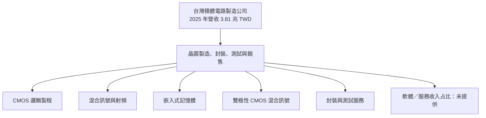
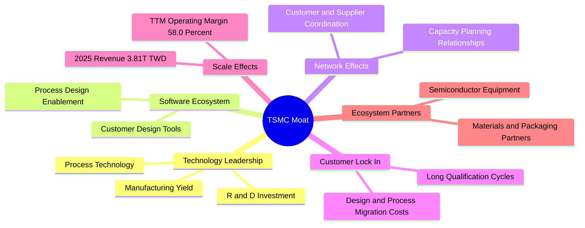
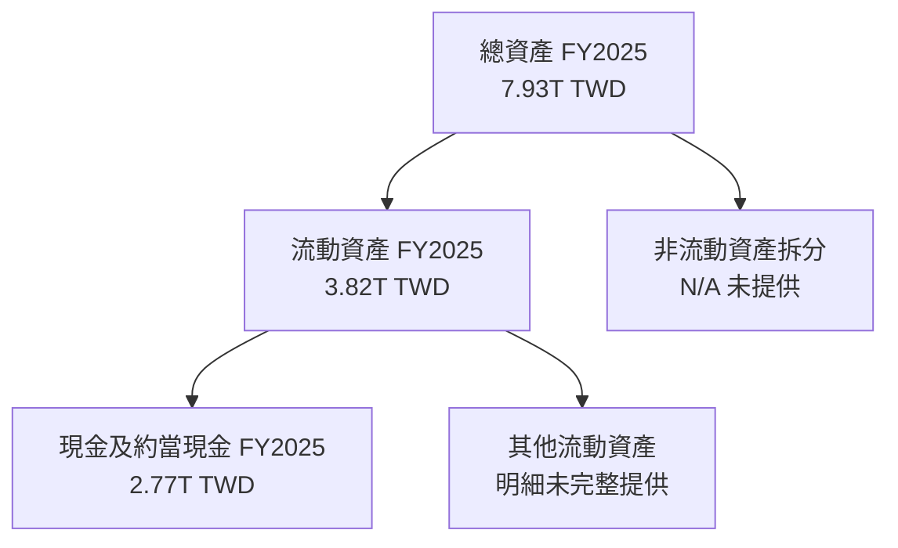
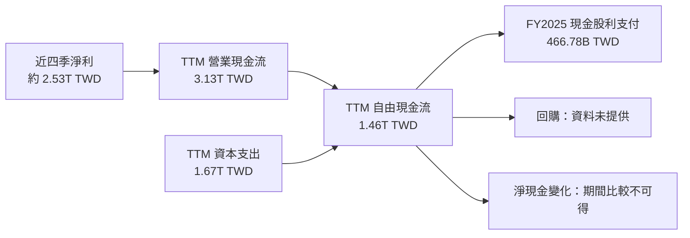
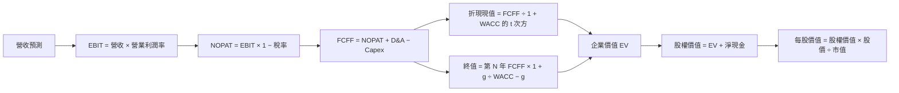
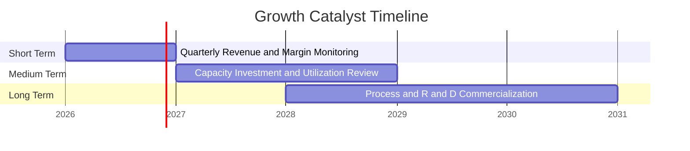
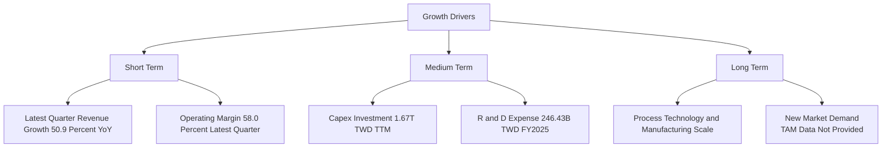
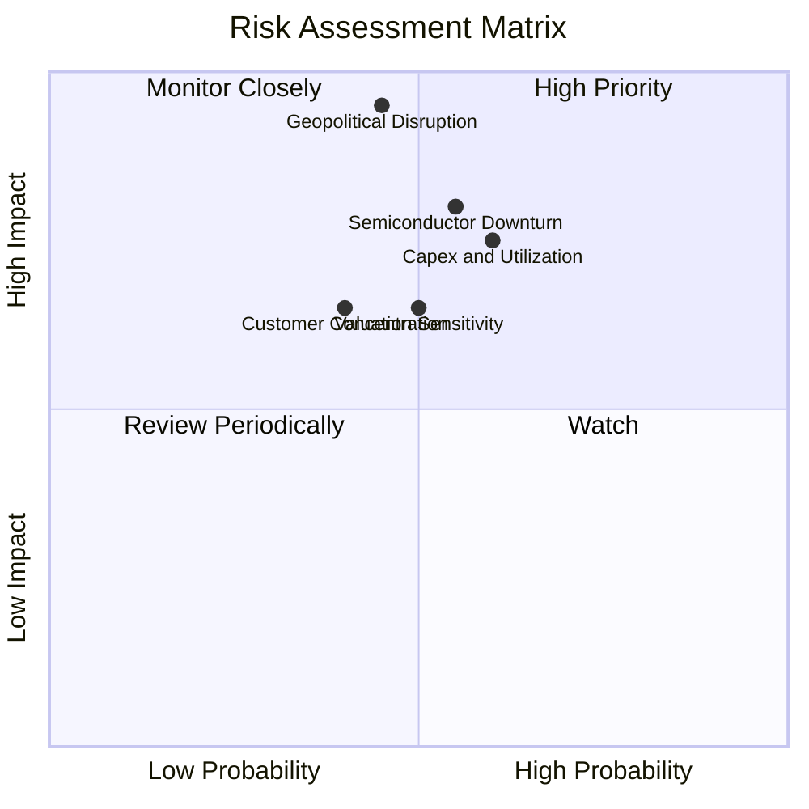
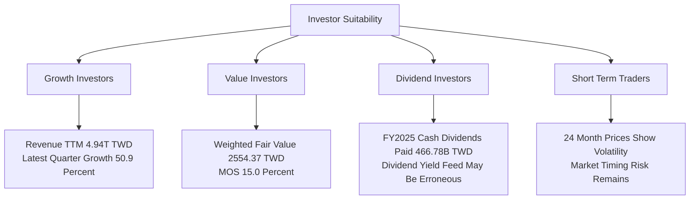

# 2330.TW 基本面深度分析報告

> **報告日期**：2026-11-17 ｜ **語言**：繁體中文 ｜ **數據來源**：Yahoo Finance、Roic.ai ｜ **分析師**：CFA 級機構研究  
> **幣別**：本文財務金額以新台幣（TWD）表示；股價、估值及每股價值亦為 TWD。Yahoo Finance 財報數據未提供 SEC 申報資料。

## 目錄

| # | 章節 | 核心結論 |
|---|------|----------|
| 1 | 執行摘要 | 買入；加權合理價值 2,554.37 元；MOS 15.0% |
| 2 | 公司概覽與商業模式 | 晶圓代工與先進製程具規模及技術壁壘；產品收入占比未提供 |
| 3 | 損益表深度分析 | TTM 營收 4.94 兆元；最新一季營收年增 50.9%，TTM 營業利益率 58.0% |
| 4 | 資產負債表分析 | 淨現金 2.95 兆元；流動比率 2.584 |
| 5 | 現金流量深度分析 | TTM FCF 1.46 兆元，FCF Yield 2.59% |
| 6 | 獲利能力與資本效率 | WACC 10.69%；目前 ROIC 數據未提供，無法作同期價值創造判定 |
| 7 | 相對估值分析 | Forward P/E 14.5x；估值方法回推範圍約 1,967–3,403 元 |
| 8 | DCF 內在價值評估 | 基準 DCF 2,836.72 元；加權合理價值 2,554.37 元 |
| 9 | 成長催化劑 | 最新季度營收年增 50.9%；TAM 與業務別營收占比未提供 |
| 10 | 風險矩陣 | 主要風險為地緣政治、資本密集度與景氣／需求反轉 |
| 11 | 投資建議 | 按規則 20 買入；以估值、毛利率、FCF 與 ROIC 為監控重點 |

---

## 1. 執行摘要

### 1.0 一頁式投資儀表板（Portfolio Manager 30 秒速讀）

| 項目 | 內容 |
|------|------|
| **投資論點（3 句）** | ① TTM 營收 4.94 兆元，最新一季年增 50.9%，反映近期需求及出貨動能上升。② TTM 營業利益率 58.0%、毛利率 65.8%，盈利能力具高水準，但最新季度年增不等於長期成長率。③ 現金及短期投資 4.02 兆元、淨現金 2.95 兆元，TTM FCF 1.46 兆元，提供資本支出與景氣下行緩衝。 |
| **綜合評分** | **8.5/10**（引用 1.1 評分卡） |
| **財務健康** | 🟢 現金 4.02 兆元、淨現金 2.95 兆元，流動比率 2.584；但營運資金天數中的 DSO 異常偏低，應留意資料口徑。 |
| **ROIC vs WACC** | ROIC：N/A；WACC：10.69%。目前資料不足以判定當期 ROIC 是否高於 WACC；歷史 ROIC 僅有 2014–2018 年資料。 |
| **FCF 趨勢** | 2022–2025 年 FCF 分別為 0.521、0.287、0.861、0.992 兆元；TTM FCF 1.46 兆元，FCF Yield 2.59%。 |
| **估值** | Forward P/E **14.5x** ｜ EV/EBITDA **14.824x** ｜ FCF Yield **2.59%** |
| **DCF 內在價值（基準）** | **2,836.72 元** ｜ 現價相對 DCF 折價 **23.5%**（折溢價定義為現價 ÷ DCF 價值 − 1） |
| **安全邊際（MOS）** | **15.0%**＝（加權合理價值 2,554.37 − 現價 2,170）÷ 加權合理價值 2,554.37 ｜ 🟡 有限 |
| **預期報酬（基準情境 12M）** | **+17.7%**，以加權合理價值 2,554.37 元相對現價計算；此非 DCF 基準情境回報。 |
| **關鍵風險（前二）** | 地緣政治與海外產能執行；資本支出高、自由現金流對需求與建廠節奏敏感。 |
| **評級 + 信心度** | 🟢 **買入** ｜ 信心：中（估值模型具完整假設，但最新季度市場預期、當期 ROIC 與 EPS 預期差資料有限） |

### 1.1 綜合評分卡（全報告唯一）

| 維度 | 評分（1–10） | 主要依據（引用數字與其來源章節） |
|------|--------------|----------------------------------|
| 成長性 | 9.0 | 最新一季營收年增 50.9%；TTM 成長率資料為 N/A，見第 3 章。 |
| 獲利能力 | 9.0 | TTM 毛利率 65.8%、營業利益率 58.0%、淨利率 51.1%；當期 ROIC 與 F-Score 未提供，見第 3、6 章。 |
| 財務健康 | 9.0 | 淨現金 2.95 兆元、流動比率 2.584、速動比率 2.287；CCC 2 天，見第 4 章。 |
| 估值 | 7.0 | 加權合理價值 2,554.37 元、MOS 15.0%；DCF 2,836.72 元但終值占 EV 60.2%，見第 7、8 章。 |
| 護城河 | 9.0 | 2025 年營收 3.81 兆元、最新一季年增 50.9%、TTM 營業利益率 58.0%；缺少市場份額與產品組合數據，見第 2 章。 |
| 管理層與資本配置 | 8.0 | 2025 年 FCF 0.992 兆元、股息支付 466.78B；年 SBC 1.25B，未見回購資料，見第 5 章。 |
| **綜合評分** | **8.5** | 六項算術平均＝（9.0＋9.0＋9.0＋7.0＋9.0＋8.0）÷6＝8.5。 |

### 1.2 五大投資論點 + 三大核心風險

| 類型 | 項目 | 具體依據 | 信心度 |
|------|------|----------|--------|
| 🟢 **投資論點①** | 最新季度成長動能高 | 2026-09 季營收 1.49 兆元，年增 50.9%；短期延續性需由後續季度驗證。 | 🟢 高 |
| 🟢 **投資論點②** | 高營業獲利能力 | TTM 營業利益率 58.0%、毛利率 65.8%、淨利率 51.1%。 | 🟢 高 |
| 🟢 **投資論點③** | 淨現金支持韌性 | 現金及短期投資 4.02 兆元，總債務 1.07 兆元，淨現金 2.95 兆元。 | 🟢 高 |
| 🟢 **投資論點④** | FCF 已形成可觀規模 | TTM FCF 1.46 兆元；但 FCF Yield 2.59% 表示股價已反映相當程度的成長預期。 | 🟢 中高 |
| 🟢 **投資論點⑤** | 基準估值支持正向報酬 | 加權合理價值 2,554.37 元，較 2,170 元現價有 17.7% 上行空間；MOS 15.0%。 | 🟡 中 |
| 🟡 **風險①** | 地緣政治與營運集中風險 | 業務涉及台灣及多個海外市場；若供應、物流或客戶交付中斷，營收與資本效率均可能受損。 | 🔴 高衝擊 |
| 🔴 **風險②** | 資本支出與產能利用率風險 | TTM Capex 1.67 兆元，約為 TTM 營收的 33.8%；若需求轉弱，折舊與固定成本可能壓縮利潤率。 | 🟡 中高 |
| 🟡 **風險③** | 高估值對長期假設敏感 | DCF 終值現值占 EV 60.2%；WACC 或永續成長率的小幅變動會顯著改變估值。 | 🟡 中 |

### 1.3 快速統計卡片

| 指標 | 公司實際值（期間） | 同業中位數 | 狀態 |
|------|--------------------|------------|------|
| 營收成長（TTM） | **N/A** | — | 🟡 無法確認 |
| 營收成長（最新一季年增） | **50.9%** | **20.9%**（UMC、GFS、INTC 中位數） | 🟢 |
| 毛利率（TTM） | **65.8%** | **31.7%**（UMC、GFS、INTC 中位數） | 🟢 |
| 營業利益率（TTM） | **58.0%** | — | 🟢 |
| ROIC（TTM） | **N/A** | — | 🟡 |
| Forward P/E | **14.5x** | **15.7x** | 🟢 |
| FCF Yield（TTM） | **2.59%** | — | 🟡 |
| Piotroski F-Score | **N/A** | — | 🟡 |

### 1.4 投資結論

```text
╔══════════════════════════════════════════════════════════════════╗
║                    📊 投資結論摘要                               ║
╠══════════════════════════════════════════════════════════════════╣
║  評級：買入（依 8.8 加權合理價值計算的 MOS 15.0%）               ║
║  價格（2026-11-17 收盤）：2,170.00 TWD                           ║
║  DCF 內在價值（基準）：2,836.72 TWD（折價 23.5%）                ║
║  安全邊際 MOS：15.0%（以加權合理價值 2,554.37 為分母）           ║
║  加權合理價值（8.8）：2,554.37 TWD                               ║
║  DCF 情境價值：                                                   ║
║    悲觀情境：1,210.28 TWD（-44.2%）                              ║
║    基準情境：2,836.72 TWD（+30.7%）                              ║
║    樂觀情境：6,294.10 TWD（+190.1%）                             ║
║  綜合評分：8.5/10（引用 1.1）                                    ║
║  適合投資人：可承受半導體週期與地緣政治風險的長線成長型投資人    ║
╚══════════════════════════════════════════════════════════════════╝
```

---

## 2. 公司概覽與商業模式

### 2.1 業務結構與收入來源

公司從事積體電路及其他半導體裝置的製造、封裝、測試及銷售，市場涵蓋台灣、中國、歐洲、中東、非洲、日本、美國及其他地區。所提供資料沒有按製程、平台或地區拆分營收的金額與占比，因此不以推估比例繪製業務占比圖。



上述分項營收與各製程收入占比未提供，不能用公司總營收反推各板塊規模。2025 年全年營收 3.81 兆元、最新季度年增 50.9%，但營收成長的產品與客戶組合拆分資料不足。

### 2.2 市場份額

市場份額數據未提供，亦沒有可引用的來源年份，因此不繪製市場份額圖或填入比例。相對位置方面，TSMC 最新一季營收年增 50.9%，高於資料所列 UMC、GFS、INTC 最新季度年增率中位數 20.9%；但該比較不等同於市場份額比較。

### 2.3 競爭護城河分析



資料支持的護城河證據主要是規模、研發投入與盈利能力：2025 年研發費用 246.43B，較 2024 年 204.18B 增加；TTM 營業利益率 58.0%。製程領先幅度、良率、客戶集中度及轉換成本沒有量化資料，以上屬業務機制分析，並非財務數據已證明的市場份額結論。

### 2.4 護城河強度

| 護城河項目 | 強度（強／中／弱） | 證據（引用數字或事實） | 會削弱它的情況 |
|------------|--------------------|------------------------|----------------|
| 技術與製造能力 | 強 | 2025 年研發費用 246.43B；TTM 營業利益率 58.0%。 | 競爭者追趕、良率或製程進展落後、研發轉化效率下降。 |
| 客戶鎖定 | 中 | 客製設計、製程導入及驗證通常涉及高轉換摩擦；本資料未提供客戶轉換成本數字。 | 客戶加大自製或多來源供應、平台遷移成本降低。 |
| 規模效應 | 強 | 2025 年營收 3.81 兆元，TTM FCF 1.46 兆元。 | 產能利用率下降、資本支出長期高於現金回報。 |
| 生態夥伴 | 中 | 公司業務涵蓋晶圓製造、封裝與測試；合作夥伴及依賴度未量化。 | 供應鏈中斷、關鍵設備或材料受限。 |
| 軟體生態系統 | N/A | 財務數據未提供獨立軟體收入、使用者數或生態鎖定量化資料。 | 設計支援服務落後或工具鏈無法維持客戶黏著度。 |
| 網路效應 | 中 | 產業合作網絡可能形成協作優勢，但資料未提供可量化網路效應指標。 | 客戶及供應商關係分散，或替代平台成熟。 |

1.1 的「護城河」評分 9.0/10，主要依據營收規模、研發支出與高營業利益率；由於缺少市場份額、客戶集中度與製程競爭力的同業量化數據，仍需保留證據限制。

---

## 3. 損益表深度分析

### 3.1 年度收入成長趨勢（近4年）

依年度財報營收計算 YoY；2022–2025 的 CAGR 約 19.0%。

```text
╔══════════════════════════════════════════════════════════════════╗
║           台灣積體電路製造公司年度收入趨勢（2022–2025）         ║
╠══════════════════════════════════════════════════════════════════╣
║  FY2022  2.26T  ████████████░░░░░░░░░░░░  YoY：—                ║
║  FY2023  2.16T  ███████████░░░░░░░░░░░░░  YoY：-4.4% 🟡         ║
║  FY2024  2.89T  ███████████████░░░░░░░░░  YoY：+33.8% 🟢        ║
║  FY2025  3.81T  ████████████████████░░░░  YoY：+31.8% 🟢        ║
║                                                                  ║
║  2022–2025 三年 CAGR：約 +19.0%                                  ║
╚══════════════════════════════════════════════════════════════════╝
```

2023 年營收較 2022 年下降 4.4%，2024、2025 年則分別回升 33.8%、31.8%。年度序列呈現週期性復甦與高成長，但不能據此推論未來每年均可維持 30% 以上增長。

### 3.2 季度收入趨勢分析

季度收入採 Yahoo Finance 財報資料；季度 YoY 使用 Roic.ai 同期季度營收。計算值四捨五入至 1 位小數。

| 季度 | 營收（TWD） | QoQ | YoY | 備註 |
|------|-------------:|----:|----:|------|
| 2025-12-31 | 1.05T | — | 19.3% | YoY 依 Roic.ai 2024Q4 0.868T 計算；跨資料源四捨五入。 |
| 2026-03-31 | 1.13T | +7.6% | 35.1% | Roic.ai 同期營收 0.839T；年增擴大。 |
| 2026-06-30 | 1.27T | +12.4% | 36.1% | Roic.ai 同期營收 0.934T。 |
| 2026-09-30 | 1.49T | +17.6% | 50.9% | 最新一季年增率，並非 TTM 成長率。 |

最新季度營收由 1.27 兆元升至 1.49 兆元，QoQ +17.6%；這表示季度營收加速，但因缺乏完整產能、售價與產品組合拆分，不能把全部增長歸因於單一產品或客戶群。

### 3.3 利潤率演變分析

| 利潤率指標 | FY2022 | FY2023 | FY2024 | FY2025 | 趨勢 | 評估 |
|------------|-------:|-------:|-------:|-------:|------|------|
| **毛利率** | 59.7% | 54.6% | 56.1% | 59.8% | 2023 下滑後連續回升 | 🟢 |
| **營業利益率** | 49.6% | 42.7% | 45.7% | 50.9% | 2023 下滑，至 2025 高於 2022 | 🟢 |
| **淨利率** | 43.9% | 39.4% | 40.1% | 44.6% | 與營業利潤率方向一致 | 🟢 |

計算依據為年度毛利、營業利益、淨利除以年度營收；TTM 口徑另列為毛利率 65.8%、營業利益率 58.0%、淨利率 51.1%。兩者期間不同，且年度報表與合併資料來源可能存在口徑差異，不應混作同一期間趨勢。  
2023 年利潤率收縮與營收回落同向；2024–2025 年營收恢復後利潤率回升，符合產能利用率及產品組合可能改善的方向性解釋，但提供資料不足以定量拆解價格、製程與成本控制各自貢獻。

### 3.4 費用結構分析

費用明細、營業成本細項與按收入百分比的完整費用結構未提供，故不繪製費用結構 pie chart。已知 2025 年研發費用為 246.43B，相當於 2025 年營收 3.81 兆元的約 6.5%；該比率可作研發投入尺度參考，不代表完整營業費用率。

### 3.5 季度 EPS 趨勢與盈餘品質（Quality of Earnings）

| 盈餘品質項目 | 數值/佔比 | 評估 |
|--------------|-----------|------|
| 股權薪酬 SBC / 營收 | TTM 約 0.010%（近四季 SBC 約 513.37M ÷ TTM 營收 4.94T） | 🟢 比例低；SBC 是非現金費用，但可能造成股權稀釋。 |
| SBC / 營業現金流 | 約 0.016%（513.37M ÷ 3.13T） | 🟢 占比低。 |
| FCF / 淨利（現金轉換率） | 約 57.7%（TTM FCF 1.46T ÷ 最新四季淨利合計約 2.53T） | 🟡 有正現金流，但重資本支出使 FCF 低於會計淨利。 |
| 一次性/非經常性損益 | N/A；未提供項目明細 | 🟡 無法確認是否有一次性項目影響淨利。 |
| 有效稅率異常 | 17.0%（最新年有效稅率） | 🟢 現有資料未顯示顯著異常；未提供當季稅率拆解。 |
| 資本化支出 vs 費用化 | TTM Capex 1.67T；資本化明細及資產化政策未提供 | 🟡 資本支出規模大，後續以折舊及產能利用率影響利潤。 |

最近四季淨利分別為 485.47B、572.48B、706.56B、763.06B，逐季上升；EPS 估計值及實際值在 Earnings History 欄均為缺值，因此**無法判定過去四季 EPS 是超預期或不及預期，也無法分析盈餘驚喜原因**。Roic.ai 列示 2026Q1–Q3 EPS 分別為 22.08、27.25、29.43，但不等同於分析師預期或上述報表 EPS 口徑。

整體而言，SBC 占比低、FCF 為正，支持盈餘具現金含量；但 FCF/淨利約 57.7%，顯示高資本支出會消耗相當部分營運現金。一次性損益與資本化政策未提供，盈餘品質判斷仍需保留。

---

## 4. 資產負債表分析

### 4.1 資產結構分解

最新完整年度資產負債表為 2025-12-31；2026-09-30 各項資產總額未提供。下圖只顯示已知數字，不將缺失項目反推為非流動資產。



### 4.2 流動性與營運資金分析

| 指標 | 最新值 | 歷史值 | 評估 |
|------|-------:|------:|------|
| 流動比率 | 2.584 | 2025 年末約 2.51（3.82T ÷ 1.52T） | 🟢 流動資產對短期負債有覆蓋。 |
| 速動比率 | 2.287 | N/A | 🟢 高於 1；來源為 Yahoo 財務指標。 |
| 現金及短期投資 | 4.02T | 2025 年末現金 2.77T | 🟢 有顯著流動性緩衝；口徑含短期投資。 |

| 指標 | 最新 TTM | 一年前 TTM | 變化 | 解讀 |
|------|----------:|-----------:|------:|------|
| DSO 應收帳款天數 | 1 天 | N/A | N/A | 來源未提供一年前值；1 天偏低，應注意期末餘額及營收口徑的影響。 |
| DIO 存貨天數 | 92 天 | N/A | N/A | 一年前值未提供；不能據此判斷庫存天數變化。 |
| DPO 應付帳款天數 | 91 天 | N/A | N/A | 一年前值未提供；目前付款天數接近存貨天數。 |
| CCC 現金轉換週期 | 2 天 | N/A | N/A | 依來源數值；因缺少比較期及細項，不能確認趨勢。 |

### 4.3 債務結構分析

```text
╔══════════════════════════════════════════════════════════════════╗
║                 台灣積體電路製造公司債務健康診斷                 ║
╠══════════════════════════════════════════════════════════════════╣
║  總債務：          1.07T TWD     ██░░░░░░░░░░░░░░░░              ║
║  現金及短期投資：  4.02T TWD     ████████████████████            ║
║  淨現金：          2.95T TWD     🟢 資產負債表具流動性緩衝       ║
║  Debt/EBITDA：     約 0.39x      🟢 以 TTM EBITDA 2.74T 計        ║
║  利息保障倍數：    N/A           利息費用未提供                   ║
║  流動比率：        2.584         🟢                               ║
╚══════════════════════════════════════════════════════════════════╝
```

Debt/EBITDA 約 0.39x 為以總債務 1.07 兆元除以 TTM EBITDA 2.74 兆元的估算比率；不等同於公司正式債務契約指標。

### 4.4 股東權益趨勢

```text
╔══════════════════════════════════════════════════════════════════╗
║              股東權益趨勢（TWD 兆元，年度末）                    ║
╠══════════════════════════════════════════════════════════════════╣
║  FY2022  2.90  ████████████░░░░░░░░░░                            ║
║  FY2023  3.43  ██████████████░░░░░░░░                            ║
║  FY2024  4.24  █████████████████░░░░░                            ║
║  FY2025  5.36  ████████████████████░░                            ║
╚══════════════════════════════════════════════════════════════════╝
```

2022–2025 年股東權益由 2.90 兆元增至 5.36 兆元。同期公司持續盈利並支付股息；資料未提供完整權益變動表，不能將增量全部歸因於留存盈餘。

---

## 5. 現金流量深度分析

### 5.1 現金流量瀑布圖

近期淨利以 2026 年前三季及 2025Q4 合計約 2.53 兆元估算；股息使用 2025 年度現金股利支付額。其他年度現金變動未提供。



### 5.2 FCF 轉換率趨勢

| 年度 | FCF | 淨利 | FCF / 淨利 |
|------|----:|----:|-----------:|
| 2022 | 520.97B | 992.92B | 52.5% |
| 2023 | 286.57B | 851.74B | 33.6% |
| 2024 | 861.20B | 1.16T | 74.2% |
| 2025 | 992.38B | 1.70T | 58.4% |

2023 年 FCF 轉換率降至 33.6%，其後恢復，但 2025 年仍低於 2024 年。高資本支出是 FCF 與淨利差異的重要來源，不能只看淨利判斷可分配現金。

### 5.3 自由現金流趨勢

```text
╔══════════════════════════════════════════════════════════════════╗
║                   自由現金流趨勢（年度）                         ║
╠══════════════════════════════════════════════════════════════════╣
║  FY2022  520.97B  ██████████░░░░░░░░░░  FCF Yield：N/A           ║
║  FY2023  286.57B  ██████░░░░░░░░░░░░░░  FCF Yield：N/A           ║
║  FY2024  861.20B  █████████████████░░░  FCF Yield：N/A           ║
║  FY2025  992.38B  ████████████████████  FCF Yield：N/A           ║
║  TTM     1.46T    —                     FCF Yield：2.59%         ║
╚══════════════════════════════════════════════════════════════════╝
```

只有 TTM FCF Yield 2.59% 有明確資料；不同年度市值未提供，故不推估年度 FCF Yield。

### 5.4 資本配置評估

分項資本配置占比資料未提供，故不繪製 pie chart。可觀察到 2025 年資本支出 1.28 兆元、現金股息支付 466.78B；同年 SBC 1.25B，回購資料未提供。TTM Capex 1.67 兆元顯示資本再投資仍具規模；是否能轉化為更高長期回報，須追蹤新增產能利用率與 ROIC。

---

## 6. 獲利能力與資本效率

### 6.1 ROE / ROA / ROIC 趨勢

| 指標 | FY2025 / TTM | 歷史資料 | 評估 |
|------|-------------:|----------|------|
| ROE | TTM 41.9% | N/A（年度序列未提供） | 🟢 高，但杜邦分解資料不足，無法確認槓桿與淨利率的相對貢獻。 |
| ROA | TTM 20.6% | N/A（年度序列未提供） | 🟢 資產獲利能力高。 |
| ROIC | N/A | Roic.ai 2014–2018 約 18.31%、20.55%、19.51%、20.38%、19.48% | 🟡 歷史值距今較久，不能代替目前 TTM ROIC。 |

未提供可引用的行業均值，不列行業比較欄。

### 6.2 ROIC vs WACC 分析（核心價值創造判斷）

```text
╔══════════════════════════════════════════════════════════════════╗
║                  ROIC vs WACC 深度分析                           ║
╠══════════════════════════════════════════════════════════════════╣
║  WACC（採用資料所列數值）：10.69%                                ║
║  ├── 無風險利率（10Y Treasury）：5.10%                           ║
║  ├── 股權風險溢酬 ERP：5.00%                                      ║
║  ├── 原始 Beta：1.23；調整後 Beta：1.16                          ║
║  ├── 股權成本 Ke：10.88%                                         ║
║  ├── 稅前債務成本：1.16%；有效稅率：17.0%                       ║
║  ├── 股權／債務權重：98.1%／1.9%                                 ║
║  └── WACC：10.69%                                                ║
║                                                                  ║
║  當期 ROIC：N/A（資料未提供）                                    ║
║  EVA / ROIC − WACC：N/A（當期 ROIC 缺漏）                       ║
║  判斷：無法依同期數字認定目前是在創造或摧毀股東價值。            ║
║  歷史參考：2018 年 ROIC 19.11%，高於此處 WACC 10.69%；             ║
║  但期間不一致，僅可作歷史背景，不能當作當期結論。                ║
╚══════════════════════════════════════════════════════════════════╝
```

成本資本組成依程式計算的 Cost of capital 數據引用。調整後 Beta 為 ⅔ × 原始 Beta 1.23 ＋ ⅓ × 1，四捨五入後為 1.16。使用提供的股權成本 10.88% 與稅前債務成本 1.16%，稅後債務成本約為 1.16% ×（1−17.0%）＝0.96%。加權後 WACC 仍採用提供值 10.69%，不另行替換。由已列示的四捨五入 CAPM 輸入直接計算會有小幅尾差，可能來自未四捨五入輸入。

### 6.3 杜邦三因素分解

| 因素 | 數值（TTM） | 解讀 |
|------|-------------|------|
| 淨利率 | N/A | QUALITY FIGURES 所列杜邦為 N/A，缺少完整計算所需資料。 |
| 資產週轉率 | N/A | 同上。 |
| 權益乘數 | N/A | 同上。 |
| **ROE** | **N/A** | QUALITY FIGURES 所列杜邦分解為 N/A；不可補算或替代。 |

### 6.4 財務體質：Piotroski F-Score

**Piotroski F-Score：N/A（需要相隔一年的兩個 TTM 期間及 SEC 申報資料，現有來源不足）。** 九項測試結果沒有提供，因此不逐項臆測或填列通過／不通過。

---

## 7. 相對估值分析

### 7.1 同業估值比較表格

公司估值取 Yahoo Finance 合併資料；同業倍數嚴格引用 Peer multiples。UMC 的 P/S、EV/EBITDA 由於幣別混合不可比而未提供。

| 估值指標 | **TSMC** | **UMC** | **GFS** | **INTC** | TSMC 評估 |
|----------|---------:|-------:|------:|-------:|-----------|
| **Trailing P/E** | 22.7x | 13.3x | 113.1x | N/A | 🟡 高於 UMC；GFS 高倍數可能反映低基期，INTC 未提供。 |
| **Forward P/E** | 14.5x | 15.7x | 15.2x | 30.8x | 🟢 低於同業中位數 15.7x。 |
| **P/S Ratio（TTM）** | 11.38x | N/A | 3.1x | 4.9x | 🔴 明顯高於 GFS、INTC；盈利率及營收質量不同，不宜單看 P/S。 |
| **EV/EBITDA（TTM）** | 14.824x | N/A | 10.6x | 16.0x | 🟡 位於 GFS 與 INTC 之間。 |
| **最新一季營收年增** | 50.9% | 25.6% | 12.5% | 20.9% | 🟢 高於三家同業。 |
| **毛利率（TTM）** | 65.8% | 31.7% | 28.5% | 40.2% | 🟢 高於可比同業。 |

同業 Forward P/E 中位數為 15.7x；EV/EBITDA 中位數為 13.3x（GFS、INTC）。同業營收成長中位數為 20.9%，毛利率中位數為 31.7%。以上同業資料不代表產品組合、資本強度或會計口徑完全一致。

### 7.2 歷史估值區間分析

N/A（未提供「Valuation vs own history」的歷史 P/E 區間與百分位資料，故不估算歷史分位數）。

### 7.3 情境價值（Bear / Base / Bull，照抄 DCF MODEL 的 Scenarios）

| 情境 | 第 1 年營收成長 | 期末營業利潤率 | WACC | 每股價值 | 相對現價 | 機率 | 會發生的條件 |
|------|----------------:|----------------:|-----:|---------:|---------:|----:|--------------|
| 🔴 悲觀 | 15.0% | 42.1% | 11.69% | 1,210.28 TWD | -44.2% | 25% | 需求增長放緩、競爭或產能利用率下降，使長期利潤率下滑，且風險溢酬上升。 |
| 🟡 基準 | 30.0% | 49.5% | 10.69% | 2,836.72 TWD | +30.7% | 50% | 近期高成長延續一段時間，之後增速線性降至 3.0%，利潤率逐步正常化。 |
| 🟢 樂觀 | 45.0% | 54.5% | 9.69% | 6,294.10 TWD | +190.1% | 25% | 高成長顯著延續，長期利潤率高於基準且資本成本下降。 |

這些情境數值與假設為 DCF 模型的直接輸出；未提供各情境逐年營收及 FCFF 中間表，故不自行補造其推導明細。

### 7.4 相對估值隱含價格區間

```text
╔══════════════════════════════════════════════════════════════════╗
║                   相對估值與共識隱含每股價值                     ║
╠══════════════════════════════════════════════════════════════════╣
║  1,967.42 ── 2,170.00 ── 2,350.32 ── 2,836.72 ── 3,402.51      ║
║  EV/EBITDA    現價        Forward P/E   基準 DCF    分析師共識   ║
╚══════════════════════════════════════════════════════════════════╝
```

| 方法 | 每股價值 | 相對現價 | 計算依據 |
|------|---------:|---------:|----------|
| 同業 Forward P/E | 2,350.32 TWD | +8.3% | 同業中位數 15.7x × Forward EPS 149.53。 |
| 同業 EV/EBITDA | 1,967.42 TWD | -9.3% | GFS、INTC 中位數 13.3x × TTM EBITDA，再加回淨現金。 |
| 基準 DCF | 2,836.72 TWD | +30.7% | 10 年 FCFF、WACC 10.69%、永續成長率 3.0%。 |
| 分析師共識 | 3,402.51 TWD | +56.8% | 35 位分析師平均目標價；參考性質，不等同基本面內在價值。 |

---

## 8. DCF 內在價值評估（Discounted Cash Flow）

### 8.0 估值推理鏈（Thinking Logic）

**Step 1 — 價值來源與主導變數**

模型以現有晶圓製造、封裝與測試業務的未來現金流為主要價值來源；2025 年營收 3.81 兆元，TTM 營收 4.94 兆元，但新業務及各平台收入占比未提供，不能另行分配成長曲線。估值對未來收入成長與長期營業利潤率最敏感；敏感度矩陣顯示終值成長率與 WACC 也會大幅改變每股價值。

**Step 2 — 模型選擇**

| 決策點 | 本報告採用 | 理由（含數字） | 曾考慮但否決 | 否決理由 |
|--------|-----------|----------------|--------------|----------|
| 現金流定義 | FCFF | 對應 WACC 折現並先求 EV；TTM OCF 3.13T、Capex 1.67T。 | FCFE | 未提供逐年融資與淨借款假設。 |
| 預測期 N | 10 年 | DCF 模型固定列示 10 年，讓成長及利潤率逐步收斂。 | 5 年 | 無法保留模型既定輸入與終值起算年度。 |
| 終值方法 | Gordon Growth | 模型採永續成長率 3.0%，低於 WACC 10.69%。 | 退出倍數 | DCF 區塊未提供退出倍數及該倍數的估值輸出。 |
| EBIT 基礎 | GAAP EBIT | 模型假設以 GAAP EBIT 預測，且明示已含 SBC。 | 非 GAAP EBIT | 會造成 SBC 處理方式與程式模型不一致。 |

**Step 3 — 高敏感假設推導**

- **營收成長路徑**：錨點＝最新一季年增 50.9%，但 TTM 年增率 N/A → 調整＝避免把單季高增長直接外推十年，模型將第 1 年成長設為 30.0%，並線性降至第 10 年 3.0% → **採用值：30.0% 緩降至 3.0%** → 曾考慮將 50.9% 當作首年起點，但否決，因它是單季 YoY，不是 TTM 或全年成長率。
- **期末營業利潤率**：錨點＝TTM 營業利益率 58.0% → 調整＝模型以過去五個財政年度中位數作長期收斂目標 → **採用值：第 10 年 49.5%** → 曾考慮長期維持 58.0%，但模型否決，避免將當期高利潤率直接視為永久水準。
- **永續成長率 g**：錨點＝模型設為 3.0%；長期經濟成長與通膨數據未提供 → 調整＝採用低於 WACC 10.69% 的成熟期成長假設 → **採用 3.0%** → 不採用高於或接近 WACC 的成長率，以免 Gordon Growth 分母失效或價值被不成比例放大。
- **預測期 N**：錨點＝模型列示 FY+1 至 FY+10 → 調整＝沿用程式模型，不改動預測期 → **採用 10 年** → 不改成短期預測，避免破壞既有估值輸出。
- **Capex/營收**：錨點＝TTM Capex 1.67T ÷ TTM 營收 4.94T，模型基準 33.8% → 調整＝隨時間淡化至 16.6%，模型依據為不高於 1.1 倍 D&A 的長期收斂規則 → **採用 FY+1 33.8% 降至 FY+10 16.6%** → 不採用長期固定 33.8%，因會忽略資本密集度收斂假設。
- **EBIT 基礎及 SBC**：錨點＝模型採 GAAP EBIT、FY2025 SBC 1.25B → **採用 GAAP EBIT、不另扣 SBC、固定股數** → 否決加回 EBIT 後再以其他方式重複扣 SBC。
- **稀釋率**：在組合 A 下，依 DCF 模型固定股數處理，年稀釋率 0%；股數取程式模型隱含基準，未額外放大 → 不採用另行增加稀釋率，避免與 GAAP SBC 重複反映。
- **終值方法**：錨點＝模型採 Gordon Growth，g 3.0%、WACC 10.69% → **採用 Gordon Growth** → 不以未提供的退出倍數替換。
- **WACC**：錨點＝Cost of capital 區塊 WACC 10.69% → **採用 10.69%** → 不以自行估計 WACC 取代程式輸入，完整組成見 8.2。

有效稅率採用 17.0%，依據為最新年度有效稅率；D&A/營收採模型 TTM 比率 15.1%。ΔWC 未建模，非歷史數據證明其為零。

**Step 4 — 最脆弱假設**

最脆弱的假設是長期高成長能否轉化成第 10 年 49.5% 營業利潤率與足夠現金流；若需求放緩、成本上升或資本密集度長期高於模型收斂假設，悲觀情境每股價值為 1,210.28 元，低於現價 44.2%。

**Step 5 — 計算路徑**



### 8.1 模型假設總表（Model Inputs）

金額以 TWD billions 表示；所有 DCF 數字照模型原值引用。

| 假設項目 | 採用值 | 依據 / 來源 | 敏感度 |
|----------|--------|-------------|--------|
| 預測期長度 **N** | 10 年 | DCF MODEL 固定 10 個預測年度。 | 🟡 中 |
| 營收成長路徑 | FY+1 30.0%，FY+10 3.0%，線性遞減 | 第 1 年參考最新季度 YoY 50.9%，但受模型 30% 上限約束；TTM 成長率 N/A。 | 🔴 高 |
| 營業利潤率 | FY+1 58.0% → FY+10 49.5% | 起點為 TTM 58.0%；終點為過去五個財政年度中位數（含 TTM）。 | 🔴 高 |
| 有效稅率 | 17.0% | 最新年度有效稅率。 | 🟢 低 |
| Capex / 營收 | 33.8% → 16.6% | TTM 起點；向 1.1×D&A 收斂。 | 🟡 中 |
| D&A / 營收 | 15.1% | TTM 比率，模型固定。 | 🟢 低 |
| 營運資金變動 | 未建模 | DCF MODEL 明示 working capital is not modelled，不自行加入 ΔWC。 | 🟢 低 |
| EBIT 基礎 | GAAP EBIT | 程式模型明示 GAAP EBIT。 | 🟡 中 |
| 股權薪酬 SBC 處理 | 已含於 GAAP EBIT；FCFF 不再減 SBC | 模型指定組合 A。 | 🟡 中 |
| 年稀釋率 | 0%；固定股數處理 | 與組合 A 及程式模型相容，不額外稀釋。 | 🟡 中 |
| 永續成長率 g | 3.0% | DCF MODEL 固定假設；低於 WACC。 | 🔴 高 |
| 終值方法 | Gordon Growth | 模型所列 TV 公式。 | 🔴 高 |
| WACC | 10.69% | Cost of capital 區塊直接採用。 | 🔴 高 |

**SBC 防重複計算**：本模型採用 **(A) GAAP EBIT + 固定股數**，故 SBC 影響已計入一次；FCFF 不另扣 SBC，年稀釋率為 0%。

**FCFF 定義**：採用模型指定的 FCFF＝NOPAT＋D&A−Capex。工作資金變動沒有建模，不能把它當作已確認為零的實際財務數字。

### 8.2 折現率推導（WACC）

```text
╔══════════════════════════════════════════════════════════════════╗
║                    WACC 推導（折現率）                           ║
╠══════════════════════════════════════════════════════════════════╣
║  股權成本 Ke（採用成本資本資料）：                               ║
║  ├── 無風險利率 Rf（10Y Treasury）：5.10%                       ║
║  ├── 市場風險溢酬 ERP：5.00%                                     ║
║  ├── Beta 原始值：1.23；調整後使用值：1.16                      ║
║  ├── 規模／國別溢酬：未另加                                      ║
║  └── 提供的 Ke：10.88%                                           ║
║                                                                  ║
║  債務成本 Kd：                                                   ║
║  ├── 稅前 Kd：1.16%                                              ║
║  ├── 有效稅率：17.0%                                             ║
║  └── 稅後 Kd = 1.16% × (1 − 17.0%) = 0.96%                      ║
║                                                                  ║
║  資本結構（市場價值權重）：                                      ║
║  ├── 股權權重 E：98.1%                                           ║
║  ├── 債務權重 D：1.9%                                            ║
║  └── 採用 WACC：10.69%                                           ║
╚══════════════════════════════════════════════════════════════════╝
```

逐步演算及口徑說明：

1. **Ke（CAPM）**：提供值為 10.88%。用已四捨五入輸入檢算：5.10%＋1.16×5.00%＝10.90%；與提供 Ke 的 0.02 個百分點差異屬輸入未四捨五入前的尾差，本報告依規則採用提供值 10.88%。  
2. **稅前 Kd**：資料直接提供 1.16%；利息費用與平均計息負債明細未提供，因此不能獨立重建分子、分母。  
3. **稅後 Kd**：1.16%×（1−17.0%）＝0.9628% ≈ **0.96%**。  
4. **權重**：採用成本資本區塊提供的 E/D 權重 98.1%／1.9%，合計 100.0%。個別市值與同口徑計息負債期末金額未提供完整拆分，故不自行重算權重。  
5. **WACC**：98.1%×10.88%＋1.9%×0.9628%＝10.6733%＋0.0183%＝**10.6916% ≈ 10.69%**。

風險自由利率的觀察日、ERP 的外部依據與規模溢酬估計未提供；模型直接採用資料列示值。第 6.2 節與本節均使用 WACC 10.69%。

### 8.3 逐年自由現金流預測（基準情境）

單位：TWD billions。折現因子三位小數；其他金額保留模型原值至小數兩位。

| 年度 | FY+1 | FY+2 | FY+3 | FY+4 | FY+5 | FY+6 | FY+7 | FY+8 | FY+9 | FY+10 |
|------|------:|------:|------:|------:|------:|------:|------:|------:|------:|-------:|
| 營收 | 6,428.26 | 8,163.89 | 10,123.23 | 12,249.11 | 14,453.94 | 16,622.04 | 18,616.68 | 20,292.18 | 21,509.71 | 22,155.00 |
| 營收 YoY | 30.0% | 27.0% | 24.0% | 21.0% | 18.0% | 15.0% | 12.0% | 9.0% | 6.0% | 3.0% |
| 營業利潤率 | 58.0% | 57.0% | 56.1% | 55.2% | 54.2% | 53.3% | 52.3% | 51.4% | 50.5% | 49.5% |
| EBIT（GAAP） | 3,726.88 | 4,656.49 | 5,679.00 | 6,756.58 | 7,837.06 | 8,856.56 | 9,744.56 | 10,431.05 | 10,854.96 | 10,972.60 |
| − 稅（17.0%） | (632.56) | (790.34) | (963.90) | (1,146.79) | (1,330.18) | (1,503.22) | (1,653.94) | (1,770.46) | (1,842.41) | (1,862.38) |
| = NOPAT | 3,094.32 | 3,866.14 | 4,715.10 | 5,609.79 | 6,506.88 | 7,353.34 | 8,090.62 | 8,660.59 | 9,012.55 | 9,110.22 |
| + D&A | 970.20 | 1,232.15 | 1,527.86 | 1,848.72 | 2,181.48 | 2,508.71 | 2,809.75 | 3,062.63 | 3,246.39 | 3,343.78 |
| − Capex | (2,171.05) | (2,601.47) | (3,032.68) | (3,435.84) | (3,778.51) | (4,028.15) | (4,156.32) | (4,143.23) | (3,981.42) | (3,678.16) |
| **= FCFF** | **1,893.46** | **2,496.82** | **3,210.29** | **4,022.67** | **4,909.85** | **5,833.90** | **6,744.04** | **7,579.99** | **8,277.52** | **8,775.85** |
| 折現因子 | 0.903 | 0.816 | 0.737 | 0.666 | 0.602 | 0.544 | 0.491 | 0.444 | 0.401 | 0.362 |
| **FCFF 現值 PV** | **1,710.52** | **2,037.67** | **2,366.81** | **2,679.22** | **2,954.17** | **3,171.03** | **3,311.58** | **3,362.46** | **3,317.12** | **3,177.05** |

**預測期現值合計：**

1,710.52＋2,037.67＋2,366.81＋2,679.22＋2,954.17＋3,171.03＋3,311.58＋3,362.46＋3,317.12＋3,177.05  
＝**28,087.64 TWD billions**（小數尾差依模型原始值）。

**逐步演算（FY+1，依模型原值示範）**

1. 營收＝TTM 營收基數 4,944.82×（1＋30.0%）＝**6,428.26**。  
2. EBIT＝6,428.26×58.0%＝**3,726.88**（模型原值）。  
3. 稅＝3,726.88×17.0%＝**632.56**。  
4. NOPAT＝3,726.88−632.56＝**3,094.32**。  
5. D&A＝6,428.26×15.1%＝**970.20**（模型原值）。  
6. Capex＝6,428.26×33.8%＝**2,171.05**（模型原值）。  
7. ΔWC＝未建模；DCF MODEL 未扣除營運資金變動。  
8. FCFF＝3,094.32＋970.20−2,171.05＝**1,893.47**；模型列示 **1,893.46**，0.01 差異來自未四捨五入底層數字，沿用模型 FCFF。  
9. 折現因子＝1÷（1＋10.69%）¹＝**0.903**；PV＝1,893.46×0.903（使用未四捨五入折現因子）＝**1,710.52**。

模型提供的預測 FCF 由 FY+1 的 1,893.46 增至 FY+10 的 8,775.85；其 CAGR 約 18.6%。可比的歷史 FCF CAGR 受 2023 年低點影響，2022–2025 年 CAGR 約 24.0%，模型預測低約 5.4 個百分點，主因預測營收增速逐年下降。FY+10 FCFF 利潤率約 39.6%（8,775.85÷22,155.00）；目前 TTM FCF 利潤率約 29.6%（1.46T÷4.94T）。同業最佳 FCF 利潤率未提供。模型預測年度 FCFF 均為正。

```text
╔══════════════════════════════════════════════════════════════════╗
║            自由現金流：歷史實際 vs 模型預測                      ║
╠══════════════════════════════════════════════════════════════════╣
║  FY2023（實）  286.57B  █░░░░░░░░░░░░░░░░░░░░  FCF             ║
║  FY2024（實）  861.20B  ██░░░░░░░░░░░░░░░░░░░  FCF             ║
║  FY2025（實）  992.38B  ██░░░░░░░░░░░░░░░░░░░  FCF             ║
║  FY+1（預）   1,893.46B ████░░░░░░░░░░░░░░░░░  FCFF            ║
║  FY+10（預）  8,775.85B ████████████████████  FCFF            ║
╠══════════════════════════════════════════════════════════════════╣
║  註：歷史 FCF 為營業現金流−資本支出；預測 FCFF 為 NOPAT+D&A−Capex ║
║  兩者口徑不同，不將歷史實際值與預測值直接視為完全同口徑序列。  ║
╚══════════════════════════════════════════════════════════════════╝
```

### 8.4 終值計算（Terminal Value）

**適用性檢查：WACC 10.69% vs g 3.0% → WACC > g？✅**

| 方法 | 計算式 | 終值 TV | TV 現值 | 佔總 EV 比重 |
|------|--------|--------:|--------:|-------------:|
| Gordon Growth | 8,775.85×（1＋3.0%）÷（10.69%−3.0%） | 117,473.33 | 42,527.94 | 60.2% |
| 退出倍數法 | N/A（模型未提供退出倍數與估值） | N/A | N/A | N/A |

逐步演算：

1. FY+N FCFF＝FY+10 **8,775.85**。  
2. 分子＝8,775.85×（1＋3.0%）＝**9,039.13**（模型列示終值按未四捨五入底層數字計算）。  
3. 分母＝10.69%−3.0%＝**7.69%**；TV＝模型所列 **117,473.33**。  
4. PV(TV)＝117,473.33×FY+10 折現因子 0.362＝**42,527.94**（以未四捨五入折現因子計算）。  
5. 終值占比＝42,527.94÷70,615.57＝**60.2%**。

退出倍數法所需的 EBITDA(FY+10) 對應倍數與退出估值未提供，不另行設定。

### 8.5 企業價值 → 每股內在價值（Bridge）

```text
╔══════════════════════════════════════════════════════════════════╗
║              企業價值 → 每股內在價值 橋接表                      ║
╠══════════════════════════════════════════════════════════════════╣
║  預測期 FCF 現值合計             +28,087.64 TWD billions         ║
║  終值現值 PV(TV)                 +42,527.94 TWD billions         ║
║  ─────────────────────────────────────────────                  ║
║  = 企業價值 EV                    70,615.57 TWD billions         ║
║  + 淨現金（模型值）               +2,947.23 TWD billions         ║
║  = 股權價值                       73,562.80 TWD billions         ║
║  每股價值（依模型換算公式）        2,836.72 TWD                  ║
║  現價（2026-11-17 收盤）           2,170.00 TWD                  ║
║  折溢價（現價÷DCF價值−1）          -23.5%（折價）                ║
╚══════════════════════════════════════════════════════════════════╝
```

逐步演算：

1. EV＝28,087.64＋42,527.94＝**70,615.58**；模型列示 EV 為 **70,615.57**，0.01 尾差來自底層精度，沿用模型總值。  
2. 股權價值＝70,615.57＋2,947.23＝**73,562.80**。  
3. 每股價值依模型原式：股權價值 × 價格 ÷ 市值＝模型列示 **2,836.72 TWD**。  
4. 折溢價＝2,170.00÷2,836.72−1＝**−23.5%**。  
5. 本節不計算 MOS；MOS 僅以 8.8 加權合理價值為基準。

模型的每股換算式採「股權價值 × 價格 ÷ 市值」，不直接以未四捨五入股數重建；DCF 淨現金採模型列示 2,947.23B，與財務摘要淨現金 2.95T 為同一近似口徑。拆分後的現金與債務未以更多小數精度提供，故不另行杜撰橋接項。

### 8.6 敏感性分析（WACC × 永續成長率）

| g（列）／WACC（欄） | 8.69% | 9.69% | **10.69%（基準）** | 11.69% | 12.69% |
|-----------|------:|------:|-------------------:|-------:|-------:|
| **2.0%** | 3,563.88 (+64.2%) | 3,036.24 (+39.9%) | 2,634.01 (+21.4%) | 2,318.12 (+6.8%) | 2,064.13 (-4.9%) |
| **2.5%** | 3,756.54 (+73.1%) | 3,169.15 (+46.0%) | 2,729.18 (+25.8%) | 2,388.27 (+10.1%) | 2,117.06 (-2.4%) |
| **3.0%** | 3,983.04 (+83.5%) | 3,321.91 (+53.1%) | **2,836.72 (+30.7%)** | 2,466.50 (+13.7%) | 2,175.46 (+0.3%) |
| **3.5%** | 4,253.14 (+96.0%) | 3,499.34 (+61.3%) | 2,959.20 (+36.4%) | 2,554.27 (+17.7%) | 2,240.21 (+3.2%) |
| **4.0%** | 4,580.78 (+111.1%) | 3,707.91 (+70.9%) | 3,099.98 (+42.9%) | 2,653.44 (+22.3%) | 2,312.40 (+6.6%) |

上行空間＝（矩陣價值−2,170）÷2,170；矩陣價格直接照錄 DCF MODEL。

**有效非基準格示例：WACC 11.69% > g 3.0% ✅**  
此格模型每股價值＝**2,466.50 TWD**；DCF 模型列示的該格數值直接引用。因敏感性矩陣所需逐年折現因子與原始未四捨五入現金流未提供，不能獨立重建該格的完整計算細節。

**三情境 DCF**

| 情境 | 營收成長假設 | 期末營業利潤率 | 永續成長 g | WACC | 每股內在價值 | 相對現價 | 主觀機率 |
|------|--------------|----------------|------------|------|--------------|----------|----------|
| 🔴 悲觀 | 第 1 年 15.0% | 42.1% | 3.0%（基準模型假設） | 11.69% | 1,210.28 | -44.2% | 25% |
| 🟡 基準 | 第 1 年 30.0% | 49.5% | 3.0% | 10.69% | 2,836.72 | +30.7% | 50% |
| 🟢 樂觀 | 第 1 年 45.0% | 54.5% | 3.0%（基準模型假設） | 9.69% | 6,294.10 | +190.1% | 25% |
| **機率加權** | — | — | — | — | **3,294.45** | **+51.8%** | 100% |

機率加權檢算：1,210.28×25%＋2,836.72×50%＋6,294.10×25%＝**3,294.46**；模型列示 **3,294.45**，0.01 差異來自底層精度，依規則引用模型值。情境逐年營收、FY+N FCFF 與終值明細未提供，故不另造三條情境演算鏈。

**敏感度結論**

- g 由 3.0% 升至 4.0%（WACC 10.69%）：3,099.98−2,836.72＝**+263.26 元，+9.3%**。  
- WACC 由 10.69% 升至 11.69%（g 3.0%）：2,466.50−2,836.72＝**−370.22 元，−13.1%**。  
- 期末營業利潤率每 +1 個百分點的價值影響：**N/A**（敏感度資料未提供，不能自行重建）。  
- 已量化的 WACC 變動影響大於 g 由 3% 至 4% 的影響；這提示折現率是敏感度矩陣中重要變數，營收與長期利潤率仍是基礎現金流的關鍵驅動。

### 8.7 反推 DCF（Reverse DCF：市場在預期什麼）

固定輸入原則上應為基準 WACC 10.69%、稅率 17.0%、Capex 路徑、10 年預測期及模型固定股數；ΔWC 在模型中未建模。

| 求解的變數（一次一個） | 其餘變數設定 | 市場隱含值 | 公司歷史實際 | 判斷 |
|------------------------|--------------|------------:|--------------|------|
| 第 1 年營收成長率 | 其餘保持基準值 | 22.6%（基準 30.0%） | 最新一季 YoY 50.9%；TTM 成長 N/A | 🟡 現價隱含值低於基準首年假設，但與單季實際不可直接比較。 |
| 固定營業利潤率 | 其餘保持基準值 | 40.1% | TTM 58.0% | 🟢 隱含長期利潤率低於目前 TTM；但不是逐年收斂路徑的直接等價比較。 |
| 永續成長率 g | 其餘保持基準值 | 未計算 | — | N/A（模型未提供該反推結果）。 |
| 預測期長度 N | 其餘保持基準值 | 未計算 | — | N/A（模型未提供該反推結果）。 |

模型提供的反推結果只涵蓋首年營收成長率與固定營業利潤率；逐點試算軌跡及另外兩項反推值未提供，不能虛構。方向上，現價可以由低於基準的 22.6% 首年成長率，或 40.1% 固定營業利潤率等單一變數組合解釋；這不代表市場只隱含其中一種預期。

### 8.8 估值三角驗證與安全邊際

| 估值方法 | 隱含每股價值 | 上行空間（÷現價） | 權重 | 說明 |
|----------|--------------:|-------------------:|------:|------|
| DCF（基準） | 2,836.72 | +30.7% | 40% | 10 年 FCFF、WACC 10.69%、g 3.0%。 |
| 同業 Forward P/E | 2,350.32 | +8.3% | 25% | 同業中位數 15.7x × Forward EPS 149.53。 |
| 同業 EV/EBITDA | 1,967.42 | -9.3% | 25% | 同業中位數 13.3x，另加淨現金。 |
| 分析師共識目標價 | 3,402.51 | +56.8% | 10% | 35 位分析師平均目標價。 |
| **加權合理價值** | **2,554.37** | **+17.7%** | **100%** | 盈利型公司，方法與權重依資料列示固定。 |

逐步演算：

2,836.72×40%＋2,350.32×25%＋1,967.42×25%＋3,402.51×10%  
＝1,134.688＋587.580＋491.855＋340.251  
＝**2,554.374 ≈ 2,554.37 TWD**。

權重總和＝40%＋25%＋25%＋10%＝**100%**。相對估值方法採同業中位數倍數；沒有方法被程式剔除。

```text
╔══════════════════════════════════════════════════════════════════╗
║                  估值區間與安全邊際                              ║
╠══════════════════════════════════════════════════════════════════╣
║  1,210.28 ── 2,170.00 ── [2,554.37] ── 2,836.72 ── 6,294.10   ║
║  悲觀DCF       現價       加權合理值       基準DCF       樂觀DCF  ║
║                                                                  ║
║  MOS = (2,554.37 − 2,170.00) ÷ 2,554.37 = 15.0%                ║
║  MOS 評估：🟡 有限（10%–25%）                                    ║
║  上行空間 = (2,554.37 − 2,170.00) ÷ 2,170.00 = 17.7%            ║
║                                                                  ║
║  買入區間：不高於 2,299 元（以 MOS ≥10% 的數學門檻計）           ║
║  現價 2,170 元低於上限；此買入區間為估值門檻，不是價格預測。      ║
╚══════════════════════════════════════════════════════════════════╝
```

買入區間上限計算：2,554.37×（1−10%）＝**2,298.93 元**，四捨五入至整數約 2,299 元。依規則 20，MOS 15.0% 對應 **買入**；未作質化調級。

### 8.9 DCF 模型的局限與失效條件

- **終值依賴度**：終值現值占 EV 60.2%，意味相當部分價值取決於 FY+10 之後的成長與折現率假設。
- **最脆弱假設**：收入成長由第 1 年 30.0% 漸降至第 10 年 3.0%；長期營業利潤率收斂至 49.5%。悲觀情境價值為 1,210.28 元，顯示需求與利潤率同步下修的估值影響。
- **資本支出限制**：TTM Capex 1.67T，模型假設 Capex/營收由 33.8% 降至 16.6%；若新產能維持高投入，現金流與終值可能高估。
- **模型口徑限制**：ΔWC 未建模；SBC 採 GAAP 已含費用、固定股數的組合 A；模型未提供完整逐年稀釋股數、退出倍數及情境逐年表。
- **對應第 10 章風險**：地緣政治事件會衝擊營收成長、產能利用率及 WACC；需求轉弱會壓低收入與利潤率；建廠成本上升則可能推高 Capex/營收。

### 8.10 複算檢核表（Audit Trail）

| # | 檢核項目 | 檢查方式 | 結果 |
|---|----------|----------|------|
| 1 | 高／中敏感度輸入有推導鏈 | 8.0 逐項說明錨點、調整、採用值及替代值 | ✅ |
| 2 | 每項假設有來歷 | 8.1 列出來源或明示未建模 | ✅ |
| 3 | WACC 五步算式與權重 | 權重 98.1%＋1.9%＝100%；使用提供 WACC 10.69% | ✅（Ke 有 0.02pp 四捨五入尾差，已揭露） |
| 4 | Kd 分母與 D 權重同口徑 | 利息及計息負債明細未提供，採成本資本區塊權重與成本 | 🟡（無法獨立核實負債口徑） |
| 5 | WACC 與第 6.2 節一致 | 兩節均為 10.69% | ✅ |
| 6 | 預測年數與省略檢查 | FY+1 至 FY+10 共 10 年 | ✅ |
| 7 | FY+1 FCFF/PV 算式 | 逐步列示；0.01 差異源於底層精度 | ✅（已揭露） |
| 8 | 預測期 PV 加總 | 十年 PV 列示合計 28,087.64 | ✅（依模型值） |
| 9 | WACC > g | 10.69% > 3.0% | ✅ |
| 10 | 終值基於 FY+10 並折現 10 期 | 模型終值及折現值照錄 | ✅ |
| 11 | EV、股權價值及每股橋接 | 70,615.57＋2,947.23＝73,562.80；每股照模型式 | ✅（EV 合計有 0.01 尾差） |
| 12 | SBC 組合一致 | GAAP EBIT、不另扣 SBC、固定股數 | ✅ |
| 13 | 敏感度矩陣基準格 | 2,836.72，與 DCF 基準值一致 | ✅ |
| 14 | 矩陣格有效性 | WACC 最低 8.69% 仍高於最高 g 4.0% | ✅ |
| 15 | 三情境機率與加權 | 25%＋50%＋25%＝100%；模型值與四捨五入計算差 0.01 | ✅（引用模型輸出） |
| 16 | 反推每列單一變數 | 只引用已提供的兩個解；未提供試算軌跡 | 🟡（反推細節無法獨立重建） |
| 17 | MOS 與折溢價分母 | MOS 用 8.8 加權值；折溢價用 8.5 DCF 值 | ✅ |
| 18 | 報告完整至第 11 章 | 章節 1–11 均列出 | ✅ |
| 19 | 加權合理價值 | 四項方法加權合計 2,554.374 ≈ 2,554.37 | ✅ |
| 20 | 評級與 MOS 門檻一致 | MOS 15.0%，評級買入 | ✅ |

需注意：現有資料未提供利息費用及計息負債細分、DCF 未四捨五入中間值、反推試算軌跡與情境逐年現金流，因此相關位置按規則保留限制，未以估計值替代模型數據。

---

## 9. 成長催化劑

### 9.1 催化劑時間軸



時間軸屬監控框架，不代表公司已公布的確切產品上市或產能投產日期。最近可量化催化訊號為 2026Q3 營收 1.49 兆元、年增 50.9%；資料沒有管理層指引及新聞催化劑，故不標示未證實的事件日期。

### 9.2 TAM 市場規模分析

N/A（TAM 數據未提供）。以公司規模觀察，2025 年營收 3.81 兆元，TTM 營收 4.94 兆元，最新季度年增 50.9%；但未提供各終端市場、製程或產品市場規模，因此不能推算滲透率或市場剩餘空間。

### 9.3 成長驅動力結構圖



營收加速與研發投入為可量化訊號；Capex 亦代表未來產能與折舊負擔。由於資料未提供產品別需求、在手訂單、產能利用率及新製程營收貢獻，不將任何單一技術或終端市場描述為已確定的成長來源。

---

## 10. 風險矩陣

### 10.1 風險評分矩陣

下圖的位置是研究分析的定性判斷，不是財務數據或公司披露的機率估計。



### 10.2 風險清單詳細分析

機率與風險評分為分析師定性估計，非統計預測；財務衝擊缺少公司指引時以可能影響方向表述，不虛構營收損失百分比。

| # | 風險項目 | 發生機率 | 財務衝擊 | 風險評分 | 緩解措施 |
|---|----------|----------|----------|----------|----------|
| 1 | 🔴 **地緣政治及營運中斷** | 中；非事件機率 | 高；營收、供應及資本配置可能受衝擊，幅度未提供 | 🔴 9/10（分析師定性） | 追蹤跨區產能、供應鏈備援、客戶交付與資本支出承諾。 |
| 2 | 🔴 **資本支出與產能利用率** | 中高 | 高；TTM Capex 1.67T，約占 TTM 營收 33.8%，利用率下降將降低資本回報 | 🔴 8/10（分析師定性） | 按季追蹤 Capex、折舊、營業利益率、FCF 與訂單／產能利用率。 |
| 3 | 🔴 **半導體景氣反轉** | 中 | 高；2023 年營收曾年減 4.4%，說明年度營收可能受週期影響 | 🔴 8/10（分析師定性） | 觀察連續季度營收成長、毛利率與客戶庫存變化。 |
| 4 | 🟡 **估值對折現率及終值假設敏感** | 中 | 中高；WACC 由 10.69% 升至 11.69%，基準 DCF 由 2,836.72 降至 2,466.50 元 | 🟡 7/10（分析師定性） | 以加權合理價值、DCF 敏感度及實際財報更新估值，不依賴單一目標價。 |
| 5 | 🟡 **客戶集中與營收組合不透明** | N/A（資料未提供） | 可能為中高；客戶集中度及產品組合未提供 | 🟡 6/10（資料受限） | 取得客戶集中度與終端應用披露後，更新壓力測試。 |

---

## 11. 投資建議

### 11.1 最終評級與評分

按 8.8 加權合理價值 2,554.37 元及現價 2,170 元計算，MOS 為 15.0%，依評級門檻為**買入**；未作質化調級。公司品質與估值整體印象為 1.1 的綜合評分 **8.5/10**，六項分數依序為成長性 9.0、獲利能力 9.0、財務健康 9.0、估值 7.0、護城河 9.0、管理層與資本配置 8.0。

### 11.2 合理價值與隱含報酬率

| 價值情境 | 每股價值 | 相對 2026-11-17 收盤價 2,170 元 | 機率 |
|----------|---------:|--------------------------------:|-----:|
| 加權合理價值 | 2,554.37 | +17.7% | — |
| 悲觀 DCF | 1,210.28 | -44.2% | 25% |
| 基準 DCF | 2,836.72 | +30.7% | 50% |
| 樂觀 DCF | 6,294.10 | +190.1% | 25% |
| DCF 機率加權值（情境參考） | 3,294.45 | +51.8% | 100% |

DCF 機率加權值僅為情境參考；依估值方法權重計算的正式加權合理價值仍為 2,554.37 元。

### 11.3 買入時機與觸發因素

```text
╔══════════════════════════════════════════════════════════════════╗
║                  ✅ 買入觸發因素 Checklist                       ║
╠══════════════════════════════════════════════════════════════════╣
║  目前估值條件：                                                   ║
║  ✅ 2026-11-17 收盤 2,170 元，低於加權合理價值 2,554.37 元       ║
║  ✅ 目前 MOS 15.0%，達到規則 20 的買入區間                       ║
║  ✅ 淨現金 2.95T，TTM FCF 1.46T                                  ║
║                                                                  ║
║  加碼觸發條件（需結合財報確認）：                                 ║
║  ☐ 最新季度營收年增維持正值，且營業利益率不低於 50%              ║
║  ☐ TTM FCF 維持正值，並能說明 Capex 增加與新增現金流的關係       ║
║  ☐ 股價下跌而核心營收、利潤率及現金流假設未同步惡化              ║
║                                                                  ║
║  減碼／重新估值條件：                                             ║
║  ☐ 加權合理價值更新低於現價，MOS 轉負                            ║
║  ☐ 營業利益率較 TTM 58.0% 顯著下滑，且連續季度未恢復             ║
║  ☐ Capex 持續上升、FCF 轉負或淨現金快速下降                      ║
╚══════════════════════════════════════════════════════════════════╝
```

營業利益率 50% 為分析監控門檻，並非公司正式指引；如果出現，需結合景氣、製程與成本因素判斷，而非單一季度即自動賣出。

### 11.4 投資人適配度分析



資料中的股息殖利率列示 **108.0%**，與其他股息數據及常見呈現口徑明顯不一致，疑似資料品質或單位異常，因此不將其作為股息投資判斷依據；以已列示年度現金股息支付額 466.78B 作為較可靠參考。

### 11.5 每季財報監控清單（Quarterly Watch List）

| 監控指標 | 最新基準 | 加碼觀察門檻 | 減碼／重新估值門檻 |
|----------|----------|--------------|--------------------|
| 營收年增 | 最新一季 +50.9% | 營收仍年增且無明顯連續減速 | 連續兩季年增轉負，或需求展望明顯下修 |
| 營業利益率 | 最新季度 58.0%；TTM 58.0% | 維持在 50% 以上並能由營收支持 | 低於 50% 且持續收縮，需重估利潤率假設 |
| 毛利率 | TTM 65.8% | 維持高於 60% 並觀察成本趨勢 | 顯著跌破 60% 且沒有產品組合或產能利用率改善 |
| Capex | TTM 1.67T | Capex 增加同時出現產出、營收與現金流增長 | Capex 上升而 TTM FCF 持續下降或轉負 |
| FCF | TTM 1.46T；Yield 2.59% | FCF 持續為正且現金轉換率改善 | FCF 轉負或連續多季低於資本支出需求 |
| 現金與債務 | 淨現金 2.95T | 淨現金保持正值 | 淨現金快速下滑或債務增加而投資回報未見 |
| EPS 預期差 | 過去四季估計值缺失 | 取得一致的預期與實際數據後追蹤 | 連續不及一致預期且原因為基本面惡化 |
| 研發與新產品貢獻 | FY2025 R&D 246.43B | 研發投入轉化為收入、產品組合或效率改善 | 研發支出增加但新產品及利潤率長期無改善 |
| 庫存與 CCC | DIO 92 天；CCC 2 天 | 比較期天數穩定，且無異常庫存堆積 | DIO 持續上升並伴隨營收減速 |
| ROIC | 當期 N/A | 取得可比 TTM ROIC 並高於 WACC 10.69% | ROIC 低於 WACC 且持續，代表資本回報不足 |

### 11.6 反面論證：什麼會證明論點錯誤（What Would Change My Mind）

```text
╔══════════════════════════════════════════════════════════════════╗
║              ⚠️ 論點失效條件（Disconfirming Evidence）           ║
╠══════════════════════════════════════════════════════════════════╣
║  本投資論點在下列情況成立時應重新檢視或退出：                    ║
║  ☐ 核心營收連續兩季年增轉負，且公司展望未顯示短期恢復            ║
║  ☐ TTM 營業利益率由 58.0% 下滑至 50% 以下並持續收縮              ║
║  ☐ TTM FCF 轉負，或高 Capex 無法支持後續營收及現金流             ║
║  ☐ 有可比資料後，ROIC 持續低於 WACC 10.69%                       ║
║  ☐ 淨現金 2.95T 明顯下降，且原因為低回報投資或營運現金流惡化     ║
║  ☐ 更新後加權合理價值低於股價，MOS 轉為負值                      ║
║  ☐ 模型長期利潤率 49.5% 或營收成長路徑失去營運數據支持           ║
╚══════════════════════════════════════════════════════════════════╝
```

> **免責聲明**：本報告為 AI 自動生成，僅供研究參考，不構成投資建議。投資有風險，入市需謹慎。

---

## 資料與來源

| 項目 | 內容 |
|------|------|
| 價格 | 2,170.00 TWD，2026-11-17 收盤（Yahoo Finance 日線） |
| 財務報表 | Yahoo quarterly statements (no SEC filing data)，最新季度 2026-09-30（TTM = four quarters to this date） |
| 有回應的資料來源 | Yahoo Finance、Roic.ai |
| 未回應的資料來源 | SEC 申報資料 (XBRL)、Finviz、StockAnalysis |
| 由程式計算 | TTM 數字、WACC、DCF 模型、估值方法與權重、加權合理價值、MOS、評級門檻、F-Score、杜邦分解、營運資金天數、綜合評分 |
| 撰寫模型 | openai / gpt-6-luna |

> 本區塊由產生報告的程式依實際取得的資料填寫，非模型撰寫。「由程式計算」的數字不是模型的估計；其餘判斷（評分、情境、策略）是模型的分析。
