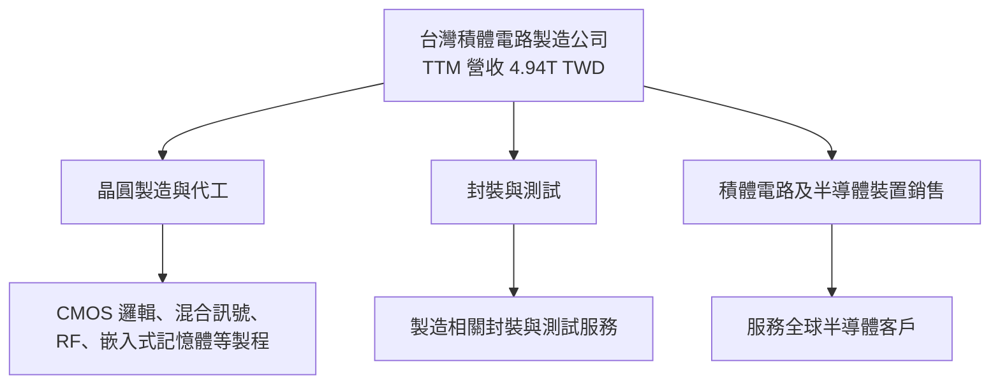
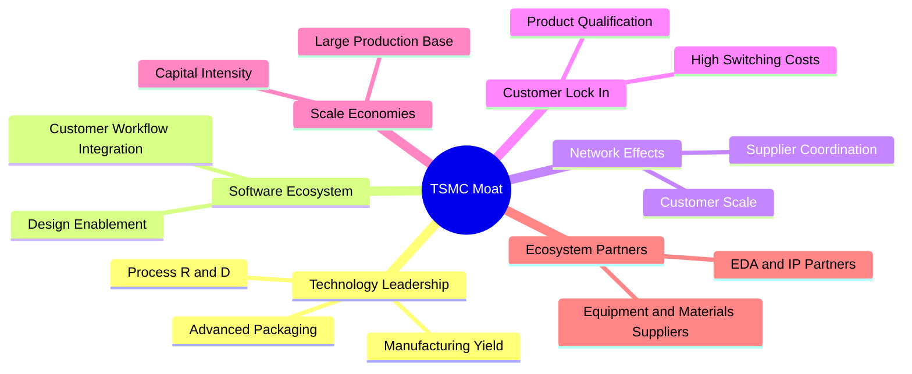
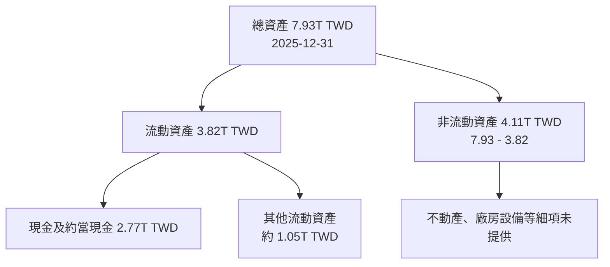
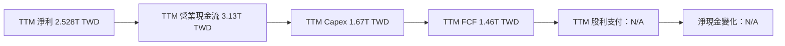
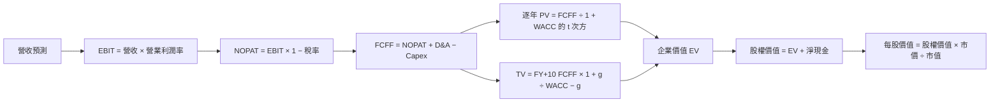
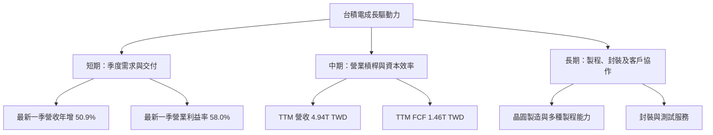
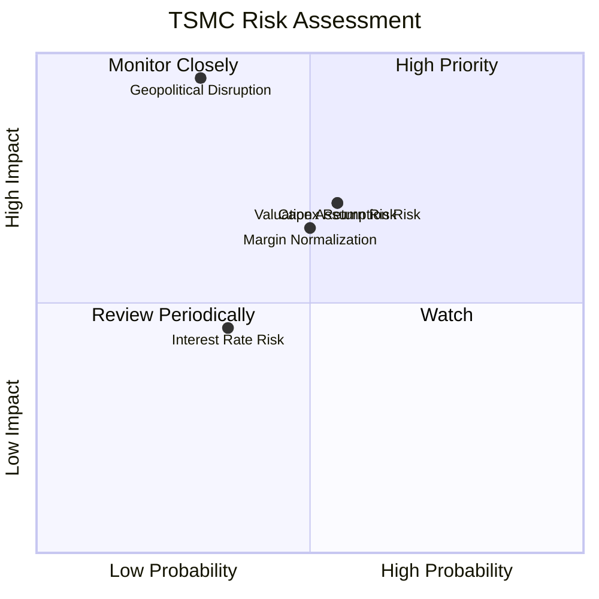
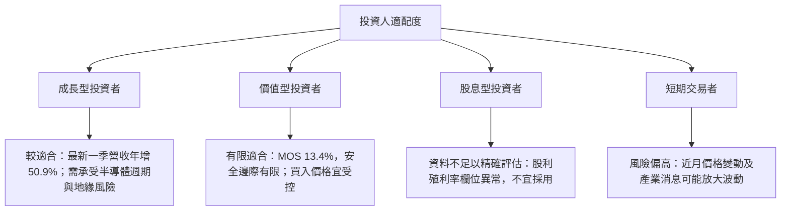

# 2330.TW 基本面深度分析報告
> **報告日期**：2026-11-17 ｜ **語言**：繁體中文 ｜ **資料來源**：Yahoo Finance、Roic.ai、價格資料庫、程式計算 ｜ **分析師**：CFA 級機構研究

## 目錄

| # | 章節 | 核心結論 |
|---|------|----------|
| 1 | 執行摘要 | 買入；加權合理價值 2,558.23 TWD；MOS 13.4% |
| 2 | 公司概覽與商業模式 | 製程能力、規模及客戶關係構成核心護城河；部門營收占比未提供 |
| 3 | 損益表深度分析 | TTM 營收 4.94T TWD；最新一季營收年增 50.9%，TTM 營業利益率 58.0% |
| 4 | 資產負債表分析 | 淨現金 3.20T TWD；流動比率 2.505 |
| 5 | 現金流量深度分析 | TTM FCF 1.46T TWD，FCF Yield 2.54%；資本支出高 |
| 6 | 獲利能力與資本效率 | WACC 10.76%；當期 ROIC 未提供，無法判斷目前 ROIC 是否高於 WACC |
| 7 | 相對估值分析 | Forward P/E 14.81x；估值方法結果介於 1,979.14–3,402.51 TWD |
| 8 | DCF 內在價值評估 | DCF 基準價值 2,818.26 TWD；現價相對 DCF 折價 21.4% |
| 9 | 成長催化劑 | 最新一季營收年增 50.9%；TAM 數字未提供 |
| 10 | 風險矩陣 | 主要風險為地緣政治、資本密集及高成長假設落空 |
| 11 | 投資建議 | 買入；建議分批布局並以獲利率、資本支出及 FCF 作季度追蹤 |

---

## 1. 執行摘要

### 1.0 一頁式投資儀表板（Portfolio Manager 30 秒速讀）

| 項目 | 內容 |
|------|------|
| **投資論點（3 句）** | ① TTM 營業利益率 58.0%、毛利率 65.8%，反映高階製程的產品組合及定價能力。② 最新一季營收年增 50.9%、EPS 年增 68.7%，短期需求與營業槓桿仍在改善。③ TTM FCF 1.46T TWD、淨現金 3.20T TWD，但 FCF Yield 僅 2.54%，現價已反映部分長期成長。 |
| **綜合評分** | **8.1/10**（引用 1.1 評分卡） |
| **財務健康** | 🟢 現金及短期投資 4.02T TWD、總債務 818.38B TWD、淨現金 3.20T TWD；流動比率 2.505 |
| **ROIC vs WACC** | 當期 ROIC：N/A；WACC：10.76%。ROIC.ai 的歷史 Return on Capital 2018 年為 20.61%，但不能替代當期 ROIC，故不據此宣稱目前創造價值 |
| **FCF 趨勢** | TTM FCF 1.46T TWD；年度 FCF 2023–2025 依序為 286.57B、861.20B、992.38B TWD；最新 FCF Yield 2.54% |
| **估值** | Forward P/E 14.81x ｜ EV/EBITDA 15.019x ｜ FCF Yield 2.54% |
| **DCF 內在價值（基準）** | 2,818.26 TWD ｜ 現價相對 DCF 折價 **−21.4%**（折溢價定義：現價 ÷ DCF 內在價值 − 1） |
| **安全邊際（MOS）** | **+13.4%**＝(加權合理價值 2,558.23 − 現價 2,215.00) ÷ 加權合理價值 2,558.23；🟡有限 |
| **預期報酬（基準情境 12M）** | DCF 基準情境相對現價 **+27.2%**；此為模型情境結果，不是保證報酬 |
| **關鍵風險（前二）** | 台海與供應鏈集中風險；高資本支出與 DCF 長期成長假設落空 |
| **評級 + 信心度** | 🟢 **買入** ｜ 信心：中 |

評級依據是加權合理價值 2,558.23 TWD 高於 2026-11-16 收盤價 2,215.00 TWD，MOS 為 13.4%，依規則 20 落在買入區間。當期 ROIC 缺漏，因此不以 ROIC 高於 WACC 作為買入論據；評級信心度為中，主要受長期 DCF 假設及資料品質限制。

### 1.1 綜合評分卡（全報告唯一）

| 維度 | 評分（1–10） | 主要依據（引用數字與其來源章節） |
|------|--------------|----------------------------------|
| 成長性 | 9.0 | 最新一季營收年增 50.9%、EPS 年增 68.7%；TTM 成長率為 N/A（第 3 章） |
| 獲利能力 | 9.0 | TTM 毛利率 65.8%、營業利益率 58.0%；當期 ROIC 與 Piotroski F-Score 未提供（第 3、6 章） |
| 財務健康 | 9.0 | 淨現金 3.20T TWD、流動比率 2.505、CCC 2 天（第 4 章） |
| 估值 | 6.5 | 加權合理價值 2,558.23 TWD、MOS 13.4%；FCF Yield 2.54%（第 7、8 章） |
| 護城河 | 9.0 | TTM 毛利率 65.8%、營業利益率 58.0%，且最新一季營收年增 50.9%；市場份額數字未提供（第 2 章） |
| 管理層與資本配置 | 6.0 | 2025 年 Capex 1.28T TWD、股息支付 466.78B TWD；回購及資本配置目標未提供（第 5 章） |
| **綜合評分** | **8.1** | 六項算術平均： (9.0 + 9.0 + 9.0 + 6.5 + 9.0 + 6.0) ÷ 6 = 8.1 |

### 1.2 五大投資論點 + 三大核心風險

| 類型 | 項目 | 具體依據 | 信心度 |
|------|------|----------|--------|
| 🟢 **投資論點①** | 高獲利能力 | TTM 毛利率 65.8%、營業利益率 58.0%；代表高階製程收入與產能利用率能轉化為高利潤，但若需求或組合逆轉，利潤率亦有下行風險 | 🟢 高 |
| 🟢 **投資論點②** | 短期營收動能 | 2026-09 季營收 1.494T TWD，年增 50.9%；若需求強度延續，固定成本攤薄可支撐獲利成長 | 🟢 高 |
| 🟢 **投資論點③** | 強勁資產負債表 | 現金及短期投資 4.02T TWD、總債務 818.38B TWD，淨現金 3.20T TWD，提供擴產及逆風承受能力 | 🟢 高 |
| 🟢 **投資論點④** | 現金流持續改善 | 2023–2025 年 FCF 從 286.57B 增至 992.38B TWD；Capex 仍高，但營業現金流增加抵銷部分投資需求 | 🟢 中高 |
| 🟢 **投資論點⑤** | 估值有正報酬空間 | 加權合理價值 2,558.23 TWD，高於現價 15.5%；MOS 13.4%，屬有限而非充足安全邊際 | 🟡 中 |
| 🟡 **風險①** | 地緣政治與供應鏈集中 | 主要製造能力集中於台灣；重大中斷可能影響出貨、產能利用率及資本設備供應，財務數據無法量化地緣衝擊幅度 | 🔴 高衝擊 |
| 🔴 **風險②** | 高資本支出造成 FCF 波動 | TTM Capex 1.67T TWD，相當於 TTM 營業現金流 3.13T TWD 的約 53%；若擴產回報不如預期，FCF Yield 2.54% 可能進一步下降 | 🟡 中高 |
| 🟡 **風險③** | DCF 對長期假設敏感 | 基準 DCF 的終值現值占 EV 60.0%；WACC 或永續成長率改變，可大幅改變每股估值 | 🟡 中高 |

### 1.3 快速統計卡片

| 指標 | 公司實際值（期間） | 同業中位數 | 狀態 |
|------|--------------------|------------|------|
| 營收成長（TTM） | **N/A** | — | ⚪ 無法判斷 |
| 營收成長（最新一季年增） | **50.9%** | 20.9% | 🟢 高於同業可得樣本 |
| 毛利率（TTM） | **65.8%** | 31.7% | 🟢 顯著高於樣本 |
| 營業利益率（TTM） | **58.0%** | — | 🟢 |
| ROIC（TTM） | **N/A** | — | ⚪ 未提供 |
| Forward P/E | **14.81x** | 15.9x | 🟢 低於可得同業中位數 |
| FCF Yield（TTM） | **2.54%** | — | 🟡 |
| Piotroski F-Score | **N/A / 9** | — | ⚪ 缺少跨年度 SEC 申報資料 |

> 同業中位數依可用 Peer multiples 計算：營收成長為 UMC、GFS、INTC 的中位數 20.9%；毛利率中位數 31.7%；Forward P/E 中位數 15.9x。由於可用同業營運模式與獲利狀況不同，這些只是參照，不是完全可比的估值標準。

### 1.4 投資結論

```text
╔══════════════════════════════════════════════════════════════════╗
║                    📊 投資結論摘要                               ║
╠══════════════════════════════════════════════════════════════════╣
║  評級：買入（依 MOS 門檻；非強烈買入）                           ║
║  價格（2026-11-16 收盤）：2,215.00 TWD                           ║
║  DCF 內在價值（基準）：2,818.26 TWD（折價 21.4%）               ║
║  安全邊際 MOS：+13.4%（以加權合理價值為分母）                   ║
║  加權合理價值（8.8）：2,558.23 TWD                               ║
║  DCF 情境價值：                                                   ║
║    悲觀情境：1,210.19 TWD（−45.4%）                              ║
║    基準情境：2,818.26 TWD（+27.2%）                              ║
║    樂觀情境：6,229.46 TWD（+181.2%）                             ║
║  綜合評分：8.1/10（引用 1.1）                                    ║
║  適合投資人：能承受半導體週期及地緣風險的長線成長型投資人        ║
╚══════════════════════════════════════════════════════════════════╝
```

---

## 2. 公司概覽與商業模式

### 2.1 業務結構與收入來源

財務資料提供 TTM 營收總額 4.94T TWD，但未提供各製程、封裝測試、地區或客戶別收入拆分。因此下圖僅呈現已知業務關係，不臆測部門占比或金額。



營收依製程節點、終端應用、地區、服務類別的占比均未提供。公司以晶圓製造服務為核心，並延伸至封裝、測試及相關製程服務；其經濟模式依賴大量前期資本投入、製程研發、產能利用率與客戶產品週期。

### 2.2 市場份額

市場份額數據未提供，故不繪製占比圖或填入推算比例。可觀察的相對位置是：公司 TTM 營收 4.94T TWD，最新一季營收年增 50.9%，而 UMC、GFS、INTC 最新一季營收年增分別為 25.6%、12.5%、20.9%；這顯示公司近期營收動能高於該組同業，但不能替代市場份額統計。

### 2.3 競爭護城河分析



以上是根據公司業務模式的質化判斷；提供資料沒有製程節點市占率、良率、客戶轉換成本或研發效率的量化資料，故不將圖中節點解讀為可量化的市場份額。

### 2.4 護城河強度

| 護城河項目 | 強度（強／中／弱） | 證據（引用數字或事實） | 會削弱它的情況 |
|------------|--------------------|------------------------|----------------|
| 技術與製程能力 | 強 | TTM 毛利率 65.8%、營業利益率 58.0%；公司提供多種 CMOS 邏輯、混合訊號、RF 與嵌入式記憶體製程 | 製程迭代延遲、良率下降或競爭者縮小技術差距 |
| 規模效應 | 強 | TTM 營收 4.94T TWD、TTM Capex 1.67T TWD，顯示規模與資本投入門檻高 | 產能利用率下降、擴產過度或資本回報降低 |
| 客戶鎖定 | 中至強 | 半導體設計轉換製程需重新驗證；但未提供客戶集中度或轉換成本量化數據 | 客戶分散訂單、轉向競爭平台或自建製造 |
| 軟體與生態系 | 中 | 與設計流程、IP、設備及材料供應鏈互補；缺少可量化生態系收入及合作夥伴數據 | 工具、IP 或製程相容性優勢被競爭者複製 |
| 網路效應 | 中 | 客戶、供應商與製程規模互相支撐；無直接網路效應指標可量化 | 客戶組合快速轉移、供應鏈協同下降 |
| 生態夥伴 | 中至強 | 業務覆蓋晶圓製造、封裝與測試，與全球客戶及供應鏈協作 | 地緣限制或關鍵設備、材料供應中斷 |

**1.1「護城河」評分為 9.0/10**，依據是 65.8% TTM 毛利率、58.0% TTM 營業利益率與高資本投入特性；因市場份額、良率與客戶集中度資料缺漏，並未給滿分。

---

## 3. 損益表深度分析

### 3.1 年度收入成長趨勢（近 4 年）

年度營收原值為 2022 年 2.26T、2023 年 2.16T、2024 年 2.89T、2025 年 3.81T TWD。下圖以收入相對比例呈現；YoY 依年度營收計算並四捨五入至一位小數。

```text
╔══════════════════════════════════════════════════════════════════╗
║            台積電年度收入趨勢（FY2022-FY2025）                  ║
╠══════════════════════════════════════════════════════════════════╣
║  FY2022  2.26T TWD  ████████████░░░░░░░░░░░░  基期              ║
║  FY2023  2.16T TWD  ███████████░░░░░░░░░░░░░  YoY -4.4% 🟡      ║
║  FY2024  2.89T TWD  ███████████████░░░░░░░░░  YoY +33.8% 🟢     ║
║  FY2025  3.81T TWD  ████████████████████░░░░  YoY +31.8% 🟢     ║
╠══════════════════════════════════════════════════════════════════╣
║  FY2022–FY2025 CAGR = (3.81 ÷ 2.26)^(1/3) − 1 = 約 19.0%        ║
║  資料來源：Yahoo Finance 年度損益表；金額以 TWD 計               ║
╚══════════════════════════════════════════════════════════════════╝
```

2023 年營收下滑約 4.4%，其後 2024–2025 年回升，兩年皆超過 30% 年增。此型態符合半導體需求週期與產品組合變化對營收的影響；但資料沒有終端市場、產能利用率及分產品營收，無法將各年變化精確歸因至特定應用。2022–2025 CAGR 約 19.0%，不等同於最新 TTM 成長率；TTM 對前一 TTM 的成長率為 N/A。

### 3.2 季度收入趨勢分析

| 季度 | 營收（TWD） | QoQ | YoY | 備註 |
|------|-------------:|----:|----:|------|
| 2025Q4 | 1.046T | — | — | 提供季度序列中的比較基礎 |
| 2026Q1 | 1.134T | +8.4% | +35.1% | YoY 對比 2025Q1 的 839.254B TWD |
| 2026Q2 | 1.270T | +12.0% | +36.1% | YoY 對比 2025Q2 的 933.792B TWD |
| 2026Q3 | 1.494T | +17.6% | +50.9% | 最新一季；YoY 對比 2025Q3 的 989.918B TWD |

QoQ 與 YoY 為依季度營收原值計算，四捨五入至一位小數。2026Q3 的年增率加速至 50.9%，表示當季營收增速高於前兩季；若不是單季基期或產品交付時點造成，後續將有利於營業槓桿。但目前沒有終端應用別營收及訂單資料，不能確認成長是否廣泛分布。

### 3.3 利潤率演變分析

下表以年度損益表的毛利、營業利益及淨利除以營收計算，與 TTM 及最新季度指標區分。年度金額取至一位小數 TWD B，比例取至一位小數。

| 利潤率指標 | FY2022 | FY2023 | FY2024 | FY2025 | 趨勢 | 評估 |
|------------|-------:|-------:|-------:|-------:|------|------|
| **毛利率** | 59.7% | 54.6% | 56.1% | 59.8% | 2023 下滑後回升 | 🟢 |
| **營業利益率** | 49.6% | 42.7% | 45.7% | 50.9% | 2023 下滑後升至區間高位 | 🟢 |
| **淨利率** | 43.9% | 39.4% | 40.1% | 44.6% | 隨營業利益率恢復 | 🟢 |

公式例：FY2025 毛利率 = 2.28T ÷ 3.81T = 59.8%；年度數據因來源已四捨五入，計算結果亦為近似值。另依財務摘要，TTM 毛利率為 65.8%、TTM 營業利益率為 58.0%、TTM 淨利率為 51.1%；最新季度營業利益率為 58.0%。TTM/季度數值不能與年度歷史比例視為同期間比較。

**利潤率演變深度解析**：FY2023 毛利率與營業利益率分別降至 54.6% 及 42.7%，而 2024–2025 年逐步回升。這可能反映需求、產品組合、產能利用率及成本吸收變化；提供資料沒有價格、節點組合、折舊或產能利用率拆分，不能把改善歸因於單一因素。TTM 毛利率與營業利益率高於 FY2025 年度比例，顯示最近四季獲利水平更高，但未來能否維持須持續追蹤產品組合及資本成本。

### 3.4 費用結構分析

年度損益數據提供營收、毛利、營業利益、研發費用，但沒有完整營業費用拆分、銷售管理費用或成本項目資料；因此不繪製可能誤導的費用圓餅圖。2025 年研發費用為 246.43B TWD，約為年度營收 3.81T TWD 的 6.5%；這是研發投入比率，不代表公司全部費用結構。年度營業利益 1.94T TWD，反映扣除營業成本及營業費用後的獲利規模。

### 3.5 季度 EPS 趨勢與盈餘品質（Quality of Earnings）

| 季度 | EPS 實際值（TWD） | YoY | 超預期／不及預期 | 說明 |
|------|------------------:|----:|-------------------|------|
| 2025Q4 | 18.72 | +35.0% | N/A | EPS 預估值缺漏 |
| 2026Q1 | 22.08 | +58.3% | N/A | EPS 預估值缺漏 |
| 2026Q2 | 27.25 | +77.5% | N/A | EPS 預估值缺漏 |
| 2026Q3 | 29.43 | +68.8% | N/A | EPS 預估值缺漏 |

季度 EPS 取自 Roic.ai 歷史資料。Yahoo earnings history 中 2025Q4 至 2026Q3 的 EPS Est、EPS Act 均為 NaN，故不能判定盈餘超預期或不及預期。EPS YoY 以 Roic.ai 同季度數值計算；而季度財報摘要所列最新季度淨利年增 68.7%，與 EPS 年增幅度接近。

| 盈餘品質項目 | 數值／佔比 | 評估 |
|--------------|-----------|------|
| 股權薪酬 SBC / 營收 | 約 0.010%（以最近四季季度 SBC 合計 513.37M TWD ÷ TTM 營收 4.94T TWD） | 🟢 比率低；SBC 對股東稀釋的直接影響有限 |
| SBC / 營業現金流 | 約 0.016%（513.37M ÷ 3.13T） | 🟢 金額相對小 |
| FCF / 淨利（現金轉換率） | 約 57.7%（TTM FCF 1.46T ÷ 最近四季淨利 2.52757T） | 🟡 FCF 低於淨利，主要需留意高 Capex 對現金留存的影響；非現金項目及營運資金亦可能造成差異 |
| 一次性／非經常性損益 | N/A（未提供明細） | ⚪ 無法判定本期盈餘是否受一次性項目影響 |
| 有效稅率異常 | 17.0%（Cost of capital 輸入所列最新年度有效稅率） | 🟡 未見資料支持稅務利益造成盈餘突增；歷史年度逐年有效稅率未完整提供 |
| 資本化支出 vs 費用化 | TTM Capex 1.67T TWD；資本化明細 N/A | 🟡 投資強度高，但無法判定資本化政策或折舊年限是否改變 |

TTM 淨利使用 2025Q4 至 2026Q3 季度淨利加總：485.47B + 572.48B + 706.56B + 763.06B = 2,527.57B TWD。該計算是用於現金轉換率，不替代損益表公布的 TTM 指標。

**盈餘品質結論**：SBC 占營收及營業現金流比例很低，股權薪酬不構成主要稀釋來源。相對需要關注的是 TTM FCF 約為淨利 57.7%，並且 TTM Capex 高達 1.67T TWD；現金獲利含金量仍可接受，但資本支出周期、折舊及營運資金變動會影響現金轉換。一次性項目與資本化明細缺漏，限制了更完整的盈餘品質判斷。

---

## 4. 資產負債表分析

### 4.1 資產結構分解

以下採用 2025-12-31 年度資產負債表數據；非流動資產為總資產減流動資產的推導值。



現金及約當現金約占年度總資產 35.0%（2.77T ÷ 7.93T）。2026-09-30 的現金及短期投資另為 4.02T TWD；由於報表期間及定義不同，不能直接把該數與 2025 年資產負債表的細項混用。

### 4.2 流動性與營運資金分析

| 指標 | 最新 TTM | 一年前 TTM | 變化 | 解讀 |
|------|----------|------------|------|------|
| DSO 應收帳款天數 | 1 天 | N/A | N/A | 一年前值未提供，不能判斷收款速度變化 |
| DIO 存貨天數 | 92 天 | N/A | N/A | 一年前值未提供；最新水準需與產能及產品週期一併追蹤 |
| DPO 應付帳款天數 | 91 天 | N/A | N/A | 一年前值未提供；不能據此推論供應商議價力變化 |
| CCC 現金轉換週期 | 2 天 | N/A | N/A | 一年前值未提供；目前 CCC 較短，有利營運資金效率 |

流動性指標歷史趨勢（Yahoo 年度資產負債表）：

| 指標 | FY2022 | FY2023 | FY2024 | FY2025 | 評估 |
|------|-------:|-------:|-------:|-------:|------|
| 流動比率 | 2.08 | 2.32 | 2.36 | 2.51 | 🟢 短期流動性改善 |
| 現金及約當現金 | 1.34T | 1.47T | 2.13T | 2.77T TWD | 🟢 現金餘額增加 |

流動比率為年度流動資產除以流動負債，使用提供數值計算並四捨五入。最新季度工作資本天數依 QUALITY FIGURES 列示，且「一年前」並無數值；不自行補值。

### 4.3 債務結構分析

```text
╔══════════════════════════════════════════════════════════════════╗
║                   台積電債務健康診斷                             ║
╠══════════════════════════════════════════════════════════════════╣
║  總債務：             818.38B TWD  ██░░░░░░░░░░░░░░░ 評估可控   ║
║  現金+短期投資：        4.02T TWD  ████████████████████ 充足     ║
║  淨現金：                3.20T TWD  ████████████████░░░ 🟢       ║
║                                                                  ║
║  Debt/EBITDA：          N/A（未提供同期間 EBITDA 數值）           ║
║  Interest Coverage：    N/A（未提供利息費用）                    ║
║  流動比率：             2.505 🟢                                 ║
║  快速比率：             2.287 🟢                                 ║
╚══════════════════════════════════════════════════════════════════╝
```

年度債務數據為 2025-12-31 的 1.06T TWD，與最新 TTM/季度數據列示的總債務 818.38B TWD 所屬期間不同。債務健康框圖使用 VERIFIED FIGURES 最新總債務；不將不同期間餘額混算。Debt/EBITDA 與利息保障倍數因必要分子或分母缺漏而不計算。

### 4.4 股東權益趨勢

```text
╔══════════════════════════════════════════════════════════════════╗
║                   股東權益年度趨勢                               ║
╠══════════════════════════════════════════════════════════════════╣
║  FY2022  2.90T TWD  ███████████░░░░░░░░░░░░░░                    ║
║  FY2023  3.43T TWD  ██████████████░░░░░░░░░░░░                    ║
║  FY2024  4.24T TWD  █████████████████░░░░░░░░                    ║
║  FY2025  5.36T TWD  ██████████████████████░░░░                    ║
║  四年呈上升；各年度帳面權益資料取自 Yahoo Finance              ║
╚══════════════════════════════════════════════════════════════════╝
```

FY2022–FY2025 股東權益由 2.90T 增至 5.36T TWD，反映累積獲利與留存增加；同期也有股利支付。資料未提供完整權益變動表，無法分離獲利、股利、匯兌及其他權益項目的貢獻。

---

## 5. 現金流量深度分析

### 5.1 現金流量瀑布圖

公司沒有於所列數據中提供單一口徑的「淨利 → 營業現金流 → Capex → FCF → 股利 → 淨現金變化」同期間完整橋接。以下以 TTM 已提供數字呈現已知關係，股利及淨現金變化不填入未提供的 TTM 值。



### 5.2 FCF 轉換率趨勢

| 年度 | FCF（TWD） | 淨利（TWD） | FCF / 淨利 | 評估 |
|------|-----------:|------------:|-----------:|------|
| 2022 | 520.97B | 992.92B | 52.5% | 🟡 資本投入使 FCF 低於淨利 |
| 2023 | 286.57B | 851.74B | 33.6% | 🔴 轉換率偏低 |
| 2024 | 861.20B | 1.16T | 74.2% | 🟢 明顯改善 |
| 2025 | 992.38B | 1.70T | 58.4% | 🟡 利潤增長快於 FCF |
| TTM 至 2026-09-30 | 1.46T | 2.528T（依季度淨利加總） | 57.7% | 🟡 高 Capex 是重要約束 |

FCF/淨利使用年度 FCF、年度淨利計算；TTM 比值的淨利為四季加總。不同資料源的四捨五入可能使結果有小幅差異。

### 5.3 自由現金流趨勢

```text
╔══════════════════════════════════════════════════════════════════╗
║                 自由現金流：年度實際值                           ║
╠══════════════════════════════════════════════════════════════════╣
║  FY2022  520.97B TWD  ██████████░░░░░░░░░░                       ║
║  FY2023  286.57B TWD  █████░░░░░░░░░░░░░░░                       ║
║  FY2024  861.20B TWD  █████████████████░░░                       ║
║  FY2025  992.38B TWD  ████████████████████                       ║
║  TTM     1.46T TWD    年度資料與 TTM 期間不同，不同圖尺不混用   ║
║                                                                  ║
║  最新 TTM FCF Yield：2.54%；歷史年度 FCF Yield：N/A              ║
╚══════════════════════════════════════════════════════════════════╝
```

年度 FCF 由 2023 年低點 286.57B 回升至 2025 年 992.38B TWD。TTM FCF 1.46T TWD 高於 2025 年度值，但年度與 TTM 期間不同。FCF Yield 只引用 TTM 2.54%；沒有歷史市值序列，不計算年度 FCF Yield。

### 5.4 資本配置評估

| 資本配置項目 | 已知數據 | 分析 |
|--------------|----------|------|
| 資本支出 | TTM 1.67T TWD；2025 年 1.28T TWD | 投資規模大，須以未來產能利用率、營收及現金回報驗證 |
| 股利支付 | 2025 年 466.78B TWD；2024 年 363.06B TWD | 2025 年增加；未提供同期間完整分派率及股利政策指引 |
| 股票回購 | N/A | 未提供 |
| 留存現金 | 最新現金及短期投資 4.02T TWD | 為資本支出及週期波動提供緩衝 |
| 併購及其他投資 | N/A | 未提供 |

未提供可按同一期間與定義拆分的資本配置金額，故不繪製比例圓餅圖；尤其不能以 TTM Capex、年度股息及季度現金餘額拼成比例。

---

## 6. 獲利能力與資本效率

### 6.1 ROE / ROA / ROIC 趨勢

| 指標 | 可得數值 | 期間 | 評估 |
|------|---------:|------|------|
| ROE | 41.9% | TTM | 🟢 資產負債表資料顯示高股東報酬，但 DuPont 品質指標因資料不足列為 N/A |
| ROA | 20.6% | TTM | 🟢 資產使用效率高 |
| ROIC | N/A | TTM | ⚪ 當期投入資本及對應 NOPAT 資料不足，不能推算 |
| Return on Capital | 20.61% | Roic.ai，2018 年歷史值 | 僅為較早期間歷史參考，不能與當期 WACC 作同步比較 |

行業均值及同業 ROE、ROA、ROIC 未提供，因此不列行業均值比較。當期 ROIC 缺漏時，不以 ROE 或舊年度 Return on Capital 代替 ROIC。

### 6.2 ROIC vs WACC 分析（核心價值創造判斷）

```text
╔══════════════════════════════════════════════════════════════════╗
║                ROIC vs WACC 深度分析                            ║
╠══════════════════════════════════════════════════════════════════╣
║  WACC（採 VERIFIED FIGURES）：10.76%                             ║
║  ├── 無風險利率（10Y 美債）：5.12%                               ║
║  ├── 市場風險溢酬 ERP：5.00%                                     ║
║  ├── Beta 原始值：1.23；採用調整後 Beta：1.16                   ║
║  ├── 股權成本 Ke（來源提供）：10.90%                             ║
║  ├── 稅前債務成本：1.51%；稅率：17.0%                            ║
║  ├── 股權／債務權重：98.6%／1.4%                                 ║
║  └── WACC：10.76%                                                ║
║                                                                  ║
║  當期 ROIC：N/A（缺少同期間投入資本與 NOPAT）                    ║
║  EVA = ROIC − WACC：N/A                                          ║
║  判斷：目前無法嚴格判定正在創造或摧毀股東價值                    ║
║  歷史參考：Roic.ai 2018 Return on Capital 20.61%，非當期 ROIC   ║
╚══════════════════════════════════════════════════════════════════╝
```

WACC 直接採用資料中的 10.76%，不另建立折現率。若用列示的四捨五入 CAPM 輸入計算，5.12% + 1.16 × 5.00% = 10.92%，與資料列示股權成本 10.90% 相差 0.02 個百分點；這反映輸入精度或取整差異。本報告依要求採用資料列示 Ke 10.90% 與 WACC 10.76%，不以四捨五入輸入重算替換。

### 6.3 杜邦三因素分解

| 因素 | 數值（TTM） | 解讀 |
|------|-------------|------|
| 淨利率 | N/A | QUALITY FIGURES 列示 DuPont 為 N/A，原因為缺少計算所需資料 |
| 資產週轉率 | N/A | 不補算或以不同期間資料替代 |
| 權益乘數 | N/A | 同上 |
| **ROE** | **N/A（DuPont 品質指標）** | 品質指標中的 DuPont 結果為 N/A；另有市場資料列示 TTM ROE 41.9%，兩個口徑不混用 |

### 6.4 財務體質：Piotroski F-Score

| 測試 | 結果 | 解讀 |
|------|------|------|
| Piotroski F-Score | N/A（九項測試無法判定） | 需要相隔一年的兩組 TTM 及 SEC 申報資料；現有來源不足 |
| 獲利能力九項測試 | N/A | 個別測試結果未提供，不推測通過與否 |
| 槓桿、流動性及融資九項測試 | N/A | 同上 |
| 營運效率九項測試 | N/A | 同上 |

F-Score 未提供並不代表公司分數低，而是資料無法支持計算。因各測試均無結果，不對未通過項目作推論。

---

## 7. 相對估值分析

### 7.1 同業估值比較表格

本公司估值使用 Yahoo Finance 市場資料；同業數據按 Peer multiples 區塊照列。UMC 的 P/S、EV/EBITDA 為 mixed currency N/A，不用估計值補入。

| 估值指標 | **2330.TW** | **UMC** | **GFS** | **INTC** | 本公司評估 |
|----------|-----------:|--------:|-------:|--------:|-----------|
| **Trailing P/E** | 24.11x | 13.5x | 112.6x | N/A | 🟡 GFS 倍數受其盈餘基礎影響；可比性有限 |
| **Forward P/E** | 14.81x | 15.9x | 15.2x | 31.0x | 🟢 低於 INTC，接近同業樣本中位數 15.9x |
| **P/S Ratio** | 11.62x | N/A | 3.1x | 4.9x | 🔴 高於可得同業，須考量公司毛利率高於同業 |
| **EV / EBITDA** | 15.019x | N/A | 10.6x | 16.1x | 🟡 高於 GFS、低於 INTC；可得樣本中位數約 13.3x |
| **最新一季營收年增** | 50.9% | 25.6% | 12.5% | 20.9% | 🟢 高於三家同業 |
| **毛利率（TTM）** | 65.8% | 31.7% | 28.5% | 40.2% | 🟢 盈利能力明顯較高 |

同業 P/E、P/S、EV/EBITDA 倍數跨市場與會計資料差異，尤其 UMC 混合幣別倍數缺值；本表用作方向性參考，不將其視為精準可比估值。Forward P/E 評估主要採同業中位數 15.9x；相對估值方法的每股價值則採估值資料中的同業中位數計算結果。

### 7.2 歷史估值區間分析

**N/A（數據未提供：缺少「Valuation vs own history」歷史 P/E 區間及當前百分位）**。雖有 24 個月月末股價，但沒有同期間 EPS 或估值倍數序列，不能用股價走勢替代歷史估值區間。

### 7.3 情境價值（Bear / Base / Bull，照抄 DCF MODEL 的 Scenarios）

| 情境 | 第 1 年營收成長 | 期末營業利潤率 | WACC | 每股價值 | 相對現價 | 機率 | 會發生的條件 |
|------|----------------:|----------------:|-----:|----------:|---------:|-----:|--------------|
| 🔴 悲觀 | 15.0% | 42.1% | 11.76% | 1,210.19 TWD | −45.4% | 25% | 需求或資本利用率轉弱、獲利率收縮，且資本成本上升 |
| 🟡 基準 | 30.0% | 49.5% | 10.76% | 2,818.26 TWD | +27.2% | 50% | 高成長逐步放緩，長期利潤率回落至模型設定 |
| 🟢 樂觀 | 45.0% | 54.5% | 9.76% | 6,229.46 TWD | +181.2% | 25% | 高需求延續、產品組合及規模效益優於基準，且資本成本下降 |

情境值及機率照 DCF MODEL 列示。模型並未提供各情境逐年營收、FCFF 或終值的逐項明細，本報告不另行建立或反推情境模型。

### 7.4 相對估值隱含價格區間

```text
╔══════════════════════════════════════════════════════════════════╗
║                 估值方法回推每股價值                             ║
╠══════════════════════════════════════════════════════════════════╣
║  1,979.14       2,215.00       2,383.56       2,818.26           ║
║  EV/EBITDA      現價           Forward P/E    DCF 基準           ║
║  另有分析師共識目標價 3,402.51 TWD                               ║
╚══════════════════════════════════════════════════════════════════╝
```

| 方法 | 每股價值 | 相對現價 | 依據 |
|------|---------:|---------:|------|
| 同業 Forward P/E | 2,383.56 TWD | +7.6% | 同業中位數 15.9x × Forward EPS 149.53 TWD |
| 同業 EV/EBITDA | 1,979.14 TWD | −10.6% | 同業中位數 13.3x（GFS、INTC）× TTM EBITDA，再加淨現金 |
| DCF 基準 | 2,818.26 TWD | +27.2% | 10 年 FCFF、WACC 10.76%、永續成長率 3.0% |
| 分析師共識 | 3,402.51 TWD | +53.6% | 35 位分析師平均目標價；僅作交叉參照 |

---

## 8. DCF 內在價值評估（Discounted Cash Flow）

> 本節所有模型假設、逐年預測、敏感度矩陣及情境值採用既有 DCF MODEL。模型金額為 TWD billions，價格為 TWD／股。逐年計算以資料原值照列，因逐年表格及折現因子均已四捨五入，允許約 1% 尾差。

### 8.0 估值推理鏈（Thinking Logic：在算之前先想清楚）

**Step 1 — 價值來源與主導變數**  
模型把價值拆為現有晶圓製造、封裝與測試業務所產生的現金流；資料沒有各業務營收占比，因此不臆測第二成長曲線的比例或額外選擇權價值。已知 TTM 營收 4.94T TWD，最新一季營收年增 50.9%；估值最受營收成長、長期營業利潤率，以及永續成長率與 WACC 差距影響。8.6 矩陣顯示 WACC 和永續成長率對估值有重大影響，且終值占 EV 60.0%。

**Step 2 — 模型選擇**

| 決策點 | 本報告採用 | 理由（含數字） | 曾考慮但否決 | 否決理由 |
|--------|-----------|----------------|--------------|----------|
| 現金流定義 | FCFF | 對應 WACC 折現並得出 EV；模型公式為 NOPAT + D&A − Capex | FCFE | 模型已固定為 FCFF，不自行更換 |
| 預測期 N | 10 年 | DCF MODEL 指定 10 年，並逐年將年一成長 30.0% 線性降至第十年 3.0% | 5 年 | 不是既有模型設定，不改動模型 |
| 終值方法 | Gordon Growth | 模型以第十年 FCFF 和 g=3.0% 計算終值 | 退出倍數作主要終值 | DCF MODEL 未列退出倍數終值，不能另建 |
| EBIT 基礎 | GAAP EBIT | 模型列明 GAAP EBIT，FCFF 已採 GAAP EBIT | 非 GAAP EBIT | 不加回 SBC，避免與股數處理不一致 |

**Step 3 — 關鍵假設推導鏈**

- **營收成長路徑**：錨點＝最新一季單季營收年增 50.9%；模型將該單季增速放在 0%–30% 上限範圍內 → 調整＝由 30.0% 線性下降至第十年 3.0%，反映成長率逐步正常化 → **採用 FY+1 30.0%、FY+10 3.0%** → 曾考慮直接延續 50.9%，但否決，因為該數據是單季 YoY，不是 TTM 成長率，且缺少全年指引支持。
- **期末營業利潤率**：錨點＝TTM 營業利益率 58.0%；模型期末採過去五個財年中位數（含 TTM）49.5% → 調整＝由 58.0% 線性遞減至 49.5%，反映目前高利潤率不無限延續 → **採用 FY+10 49.5%** → 曾考慮長期維持 58.0%，但否決，因為既有模型以歷史五年中位數作成熟期錨點。
- **永續成長率 g**：錨點＝模型設為 3.0%，資料沒有公司長期指引或可引用宏觀假設 → 調整＝以 3.0% 作長期名目成長假設，並低於 WACC 10.76% → **採用 3.0%** → 否決高於 3.0% 的基準值，避免終值依賴更激進的長期成長。
- **預測期 N**：錨點＝模型設定 10 年 → 調整＝不另作調整，逐年呈現既有模型期間 → **採用 10 年** → 曾考慮縮短期數，但沒有模型生成的替代估值可引用，故不改。
- **Capex／營收**：錨點＝TTM Capex／營收約 33.8% → 調整＝模型逐步淡化至第十年 16.6%，若比率高於 1.1 倍 D&A 則向下收斂 → **採用 FY+1 33.8% 至 FY+10 16.6% 的模型路徑** → 曾考慮永久維持 33.8%，但否決，因模型假設成熟期資本支出強度下降。
- **EBIT 基礎、SBC 與稀釋**：錨點＝模型採 GAAP EBIT；年度及季度 SBC 均相對營收很低，且模型固定股數 → **採組合 (A)：GAAP EBIT + 固定股數 + 不另扣 SBC；年稀釋率 0%** → 不採非 GAAP 加回 SBC，避免成本被漏計或重複扣除。
- **WACC**：錨點＝成本資本輸入列示 WACC 10.76%，權重股權 98.6%、債務 1.4% → 調整＝不作額外風險溢酬調整 → **採用 10.76%** → 不另計國別或規模溢酬，因原始模型未列此項。
- **有效稅率與 D&A／營收**：錨點＝有效稅率 17.0%、D&A／營收 15.1%（均為模型輸入及 TTM 錨點）→ **採用 17.0% 與 15.1%**；沒有資料足以另行調整。
- **營運資金變動**：模型未建模，沒有可引用的歷史 ΔWC／營收增額比率；不補填或反推，明確沿用「未建模」設定。
- **終值方法**：採 Gordon Growth，g=3.0%，WACC=10.76%；退出倍數法未納入這個 DCF 模型，不能用同業倍數另造終值。

**Step 4 — 最脆弱環節**  
最脆弱假設是高營業利潤率及長期現金流能否維持；終值占 EV 60.0%，若利潤率、WACC 或 g 偏離基準，DCF 對應價值會顯著改變，方向及幅度見 8.6 敏感度矩陣。

**Step 5 — 計算路徑圖**



### 8.1 模型假設總表（Model Inputs）

| 假設項目 | 採用值 | 依據／來源 | 敏感度 |
|----------|--------|-------------|--------|
| 預測期長度 **N** | 10 年 | DCF MODEL；逐年預測及終值期數 | 🟡 中 |
| 營收成長路徑 | FY+1 30.0% 線性降至 FY+10 3.0% | FY+1 以最新一季 YoY 50.9% 為參照並限制於 0%–30%；不是 TTM 成長率 | 🔴 高 |
| 營業利潤率 | FY+1 58.0% 至 FY+10 49.5% | TTM 58.0%；期末取近五個財年中位數，含 TTM | 🔴 高 |
| 有效稅率 | 17.0% | 最新年度有效稅率 | 🟢 低 |
| Capex／營收 | FY+1 33.8% 至 FY+10 16.6% | TTM Capex 強度，逐步淡化至模型成熟期設定 | 🔴 高 |
| D&A／營收 | 15.1% | TTM D&A／營收，模型維持固定 | 🟢 低 |
| 營運資金變動 | 未建模 | DCF MODEL 明確不建模；不以營運資金天數推估 | 🟢 低 |
| EBIT 基礎 | GAAP EBIT | 模型採 GAAP EBIT | 🟡 中 |
| SBC 處理 | GAAP EBIT 已包含 SBC，不另扣 | SBC 在最近四季占營收約 0.010%；模型組合 (A) | 🟡 中 |
| 年稀釋率 | 0%（固定股數） | 模型組合 (A)，採固定股數 25.93B 股的近似口徑 | 🟡 中 |
| 永續成長率 g | 3.0% | DCF MODEL 設定；低於 WACC 10.76% | 🔴 高 |
| 終值方法 | Gordon Growth | DCF MODEL 已採用；終值以 FY+10 FCFF 起算 | 🔴 高 |
| WACC | 10.76% | Cost of capital 輸入，詳見 8.2 | 🔴 高 |

**FCFF 定義**：FCFF = NOPAT + D&A − Capex。營運資金沒有建模，因此公式中不另加 ΔWC 項。  
**SBC 防重複計算**：本模型採用 **(A)**，GAAP EBIT 已反映 SBC，故 FCFF 不再減 SBC，股數亦不逐年增加；SBC 影響在模型中計入一次。  
**四捨五入**：金額以 TWD B 顯示兩位小數；比例一位小數（WACC 保留兩位）；折現因子保留三位。模型原始價值照列，不以自行重算結果替換。

### 8.2 折現率推導（WACC）

```text
╔══════════════════════════════════════════════════════════════════╗
║                    WACC 推導（折現率）                           ║
╠══════════════════════════════════════════════════════════════════╣
║  股權成本 Ke（CAPM，資料列示值）：10.90%                        ║
║  ├── 無風險利率 Rf（10Y 美債）：5.12%                            ║
║  ├── 市場風險溢酬 ERP：5.00%                                     ║
║  ├── Beta 原始值：1.23；調整後採用值：1.16                      ║
║  ├── 規模／國別溢酬：未另加；模型成本資本輸入未列示             ║
║  └── Ke（來源列示）：10.90%                                     ║
║                                                                  ║
║  債務成本 Kd：                                                   ║
║  ├── 稅前 Kd：1.51%                                              ║
║  ├── 有效稅率：17.0%                                             ║
║  └── 稅後 Kd = 1.51% × (1 − 17.0%) = 1.2533%                    ║
║                                                                  ║
║  資本結構（資料列示權重）：股權 98.6%，債務 1.4%                ║
║  WACC = 98.6% × 10.90% + 1.4% × 1.2533%                         ║
║       = 10.7474% + 0.0175% = 10.7649% ≈ 10.76%                  ║
╚══════════════════════════════════════════════════════════════════╝
```

逐步演算：

1. **Ke（CAPM）**：資料列示 Ke 為 10.90%。使用已四捨五入輸入直接代入會得 5.12% + 1.16 × 5.00% = 10.92%；與資料列示值相差 0.02 個百分點，故沿用原列示 Ke，不以取整輸入改寫。
2. **稅前 Kd**：採 Cost of capital 區塊列示值 **1.51%**。該區塊未提供可重建的利息費用及平均計息負債組成，不自行反推。
3. **稅後 Kd** = 1.51% × (1 − 17.0%) = 1.51% × 0.83 = **1.2533%**。
4. **權重**：股權權重 98.6%；債務權重 1.4%；98.6% + 1.4% = **100.0%**。此處採資料列示市值／債務權重，不另以未同期間的市值與債務重算替換。
5. **WACC** = 98.6% × 10.90% + 1.4% × 1.2533% = 10.7474% + 0.0175% = **10.76%**（四捨五入）。

原始 Beta 1.23 調整為 1.16，資料給定的方式為 ⅔ × 1.23 + ⅓ × 1；以完整輸入算得約 1.153，列示採用 1.16。無風險利率日期未另提供，只能引用 10Y Treasury 5.12%。ERP 為假設值 5.00%，來源註記為 assumed。WACC 與第 6.2 節一致，均為 10.76%。

### 8.3 逐年自由現金流預測（基準情境）

| 項目（TWD B，除比率外） | FY+1 | FY+2 | FY+3 | FY+4 | FY+5 | FY+6 | FY+7 | FY+8 | FY+9 | FY+10 |
|------|------:|------:|------:|------:|------:|------:|------:|------:|------:|------:|
| 營收 | 6,428.26 | 8,163.89 | 10,123.23 | 12,249.11 | 14,453.94 | 16,622.04 | 18,616.68 | 20,292.18 | 21,509.71 | 22,155.00 |
| 營收 YoY | 30.0% | 27.0% | 24.0% | 21.0% | 18.0% | 15.0% | 12.0% | 9.0% | 6.0% | 3.0% |
| 營業利潤率 | 58.0% | 57.0% | 56.1% | 55.2% | 54.2% | 53.3% | 52.3% | 51.4% | 50.5% | 49.5% |
| EBIT（GAAP） | 3,726.88 | 4,656.49 | 5,679.00 | 6,756.58 | 7,837.06 | 8,856.56 | 9,744.56 | 10,431.05 | 10,854.96 | 10,972.60 |
| − 稅 | (632.56) | (790.34) | (963.90) | (1,146.79) | (1,330.18) | (1,503.22) | (1,653.94) | (1,770.46) | (1,842.41) | (1,862.38) |
| NOPAT | 3,094.32 | 3,866.14 | 4,715.10 | 5,609.79 | 6,506.88 | 7,353.34 | 8,090.62 | 8,660.59 | 9,012.55 | 9,110.22 |
| + D&A | 970.20 | 1,232.15 | 1,527.86 | 1,848.72 | 2,181.48 | 2,508.71 | 2,809.75 | 3,062.63 | 3,246.39 | 3,343.78 |
| − Capex | (2,171.05) | (2,601.47) | (3,032.68) | (3,435.84) | (3,778.51) | (4,028.15) | (4,156.32) | (4,143.23) | (3,981.42) | (3,678.16) |
| − ΔWC | 未建模 | 未建模 | 未建模 | 未建模 | 未建模 | 未建模 | 未建模 | 未建模 | 未建模 | 未建模 |
| = FCFF | 1,893.46 | 2,496.82 | 3,210.29 | 4,022.67 | 4,909.85 | 5,833.90 | 6,744.04 | 7,579.99 | 8,277.52 | 8,775.85 |
| 折現因子 | 0.903 | 0.815 | 0.736 | 0.664 | 0.600 | 0.542 | 0.489 | 0.441 | 0.399 | 0.360 |
| FCFF 現值 PV | 1,709.48 | 2,035.18 | 2,362.48 | 2,672.69 | 2,945.17 | 3,159.43 | 3,297.46 | 3,346.08 | 3,298.95 | 3,157.71 |

模型預測期現值加總：  
`1,709.48 + 2,035.18 + 2,362.48 + 2,672.69 + 2,945.17 + 3,159.43 + 3,297.46 + 3,346.08 + 3,298.95 + 3,157.71 = 27,984.63 TWD B`

**FY+1 逐步演算（模型表格值照列）**

1. **營收** = TTM 營收基數 4,944.82 × (1 + 30.0%) = 6,428.27 TWD B；模型列示 6,428.26 TWD B，差異為顯示精度。
2. **EBIT** = 6,428.26 × 58.0% = 3,728.39 TWD B；模型列示 EBIT 3,726.88 TWD B。模型列示 EBIT 與四捨五入後營收、利潤率不完全相符，依規則照抄模型原值，不以自行重算替換。
3. **稅** = 3,726.88 × 17.0% = 633.57 TWD B；模型列示 632.56 TWD B，存在約 1.01 TWD B 差異。
4. **NOPAT** = 模型列示 EBIT 3,726.88 − 模型列示稅 632.56 = **3,094.32 TWD B**。
5. **D&A** = 模型列示 **970.20 TWD B**；D&A／營收假設 15.1%。
6. **Capex** = 模型列示 **2,171.05 TWD B**；Capex／營收假設為模型路徑 FY+1 33.8%。
7. **ΔWC**：未建模，沒有可代入的數值。
8. **FCFF** = 3,094.32 + 970.20 − 2,171.05 = **1,893.47 TWD B**；模型列示 1,893.46 TWD B，為顯示精度尾差。
9. **折現因子** = 1 ÷ (1 + 10.76%)¹ = 約 **0.903**；PV = 模型列示 FCFF 1,893.46 × 0.903 = 約 **1,710 TWD B**。模型列示 PV 1,709.48 TWD B，因折現因子表格取三位小數，應以模型原值為準。

**合理性自檢**

- 預測 FCFF CAGR（FY+1 至 FY+10）= (8,775.85 ÷ 1,893.46)^(1/9) − 1 ≈ **18.6%**；FY2022–FY2025 FCF CAGR 約 **24.0%**（(992.38 ÷ 520.97)^(1/3) − 1），預測成長低於該短期歷史 CAGR，但仍高於長期成熟企業通常的現金流成長，需以高營收增長與高利潤率支撐。
- FY+10 FCFF 利潤率 = 8,775.85 ÷ 22,155.00 = **39.6%**；目前 TTM FCF 利潤率 = 1.46T ÷ 4.94482T ≈ **29.5%**。模型隱含未來現金流率提高，主要來自 Capex／營收由 33.8% 淡化至 16.6%，不代表可無條件實現。
- 模型列示各年 FCFF 均為正；若需求下滑或資本支出維持高位，實際現金流可能低於預測。

```text
╔══════════════════════════════════════════════════════════════════╗
║            自由現金流：歷史實際 vs 模型預測                      ║
╠══════════════════════════════════════════════════════════════════╣
║  FY2023（實）  286.57B TWD  ███░░░░░░░░░░░░░░░░░░                ║
║  FY2024（實）  861.20B TWD  █████████░░░░░░░░░░░                ║
║  FY2025（實）  992.38B TWD  ██████████░░░░░░░░░░                ║
║  FY+1（預）  1,893.46B TWD  ███████████████████░                ║
║  FY+10（預） 8,775.85B TWD  模型值；尺度遠高於歷史實際值        ║
╠══════════════════════════════════════════════════════════════════╣
║  預測 FCFF CAGR 約 18.6%；模型依賴營收擴張及 Capex 強度下降      ║
╚══════════════════════════════════════════════════════════════════╝
```

### 8.4 終值計算（Terminal Value）

**適用性檢查**：`WACC 10.76% vs g 3.0% → WACC > g？✅`

| 方法 | 計算式 | 終值 TV | TV 現值 | 佔總 EV 比重 |
|------|--------|---------:|--------:|-------------:|
| Gordon Growth | 8,775.85 × (1 + 3.0%) ÷ (10.76% − 3.0%) | 116,450.32 TWD B | 41,901.01 TWD B | 60.0% |
| 退出倍數法 | N/A（DCF MODEL 未提供此法終值） | N/A | N/A | N/A |

逐步演算：

1. **FY+N 的 FCFF** = FY+10 FCFF **8,775.85 TWD B**。
2. **分子** = 8,775.85 × (1 + 3.0%) = **9,039.13 TWD B**（模型列示終值沿用其內部精度）。
3. **分母** = 10.76% − 3.0% = **7.76%**；模型列示 `8,775.85 × 1.03 ÷ (10.76% − 3.0%) = 116,450.32 TWD B`。
4. **PV(TV)** = 116,450.32 × 0.360 = 41,922.12 TWD B（以表面四捨五入因子計算）；模型列示 **41,901.01 TWD B**，差異來自未四捨五入的折現因子與內部模型精度，依要求採模型列示值。
5. **終值佔比** = 41,901.01 ÷ 69,885.64 = **59.9%**，模型列示 60.0%。

模型未提供退出倍數終值，不補入同業倍數；終值現值占 EV 約 60.0%，估值對長期假設具實質依賴，但未超過 75% 警示門檻。

### 8.5 企業價值 → 每股內在價值（Bridge）

```text
╔══════════════════════════════════════════════════════════════════╗
║              企業價值 → 每股內在價值 橋接表                      ║
╠══════════════════════════════════════════════════════════════════╣
║  預測期 FCF 現值合計            +27,984.63 TWD B                  ║
║  終值現值 PV(TV)                +41,901.01 TWD B                  ║
║  = 企業價值 EV                   69,885.64 TWD B                  ║
║  + 淨現金                        +3,198.60 TWD B                  ║
║  = 股權價值                      73,084.24 TWD B                  ║
║  ÷ 價格／市值反推之股數          模型每股換算口徑                 ║
║  ★ 每股內在價值                  2,818.26 TWD                     ║
║    當前股價（2026-11-16 收盤）    2,215.00 TWD                     ║
║    折溢價（現價÷DCF價值−1）       −21.4%（折價）                  ║
╚══════════════════════════════════════════════════════════════════╝
```

逐步演算：

1. **EV** = 27,984.63 + 41,901.01 = **69,885.64 TWD B**。
2. **股權價值** = 69,885.64 + 3,198.60 = **73,084.24 TWD B**；淨現金來自模型列示值。模型橋接未另列少數股東權益扣除項目。
3. **每股內在價值**：模型指定公式為「股權價值 × 價格 ÷ 市值」，以原模型列示結果 **2,818.26 TWD／股**。市場股數資料另列 25.93B 股；因模型採用價格／市值橋接法，這裡不以不同精度股數替代模型值。
4. **折溢價** = 2,215.00 ÷ 2,818.26 − 1 = **−21.4%**。
5. **本節不計算 MOS**：MOS 只以 8.8 加權合理價值為分母，並在全報告只列一次。

**股數與資產負債表口徑**：模型採 GAAP EBIT、固定股數、無年稀釋率；市場資料流通股數 25.93B 股。模型淨現金為 3,198.60 TWD B；財務摘要最新現金及短期投資 4.02T TWD、總債務 818.38B TWD，兩者差額與模型淨現金相符（四捨五入）。此數據未提供模型採用的明確報表日期橋接細項，故沿用模型原值。

### 8.6 敏感性分析（WACC × 永續成長率）

括號為相對 2,215.00 TWD 現價的上行空間。基準格以粗體表示；矩陣數值照 DCF MODEL 列示，百分比以「每股價值 ÷ 2,215.00 − 1」計算並四捨五入至一位小數。

| g（列）／WACC（欄） | 8.76% | 9.76% | **10.76%（基準）** | 11.76% | 12.76% |
|-----------|------:|------:|------------------:|-------:|-------:|
| 2.0% | 3,532.81 (+59.5%) | 3,015.34 (+36.1%) | 2,619.96 (+18.3%) | 2,308.90 (+4.2%) | 2,058.45 (−7.1%) |
| 2.5% | 3,720.44 (+68.0%) | 3,145.14 (+42.0%) | 2,713.11 (+22.5%) | 2,377.69 (+7.3%) | 2,110.43 (−4.7%) |
| **3.0%（基準）** | 3,940.63 (+77.9%) | 3,294.14 (+48.7%) | **2,818.26 (+27.2%)** | 2,454.33 (+10.8%) | 2,167.73 (−2.1%) |
| 3.5% | 4,202.67 (+89.7%) | 3,466.94 (+56.5%) | 2,937.89 (+32.6%) | 2,540.24 (+14.7%) | 2,231.21 (+0.7%) |
| 4.0% | 4,519.72 (+104.1%) | 3,669.72 (+65.6%) | 3,075.21 (+38.9%) | 2,637.22 (+19.1%) | 2,301.94 (+3.9%) |

**有效非基準格示範**：`所選格 WACC 11.76% > g 3.0% ✅`。該格每股價值照矩陣為 **2,454.33 TWD**。DCF MODEL 沒有提供此格重算所需的逐年折現現值、終值及橋接中間數，因此不偽造「新 PV 合計」或中間 EV；以該矩陣格作可追溯的模型輸出。

**三情境 DCF（模型列示）**

| 情境 | 第 1 年營收成長 | 期末營業利潤率 | 永續成長 g | WACC | 每股內在價值 | 相對現價 | 主觀機率 |
|------|----------------:|----------------:|------------:|-----:|--------------:|---------:|----------:|
| 🔴 悲觀 | 15.0% | 42.1% | 模型未另列 | 11.76% | 1,210.19 | −45.4% | 25% |
| 🟡 基準 | 30.0% | 49.5% | 3.0% | 10.76% | 2,818.26 | +27.2% | 50% |
| 🟢 樂觀 | 45.0% | 54.5% | 模型未另列 | 9.76% | 6,229.46 | +181.2% | 25% |
| **機率加權** | — | — | — | — | **3,269.04** | **+47.6%** | 100% |

機率加權算式：`1,210.19 × 25% + 2,818.26 × 50% + 6,229.46 × 25% = 3,269.04 TWD`（採模型原始精度）。模型沒有列悲觀及樂觀情境的 g、逐年營收、FY+10 FCFF 及 TV 明細，因此不能提供「營收 CAGR → FY+N 營收 → FCFF → TV」的可複算鏈，也不另外反推。

**敏感度結論**

- **g 每 +1pp**（2.5% 到 3.5%，WACC 10.76%）：價值由 2,713.11 變為 2,937.89 TWD，增加 **224.78 TWD／股**，約 **+8.3%**（相對 2,713.11）。
- **WACC 每 +1pp**（10.76% 到 11.76%，g 3.0%）：價值由 2,818.26 變為 2,454.33 TWD，減少 **363.93 TWD／股**，約 **−12.9%**（相對 2,818.26）。
- **期末營業利潤率每 +1pp**：敏感度矩陣沒有此變數的單獨變化格，故 **N/A（資料未提供可比模型輸出）**。
- 結論：在所提供矩陣中，WACC ±1pp 對價值的影響可直接量化且顯著；終值占比 60.0% 令折現率與長期假設成為主導風險，與 8.0 Step 1 對估值主導因素的判斷一致。

### 8.7 反推 DCF（Reverse DCF：市場在預期什麼）

DCF MODEL 提供兩項反推結果；其餘變數固定於基準假設，價格取 2026-11-16 收盤 2,215.00 TWD。

| 求解的變數（一次一個） | 其餘變數設定 | 市場隱含值（令 DCF = 現價） | 公司歷史實際／基準 | 判斷 |
|------------------------|--------------|------------------------------|---------------------|------|
| 年 1 營收成長率 | 其餘採基準模型 | 23.3% | 基準年 1 為 30.0%；最近一季 YoY 50.9%，非 TTM 成長率 | 🟡 現價隱含低於基準成長 |
| 固定營業利潤率 | 其餘採基準模型 | 41.1% | TTM 營業利益率 58.0%；模型長期由 58.0% 降至 49.5% | 🟢 低於目前獲利率，但非同一利潤率路徑 |
| 永續成長率 g | 未提供反推結果 | 未計算 | — | N/A |
| 預測期長度 N | 未提供反推結果 | 未計算 | — | N/A |

求解方法及收斂軌跡未在 DCF MODEL 中提供，因此不虛構逐級試算表。反推結論僅能表述為：在其他假設固定時，模型指出現價對應的年一營收成長率為 23.3%，或固定營業利潤率為 41.1%；這是兩個分別「一次放開一個變數」的解，不可同時當成市場隱含條件。

### 8.8 估值三角驗證與安全邊際

| 估值方法 | 隱含每股價值 | 上行空間（÷現價） | 權重 | 說明 |
|----------|--------------:|-------------------:|-----:|------|
| DCF（基準） | 2,818.26 TWD | +27.2% | 40% | 10 年 FCFF、WACC 10.76%、g 3.0% |
| 同業 Forward P/E | 2,383.56 TWD | +7.6% | 25% | 同業中位數 15.9x × Forward EPS 149.53 TWD |
| 同業 EV/EBITDA | 1,979.14 TWD | −10.6% | 25% | 同業中位數 13.3x（GFS、INTC），乘公司 TTM EBITDA 並加回淨現金 |
| 分析師共識目標價 | 3,402.51 TWD | +53.6% | 10% | 35 位分析師平均目標價，作參考而非主要估值依據 |
| **加權合理價值** | **2,558.23 TWD** | **+15.5%** | **100%** | 公司類型：獲利公司；方法與權重依估值規則固定 |

逐步演算：  
`2,818.26 × 40% + 2,383.56 × 25% + 1,979.14 × 25% + 3,402.51 × 10%`  
`= 1,127.304 + 595.890 + 494.785 + 340.251`  
`= 2,558.230 ≈ 2,558.23 TWD`

**MOS 算式**：`(2,558.23 − 2,215.00) ÷ 2,558.23 = 343.23 ÷ 2,558.23 = 13.4%`。  
**上行空間算式**：`(2,558.23 − 2,215.00) ÷ 2,215.00 = 343.23 ÷ 2,215.00 = 15.5%`。  
兩者分母不同：MOS 以加權合理價值為分母，上行空間以現價為分母。估值方法未有缺項，四種方法及權重均照列。

```text
╔══════════════════════════════════════════════════════════════════╗
║                  估值區間與安全邊際                              ║
╠══════════════════════════════════════════════════════════════════╣
║  1,210.19 ─── 2,215.00 ─── [2,558.23] ─── 2,818.26 ─── 6,229.46 ║
║  悲觀DCF       現價          加權合理值        基準DCF      樂觀DCF ║
║                                                                  ║
║  MOS = (2,558.23 − 2,215.00) ÷ 2,558.23 = 13.4%                 ║
║  MOS 評估：🟡 有限；落在 10%–25% 區間                            ║
║  上行空間 = (2,558.23 − 2,215.00) ÷ 2,215.00 = 15.5%            ║
║                                                                  ║
║  建議買入區間：不高於 2,302.41 TWD                               ║
║  （對應至少 10% MOS：2,558.23 × 90% = 2,302.41）                ║
║  合理持有參考：2,302.41–2,842.48 TWD                             ║
║  （上方以 MOS −10% 對應價格：2,558.23 ÷ 0.9 = 2,842.48）        ║
║  減碼考慮：高於樂觀 DCF 情境 6,229.46 TWD                        ║
╚══════════════════════════════════════════════════════════════════╝
```

評級為買入時，買入區間上限必須不低於現價；因此**實際分批買入參考區間為 2,215.00–2,302.41 TWD**。現價在該區間內，但 MOS 僅 13.4%，並非高安全邊際。

> 🔎 **程式複算（Python，依本節各項自動重算）**
>
> 加權合理價值 = $2,818.26 × 40% + $2,383.56 × 25% + $1,979.14 × 25% + $3,402.51 × 10% = **$2,558.23**（權重合計 100%）
>
> 以價格 $2,215.00 計：MOS = **+13.4%**，上行空間 = **+15.5%**
>
> ✅ 與本節所寫數值一致。

### 8.9 DCF 模型的局限與失效條件

- **終值依賴度**：終值現值占 EV 60.0%，代表超過一半企業價值由 FY+10 以後的現金流假設決定。
- **最脆弱假設**：第一，模型假設營收由 FY+1 30.0% 線性降至 FY+10 3.0%；第二，Capex／營收由 FY+1 33.8% 降至 FY+10 16.6%。若需求成長較慢或資本支出強度下降不如預期，DCF 價值會低於基準；壓力情境價值為 1,210.19 TWD。
- **終值與折現率敏感度**：WACC 由 10.76% 升至 11.76%、g 維持 3.0%，每股價值由 2,818.26 降至 2,454.33 TWD；WACC 降至 9.76% 則價值為 3,294.14 TWD。
- **不適用情境說明**：公司目前 FCF 為正，故 DCF 可作參考；但處於高資本支出及擴產周期時，DCF 對 Capex、折舊和產能利用率高度敏感。若未來 FCF 轉負或資本支出回報不確定，應提高相對估值及資產負債表現金流分析權重，而非單看 DCF。
- **模型限制**：營運資金未建模；沒有退出倍數交叉驗證；情境模型沒有逐年明細；沒有明確公布 DCF 股數橋接細節；FY+1 表格內部部分數字因原始精度及顯示取整存在微小不一致。上述限制降低內在價值估算的精確度。
- **與第 10 章風險連結**：地緣事件可能直接衝擊營收與產能利用率；資本支出效率下降會影響 Capex／營收及 FCF；利率上升會提高 WACC、降低現值。

### 8.10 複算檢核表（Audit Trail）

| # | 檢核項目 | 檢查方式 | 結果 |
|---|----------|----------|------|
| 1 | 所有高／中敏感度輸入有推導說明 | 對照 8.0 Step 3 與 8.1 | ⚠️ 推導及取捨均說明；部分替代值沒有額外模型數據可量化 |
| 2 | 每個假設都有來歷 | 對照 8.1 依據欄 | ✅ |
| 3 | WACC 權重與算式 | 98.6% + 1.4% = 100%；依列示權重與成本計算 | ✅ 採用列示 WACC 10.76%；Ke 顯示精度有 0.02pp 差異 |
| 4 | Kd 分母與債務權重口徑一致 | 檢查平均計息負債及期末 D 構成 | ⚠️ 成本資本資料未提供負債組成，無法獨立核對 |
| 5 | WACC 與第 6.2 節同值 | 兩處比對 | ✅ 10.76% |
| 6 | 逐年表格年度數 = N，無省略年度 | FY+1 至 FY+10 | ✅ |
| 7 | FY+1 九步算式可複算 | 以表格列示值檢查 | ⚠️ 模型原始 EBIT、稅及顯示比例有取整差異，已列出差異並沿用原值 |
| 8 | 預測期 PV 加總 | 十項 PV 相加 | ✅ 加總 27,984.63 TWD B |
| 9 | WACC > g | 10.76% > 3.0% | ✅ |
| 10 | 終值以 FY+10 FCFF 為基礎並折現 10 期 | 8.4 核對 | ✅ 依模型列示；使用顯示折現因子重算有取整尾差 |
| 11 | EV、股權價值及每股橋接 | PV 合計 + PV(TV)；再加淨現金 | ✅ EV 與股權價值相加一致；每股值沿用模型指定換算公式 |
| 12 | SBC 三要素組合相容 | GAAP EBIT、無 −SBC 列、固定股數 | ✅ 組合 (A) |
| 13 | 敏感性矩陣基準格等於 DCF 基準 | 核對基準格 | ✅ 2,818.26 TWD |
| 14 | 示範格 WACC > g，無效格處理 | 矩陣核對 | ✅ 全部格子均 WACC > g |
| 15 | 三情境機率與加權值 | 25% + 50% + 25% | ✅ 加總 100%；機率加權 3,269.04 TWD |
| 16 | 反推每列只放開一個變數 | 依模型列示 | ⚠️ 僅可引用模型給出的兩個解，疊代軌跡未提供，未虛構 |
| 17 | MOS 與折溢價分母一致 | MOS 用 8.8；折溢價用 8.5 DCF | ✅ MOS 13.4%；DCF 折價 21.4% |
| 18 | 報告完整至第 11 章 | 核對章節 | ✅ |
| 19 | 加權合理價值等於各方法加權總和 | 8.8 逐項計算 | ✅ 2,558.23 TWD |
| 20 | 評級符合 MOS 門檻 | MOS 13.4% 對照規則 20 | ✅ 買入 |

**未完全核驗項目**：WACC 的計息負債明細與 DCF 情境逐年試算資料未提供；另模型顯示精度造成少量算式差異。已在相應段落標明，不另行重建模型或替換模型輸出，因此第 8 章結論信心度維持中。

---

## 9. 成長催化劑

### 9.1 催化劑時間軸

公司財報日程及產品量產時間未提供，因此不以自行假設的日期繪製 gantt。可追蹤的近期訊號是季度營收和利潤率：

| 時間維度 | 可觀察催化劑 | 已知數字 | 確認方式 |
|---------|--------------|---------|---------|
| 短期 | 季度營收動能 | 2026Q3 營收 1.494T TWD，YoY +50.9% | 後續季度 YoY 是否維持正成長 |
| 中期 | 獲利率及產能利用效率 | 最新季度營業利益率 58.0% | 營收成長是否轉化為穩定營業利益率 |
| 中長期 | 擴產轉化為現金流 | TTM Capex 1.67T TWD、TTM FCF 1.46T TWD | 新增資本投入是否帶來產出與 FCF 成長 |
| 長期 | 多元製程、封裝與客戶服務 | 公司業務涵蓋晶圓製造、封裝與測試 | 追蹤收入拆分、技術進程及客戶需求；目前無量化資料 |

### 9.2 TAM 市場規模分析

**N/A（TAM 數據未提供）**。公司 TTM 營收為 4.94T TWD，最新一季營收年增 50.9%，顯示現有業務具成長動能；但沒有可引用的市場規模、公司滲透率及市場預測，因此不估算 TAM 或滲透率。

### 9.3 成長驅動力結構圖



短期成長已有營收與獲利率數字支持；中長期驅動力的產品及應用別收入貢獻未提供，需以後續財報拆分及資本回報驗證。

---

## 10. 風險矩陣

### 10.1 風險評分矩陣

下圖機率與衝擊位置屬定性風險排序，**不是公司財務資料提供的機率統計**。



### 10.2 風險清單詳細分析

| # | 風險項目 | 發生機率 | 財務衝擊 | 風險評分 | 緩解措施 |
|---|----------|----------|----------|----------|----------|
| 1 | 🔴 **地緣政治及供應鏈中斷** | 定性中等；無量化機率 | 高；收入、產能利用率及設備供應可能同時受影響，無法以現有資料量化 | 🔴 9/10（質化） | 追蹤公司地區產能、供應鏈備援及海外投資；控制持倉集中度 |
| 2 | 🟠 **資本支出回報低於預期** | 定性中高 | 高；TTM Capex 1.67T TWD，相當於 TTM 營業現金流約 53%，回報不足會壓低 FCF | 🟠 7/10（質化） | 逐季比較 Capex、營收、FCF；關注產能爬坡及折舊負擔 |
| 3 | 🟠 **營業利潤率正常化** | 定性中 | 高；TTM 營業利益率 58.0%，DCF 期末降至 49.5%，兩者相差 8.5 個百分點 | 🟠 7/10（質化） | 監控季度毛利率、營業利益率及營收組合 |
| 4 | 🟡 **估值對折現率及終值敏感** | 定性中 | 中高；WACC +1pp 時模型價值由 2,818.26 降至 2,454.33 TWD；終值占 EV 60.0% | 🟡 6/10（質化） | 以加權估值而非單一 DCF 下結論，分批交易 |
| 5 | 🟡 **半導體週期及客戶需求波動** | 定性中 | 中高；2023 年營收年減約 4.4%，顯示歷史營收並非線性成長 | 🟡 6/10（質化） | 追蹤營收 YoY、產能利用與客戶需求變化 |

表內風險評分是用於排序的定性判斷，不是從歷史違約或事件頻率統計推導的精確風險分數；不以看似精確的損失百分比冒充財務預測。

---

## 11. 投資建議

### 11.1 最終評級與評分

MOS 為 13.4%，依規則 20 評級為**買入**；不作質化升降級。1.1 綜合評分為 **8.1/10**，六項分數依序為成長性 9.0、獲利能力 9.0、財務健康 9.0、估值 6.5、護城河 9.0、管理層與資本配置 6.0。評級高於持有的理由是加權合理價值高於現價；但 FCF Yield 僅 2.54%、DCF 長期假設敏感，故不評為強烈買入。

### 11.2 合理價值與隱含報酬率

| 估值情境 | 每股價值 | 相對 2026-11-16 收盤價 2,215.00 TWD | 機率／權重 |
|----------|---------:|-----------------------------------:|-----------:|
| 加權合理價值 | **2,558.23 TWD** | **+15.5% 上行空間；MOS 13.4%** | 評級依據 |
| DCF 悲觀情境 | 1,210.19 TWD | −45.4% | 25% |
| DCF 基準情境 | 2,818.26 TWD | +27.2% | 50% |
| DCF 樂觀情境 | 6,229.46 TWD | +181.2% | 25% |
| DCF 機率加權值（參考） | 3,269.04 TWD | +47.6% | 100% |

DCF 情境價值直接依 7.3 模型列示；加權合理價值則依估值方法固定權重計算。機率加權 DCF 值不是 8.8 MOS 的分母。

### 11.3 買入時機與觸發因素

```text
╔══════════════════════════════════════════════════════════════════╗
║                  ✅ 買入觸發因素 Checklist                       ║
╠══════════════════════════════════════════════════════════════════╣
║  立即買入觸發條件（需持續確認）：                                ║
║  ✅ 現價 2,215.00 TWD 低於加權合理價值 2,558.23 TWD              ║
║  ✅ 最新一季營收年增 50.9%，且最新營業利益率 58.0%              ║
║  ✅ 淨現金 3.20T TWD，資產負債表具備擴產緩衝                    ║
║                                                                  ║
║  加碼觸發條件（出現以下任一並確認基本面）：                      ║
║  ☐ 股價下跌但未伴隨營收、利潤率或 FCF 基本面惡化                ║
║  ☐ 股價低於 2,302.41 TWD，對應加權合理價值至少 10% MOS          ║
║  ☐ 後續季度營收維持正成長，且營業利益率未明顯跌破模型長期水平   ║
║                                                                  ║
║  減碼／重新檢視觸發條件（出現以下任一）：                        ║
║  ☐ 營業利益率持續收縮，或兩季營收年增轉負                        ║
║  ☐ Capex 持續上升而 FCF 明顯下滑或轉負                           ║
║  ☐ 資本成本上升令 WACC 假設失效，DCF 價值明顯低於現價           ║
║  ☐ 股價高於樂觀 DCF 情境 6,229.46 TWD 且基本面未相應上修         ║
╚══════════════════════════════════════════════════════════════════╝
```

### 11.4 投資人適配度分析



股息數據需特別謹慎：市場摘要列示 Dividend Yield 102.0%，與同一資料中的 Payout Ratio 24.6%、年度現金股利支付額不相稱，顯示殖利率欄位可能異常，因此不以 102.0% 評估股息投資適配度。

### 11.5 每季財報監控清單（Quarterly Watch List）

| 追蹤指標 | 最新基準 | 加碼／正面觸發 | 減碼／負面觸發 | 投資意義 |
|---------|---------|---------------|----------------|----------|
| 營收年增率 | 2026Q3 +50.9% | 仍維持正成長且不只靠單季交付 | 連續兩季年增轉負 | 判斷需求及出貨動能 |
| 營業利益率 | 最新季度 58.0% | 維持高位或下滑幅度受控 | 持續下滑，接近或低於 DCF 期末 49.5% | 反映產品組合、定價與成本吸收 |
| 毛利率 | TTM 65.8% | 維持高於近期年度基準 | 連續下降且伴隨營收放緩 | 衡量製程組合與產能效率 |
| Capex | TTM 1.67T TWD | Capex 增加同時帶動營收及 FCF 成長 | Capex 上升但 FCF 轉弱或轉負 | 檢驗擴產投資回報 |
| FCF | TTM 1.46T TWD | 保持正值且年比改善 | FCF 轉負或連續兩季明顯下滑 | 評估成長的現金含金量 |
| 存貨天數 DIO | 最新 TTM 92 天 | 庫存天數穩定或下降 | 持續上升且營收增速放緩 | 追蹤庫存與供需匹配 |
| 營運資金 CCC | 最新 TTM 2 天 | 維持短週期 | 明顯拉長且應收、存貨同步上升 | 追蹤現金轉換效率 |
| 研發支出 | 2025 年 246.43B TWD | 支出投入與營收、產品競爭力相稱 | 支出上升但營業利益率及營收均弱化 | 評估技術投入效率 |
| 財測及 EPS | 最新季度 EPS 29.43 TWD；公司財測未提供 | 財測上修且實際營收、利潤率配合 | 財測下修或連續低於指引 | 對照管理層預期與實際執行 |
| 淨現金 | 最新 3.20T TWD | 保持淨現金且投資回報改善 | 淨現金快速下降、債務增加而 FCF 走弱 | 衡量財務韌性及資本配置 |

### 11.6 反面論證：什麼會證明論點錯誤（What Would Change My Mind）

```text
╔══════════════════════════════════════════════════════════════════╗
║              ⚠️ 論點失效條件（Disconfirming Evidence）           ║
╠══════════════════════════════════════════════════════════════════╣
║  本投資論點在下列情況成立時應重新檢視或退出：                    ║
║  ☐ 營收年增率連續兩季低於 0%，且無法以單季基期解釋               ║
║  ☐ 營業利益率連續兩季低於 DCF 第十年假設 49.5%                  ║
║  ☐ TTM FCF 轉負，或 FCF 相對淨利持續低於目前約 57.7%            ║
║  ☐ 當期 ROIC 可計算後低於 WACC 10.76%，並持續惡化               ║
║  ☐ Capex 長期維持高位但營收與 FCF 沒有相應改善                  ║
║  ☐ 淨現金顯著收縮，且新增投資不能支持可持續營收和現金流         ║
║  ☐ 地緣或供應鏈中斷影響生產、交付或關鍵設備供應                 ║
╚══════════════════════════════════════════════════════════════════╝
```

上述門檻是監控條件，不代表已預測事件必然發生。尤其 ROIC 當期資料缺漏，後續若取得可比口徑的 ROIC，應以其與 WACC 的差距重新檢驗價值創造判斷。

> **免責聲明**：本報告為 AI 自動生成，僅供研究參考，不構成投資建議。投資有風險，入市需謹慎。

---

## 資料與來源

| 項目 | 內容 |
|------|------|
| 價格 | 2,215.00 TWD，2026-11-16 收盤（Yahoo Finance 日線） |
| 財務報表 | Yahoo quarterly statements (no SEC filing data)，最新季度 2026-09-30（TTM = four quarters to this date） |
| 有回應的資料來源 | Yahoo Finance、Roic.ai |
| 未回應的資料來源 | SEC 申報資料 (XBRL)、Finviz、StockAnalysis |
| 由程式計算 | TTM 數字、WACC、DCF 模型、估值方法與權重、加權合理價值、MOS、評級門檻、F-Score、杜邦分解、營運資金天數、綜合評分 |
| 撰寫模型 | openai / gpt-6-luna |

> 本區塊由產生報告的程式依實際取得的資料填寫，非模型撰寫。「由程式計算」的數字不是模型的估計；其餘判斷（評分、情境、策略）是模型的分析。
