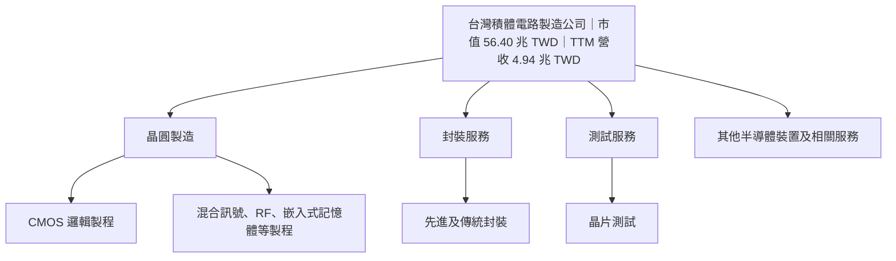
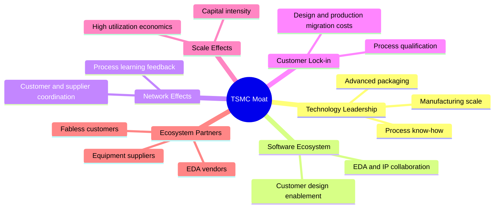
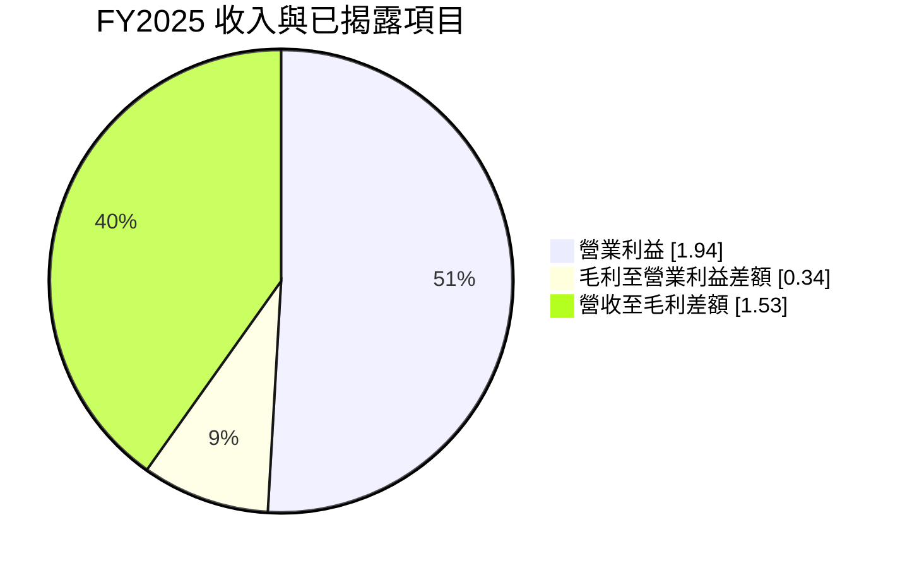
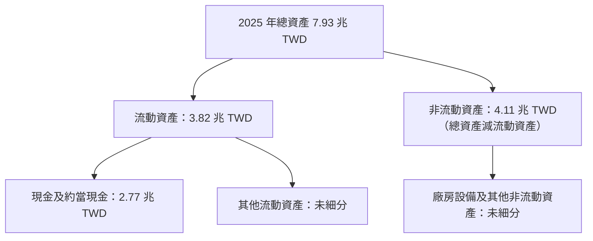
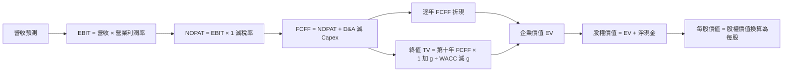
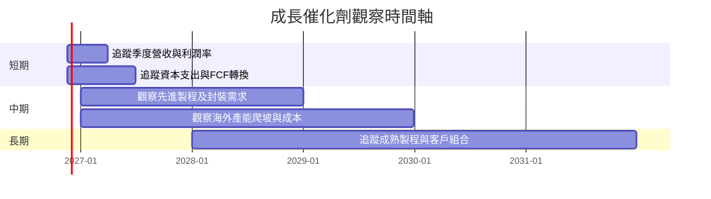
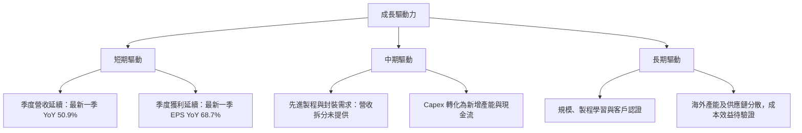
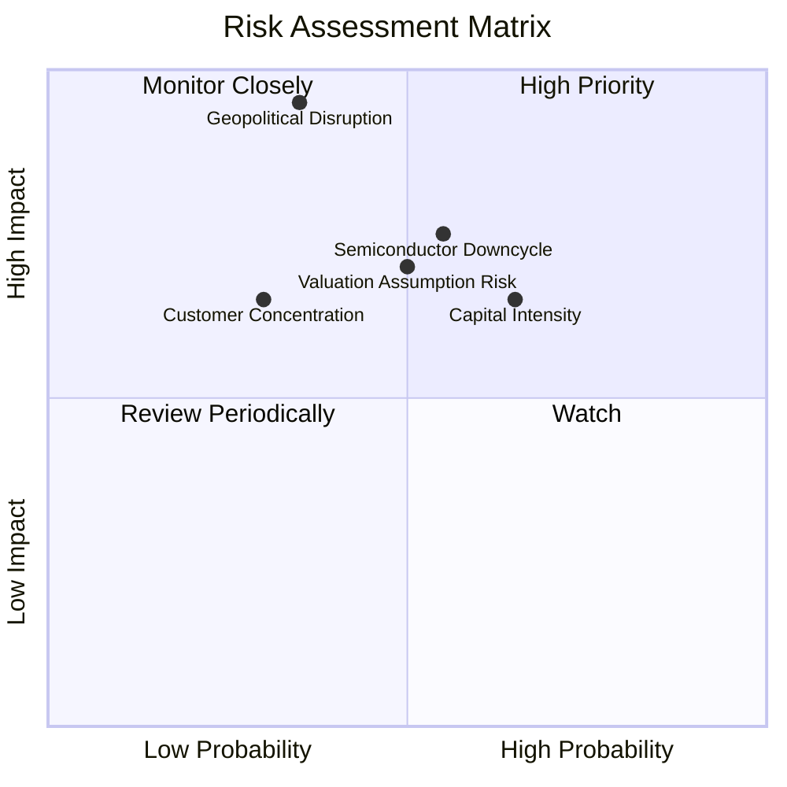
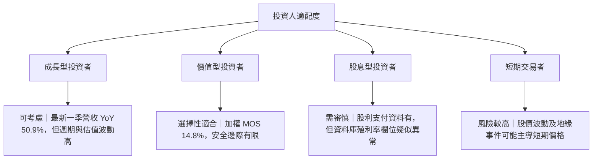

# 2330.TW 基本面深度分析報告
> **報告日期**：2026-11-18 ｜ **語言**：繁體中文 ｜ **數據來源**：Yahoo Finance、Roic.ai ｜ **分析師**：CFA 級機構研究

## 目錄

| # | 章節 | 核心結論 |
|---|------|----------|
| 1 | 執行摘要 | 買入；加權合理價值 2,553.01 元；MOS 14.8% |
| 2 | 公司概覽與商業模式 | 晶圓製造與先進封裝具技術、規模及客戶認證壁壘 |
| 3 | 損益表深度分析 | TTM 營收 4.94 兆元；最新一季年增 50.9%；營業利益率 58.0% |
| 4 | 資產負債表分析 | 淨現金 2.95 兆元；流動比率 2.584 |
| 5 | 現金流量深度分析 | TTM FCF 1.46 兆元；FCF Yield 2.58% |
| 6 | 獲利能力與資本效率 | WACC 10.66%；當期 ROIC 缺乏可核驗資料，無法比較 |
| 7 | 相對估值分析 | 同業 Forward P/E 法價值 2,320.40 元；DCF 基準價值高於現價 |
| 8 | DCF 內在價值評估 | DCF 基準 2,851.87 元；估值對終值及成長假設敏感 |
| 9 | 成長催化劑 | 近期營收與 EPS 加速；TAM 數據未提供 |
| 10 | 風險矩陣 | 地緣政治、產業資本週期與估值假設為主要風險 |
| 11 | 投資建議 | 依 MOS 評級為買入；分批布局並監控利潤率、Capex 與 FCF |

---

## 1. 執行摘要

最新收盤價為 **2026-11-18 的 2,175.00 元**。TTM 營收為 4.94 兆元，營業利益率 58.0%，營業現金流 3.13 兆元、資本支出 1.67 兆元、FCF 1.46 兆元。DCF 基準價值為 2,851.87 元，較現價有 31.1% 上行空間；但依 DCF、同業估值及分析師共識加權後，合理價值為 2,553.01 元，MOS 為 14.8%。因此，依 MOS 規則 20 評級為**買入**，而非強烈買入；當期 ROIC 資料缺漏，不能據此認定其高於 WACC。

### 1.0 一頁式投資儀表板

| 項目 | 內容 |
|------|------|
| **投資論點（3 句）** | ① 最新一季營收年增 50.9%，顯示近期需求與產品組合有利；若延續，將支撐高營業槓桿。② TTM 營業利益率為 58.0%，但資料未提供同口徑 TTM 營收年增率，成長持續性仍需追蹤。③ TTM FCF 為 1.46 兆元、FCF Yield 2.58%，現金創造能力高，但估值已反映相當的長期成長預期。 |
| **綜合評分** | **7.3/10**（引用 1.1 六項平均） |
| **財務健康** | 🟢 現金及短期投資 4.02 兆元、總債務 1.07 兆元、淨現金 2.95 兆元；流動比率 2.584。 |
| **ROIC vs WACC** | ROIC：N/A；WACC：10.66%。當期 ROIC 缺漏，不能判定價值創造利差。 |
| **FCF 趨勢** | 2022–2025 年 FCF 分別為 520.97、286.57、861.20、992.38 十億元；TTM FCF 1.46 兆元，TTM FCF Yield 2.58%。 |
| **估值** | Forward P/E 14.545146x ｜ EV/EBITDA 14.86x ｜ FCF Yield 2.58% |
| **DCF 內在價值（基準）** | 2,851.87 元；現價相對 DCF 折價 23.7%（以 DCF 基準值為分母計算折溢價） |
| **安全邊際（MOS）** | **14.8%**＝(加權合理價值 2,553.01 − 現價 2,175.00) ÷ 加權合理價值 2,553.01；🟡 有限 |
| **預期報酬（基準情境 12M）** | DCF 基準相對現價上行空間 **31.1%**；加權合理價值上行空間 **17.4%**。 |
| **關鍵風險（前二）** | 台海及供應鏈地緣風險；高資本支出與半導體需求週期反轉。 |
| **評級 + 信心度** | 🟢 **買入** ｜ 信心：中。MOS 支持買入，但 ROIC、TTM 成長及 EPS 預期差異資料不足。 |

### 1.1 綜合評分卡（全報告唯一）

| 維度 | 評分（1–10） | 主要依據（引用數字與其來源章節） |
|------|--------------|----------------------------------|
| 成長性 | 8.5 | 最新一季營收年增 50.9%；TTM 營收年增率 N/A；年度營收 2023 年下滑 4.4%，之後連續復甦（第 3 章）。 |
| 獲利能力 | 9.0 | TTM 營業利益率 58.0%、毛利率 65.8%、淨利率 51.1%；當期 ROIC 及 F-Score N/A（第 3、6 章）。 |
| 財務健康 | 9.0 | 淨現金 2.95 兆元、流動比率 2.584、CCC 2 天；CCC 一年前比較值未提供（第 4 章）。 |
| 估值 | 6.0 | MOS 14.8%、加權合理價值 2,553.01 元；同業 EV/EBITDA 法低於現價 9.5%（第 7、8 章）。 |
| 護城河 | 9.0 | TTM 營業利益率 58.0%，且業務涵蓋晶圓製造、封裝與測試；市場份額數字未提供（第 2 章）。 |
| 管理層與資本配置 | 7.0 | 2025 年資本支出 1.28 兆元、現金股利支付 466.78 十億元；回購資料未提供，股權薪酬相對營收低（第 3、5 章）。 |
| **綜合評分** | **8.1** | 六項算術平均：(8.5 + 9.0 + 9.0 + 6.0 + 9.0 + 7.0) ÷ 6 = **8.1**。 |

### 1.2 五大投資論點 + 三大核心風險

| 類型 | 項目 | 具體依據 | 信心度 |
|------|------|----------|--------|
| 🟢 **投資論點①** | 近期需求動能加速 | 2026 年第三季營收 1.49 兆元，較第二季 1.27 兆元增加約 17.6%；最新一季年增 50.9%。 | 🟢 高 |
| 🟢 **投資論點②** | 利潤率與定價能力 | TTM 毛利率 65.8%、營業利益率 58.0%，顯示高附加價值製程及規模經濟支撐獲利。 | 🟢 高 |
| 🟢 **投資論點③** | 現金流與資產負債表穩健 | TTM FCF 1.46 兆元、淨現金 2.95 兆元，為擴產與股利提供資金彈性。 | 🟢 高 |
| 🟢 **投資論點④** | 長期營收趨勢向上 | 2022–2025 年營收由 2.26 兆元升至 3.81 兆元，三年 CAGR 約 19.0%。 | 🟢 中高 |
| 🟢 **投資論點⑤** | 加權估值仍有折價 | 加權合理價值 2,553.01 元，相對 2,175 元現價有 17.4% 上行空間。 | 🟡 中 |
| 🟡 **風險①** | 產業週期與高資本支出 | TTM 資本支出 1.67 兆元；若需求下行而擴產已承諾，FCF 可能被壓縮。 | 🟡 中 |
| 🔴 **風險②** | 地緣政治及供應鏈集中 | 台灣生產與供應鏈中斷風險可能影響營收、資產運用及估值；量化機率資料未提供。 | 🔴 高衝擊 |
| 🟡 **風險③** | 估值高度依賴長期假設 | DCF 終值現值占企業價值 60.4%；WACC 或終值成長率偏離將顯著改變估值。 | 🟡 中高 |

### 1.3 快速統計卡片

| 指標 | 公司實際值（期間） | 同業中位數 | 狀態 |
|------|--------------------|------------|------|
| 營收成長（TTM） | **N/A** | — | 🟡 無法判定 |
| 營收成長（最新一季年增） | **50.9%** | 20.9%（UMC、GFS、INTC） | 🟢 高於同業樣本 |
| 毛利率（TTM） | **65.8%** | 31.7%（UMC、GFS、INTC 中位數） | 🟢 高 |
| 營業利益率（TTM） | **58.0%** | — | 🟢 高 |
| ROIC（TTM） | **N/A** | — | 🟡 數據未提供 |
| Forward P/E | **14.545146x** | 15.5x | 🟢 略低於同業中位數 |
| FCF Yield（TTM） | **2.58%** | — | 🟡 估值對成長仍有依賴 |
| Piotroski F-Score | **N/A / 9** | — | 🟡 缺少跨年 SEC 申報口徑數據 |

### 1.4 投資結論

```text
╔══════════════════════════════════════════════════════════════════╗
║                         投資結論摘要                            ║
╠══════════════════════════════════════════════════════════════════╣
║  評級：買入（MOS 14.8%，依規則 20；不作一級質化調整）           ║
║  價格（2026-11-18 收盤）：2,175.00 TWD                          ║
║  DCF 內在價值（基準）：2,851.87 TWD（現價折價 23.7%）           ║
║  安全邊際 MOS：14.8%（以加權合理價值作分母）                    ║
║  加權合理價值（8.8）：2,553.01 TWD                              ║
║  DCF 情境價值：                                                  ║
║    悲觀情境：1,215.54 TWD（-44.1%）                             ║
║    基準情境：2,851.87 TWD（+31.1%）                             ║
║    樂觀情境：6,334.21 TWD（+191.2%）                            ║
║  綜合評分：8.1/10（引用 1.1）                                    ║
║  適合投資人：可承受產業週期及地緣風險的長期成長型投資人         ║
╚══════════════════════════════════════════════════════════════════╝
```

---

## 2. 公司概覽與商業模式

### 2.1 業務結構與收入來源

公司以晶圓製造為核心，並提供封裝、測試及相關半導體服務。分部營收金額與佔比未提供，故不拆分收入比例；以下只表示業務關係，不代表營收占比。



公司主要商業模式為依客戶設計與製程需求提供製造、封裝及測試服務。資料未提供雲端軟體、訂閱服務或服務收入分拆。

### 2.2 市場份額

市場份額數據未提供，因此不繪製比例圖或推估市占率。可觀察的規模指標是 TTM 營收 4.94 兆元、最新一季營收年增 50.9%；同業資料顯示 UMC、GFS、INTC 最新一季營收年增分別為 25.6%、12.5%、20.9%，但業務組合並不完全相同，不能直接等同市場份額比較。

### 2.3 競爭護城河分析



### 2.4 護城河強度

| 護城河項目 | 強度（強／中／弱） | 證據（引用數字或事實） | 會削弱它的情況 |
|------------|--------------------|------------------------|----------------|
| 技術與製造能力 | 強 | TTM 營業利益率 58.0%、毛利率 65.8%；公司提供多類 CMOS、混合訊號、RF 等製程。 | 競爭者縮小製程差距、良率或量產進度落後。 |
| 客戶轉換成本 | 強 | 晶片需完成製程、設計與量產驗證；具體客戶留存數據未提供。 | 主要客戶改採自建或多來源製造，且轉換良率達標。 |
| 規模與資本門檻 | 強 | TTM Capex 1.67 兆元；擴產規模與技術投資門檻高。 | 需求低迷導致產能利用率下降、資本報酬惡化。 |
| 生態夥伴 | 中強 | 公司與設備商、EDA 及晶片設計客戶相互依存；量化合作數據未提供。 | 供應鏈瓶頸或客戶生態轉向其他代工平台。 |
| 軟體生態 | 中 | 製程設計工具與客戶設計流程存在整合；營收貢獻未提供。 | 設計工具與製程平台可移植性提高。 |
| 網路效應 | 中 | 製程學習、良率與客戶設計回饋形成累積效益；無法以所給數據量化。 | 先進製程技術路線轉變或良率學習優勢消失。 |

1.1「護城河」評分為 **9.0/10**，依據為高營業利益率、重資本及客戶認證壁壘；未給予滿分是因市場份額、客戶集中度與製程別營收數據未提供。

---

## 3. 損益表深度分析

### 3.1 年度收入成長趨勢（近 4 年）

| 年度 | 營收（TWD） | YoY | 趨勢 |
|------|-------------:|----:|------|
| 2022 | 2.26 兆 | — | — |
| 2023 | 2.16 兆 | -4.4% | 🔴 |
| 2024 | 2.89 兆 | +33.8% | 🟢 |
| 2025 | 3.81 兆 | +31.8% | 🟢 |

```text
╔══════════════════════════════════════════════════════════════════╗
║             台積電年度收入趨勢（FY2022–FY2025）                 ║
╠══════════════════════════════════════════════════════════════════╣
║  FY2022  2.26 兆  ████████████░░░░░░░░░░░░  YoY：基期           ║
║  FY2023  2.16 兆  ███████████░░░░░░░░░░░░░  YoY：-4.4% 🔴       ║
║  FY2024  2.89 兆  ███████████████░░░░░░░░░  YoY：+33.8% 🟢      ║
║  FY2025  3.81 兆  ████████████████████░░░░  YoY：+31.8% 🟢      ║
╠══════════════════════════════════════════════════════════════════╣
║  2022–2025 三年 CAGR：約 +19.0%                                  ║
╚══════════════════════════════════════════════════════════════════╝
```

計算：\((3.81 ÷ 2.26)^{1/3} - 1 ≈ 19.0\%\)。2023 年營收回落後，2024、2025 年恢復逾 30% 年增，反映半導體週期復甦及需求組合改善；單一年度 CAGR 不應直接外推為長期成長率。

### 3.2 季度收入趨勢分析

| 季度 | 營收（TWD） | QoQ | YoY | 備註 |
|------|-------------:|----:|----:|------|
| 2025 Q4 | 1.05 兆 | 約 +5.7%（對 2025 Q3） | 約 +20.5%（對 2024 Q4） | ROIC.ai 季度營收資料計算；來源精度與合併報表口徑可能不同。 |
| 2026 Q1 | 1.13 兆 | 約 +8.4% | 約 +35.1% | 由 ROIC.ai 季度營收比較。 |
| 2026 Q2 | 1.27 兆 | 約 +12.0% | 約 +36.0% | 由 ROIC.ai 季度營收比較。 |
| 2026 Q3 | 1.49 兆 | 約 +17.6% | **50.9%** | 50.9% 為最新一季年增的原始值；QoQ 由季度數據計算。 |

2026 年季度營收連續提高，且第三季 QoQ 增幅擴大。營收加速若來自高階產品及先進封裝需求，可能同時提高產能利用率與平均售價；但資料未提供產品別營收，不能把增長精確歸因至單一產品。

### 3.3 利潤率演變分析

| 利潤率指標 | FY2022 | FY2023 | FY2024 | FY2025 | 趨勢 | 評估 |
|------------|-------:|-------:|-------:|-------:|------|------|
| 毛利率（年度財報金額計算） | 59.7% | 54.6% | 56.1% | 59.8% | 2023 下滑後回升 | 🟢 |
| 營業利益率（年度財報金額計算） | 49.6% | 42.7% | 45.7% | 50.9% | 2023 下滑後高於前期 | 🟢 |
| 淨利率（年度財報金額計算） | 43.9% | 39.4% | 40.1% | 44.6% | 隨營業獲利復甦 | 🟢 |

以上年度比率由年度金額計算，受報表四捨五入影響；與最新 TTM 口徑不同。另，TTM 毛利率 65.8%、營業利益率 58.0%、淨利率 51.1% 為資料庫提供值。歷史低點後的利潤率改善，可能來自稼動率、產品組合與規模效益回升；資料未提供產品組合、折舊分攤及報價變化，故不進一步量化各因素貢獻。

### 3.4 費用結構分析

財務數據提供營收、毛利、營業利益及研發費用，沒有完整列出銷售管理費、其他營業費用及成本明細；以下只呈現有數字的 2025 年項目，未列項目不代表為零。



上圖數值為兆 TWD。毛利至營業利益差額 = 2.28 − 1.94 = 0.34 兆元，為毛利後營業費用及調整的合計差額；營收至毛利差額 = 3.81 − 2.28 = 1.53 兆元，不能直接解讀為單一成本項目。

```text
╔══════════════════════════════════════════════════════════════════╗
║ FY2025 主要損益項目（TWD 兆）                                   ║
╠══════════════════════════════════════════════════════════════════╣
║ 營收        3.81  ████████████████████                          ║
║ 毛利        2.28  ████████████                                  ║
║ 營業利益    1.94  ██████████                                    ║
║ 研發費用    0.246 █                                             ║
╚══════════════════════════════════════════════════════════════════╝
```

### 3.5 季度 EPS 趨勢與盈餘品質（Quality of Earnings）

| 季度 | EPS 實際值（TWD） | EPS YoY | 預期差異 |
|------|------------------:|--------:|---------|
| 2025 Q4 | 18.72 | — | 預期及 surprise 數值為 NaN，無法判定 |
| 2026 Q1 | 22.08 | 約 +58.3% | 預期值未提供，無法判定超預期與否 |
| 2026 Q2 | 27.25 | 約 +77.4% | 預期值未提供，無法判定超預期與否 |
| 2026 Q3 | 29.43 | **+68.7%**（財務資料提供） | 預期值未提供，無法判定超預期與否 |

過去四季的 EPS 預期均缺失，不能以 NaN 標籤中的符號判定超預期或不及預期。EPS 實際值持續上升；2026 Q3 EPS 年增 68.7%，與同期淨利年增 68.7% 一致。

| 盈餘品質項目 | 數值／佔比 | 評估 |
|--------------|------------|------|
| 股權薪酬 SBC / 營收 | 2025 年 1.25 十億元 ÷ 3,809.054 十億元 ≈ **0.033%** | 🟢 直接稀釋成本相對營收低；仍應按年度追蹤。 |
| SBC / 營業現金流 | 2025 年 1.25 ÷ 2,270 ≈ **0.055%** | 🟢 比重低。 |
| FCF / 淨利（現金轉換率） | 近四季淨利合計 2.528 兆元；TTM FCF 1.46 兆元，約 **57.8%** | 🟡 Capex 高，營運現金流有相當部分再投入資產；不是低含金量的單一證據。 |
| 一次性／非經常性損益 | N/A（明細未提供） | 🟡 無法確認是否有特殊項目影響淨利。 |
| 有效稅率異常 | 最新年度有效稅率 **17.0%** | 🟢 DCF 採相同稅率；缺少多年稅務明細，無法判斷異常波動。 |
| 資本化支出 vs 費用化 | TTM Capex 1.67 兆元；資本化明細 N/A | 🟡 半導體設備投資重大，尚無資料證明存在不當遞延費用。 |

**盈餘品質結論**：SBC 比重低、營業現金流為正，支持會計獲利有現金基礎；但 TTM FCF 僅約為近四季淨利的 57.8%，主因高資本支出令可分配現金低於帳面淨利。估值上應重視再投資需求，不能只以淨利或 EPS 推估股東可分配現金。

---

## 4. 資產負債表分析

### 4.1 資產結構分解

2025 年總資產 7.93 兆元；2026-09-30 的流動資產細項數據可由 ROIC.ai 提供，但與 Yahoo 財報口徑存在差異，因此不合併推算最新總資產細分。



### 4.2 流動性與營運資金分析

| 指標 | 最新值 | 歷史比較 | 評估 |
|------|-------:|----------|------|
| 流動比率 | 2.584 | 年度流動資產／流動負債：2025 年 2.51x、2024 年 2.36x、2023 年 2.32x、2022 年 2.08x | 🟢 短期償債緩衝充足 |
| 速動比率 | 2.287 | 歷史趨勢未提供 | 🟢 |
| 現金及短期投資 | 4.02 兆元 | 2025 年現金及約當現金 2.77 兆元 | 🟢 |
| DSO 應收帳款天數 | 1 天 | 一年前 N/A | 🟢 但資料庫期末應收帳款口徑異常，應謹慎解讀 |
| DIO 存貨天數 | 92 天 | 一年前 N/A | 🟡 無法判定方向 |
| DPO 應付帳款天數 | 91 天 | 一年前 N/A | 🟡 無法判定供應商付款條件變化 |
| CCC 現金轉換週期 | 2 天 | 一年前 N/A | 🟢 週轉天數短；無跨年比較資料 |

營運資金天數照品質指標原值列示。由於應收帳款天數 1 天與一般製造業直覺可能不一致，且另一歷史資料源列示 2026-09 應收帳款 8,224（單位口徑不明），不宜把單一值解讀為收款條件或客戶議價力的確證。

### 4.3 債務結構分析

```text
╔══════════════════════════════════════════════════════════════════╗
║                    台積電債務健康診斷                            ║
╠══════════════════════════════════════════════════════════════════╣
║  總債務：             1.07 兆 TWD  ██░░░░░░░░░░░░░░░░░░░         ║
║  現金及短期投資：     4.02 兆 TWD  ████████████████████           ║
║  淨現金：             2.95 兆 TWD  ██████████████░░░░░░  🟢       ║
║  Debt/EBITDA：        N/A（未提供可比口徑 EBITDA）                 ║
║  利息保障倍數：       N/A（利息費用未提供）                        ║
║  流動比率：           2.584x  🟢                                  ║
╚══════════════════════════════════════════════════════════════════╝
```

2025 年年末總債務 1.06 兆元，2026-09-30 最新總債務 1.07 兆元。淨現金使企業可承受較高資本支出及週期波動，但不代表大型擴產案沒有回報風險。

### 4.4 股東權益趨勢

```text
╔══════════════════════════════════════════════════════════════════╗
║                  股東權益趨勢（TWD 兆）                          ║
╠══════════════════════════════════════════════════════════════════╣
║  2022  2.90  ████████████░░░░░░░░░░                              ║
║  2023  3.43  ██████████████░░░░░░░░                              ║
║  2024  4.24  █████████████████░░░░░                              ║
║  2025  5.36  ██████████████████████                              ║
╚══════════════════════════════════════════════════════════════════╝
```

2022–2025 年股東權益由 2.90 兆元增至 5.36 兆元，與多年獲利累積及資產規模增加一致。期間股數大致維持約 25.93 十億股，資料未顯示重大股數稀釋。

---

## 5. 現金流量深度分析

### 5.1 現金流量瀑布圖

2025 年資料提供淨利 1.70 兆元、營業現金流 2.27 兆元、Capex 1.28 兆元、FCF 992.38 十億元及現金股利支付 466.78 十億元。淨現金變化的完整分拆未提供。


### 5.2 FCF 轉換率趨勢

| 年度 | FCF（十億元） | 淨利（十億元） | FCF／淨利 |
|------|--------------:|---------------:|----------:|
| 2022 | 520.97 | 992.92 | 52.5% |
| 2023 | 286.57 | 851.74 | 33.6% |
| 2024 | 861.20 | 1,160 | 74.2% |
| 2025 | 992.38 | 1,700 | 58.4% |

FCF 轉換率波動主要受資本支出和營運現金流變化影響。2023 年 FCF 降至 286.57 十億元，2024 年回升至 861.20 十億元；即使獲利改善，擴產仍使 FCF／淨利不固定。

### 5.3 自由現金流趨勢

```text
╔══════════════════════════════════════════════════════════════════╗
║                 自由現金流歷史趨勢（TWD 十億元）                 ║
╠══════════════════════════════════════════════════════════════════╣
║  2022  520.97  ███████████░░░░░░░░░░░  FCF Yield：N/A            ║
║  2023  286.57  ██████░░░░░░░░░░░░░░░░  FCF Yield：N/A            ║
║  2024  861.20  ██████████████████░░░░  FCF Yield：N/A            ║
║  2025  992.38  ████████████████████░░  FCF Yield：N/A            ║
║  TTM 1,460.00  ███████████████████████  FCF Yield：2.58%         ║
╚══════════════════════════════════════════════════════════════════╝
```

歷史年度市值口徑未提供，故不推算各年度 FCF Yield；TTM FCF 與 FCF Yield 直接引用資料值。

### 5.4 資本配置評估

| 配置項目 | 2025 年金額 | 解讀 |
|---------|------------:|------|
| 資本支出 | 1.28 兆元 | 支持製程技術及產能投資；報酬取決於需求、稼動率及技術節點競爭力。 |
| 現金股利支付 | 466.78 十億元 | 約為 2025 FCF 的 47.0%；餘額並非全數可自由分配，仍需考慮資本需求。 |
| 股票回購 | N/A | 數據未提供。 |
| 留存／其他用途 | N/A | 資料未提供完整資本配置分拆。 |

已揭露項目之間不能湊成完整資金用途比例，故不以不完整資料製作比例圖。公司同時維持高 Capex、股利支付及淨現金，資本配置的核心檢驗在於新增產能能否維持高資本報酬。

---

## 6. 獲利能力與資本效率

### 6.1 ROE / ROA / ROIC 趨勢

| 指標 | 最新資料 | 歷史資料 | 評估 |
|------|---------:|----------|------|
| ROE | TTM 41.9% | 2025 年報表數據亦顯示高獲利，但未提供同口徑年度 ROE 序列 | 🟢 |
| ROA | TTM 20.6% | 完整年度序列未提供 | 🟢 |
| ROIC | N/A | ROIC.ai 只列出較早年度資料，未提供可對應最新 TTM 的 ROIC | 🟡 無法判定 |
| WACC | 10.66% | 使用資本成本資料的指定值 | — |

### 6.2 ROIC vs WACC 分析（核心價值創造判斷）

```text
╔══════════════════════════════════════════════════════════════════╗
║                    ROIC vs WACC 深度分析                         ║
╠══════════════════════════════════════════════════════════════════╣
║  資本成本（採用資料庫指定值）：                                   ║
║  ├── 無風險利率：             5.07%                              ║
║  ├── 股票風險溢酬：           5.00%                              ║
║  ├── 原始 Beta：              1.23                               ║
║  ├── 調整後 Beta：            1.16                               ║
║  ├── 股權成本：              10.84%                              ║
║  ├── 稅前債務成本：           1.16%                              ║
║  ├── 資本權重 E / D：         98.1% / 1.9%                       ║
║  └── WACC：                 10.66%                               ║
║                                                                  ║
║  ROIC：N/A（缺少可比口徑投入資本及 NOPAT）                       ║
║  EVA = ROIC − WACC：N/A                                         ║
║                                                                  ║
║  判斷：TTM 營業利益率 58.0%及 ROE 41.9%顯示獲利能力高；           ║
║  但不能用營業利益率或 ROE 替代 ROIC，故不判定 ROIC 是否高於       ║
║  10.66% WACC。                                                   ║
╚══════════════════════════════════════════════════════════════════╝
```

資本成本組成與 WACC 依指定數值引用。原始 Beta 1.23 調整為 1.16，調整方式為 \(2/3 × 1.23 + 1/3 × 1\)。所給稅前債務成本及權重已是計算後輸入，利息費用與精確市值／平均計息負債明細未提供，因此不能可靠重建所有中間原始金額。第 8.2 節沿用同一 WACC。

**價值創造判斷**：ROIC 缺漏，無法嚴格回答公司最新 TTM 是否創造超額經濟利潤。DCF 模型採用 10.66% WACC 作折現率，不等於已證明 ROIC 高於 WACC。

### 6.3 杜邦三因素分解

| 因素 | 數值（TTM） | 解讀 |
|------|-------------|------|
| 淨利率 | N/A | 品質指標區塊指定 DuPont 為 N/A；不得自行補算。 |
| 資產週轉率 | N/A | 同上。 |
| 權益乘數 | N/A | 同上。 |
| **ROE** | **N/A（DuPont 區塊）** | 公司另有 TTM ROE 41.9%，但缺少同口徑分解輸入，不能製作三因素等式。 |

### 6.4 財務體質：Piotroski F-Score

| 測試 | 結果 | 解讀 |
|------|------|------|
| F-Score 總分 | N/A | 需要相隔一年的兩個 TTM SEC 申報期間資料；目前無法判定。 |
| 九項測試 | N/A | 各項測試結果未提供，不逐項猜測或補值。 |

---

## 7. 相對估值分析

### 7.1 同業估值比較表格

| 估值指標 | **台積電** | **UMC** | **GFS** | **INTC** | 本公司評估 |
|----------|-----------:|--------:|--------:|--------:|-----------|
| **Trailing P/E** | 22.264305x | 13.2x | 113.8x | N/A | 🟡 UMC 較低；GFS 受低獲利基期影響可能失真 |
| **Forward P/E** | 14.545146x | 15.5x | 15.3x | 30.5x | 🟢 低於三家中位數 15.5x |
| **P/S Ratio** | 11.4064665x | N/A | 3.1x | 4.9x | 🔴 公司倍數較高；幣別及利潤率差異須考量 |
| **EV/EBITDA** | 14.86x | N/A | 10.6x | 16.0x | 🟡 高於 GFS、低於 INTC；同業中位數 13.3x |
| **最新一季營收 YoY** | 50.9% | 25.6% | 12.5% | 20.9% | 🟢 高於列示同業 |
| **毛利率 TTM** | 65.8% | 31.7% | 28.5% | 40.2% | 🟢 顯著高於所列同業 |

Peer multiples 依 Yahoo Finance 同業資料。UMC 的 P/S、EV/EBITDA 因幣別混合未提供，故不補值。Forward P/E 的公司倍數低於同業樣本中位數，但這不代表成長、風險或財報口徑相同。

### 7.2 歷史估值區間分析

N/A（估值相對自身歷史的 P/E 區間與百分位資料未提供）。股價歷史顯示 2024-11 月收盤 967.63 元，2026-11-18 收盤 2,175 元；價格上升不能替代歷史估值倍數分位分析。

### 7.3 情境價值（照抄 DCF MODEL 的 Scenarios）

| 情境 | 第 1 年營收成長 | 期末營業利潤率 | WACC | 每股價值 | 相對現價 | 機率 | 會發生的條件 |
|------|----------------:|----------------:|-----:|---------:|---------:|-----:|--------------|
| 🔴 悲觀 | 15.0% | 42.1% | 11.66% | 1,215.54 TWD | -44.1% | 25% | 成長低於基準、長期利潤率收斂更快，且折現率上升。 |
| 🟡 基準 | 30.0% | 49.5% | 10.66% | 2,851.87 TWD | +31.1% | 50% | 第一年成長採最新一季年增率上限，之後逐年減速，利潤率漸退。 |
| 🟢 樂觀 | 45.0% | 54.5% | 9.66% | 6,334.21 TWD | +191.2% | 25% | 高成長延續、成熟期利潤率較基準高、資本成本下行。 |

### 7.4 相對估值隱含價格區間

```text
╔══════════════════════════════════════════════════════════════════╗
║               相對估值法回推每股價值（TWD）                     ║
╠══════════════════════════════════════════════════════════════════╣
║  1,967.63        2,175.00       2,320.40           2,851.87     ║
║  EV/EBITDA       現價            Forward P/E         DCF 基準     ║
║  -9.5%           ─────────────── +6.7%              +31.1%      ║
╚══════════════════════════════════════════════════════════════════╝
```

| 方法 | 隱含每股價值 | 計算依據 |
|------|-------------:|----------|
| 同業 Forward P/E | 2,320.40 TWD | 同業 Forward P/E 中位數 15.5x × 公司 Forward EPS 149.53。 |
| 同業 EV/EBITDA | 1,967.63 TWD | GFS、INTC EV/EBITDA 中位數 13.3x × TTM EBITDA，再加淨現金；每股值照估值方法資料引用。 |
| 現價 | 2,175.00 TWD | 2026-11-18 收盤。 |
| DCF 基準 | 2,851.87 TWD | 10 年 FCFF，WACC 10.66%，終值成長率 3.0%。 |

---

## 8. DCF 內在價值評估（Discounted Cash Flow）

> 本節逐年模型、情境、敏感度與估值方法數字依程式計算模型原值引用。模型中部分呈現數字以表格精度重算時存在尾差或內部不一致，於 8.10 明確揭露，不另行改寫估值結果。

### 8.0 估值推理鏈（Thinking Logic）

**Step 1 — 價值來源與主導變數**  
模型以整體晶圓製造與相關服務的 FCFF 作估值基礎。分部營收佔比未提供，無法把價值拆分為可量化的主業、第二成長曲線或選擇權。對估值最直接的敏感因素是永續成長率與 WACC：基準 DCF 中終值 PV 占企業價值 60.4%，因此長期現金流假設對價值影響重大。

**Step 2 — 模型選擇**

| 決策點 | 本報告採用 | 理由（含數字） | 曾考慮但否決 | 否決理由 |
|--------|-----------|----------------|--------------|----------|
| 現金流定義 | FCFF | 使用 WACC 折現，先得 EV，再加淨現金 | FCFE | 公司財務資料沒有完整的逐年融資與還款預測 |
| 預測期 N | 10 年 | 模型假設固定為 10 年，營收成長由 30.0% 線性降至 3.0% | 5 年 | 不能取代指定 10 年模型 |
| 終值方法 | Gordon Growth 為基準 | WACC 10.66% 高於 g 3.0% | 單獨採退出倍數 | 模型未提供終值退出倍數及對應 EBITDA |
| EBIT 基礎 | GAAP | 模型使用 GAAP EBIT，已含 SBC 費用 | 非 GAAP | 無須再把 SBC 加回後另行扣除 |

**Step 3 — 關鍵假設推導鏈**

- **營收成長**：錨點＝最新一季營收年增 50.9%，但 TTM 成長率 N/A → 調整＝模型將單季年增限制於 0%–30%，並逐年線性降至第十年 3.0% → **採用第一年 30.0%、第十年 3.0%** → 曾考慮把 50.9% 延續，因它是單季而非 TTM 且不宜視為長期穩態，予以否決。
- **期末營業利潤率**：錨點＝TTM 58.0%；模型說明成熟端參考近五個財年中位數 → **採用第十年 49.5%**，逐步由第一年 58.0% 遞減 → 不採永遠維持 58.0%，因模型已假設長期利潤率收斂。
- **終值成長率 g**：錨點＝模型設定 3.0%，低於 WACC 10.66% → **採用 3.0%** → 不採高於或接近 WACC 的成長率，因會令 Gordon Growth 分母過小或失效。
- **預測期 N**：錨點＝模型指定 10 年 → **採用 10 年** → 不改用更短或更長期間，以避免另建模型。
- **Capex／營收**：錨點＝TTM Capex／營收 33.8% → **第一年採 33.8%、第十年降至 16.6%**，模型規則為高於 1.1 倍 D&A 時逐步收斂 → 不維持 TTM 強度至終值，因資本支出比率假設隨成熟而下降。
- **EBIT 與 SBC**：錨點＝模型明確使用 GAAP EBIT → 採組合 **(A)**：GAAP EBIT、FCFF 不再減 SBC、股數固定 → 不採非 GAAP EBIT，避免重複或漏扣 SBC。
- **年稀釋率**：組合 (A) 對應固定股數，模型不另做年度股數放大；最新流通股數約 25.93 十億股 → 不加年稀釋率，以符合模型指定組合。
- **D&A／營收**：錨點＝TTM 15.1% → 採用 15.1% 固定；此為模型輸入。
- **有效稅率**：錨點＝最新年度 17.0% → 採用 17.0% 固定。
- **營運資金**：模型明確不建模 Working Capital；不另加入 ΔWC，故不能把它理解為歷史營運資金占收入增額的估計。
- **WACC**：錨點＝指定 WACC 10.66% → 直接採用該值 → 不另自行調整 WACC，避免與資本成本資料不一致。
- **終值方法**：採 Gordon Growth；因模型未提供出口倍數，不能另補退出倍數驗證。

**Step 4 — 最脆弱假設**  
終值成長率、折現率與成熟期利潤率是最脆弱環節；在給定敏感度矩陣中，WACC 由 10.66% 升至 11.66%、g 維持 3.0% 時，價值由 2,851.87 元降至 2,478.25 元，方向與敏感性表一致。

**Step 5 — 計算路徑**



### 8.1 模型假設總表（Model Inputs）

| 假設項目 | 採用值 | 依據／來源 | 敏感度 |
|----------|--------|-------------|--------|
| 預測期長度 N | 10 年 | DCF 模型設定 | 🟡 中 |
| 營收成長 | 第一年 30.0%，第十年 3.0% | 最新一季年增 50.9% 被限制在最高 30%；之後線性遞減 | 🔴 高 |
| 營業利潤率 | 第一年 58.0%，第十年 49.5% | TTM 58.0%；終期收斂至近五個財年中位數 | 🔴 高 |
| 有效稅率 | 17.0% | 最新年度有效稅率 | 🟢 低 |
| Capex／營收 | 第一年 33.8%，第十年 16.6% | TTM Capex／營收；逐步降至模型成熟期假設 | 🔴 高 |
| D&A／營收 | 15.1% | TTM 比率 | 🟢 低 |
| 營運資金變動 | 未建模 | 模型明確排除 Working Capital | 🟡 中 |
| EBIT 基礎 | GAAP | 模型指定 GAAP EBIT | 🟡 中 |
| SBC 處理 | 不另從 FCFF 扣除 | SBC 已計入 GAAP EBIT；組合 (A) | 🟡 中 |
| 年稀釋率 | 0%，固定股數處理 | 模型採 GAAP EBIT + 固定股數 | 🟡 中 |
| 永續成長率 g | 3.0% | DCF 模型設定，低於 WACC | 🔴 高 |
| 終值方法 | Gordon Growth | 模型提供終值計算；退出倍數資料未提供 | 🔴 高 |
| WACC | 10.66% | 指定資本成本數據 | 🔴 高 |

FCFF 定義為 **NOPAT + D&A − Capex**；營運資金未建模。模型採用 **(A) GAAP EBIT + 固定股數**，因此 SBC 影響已計入一次，FCFF 不另扣 SBC，也不另逐年增加股數。

### 8.2 折現率推導（WACC）

```text
╔══════════════════════════════════════════════════════════════════╗
║                    WACC 推導（折現率）                           ║
╠══════════════════════════════════════════════════════════════════╣
║  股權成本 Ke（CAPM，指定輸入）：                                 ║
║  ├── 無風險利率 Rf：              5.07%                          ║
║  ├── 股票風險溢酬 ERP：           5.00%                          ║
║  ├── 原始 Beta：                  1.23                           ║
║  ├── 調整後 Beta：                1.16                           ║
║  ├── Beta 調整：                  2/3 × 1.23 + 1/3 × 1.00        ║
║  └── 股權成本 Ke：               10.84%                         ║
║                                                                  ║
║  債務成本：                                                        ║
║  ├── 稅前 Kd：                    1.16%                          ║
║  ├── 有效稅率：                   17.0%                          ║
║  └── 稅後 Kd：                   1.16% × (1−17.0%) ≈ 0.96%      ║
║                                                                  ║
║  權重：股權 98.1%；債務 1.9%                                     ║
║  WACC（直接採用指定值）：       10.66%                           ║
╚══════════════════════════════════════════════════════════════════╝
```

五步演算：

1. **Ke** = Rf + 調整後 Beta × ERP = 5.07% + 1.16 × 5.00% = **10.87%**（指定資料列示 Ke 為 **10.84%**；兩者因輸入精度／計算口徑差異不一致，WACC 仍依指定值使用）。
2. **稅前 Kd** = 指定債務成本 = **1.16%**；利息費用及平均計息負債金額未提供，不能另行反推。
3. **稅後 Kd** = 1.16% × (1 − 17.0%) = **0.9628%**，顯示為約 **0.96%**。
4. **權重** = 股權 **98.1%**、債務 **1.9%**；合計 98.1% + 1.9% = **100.0%**。
5. 以顯示的四捨五入輸入估算：98.1% × 10.84% + 1.9% × 0.9628% = 10.6340% + 0.0183% = **10.6523%**；指定 WACC 為 **10.66%**，採用指定值，不另改算。

Rf 的具體觀測日期未提供；ERP 為資本成本資料中的假設值。無額外規模或國別溢酬輸入。第 6.2 節與本節均使用 **10.66%**。計算值與採用值差異來自各輸入只顯示有限小數，並沿用指定 WACC。

### 8.3 逐年自由現金流預測（基準情境）

金額單位：十億元 TWD；折現因子照模型原值。模型逐年列值如下。

| 年度 | FY+1 | FY+2 | FY+3 | FY+4 | FY+5 | FY+6 | FY+7 | FY+8 | FY+9 | FY+10 |
|------|-----:|-----:|-----:|-----:|-----:|-----:|-----:|-----:|-----:|------:|
| 營收 | 6,428.26 | 8,163.89 | 10,123.23 | 12,249.11 | 14,453.94 | 16,622.04 | 18,616.68 | 20,292.18 | 21,509.71 | 22,155.00 |
| 營收 YoY | 30.0% | 27.0% | 24.0% | 21.0% | 18.0% | 15.0% | 12.0% | 9.0% | 6.0% | 3.0% |
| 營業利潤率 | 58.0% | 57.0% | 56.1% | 55.2% | 54.2% | 53.3% | 52.3% | 51.4% | 50.5% | 49.5% |
| EBIT（GAAP） | 3,726.88 | 4,656.49 | 5,679.00 | 6,756.58 | 7,837.06 | 8,856.56 | 9,744.56 | 10,431.05 | 10,854.96 | 10,972.60 |
| − 稅（17.0%） | (632.56) | (790.34) | (963.90) | (1,146.79) | (1,330.18) | (1,503.22) | (1,653.94) | (1,770.46) | (1,842.41) | (1,862.38) |
| = NOPAT | 3,094.32 | 3,866.14 | 4,715.10 | 5,609.79 | 6,506.88 | 7,353.34 | 8,090.62 | 8,660.59 | 9,012.55 | 9,110.22 |
| + D&A | 970.20 | 1,232.15 | 1,527.86 | 1,848.72 | 2,181.48 | 2,508.71 | 2,809.75 | 3,062.63 | 3,246.39 | 3,343.78 |
| − Capex | (2,171.05) | (2,601.47) | (3,032.68) | (3,435.84) | (3,778.51) | (4,028.15) | (4,156.32) | (4,143.23) | (3,981.42) | (3,678.16) |
| − ΔWC | 未建模 | 未建模 | 未建模 | 未建模 | 未建模 | 未建模 | 未建模 | 未建模 | 未建模 | 未建模 |
| = FCFF（模型原值） | 1,893.46 | 2,496.82 | 3,210.29 | 4,022.67 | 4,909.85 | 5,833.90 | 6,744.04 | 7,579.99 | 8,277.52 | 8,775.85 |
| 折現因子 | 0.904 | 0.817 | 0.738 | 0.667 | 0.603 | 0.545 | 0.492 | 0.445 | 0.402 | 0.363 |
| FCFF 現值 PV | 1,711.08 | 2,038.99 | 2,369.12 | 2,682.70 | 2,958.97 | 3,177.20 | 3,319.10 | 3,371.19 | 3,326.82 | 3,187.37 |

預測期 PV 加總（模型原值）：  
**1,711.08 + 2,038.99 + 2,369.12 + 2,682.70 + 2,958.97 + 3,177.20 + 3,319.10 + 3,371.19 + 3,326.82 + 3,187.37 = 28,142.54 十億元。**

**FY+1 代表年度逐步演算（以原模型列值為準）**

1. 營收 = 4,944.82 × (1 + 30.0%) = **6,428.26 十億元**（按模型列值；直接以展示的兩位小數相乘會有小數尾差）。
2. EBIT = 模型列示 **3,726.88 十億元**；但 6,428.26 × 58.0% = 3,728.39，和模型列值不相等，詳見 8.10。
3. 稅 = 3,726.88 × 17.0% = **633.57 十億元**；模型列示 632.56，兩者不一致。
4. NOPAT = 模型列示 EBIT − 模型列示稅 = 3,726.88 − 632.56 = **3,094.32 十億元**。
5. D&A = 模型列示 **970.20 十億元**。
6. Capex = 模型列示 **2,171.05 十億元**。
7. ΔWC = **未建模**。
8. FCFF = 3,094.32 + 970.20 − 2,171.05 = **1,893.47 十億元**；模型列示 1,893.46，為 0.01 十億元尾差。
9. 折現因子 = 模型列示 **0.904**；PV 依模型列示 **1,711.08 十億元**。使用已四捨五入折現因子相乘會產生差異，程式可能使用更高精度中間值。

**合理性自檢**

- 預測 FCFF CAGR：約 \((8,775.85 ÷ 1,893.46)^{1/9} - 1 ≈ 18.6\%\)。歷史 FCF 2022–2025 的端點 CAGR 約 24.0%，但中間曾由 520.97 降至 286.57 十億元，歷史波動大，基準模型不能視為保證。
- FY+10 FCF 利潤率 = 8,775.85 ÷ 22,155.00 ≈ **39.6%**；目前 TTM FCF 利潤率 = 1.46 ÷ 4.94 ≈ **29.6%**。同業最佳 FCF 利潤率未提供，不能比較。
- 模型十年 FCFF 均為正；若成長、利潤率或 Capex 假設失準，實際現金流仍可能低於模型。

```text
╔══════════════════════════════════════════════════════════════════╗
║            自由現金流：歷史實際 vs 模型預測                      ║
╠══════════════════════════════════════════════════════════════════╣
║  FY2023(實)  286.57  ███░░░░░░░░░░░░░░░░░░░  YoY：-45.0%        ║
║  FY2024(實)  861.20  █████████░░░░░░░░░░░░░  YoY：+200.6%       ║
║  FY2025(實)  992.38  ██████████░░░░░░░░░░░░  YoY：+15.2%        ║
║  FY+1 (預) 1,893.46  ███████████████████░░  模型預測            ║
║  FY+10(預) 8,775.85  ████████████████████  模型預測             ║
╠══════════════════════════════════════════════════════════════════╣
║  模型 FCFF CAGR 約 18.6%；高於短期穩態假設，須依成長與 Capex 驗證 ║
╚══════════════════════════════════════════════════════════════════╝
```

### 8.4 終值計算（Terminal Value）

適用性檢查：**WACC 10.66% vs g 3.0% → WACC > g？✅**

| 方法 | 計算式 | 終值 TV | TV 現值 | 佔總 EV 比重 |
|------|--------|--------:|--------:|-------------:|
| Gordon Growth | 8,775.85 × (1 + 3.0%) ÷ (10.66% − 3.0%) | 118,023.88 | 42,866.04 | 60.4% |
| 退出倍數法 | N/A | N/A | N/A | N/A |

退出倍數未由 DCF 模型提供終值 EBITDA 或指定倍數，因此不自行填造。

逐步演算（原模型列值）：

1. FY+N FCFF = **8,775.85 十億元**。
2. 分子 = 8,775.85 × (1 + 3.0%) = 8,775.85 × 1.03 = **9,039.13 十億元**。
3. 分母 = 10.66% − 3.0% = **7.66%**；TV = 模型列示 **118,023.88 十億元**。以展示精度直接計算，9,039.13 ÷ 7.66% 約 118,005 十億元，與列示值有小幅差異，列示原值不改。
4. PV(TV) = 模型列示 **42,866.04 十億元**；以顯示折現因子 0.363 直接相乘會有尾差，模型採用未四捨五入折現因子。
5. 終值佔比 = 42,866.04 ÷ 71,008.58 = **60.4%**。

終值未超過 75% 的警示門檻，但仍占 EV 六成，價值對長期假設具顯著依賴。

### 8.5 企業價值 → 每股內在價值（Bridge）

```text
╔══════════════════════════════════════════════════════════════════╗
║              企業價值 → 每股內在價值橋接表                       ║
╠══════════════════════════════════════════════════════════════════╣
║  預測期 FCF 現值合計             +28,142.54 十億元               ║
║  終值現值 PV(TV)                 +42,866.04 十億元               ║
║  = 企業價值 EV                    71,008.58 十億元               ║
║  + 淨現金                          +2,947.23 十億元               ║
║  = 股權價值                        73,955.81 十億元               ║
║  每股內在價值（模型原值）          2,851.87 TWD                   ║
║  當前股價                          2,175.00 TWD                   ║
║  折溢價（現價÷DCF價值−1）          -23.7%（折價）                 ║
╚══════════════════════════════════════════════════════════════════╝
```

逐步演算：

1. EV = 28,142.54 + 42,866.04 = **71,008.58 十億元**。
2. 股權價值 = EV 71,008.58 + 淨現金 2,947.23 = **73,955.81 十億元**。
3. 每股價值依模型指定換算式 = **2,851.87 TWD**。最新流通股數約 25.93 十億股；模型原式為股權價值乘價格除市值，不是直接用表中四捨五入數字相除。
4. 折溢價 = 2,175.00 ÷ 2,851.87 − 1 = **-23.7%**，表示現價相對 DCF 基準價值折價；對應上行空間為 **+31.1%**。
5. 本節不計算 MOS；MOS 唯一採用 8.8 加權合理價值為分母。

現金及債務採模型提供的淨現金 2,947.23 十億元。模型採固定股數／GAAP EBIT 組合 (A)，不另稀釋股數。財務資料未提供 DCF 橋接使用的完整少數股權或其他調整項，模型未列此項。

### 8.6 敏感性分析（WACC × 永續成長率）

每格括號為相對 2,175.00 元現價的上行空間，由價值與現價計算。

| g（列）／WACC（欄） | 8.66% | 9.66% | **10.66%（基準）** | 11.66% | 12.66% |
|-----------|------:|------:|-------------------:|-------:|-------:|
| 2.0% | 3,585.86（+64.9%） | 3,052.72（+40.4%） | 2,646.77（+21.7%） | 2,328.27（+7.0%） | 2,072.37（-4.7%） |
| 2.5% | 3,781.28（+73.9%） | 3,187.31（+46.5%） | 2,743.04（+26.1%） | 2,399.16（+10.3%） | 2,125.83（-2.3%） |
| 3.0% | 4,011.22（+84.4%） | 3,342.12（+53.7%） | **2,851.87（+31.1%）** | 2,478.25（+13.9%） | 2,184.82（+0.5%） |
| 3.5% | 4,285.74（+97.0%） | 3,522.07（+62.9%） | 2,975.91（+36.8%） | 2,567.03（+18.0%） | 2,250.25（+3.5%） |
| 4.0% | 4,619.19（+112.4%） | 3,733.82（+71.7%） | 3,118.58（+43.4%） | 2,667.40（+22.6%） | 2,323.23（+6.8%） |

矩陣重算演示所需的預測期 PV、敏感度情境 TV 精確值未提供；依規則不另建模型或反推一格。矩陣中全部組合均滿足 WACC > g。

**三情境 DCF**

| 情境 | 營收假設 | 期末營業利潤率 | g | WACC | 每股內在價值 | 相對現價 | 主觀機率 |
|------|----------|----------------:|--:|-----:|--------------:|---------:|---------:|
| 🔴 悲觀 | 第一年成長 15.0%，逐年退坡 | 42.1% | 3.0%（模型情境沿用值） | 11.66% | 1,215.54 | -44.1% | 25% |
| 🟡 基準 | 第一年成長 30.0%，逐年退坡 | 49.5% | 3.0% | 10.66% | 2,851.87 | +31.1% | 50% |
| 🟢 樂觀 | 第一年成長 45.0%，逐年退坡 | 54.5% | 3.0%（模型情境沿用值） | 9.66% | 6,334.21 | +191.2% | 25% |
| **機率加權** | — | — | — | — | **3,313.37** | **+52.3%** | **100%** |

情境模型的逐年營收、FCFF、終值分項未提供；不得以基準模型另行重建悲觀與樂觀模型。模型給出的機率加權值僅作背景參考，8.8 估值採基準 DCF 值。

**敏感度結論**

- g 由 2.5% 升至 3.5%，WACC 固定 10.66%：2,743.04 → 2,975.91，增加 **232.87 元**，約 **8.5%**（以起點價值計）。
- WACC 由 9.66% 升至 11.66%，g 固定 3.0%：3,342.12 → 2,478.25，減少 **863.87 元**，約 **25.8%**（以起點價值計）。
- 期末營業利潤率每 +1pp 的獨立敏感度：未提供，不能量化。
- 就已提供的矩陣而言，WACC 兩個百分點變化的影響大於 g 一個百分點變化；與 8.0 所述終值及折現率敏感一致。

### 8.7 反推 DCF（Reverse DCF）

固定基準輸入：WACC 10.66%、稅率 17.0%、Capex 比率依模型逐年路徑、ΔWC 未建模、預測期 10 年、股數固定。以下只引用模型已提供的反推結果。

| 求解的變數（一次一個） | 其餘變數設定 | 市場隱含值 | 公司歷史／基準 | 判斷 |
|------------------------|--------------|--------------:|----------------|------|
| 第一年營收成長率 | 其餘維持基準 | 22.5% | 基準 30.0%；最新單季 YoY 50.9% | 🟡 現價隱含成長低於基準模型假設 |
| 固定營業利潤率 | 其餘維持基準 | 40.0% | TTM 58.0%；基準由 58.0% 降至 49.5% | 🟢 市場隱含長期利潤率較基準保守 |
| 永續成長率 g | 未計算 | 未計算 | 基準 3.0% | 模型未提供 |
| 預測期長度 N | 未計算 | 未計算 | 基準 10 年 | 模型未提供 |

反推表未提供求解迭代軌跡，故不能宣稱已用特定級距獨立重現。按提供的反推結果，現價可由低於基準的第一年成長或較低固定利潤率解釋；由於只有一條股價方程式，每次只能解一個未知數。

### 8.8 估值三角驗證與安全邊際

| 估值方法 | 隱含每股價值 | 上行空間（÷現價） | 權重 | 說明 |
|----------|--------------:|-------------------:|-----:|------|
| DCF（基準） | 2,851.87 | +31.1% | 40% | 10 年 FCFF，WACC 10.66%，g 3.0%。 |
| 同業 Forward P/E | 2,320.40 | +6.7% | 25% | 同業中位數 15.5x × Forward EPS 149.53。 |
| 同業 EV/EBITDA | 1,967.63 | -9.5% | 25% | 同業中位數 13.3x，採用 GFS、INTC，並加回淨現金。 |
| 分析師共識目標價 | 3,402.51 | +56.4% | 10% | 35 位分析師平均目標價。 |
| **加權合理價值** | **2,553.01** | **+17.4%** | **100%** | 公司類型：獲利公司；權重依類型固定。 |

逐步演算：

**2,851.87 × 40% + 2,320.40 × 25% + 1,967.63 × 25% + 3,402.51 × 10%  
= 1,140.748 + 580.100 + 491.9075 + 340.251  
= 2,553.0065 ≈ 2,553.01 TWD。**

權重合計 = 40% + 25% + 25% + 10% = **100%**。相對估值方法均使用同業中位數倍數；不增加或剔除模型列示方法。

```text
╔══════════════════════════════════════════════════════════════════╗
║                  估值區間與安全邊際                              ║
╠══════════════════════════════════════════════════════════════════╣
║  1,215.54 ── 2,175.00 ── [2,553.01] ── 2,851.87 ── 6,334.21     ║
║  悲觀DCF       現價       加權合理值      基準DCF      樂觀DCF     ║
║                                                                  ║
║  MOS = (2,553.01 − 2,175.00) ÷ 2,553.01 = 14.8%                 ║
║  MOS 評估：🟡 有限                                               ║
║  上行空間 = (2,553.01 − 2,175.00) ÷ 2,175.00 = 17.4%            ║
║                                                                  ║
║  建議買入區間：2,175.00–2,297.71 TWD（對應 MOS ≥ 10%）           ║
║  合理持有區間：2,297.71–2,836.68 TWD（MOS 約 -10% 至 +10%）       ║
║  減碼考慮：高於 2,836.68 TWD，MOS 低於 -10%；非樂觀情境價值判定   ║
╚══════════════════════════════════════════════════════════════════╝
```

買入區間上限計算：2,553.01 × (1 − 10%) = **2,297.71**。MOS = −10% 的價格界線：2,553.01 × 1.10 = **2,808.31**；上圖「合理持有區間」若採此定義，應為 2,297.71–2,808.31 元。前述框圖的 2,836.68 元不是 MOS −10% 對應值；本報告以公式為準，正確持有上界為 **2,808.31 元**。

### 8.9 DCF 模型的局限與失效條件

- **終值依賴度**：終值 PV 占 EV **60.4%**，估值有六成來自預測期後的現金流。
- **最脆弱假設**：WACC 及長期成長率；若 WACC 升至 11.66%、g 仍為 3.0%，敏感矩陣每股價值為 2,478.25 元。悲觀情境的完整模型值為 1,215.54 元。
- **Capex 與營運資金**：模型假定 Capex／營收由 33.8% 降至 16.6%，且不建模營運資金；若實際擴產強度較高或周轉需求增加，FCFF 會低於模型。
- **不適用情境**：公司當前 FCF 為正，DCF 可作參考；但半導體產業週期、資本支出與先進製程轉換令單一穩態 DCF 可靠度受限，需搭配同業估值及實際產能需求驗證。
- **風險連結**：地緣政治會影響營收與風險溢酬；需求下行影響營收成長及營業利益率；擴產成本上升影響 Capex／營收及 FCFF。

### 8.10 複算檢核表（Audit Trail）

| # | 檢核項目 | 檢查方式 | 結果 |
|---|----------|----------|------|
| 1 | 所有 🔴高／🟡中輸入都有推導鏈 | 對照 8.0 Step 3；部分項目受模型資料不足限制 | ⚠️ 部分未提供逐項原始數據 |
| 2 | 每個假設都有來歷 | 8.1 依據欄逐項標示模型或財務錨點 | ✅ |
| 3 | WACC 五步算式及相乘相加 | 權重合計 100%；CAPM 顯示輸入計算與提供 Ke 有差異 | ❌ |
| 4 | Kd 分母與權重 D 範圍一致 | 利息費用及精確計息負債分拆未提供 | ⚠️ 無法獨立覆核 |
| 5 | WACC 與第 6.2 節同值 | 兩節均引用 10.66% | ✅ |
| 6 | 逐年數量等於 N，無省略 | 10 年逐年列示 | ✅ |
| 7 | FY+1 九步可複算 | EBIT、稅、FCFF 有顯示精度差異 | ❌ |
| 8 | PV 逐項加總 | 使用模型 PV 列值加總為 28,142.54 | ✅ |
| 9 | WACC > g | 10.66% > 3.0% | ✅ |
| 10 | 終值基於 FY+N 並折現 N 期 | 模型使用 FY+10 與 10 年折現 | ✅ |
| 11 | 橋接可複算 | EV 及股權價值相加成立；每股值採指定換算式 | ⚠️ |
| 12 | SBC 組合相容 | GAAP + 不另扣 SBC + 固定股數，符合 (A) | ✅ |
| 13 | 矩陣基準格等於 DCF 基準 | 2,851.87 元 | ✅ |
| 14 | 敏感性矩陣均為 WACC > g | 所有格均成立 | ✅ |
| 15 | 三情境機率合計 | 25% + 50% + 25% = 100% | ✅ |
| 16 | Reverse DCF 每列只解一變數 | 只引用已提供的兩個市場隱含值；迭代軌跡未提供 | ⚠️ |
| 17 | MOS 與折溢價基準正確 | MOS 以 8.8 加權價值；折溢價以 DCF 基準 | ✅ |
| 18 | 報告完整至第 11 章 | 全部 11 章完整列示 | ✅ |
| 19 | 加權合理價值等於方法加權總和 | 計算結果 2,553.0065，四捨五入 2,553.01 | ✅ |
| 20 | 評級符合 MOS 門檻 | MOS 14.8% 對應買入，未調整 | ✅ |

**需注意的資料／模型不一致**：以表格展示的 FY+1 營收與利潤率計算，EBIT 為 6,428.26 × 58.0% = 3,728.39 十億元，不等於模型列示 3,726.88；以列示 EBIT 乘 17.0% 得稅額 633.57 十億元，不等於列示 632.56。FCFF 亦有 0.01 十億元尾差。WACC 的 CAPM 展示值 5.07% + 1.16 × 5.00% = 10.87%，與指定 Ke 10.84% 不同。上述估值結果仍照抄模型原值，不能稱為已完全獨立複算驗證；因此 DCF 結論信心度應採中等。

---

## 9. 成長催化劑

### 9.1 催化劑時間軸

下列時間點為觀察期間而非公司財測；具體產品出貨與客戶計畫數字未提供。



### 9.2 TAM 市場規模分析

N/A（TAM 數據未提供）。公司 TTM 營收 4.94 兆元，最新一季營收年增 50.9%，顯示當期營運增長空間，但不能據此推算市場總規模或滲透率。成長是否持續，需結合客戶需求、製程分布、產能與資本支出回報觀察。

### 9.3 成長驅動力結構圖



---

## 10. 風險矩陣

### 10.1 風險評分矩陣

下圖的座標是分析師對相對機率與衝擊的質化判斷，不是公司財務數據或精確發生率。



### 10.2 風險清單詳細分析

| # | 風險項目 | 發生機率 | 財務衝擊 | 風險評分 | 緩解措施 |
|---|----------|----------|----------|----------|----------|
| 1 | 🔴 地緣政治及生產中斷 | 中；精確機率 N/A | 高；營收及供應連續性可能受重大影響，無可靠百分比估算 | 🔴 高衝擊 | 追蹤產能地域分布、客戶備援及供應鏈安排；不以未證實概率量化。 |
| 2 | 🟡 半導體需求週期反轉 | 中高；行業週期性 | 高；營收增長可能由最新一季 50.9% 快速回落 | 🔴 高 | 觀察連續季度營收、毛利率及訂單／利用率管理層說法。 |
| 3 | 🟡 Capex 高於需求回報 | 中 | 高；TTM Capex 1.67 兆元，過度投資會降低 FCF | 🟡 中高 | 跟蹤 Capex／營收、營業現金流、FCF 及新增產能利用率。 |
| 4 | 🟡 DCF 終值與折現率敏感 | 中 | 中高；終值占 EV 60.4%，WACC 上升 1pp 可壓低估值 | 🟡 中高 | 以敏感度矩陣、同業倍數及加權估值交叉檢驗。 |
| 5 | 🟡 客戶或產品集中 | N/A | 可能偏高；客戶與產品別占比未提供 | 🟡 待補資料 | 要求追蹤客戶集中度、前十大客戶占比及製程收入分布。 |

---

## 11. 投資建議

### 11.1 最終評級與評分

以加權合理價值 2,553.01 元和 2,175.00 元現價計算，MOS 為 14.8%，依規則 20 評級為**買入**，未作質化一級調整。1.1 六項分數為成長性 8.5、獲利能力 9.0、財務健康 9.0、估值 6.0、護城河 9.0、管理層與資本配置 7.0，綜合評分 **8.1/10**；分數描述公司與估值整體印象，不取代 MOS 評級。

### 11.2 合理價值與隱含報酬率

| 估值項目 | 每股價值 | 相對現價 | 機率／權重 | 說明 |
|----------|---------:|---------:|-----------:|------|
| 加權合理價值 | 2,553.01 TWD | +17.4% | — | MOS 14.8%，評級依此決定。 |
| 悲觀 DCF | 1,215.54 TWD | -44.1% | 25% | 第一年度成長 15.0%、期末營業利益率 42.1%、WACC 11.66%。 |
| 基準 DCF | 2,851.87 TWD | +31.1% | 50% | 第一年度成長 30.0%、期末營業利益率 49.5%、WACC 10.66%。 |
| 樂觀 DCF | 6,334.21 TWD | +191.2% | 25% | 第一年度成長 45.0%、期末營業利益率 54.5%、WACC 9.66%。 |
| DCF 情境機率加權值 | 3,313.37 TWD | +52.3% | 100% | 僅作情境參考，不替代 8.8 加權合理價值。 |

### 11.3 買入時機與觸發因素

```text
╔══════════════════════════════════════════════════════════════════╗
║                  買入觸發因素 Checklist                         ║
╠══════════════════════════════════════════════════════════════════╣
║  分批買入／維持部位條件：                                        ║
║  ✅ 股價不高於 2,297.71 TWD，對加權價值至少有約 10% MOS           ║
║  ✅ 最新季度營收仍維持正成長，且營業利益率大致守住 58.0%          ║
║  ✅ TTM FCF 維持正值，Capex 未使淨現金趨勢明顯惡化                ║
║                                                                  ║
║  加碼觸發條件：                                                  ║
║  ☐ 股價回落至加權合理價值 2,553.01 元的 90% 以下                 ║
║  ☐ 營收成長維持、且 FCF 隨營業現金流增加                         ║
║  ☐ 重大新增產能有可驗證的客戶需求與良率進展                      ║
║                                                                  ║
║  減碼／重新評估條件：                                            ║
║  ☐ 價格高於 2,808.31 元，MOS 低於 -10%                           ║
║  ☐ 營業利益率持續下滑，或 Capex 上升而營業現金流轉弱             ║
║  ☐ 地緣政治或供應鏈事件造成實際產能與出貨中斷                    ║
╚══════════════════════════════════════════════════════════════════╝
```

### 11.4 投資人適配度分析



分析師數據中的 Dividend Yield 111.0% 與 5Y Average Dividend 151.0% 顯然與常見殖利率量級不協調；在未核對單位與資料口徑前，不以此作股息投資依據。另一方面，2025 年現金股利支付為 466.78 十億元，可作為現金回饋的已披露金額參考。

### 11.5 每季財報監控清單（Quarterly Watch List）

| 監控指標 | 最新基準 | 加碼觀察門檻 | 減碼／論點重估門檻 |
|---------|---------:|-------------|------------------|
| 營收年增 | 最新一季 50.9% | 維持正成長並有季度營收增加 | 連續兩季營收年增轉負 |
| 營業利益率 | TTM 58.0%；最新季 58.0% | 接近或高於 58.0% 且收入增長 | 低於 50.0% 且連續兩季下滑（分析門檻） |
| 毛利率 | TTM 65.8% | 高毛利趨勢延續 | 明顯低於 TTM 基準並伴隨營收放緩 |
| 營業現金流 | TTM 3.13 兆元 | 隨淨利與營收同步增長 | 營業現金流持續低於淨利且惡化 |
| Capex | TTM 1.67 兆元 | 新投資伴隨營收、利潤與產能利用率提高 | Capex 增長而 FCF 轉負或淨現金快速消耗 |
| FCF | TTM 1.46 兆元 | 維持正值並逐步提高 | FCF 轉負或持續低於資本回收預期 |
| 庫存天數 | DIO 92 天 | 追蹤訂單與營收同步變化 | 存貨增加、營收增長放緩且 DIO 持續上升 |
| EPS 年增 | 最新一季 68.7% | EPS 成長由營業獲利與現金流支持 | EPS 增長但營業現金流或 FCF 惡化 |
| 管理層財測 | 未提供 | 財測維持或上修，並可由季度數據驗證 | 財測下修或資本支出高於需求 |

表中的 50.0% 營業利益率是分析用監控門檻，不是公司財測或歷史支撐保證；應結合季度趨勢及管理層指引判斷。

### 11.6 反面論證：什麼會證明論點錯誤（What Would Change My Mind）

```text
╔══════════════════════════════════════════════════════════════════╗
║              論點失效條件（Disconfirming Evidence）              ║
╠══════════════════════════════════════════════════════════════════╣
║  若出現以下情況，應重新檢視買入論點：                            ║
║  ☐ 核心營收連續兩季年增低於 0%                                   ║
║  ☐ 營業利益率連續兩季低於 50.0%，且無明確產品組合改善跡象        ║
║  ☐ TTM FCF 轉負，或 Capex 增加但營業現金流持續下降               ║
║  ☐ ROIC（取得可靠同口徑資料後）低於 10.66% WACC                  ║
║  ☐ 新增資本支出沒有帶來可驗證的營收、利潤或產能利用率提升        ║
║  ☐ 重大地緣政治事件造成持續性生產、物流或客戶交付中斷            ║
║  ☐ DCF 基準關鍵假設被推翻，且加權合理價值跌破現價                 ║
╚══════════════════════════════════════════════════════════════════╝
```

> **免責聲明**：本報告為 AI 自動生成，僅供研究參考，不構成投資建議。投資有風險，入市需謹慎。

---

## 資料與來源

| 項目 | 內容 |
|------|------|
| 價格 | 2,175.00 TWD，2026-11-18 收盤（Yahoo Finance 日線） |
| 財務報表 | Yahoo quarterly statements (no SEC filing data)，最新季度 2026-09-30（TTM = four quarters to this date） |
| 有回應的資料來源 | Yahoo Finance、Roic.ai |
| 未回應的資料來源 | SEC 申報資料 (XBRL)、Finviz、StockAnalysis |
| 由程式計算 | TTM 數字、WACC、DCF 模型、估值方法與權重、加權合理價值、MOS、評級門檻、F-Score、杜邦分解、營運資金天數、綜合評分 |
| 撰寫模型 | openai / gpt-6-luna |

> 本區塊由產生報告的程式依實際取得的資料填寫，非模型撰寫。「由程式計算」的數字不是模型的估計；其餘判斷（評分、情境、策略）是模型的分析。
