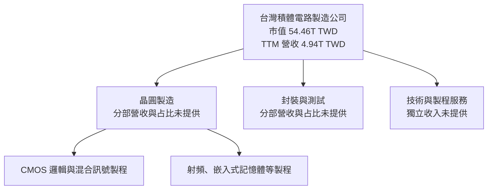
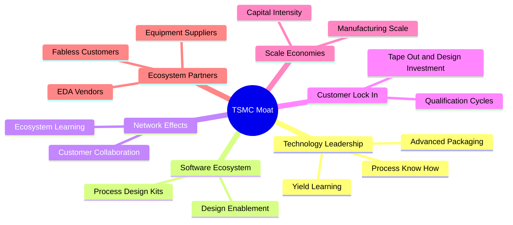
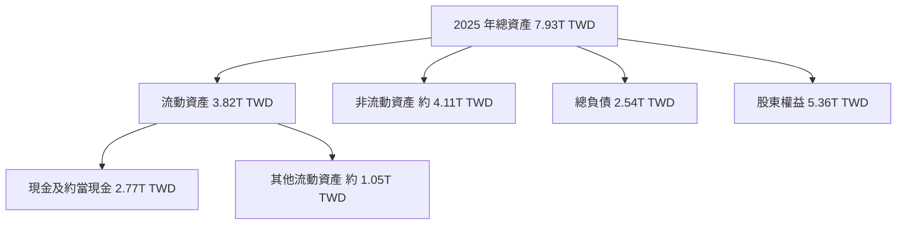
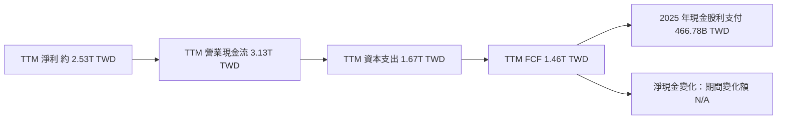
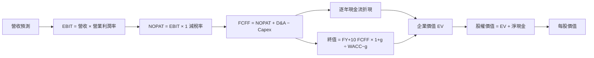
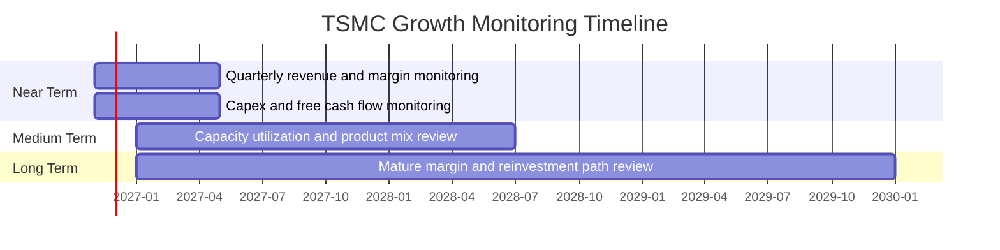
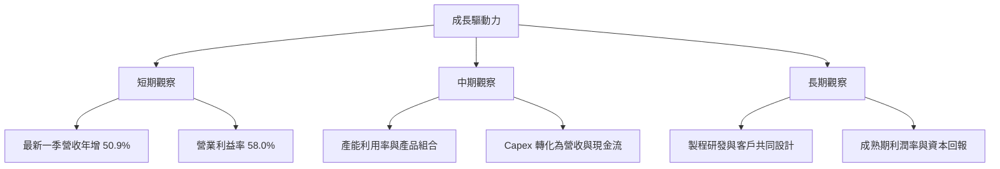
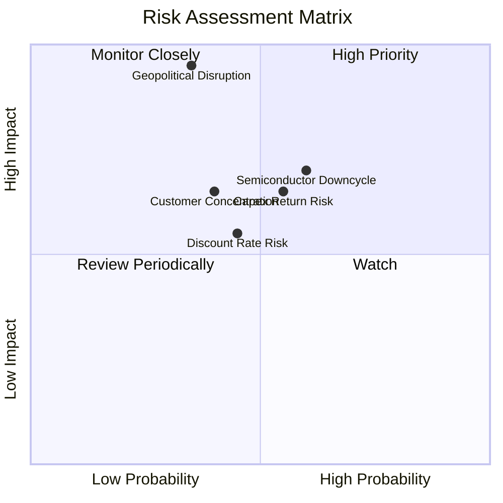
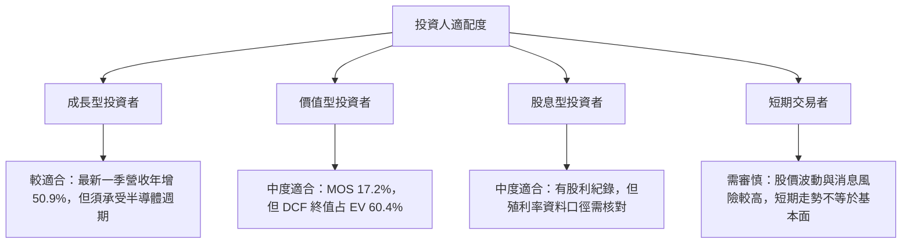

# 2330.TW 基本面深度分析報告
> **報告日期**：2026-11-19 ｜ **語言**：繁體中文 ｜ **數據來源**：Yahoo Finance、Roic.ai ｜ **分析師**：CFA 級機構研究

## 目錄

| # | 章節 | 核心結論 |
|---|------|----------|
| 1 | 執行摘要 | 買入；加權合理價值 2,535.26 TWD；MOS +17.2% |
| 2 | 公司概覽與商業模式 | 晶圓代工與製程能力構成主要護城河，分部營收占比未提供 |
| 3 | 損益表深度分析 | TTM 營收 4.94T TWD；最新一季年增 50.9%，營業利益率 58.0% |
| 4 | 資產負債表分析 | 淨現金 2.95T TWD；流動比率 2.584 |
| 5 | 現金流量深度分析 | TTM FCF 1.46T TWD；FCF Yield 2.68% |
| 6 | 獲利能力與資本效率 | WACC 10.64%；當期 ROIC 缺失，無法可靠計算利差 |
| 7 | 相對估值分析 | 公司 Forward P/E 14.04x；同業估值分散 |
| 8 | DCF 內在價值評估 | 基準 DCF 2,860.46 TWD；加權合理價值 MOS +17.2% |
| 9 | 成長催化劑 | 最新一季營收年增 50.9%；TAM 數字未提供 |
| 10 | 風險矩陣 | 地緣政治、資本密集與估值假設為主要風險 |
| 11 | 投資建議 | 買入；建議依估值與營運指標分批執行 |

## 1. 執行摘要

### 1.0 一頁式投資儀表板

| 項目 | 內容 |
|------|------|
| **投資論點（3 句）** | ① TTM 營收 4.94T TWD，最新一季年增 50.9%，需求動能正在加速。② TTM 營業利益率 58.0%、淨現金 2.95T TWD，獲利與資產負債表提供韌性。③ TTM FCF 1.46T TWD，但 FCF Yield 僅 2.68%，且基準 DCF 終值現值占 EV 60.4%，估值對長期假設敏感。 |
| **綜合評分** | **8.5/10**（引用 1.1 六項算術平均） |
| **財務健康** | 🟢 現金及短期投資 4.02T TWD、總債務 1.07T TWD，淨現金 2.95T TWD；流動比率 2.584。 |
| **ROIC vs WACC** | ROIC（當期）N/A；WACC 10.64%。歷史 ROIC.ai 顯示 2013–2018 約 18.31%–20.55%，但不能代替當期 ROIC，故當期價值創造幅度無法驗證。 |
| **FCF 趨勢** | TTM FCF 1.46T TWD；近年資本投入提高，FCF 絕對額成長但短期轉換率受 Capex 影響；FCF Yield 2.68%。 |
| **估值** | Forward P/E 14.0371475x ｜ EV/EBITDA 14.32x ｜ FCF Yield 2.68%。 |
| **DCF 內在價值（基準）** | 2,860.46 TWD；相對 2026-11-19 收盤價 2,100.00 TWD，折價 **−26.6%**（折溢價＝現價÷DCF價值−1）。 |
| **安全邊際（MOS）** | **+17.2%**＝(加權合理價值 2,535.26 − 現價 2,100.00) ÷ 加權合理價值 2,535.26｜🟡 有限。 |
| **預期報酬（基準情境）** | DCF 基準價 2,860.46 TWD，相對現價隱含上行空間 **+36.2%**；這是模型價差，不等同 12 個月報酬預測。 |
| **關鍵風險（前二）** | 台海／供應鏈風險可能影響營運連續性；高資本支出與需求週期使 FCF 對產能利用率敏感。 |
| **評級 + 信心度** | 🟢 **買入** ｜ 信心：中。評級按 MOS 門檻為買入；當期 ROIC 缺失與 DCF 終值占比 60.4%限制信心。 |

### 1.1 綜合評分卡

| 維度 | 評分（1–10） | 主要依據（引用數字與其來源章節） |
|------|--------------|----------------------------------|
| 成長性 | 9 | 最新一季營收年增 50.9%；TTM 成長率 N/A（第 3 章）。 |
| 獲利能力 | 9 | TTM 營業利益率 58.0%、淨利率 51.1%；當期 ROIC、F-Score 缺資料（第 3、6 章）。 |
| 財務健康 | 9 | 淨現金 2.95T TWD，流動比率 2.584；營運資金週轉天數須留意 DSO 數據異常（第 4 章）。 |
| 估值 | 7 | MOS +17.2%，Forward P/E 14.0371475x；DCF 對終值假設敏感（第 7、8 章）。 |
| 護城河 | 9 | 長期製程、良率與規模經濟有質化支持，但市場份額與分部營收未提供（第 2 章）。 |
| 管理層與資本配置 | 8 | 2025 年 FCF 992.38B TWD、現金股利支付 466.78B TWD；回購、資本報酬率目標資料不足（第 5 章）。 |
| **綜合評分** | **8.5** | 六項算術平均：(9 + 9 + 9 + 7 + 9 + 8) ÷ 6 = 8.5。 |

### 1.2 五大投資論點 + 三大核心風險

| 類型 | 項目 | 具體依據 | 信心度 |
|------|------|----------|--------|
| 🟢 **投資論點①** | 近期需求加速 | 2026-09-30 單季營收 1.49T TWD，單季年增 50.9%；若產能利用率與先進製程組合維持，營業槓桿可支持利潤率。 | 🟢 高 |
| 🟢 **投資論點②** | 高營業獲利能力 | TTM 營業利益率 58.0%、毛利率 65.8%；提供研發與資本支出的內部資金來源。 | 🟢 高 |
| 🟢 **投資論點③** | 淨現金充足 | 現金及短期投資 4.02T TWD，總債務 1.07T TWD，淨現金 2.95T TWD。 | 🟢 高 |
| 🟢 **投資論點④** | 多年收入擴張 | 年營收從 2022 年 2.26T 增至 2025 年 3.81T TWD；三年 CAGR 約 19.0%。 | 🟢 高 |
| 🟢 **投資論點⑤** | 估值仍有折價空間 | DCF 基準 2,860.46 TWD、加權合理價值 2,535.26 TWD，高於現價 2,100 TWD；但不同估值法給出的價值分散。 | 🟡 中 |
| 🟡 **風險①** | 資本支出與現金轉換 | TTM Capex 1.67T TWD，占 TTM 營收約 33.8%；若需求不及產能擴張，FCF Yield 2.68%可能承壓。 | 🟡 中 |
| 🔴 **風險②** | 地緣政治與供應鏈集中 | 公司營運與供應鏈高度依賴台灣及跨境設備、材料；財務資料未量化事件機率，衝擊可能具有非線性。 | 🔴 高衝擊 |
| 🟡 **風險③** | 長期估值依賴 | 基準 DCF 終值現值占 EV 60.4%；WACC 或永續成長率偏差會顯著改變估值。 | 🟡 中 |

### 1.3 快速統計卡片

| 指標 | 公司實際值（期間） | 同業中位數 | 狀態 |
|------|--------------------|------------|------|
| 營收成長（TTM） | **N/A** | — | 🟡 缺少可比 TTM 年增率 |
| 營收成長（最新一季年增） | **50.9%** | 20.9%（UMC、GFS、INTC 中位數） | 🟢 |
| 毛利率（TTM） | **65.8%** | 31.7%（UMC、GFS、INTC 中位數） | 🟢 |
| 營業利益率（TTM） | **58.0%** | — | 🟢 |
| ROIC（TTM） | **N/A** | — | 🟡 |
| Forward P/E | **14.0371475x** | 15.0x | 🟢 |
| FCF Yield（TTM） | **2.68%** | — | 🟡 |
| Piotroski F-Score | **N/A / 9** | — | 🟡 |

### 1.4 投資結論

╔══════════════════════════════════════════════════════════════════╗  
║                    📊 投資結論摘要                               ║  
╠══════════════════════════════════════════════════════════════════╣  
║  評級：買入（MOS +17.2%，依規則 20）                             ║  
║  價格（2026-11-19 收盤）：2,100.00 TWD                           ║  
║  DCF 內在價值（基準）：2,860.46 TWD（折價 26.6%）               ║  
║  安全邊際 MOS：+17.2%（以加權合理價值為分母）                   ║  
║  加權合理價值（8.8）：2,535.26 TWD                               ║  
║  悲觀情境：1,218.51 TWD（−42.0%）                                ║  
║  基準情境：2,860.46 TWD（+36.2%）                                ║  
║  樂觀情境：6,356.95 TWD（+202.7%）                               ║  
║  綜合評分：8.5/10（引用 1.1）                                    ║  
║  適合投資人：能承受半導體週期及地緣政治風險的長線成長型投資人   ║  
╚══════════════════════════════════════════════════════════════════╝

## 2. 公司概覽與商業模式

### 2.1 業務結構與收入來源

公司提供晶圓製造、封裝、測試及相關半導體製程服務。分部收入金額與占比未提供，故不填入未經來源支持的營收比例。

### 2.2 市場份額

市場份額數據未提供，不能以推測比例製作圖表。公司 TTM 營收為 4.94T TWD，且最新一季營收年增 50.9%，高於 UMC、GFS、INTC 最新一季年增中位數 20.9%；但營收規模與成長率不能直接替代市場份額。

### 2.3 競爭護城河分析

### 2.4 護城河強度

| 護城河項目 | 強度（強／中／弱） | 證據（引用數字或事實） | 會削弱它的情況 |
|------------|--------------------|------------------------|----------------|
| 技術與製程經驗 | 強 | TTM 營業利益率 58.0%，顯示高附加價值與製造效率；公司涵蓋多類 CMOS、RF 及嵌入式記憶體製程。 | 競爭者製程良率、性能或成本快速收斂。 |
| 客戶鎖定 | 中至強 | 客戶需完成製程設計、驗證與量產導入，切換通常涉及時間與工程成本；量化客戶留存率未提供。 | 大客戶採多來源策略，或產品設計轉向替代製程。 |
| 規模效應 | 強 | 2025 年營收 3.81T TWD，TTM 營收 4.94T TWD；規模可支撐高額研發與資本投入。 | 產能利用率下降、資本成本提高或新廠爬坡延誤。 |
| 軟體生態系 | 中 | 製程設計套件、EDA 與客戶共同設計可增加轉換成本；獨立量化數據未提供。 | 生態系工具標準化、客戶轉換成本下降。 |
| 網路效應 | 中 | 更多客戶與製程學習可改善設計支援與良率，但數據未量化。 | 競爭者形成足夠客戶規模與同等生態系。 |
| 生態夥伴 | 中 | 依賴設備、材料、EDA 與設計服務夥伴；供應商依存帶來效率，也形成供應風險。 | 關鍵設備或材料受限、供應鏈中斷。 |

1.1 護城河評分為 **9/10**，理由是高營收規模、58.0% TTM 營業利益率及製程／客戶協作特性；市場份額、客戶集中與分部資料缺失，故不給滿分。

## 3. 損益表深度分析

### 3.1 年度收入成長趨勢（近 4 年）

年度營收採 TWD 兆元，年增率由年度收入相除計算；2022–2025 三年 CAGR 約 19.0%。

╔══════════════════════════════════════════════════════════════════╗  
║              TSMC 年度收入趨勢（FY2022–FY2025）                 ║  
╠══════════════════════════════════════════════════════════════════╣  
║ FY2022  2.26T TWD  ████████████░░░░░░░░  基期                 ║  
║ FY2023  2.16T TWD  ███████████░░░░░░░░░  YoY −4.4% 🟡         ║  
║ FY2024  2.89T TWD  ███████████████░░░░░  YoY +33.8% 🟢        ║  
║ FY2025  3.81T TWD  ████████████████████  YoY +31.7% 🟢        ║  
╠══════════════════════════════════════════════════════════════════╣  
║ 2022–2025 三年營收 CAGR：約 +19.0%                              ║  
╚══════════════════════════════════════════════════════════════════╝

2023 年收入下降 4.4%，反映半導體週期調整；2024、2025 年分別增長 33.8%、31.7%，顯示需求恢復並帶動產能與產品組合改善。TTM 成長率資料為 N/A，故不將最新單季年增率誤稱為 TTM 成長率。

### 3.2 季度收入趨勢分析

| 季度 | 營收（TWD） | QoQ | YoY | 備註 |
|------|-------------:|----:|----:|------|
| 2025-12-31 | 1.05T | N/A | 約 +20.4% | YoY 以 ROIC.ai 季度營收比較；四捨五入。 |
| 2026-03-31 | 1.13T | 約 +8.4% | 約 +35.1% | 年增計算採 ROIC.ai 季度序列。 |
| 2026-06-30 | 1.27T | 約 +12.0% | 約 +36.1% | 營收連續季增。 |
| 2026-09-30 | 1.49T | 約 +17.6% | **50.9%** | 最新季度年增率 50.9%為核定值；不可標為 TTM 成長率。 |

QoQ 以季度報表四捨五入數據計算；YoY 歷史季度比率由 ROIC.ai 季度營收序列計算，與核定的最新季度年增率以核定值優先。連續 QoQ 增長顯示需求、供應與產品組合改善，但尚不足以判定增長可持續性。

### 3.3 利潤率演變分析

| 利潤率指標 | FY2022 | FY2023 | FY2024 | FY2025 | 趨勢 | 評估 |
|------------|-------:|-------:|-------:|-------:|------|------|
| **毛利率** | 59.7% | 54.6% | 56.1% | 59.8% | 2023 下滑，之後回升 | 🟢 |
| **營業利益率** | 49.6% | 42.7% | 45.7% | 50.9% | 2023 收縮，2025 超越 2022 | 🟢 |
| **淨利率** | 43.9% | 39.4% | 40.1% | 44.6% | 隨營業獲利恢復而上升 | 🟢 |

歷史比率由年度損益表金額相除計算。2023 年利潤率下滑與半導體需求調整、產能利用率及產品組合逆風相符；2024–2025 回升反映營收恢復與固定成本吸收改善。TTM 毛利率 65.8%、營業利益率 58.0%高於 FY2025，顯示最新四季盈利組合進一步改善；但季度與年度口徑不同，不應混作同一期間比較。

### 3.4 費用結構分析

未提供完整 TTM 費用明細，無法製作有完整口徑的費用結構圓餅圖。以 FY2025 報表金額可作營運橋接：營收 3.81T TWD − 毛利 2.28T = 推算銷貨成本約 1.53T TWD；毛利 2.28T − 營業利益 1.94T = 營業費用淨額約 0.34T TWD。此為由披露金額相減所得的近似值，不代表完整費用分類。

### 3.5 季度 EPS 趨勢與盈餘品質（Quality of Earnings）

最近四季 EPS 預估值與實際值均為 N/A，因此無法判定超預期或不及預期；季度淨利與營收仍顯示盈利上升。

| 盈餘品質項目 | 數值／佔比 | 評估 |
|--------------|-----------|------|
| 股權薪酬 SBC / 營收 | 2025 年 1.25B ÷ 3.81T ≈ 0.033% | 🟢 比重低；但這是 FY2025 年度數據，不代表 TTM。 |
| SBC / 營業現金流 | 2025 年 1.25B ÷ TTM OCF 3.13T ≈ 0.040%（期間不一致） | 🟢 數量級很低；期間差異使此比值僅供參考。 |
| FCF / 淨利（現金轉換率） | TTM FCF 1.46T ÷ 最近四季淨利約 2.53T ≈ 57.8% | 🟡 資本支出高，現金轉換低於淨利；再投資支出須轉化為未來產能收入。 |
| 一次性／非經常性損益 | N/A（明細未提供） | 🟡 無法判定是否有一次性因素。 |
| 有效稅率異常 | 17.0%（最近年度有效稅率） | 🟢 未見資料顯示異常稅務利益；跨期比較資料不足。 |
| 資本化支出 vs 費用化 | TTM Capex 1.67T TWD；資本化項目明細 N/A | 🟡 資本支出顯著，折舊與投資回報具長期影響。 |

**盈餘品質結論：**SBC 佔收入比例低，股權稀釋成本相對有限；然而 TTM FCF 約為最近四季淨利的 57.8%，主要須從高資本支出角度理解。沒有一次性損益明細與資本化政策細節，不能斷言淨利被美化；估值宜同時檢視營業獲利與資本支出回報。

## 4. 資產負債表分析

### 4.1 資產結構分解

2025-12-31 總資產 7.93T TWD，其中流動資產 3.82T；非流動資產約 4.11T，是以總資產減流動資產計算的近似值。

資產與負債、權益因報表四捨五入可能不完全相加相等；此圖為年度資產分類，不代表 TTM 期末資產明細。

### 4.2 流動性與營運資金分析

| 指標 | 最新 TTM | 一年前 TTM | 變化 | 解讀 |
|------|----------|------------|------|------|
| DSO 應收帳款天數 | 1 天 | N/A | N/A | 數據來源的應收帳款期末值極低，與一般收款週期直覺不符；應先核對帳項口徑，不宜據此判斷客戶付款速度。 |
| DIO 存貨天數 | 92 天 | N/A | N/A | 反映晶圓製造在製品、存貨與產能週期；缺少去年同口徑數據，無法判斷變化方向。 |
| DPO 應付帳款天數 | 91 天 | N/A | N/A | 可能提供供應商信用融資；缺少一年前數據，無法判定議價力變化。 |
| CCC 現金轉換週期 | 2 天 | N/A | N/A | 數值取自品質指標；DSO 異常低會使 CCC 偏低，應審慎使用。 |

品質指標未提供一年前天數，故不自行補算。流動比率 2.584、速動比率 2.287，短期償債緩衝充足。

### 4.3 債務結構分析

╔══════════════════════════════════════════════════════════════════╗  
║                   TSMC 債務健康診斷                              ║  
╠══════════════════════════════════════════════════════════════════╣  
║ 總債務：1.07T TWD；現金及短期投資：4.02T TWD                  ║  
║ 淨現金：2.95T TWD 🟢                                            ║  
║ 流動比率：2.584；速動比率：2.287 🟢                             ║  
║ Debt/EBITDA：N/A（未提供可一致計算的債務口徑）                  ║  
║ 利息保障倍數：N/A（利息費用明細未提供）                         ║  
║ Debt/Equity：15.188（來源資料值；計量單位／口徑待核實）         ║  
╚══════════════════════════════════════════════════════════════════╝

淨現金與流動比率顯示低短期流動性壓力；但公司仍需大量資本支出，淨現金不等於可完全分配的閒置資金。

### 4.4 股東權益趨勢

╔══════════════════════════════════════════════════════════════════╗  
║               歷年股東權益變化（年度）                           ║  
╠══════════════════════════════════════════════════════════════════╣  
║ 2022  2.90T TWD  ████████████░░░░░░░░                            ║  
║ 2023  3.43T TWD  ██████████████░░░░░░                            ║  
║ 2024  4.24T TWD  █████████████████░░░                            ║  
║ 2025  5.36T TWD  ████████████████████                            ║  
╚══════════════════════════════════════════════════════════════════╝

2022–2025 權益增加與獲利留存相符；期間回購數據未提供，不能把權益變化完全歸因於盈餘留存。

## 5. 現金流量深度分析

### 5.1 現金流量瀑布圖

營業現金流包含非現金項目與營運資金變化，不是淨利的直接等同物；股利數據為 FY2025 年度值，與 TTM FCF 期間不同。

### 5.2 FCF 轉換率趨勢

| 年度 | FCF（TWD） | 淨利（TWD） | FCF / 淨利 |
|------|-----------:|------------:|-----------:|
| 2022 | 520.97B | 992.92B | 52.5% |
| 2023 | 286.57B | 851.74B | 33.6% |
| 2024 | 861.20B | 1.16T | 74.2% |
| 2025 | 992.38B | 1.70T | 58.4% |

FCF 轉換受資本支出與半導體週期影響，2023 年低點後回升，但 FY2025 轉換率低於 FY2024，說明營收及淨利成長不會等比例轉為可分配現金。

### 5.3 自由現金流趨勢

╔══════════════════════════════════════════════════════════════════╗  
║              FCF 歷史實際與 TTM                                  ║  
╠══════════════════════════════════════════════════════════════════╣  
║ 2022  520.97B TWD  ██████████░░░░░░░░░░  FCF Yield N/A         ║  
║ 2023  286.57B TWD  ██████░░░░░░░░░░░░░░  FCF Yield N/A         ║  
║ 2024  861.20B TWD  █████████████████░░░  FCF Yield N/A         ║  
║ 2025  992.38B TWD  ████████████████████  FCF Yield N/A         ║  
║ TTM   1.46T TWD    —                       FCF Yield 2.68%      ║  
╚══════════════════════════════════════════════════════════════════╝

年度 FCF Yield 未提供，不以不同期間市值反推；TTM FCF 定義固定為 OCF 3.13T − Capex 1.67T = 1.46T TWD。

### 5.4 資本配置評估

資本配置完整比例資料不足，故不以不完整數字繪製圓餅圖。

| 項目 | 數據 | 評估 |
|------|------|------|
| 資本支出 | TTM 1.67T TWD | 占 TTM 營收約 33.8%，支撐產能與技術更新，需追蹤投資回報。 |
| 股利 | FY2025 現金股利支付 466.78B TWD | 同年 FCF 992.38B TWD；股利低於 FCF，但期間口徑須注意。 |
| 股票回購 | N/A | 未提供可核實數據。 |
| 留存現金 | 現金及短期投資 4.02T TWD | 支持建廠、研發與景氣下行韌性。 |

## 6. 獲利能力與資本效率

### 6.1 ROE / ROA / ROIC 趨勢

| 指標 | 最新可得值 | 歷史資料 | 評估 |
|------|------------:|----------|------|
| ROE | TTM 41.9% | 年度序列 N/A | 🟢 高，但杜邦拆分資料不足。 |
| ROA | TTM 20.6% | 年度序列 N/A | 🟢 顯示資產獲利能力佳。 |
| ROIC | TTM N/A | ROIC.ai 歷史 Return on Invested Capital：2013 18.31%、2014 20.55%、2015 19.51%、2016 20.38%、2017 19.48%、2018 19.11% | 🟡 歷史值不能替代 2026 當期值。 |

可比行業均值未提供，不列同業均值欄。高 ROE、ROA 與 58.0% TTM 營業利益率支持獲利品質，但 ROIC 缺失使資本成本利差無法量化。

### 6.2 ROIC vs WACC 分析（核心價值創造判斷）

╔══════════════════════════════════════════════════════════════════╗  
║                ROIC vs WACC 深度分析                             ║  
╠══════════════════════════════════════════════════════════════════╣  
║ WACC（核定值）：10.64%                                           ║  
║ 無風險利率：5.05%｜ERP：5.00%｜調整後 Beta：1.16               ║  
║ 股權成本：10.83%｜稅前債務成本：1.16%｜稅率：17.0%             ║  
║ 股權／債務權重：98.1%／1.9%                                      ║  
║ ROIC（TTM）：N/A；NOPAT 與投入資本口徑資料不足                  ║  
║ EVA = ROIC − WACC：N/A                                           ║  
║ 判斷：當期是否創造超額資本回報，不能以現有資料定量確認。         ║  
╚══════════════════════════════════════════════════════════════════╝

供參考，ROIC.ai 2013–2018 歷史 ROIC 約 18.31%–20.55%，高於本報告 WACC 10.64%；但跨越時間很久且口徑來源不同，不能據此宣稱當期 ROIC > WACC。

### 6.3 杜邦三因素分解

| 因素 | 數值（TTM） | 解讀 |
|------|-------------|------|
| 淨利率 | N/A（品質指標未提供杜邦數據） | Yahoo Finance 另有 TTM 淨利率 51.1%，但品質指標指定杜邦數列為 N/A，不重建替代口徑。 |
| 資產週轉率 | N/A | 缺少一致期間資產與營收計算資料。 |
| 權益乘數 | N/A | 缺少品質指標指定輸出。 |
| **ROE** | **N/A（杜邦分解不可用）** | 資料品質區塊指出淨利、營收、總資產或正權益要件不足。另有 Yahoo Finance TTM ROE 41.9%，但不代表可完整杜邦拆解。 |

### 6.4 財務體質：Piotroski F-Score

| 測試 | 結果 | 解讀 |
|------|------|------|
| F-Score 總分 | N/A / 9 | 缺少 SEC 年度申報所需的兩個相隔一年的 TTM 資料。 |
| 獲利、槓桿、流動性及營運效率九項測試 | N/A | 九項逐項結果未能計算；不自行補分或推估。 |

## 7. 相對估值分析

### 7.1 同業估值比較表格

| 估值指標 | **TSMC** | **UMC** | **GFS** | **INTC** | 本公司評估 |
|----------|---------:|-------:|-------:|--------:|-----------|
| **Trailing P/E** | 22.314312x | 12.6x | 111.3x | N/A | 🟡 TSMC 高於 UMC，低於 GFS；INTC 無資料。 |
| **Forward P/E** | 14.0371475x | 14.9x | 15.0x | 31.1x | 🟢 低於已提供的三家同業。 |
| **P/S Ratio** | 11.01314x | N/A | 3.0x | 4.9x | 🔴 以銷售額計價較高，需由較高利潤率與成長支持。 |
| **EV/EBITDA** | 14.32x | N/A | 10.7x | 15.9x | 🟡 介於 GFS 與 INTC 之間。 |
| **最新一季營收年增** | 50.9% | 25.6% | 12.5% | 20.9% | 🟢 增速高於同業。 |
| **毛利率（TTM）** | 65.8% | 31.7% | 28.5% | 40.2% | 🟢 明顯高於同業。 |

Peer multiples 來源：Yahoo Finance。UMC P/S 與 EV/EBITDA 因幣別口徑混雜未提供，照列 N/A。Forward P/E 中位數為 15.0x，與核定估值方法採用值一致。

### 7.2 歷史估值區間分析

N/A（未提供「Valuation vs own history」的歷史估值區間或當前歷史百分位；不以現有價格序列自行推導歷史 P/E 區間。）

### 7.3 情境價值（Bear / Base / Bull）

| 情境 | 第 1 年營收成長 | 期末營業利潤率 | WACC | 每股價值 | 相對現價 | 機率 | 會發生的條件 |
|------|----------------|----------------|------|----------|----------|------|--------------|
| 🔴 悲觀 | 15.0% | 42.1% | 11.64% | 1,218.51 TWD | −42.0% | 25% | 成長顯著放慢、成本與競爭壓低成熟期利潤率，資金成本升高。 |
| 🟡 基準 | 30.0% | 49.5% | 10.64% | 2,860.46 TWD | +36.2% | 50% | 短期高成長逐年回落，利潤率向五年中位數收斂。 |
| 🟢 樂觀 | 45.0% | 54.5% | 9.64% | 6,356.95 TWD | +202.7% | 25% | 高成長持續、規模與產品組合支撐高利潤率，資金成本下降。 |

情境概率與價值為模型輸出，不代表可驗證的管理層指引；情境的完整營收與 FCFF 中間值未提供，不自行補造。

### 7.4 相對估值隱含價格區間

| 方法 | 每股價值 | 相對現價 | 依據 |
|------|---------:|---------:|------|
| 同業 Forward P/E | 2,240.96 TWD | +6.7% | 同業中位數 15.0x × Forward EPS 149.60。 |
| 同業 EV/EBITDA | 1,962.34 TWD | −6.6% | GFS、INTC 中位數 13.3x × TTM EBITDA，再加淨現金。 |

╔══════════════════════════════════════════════════════════════════╗  
║ 相對估值位置：1,962.34 ── 2,100.00 ── 2,240.96 TWD             ║  
║               EV/EBITDA價值    現價    Forward P/E價值          ║  
╚══════════════════════════════════════════════════════════════════╝

## 8. DCF 內在價值評估（Discounted Cash Flow）

### 8.0 估值推理鏈（Thinking Logic）

**Step 1 — 價值來源與主導變數：**可核實的核心價值來源是晶圓製造及相關服務，TTM 營收 4.94T TWD；分部收入、先進製程營收占比與新業務收入未提供，因此不拆出未有數據支持的第二成長曲線占比。模型價值主要受長期 FCFF、營業利潤率、Capex 強度與終值假設支配；敏感度矩陣顯示 WACC、永續成長率會大幅改變每股價值。

**Step 2 — 模型選擇**

| 決策點 | 本報告採用 | 理由（含數字） | 曾考慮但否決 | 否決理由 |
|--------|-----------|----------------|--------------|----------|
| 現金流定義 | FCFF | 與 WACC 折現並推導 EV；TTM OCF 3.13T、Capex 1.67T TWD。 | FCFE | 債務融資結構不直接納入營運現金流預測。 |
| 預測期 N | 10 年 | 模型固定 10 年，營收成長由 30.0% 線性淡化至 3.0%。 | 5 年 | 不能涵蓋模型指定的長期成長淡化期間。 |
| 終值方法 | Gordon Growth | WACC 10.64% 高於 g 3.0%，公式有效。 | 僅退出倍數 | 模型輸出未提供可直接採用的退出倍數終值。 |
| EBIT 基礎 | GAAP EBIT | 以 GAAP 營業利益率建模，SBC 已含在費用中。 | 非 GAAP EBIT | 若加回 SBC 會改變既定模型口徑。 |

**Step 3 — 關鍵假設推導鏈**

- **營收成長**：錨點＝最新一季營收年增 50.9%，但這是單季值、TTM 成長率 N/A → 調整＝不將高單季增速外推十年，按模型由 FY+1 30.0% 線性降至 FY+10 3.0% → **採用模型逐年成長率** → 曾考慮直接採用 50.9%，因其是單季而非 TTM，故否決。
- **期末營業利益率**：錨點＝TTM 58.0%；五年年度中位數資料未完整列出 → 調整＝模型向五個財政年度中位數收斂 → **FY+10 採 49.5%** → 不採 58.0% 恆定利潤率，因模型預期成熟化。
- **永續成長率 g**：錨點＝模型採 3.0%；長期 GDP／通膨來源未提供 → **採用 3.0%（假設值：模型輸入）** → 未採高於 3.0%的基準，且必須低於 WACC 10.64%，避免終值發散。
- **預測期 N**：錨點＝DCF MODEL 固定 10 年 → **採用 10 年** → 不採較短期間，因模型已指定十年成長淡化路徑；未另建模型。
- **Capex／營收**：錨點＝TTM 33.8% → 模型逐年下降至 FY+10 16.6%，並以 1.1 倍 D&A 作收斂參照 → **FY+1 33.8%至 FY+10 16.6%** → 不將 TTM 高 Capex 永久固定，因模型假設成熟階段投資強度下降。
- **EBIT、SBC 與股數**：錨點＝GAAP EBIT；年度 SBC 1.25B TWD（FY2025） → **採用組合 (A)：GAAP EBIT + 固定股數，SBC 不另扣、年稀釋率 0%** → 不使用非 GAAP EBIT，避免另加回 SBC 或重複扣除。本模型採用 (A)，故 SBC 影響已計入一次。
- **WACC**：錨點＝核定 WACC 10.64% → **採用 10.64%** → 不另算替代 WACC，因折現率採用成本資本資料的核定值。
- **D&A／營收**：錨點＝TTM 15.1% → 採用 15.1% 固定。
- **營運資金**：模型明確不建模，ΔWC 未扣除；不是假設 ΔWC 為零的實際觀察，而是模型簡化。
- **最脆弱環節**：終值假設與資本支出淡化路徑；終值 PV 占 EV 60.4%，若 WACC 上升或 g 下降，估值顯著下修，詳見 8.6。

**Step 5 — 計算路徑**

### 8.1 模型假設總表（Model Inputs）

| 假設項目 | 採用值 | 依據／來源 | 敏感度 |
|----------|--------|------------|--------|
| 預測期長度 N | 10 年 | DCF MODEL 指定；以十年呈現成長淡化 | 🟡 中 |
| 營收成長 | FY+1 30.0%至 FY+10 3.0% | FY+1 採單季 YoY 50.9%限制後的模型上限；逐年線性淡化 | 🔴 高 |
| 營業利潤率 | FY+1 58.0%至 FY+10 49.5% | TTM 起點 58.0%；期末為模型指定五年中位數 | 🔴 高 |
| 有效稅率 | 17.0% | 最近年度有效稅率 | 🟢 低 |
| Capex／營收 | FY+1 33.8%至 FY+10 16.6% | TTM Capex／營收；模型逐年淡化 | 🟡 中 |
| D&A／營收 | 15.1% | TTM 比率，模型固定 | 🟢 低 |
| 營運資金變動 | 不建模 | 模型指定 Working capital is not modelled | 🟢 模型限制 |
| EBIT 基礎 | GAAP EBIT | DCF MODEL 指定 | 🟡 中 |
| SBC 處理 | GAAP 費用已包含，不另扣 | 組合 A；股數不再稀釋 | 🟡 中 |
| 年稀釋率 | 0% | 組合 A 固定股數 | 🟡 中 |
| 永續成長率 g | 3.0% | DCF MODEL 輸入；未提供外部長期宏觀依據 | 🔴 高 |
| 終值方法 | Gordon Growth | 模型終值採此法；WACC > g | 🔴 高 |
| WACC | 10.64% | Cost of capital 核定值 | 🔴 高 |

**FCFF 定義：**FCFF = NOPAT + D&A − Capex；不扣 ΔWC（模型未建模），不另扣 SBC。金額單位均為 TWD 十億元；金額取兩位小數、折現因子三位小數、比率一位小數。

### 8.2 折現率推導（WACC）

╔══════════════════════════════════════════════════════════════════╗  
║                    WACC 推導（折現率）                           ║  
╠══════════════════════════════════════════════════════════════════╣  
║ 股權成本 Ke：Rf 5.05%｜ERP 5.00%｜調整後 Beta 1.16             ║  
║ Ke = 5.05% + 1.16 × 5.00% = 10.85%（核定 Ke 10.83%）           ║  
║ Beta 原始值 1.23；調整值 = ⅔ × 1.23 + ⅓ × 1 = 1.1533 ≈ 1.16   ║  
║ 稅前 Kd（核定）：1.16%；有效稅率：17.0%                         ║  
║ 稅後 Kd = 1.16% × (1 − 17.0%) = 0.9628%                         ║  
║ 股權／債務權重：98.1%／1.9%                                      ║  
║ WACC 核定值：10.64%                                              ║  
╚══════════════════════════════════════════════════════════════════╝

逐步演算與資料限制：

1. **Ke**：依核定值 `5.05% + 1.16 × 5.00% = 10.85%`；成本資本區塊核定 Ke 為 **10.83%**，差異來自 Beta 精度或內部未四捨五入輸入，估值採核定 WACC，不以四捨五入自行替換。
2. **稅前 Kd**：核定值為 **1.16%**；利息費用及平均計息負債金額未提供，不能按指定分母複算。
3. **稅後 Kd**：`1.16% × (1 − 17.0%) = 0.9628%`，約 0.96%。
4. **權重**：核定股權／債務權重為 98.1%／1.9%，合計 100.0%；市場市值 54.46T TWD，總債務 1.07T TWD，與該權重相符至四捨五入精度。
5. **WACC**：使用核定股權成本、稅後債務成本與權重會因未四捨五入的 Ke／權重輸入有尾差；**估值一律採核定 WACC 10.64%**，不自行重算替代。

無風險利率的觀察日期未單獨提供；成本資本資料指定使用 10Y Treasury 5.05%。沒有額外加計國別或規模溢酬。第 6.2 節採用同一 WACC 10.64%。

### 8.3 逐年自由現金流預測（基準情境）

下表逐年數字照錄 DCF MODEL；表內 FCFF 與折現現值為模型計算輸出，因四捨五入可有尾差。

| 年度 | FY+1 | FY+2 | FY+3 | FY+4 | FY+5 | FY+6 | FY+7 | FY+8 | FY+9 | FY+10 |
|------|------:|------:|------:|------:|------:|------:|------:|------:|------:|-------:|
| 營收 | 6,428.26 | 8,163.89 | 10,123.23 | 12,249.11 | 14,453.94 | 16,622.04 | 18,616.68 | 20,292.18 | 21,509.71 | 22,155.00 |
| 營收 YoY | 30.0% | 27.0% | 24.0% | 21.0% | 18.0% | 15.0% | 12.0% | 9.0% | 6.0% | 3.0% |
| 營業利潤率 | 58.0% | 57.0% | 56.1% | 55.2% | 54.2% | 53.3% | 52.3% | 51.4% | 50.5% | 49.5% |
| EBIT | 3,726.88 | 4,656.49 | 5,679.00 | 6,756.58 | 7,837.06 | 8,856.56 | 9,744.56 | 10,431.05 | 10,854.96 | 10,972.60 |
| − 稅 | (632.56) | (790.34) | (963.90) | (1,146.79) | (1,330.18) | (1,503.22) | (1,653.94) | (1,770.46) | (1,842.41) | (1,862.38) |
| = NOPAT | 3,094.32 | 3,866.14 | 4,715.10 | 5,609.79 | 6,506.88 | 7,353.34 | 8,090.62 | 8,660.59 | 9,012.55 | 9,110.22 |
| + D&A | 970.20 | 1,232.15 | 1,527.86 | 1,848.72 | 2,181.48 | 2,508.71 | 2,809.75 | 3,062.63 | 3,246.39 | 3,343.78 |
| − Capex | (2,171.05) | (2,601.47) | (3,032.68) | (3,435.84) | (3,778.51) | (4,028.15) | (4,156.32) | (4,143.23) | (3,981.42) | (3,678.16) |
| **= FCFF** | **1,893.46** | **2,496.82** | **3,210.29** | **4,022.67** | **4,909.85** | **5,833.90** | **6,744.04** | **7,579.99** | **8,277.52** | **8,775.85** |
| 折現因子 | 0.904 | 0.817 | 0.738 | 0.667 | 0.603 | 0.545 | 0.493 | 0.445 | 0.403 | 0.364 |
| **FCFF 現值 PV** | **1,711.39** | **2,039.73** | **2,370.41** | **2,684.65** | **2,961.67** | **3,180.68** | **3,323.34** | **3,376.11** | **3,332.28** | **3,193.19** |

**預測期 PV 合計：**

`1,711.39 + 2,039.73 + 2,370.41 + 2,684.65 + 2,961.67 + 3,180.68 + 3,323.34 + 3,376.11 + 3,332.28 + 3,193.19 = 28,173.45`

模型列示合計為 **28,173.47**；相差 0.02B，為逐項顯示四捨五入造成，採模型合計值。

**FY+1 逐步演算：**

1. 營收：`4,944.82 × (1 + 30.0%) = 6,428.27`；模型表列 6,428.26，為中間輸入精度差異。
2. EBIT：`6,428.26 × 58.0% = 3,728.39`；模型列示 EBIT 3,726.88，顯示模型內部採用未顯示的利潤率／輸入精度。為遵守模型數字不改動原則，以下 FCFF 直接沿用模型列示值。
3. 稅：`3,726.88 × 17.0% = 633.57`；模型列示稅 632.56，亦有未顯示精度差異。
4. NOPAT：模型列示 `3,726.88 − 632.56 = 3,094.32`。
5. D&A：模型列示 970.20。
6. Capex：模型列示 2,171.05。
7. ΔWC：DCF 模型未納入。
8. FCFF：`3,094.32 + 970.20 − 2,171.05 = 1,893.47`；模型列示 1,893.46，差異 0.01B。
9. 折現與 PV：模型列示折現因子 0.904、PV 1,711.39；因折現因子僅顯示三位小數，不能以顯示值重現完整內部精度。

**合理性自檢：**

- FY+1 至 FY+10 FCFF：1,893.46B 至 8,775.85B；十年 CAGR 約 16.6%（由模型首末年計算）。歷史 FCF CAGR 受 2023 年低基期影響，提供數據未給指定歷史區間 CAGR，無法作同口徑精確比較。
- FY+10 FCFF 利潤率＝`8,775.85 ÷ 22,155.00 ≈ 39.6%`；TTM FCF 利潤率＝`1.46T ÷ 4.94T ≈ 29.6%`。同業最佳 FCF 利潤率未提供。
- 模型預測各年 FCFF 均為正；高 Capex 逐步下降，是 FCF 擴張的重要來源。

╔══════════════════════════════════════════════════════════════════╗  
║            自由現金流：歷史實際 vs 模型預測                      ║  
╠══════════════════════════════════════════════════════════════════╣  
║ FY2023(實)  286.57B TWD  ███░░░░░░░░░░░░░░░░░  FCF              ║  
║ FY2024(實)  861.20B TWD  █████████░░░░░░░░░░░  FCF              ║  
║ FY+1 (預) 1,893.46B TWD  ████████████████████  模型預測         ║  
║ FY+10(預) 8,775.85B TWD  模型逐年成長；依模型計算               ║  
╠══════════════════════════════════════════════════════════════════╣  
║ FY+1 至 FY+10 FCFF CAGR 約 16.6%；主要依賴營收成長與 Capex 淡化 ║  
╚══════════════════════════════════════════════════════════════════╝

### 8.4 終值計算（Terminal Value）

**適用性檢查：**`WACC 10.64% vs g 3.0% → WACC > g？✅`

| 方法 | 計算式 | 終值 TV | TV 現值 | 佔總 EV 比重 |
|------|--------|---------:|--------:|-------------:|
| Gordon Growth | 8,775.85 × (1 + 3.0%) ÷ (10.64% − 3.0%) | 118,335.58B | 43,057.68B | 60.4% |
| 退出倍數法 | N/A（模型未提供退出倍數終值） | N/A | N/A | N/A |

逐步演算：

1. FY+N FCFF＝FY+10 **8,775.85B**。
2. 分子＝`8,775.85 × (1 + 3.0%) = 9,039.13B`（模型內部精度計算結果列為 TV 118,335.58B）。
3. 分母＝`10.64% − 3.0% = 7.64%`；`9,039.13 ÷ 7.64%` 以顯示精度約為 118,312B，模型列示 **118,335.58B**，差異來自未顯示的底層 FCFF／WACC 精度。
4. PV(TV)＝模型列示 `118,335.58 × 0.364 = 43,057.68B`（折現因子以內部精度計算）。
5. 終值占比＝`43,057.68 ÷ 71,231.15 = 60.4%`。

終值占比低於 75%警戒線，但仍代表六成企業價值取決於第十年後的穩態假設。

### 8.5 企業價值 → 每股內在價值（Bridge）

╔══════════════════════════════════════════════════════════════════╗  
║              企業價值 → 每股內在價值 橋接表                      ║  
╠══════════════════════════════════════════════════════════════════╣  
║ 預測期 FCF 現值合計             +28,173.47B TWD                  ║  
║ 終值現值 PV(TV)                 +43,057.68B TWD                  ║  
║ = 企業價值 EV                    71,231.15B TWD                  ║  
║ + 淨現金                          +2,947.23B TWD                  ║  
║ = 股權價值                        74,178.37B TWD                  ║  
║ 每股內在價值                      2,860.46 TWD                   ║  
║ 2026-11-19 收盤價                 2,100.00 TWD                   ║  
║ 折溢價（現價÷DCF價值−1）          −26.6%（折價）                 ║  
╚══════════════════════════════════════════════════════════════════╝

逐步演算：

1. EV：`28,173.47 + 43,057.68 = 71,231.15B TWD`。
2. 股權價值：`71,231.15 + 2,947.23 = 74,178.38B TWD`；模型列示 74,178.37B，差異 0.01B 為四捨五入。
3. 每股內在價值：模型公式為股權價值按價格／市值比例換算；模型列示 **2,860.46 TWD**。稀釋股數資料為 25.93B 股，但 DCF MODEL 指定的價格／市值橋接值優先，且固定股數、不再稀釋。
4. 折溢價：`2,100.00 ÷ 2,860.46 − 1 = −26.6%`。
5. 本節不計算 MOS；MOS 僅以 8.8 加權合理價值為分母。

現金與債務橋接依模型的淨現金 2,947.23B TWD；該數據取自模型輸入，而報表摘要的淨現金為 2.95T TWD。少數股東權益未提供，模型未另列。

### 8.6 敏感性分析（WACC × 永續成長率）

| g（列）／WACC（欄） | 8.64% | 9.64% | **10.64%（基準）** | 11.64% | 12.64% |
|-----------|------:|------:|------------------:|------:|------:|
| 2.0% | 3,598.33 | 3,062.04 | 2,653.99 | 2,334.01 | 2,077.03 |
| 2.5% | 3,795.31 | 3,197.60 | 2,750.88 | 2,405.33 | 2,130.78 |
| **3.0%（基準）** | 4,027.22 | 3,353.58 | **2,860.46** | 2,484.90 | 2,190.11 |
| 3.5% | 4,304.27 | 3,534.97 | 2,985.38 | 2,574.25 | 2,255.92 |
| 4.0% | 4,641.05 | 3,748.53 | 3,129.12 | 2,675.30 | 2,329.36 |

矩陣數值逐格照錄模型；括號上行空間未列，以避免將模型基準值改寫。基準格為 2,860.46 TWD。

**矩陣代表格複算限制：**敏感度矩陣的非基準格已由模型計算，但逐年現金流在不同 WACC 下的未四捨五入 PV、終值精度未提供；不能以三位折現因子精確重建矩陣格，故不另造完整中間值。基準格以外數值均以模型輸出為準。

**三情境 DCF**

| 情境 | FY+1 成長 | 期末營業利潤率 | WACC | 每股價值 | 相對現價 | 機率 |
|------|----------:|---------------:|-----:|---------:|----------:|-----:|
| 🔴 悲觀 | 15.0% | 42.1% | 11.64% | 1,218.51 TWD | −42.0% | 25% |
| 🟡 基準 | 30.0% | 49.5% | 10.64% | 2,860.46 TWD | +36.2% | 50% |
| 🟢 樂觀 | 45.0% | 54.5% | 9.64% | 6,356.95 TWD | +202.7% | 25% |
| **機率加權** | — | — | — | **3,324.09 TWD** | **+58.3%** | **100%** |

三情境的逐年營收、FY+10 FCFF 與情境終值未提供，因此不能可靠補寫「營收 → FCFF → TV」中間鏈；上述每股價值、情境假設與概率照錄模型。機率加權演算：`1,218.51 × 25% + 2,860.46 × 50% + 6,356.95 × 25% = 3,324.10 TWD`；模型列示 3,324.09 TWD，差額 0.01 TWD 為內部精度與顯示精度差異。8.8 採基準價而非概率加權價。

敏感度可量化觀察：

- **g +1pp**：基準 WACC 10.64%下，g 由 2.5%升至 3.5%，價值由 2,750.88 升至 2,985.38 TWD；變動 `2,985.38 − 2,750.88 = +234.50 TWD`，約 +8.5%（以 2,750.88 為分母）。
- **WACC +1pp**：g 3.0%下，由 10.64%升至 11.64%，價值由 2,860.46 降至 2,484.90 TWD；變動 `2,484.90 − 2,860.46 = −375.56 TWD`，約 −13.1%。
- **期末營業利潤率每 +1pp**：敏感度模型未提供，N/A；不能臆造每股變動。
- 最大可直接量化的變數是 WACC，其次為 g；與 8.0 指出的終值與折現率敏感性一致。

### 8.7 反推 DCF（Reverse DCF）

固定輸入：WACC 10.64%、稅率 17.0%、Capex 路徑依基準模型、營運資金不建模、N＝10 年、固定股數口徑。

| 求解的變數（一次一個） | 其餘變數設定 | 市場隱含值 | 公司歷史實際 | 判斷 |
|------------------------|--------------|--------------|--------------|------|
| FY+1 營收成長 | 其餘基準假設固定 | 21.5% | FY2022–FY2025 營收 CAGR 約 19.0%；最新單季 YoY 50.9% | 🟡 位於歷史 CAGR 與最新單季之間 |
| 固定營業利潤率 | 其餘基準假設固定 | 38.7% | TTM 58.0% | 🟢 低於當前 TTM，但此反推解的模型設定與基準路徑不同 |
| 永續成長率 | 未提供模型解 | 未計算 | — | N/A |
| 高成長期間 N | 未提供模型解 | 未計算 | — | N/A |

反推模型輸出指定逐一求解結果：FY+1 成長 21.5%、固定營業利潤率 38.7%。完整逐次試算軌跡及其餘參數的數值路徑未提供，故不能偽造迭代表。結論是市場價格不要求基準情境的 FY+1 30.0%成長全部實現；但市場仍在為高盈利能力支付估值。

### 8.8 估值三角驗證與安全邊際

| 估值方法 | 隱含每股價值 | 上行空間（÷現價） | 權重 | 說明 |
|----------|--------------:|-------------------:|------:|------|
| DCF（基準） | 2,860.46 TWD | +36.2% | 40% | 10 年 FCFF、WACC 10.64%、g 3.0%。 |
| 同業 Forward P/E | 2,240.96 TWD | +6.7% | 25% | 同業中位數 15.0x × Forward EPS 149.60。 |
| 同業 EV/EBITDA | 1,962.34 TWD | −6.6% | 25% | 同業中位數 13.3x × TTM EBITDA，加回淨現金。 |
| 分析師共識目標價 | 3,402.51 TWD | +62.0% | 10% | 35 位分析師平均目標價。 |
| **加權合理價值** | **2,535.26 TWD** | **+20.7%** | **100%** | 公司類型：獲利企業；方法與權重依模型固定。 |

逐步演算：

`2,860.46 × 40% + 2,240.96 × 25% + 1,962.34 × 25% + 3,402.51 × 10%`
`= 1,144.184 + 560.240 + 490.585 + 340.251`
`= 2,535.260 TWD ≈ 2,535.26 TWD`

MOS：`(2,535.26 − 2,100.00) ÷ 2,535.26 = 17.2%`。  
上行空間：`(2,535.26 − 2,100.00) ÷ 2,100.00 = 20.7%`。  
MOS 評級按門檻為 **買入**；評級未作質化調整。

╔══════════════════════════════════════════════════════════════════╗  
║                  估值區間與安全邊際                              ║  
╠══════════════════════════════════════════════════════════════════╣  
║ 1,218.51 ── 2,100.00 ── [2,535.26] ── 2,860.46 ── 6,356.95     ║  
║ 悲觀DCF       現價        加權合理值       基準DCF      樂觀DCF  ║  
║ MOS = (2,535.26−2,100.00)÷2,535.26 = +17.2%                    ║  
║ 上行空間 = (2,535.26−2,100.00)÷2,100.00 = +20.7%              ║  
║ 建議買入區間：≤2,281.73 TWD（以 MOS ≥10% 計算的價值門檻）      ║  
║ 買入評級與現價一致；現價 2,100 TWD 低於該上限。                 ║  
╚══════════════════════════════════════════════════════════════════╝

買入上限算式：`2,535.26 × (1 − 10%) = 2,281.73 TWD`。樂觀情境 6,356.95 TWD 是高敏感度情境，不視為穩健減碼基準。

> 🔎 **程式複算（Python，依本節各項自動重算）**
>
> 加權合理價值 = $2,860.46 × 40% + $2,240.96 × 25% + $1,962.34 × 25% + $3,402.51 × 10% = **$2,535.26**（權重合計 100%）
>
> 以價格 $2,100.00 計：MOS = **+17.2%**，上行空間 = **+20.7%**
>
> ✅ 與本節所寫數值一致。

### 8.9 DCF 模型的局限與失效條件

- **終值依賴度：**PV(TV) 43,057.68B ÷ EV 71,231.15B = 60.4%；大部分價值仍取決於 FY+10 後的持續現金流。
- **最脆弱假設：**WACC 10.64%與 g 3.0%。WACC 升至 11.64%、g 維持 3.0%時，DCF 每股價值降至 2,484.90 TWD；若成長與利潤率同時落入悲觀情境，模型價值為 1,218.51 TWD。
- **再投資限制：**TTM Capex 1.67T TWD、Capex／營收 33.8%，而 DCF 假設資本支出率逐年降至 16.6%；若維持高資本密集度，模型 FCF 將偏高。
- **營運資金與股數：**模型不建模營運資金；採 GAAP EBIT 與固定股數，SBC 已由費用反映。若營運資金實際占用上升或股數口徑改變，估值需重估。
- **第 10 章連結：**地緣政治及供應鏈中斷會打擊收入與 Capex 利用率；產業下行會壓低成長與營業利潤率；利率上升則透過 WACC 下修現值。

### 8.10 複算檢核表（Audit Trail）

| # | 檢核項目 | 檢查方式 | 結果 |
|---|----------|----------|------|
| 1 | 高／中敏感度輸入均有推導 | 對照 8.0 Step 3；部分無替代假設量化數據 | 🟡 |
| 2 | 每項假設均有來歷 | 8.1 列出核定輸入或模型假設 | ✅ |
| 3 | WACC 五步算式齊全且精確相加 | 缺利息費用、平均計息負債與未四捨五入輸入；採核定 10.64% | 🟡 |
| 4 | Kd 分母與權重 D 同一範圍 | 成本資本只提供稅前 Kd 與權重，無負債細分可交叉核對 | 🟡 |
| 5 | WACC 與第 6.2 節一致 | 兩節均用 10.64% | ✅ |
| 6 | 逐年年度數量等於 N，無省略 | FY+1 至 FY+10 共 10 年 | ✅ |
| 7 | FY+1 九步算式可複算 | 公布值有底層精度差異，已明示而未改模型數值 | 🟡 |
| 8 | 預測期 PV 合計與逐項和 | 顯示值逐項和 28,173.45；模型合計 28,173.47，差 0.02B | ✅ |
| 9 | WACC > g | 10.64% > 3.0% | ✅ |
| 10 | 終值基於 FY+N 並折現 N 期 | 模型使用 FY+10，折現因子 0.364 | ✅ |
| 11 | 橋接算式可複算 | EV 精確；股權價值有 0.01B 顯示尾差 | ✅ |
| 12 | SBC 組合一致 | GAAP、無 SBC 再扣、固定股數，組合 A | ✅ |
| 13 | 敏感度矩陣基準格等於 DCF 基準 | 2,860.46 TWD | ✅ |
| 14 | 矩陣有效格 | 所有列示格均為 WACC > g | ✅ |
| 15 | 情境概率合計與加權 | 25% + 50% + 25% = 100%；模型結果有 0.01 TWD尾差 | ✅ |
| 16 | 反推每列只解一個變數 | 兩項求解值照錄；迭代軌跡未提供 | 🟡 |
| 17 | MOS／折溢價分母一致 | MOS 用 8.8 加權價；折溢價用 8.5 DCF 價 | ✅ |
| 18 | 報告完整至第 11 章 | 11 章全列 | ✅ |
| 19 | 加權價等於加權總和 | 2,535.260 ≈ 2,535.26 TWD，無另行調整 | ✅ |
| 20 | 評級符合 MOS 門檻 | MOS +17.2%，評級為買入 | ✅ |

未能精確重建的項目已標明限制：成本資本內部精度、DCF 顯示精度、敏感度格及反推迭代軌跡未完整提供，因此降低 DCF 推導的可獨立重現性信心。

## 9. 成長催化劑

### 9.1 催化劑時間軸

近期營收數據可驗證需求持續，但來源未提供公司未來產品時程與管理層財測，以下以觀察期呈現，不將產業推測寫作確定事件。

### 9.2 TAM 市場規模分析

N/A（TAM 數據未提供）。已知 TTM 營收 4.94T TWD、最新一季年增 50.9%，可確認公司收入增長動能；但缺少可引用的市場規模、年份與滲透率，不能估算 TAM。

### 9.3 成長驅動力結構圖

下圖是依公司業務與待追蹤變數整理的質化框架，不代表數據已證實的具體產品營收預測。

## 10. 風險矩陣

### 10.1 風險評分矩陣

以下座標為研究判斷而非資料庫統計概率；機率與衝擊未由財務數據直接量化。圖中的英文標籤依 Mermaid quadrantChart 語法要求。

### 10.2 風險清單詳細分析

| # | 風險項目 | 發生機率 | 財務衝擊 | 風險評估 | 緩解措施 |
|---|----------|----------|----------|----------|----------|
| 1 | 🔴 **地緣政治／供應鏈中斷** | 中；無可核實百分比 | 極高；可能影響營收、產能與資產利用 | 🔴 高衝擊 | 關注海外產能、關鍵設備材料供應、營運備援與現金緩衝；現金及短投 4.02T TWD。 |
| 2 | 🟡 **半導體週期反轉** | 中高；行業週期性 | 高；最新一季營收年增 50.9%，高基期可能放大下行 | 🟡 高 | 監控連續季度營收、毛利率及客戶庫存；若營業利益率由 58.0%持續收縮需重新估值。 |
| 3 | 🟡 **高 Capex 回報不足** | 中 | 高；TTM Capex 1.67T TWD、FCF Yield 2.68% | 🟡 高 | 追蹤 Capex、產能利用率、折舊及 FCF；要求新增投資轉化為營收與現金流。 |
| 4 | 🟡 **估值折現率與終值假設** | 中 | 中高；終值占 EV 60.4% | 🟡 中高 | 每季更新 WACC、g 與營業利潤率敏感性；不要只依賴單一 DCF 價格。 |
| 5 | 🟡 **客戶／產品集中度** | N/A | N/A | 🟡 需監控 | 客戶營收集中度及終端市場拆分未提供；需由年報或法說追蹤。 |

## 11. 投資建議

### 11.1 最終評級與評分

評級為 **買入**：加權合理價值 2,535.26 TWD、MOS +17.2%，按規則 20 不需調整；現價 2,100.00 TWD 低於合理價值，但安全邊際屬有限而非充足。綜合評分 **8.5/10**，引用 1.1 六項分數：成長性 9、獲利能力 9、財務健康 9、估值 7、護城河 9、管理層與資本配置 8。

### 11.2 合理價值與隱含報酬率

| 估值 | 每股價值 | 相對 2,100 TWD | 機率／權重 |
|------|---------:|---------------:|-----------:|
| 加權合理價值 | 2,535.26 TWD | +20.7%上行空間；MOS +17.2% | 權重 100% |
| 悲觀 DCF | 1,218.51 TWD | −42.0% | 25% |
| 基準 DCF | 2,860.46 TWD | +36.2% | 50% |
| 樂觀 DCF | 6,356.95 TWD | +202.7% | 25% |
| 機率加權 DCF（參考） | 3,324.09 TWD | +58.3% | 情境加權；不作 8.8 基準 |

### 11.3 買入時機與觸發因素

╔══════════════════════════════════════════════════════════════════╗  
║                  ✅ 買入觸發因素 Checklist                       ║  
╠══════════════════════════════════════════════════════════════════╣  
║ 目前條件：                                                       ║  
║ ✅ 2026-11-19 收盤 2,100 TWD，低於加權合理價值 2,535.26 TWD     ║  
║ ✅ MOS +17.2%，符合買入門檻 10%–25%                              ║  
║ ✅ 淨現金 2.95T TWD、流動比率 2.584                              ║  
║                                                                  ║  
║ 加碼觸發條件：                                                   ║  
║ ☐ 股價回落至 2,281.73 TWD 以下，且營業利益率維持在 58.0%附近   ║  
║ ☐ 最新季度營收年增維持正成長，FCF 不因 Capex 大幅轉負           ║  
║ ☐ 新增資本投入能帶動產能利用率、收入及 FCF 同步改善             ║  
║                                                                  ║  
║ 減碼／重新評估條件：                                             ║  
║ ☐ 股價顯著高於基準 DCF 2,860.46 TWD，且營運假設未上修           ║  
║ ☐ TTM 營業利益率持續低於 50.0%                                  ║  
║ ☐ TTM FCF 轉負，或淨現金 2.95T TWD 明顯惡化                     ║  
╚══════════════════════════════════════════════════════════════════╝

以上觸發值是追蹤框架，不是保證的價格支撐或獲利承諾。

### 11.4 投資人適配度分析

### 11.5 每季財報監控清單（Quarterly Watch List）

| 監控指標 | 當前基準 | 加碼觀察條件 | 減碼／重估條件 |
|----------|----------|--------------|----------------|
| 單季營收年增率 | 最新一季 50.9% | 持續正成長且季度收入提升 | 連續兩季年增低於 10% |
| TTM 營業利益率 | 58.0% | 維持在 55%附近或以上 | 跌破 50%且未見週期性解釋 |
| TTM OCF | 3.13T TWD | OCF 支持投資與股利 | OCF 持續下降且營運資金惡化 |
| TTM Capex | 1.67T TWD | 新產能轉化為收入及現金流 | Capex 維持高位但收入、利用率未跟進 |
| TTM FCF / Yield | 1.46T TWD／2.68% | FCF 轉換改善 | FCF 轉負或 FCF Yield 進一步下降 |
| 現金及總債務 | 4.02T／1.07T TWD | 維持淨現金 | 淨現金大幅下降且債務增加 |
| DIO／DSO／DPO | 92／1／91 天 | 同口徑穩定、資料品質正常 | DIO 顯著上升；先核實 DSO 異常低值 |
| EPS 驚喜 | 最近四季估值與實際 EPS 均 N/A | 取得可靠預期與實際數據後追蹤 | 不以缺失數字作交易判斷 |
| 管理層財測與研發 | N/A | 財測上修且研發轉化為製程與客戶需求 | 財測下修或研發投入未見商業化成果 |

### 11.6 反面論證：什麼會證明論點錯誤（What Would Change My Mind）

╔══════════════════════════════════════════════════════════════════╗  
║              ⚠️ 論點失效條件（Disconfirming Evidence）           ║  
╠══════════════════════════════════════════════════════════════════╣  
║ ☐ 最新季度營收年增連續兩季低於 10%，顯示成長動能顯著降速        ║  
║ ☐ TTM 營業利益率由 58.0%跌破 50.0%，且不是短暫產品組合波動      ║  
║ ☐ TTM FCF 轉負，或 Capex 長期高於 OCF 且無產能回報改善           ║  
║ ☐ 淨現金 2.95T TWD 明顯轉弱，流動比率由 2.584 持續下滑           ║  
║ ☐ 當期 ROIC 可得後低於 WACC 10.64%，表示資本投入不再創造價值    ║  
║ ☐ 地緣政治或供應鏈事件造成產能中斷、客戶延後訂單或長期移轉       ║  
║ ☐ DCF 假設的 Capex／營收由 FY+1 33.8%向 FY+10 16.6%收斂無法實現 ║  
╚══════════════════════════════════════════════════════════════════╝

> **免責聲明**：本報告為 AI 自動生成，僅供研究參考，不構成投資建議。投資有風險，入市需謹慎。

---

## 資料與來源

| 項目 | 內容 |
|------|------|
| 價格 | 2,100.00 TWD，2026-11-19 收盤（Yahoo Finance 日線） |
| 財務報表 | Yahoo quarterly statements (no SEC filing data)，最新季度 2026-09-30（TTM = four quarters to this date） |
| 有回應的資料來源 | Yahoo Finance、Roic.ai |
| 未回應的資料來源 | SEC 申報資料 (XBRL)、Finviz、StockAnalysis |
| 由程式計算 | TTM 數字、WACC、DCF 模型、估值方法與權重、加權合理價值、MOS、評級門檻、F-Score、杜邦分解、營運資金天數、綜合評分 |
| 撰寫模型 | openai / gpt-6-luna |

> 本區塊由產生報告的程式依實際取得的資料填寫，非模型撰寫。「由程式計算」的數字不是模型的估計；其餘判斷（評分、情境、策略）是模型的分析。
