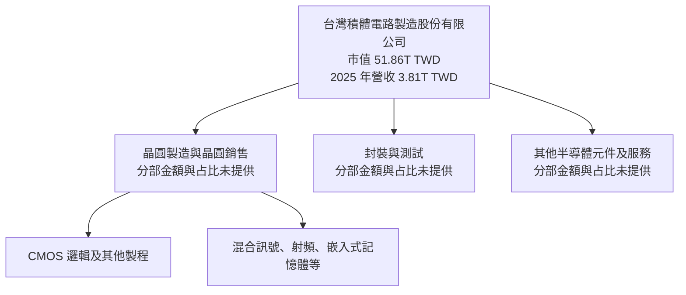
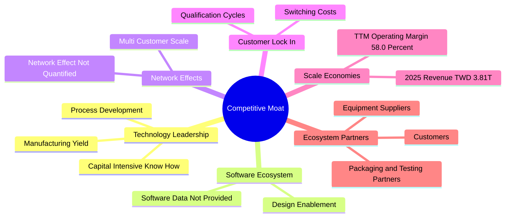
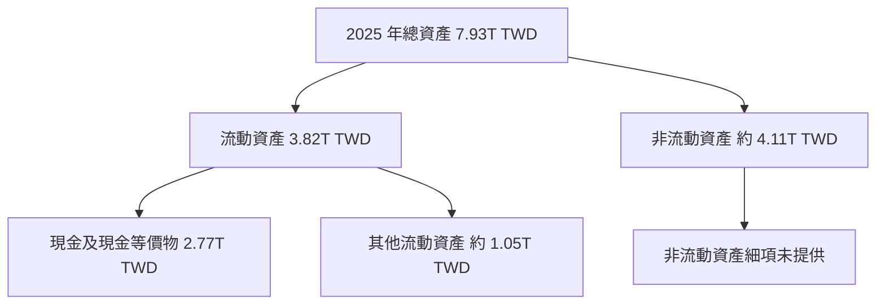
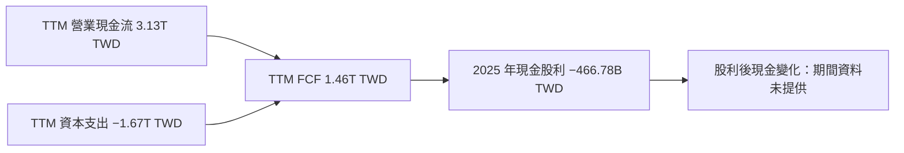
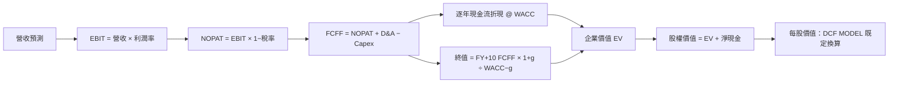
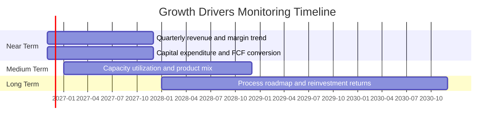
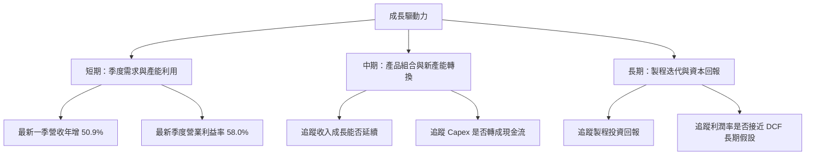
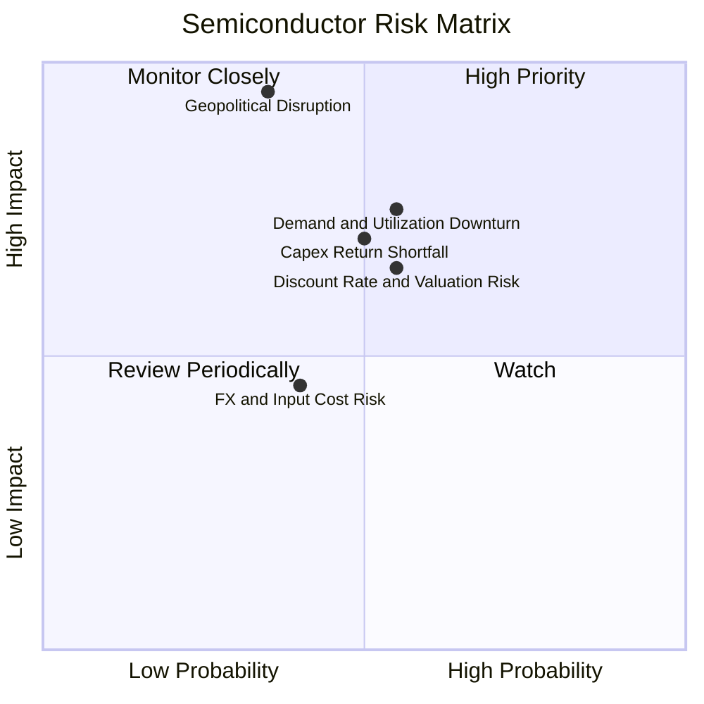
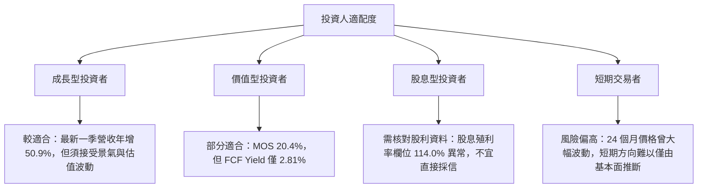

# 2330.TW 基本面深度分析報告
> **報告日期**：2026-11-20 ｜ **語言**：繁體中文 ｜ **數據來源**：Yahoo Finance、Roic.ai 

## 目錄

| # | 章節 | 核心結論 |
|---|------|----------|
| 1 | 執行摘要 | 買入；加權合理價值 2,512.95 TWD；MOS +20.4% |
| 2 | 公司概覽與商業模式 | 晶圓代工與先進製程構成核心，市場份額數據未提供 |
| 3 | 損益表深度分析 | TTM 營收 4.94T TWD；最新一季年增 50.9%；TTM 營業利益率 58.0% |
| 4 | 資產負債表分析 | 淨現金 2.95T TWD；流動比率 2.584 |
| 5 | 現金流量深度分析 | TTM FCF 1.46T TWD；FCF Yield 2.81% |
| 6 | 獲利能力與資本效率 | WACC 10.49%；最新 ROIC 缺乏可比數據，無法直接判斷當期利差 |
| 7 | 相對估值分析 | 同業估值法隱含價值約 1,965.61–2,046.45 TWD |
| 8 | DCF 內在價值評估 | 基準 DCF 2,924.21 TWD；估值對終值與營運假設敏感 |
| 9 | 成長催化劑 | 最新一季營收年增 50.9%；TAM 與公司分部收入數據未提供 |
| 10 | 風險矩陣 | 主要風險為地緣政治、資本支出與景氣循環、估值假設落空 |
| 11 | 投資建議 | 買入；以加權合理價值與季度營運指標作為決策錨點 |

## 1. 執行摘要

### 1.0 一頁式投資儀表板（Portfolio Manager 30 秒速讀）

| 項目 | 內容 |
|------|------|
| **投資論點（3 句）** | ① 最新一季營收年增 **50.9%**，而 2026-09-30 季營業利益率為 **58.0%**，反映需求成長轉化為高營業獲利。② TTM 營業現金流 **3.13T TWD**、資本支出 **1.67T TWD**，形成 **1.46T TWD** FCF，但 FCF Yield 僅 **2.81%**。③ 估值模型加權合理價值 **2,512.95 TWD**，高於 2026-11-20 收盤價 **2,000.00 TWD**，MOS 為 **20.4%**。 |
| **綜合評分** | **8.3/10**（引用 1.1） |
| **財務健康** | 🟢 現金與短期投資 **4.02T**、總債務 **1.07T**，淨現金 **2.95T TWD**；流動比率 **2.584**。 |
| **ROIC vs WACC** | 最新 ROIC：**N/A**；WACC：**10.49%**。資料不足，不能據此宣稱當期 ROIC 高於 WACC。 |
| **FCF 趨勢** | 2022–2025 年 FCF 逐年增加，分別為 **520.97B、286.57B、861.20B、992.38B TWD**；最新 TTM FCF Yield **2.81%**。2023 年曾回落，資本支出週期使現金流波動。 |
| **估值** | Forward P/E **13.37x** ｜ EV/EBITDA **13.6x** ｜ FCF Yield **2.81%** |
| **DCF 內在價值（基準）** | **2,924.21 TWD** ｜ 現價相對 DCF 溢價／折價 **−31.6%**（折價；以 DCF 基準價為分母） |
| **安全邊際（MOS）** | **+20.4%**＝(加權合理價值 **2,512.95** − 現價 **2,000.00**) ÷ 加權合理價值；🟡有限 |
| **預期報酬（基準情境 12M）** | **+25.6%**（加權合理價值相對現價的上行空間；非保證報酬） |
| **關鍵風險（前二）** | 地緣政治與供應鏈中斷；巨額資本支出若未轉成足夠 FCF，會降低估值。 |
| **評級 + 信心度** | 🟢 **買入** ｜ 信心：中（估值模型有明確假設，但最新 ROIC、分部數據與同業部分指標缺漏） |

> 折溢價依 DCF 基準價計算：`2,000.00 ÷ 2,924.21 − 1 = −31.6%`。MOS 則固定以第 8.8 節加權合理價值為分母。

### 1.1 綜合評分卡（全報告唯一）

| 維度 | 評分（1–10） | 主要依據（引用數字與其來源章節） |
|------|--------------|----------------------------------|
| 成長性 | 9.0 | 最新一季營收年增 **50.9%**；TTM 營收年增率 N/A，不能以單季增速替代 TTM（第 3 章）。 |
| 獲利能力 | 9.0 | TTM 營業利益率 **58.0%**、毛利率 **65.8%**；最新 ROIC 與 Piotroski F-Score 為 N/A（第 3、6 章）。 |
| 財務健康 | 9.0 | 淨現金 **2.95T TWD**、流動比率 **2.584**、CCC **2 天**（第 4 章）。 |
| 估值 | 6.0 | MOS **20.4%**、Forward P/E **13.37x**；但 DCF 終值現值佔 EV **61.0%**，假設敏感度高（第 7、8 章）。 |
| 護城河 | 9.0 | 2025 年營收 **3.81T TWD**、營業利益率 **50.9%**；目前 TTM 營業利益率 **58.0%**，顯示規模與製程能力支持高獲利（第 2、3 章）。 |
| 管理層與資本配置 | 7.5 | 2025 年 FCF **992.38B TWD**、現金股利支付 **466.78B TWD**、SBC **1.25B TWD**；回購資料未提供（第 5 章）。 |
| **綜合評分** | **8.3** | 六項算術平均：`(9.0 + 9.0 + 9.0 + 6.0 + 9.0 + 7.5) ÷ 6 = 8.25`，四捨五入至一位小數為 **8.3**。 |

### 1.2 五大投資論點 + 三大核心風險

| 類型 | 項目 | 具體依據 | 信心度 |
|------|------|----------|--------|
| 🟢 **投資論點①** | 需求增長推動營收加速 | 2026-09-30 季營收 **1.49T TWD**，年增 **50.9%**；季度數據顯示收入規模高於前幾季。 | 🟢 高 |
| 🟢 **投資論點②** | 高利潤率支持獲利轉化 | TTM 營業利益率 **58.0%**、淨利率 **51.1%**；收入增長若不伴隨大幅成本上升，仍具營業槓桿。 | 🟢 高 |
| 🟢 **投資論點③** | 資產負債表具緩衝 | 現金與短期投資 **4.02T TWD**，總債務 **1.07T TWD**，淨現金 **2.95T TWD**。 | 🟢 高 |
| 🟢 **投資論點④** | 現金流覆蓋大量投資支出 | TTM OCF **3.13T** 減 Capex **1.67T**，FCF 為 **1.46T TWD**；代表投資後仍有正現金流，但 FCF Yield 僅 **2.81%**。 | 🟢 高 |
| 🟢 **投資論點⑤** | 綜合估值仍有折價空間 | 加權合理價值 **2,512.95 TWD**，較現價高 **25.6%**；MOS **20.4%**，符合買入門檻。 | 🟡 中 |
| 🟡 **風險①** | 地緣政治與供應集中 | 公司製造基地與供應鏈跨區域，但可量化的地理營收／產能占比未提供；重大中斷可能影響營收、交付及資本支出。 | 🔴 高衝擊 |
| 🟡 **風險②** | 資本密集與現金流波動 | 2025 年 Capex **1.28T TWD**，TTM Capex **1.67T TWD**；需求降溫時，固定投資可能令 FCF 下降。 | 🟡 中 |
| 🔴 **風險③** | 估值依賴長期假設 | DCF 終值現值佔 EV **61.0%**；WACC、永續成長率及期末利潤率小幅變動，均可能顯著改變估值。 | 🔴 高 |

### 1.3 快速統計卡片

| 指標 | 公司實際值（期間） | 同業中位數 | 狀態 |
|------|--------------------|------------|------|
| 營收成長（TTM） | **N/A** | — | 🟡 TTM 比較資料缺漏 |
| 營收成長（最新一季年增） | **50.9%** | **20.9%**（UMC、GFS、INTC） | 🟢 高於同業中位數 |
| 毛利率（TTM） | **65.8%** | **31.7%**（UMC、GFS、INTC） | 🟢 高於同業中位數 |
| 營業利益率（TTM） | **58.0%** | — | 🟢 高 |
| ROIC（TTM） | **N/A** | — | 🟡 缺少可比期間數據 |
| Forward P/E | **13.37x** | **13.7x**（UMC、GFS、INTC） | 🟢 略低於同業中位數 |
| FCF Yield（TTM） | **2.81%** | — | 🟡 估值對未來成長要求較高 |
| Piotroski F-Score | **N/A / 9** | — | 🟡 需要兩個相隔一年的 SEC 申報 TTM 期間；現有資料不足 |

同業中位數依 Peer multiples 區塊可用數字計算；不同幣別下的 P/S 與 EV/EBITDA 不混算。

### 1.4 投資結論

╔══════════════════════════════════════════════════════════════════╗  
║                    📊 投資結論摘要                               ║  
╠══════════════════════════════════════════════════════════════════╣  
║ 評級：買入（MOS +20.4%，按規則 20，不作質化調整）                ║  
║ 價格（2026-11-20 收盤）：2,000.00 TWD                            ║  
║ DCF 內在價值（基準）：2,924.21 TWD（折價 31.6%）                 ║  
║ 安全邊際 MOS：+20.4%（以加權合理價值為分母）                     ║  
║ 加權合理價值（8.8）：2,512.95 TWD                                ║  
║ DCF 悲觀情境：1,240.55 TWD（−38.0%）                             ║  
║ DCF 基準情境：2,924.21 TWD（+46.2%）                             ║  
║ DCF 樂觀情境：6,526.44 TWD（+226.3%）                            ║  
║ 綜合評分：8.3/10（引用 1.1）                                     ║  
║ 適合投資人：能承受半導體景氣與地緣政治波動的長線成長型投資人     ║  
╚══════════════════════════════════════════════════════════════════╝

## 2. 公司概覽與商業模式

### 2.1 業務結構與收入來源

公司業務包括整合電路與其他半導體元件的製造、封裝、測試及銷售，營運地區涵蓋台灣、中國、歐洲、中東、非洲、日本、美國及其他國際市場。最新 TTM 營收為 **4.94T TWD**，2025 年年度營收為 **3.81T TWD**。收入按製程、封裝、客戶或地區的分部金額與占比未提供，因此不製作分部比例圖。

### 2.2 市場份額

市場份額數據未提供，亦無可引用的產業份額年份資料，因此不製作份額圖。公司 2025 年營收 **3.81T TWD**，TTM 營收 **4.94T TWD**；最新一季營收年增 **50.9%**，明顯高於同業比較組的最新一季營收年增中位數 **20.9%**。這些數字顯示規模與近期成長表現突出，但不能單獨替代市場份額資料。

### 2.3 競爭護城河分析

### 2.4 護城河強度

| 護城河項目 | 強度（強／中／弱） | 證據（引用數字或事實） | 會削弱它的情況 |
|------------|--------------------|------------------------|----------------|
| 技術與製程能力 | 強 | TTM 營業利益率 **58.0%**、毛利率 **65.8%**；2025 年營業利益率約 **50.9%**，顯示高附加價值製造能力。 | 製程良率落後、技術迭代延誤或競爭者縮小差距。 |
| 軟體與設計生態 | 中 | 公司提供多類製程，但軟體收入、設計平台採用與客戶數據未提供。 | 客戶轉向其他平台或設計支援差異化下降。 |
| 網路效應 | 中 | 規模可能使客戶、供應商與製造經驗互相強化，但可量化網路效應資料未提供。 | 供應鏈伙伴與客戶逐步建立替代生態。 |
| 客戶鎖定 | 強 | 半導體設計導入與製程驗證通常有較高轉換成本；公司 TTM 營收 **4.94T TWD**，但客戶集中度未提供。 | 大客戶自建產能、雙供應商策略或產品世代轉換失利。 |
| 規模效應 | 強 | 2025 年營收 **3.81T TWD**，TTM 營業利益率 **58.0%**；高固定成本產業下，規模可支撐效率與研發。 | 產能利用率下滑、資本回報降低或過度擴產。 |
| 生態夥伴 | 中 | 公司經營製造、封裝與測試等環節，外部伙伴名單及貢獻度未提供。 | 關鍵設備、材料、能源或封裝供應受限。 |

**護城河分數理由**：1.1 護城河評分為 **9.0/10**，依據是高規模與高利潤率；分部、客戶與軟體生態的量化資料不足，因此未給滿分。

## 3. 損益表深度分析

### 3.1 年度收入成長趨勢（近 4 年）

收入 YoY 以年度財報值計算，四捨五入至一位小數；2022–2025 三年 CAGR 為約 **19.0%**。

╔══════════════════════════════════════════════════════════════════╗  
║ 台灣積體電路製造 年度收入趨勢（FY2022–FY2025）                  ║  
╠══════════════════════════════════════════════════════════════════╣  
║ FY2022　2.26T TWD　███████████████░░░░░　YoY：N/A              ║  
║ FY2023　2.16T TWD　██████████████░░░░░░　YoY：−4.4% 🟡         ║  
║ FY2024　2.89T TWD　███████████████████░　YoY：+33.8% 🟢        ║  
║ FY2025　3.81T TWD　████████████████████　YoY：+31.8% 🟢        ║  
╠══════════════════════════════════════════════════════════════════╣  
║ 2022–2025 三年收入 CAGR：約 +19.0%                              ║  
╚══════════════════════════════════════════════════════════════════╝

計算：`(3.81 ÷ 2.26)^(1/3) − 1 ≈ 19.0%`。2023 年收入回落後，2024–2025 年恢復成長；年度資料無法將變化精確拆解為價格、產量與產品組合，但最新季度成長顯示 2026 年動能進一步加快。

### 3.2 季度收入趨勢分析

以下營收以季度損益表為準；QoQ 與可計算的 YoY 由所列季度數據推導，約至一位小數。

| 季度 | 營收（TWD） | QoQ | YoY | 備註 |
|------|-------------:|----:|----:|------|
| 2025-12-31 | 1.05T | — | 約 **20.9%** | 對比 2024 Q4 Roic.ai 營收 **868.461B**。 |
| 2026-03-31 | 1.13T | 約 **7.6%** | 約 **35.1%** | 對比 2025 Q1 **839.254B**。 |
| 2026-06-30 | 1.27T | 約 **12.4%** | 約 **36.0%** | 對比 2025 Q2 **933.792B**。 |
| 2026-09-30 | 1.49T | 約 **17.3%** | **50.9%** | 最新季度年增率；不得視為 TTM 成長率。 |

2026 年前三季營收連續提高，Q3 年增率增至 **50.9%**。增長若來自較高價值產品組合與產能利用率提升，會帶來營業槓桿；若主要由短期需求或急單造成，則需觀察後續季度是否延續。

### 3.3 利潤率演變分析

| 利潤率指標 | FY2022 | FY2023 | FY2024 | FY2025 | 趨勢 | 評估 |
|------------|-------:|-------:|-------:|-------:|------|------|
| **毛利率** | 59.7% | 54.6% | 56.1% | 59.8% | 2023 下滑，之後回升 | 🟢 |
| **營業利益率** | 49.6% | 42.7% | 45.7% | 50.9% | 2023 低點後改善 | 🟢 |
| **淨利率** | 43.9% | 39.4% | 40.1% | 44.6% | 2023 下滑，之後回升 | 🟢 |

年度比率由年度毛利、營業利益、淨利除以年度營收計算。另據 Yahoo Finance，TTM 毛利率 **65.8%**、營業利益率 **58.0%**、淨利率 **51.1%**；最新季度營業利益率亦為 **58.0%**。

**利潤率演變深度解析**：2023 年毛利率由 2022 年 **59.7%** 降至 **54.6%**，營業利益率由 **49.6%** 降至 **42.7%**，符合半導體產業需求與產能利用率波動對固定成本吸收的影響。2024–2025 年利潤率回升，且最新 TTM 利潤率高於 2025 年年度水準；這代表收入組合、產能利用率及定價／成本吸收的合力改善，但現有資料不能精確分解各項貢獻。

### 3.4 費用結構分析

完整損益表費用項目、營收成本以外的費用明細及各項占比未提供，故不製作費用結構圓餅圖。可確認 2025 年研發費用為 **246.43B TWD**，約占 2025 年營收 **3.81T TWD** 的 **6.5%**；計算為 `246.43 ÷ 3,809.05 ≈ 6.5%`。研發投入支持製程迭代，但其對當期與未來利潤的分項貢獻無法由資料量化。

### 3.5 季度 EPS 趨勢與盈餘品質（Quality of Earnings）

EPS 預估值缺漏，故不能判定最近四季「超預期／不及預期」。以下 EPS 實際值取自 Roic.ai 季度歷史；2025 Q4 至 2026 Q3 分別為 **18.72、22.08、27.25、29.43 TWD**。2026 Q3 EPS 年增 **68.7%** 的最新季度增長率來自 Yahoo Finance；估值預期差資料為 N/A。

| 盈餘品質項目 | 數值／佔比 | 評估 |
|--------------|-----------|------|
| 股權薪酬 SBC / 營收 | 最新四季 SBC 合計約 **0.513B TWD**；除以 TTM 營收 **4.94T**，約 **0.010%** | 🟢 佔比低；稀釋影響相對有限。 |
| SBC / 營業現金流 | 約 **0.016%**（0.513B ÷ TTM OCF 3.13T） | 🟢 對現金流影響低。 |
| FCF / 淨利（現金轉換率） | 近四季淨利合計約 **2.528T TWD**；TTM FCF **1.46T TWD**，約 **57.8%** | 🟡 有正現金轉換，但大額資本支出壓低 FCF／淨利比。 |
| 一次性／非經常性損益 | 分項資料未提供 | 🟡 無法判斷是否存在一次性盈餘影響。 |
| 有效稅率異常 | 最新年度 **17.0%** | 🟢/🟡 稅率可用於模型；缺乏多年可比明細，不能確認是否異常。 |
| 資本化支出 vs 費用化 | TTM Capex **1.67T TWD**；資本化與費用化明細未提供 | 🟡 無法評估是否有成本遞延；Capex 已反映在 FCF 計算中。 |

**EPS 趨勢與盈餘品質結論**：已提供的四季 EPS 實際值呈上升趨勢，但市場預估值為 NaN，無法核對超預期或低於預期。SBC 占營收與營業現金流均低於 **0.02%**，不太可能是主要稀釋來源；相較之下，TTM FCF 約為近四季淨利的 **57.8%**，顯示資本密集投資對現金盈餘有實質影響。一次性損益與資本化費用的明細缺失，盈餘品質判斷需保留。

## 4. 資產負債表分析

### 4.1 資產結構分解

以 2025-12-31 年度資產負債表為基準，總資產 **7.93T TWD**，流動資產 **3.82T TWD**；非流動資產由差額計算為約 **4.11T TWD**。

### 4.2 流動性與營運資金分析

| 指標 | 最新值 | 可比較歷史值 | 評估 |
|------|-------:|--------------:|------|
| 現金與短期投資 | 4.02T TWD | 2025 年末現金 **2.77T TWD**（欄位口徑不同） | 🟢 流動性緩衝充足；期間／口徑需留意。 |
| 流動比率 | 2.584 | 歷史趨勢未提供 | 🟢 短期資產覆蓋流動負債。 |
| 速動比率 | 2.287 | 歷史趨勢未提供 | 🟢 不依賴存貨仍具流動性緩衝。 |

**營運資金天數**（QUALITY FIGURES；同一來源未提供一年前 TTM 數值）：

| 指標 | 最新 TTM | 一年前 TTM | 變化 | 解讀 |
|------|---------:|-----------:|------|------|
| DSO 應收帳款天數 | **1 天** | N/A | N/A | 顯示週轉極快；單一期末餘額比率可能受期末時點影響。 |
| DIO 存貨天數 | **92 天** | N/A | N/A | 存貨約覆蓋三個月營業成本；若需求預測失準，需留意去庫存風險。 |
| DPO 應付帳款天數 | **91 天** | N/A | N/A | 付款週期接近存貨天數；不能單憑此數字推斷供應商議價力。 |
| CCC 現金轉換週期 | **2 天** | N/A | N/A | `DSO + DIO − DPO = 1 + 92 − 91 = 2 天`；營運資金週期短。 |

### 4.3 債務結構分析

╔══════════════════════════════════════════════════════════════════╗  
║                    台灣積體電路製造 債務健康診斷                ║  
╠══════════════════════════════════════════════════════════════════╣  
║ 總債務：　　　　1.07T TWD　██░░░░░░░░░░░░░░░░░░░　🟢         ║  
║ 現金及短期投資：4.02T TWD　████████████████████　🟢          ║  
║ 淨現金：　　　　2.95T TWD　███████████████░░░░░　🟢           ║  
║ Debt/EBITDA：　 N/A（未提供同口徑債務與 EBITDA 計算值）       ║  
║ 利息保障倍數：　N/A（利息費用未單獨提供）                       ║  
╠══════════════════════════════════════════════════════════════════╣  
║ 結論：現金與短期投資高於總債務，近期償債壓力相對可控。          ║  
╚══════════════════════════════════════════════════════════════════╝

### 4.4 股東權益趨勢

╔══════════════════════════════════════════════════════════════════╗  
║                 股東權益變化（年度，TWD）                       ║  
╠══════════════════════════════════════════════════════════════════╣  
║ 2022　2.90T　███████████░░░░░░░░░                               ║  
║ 2023　3.43T　█████████████░░░░░░░                               ║  
║ 2024　4.24T　████████████████░░░░                               ║  
║ 2025　5.36T　████████████████████                               ║  
╚══════════════════════════════════════════════════════════════════╝

股東權益在 2022–2025 年持續上升，與期間淨利累積一致；股利、其他綜合損益及資本交易的完整權益變動表未提供，不能將增幅單獨歸因於留存盈餘。

## 5. 現金流量深度分析

### 5.1 現金流量瀑布圖

年度淨利、完整 TTM 淨利及股利後現金餘額變化並非同一期間口徑；下圖僅呈現已提供的現金流項目，避免把不同期間金額相加成虛構瀑布。

### 5.2 FCF 轉換率趨勢

年度 FCF／年度淨利由年度財報數據計算，約至一位小數。

| 年度 | FCF（TWD） | 淨利（TWD） | FCF／淨利 | 趨勢解讀 |
|------|-----------:|------------:|----------:|----------|
| 2022 | 520.97B | 992.92B | 52.5% | 正現金轉換，資本投資仍吸收部分營業現金。 |
| 2023 | 286.57B | 851.74B | 33.6% | FCF 明顯下降，反映資本支出與營運週期影響。 |
| 2024 | 861.20B | 1.16T | 74.2% | 現金轉換改善。 |
| 2025 | 992.38B | 1.70T | 58.4% | FCF 金額創此表期間高點，但淨利增長快於 FCF。 |

### 5.3 自由現金流趨勢

╔══════════════════════════════════════════════════════════════════╗  
║                 自由現金流趨勢（年度）                           ║  
╠══════════════════════════════════════════════════════════════════╣  
║ 2022　520.97B TWD　██████████░░░░░░░░░░　FCF Yield N/A          ║  
║ 2023　286.57B TWD　██████░░░░░░░░░░░░░░　FCF Yield N/A          ║  
║ 2024　861.20B TWD　█████████████████░░░　FCF Yield N/A          ║  
║ 2025　992.38B TWD　████████████████████　FCF Yield N/A          ║  
╠══════════════════════════════════════════════════════════════════╣  
║ 最新 TTM FCF：1.46T TWD ｜ FCF Yield：2.81%                     ║  
╚══════════════════════════════════════════════════════════════════╝

年度市值資料未提供一致的歷史序列，故不填年度 FCF Yield。最新 TTM FCF 依指定定義為 `OCF − Capex = 3.13T − 1.67T = 1.46T TWD`。

### 5.4 資本配置評估

完整多年回購與留存現金用途資料未提供，因此不製作資本配置比例圓餅圖。已知 2025 年 Capex **1.28T TWD**、現金股利支付 **466.78B TWD**、SBC **1.25B TWD**；2025 年 FCF **992.38B TWD**。投資支出主要支持製造產能與技術，但缺乏各項目回報率與回購資料，無法將資本配置效率完整量化。

## 6. 獲利能力與資本效率

### 6.1 ROE／ROA／ROIC 趨勢

| 指標 | 最新可用值 | 歷史資料 | 評估 |
|------|-----------:|----------|------|
| ROE | **41.9% TTM** | 最新年度序列未提供；Roic.ai 歷史至 2018 年 | 🟢 高，但不宜以舊年度資料代表當期趨勢。 |
| ROA | **20.6% TTM** | 可比歷史序列未提供 | 🟢 資產獲利能力高。 |
| ROIC | **N/A（最新 TTM）** | Roic.ai 2018 年 Return on Capital **20.61%**，非當期 | 🟡 無法與當期 WACC 做同期比較。 |

行業均值未提供，故不列入比較。歷史 Roic.ai 2018 年 Return on Capital **20.61%** 是舊期指標，且未必與目前 ROIC 口徑完全一致，不用來代替當期 ROIC。

### 6.2 ROIC vs WACC 分析（核心價值創造判斷）

╔══════════════════════════════════════════════════════════════════╗  
║                    ROIC vs WACC 深度分析                        ║  
╠══════════════════════════════════════════════════════════════════╣  
║ WACC（資本成本來源：程式計算）                                   ║  
║ ├─ 無風險利率：4.91%                                             ║  
║ ├─ ERP：5.00%                                                    ║  
║ ├─ 原始 Beta：1.23；調整後 Beta：1.16                            ║  
║ ├─ 股權成本：10.69%（採用資料區塊值）                            ║  
║ ├─ 稅前債務成本：1.16%；有效稅率：17.0%                          ║  
║ ├─ 股權／債務權重：98.0%／2.0%                                   ║  
║ └─ WACC：10.49%                                                  ║  
║                                                                  ║  
║ 最新 ROIC：N/A（淨利、營運資本等同口徑所需資料不足）             ║  
║ ROIC−WACC：N/A；不能據此判斷當期是在創造或摧毀價值。             ║  
╚══════════════════════════════════════════════════════════════════╝

成本資本資料列示的 CAPM 成本股權 **10.69%** 與顯示後的 Beta、Rf、ERP 以四捨五入值重算可能有微小差異；本報告採用指定 WACC **10.49%**，不另行替換。當期 ROIC 缺漏，故不以歷史指標或自行估算值填補。

### 6.3 杜邦三因素分解

| 因素 | 數值（TTM） | 解讀 |
|------|-------------|------|
| 淨利率 | N/A | QUALITY FIGURES 的 DuPont 結果為 N/A；缺少同口徑所需財務項目。 |
| 資產週轉率 | N/A | 同上。 |
| 權益乘數 | N/A | 同上。 |
| **ROE** | **N/A（杜邦分解）** | 杜邦計算無法提供；另有 Yahoo Finance ROE TTM **41.9%**，不可將其當作本表重新推導結果。 |

### 6.4 財務體質：Piotroski F-Score

Piotroski F-Score 為 **N/A**，原因是缺少由 SEC 申報資料計算所需、相隔一年的兩個 TTM 期間；來源資料列出的九項測試結果亦未提供，故不逐項臆測。

| 測試 | 結果 | 解讀 |
|------|------|------|
| 獲利能力四項 | N/A | 缺少可判定的 F-Score 測試結果。 |
| 槓桿、流動性與股權發行三項 | N/A | 缺少可判定的 F-Score 測試結果。 |
| 營運效率兩項 | N/A | 缺少可判定的 F-Score 測試結果。 |

## 7. 相對估值分析

### 7.1 同業估值比較表格

公司倍數採市場資料；同業倍數採 Yahoo Finance Peer multiples。UMC 部分指標為 N/A，並依規則不以跨幣別數據補估。

| 估值指標 | **台積電** | **UMC** | **GFS** | **INTC** | 本公司評估 |
|----------|----------:|---------:|--------:|---------:|-----------|
| **Trailing P/E** | **21.54x** | 11.4x | 101.6x | N/A | 🟡 相對 UMC 高；GFS TTM P/E 極高，不能簡化為同業一致折價。 |
| **Forward P/E** | **13.37x** | 13.4x | 13.7x | 28.6x | 🟢 低於同業中位數 **13.7x**。 |
| **P/S Ratio（TTM）** | **10.49x** | N/A | 2.8x | 4.6x | 🔴 名目倍數較高；業務利潤率差異使 P/S 可比性有限。 |
| **EV/EBITDA（TTM）** | **13.6x** | N/A | 10.4x | 16.1x | 🟡 位於 GFS 與 INTC 之間；兩者中位數 **13.25x**，資料區塊估值法使用 **13.3x**。 |
| **最新一季營收年增** | **50.9%** | 25.6% | 12.5% | 20.9% | 🟢 高於比較組中位數 **20.9%**。 |
| **毛利率（TTM）** | **65.8%** | 31.7% | 28.5% | 40.2% | 🟢 高於同業，顯示盈利能力差異。 |

Peer multiples 只有三家公司的表列數值；P/S 與 EV/EBITDA 不將不同幣別的 UMC 數據混算。Forward P/E 中位數為 **13.7x**（13.4x、13.7x、28.6x 的中位數）。

### 7.2 歷史估值區間分析

╔══════════════════════════════════════════════════════════════════╗  
║                    歷史估值區間分析                             ║  
╠══════════════════════════════════════════════════════════════════╣  
║ 歷史 P/E 區間與當前百分位：N/A（估值 vs own history 數據未提供） ║  
║ 當前 Trailing P/E：21.54x ｜ Forward P/E：13.37x                ║  
╚══════════════════════════════════════════════════════════════════╝

### 7.3 情境價值（Bear / Base / Bull，依 DCF MODEL）

| 情境 | 第 1 年營收成長 | 期末營業利潤率 | WACC | 每股價值 | 相對現價 | 機率 | 會發生的條件 |
|------|----------------:|---------------:|-----:|---------:|---------:|-----:|--------------|
| 🔴 悲觀 | 15.0% | 42.1% | 11.49% | **1,240.55 TWD** | **−38.0%** | 25% | 需求放緩、利潤率長期回落，且資本成本上升。 |
| 🟡 基準 | 30.0% | 49.5% | 10.49% | **2,924.21 TWD** | **+46.2%** | 50% | 營收成長逐步減速，長期利潤率回歸模型假設。 |
| 🟢 樂觀 | 45.0% | 54.5% | 9.49% | **6,526.44 TWD** | **+226.3%** | 25% | 需求高於基準，且較高期末利潤率與較低折現率同時成立。 |

這些情境的機率與價格是模型輸出，不應視為可直接觀察的市場事實；情境間變動不只來自折現率，也包含營收成長與期末利潤率。

### 7.4 相對估值隱含價格區間

╔══════════════════════════════════════════════════════════════════╗  
║ 相對估值法隱含價格：                                            ║  
║ 1,965.61 ───────── 2,000.00 ── 2,046.45 TWD                   ║  
║ EV/EBITDA　　　現價　　　Forward P/E                           ║  
╠══════════════════════════════════════════════════════════════════╣  
║ 同業 Forward P/E：peer median 13.7x × Forward EPS 149.60       ║  
║ 對應每股價值：2,046.45 TWD                                      ║  
║ 同業 EV/EBITDA：peer median 13.3x × TTM EBITDA，加回淨現金     ║  
║ 對應每股價值：1,965.61 TWD                                      ║  
╚══════════════════════════════════════════════════════════════════╝

依資料區塊，Forward P/E 相對法高於現價 **2.3%**，EV/EBITDA 相對法低於現價 **1.7%**；兩者均較基準 DCF **2,924.21 TWD** 保守。

## 8. DCF 內在價值評估（Discounted Cash Flow）

> 本節數字按 DCF MODEL 原值引用。金額以 **TWD billions** 表示，除每股價值外；比率採一位小數，折現因子採三位小數。模型中的計算值可能因顯示四捨五入有不超過約 1% 的尾差；遇到模型輸出彼此差異時，保留原值並明確揭露，不自行改寫。

### 8.0 估值推理鏈（Thinking Logic）

**Step 1 — 價值由什麼決定？**  
模型把價值拆為既有晶圓製造業務的現金流、未來營收與利潤率延續，以及終值。公司總營收中各業務占比未提供，不能把任何一項新業務或特定應用的營收占比寫成數字。模型敏感度顯示，折現率與終值成長率會影響遠期現金流價值；終值現值佔 EV **61.0%**，因此永續假設是主要估值驅動因素之一。

**Step 2 — 模型選擇**

| 決策點 | 本報告採用 | 理由（含數字） | 曾考慮但否決 | 否決理由 |
|--------|-----------|----------------|--------------|----------|
| 現金流定義 | FCFF | 以 WACC **10.49%** 折現並得出 EV，之後加淨現金 | FCFE | 與模型既定輸出不一致。 |
| 預測期 N | **10 年** | DCF MODEL 固定預測期 10 年；產業週期資料未提供，視為模型設定而非可驗證預測 | 5 年 | 不能替換已計算模型。 |
| 終值方法 | Gordon Growth | 模型採永續成長率 **3.0%**，且 WACC **10.49% > 3.0%** | 另以退出倍數替代 | DCF MODEL 沒有提供退出倍數終值輸出，不能自建。 |
| EBIT 基礎 | GAAP EBIT | 模型明確使用 GAAP EBIT，已將 SBC 作為費用處理 | 非 GAAP EBIT | 會改變既有模型口徑。 |

**Step 3 — 關鍵假設推導鏈**

- **營收成長**：錨點為最新一季年增 **50.9%**，但它是單季而非 TTM；模型將第 1 年成長限制至 30.0%，並逐年線性遞減至第 10 年 3.0%。採用 **30.0%→3.0%**；否決直接把最新單季 **50.9%** 外推十年的做法，因其不是 TTM 且缺少持續性證據。
- **期末營業利潤率**：錨點為 TTM 營業利益率 **58.0%**；模型依過去五個會計年度中位數設定第 10 年 **49.5%**。採用 **58.0% 降至 49.5%**；未採用長期固定維持 58.0%，因模型假設利潤率逐步回歸歷史中位數。
- **永續成長率 g**：錨點是模型設定 **3.0%**；此值低於 WACC **10.49%**，使 Gordon Growth 分母為正。採用 **3.0%**；不採高於或接近 WACC 的成長率，以避免終值不穩定或公式失效。長期 GDP 與通膨的數據未提供，不能聲稱 3.0% 是由其精確推導。
- **預測期 N**：採用模型指定 **10 年**；沒有可引用的產業週期或管理層長期財測作獨立錨點。曾考慮較短期間，但不另建模型；此項是模型設定而非資料直接推導。
- **Capex／營收**：錨點為 TTM 資料 **1.67T ÷ 4.94T**，模型輸入為第 1 年 **33.8%**，逐步降至第 10 年 **16.6%**。採用模型既定路徑；否決假設 Capex 立即降至折舊水準，因模型明確讓資本支出逐步收斂。
- **GAAP EBIT 與 SBC**：年報 SBC **1.25B TWD**、營收 **3.81T TWD**；DCF 採 GAAP EBIT，不再另外扣 SBC。採用組合 **(A)**，固定股數、年稀釋率 **0%**；否決再扣一次 SBC 或再計股數稀釋，以免重複計算同一成本。
- **D&A／營收**：模型採 TTM **15.1%**，並維持固定；缺乏未來折舊與資產使用年限預測，故沿用模型值。
- **營運資金變動**：模型不建模 Working Capital，亦不列 ΔWC；歷史營運資金天數為 DSO **1**、DIO **92**、DPO **91**、CCC **2 天**，但未提供可直接轉換為未來 ΔWC 的金額序列。採模型既定排除法，而不另填估計數字。
- **WACC**：採指定 **10.49%**；組成與來源見 8.2。曾考慮以顯示後的四捨五入輸入重新計算，但遵循指定 WACC，並揭露顯示值的微小算術差異。
- **年稀釋率**：模型固定股數，年稀釋率 **0%**，與 GAAP EBIT 已含 SBC 的組合相容；沒有另假設增發或回購。

**Step 4 — 最脆弱環節**  
最脆弱的假設是未來營收成長、利潤率與折現率能共同支持終值；終值現值佔 EV **61.0%**，若長期成長率或利潤率下滑，價值可能向悲觀情境 **1,240.55 TWD** 靠近。

**Step 5 — 計算路徑圖**

### 8.1 模型假設總表（Model Inputs）

| 假設項目 | 採用值 | 依據／來源 | 敏感度 |
|----------|--------|-------------|--------|
| 預測期長度 **N** | 10 年 | DCF MODEL 指定；產業周期可見度資料未提供。 | 🟡 中 |
| 營收成長路徑 | 第 1 年 **30.0%**，第 10 年 **3.0%** | 最新單季 YoY **50.9%**，但非 TTM；模型將高增長封頂並逐年淡出。 | 🔴 高 |
| 營業利潤率 | 第 1 年 **58.0%** → 第 10 年 **49.5%** | TTM **58.0%**；期末值為模型採用的近五個會計年度中位數。 | 🔴 高 |
| 有效稅率 | **17.0%** | 最新年度有效稅率。 | 🟢 低 |
| Capex／營收 | 第 1 年 **33.8%** → 第 10 年 **16.6%** | TTM Capex **1.67T**、營收 **4.94T**；按模型路徑逐步降至約 1.1×D&A。 | 🔴 高 |
| D&A／營收 | **15.1%** | DCF MODEL 列示 TTM 比率，固定至預測期。 | 🟢 低 |
| 營運資金變動／營收增額 | **未建模** | DCF MODEL 明確排除 ΔWC；不以 CCC 反推金額。 | 🟡 中 |
| EBIT 基礎 | GAAP EBIT | DCF MODEL 指定。 | 🟡 中 |
| SBC 處理 | GAAP EBIT 已含 SBC，不重複扣除 | 年報 SBC **1.25B TWD**；組合 (A)。 | 🟡 中 |
| 年稀釋率 | **0%** | 固定股數；與組合 (A) 相容。 | 🟡 中 |
| 永續成長率 g | **3.0%** | DCF MODEL 指定；小於 WACC **10.49%**。 | 🔴 高 |
| 終值方法 | Gordon Growth | DCF MODEL 指定。 | 🔴 高 |
| WACC | **10.49%** | Cost of capital 資料列示值；見 8.2。 | 🔴 高 |
| 現金流定義 | FCFF = NOPAT + D&A − Capex | 依模型定義；不含 ΔWC，且不另減 SBC。 | 🟡 中 |

**SBC 防呆說明**：本模型採用 **(A) GAAP EBIT + 固定股數**，故 SBC 影響已計入一次；FCFF 不再減 SBC，股數不逐年放大。

### 8.2 折現率推導（WACC）

╔══════════════════════════════════════════════════════════════════╗  
║                    WACC 推導（折現率）                          ║  
╠══════════════════════════════════════════════════════════════════╣  
║ 股權成本 Ke：                                                     ║  
║ ├─ 無風險利率 Rf：4.91%（10Y Treasury；觀測日期未提供）          ║  
║ ├─ ERP：5.00%（假設值；Cost of capital 輸入）                    ║  
║ ├─ 原始 Beta：1.23；調整後 Beta：1.16                             ║  
║ ├─ Beta 調整：⅔ × 1.23 + ⅓ × 1 = 1.153；顯示為 1.16             ║  
║ ├─ 股權成本：10.69%（採 Cost of capital 列示值）                 ║  
║ ├─ 規模／國別額外溢酬：0%（輸入未列額外溢酬）                    ║  
║ ├─ 稅前 Kd：1.16%；稅後 Kd：1.16% × (1−17.0%) = 0.9628%         ║  
║ ├─ E／D 權重：98.0%／2.0%                                        ║  
║ └─ 指定 WACC：10.49%                                             ║  
╚══════════════════════════════════════════════════════════════════╝

**五步演算與一致性說明**

1. CAPM 按列示值代入：`4.91% + 1.16 × 5.00% = 10.71%`；但 Cost of capital 資料列示股權成本為 **10.69%**。此差異來自 Beta 與輸入顯示精度，不能將自行重算的 10.71% 替代指定值。
2. 稅前 Kd：利息費用金額與平均計息負債明細未提供；資料列示的稅前債務成本為 **1.16%**，故無法依要求逐項重建利息／負債分子分母。
3. 稅後 Kd：`1.16% × (1 − 17.0%) = 0.9628%`。
4. 權重：Cost of capital 資料列示 E／D 為 **98.0%／2.0%**；其市值及債務口徑資料列示未提供逐項重建數字。
5. 以列示後數值驗算：`98.0% × 10.69% + 2.0% × 0.9628% = 10.495456%`，四捨五入約 **10.50%**。指定 WACC 為 **10.49%**；差異約 **0.01 個百分點**，本報告使用指定值，不另算替代 WACC。

Rf 的精確觀測日期、利息費用、平均計息負債與資本結構完整底稿未提供；因此 WACC 的部分輸入只能按列示值引用，無法做到完整底層審計重建。第 6.2 與本節均使用 **10.49%**。

### 8.3 逐年自由現金流預測（基準情境）

金額單位：**TWD billions**。模型未列 ΔWC，因此不另造 ΔWC 數字。

| 年度 | FY+1 | FY+2 | FY+3 | FY+4 | FY+5 | FY+6 | FY+7 | FY+8 | FY+9 | FY+10 |
|------|-----:|-----:|-----:|-----:|-----:|-----:|-----:|-----:|-----:|------:|
| 營收 | 6,428.26 | 8,163.89 | 10,123.23 | 12,249.11 | 14,453.94 | 16,622.04 | 18,616.68 | 20,292.18 | 21,509.71 | 22,155.00 |
| 營收 YoY | 30.0% | 27.0% | 24.0% | 21.0% | 18.0% | 15.0% | 12.0% | 9.0% | 6.0% | 3.0% |
| 營業利潤率 | 58.0% | 57.0% | 56.1% | 55.2% | 54.2% | 53.3% | 52.3% | 51.4% | 50.5% | 49.5% |
| 營業利益 EBIT（GAAP） | 3,726.88 | 4,656.49 | 5,679.00 | 6,756.58 | 7,837.06 | 8,856.56 | 9,744.56 | 10,431.05 | 10,854.96 | 10,972.60 |
| − 稅（17.0%） | (632.56) | (790.34) | (963.90) | (1,146.79) | (1,330.18) | (1,503.22) | (1,653.94) | (1,770.46) | (1,842.41) | (1,862.38) |
| = NOPAT | 3,094.32 | 3,866.14 | 4,715.10 | 5,609.79 | 6,506.88 | 7,353.34 | 8,090.62 | 8,660.59 | 9,012.55 | 9,110.22 |
| + D&A | 970.20 | 1,232.15 | 1,527.86 | 1,848.72 | 2,181.48 | 2,508.71 | 2,809.75 | 3,062.63 | 3,246.39 | 3,343.78 |
| − Capex | (2,171.05) | (2,601.47) | (3,032.68) | (3,435.84) | (3,778.51) | (4,028.15) | (4,156.32) | (4,143.23) | (3,981.42) | (3,678.16) |
| **= FCFF** | **1,893.46** | **2,496.82** | **3,210.29** | **4,022.67** | **4,909.85** | **5,833.90** | **6,744.04** | **7,579.99** | **8,277.52** | **8,775.85** |
| 折現因子 | 0.905 | 0.819 | 0.741 | 0.671 | 0.607 | 0.550 | 0.497 | 0.450 | 0.407 | 0.369 |
| **FCFF 現值 PV** | **1,713.66** | **2,045.15** | **2,379.85** | **2,698.92** | **2,981.35** | **3,206.07** | **3,354.31** | **3,412.09** | **3,372.25** | **3,235.77** |

預測期現值加總：  
`1,713.66 + 2,045.15 + 2,379.85 + 2,698.92 + 2,981.35 + 3,206.07 + 3,354.31 + 3,412.09 + 3,372.25 + 3,235.77 = 28,399.42 TWD billions`（逐項顯示值相加可能有小幅四捨五入尾差；採用模型列示總額 **28,399.42**。）

**逐步演算：FY+1**

1. 營收：`4,944.82 × (1 + 30.0%) = 6,428.266 ≈ 6,428.26`（模型列示值）。
2. EBIT：`6,428.26 × 58.0% = 3,728.39`；模型列示 **3,726.88**。模型各列可能採未顯示精度或不同內部輸入；依要求保留模型原值，不將其改寫成自行重算數字。
3. 稅：模型列示 **632.56**；若直接以列示 EBIT 乘 17.0%，會有顯示精度差異。
4. NOPAT：模型列示 **3,094.32**。
5. D&A：模型列示 **970.20**。
6. Capex：模型列示 **2,171.05**。
7. ΔWC：模型不建模，未列入。
8. FCFF：模型列示 **1,893.46**。
9. 折現：模型列示因子 **0.905**、PV **1,713.66**。

> 模型提供的逐年 FCFF、折現因子與 PV 為唯一採用值；上述代表年算式揭示以顯示數字直接相乘未必完全還原模型內部精度，故不以自行計算結果取代原值。

**合理性自檢**

- 預測 FCF CAGR（FY+1 至 FY+10）：`(8,775.85 ÷ 1,893.46)^(1/9) − 1 ≈ 18.6%`。歷史 FCF 的 2022–2025 CAGR 約 ` (992.38 ÷ 520.97)^(1/3) − 1 ≈ 24.0%`；預測較歷史低約 **5.4 個百分點**，但預測從高基期現金流擴大，增速下降仍依賴營收與利潤率假設。
- FY+10 FCF 利潤率：`8,775.85 ÷ 22,155.00 ≈ 39.6%`；目前 TTM FCF 利潤率：`1,460 ÷ 4,944.82 ≈ 29.5%`。可用同業 FCF 利潤率未提供，不能比較產業最佳值。
- 表列預測年度 FCFF 均為正；模型沒有提供 ΔWC，因此營運資金占用未反映在預測 FCFF 中，可能使估值偏高或偏低。

╔══════════════════════════════════════════════════════════════════╗  
║         自由現金流：歷史實際 vs 模型預測（TWD billions）        ║  
╠══════════════════════════════════════════════════════════════════╣  
║ 2022（實）　520.97　███░░░░░░░░░░░░░░░░░░                     ║  
║ 2023（實）　286.57　██░░░░░░░░░░░░░░░░░░░                     ║  
║ 2024（實）　861.20　█████░░░░░░░░░░░░░░░                     ║  
║ 2025（實）　992.38　██████░░░░░░░░░░░░░░                    ║  
║ FY+1（預）1,893.46　███████████░░░░░░░░░                    ║  
║ FY+10（預）8,775.85　████████████████████                    ║  
╠══════════════════════════════════════════════════════════════════╣  
║ 預測 FCF CAGR 約 18.6%；歷史 2022–2025 約 24.0%。             ║  
║ 預測仍依賴長期營收與利潤率延續，且未建模營運資金變動。        ║  
╚══════════════════════════════════════════════════════════════════╝

### 8.4 終值計算（Terminal Value）

**適用性檢查**：`WACC 10.49% vs g 3.0% → WACC > g？✅`

| 方法 | 計算式 | 終值 TV | TV 現值 | 佔總 EV 比重 |
|------|--------|--------:|--------:|-------------:|
| Gordon Growth | `8,775.85 × (1 + 3.0%) ÷ (10.49% − 3.0%)` | **120,649.28** | **44,485.03** | **61.0%** |
| 退出倍數法 | 模型未提供此方法的終值計算 | N/A | N/A | N/A |

1. FY+10 FCFF：**8,775.85 TWD billions**。
2. 分子：`8,775.85 × 1.03 = 9,039.1255`。
3. 分母：`10.49% − 3.0% = 7.49%`；模型列示終值 **120,649.28**。
4. PV(TV)：模型列示 **44,485.03**，按模型折現因子 **0.369**。
5. 終值占比：`44,485.03 ÷ 72,884.44 ≈ 61.0%`。

計算器以表面顯示值直接計算 Gordon Growth 終值，可能與模型採用的未四捨五入 FCFF、WACC 與折現因子略有差異；本報告照抄 DCF MODEL 的終值與現值。**終值佔 EV 61.0%**，低於 75% 警示線，但仍是估值的重要部分。

DCF MODEL 未提供退出倍數法的數字，故不新增交叉驗證方法或自行選倍數。

### 8.5 企業價值 → 每股內在價值（Bridge）

╔══════════════════════════════════════════════════════════════════╗  
║              企業價值 → 每股內在價值 橋接表                    ║  
╠══════════════════════════════════════════════════════════════════╣  
║ 預測期 FCF 現值合計　　　　+28,399.42 TWD billions             ║  
║ 終值現值 PV(TV)　　　　　　+44,485.03 TWD billions             ║  
║ = 企業價值 EV　　　　　　　72,884.44 TWD billions             ║  
║ + 淨現金　　　　　　　　　+2,947.23 TWD billions              ║  
║ = 股權價值　　　　　　　　75,831.67 TWD billions              ║  
║ 每股內在價值（模型值）　　2,924.21 TWD                         ║  
║ 2026-11-20 收盤價　　　　　2,000.00 TWD                         ║  
║ 折溢價：現價／DCF價值−1　 −31.6%（折價）                       ║  
╚══════════════════════════════════════════════════════════════════╝

1. EV：`28,399.42 + 44,485.03 = 72,884.45 TWD billions`；DCF MODEL 列示 EV **72,884.44**，差 **0.01**，屬顯示精度尾差。
2. 股權價值：`72,884.44 + 2,947.23 = 75,831.67 TWD billions`。
3. 每股價值：DCF MODEL 列示 **2,924.21 TWD**。模型的換算式依其輸出採 `股權價值 × 價格 ÷ 市值`；提供的已四捨五入市值、股數與現價無法完全反推出同一個每股值，因此照抄模型基準值。
4. 折溢價：`2,000.00 ÷ 2,924.21 − 1 ≈ −31.6%`。
5. 本節不計算 MOS；MOS 僅以第 8.8 節加權合理價值作分母。

淨現金取自最新 TTM 財務數據 **2.95T TWD**；DCF 使用精確列示值 **2,947.23 TWD billions**。DCF MODEL 沒有單獨列示股數底稿；市場資料列示流通股數 **25.93B**，模型採固定股數及年稀釋率 **0%**。

### 8.6 敏感性分析（WACC × 永續成長率）

下表每股價值照抄 DCF MODEL。括號內上行空間以 `每股價值 ÷ 2,000.00 − 1` 計算，四捨五入至一位小數；基準格直接引用模型值。

| g／WACC | 8.49% | 9.49% | **10.49%（基準）** | 11.49% | 12.49% |
|-----------|------:|------:|-------------------:|-------:|-------:|
| **2.0%** | 3,691.24 (+84.6%) | 3,131.35 (+56.6%) | 2,707.51 (+35.4%) | 2,376.46 (+18.8%) | 2,111.44 (+5.6%) |
| **2.5%** | 3,900.11 (+95.0%) | 3,274.16 (+63.7%) | 2,809.08 (+40.5%) | 2,450.93 (+22.5%) | 2,167.39 (+8.4%) |
| **3.0%（基準）** | 4,147.01 (+107.4%) | 3,438.97 (+71.9%) | **2,924.21 (+46.2%)** | 2,534.18 (+26.7%) | 2,229.23 (+11.5%) |
| **3.5%** | 4,443.37 (+122.2%) | 3,631.29 (+81.6%) | 3,055.80 (+52.8%) | 2,627.84 (+31.4%) | 2,297.96 (+14.9%) |
| **4.0%** | 4,805.71 (+140.3%) | 3,858.62 (+92.9%) | 3,207.66 (+60.4%) | 2,734.00 (+36.7%) | 2,374.77 (+18.7%) |

敏感度矩陣基準格為 **2,924.21 TWD**，與 DCF 基準值一致。矩陣中 **WACC 均高於 g**，沒有無效格。

**矩陣重算限制**：DCF MODEL 只提供已計算的矩陣，未提供每個非基準格的逐年折現 PV、終值折現因子及股權價值橋接中間數字。依指示不自行另建模型，故不宣稱能以中間步驟完整重算一個非基準格。

**三情境 DCF（模型輸出）**

| 情境 | 營收成長假設 | 期末營業利潤率 | 永續成長 g | WACC | 每股內在價值 | 相對現價 | 主觀機率 |
|------|--------------|---------------:|-----------:|-----:|-------------:|---------:|----------:|
| 🔴 悲觀 | 第 1 年 15.0% | 42.1% | N/A（情境輸出未列） | 11.49% | **1,240.55** | **−38.0%** | 25% |
| 🟡 基準 | 第 1 年 30.0% | 49.5% | 3.0% | 10.49% | **2,924.21** | **+46.2%** | 50% |
| 🟢 樂觀 | 第 1 年 45.0% | 54.5% | N/A（情境輸出未列） | 9.49% | **6,526.44** | **+226.3%** | 25% |
| **機率加權** | — | — | — | — | **3,403.85** | **+70.2%** | **100%** |

完整的三情境 FY+10 營收、FCFF 與終值未提供，不能重建各情境的完整營運推導鏈；此處以模型情境值為準。機率加權核對：`1,240.55 × 25% + 2,924.21 × 50% + 6,526.44 × 25% = 3,403.8525 ≈ 3,403.85`。

**敏感度結論**

- 永續成長率 g **2.0% → 3.0%**、WACC 維持 **10.49%**：價值 **2,707.51 → 2,924.21 TWD**，增加 **216.70 TWD**，約 **8.0%**。
- WACC **9.49% → 10.49%**、g 維持 **3.0%**：價值 **3,438.97 → 2,924.21 TWD**，減少 **514.76 TWD**，約 **15.0%**。
- 期末營業利潤率每增加 1 個百分點：DCF MODEL 未提供相應敏感度數值，標示 **N/A**，不自行推算。
- 依已提供矩陣，WACC 變化對估值的影響大於 g 由 2.0% 至 3.0% 的影響；這與 Step 1 對折現與終值假設重要性的判斷一致。

### 8.7 反推 DCF（Reverse DCF：市場在預期什麼）

固定基準輸入：WACC **10.49%**、稅率 **17.0%**、Capex 路徑第 1 年 **33.8%** 至第 10 年 **16.6%**、營運資金不建模、預測期 **10 年**、固定股數（年稀釋率 **0%**）。

| 求解的變數（一次一個） | 其餘變數設定 | 市場隱含值 | 公司歷史實際 | 判斷 |
|------------------------|--------------|-----------:|--------------|------|
| 第 1 年營收成長 | 期末利潤率與 g 固定基準值 | **19.6%** | 2025 年年度營收成長 **31.8%**；最新季度 YoY **50.9%** | 市場隱含值低於基準假設 30.0%，呈相對保守。 |
| 固定營業利潤率 | 營收成長與其他基準輸入固定 | **36.3%** | 2025 年年度營業利益率約 **50.9%**；TTM **58.0%** | 隱含利潤率遠低於目前，具保守色彩；模型輸出未詳列求解期間。 |
| 永續成長率 g | 營收成長與利潤率固定基準值 | 未提供 | — | N/A（DCF MODEL 未提供此變數的反推結果）。 |
| 預測期長度 N | 其餘輸入基準值 | 未提供 | — | N/A（DCF MODEL 未提供此變數的反推結果）。 |

資料區塊提供反推 DCF 的兩個結果，但未提供逐步試算軌跡或逐步收斂表格；因此不捏造試算點。依已提供的反推值，若固定其他模型假設，現價可由約 **19.6%** 第 1 年成長或 **36.3%** 固定營業利潤率解釋。兩者不是同時成立的必要條件，而是一次只放開一個變數的反推結果。

### 8.8 估值三角驗證與安全邊際

| 估值方法 | 隱含每股價值 | 上行空間（÷現價） | 權重 | 說明 |
|----------|--------------:|-------------------:|-----:|------|
| DCF（基準） | **2,924.21 TWD** | +46.2% | 40% | 10 年 FCFF、WACC 10.49%、g 3.0%。 |
| 同業 Forward P/E | **2,046.45 TWD** | +2.3% | 25% | 同業中位數 13.7x × Forward EPS 149.60。 |
| 同業 EV/EBITDA | **1,965.61 TWD** | −1.7% | 25% | 同業中位數 13.3x × TTM EBITDA，加回淨現金。 |
| 分析師共識目標價 | **3,402.51 TWD** | +70.1% | 10% | 35 位分析師平均目標價，參考性較高而非單獨定價依據。 |
| **加權合理價值** | **2,512.95 TWD** | **+25.6%** | **100%** | 公司類型為 profitable，權重依固定規則；未剔除已列估值方法。 |

逐步演算：  
`2,924.21 × 40% + 2,046.45 × 25% + 1,965.61 × 25% + 3,402.51 × 10%`  
`= 1,169.684 + 511.6125 + 491.4025 + 340.251`  
`= 2,512.95 TWD`（四捨五入）。

MOS 與上行空間：

- `MOS = (2,512.95 − 2,000.00) ÷ 2,512.95 = 512.95 ÷ 2,512.95 ≈ +20.4%`
- `上行空間 = (2,512.95 − 2,000.00) ÷ 2,000.00 = 512.95 ÷ 2,000.00 ≈ +25.6%`

╔══════════════════════════════════════════════════════════════════╗  
║                  估值區間與安全邊際                              ║  
╠══════════════════════════════════════════════════════════════════╣  
║ 1,240.55 ── 2,000.00 ── [2,512.95] ── 2,924.21 ── 6,526.44    ║  
║ 悲觀 DCF　　　現價　　　加權合理值　　　基準 DCF　　　樂觀 DCF ║  
║                                                                  ║  
║ MOS = (2,512.95 − 2,000.00) ÷ 2,512.95 = 20.4%                 ║  
║ MOS 評估：🟡 10%–25% 有限                                       ║  
║ 上行空間 = (2,512.95 − 2,000.00) ÷ 2,000.00 = 25.6%            ║  
║ 建議買入區間：依買入評級，現價至 2,512.95 TWD                  ║  
║ 合理持有區間：2,512.95–2,924.21 TWD                            ║  
║ 減碼考慮區間：高於 6,526.44 TWD；屬情境參考，不是精確價位      ║  
╚══════════════════════════════════════════════════════════════════╝

> 🔎 **程式複算（Python，依本節各項自動重算）**
>
> 加權合理價值 = $2,924.21 × 40% + $2,046.45 × 25% + $1,965.61 × 25% + $3,402.51 × 10% = **$2,512.95**（權重合計 100%）
>
> 以價格 $2,000.00 計：MOS = **+20.4%**，上行空間 = **+25.6%**
>
> ✅ 與本節所寫數值一致。

### 8.9 DCF 模型的局限與失效條件

- **終值依賴度**：終值現值佔 EV **61.0%**，代表模型價值有相當部分取決於 FY+10 之後的成長與折現假設。
- **最脆弱假設**：WACC 與遠期營收、利潤率。敏感性矩陣中，WACC 由 **9.49%** 升至 **10.49%**，基準 g 下價值由 **3,438.97** 降至 **2,924.21 TWD**，減少約 **15.0%**。悲觀情境價值為 **1,240.55 TWD**。
- **營運資金與情境細節缺漏**：模型不含 ΔWC；情境表未提供每個情境的完整 FY+10 營收、FCFF 與終值拆解，降低獨立重建能力。
- **使用適用性**：目前 TTM FCF 為正 **1.46T TWD**，可採 FCFF DCF；但資本支出大，FCF 可能隨投資週期波動，應以相對估值交叉檢驗，不宜只看單一 DCF 數字。
- **第 10 章風險連結**：需求或地緣事件會衝擊營收成長；競爭與成本上升會壓低營業利潤率；利率上升則提高 WACC。

### 8.10 複算檢核表（Audit Trail）

| # | 檢核項目 | 檢查方式 | 結果 |
|---|----------|----------|------|
| 1 | 高／中敏感度輸入均有完整四段式推導 | 部分輸入缺少歷史細分錨點與替代數值 | ❌（缺失項已標示，未補造數字） |
| 2 | 每個假設都有來歷 | DCF 模型值均列來源；部分缺少獨立可驗證依據 | ❌（已揭露缺口） |
| 3 | WACC 五步算式與重算 | 顯示後輸入重算約 10.50%，指定 WACC 為 10.49% | ❌（採用指定值並揭露約 0.01pp 差異） |
| 4 | Kd 分母與權重 D 同範圍 | 利息費用及計息負債明細未提供 | ❌（無法獨立核對） |
| 5 | WACC 與第 6.2 節同值 | 兩處均為 10.49% | ✅ |
| 6 | 逐年表格年度數等於 N，無省略 | FY+1 至 FY+10 共 10 年 | ✅ |
| 7 | FY+1 算式可由顯示數值完全複算 | 顯示值乘算與模型 EBIT 等有微小不一致 | ❌（依規則保留模型原值） |
| 8 | 預測期 PV 加總 | 模型列示 PV 合計 28,399.42；顯示項相加可能有小幅四捨五入尾差 | ✅（採模型合計） |
| 9 | WACC > g | 10.49% > 3.0% | ✅ |
| 10 | 終值以 FY+10 現金流並折現 10 期 | 模型終值採 FY+10 FCFF | ✅（數值引用模型） |
| 11 | EV 至每股價值橋接 | EV 與股權價值算術可核；每股值無法由顯示後股數、市值精確重建 | ❌（保留模型每股值） |
| 12 | SBC 組合相容 | GAAP EBIT、不另扣 SBC、年稀釋率 0% | ✅ |
| 13 | 敏感矩陣基準格等於 DCF 基準值 | 2,924.21 TWD | ✅ |
| 14 | 矩陣有效格均為 WACC > g | 所有格皆成立 | ✅ |
| 15 | 三情境機率加總及機率加權 | 25%+50%+25%=100%；加權值約 3,403.85 | ✅ |
| 16 | 反推每列只解一變數且有逐步軌跡 | 有兩個反推結果，無迭代軌跡 | ❌（未提供試算軌跡） |
| 17 | MOS、折溢價基準一致 | MOS 用加權值；折溢價用 DCF 值 | ✅ |
| 18 | 報告完整至第 11 章 | 章節完整 | ✅ |
| 19 | 加權合理價值等於各方法加權總和 | 各項相乘後合計 2,512.95 | ✅ |
| 20 | 評級符合 MOS 門檻 | MOS 20.4%，為買入；ROIC 缺漏不影響此 MOS 區間 | ✅ |

## 9. 成長催化劑

### 9.1 催化劑時間軸

公司沒有提供具體訂單、產能投產日程或產品導入日程；以下依資料能支持的時間範圍標示監控方向，不把未知事件寫成已確定日期。

### 9.2 TAM 市場規模分析

**N/A（TAM 數據未提供）**。公司最新 TTM 營收為 **4.94T TWD**，最新一季營收年增 **50.9%**，可見近期成長，但缺少各終端市場 TAM、公司分部收入與滲透率，不能量化市場空間。

### 9.3 成長驅動力結構圖

## 10. 風險矩陣

### 10.1 風險評分矩陣

下列座標為定性排序，不代表財務資料庫的統計機率；風險名稱使用英文以符合 quadrantChart 語法要求。

### 10.2 風險清單詳細分析

| # | 風險項目 | 發生機率 | 財務衝擊 | 風險評估 | 緩解措施 |
|---|----------|----------|----------|----------|----------|
| 1 | 🔴 **地緣政治與供應鏈中斷** | 高度不確定；缺少可量化機率資料 | 可能影響產能、交付、營收與資本支出；金額未提供 | 🔴 高衝擊 | 追蹤產能地理分布、供應鏈備援、客戶交付與海外投資回報；相關分布目前未提供。 |
| 2 | 🔴 **半導體需求與產能利用率下滑** | 中；產業具週期性，但公司訂單資料未提供 | 毛利率與營業利益率可能由 TTM **65.8%／58.0%** 下滑，幅度無法預估 | 🔴 高 | 每季檢查營收 YoY、營業利益率及庫存天數；連續兩季營收年增低於 10% 可觸發下修假設。 |
| 3 | 🟠 **高資本支出未能轉化為現金流** | 中 | TTM Capex **1.67T TWD**；若 OCF 下降，FCF 可能明顯收縮 | 🟠 中高 | 追蹤 Capex／營收、FCF 與資本支出投產節奏；若 FCF 連續兩季為負，重新評估估值。 |
| 4 | 🟠 **折現率與終值假設風險** | 中 | WACC 由 **9.49%** 到 **10.49%**，基準 g 下 DCF 降約 **15.0%** | 🟠 中高 | 對 WACC、g、長期利潤率做敏感度檢查；避免只依賴單一 DCF。 |
| 5 | 🟡 **匯率、能源與原材料成本** | 中；量化資料未提供 | 可能影響成本和報價，影響金額 N/A | 🟡 中 | 每季監控毛利率、成本指標與外匯敏感度揭露；現有資料無法量化對沖效果。 |

## 11. 投資建議

### 11.1 最終評級與評分

基於加權合理價值 **2,512.95 TWD**、現價 **2,000.00 TWD** 與 MOS **20.4%**，依規則 20 評級為 **買入**，未作質化調整。1.1 綜合評分為 **8.3/10**；六項分數為成長性 **9.0**、獲利能力 **9.0**、財務健康 **9.0**、估值 **6.0**、護城河 **9.0**、管理層與資本配置 **7.5**。

### 11.2 合理價值與隱含報酬率

| 估值參考 | 每股價值 | 相對現價 | 機率／權重 |
|----------|---------:|---------:|-----------:|
| 加權合理價值（8.8） | **2,512.95 TWD** | **+25.6%** 上行空間 | — |
| DCF 悲觀情境 | **1,240.55 TWD** | **−38.0%** | 25% |
| DCF 基準情境 | **2,924.21 TWD** | **+46.2%** | 50% |
| DCF 樂觀情境 | **6,526.44 TWD** | **+226.3%** | 25% |
| DCF 機率加權情境 | **3,403.85 TWD** | **+70.2%** | 100% |

情境價值是模型輸出，不代表保證目標價；採用時須同時看營收、營業利潤率、Capex 與 WACC 是否支持相應情境。

### 11.3 買入時機與觸發因素

╔══════════════════════════════════════════════════════════════════╗  
║                  ✅ 買入觸發因素 Checklist                      ║  
╠══════════════════════════════════════════════════════════════════╣  
║ 目前估值條件：                                                   ║  
║ ✅ 現價 2,000.00 TWD 低於加權合理價值 2,512.95 TWD              ║  
║ ✅ MOS 20.4%，落在規則 20 的買入區間                             ║  
║ ✅ 最新 TTM FCF 為正 1.46T TWD                                   ║  
║                                                                  ║  
║ 加碼觸發條件：                                                   ║  
║ ☐ 季營收年增維持 20% 以上，且營業利益率不低於 50%                ║  
║ ☐ FCF 維持正值，且 Capex／營收未持續偏離模型下降路徑             ║  
║ ☐ 股價回落至加權合理價值以下且公司基本假設未惡化                 ║  
║                                                                  ║  
║ 減碼／停損觸發條件：                                             ║  
║ ☐ 連續兩季營收年增低於 10%                                       ║  
║ ☐ 營業利益率較 TTM 58.0% 收縮超過 8 個百分點                     ║  
║ ☐ FCF 連續兩季為負，或資本支出增加但營業現金流持續下降           ║  
║ ☐ 地緣政治事件實際造成長期產能或交付中斷                         ║  
╚══════════════════════════════════════════════════════════════════╝

上述加減碼門檻是投資監控條件，不是公司已發布的財測；應與後續季度財報核對。

### 11.4 投資人適配度分析

Yahoo Finance 顯示的 Dividend Yield **114.0%** 與通常的殖利率量級明顯不一致，可能存在欄位單位或資料品質問題；本報告不將其作為投資依據。年度現金股利支付可用數據為 2025 年 **466.78B TWD**，但股息殖利率需以可靠的每股股利與一致價格重新核對。

### 11.5 每季財報監控清單（Quarterly Watch List）

| 監控指標 | 目前基準 | 加碼觀察條件 | 減碼／重估條件 |
|----------|----------|--------------|----------------|
| 季營收年增 | 最新一季 **50.9%** | 維持 **20% 以上** | 連續兩季低於 **10%** |
| 營業利益率 | 最新一季 **58.0%** | 維持 **50% 以上** | 低於 **50%** 或較 TTM 收縮超過 8 個百分點 |
| 營業現金流 | TTM **3.13T TWD** | 與營收同步成長 | 連續兩季下滑且營收成長轉負 |
| 資本支出 | TTM **1.67T TWD** | Capex 投入後 FCF 仍為正 | Capex 上升、OCF 下降，導致 FCF 轉負 |
| FCF | TTM **1.46T TWD** | 維持正值並改善轉換率 | 連續兩季為負 |
| 存貨天數 DIO | **92 天** | 大致穩定或下降 | 快速上升且伴隨營收增速減弱 |
| 現金轉換週期 CCC | **2 天** | 維持短週期 | 顯著拉長且 DSO／DIO 同時惡化 |
| EPS 實際與預估差 | 預估值缺漏 | 追蹤實際 EPS、管理層展望與市場預期 | 連續未達市場預期；目前因 EPS Est 為 NaN 而無法回測 |
| 現金與債務 | 淨現金 **2.95T TWD** | 維持淨現金 | 淨現金明顯縮減或轉為淨負債 |

### 11.6 反面論證：什麼會證明論點錯誤（What Would Change My Mind）

╔══════════════════════════════════════════════════════════════════╗  
║              ⚠️ 論點失效條件（Disconfirming Evidence）           ║  
╠══════════════════════════════════════════════════════════════════╣  
║ ☐ 核心營收年增連續兩季低於 10%，且無明確需求復甦證據            ║  
║ ☐ 營業利益率低於 50%，或由 TTM 58.0% 收縮超過 8 個百分點       ║  
║ ☐ FCF 連續兩季為負，且不是短期可逆的資本支出時點差異            ║  
║ ☐ 淨現金由 2.95T TWD 大幅下降並轉為淨負債                       ║  
║ ☐ 最新 ROIC 可得後低於 WACC 10.49%，且連續期間無改善            ║  
║ ☐ 資本支出持續增加，卻未能帶動營收、利潤率或 FCF 改善            ║  
║ ☐ 地緣事件導致重大產能中斷、交付受限或客戶長期轉單              ║  
╚══════════════════════════════════════════════════════════════════╝

> **免責聲明**：本報告為 AI 自動生成，僅供研究參考，不構成投資建議。投資有風險，入市需謹慎。

---

## 資料與來源

| 項目 | 內容 |
|------|------|
| 價格 | 2,000.00 TWD，2026-11-20 收盤（Yahoo Finance 日線） |
| 財務報表 | Yahoo quarterly statements (no SEC filing data)，最新季度 2026-09-30（TTM = four quarters to this date） |
| 有回應的資料來源 | Yahoo Finance、Roic.ai |
| 未回應的資料來源 | SEC 申報資料 (XBRL)、Finviz、StockAnalysis |
| 由程式計算 | TTM 數字、WACC、DCF 模型、估值方法與權重、加權合理價值、MOS、評級門檻、F-Score、杜邦分解、營運資金天數、綜合評分 |
| 撰寫模型 | openai / gpt-6-luna |

> 本區塊由產生報告的程式依實際取得的資料填寫，非模型撰寫。「由程式計算」的數字不是模型的估計；其餘判斷（評分、情境、策略）是模型的分析。
