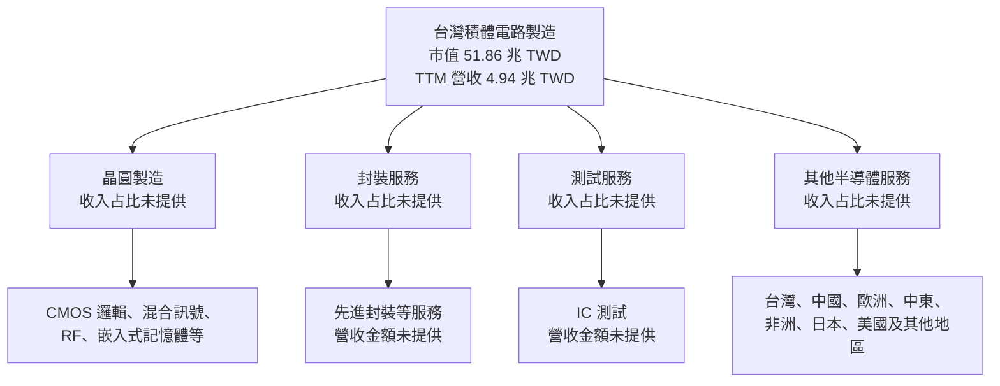
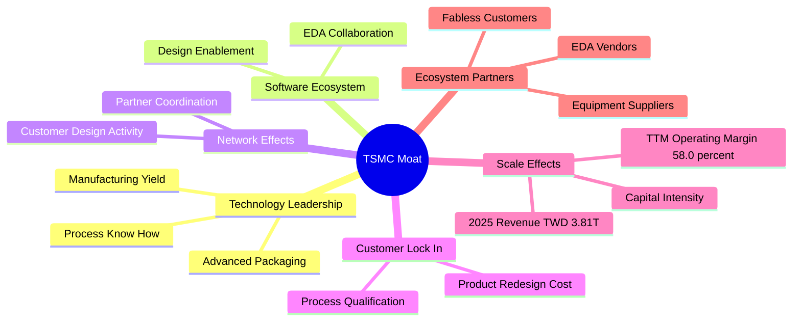
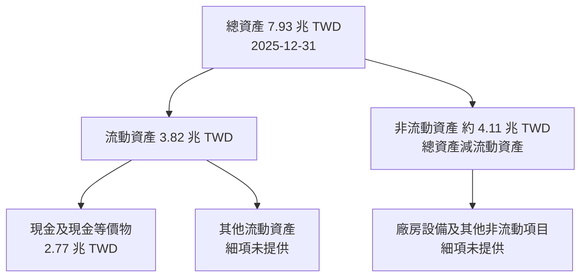
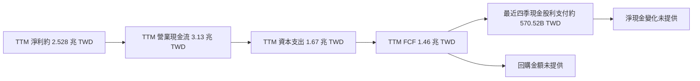
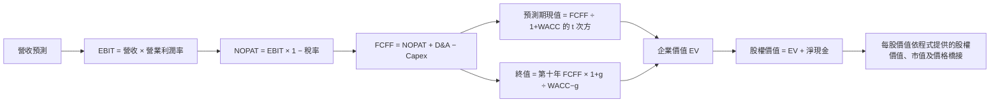
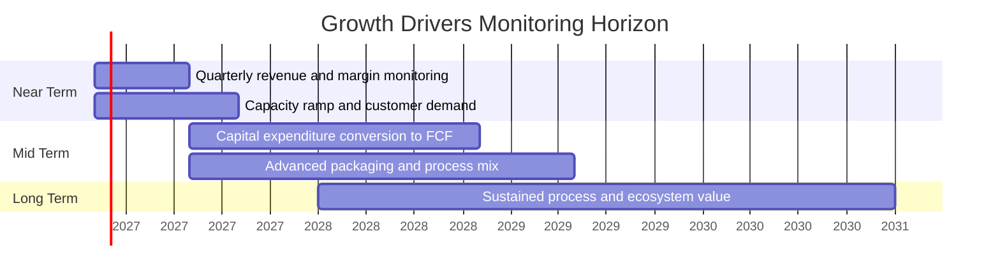
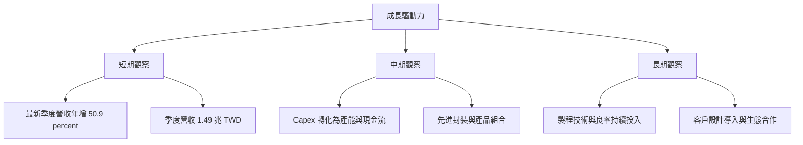
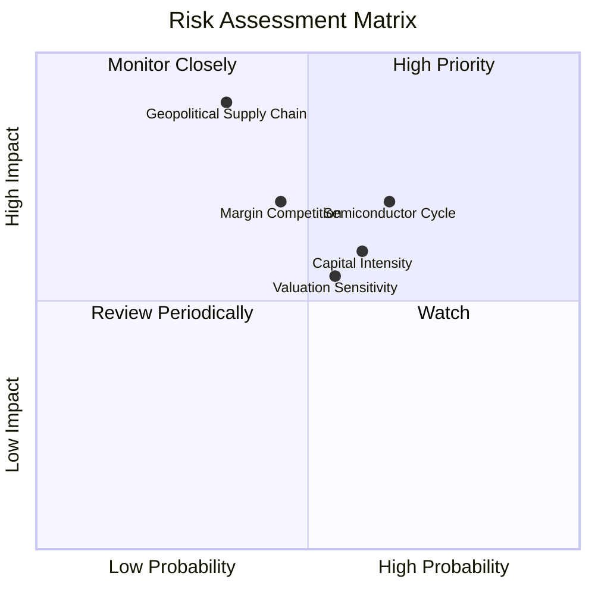
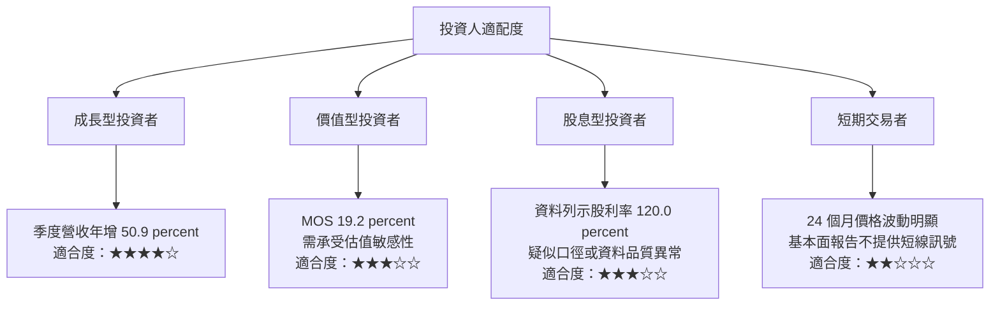

# 2330.TW 基本面深度分析報告
> **報告日期**：2026-11-21 ｜ **語言**：繁體中文 ｜ **數據來源**：Yahoo Finance、Roic.ai ｜ **分析師**：CFA 級機構研究

---

## 目錄

| # | 章節 | 核心結論 |
|---|------|----------|
| 1 | 執行摘要 | 評級買入；加權合理價值 2,475.33 TWD；MOS 19.2% |
| 2 | 公司概覽與商業模式 | 純晶圓代工模式具規模、技術與客戶合作優勢；產品別營收占比未提供 |
| 3 | 損益表深度分析 | TTM 營收 4.94 兆 TWD；最新一季營收年增 50.9%；TTM 營業利益率 58.0% |
| 4 | 資產負債表分析 | 淨現金 2.95 兆 TWD；流動比率 2.584 倍 |
| 5 | 現金流量深度分析 | TTM FCF 1.46 兆 TWD，定義為營業現金流減資本支出 |
| 6 | 獲利能力與資本效率 | WACC 10.49%；最新 TTM ROIC 未提供，不能據此精確判斷當期價值創造幅度 |
| 7 | 相對估值分析 | Forward P/E 13.37 倍；DCF、同業倍數及分析師共識交叉驗證 |
| 8 | DCF 內在價值評估 | 基準 DCF 2,924.21 TWD／股；估值對終值與長期假設敏感 |
| 9 | 成長催化劑 | 最新一季營收年增 50.9%；TAM 與產品別營收資料未提供 |
| 10 | 風險矩陣 | 主要風險為半導體週期、巨額資本支出及地緣政治供應鏈風險 |
| 11 | 投資建議 | 買入；現價低於加權合理價值，建議以財報與投資回報指標持續驗證 |

---

## 1. 執行摘要

### 1.0 一頁式投資儀表板（Portfolio Manager 30 秒速讀）

| 項目 | 內容 |
|------|------|
| **投資論點（3 句）** | ① 最新一季營收年增 **50.9%**，顯示營收動能加速，但此為單季年增而非 TTM 成長。② TTM 營業利益率 **58.0%**、毛利率 **65.8%**，顯示高獲利結構；仍需監控資本支出對自由現金流的消耗。③ TTM FCF 為 **1.46 兆 TWD**，加權合理價值 **2,475.33 TWD**，高於 2026-11-20 收盤價 **2,000.00 TWD**。 |
| **綜合評分** | **7.5/10**（引用 1.1 評分卡；六項算術平均） |
| **財務健康** | 🟢 現金及短期投資 **4.02 兆 TWD**、總債務 **1.07 兆 TWD**、淨現金 **2.95 兆 TWD**；流動比率 **2.584 倍**。 |
| **ROIC vs WACC** | 最新 TTM ROIC：**N/A**；WACC **10.49%**。ROIC.ai 提供的 2018 年 ROIC 為 **19.11%**，但不能取代當期 ROIC；當期價值創造判斷保留。 |
| **FCF 趨勢** | 2022–2025 年度 FCF 依序為 **520.97B、286.57B、861.20B、992.38B TWD**；TTM FCF 為 **1.46 兆 TWD**，FCF Yield **2.81%**。 |
| **估值** | Forward P/E **13.37 倍** ｜ EV/EBITDA **13.6 倍** ｜ FCF Yield **2.81%** |
| **DCF 內在價值（基準）** | **2,924.21 TWD** ｜ 相對 DCF 基準內在價值，現價折價 **31.6%**（折溢價定義：現價 ÷ DCF 價值 − 1） |
| **安全邊際（MOS）** | **19.2%**＝(加權合理價值 **2,475.33** − 現價 **2,000.00**) ÷ 加權合理價值 **2,475.33** ｜ 🟡 有限 |
| **預期報酬（基準情境 12M）** | 加權合理價值相對現價上行空間 **23.8%**；DCF 基準情境為 **+46.2%**。估值期間並非保證的 12 個月報酬。 |
| **關鍵風險（前二）** | 資本支出與產能利用率變化可能壓低 FCF；地緣政治或供應鏈中斷可能影響產能、客戶交付與估值。 |
| **評級 + 信心度** | 🟢 **買入** ｜ 信心：中（估值輸入可檢查，但當期 ROIC、同業部分倍數及歷史估值區間資料不足） |

### 1.1 綜合評分卡（全報告唯一）

| 維度 | 評分（1–10） | 主要依據（引用數字與其來源章節） |
|------|--------------|----------------------------------|
| 成長性 | 8.5 | 最新一季營收年增 **50.9%**，2025 年營收 **3.81 兆 TWD**，較 2024 年 **2.89 兆 TWD** 增長；TTM 成長率 N/A（第 3 章）。 |
| 獲利能力 | 9.0 | TTM 營業利益率 **58.0%**、毛利率 **65.8%**；最新 TTM ROIC 未提供，Piotroski F-Score N/A（第 3、6 章）。 |
| 財務健康 | 9.0 | 淨現金 **2.95 兆 TWD**、流動比率 **2.584 倍**；CCC **2 天**，但一年前營運資金天數未提供（第 4 章）。 |
| 估值 | 6.0 | MOS **19.2%**；Forward P/E **13.37 倍**，低於同業 Forward P/E 中位數 **13.7 倍**，但 FCF Yield 為 **2.81%**（第 7、8 章）。 |
| 護城河 | 8.5 | 2025 年營收 **3.81 兆 TWD**、TTM 毛利率 **65.8%**及營業利益率 **58.0%**，與高規模、高資本密集代工模式相符；未提供市場份額量化資料（第 2 章）。 |
| 管理層與資本配置 | 5.0 | 2025 年資本支出 **1.28 兆 TWD**、現金股利支付 **466.78B TWD**；回購資料未提供，SBC 相對營收低，但無法據此完整評估資本配置回報（第 5 章）。 |
| **綜合評分** | **7.7** | 六項算術平均：(**8.5 + 9.0 + 9.0 + 6.0 + 8.5 + 5.0**) ÷ 6 = **7.7**。 |

### 1.2 五大投資論點 + 三大核心風險

| 類型 | 項目 | 具體依據 | 信心度 |
|------|------|----------|--------|
| 🟢 **投資論點①** | 最新季度需求動能加速 | 2026-09-30 單季營收 **1.49 兆 TWD**，年增 **50.9%**；最新季度營業利益 **876.43B TWD**。 | 🟢 高 |
| 🟢 **投資論點②** | 獲利率顯示產品與產能組合有利 | TTM 毛利率 **65.8%**、營業利益率 **58.0%**、淨利率 **51.1%**。 | 🟢 高 |
| 🟢 **投資論點③** | 資產負債表有淨現金緩衝 | 現金及短期投資 **4.02 兆 TWD**，總債務 **1.07 兆 TWD**，淨現金 **2.95 兆 TWD**。 | 🟢 高 |
| 🟢 **投資論點④** | TTM 現金流規模可支應部分投資與股利 | TTM 營業現金流 **3.13 兆 TWD**，資本支出 **1.67 兆 TWD**，FCF **1.46 兆 TWD**。 | 🟢 高 |
| 🟢 **投資論點⑤** | 綜合估值高於市價 | 加權合理價值 **2,475.33 TWD**，較現價 **2,000.00 TWD** 上行空間 **23.8%**；MOS **19.2%**。 | 🟡 中 |
| 🟡 **風險①** | 高資本支出與投資回收風險 | 2025 年資本支出 **1.28 兆 TWD**；TTM 資本支出 **1.67 兆 TWD**，若新增產能爬坡或需求不及預期，FCF 可能收縮。 | 🟡 中 |
| 🔴 **風險②** | 地緣政治與供應鏈集中 | 公司營運涉及台灣及多個國際地區；資料未提供各地產能占比，無法量化事件風險，但其衝擊可同時影響產能與客戶交付。 | 🔴 高衝擊 |
| 🟡 **風險③** | 高估值對長期假設敏感 | DCF 終值現值占 EV **61.0%**；若 WACC、永續成長率或長期利潤率偏離假設，內在價值會顯著改變。 | 🟡 中 |

### 1.3 快速統計卡片

| 指標 | 公司實際值（期間） | 同業中位數 | 狀態 |
|------|--------------------|------------|------|
| 營收成長（TTM） | **N/A** | — | ⚪ 資料未提供 |
| 營收成長（最新一季年增） | **50.9%** | **20.9%**（UMC、GFS、INTC 最新一季年增率中位數） | 🟢 |
| 毛利率（TTM） | **65.8%** | **31.7%**（UMC、GFS、INTC 中位數） | 🟢 |
| 營業利益率（TTM） | **58.0%** | — | 🟢 |
| ROIC（TTM） | **N/A** | — | ⚪ |
| Forward P/E | **13.37 倍** | **13.7 倍** | 🟢 |
| FCF Yield（TTM） | **2.81%** | — | 🟡 |
| Piotroski F-Score | **N/A** | — | ⚪ |

> 同業毛利率中位數使用 UMC **31.7%**、GFS **28.5%**、INTC **40.2%**；計算中位數為 **31.7%**。同業資料來自 Yahoo Finance。

### 1.4 投資結論

```text
╔══════════════════════════════════════════════════════════════════╗
║                    📊 投資結論摘要                               ║
╠══════════════════════════════════════════════════════════════════╣
║  評級：買入（MOS 19.2%，依規則 20；ROIC 最新值未提供）          ║
║  價格（2026-11-20 收盤）：2,000.00 TWD                           ║
║  DCF 內在價值（基準）：2,924.21 TWD（折價 31.6%）               ║
║  安全邊際 MOS：19.2%（以加權合理價值為分母）                    ║
║  加權合理價值（8.8）：2,475.33 TWD                               ║
║  DCF 情境價值：                                                  ║
║    悲觀情境：1,240.55 TWD（-38.0%）                              ║
║    基準情境：2,924.21 TWD（+46.2%）                              ║
║    樂觀情境：6,526.44 TWD（+226.3%）                             ║
║  綜合評分：7.7/10（引用 1.1）                                    ║
║  適合投資人：能承受半導體週期及地緣政治波動的長期投資人          ║
╚══════════════════════════════════════════════════════════════════╝
```

---

## 2. 公司概覽與商業模式

### 2.1 業務結構與收入來源

公司提供晶圓製造、封裝、測試及相關半導體服務。財務資料未提供各業務、製程或終端應用的營收分拆，因此不以估計比例繪製業務占比圖。公司 TTM 營收為 **4.94 兆 TWD**，2025 年全年營收為 **3.81 兆 TWD**。



### 2.2 市場份額

市場份額數據未提供，因此不填入市占率或繪製市場份額圓餅圖。公司 2025 年營收為 **3.81 兆 TWD**，最新一季營收年增 **50.9%**；與同業相比，公司的最新一季營收增幅高於 UMC **25.6%**、GFS **12.5%**及 INTC **20.9%**。但營收成長率不能直接替代市場份額，亦不能單獨證明份額提升。

### 2.3 競爭護城河分析



> 上圖的技術、客戶與供應鏈關係屬質化分析；財務資料未提供可量化的設計導入數、客戶留存率或供應商集中度。

### 2.4 護城河強度

| 護城河項目 | 強度（強／中／弱） | 證據（引用數字或事實） | 會削弱它的情況 |
|------------|--------------------|------------------------|----------------|
| 技術與製造執行 | 強 | TTM 毛利率 **65.8%**、營業利益率 **58.0%**，提供高獲利能力的間接證據；具體製程良率資料未提供。 | 同業製程追趕、良率落差縮小、關鍵製程供應或設備受限。 |
| 客戶鎖定與設計導入 | 中至強 | 晶片設計須配合製程與封裝流程，轉換可能涉及重新設計及驗證；客戶留存率與轉換成本未提供。 | 客戶為供應鏈韌性採多來源策略，或替代供應商在性能、成本達到要求。 |
| 規模效應 | 強 | 2025 年營收 **3.81 兆 TWD**，TTM FCF **1.46 兆 TWD**；規模可支撐高額資本與研發投入。 | 高資本支出未能轉成利用率、良率與現金回報。 |
| 生態系合作 | 中至強 | 公司業務連結晶片設計、設備、材料及 EDA 供應鏈；量化合作規模未提供。 | 關鍵供應商受限，或客戶及合作夥伴轉向替代平台。 |
| 軟體生態與網路效應 | 中 | 產品設計流程與製程、封裝、驗證服務互相配合；獨立軟體收入及網路效應指標未提供。 | 生態協作無法轉化為更高設計導入或客戶黏著。 |
| **分數理由（引用 1.1）** | — | 1.1 護城河分數 **8.5/10**：大型營收基礎與高 TTM 利潤率提供支持，但市場份額、良率及客戶黏著度未能以本資料量化。 | — |

---

## 3. 損益表深度分析

### 3.1 年度收入成長趨勢（近 4 年）

年度營收原值來自 Yahoo Finance 年度損益表。同比增幅為依年度營收計算；2022 年同比需要 2021 年數據，此處不列。

```text
╔══════════════════════════════════════════════════════════════════╗
║          台積電年度收入趨勢（FY2022-FY2025，TWD）               ║
╠══════════════════════════════════════════════════════════════════╣
║  FY2022  2.26 兆  ███████████████░░░░░  YoY：N/A                ║
║  FY2023  2.16 兆  ██████████████░░░░░░  YoY：-4.4%              ║
║  FY2024  2.89 兆  ███████████████████░  YoY：+33.8%             ║
║  FY2025  3.81 兆  ████████████████████  YoY：+31.8%             ║
╠══════════════════════════════════════════════════════════════════╣
║  FY2022-FY2025 營收 CAGR：約 19.0%                               ║
╚══════════════════════════════════════════════════════════════════╝
```

計算：(**3.81 ÷ 2.26**)^(1/3) − 1 約 **19.0%**。2023 年營收回落後，2024、2025 年恢復增長；年度資料本身不能完全分辨需求、價格、製程組合各自的貢獻。

### 3.2 季度收入趨勢分析

季度營收取 ROIC.ai 季度歷史資料，2025Q4 至 2026Q3 與季度損益表所列數字一致至四捨五入精度。QoQ、YoY 為依原始季度營收計算；最新一季年增亦有財務資料直接提供的 **50.9%**。

| 季度 | 營收（B TWD） | QoQ | YoY | 備註 |
|------|---------------:|----:|----:|------|
| 2025Q4 | 1,046.090 | 約 +5.7% | 約 +20.5% | QoQ 以 2025Q3 **989.918B** 為比較基期。 |
| 2026Q1 | 1,134.103 | 約 +8.4% | 約 +35.1% | 高於 2025Q1 **839.254B**。 |
| 2026Q2 | 1,270.380 | 約 +12.0% | 約 +36.1% | 高於 2025Q2 **933.792B**。 |
| 2026Q3 | 1,494.243 | 約 +17.6% | **50.9%** | 財務資料直接列示的最新一季年增率為 **50.9%**；與季度序列按顯示數值計算的結果可能有四捨五入差異。 |

連續 QoQ 增長反映季度營收擴大；是否可延續，仍須觀察新產能爬坡、產品組合與客戶需求，不能將最新一季增幅直接外推為 TTM 成長。

### 3.3 利潤率演變分析

年度利潤率由年度損益表的毛利、營業利益及淨利除以營收計算；TTM 數據直接引用最新 TTM 財務數據。

| 利潤率指標 | FY2022 | FY2023 | FY2024 | FY2025 | TTM／趨勢 | 評估 |
|------------|-------:|-------:|-------:|-------:|------------|------|
| **毛利率** | 約 59.7% | 約 54.6% | 約 56.1% | 約 59.8% | **65.8%** | 🟢 TTM 高於年度歷史值；TTM 產品組合與營運狀況有利，但拆分原因資料不足。 |
| **營業利益率** | 約 49.6% | 約 42.7% | 約 45.7% | 約 50.9% | **58.0%** | 🟢 TTM 較 FY2025 提升；高營收增長與營運槓桿可能有貢獻，資料未提供成本明細以分辨各項因素。 |
| **淨利率** | 約 43.9% | 約 39.4% | 約 40.1% | 約 44.6% | **51.1%** | 🟢 TTM 提升；仍需留意匯兌、稅項及非營業項目的影響，分項資料未提供。 |

利潤率上升與同期營收擴張並行，可能反映高附加價值產品組合及固定成本吸收改善；但缺少各節點製程、產品別毛利、產能利用率及匯率貢獻數據，不能把提升全數歸因於單一因素。

### 3.4 費用結構分析

資料未提供完整費用明細及各項營運費用比率，不能建立可靠的費用結構圓餅圖。可直接觀察到的年度研發費用為：2022 年 **163.26B**、2023 年 **182.37B**、2024 年 **204.18B**、2025 年 **246.43B TWD**。以 2025 年研發費用除以營收 **3.81 兆 TWD**，約為 **6.5%**；此比率為依揭露數值計算。

```text
╔══════════════════════════════════════════════════════════════════╗
║                 2025 年研發支出觀察                              ║
╠══════════════════════════════════════════════════════════════════╣
║  研發費用：246.43B TWD                                           ║
║  研發費用 ÷ 年營收：246.43 ÷ 3,810 ≈ 6.5%                       ║
║  其餘費用類別及完整占比：資料未提供，不繪製比例圖                ║
╚══════════════════════════════════════════════════════════════════╝
```

### 3.5 季度 EPS 趨勢與盈餘品質（Quality of Earnings）

EPS Est／EPS Act 的最近四季欄位均為 NaN，因此不能判斷四季盈餘是否超預期或不及預期。替代觀察是季度淨利：2025Q4 **485.47B**、2026Q1 **572.48B**、2026Q2 **706.56B**、2026Q3 **763.06B TWD**。資料未提供這四季可比較的一致市場預期值，不能將淨利變化說成「超預期」。

| 盈餘品質項目 | 數值／佔比 | 評估 |
|--------------|------------|------|
| 股權薪酬 SBC／營收 | 四季 SBC 合計約 **0.513B TWD**；除以 TTM 營收 **4,944.82B**，約 **0.010%** | 🟢 占比很低，對股東的直接稀釋影響目前有限；若授予股數與流通股數明細不足，不能只靠費用額估計未來稀釋。 |
| SBC／營業現金流 | 約 **0.016%**（0.513 ÷ 3,130） | 🟢 相對營業現金流很低。 |
| FCF／淨利（現金轉換率） | 約 **57.8%**（TTM FCF **1.46T** ÷ 四季淨利加總約 **2.528T**） | 🟡 仍為正值，但高資本支出使 FCF 低於會計淨利；判讀應與產能投資週期一併考慮。 |
| 一次性／非經常性損益 | N/A（未提供明細） | ⚪ 無法判斷一次性項目是否推高或壓低淨利。 |
| 有效稅率異常 | **17.0%**（Cost of capital 資料列示的最新年度有效稅率） | 🟡 未提供多年度稅率對照，不能判定是否異常。 |
| 資本化支出 vs 費用化 | TTM 資本支出 **1.67T TWD**；資本化政策細節未提供 | 🟡 資本支出在現金流中已反映；沒有資本化會計政策資訊，不對盈餘遞延作結論。 |

**盈餘品質結論**：SBC 相對營收和營業現金流很低，代表可見的股權薪酬成本有限；另一方面，TTM FCF 約為 TTM 淨利的 **57.8%**，顯示高資本投資使現金轉換低於淨利。未提供一次性損益及資本化政策明細，故不能斷言 GAAP 淨利被高估或低估。

---

## 4. 資產負債表分析

### 4.1 資產結構分解

2025-12-31 總資產 **7.93 兆 TWD**、流動資產 **3.82 兆 TWD**；非流動資產金額以總資產減流動資產計算約 **4.11 兆 TWD**。非流動資產細項未提供。



### 4.2 流動性與營運資金分析

| 指標 | 最新值 | 評估 |
|------|-------:|------|
| 現金及短期投資 | **4.02 兆 TWD** | 🟢 大於總債務。 |
| 總債務 | **1.07 兆 TWD** | 🟢 相對現金規模可控。 |
| 淨現金 | **2.95 兆 TWD** | 🟢 淨現金緩衝充足。 |
| 流動比率 | **2.584 倍** | 🟢 流動資產高於流動負債。 |
| 速動比率 | **2.287 倍** | 🟢 即使扣除部分存貨仍具短期流動性。 |

**營運資金天數**（照抄 QUALITY FIGURES；一年前數據未提供）：

| 指標 | 最新 TTM | 一年前 TTM | 變化 | 解讀 |
|------|----------:|-----------:|------|------|
| DSO 應收帳款天數 | **1 天** | **N/A** | N/A | 依品質指標計算；單日數值極低，可能受期末應收帳款餘額影響，應以公司正式季報口徑核驗。 |
| DIO 存貨天數 | **92 天** | **N/A** | N/A | 一年前比較值未提供，無法判斷存貨周轉改善或惡化。 |
| DPO 應付帳款天數 | **91 天** | **N/A** | N/A | 一年前比較值未提供，無法評估付款條件變化。 |
| CCC 現金轉換週期 | **2 天** | **N/A** | N/A | 數值依品質指標列示；以展示值直接相加為 1 + 92 − 91 = 2 天。 |

### 4.3 債務結構分析

```text
╔══════════════════════════════════════════════════════════════════╗
║                   台積電債務健康診斷                             ║
╠══════════════════════════════════════════════════════════════════╣
║  總債務：        1.07 兆 TWD     █████░░░░░░░░░░░░░░  🟡         ║
║  現金+短期投資： 4.02 兆 TWD     ████████████████████ 🟢         ║
║  淨現金：        2.95 兆 TWD     ███████████████░░░░░ 🟢         ║
║                                                                  ║
║  Debt/EBITDA：N/A（缺少一致口徑的 TTM EBITDA 金額）              ║
║  Interest Coverage：N/A（缺少利息費用與利息保障倍數資料）        ║
║  Debt/Equity：15.188（來源列示；口徑可能為百分比表示）            ║
╚══════════════════════════════════════════════════════════════════╝
```

現金與短期投資高於債務，構成淨現金 **2.95 兆 TWD**。年度資產負債表列示 2025 年現金 **2.77 兆 TWD**，與最新 TTM 資料列示的現金及短期投資 **4.02 兆 TWD**期間及項目範圍不同，兩者不混用。

### 4.4 股東權益趨勢

| 年度 | 股東權益（TWD） | YoY 變化 |
|------|----------------:|---------:|
| 2022 | 2.90 兆 | — |
| 2023 | 3.43 兆 | 約 +18.3% |
| 2024 | 4.24 兆 | 約 +23.6% |
| 2025 | 5.36 兆 | 約 +26.4% |

```text
╔══════════════════════════════════════════════════════════════════╗
║                  股東權益趨勢（TWD）                             ║
╠══════════════════════════════════════════════════════════════════╣
║  2022  2.90 兆  ███████████░░░░░░░░░                              ║
║  2023  3.43 兆  █████████████░░░░░░░                              ║
║  2024  4.24 兆  ████████████████░░░░                              ║
║  2025  5.36 兆  ████████████████████                              ║
╚══════════════════════════════════════════════════════════════════╝
```

---

## 5. 現金流量深度分析

### 5.1 現金流量瀑布圖

以下 TTM FCF 使用指定定義：**營業現金流 − 資本支出**。股息支付為最近四季各季金額加總；回購與淨現金變化未提供。



### 5.2 FCF 轉換率趨勢

| 年度 | FCF（TWD） | 淨利（TWD） | FCF／淨利 |
|------|-----------:|------------:|----------:|
| 2022 | 520.97B | 992.92B | 約 52.5% |
| 2023 | 286.57B | 851.74B | 約 33.6% |
| 2024 | 861.20B | 1.16T | 約 74.2% |
| 2025 | 992.38B | 1.70T | 約 58.4% |
| TTM | 1.46T | 約 2.528T | 約 57.8% |

2023 年現金轉換率較低，之後年度 FCF 回升，與資本支出和營業現金流變動有關；僅憑年度總額無法區分營運資金、付款時點或具體投資項目影響。

### 5.3 自由現金流趨勢

```text
╔══════════════════════════════════════════════════════════════════╗
║                自由現金流趨勢（年度 TWD）                        ║
╠══════════════════════════════════════════════════════════════════╣
║  2022  520.97B  ███████████░░░░░░░░░                              ║
║  2023  286.57B  ██████░░░░░░░░░░░░░░                              ║
║  2024  861.20B  █████████████████░░░                              ║
║  2025  992.38B  ████████████████████                              ║
║  TTM     1.46T  ██████████████████████████████                    ║
╠══════════════════════════════════════════════════════════════════╣
║  TTM FCF Yield：2.81%（直接引用）                                 ║
║  2022-2025 FCF CAGR：約 24.0%（依年度 FCF 計算）                  ║
╚══════════════════════════════════════════════════════════════════╝
```

### 5.4 資本配置評估

財務資料提供資本支出與股利支付，未提供回購金額、收購金額及可分配留存現金的完整分類，故不繪製含估計比例的資本配置圓餅圖。

| 項目 | 金額與期間 | 評估 |
|------|------------|------|
| 資本支出 | 2025 年 **1.28 兆 TWD**；TTM **1.67 兆 TWD** | 高再投資支出符合晶圓代工資本密集特性；關鍵在新增產能能否轉化為利用率與現金回報。 |
| 現金股利支付 | 2025 年 **466.78B TWD** | 相對年度 FCF **992.38B TWD**約為 47.0%；這是以現金流表數據計算，並非股利率或派息率的替代定義。 |
| 回購 | N/A | 回購金額未提供。 |
| SBC | 2025 年 **1.25B TWD** | 相較 2025 年營收 **3.81 兆 TWD**占比很低。 |
| 留存現金／併購 | N/A | 未提供完整資金運用明細。 |

---

## 6. 獲利能力與資本效率

### 6.1 ROE／ROA／ROIC 趨勢

| 指標 | 最新資料 | 可比較歷史資料 | 評估 |
|------|---------:|---------------|------|
| ROE | **41.9% TTM** | 多年度 ROE 序列未提供 | 🟢 獲利相對股東權益高；需注意這不是 ROIC。 |
| ROA | **20.6% TTM** | 多年度 ROA 序列未提供 | 🟢 資產盈利能力良好。 |
| ROIC | **N/A（TTM）** | ROIC.ai 列示 2018 年 **19.11%** | ⚪ 2018 年數據不是當期 ROIC，不能直接作為最新 ROIC 對比。 |
| 行業均值 | N/A | 無可引用來源 | 不列行業均值欄作為比較結論。 |

### 6.2 ROIC vs WACC 分析（核心價值創造判斷）

**Cost of capital** 資料直接列示 WACC **10.49%**，本節與第 8.2 節使用同一數值。因最新 TTM ROIC 未提供，無法按同期間精確計算 ROIC−WACC 的 EVA；2018 年歷史 ROIC **19.11%**只作歷史參照，不推定為現在水準。

```text
╔══════════════════════════════════════════════════════════════════╗
║                ROIC vs WACC 深度分析                            ║
╠══════════════════════════════════════════════════════════════════╣
║  WACC（Cost of capital 資料列示）：10.49%                       ║
║  無風險利率 Rf（10Y Treasury）：4.91%                           ║
║  ERP（假設值）：5.00%                                            ║
║  Yahoo 原始 Beta：1.23；調整後 Beta：1.16                       ║
║  股權成本（來源列示）：10.69%                                    ║
║  稅前債務成本（來源列示）：1.16%                                ║
║  股權／債務權重：98.0%／2.0%                                     ║
║  WACC：10.49%                                                    ║
║                                                                  ║
║  最新 TTM ROIC：N/A                                              ║
║  ROIC.ai 2018 年歷史 ROIC：19.11%（非當期數據）                 ║
║  當期 EVA = N/A：欠缺最新 TTM ROIC，不能得出精確價差             ║
╚══════════════════════════════════════════════════════════════════╝
```

ROIC.ai 列示的 2018 年 ROIC **19.11%**高於本報告採用的 WACC **10.49%**，但期間不一致；當期是否持續創造高於資本成本的報酬，必須等待最新投入資本及稅後營業利益資料。不得用 ROE **41.9%**替代 ROIC。

### 6.3 杜邦三因素分解

| 因素 | 數值（TTM） | 解讀 |
|------|-------------|------|
| 淨利率 | N/A | QUALITY FIGURES 列示 DuPont N/A；不可補算。 |
| 資產週轉率 | N/A | 欠缺品質指標計算所需資料。 |
| 權益乘數 | N/A | 欠缺品質指標計算所需資料。 |
| **ROE** | **N/A（杜邦分解口徑）** | QUALITY FIGURES 的 DuPont 為 N/A；另列的 ROE **41.9% TTM**不代表可將三因素分解完整反推。 |

### 6.4 財務體質：Piotroski F-Score

| 測試 | 結果 | 解讀 |
|------|------|------|
| F-Score | **N/A** | 需以 SEC 申報資料取得相隔一年的兩個 TTM 期間；目前來源為 Yahoo quarterly statements，無足夠資料計算。 |
| 九項測試 | **N/A** | 九項結果均未提供，不能推定通過或未通過。 |

---

## 7. 相對估值分析

### 7.1 同業估值比較表格

同業倍數採 Yahoo Finance Peer multiples；本公司倍數採財務資料列示數值。不同市場、資本結構、獲利狀態及會計口徑都會限制直接比較。

| 估值指標 | **2330.TW** | **UMC** | **GFS** | **INTC** | 本公司評估 |
|----------|----------:|--------:|-------:|--------:|-----------|
| **Trailing P/E** | **20.52 倍** | 11.4 倍 | 101.6 倍 | N/A | 🟡 GFS 倍數受盈利基礎影響；INTC 無資料。 |
| **Forward P/E** | **13.37 倍** | 13.4 倍 | 13.7 倍 | 28.6 倍 | 🟢 略低於三家同業中位數 **13.7 倍**。 |
| **P/S TTM** | **10.49 倍** | N/A | 2.8 倍 | 4.6 倍 | 🔴 本公司高於可用同業；UMC 因混合幣別不可比。 |
| **EV/EBITDA TTM** | **13.6 倍** | N/A | 9.5 倍 | 14.9 倍 | 🟡 高於同業可用中位數 **12.2 倍**；UMC 因混合幣別不可比。 |
| **最新一季營收年增** | **50.9%** | 25.6% | 12.5% | 20.9% | 🟢 公司增幅高於所列同業；單季增長不等於 TTM 增長。 |
| **毛利率 TTM** | **65.8%** | 31.7% | 28.5% | 40.2% | 🟢 明顯高於所列同業；公司產品與資產結構不同，仍需考量可比性。 |

### 7.2 歷史估值區間分析

歷史 P/E 區間、歷史百分位及當前估值相對公司自身歷史的位置未提供，因此不推估百分位或畫估值區間圖。

**N/A（數據未提供：缺少 Valuation vs own history 的歷史估值統計）。**

### 7.3 情境價值（Bear／Base／Bull）

下列數值直接引用 DCF MODEL 的 Scenarios；營收成長、期末營業利潤率、WACC、價值、相對現價變化及機率均不另行更改。

| 情境 | 第 1 年營收成長 | 期末營業利潤率 | WACC | 每股價值 | 相對現價 | 機率 | 會發生的條件 |
|------|----------------:|----------------:|-----:|---------:|---------:|------:|--------------|
| 🔴 悲觀 | 15.0% | 42.1% | 11.49% | **1,240.55 TWD** | **-38.0%** | 25% | 需求放緩、產能利用率下降或競爭加劇，使成長與利潤率均低於基準。 |
| 🟡 基準 | 30.0% | 49.5% | 10.49% | **2,924.21 TWD** | **+46.2%** | 50% | 延續模型所列成長及利潤率收斂路徑，並維持基準折現率。 |
| 🟢 樂觀 | 45.0% | 54.5% | 9.49% | **6,526.44 TWD** | **+226.3%** | 25% | 高成長持續，長期利潤率高於基準，且資本成本下降。 |

### 7.4 相對估值隱含價格區間

```text
╔══════════════════════════════════════════════════════════════════╗
║        相對估值與其他估值方法隱含每股價值（TWD）                 ║
╠══════════════════════════════════════════════════════════════════╣
║  1,815.14         2,000.00        2,046.45         2,924.21      ║
║  EV/EBITDA  ───── 現價 ───────── Forward P/E ───── DCF 基準      ║
║  同業中位數倍數    2026-11-20      同業中位數倍數    DCF 模型      ║
╚══════════════════════════════════════════════════════════════════╝
```

- **同業 Forward P/E：2,046.45 TWD**。依據為 UMC、GFS、INTC Forward P/E 中位數 **13.7 倍**乘以公司 Forward EPS **149.60 TWD**；價格直接引用 VALUATION METHODS。
- **同業 EV/EBITDA：1,815.14 TWD**。依據為 GFS、INTC 可用 EV/EBITDA 中位數 **12.2 倍**乘以公司 TTM EBITDA，再加回淨現金；具體中間計算未在資料中列示，故不自行重建。
- DCF 基準價值與分析師共識目標價不是相對估值法，但一併列於第 8.8 節交叉驗證。

---

## 8. DCF 內在價值評估（Discounted Cash Flow）

### 8.0 估值推理鏈（Thinking Logic）

#### Step 1 — 價值由哪些變數決定？

本 DCF 將價值拆為十年預測期營運現金流與其後終值；公司整體業務的 TTM 營收為 **4.94 兆 TWD**，但缺少產品別營收分拆，因此無法把特定成長曲線歸因到某一業務。模型顯示終值現值占 EV **61.0%**，故最主導估值的變數是長期現金流、WACC 與永續成長率，而不是單一年度成長。

#### Step 2 — 模型選擇

| 決策點 | 本報告採用 | 理由（含數字） | 曾考慮但否決 | 否決理由 |
|--------|-----------|----------------|--------------|----------|
| 現金流定義 | FCFF | 以 GAAP EBIT 推導 NOPAT，按 WACC 折現；模型終值及 EV 皆由 FCFF 建立。 | FCFE | 預測與估值模型已採 FCFF，改用 FCFE 會與 WACC／EV 框架不一致。 |
| 預測期 N | **10 年** | DCF MODEL 固定列示 10 年，並將成長率由 30.0% 線性降至 3.0%。 | 5 年 | 會改變程式模型期間與估值，故不替換。 |
| 終值方法 | Gordon Growth | DCF MODEL 直接提供終值 **120,649.27B TWD**及終值現值。 | 退出倍數終值 | 程式模型未提供終值退出倍數結果；不另建模型。 |
| EBIT 基礎 | GAAP EBIT | 模型明確採 GAAP EBIT；TTM 營業利益率 **58.0%**。 | 非 GAAP EBIT | 會造成 SBC 處理與既有模型不相容。 |

#### Step 3 — 關鍵假設推導鏈

下列模型假設及數字依 DCF MODEL 原值引用；財務資料未提供部分只說明其為模型假設，不冒稱為已實現事實。

- **營收成長路徑**：錨點＝最新一季營收年增 **50.9%**，但 TTM 營收成長率為 N/A → 調整＝最新一季數字可能高於可持續速度，模型將其封頂於 **30.0%**，並線性遞減 → **採用 FY+1 30.0%、FY+10 3.0%** → 曾考慮直接以最新季 **50.9%**作第一年成長，因單季年增不可視為長期年增而不採用。
- **期末營業利潤率**：錨點＝TTM 營業利益率 **58.0%** → 調整＝模型把利潤率逐年淡化至最近五個財政年度中位數（含 TTM） → **採用 FY+10 49.5%** → 曾考慮永久維持 **58.0%**，因這會忽略成熟化與利潤率回歸風險。
- **永續成長率 g**：錨點＝模型採 **3.0%**，低於 WACC **10.49%** → 調整理由＝終值需反映長期名目成長且避免永續成長超過折現率 → **採用 3.0%** → 不採用高於 3.0%的主模型值；敏感度另列 2.0%–4.0%。
- **預測期 N**：錨點＝模型列示 **10 年**逐年現金流 → 調整＝不更改程式設定 → **採用 10 年** → 不以較短週期取代，以免與已驗證模型不一致。
- **Capex／營收**：錨點＝TTM 資本支出 **1.67 兆**、TTM 營收 **4.94 兆 TWD**；模型直接列示 FY+1 **33.8%**、FY+10 **16.6%** → 調整＝模型按假設逐步下降 → **採用 33.8% 至 16.6%** → 不採用永久維持 FY+1 高資本強度，亦不改用自估比例。
- **有效稅率**：錨點＝最新年度有效稅率 **17.0%** → **採用 17.0%**；稅率歷史波動資料未完整提供，不另行調整。
- **D&A／營收**：錨點＝模型列示 TTM **15.1%** → **採用 15.1% 並維持不變**；財務資料未提供可比較的完整 TTM D&A 明細以重建比例。
- **EBIT 基礎與 SBC**：錨點＝模型明列 **GAAP EBIT**；年度 SBC 2025 年 **1.25B TWD**，TTM 四季估計加總約 **0.513B TWD** → 採組合 **(A)**：GAAP EBIT 已費用化 SBC，FCFF 不再扣 SBC，股數不再額外稀釋 → 不採加回 SBC 或另扣第二次，以免重複計入。
- **年稀釋率**：模型採 GAAP EBIT + 固定股數組合，因此年稀釋率為 **0%**（模型口徑）→ 不另加逐年稀釋假設。
- **WACC**：依據 Cost of capital 資料列示 **10.49%**，組成於 8.2 說明 → 採用程式值，不自行改算其他 WACC。
- **終值方法**：模型採 Gordon Growth，永續成長率 **3.0%**及 WACC **10.49%**，滿足 WACC > g → 不另以退出倍數取代模型值。

#### Step 4 — 最脆弱假設

最脆弱的一環是長期成長、利潤率與終值假設：終值占 EV **61.0%**，因此長期成長低於模型、WACC 上升或利潤率收斂更快，都會把估值往下拉；具體幅度參見 8.6 敏感度矩陣及 8.9 局限。

#### Step 5 — 計算路徑圖



### 8.1 模型假設總表（Model Inputs）

| 假設項目 | 採用值 | 依據／來源 | 敏感度 |
|----------|--------|-------------|--------|
| 預測期長度 N | **10 年** | DCF MODEL 預測 FY+1 至 FY+10。 | 🟡 中 |
| 營收成長 | **FY+1 30.0% 線性降至 FY+10 3.0%** | FY+1 以最新一季年增 **50.9%**作錨，並在模型 0%–30%範圍內封頂；TTM 成長率 N/A。 | 🔴 高 |
| 營業利益率 | **FY+1 58.0% → FY+10 49.5%** | TTM 營業利益率 **58.0%**，終值趨向近五年中位數。 | 🔴 高 |
| 有效稅率 | **17.0%** | 最新年度有效稅率。 | 🟢 低 |
| Capex／營收 | **FY+1 33.8% → FY+10 16.6%** | 模型以 TTM Capex／營收錨定，並淡化至約 1.1 倍 D&A。 | 🔴 高 |
| D&A／營收 | **15.1%** | DCF MODEL 列示 TTM 比率並固定。 | 🟢 低 |
| 營運資金變動 | **未建模** | DCF MODEL 明確註明 Working capital is not modelled；不補造 ΔWC。 | 🟡 中 |
| EBIT 基礎 | **GAAP EBIT** | DCF MODEL 明列 GAAP EBIT。 | 🟡 中 |
| 股權薪酬 SBC 處理 | **不在 FCFF 再扣；費用已包含於 GAAP EBIT** | 模型明列 SBC 已是費用，採組合 (A)。 | 🟡 中 |
| 年稀釋率 | **0%（模型股數固定口徑）** | 組合 (A)：不另放大股數。 | 🟡 中 |
| 永續成長率 g | **3.0%** | DCF MODEL 列示；低於 WACC **10.49%**。 | 🔴 高 |
| 終值方法 | **Gordon Growth** | DCF MODEL 已計算終值及終值現值；不另建退出倍數終值。 | 🔴 高 |
| WACC | **10.49%** | 直接引用 Cost of capital 資料。 | 🔴 高 |

**FCFF 定義**：模型採 FCFF = NOPAT + D&A − Capex。營運資金未建模，因此不加入 ΔWC 列。模型採 **(A) GAAP EBIT + 固定股數**，故 SBC 影響已計入一次，不在 FCFF 再扣，也不額外放大股數。

### 8.2 折現率推導（WACC）

```text
╔══════════════════════════════════════════════════════════════════╗
║                    WACC 推導（折現率）                           ║
╠══════════════════════════════════════════════════════════════════╣
║  股權成本 Ke（CAPM，依 Cost of capital 列示）：                  ║
║  ├── 無風險利率 Rf（10Y Treasury）：4.91%                        ║
║  ├── ERP（假設值）：5.00%                                         ║
║  ├── 原始 Beta（Yahoo）：1.23                                     ║
║  ├── 調整後 Beta：1.16 = ⅔ × 1.23 + ⅓（資料列示）                ║
║  ├── 規模／國別溢酬：資料未提供；不另加                           ║
║  └── Ke（資料列示）：10.69%                                      ║
║                                                                  ║
║  債務成本：                                                       ║
║  ├── 稅前 Kd（利息 ÷ 債務）：1.16%（資料列示）                   ║
║  ├── 有效稅率：17.0%                                             ║
║  └── 稅後 Kd（以列示值計）：1.16% × (1−17.0%) = 0.9628%         ║
║                                                                  ║
║  資本結構權重（資料列示）：股權 98.0%／債務 2.0%                ║
║  WACC（資料列示）：10.49%                                        ║
╚══════════════════════════════════════════════════════════════════╝
```

**五步演算與精度限制**：

1. **Ke（CAPM）**：輸入資料列示 `4.91% + 1.16 × 5.00% = 10.69%`。依展示到兩位小數的輸入直接計算為 **10.71%**，與資料列示 **10.69%**相差 **0.02 個百分點**；採用值依規則引用 **10.69%**，不自行替換。
2. **稅前 Kd**：資料直接列示 **1.16%**。利息費用與一致口徑的平均計息負債金額未提供，不能補造其除法算式。
3. **稅後 Kd**：`1.16% × (1 − 17.0%) = 0.9628%`。
4. **權重**：資料直接列示股權 **98.0%**、債務 **2.0%**，相加為 **100.0%**。市值與債務採用同一期、同範圍的逐項推導資料未提供，故不反推債務金額。
5. **WACC**：以所列示的已四捨五入輸入重算，`98.0% × 10.69% + 2.0% × 0.9628% = 10.495456%`，四捨五入為 **10.50%**；Cost of capital 資料列示 **10.49%**。本報告 DCF 與 ROIC 比較仍依要求採用原值 **10.49%**，並將細部輸入的四捨五入差異視為模型稽核限制，而非另改 WACC。

無風險利率資料未提供明確觀測日期；ERP 為假設值，資料未附推導來源。Beta 的 Yahoo 原始值為 **1.23**，調整後 Beta **1.16**依資料列示採用。模型沒有額外規模／國別溢酬。債務成本的平均計息債務分母未提供，因此不能自行以總負債替代。

### 8.3 逐年自由現金流預測（基準情境）

下表逐年照錄 DCF MODEL，金額單位為 **B TWD**；折現因子保留三位小數。模型未列 ΔWC，故不將營運資金變化反推進 FCF。

| 年度 | FY+1 | FY+2 | FY+3 | FY+4 | FY+5 | FY+6 | FY+7 | FY+8 | FY+9 | FY+10 |
|------|-----:|-----:|-----:|-----:|-----:|-----:|-----:|-----:|-----:|------:|
| 營收 | 6,428.26 | 8,163.89 | 10,123.23 | 12,249.11 | 14,453.94 | 16,622.04 | 18,616.68 | 20,292.18 | 21,509.71 | 22,155.00 |
| 營收 YoY | 30.0% | 27.0% | 24.0% | 21.0% | 18.0% | 15.0% | 12.0% | 9.0% | 6.0% | 3.0% |
| 營業利潤率 | 58.0% | 57.0% | 56.1% | 55.2% | 54.2% | 53.3% | 52.3% | 51.4% | 50.5% | 49.5% |
| EBIT | 3,726.88 | 4,656.49 | 5,679.00 | 6,756.58 | 7,837.06 | 8,856.56 | 9,744.56 | 10,431.05 | 10,854.96 | 10,972.60 |
| − 稅 | (632.56) | (790.34) | (963.90) | (1,146.79) | (1,330.18) | (1,503.22) | (1,653.94) | (1,770.46) | (1,842.41) | (1,862.38) |
| NOPAT | 3,094.32 | 3,866.14 | 4,715.10 | 5,609.79 | 6,506.88 | 7,353.34 | 8,090.62 | 8,660.59 | 9,012.55 | 9,110.22 |
| + D&A | 970.20 | 1,232.15 | 1,527.86 | 1,848.72 | 2,181.48 | 2,508.71 | 2,809.75 | 3,062.63 | 3,246.39 | 3,343.78 |
| − Capex | (2,171.05) | (2,601.47) | (3,032.68) | (3,435.84) | (3,778.51) | (4,028.15) | (4,156.32) | (4,143.23) | (3,981.42) | (3,678.16) |
| **FCFF** | **1,893.46** | **2,496.82** | **3,210.29** | **4,022.67** | **4,909.85** | **5,833.90** | **6,744.04** | **7,579.99** | **8,277.52** | **8,775.85** |
| 折現因子 | 0.905 | 0.819 | 0.741 | 0.671 | 0.607 | 0.550 | 0.497 | 0.450 | 0.407 | 0.369 |
| **FCFF 現值 PV** | **1,713.66** | **2,045.15** | **2,379.85** | **2,698.92** | **2,981.35** | **3,206.07** | **3,354.31** | **3,412.09** | **3,372.25** | **3,235.77** |

**預測期現值合計（照錄 DCF MODEL）**：

`1,713.66 + 2,045.15 + 2,379.85 + 2,698.92 + 2,981.35 + 3,206.07 + 3,354.31 + 3,412.09 + 3,372.25 + 3,235.77 = 28,399.42B TWD`

**FY+1 逐步演算（以模型列示值示範）**：

1. **營收** = TTM 營收基數 **4,944.82B** × (1 + **30.0%**) = **6,428.26B**（模型列示值）。
2. **EBIT** = **6,428.26B** × **58.0%** = **3,728.39B**；模型列示 **3,726.88B**。依模型數字直接重算會有約 **1.51B**差異，疑為模型精度或內部未顯示輸入所致；估值計算仍照錄模型值。
3. **稅** = 模型列示 **632.56B**；以列示 EBIT **3,726.88B × 17.0%**計算約 **633.57B**，存在約 **1.01B**差異。
4. **NOPAT** = **3,726.88 − 632.56 = 3,094.32B**（成立）。
5. **D&A** = 模型列示 **970.20B**；以營收 **6,428.26 × 15.1%**計算約 **970.67B**，存在四捨五入／內部精度差異。
6. **Capex** = 模型列示 **2,171.05B**。
7. **ΔWC** = 模型未建模，**不適用**。
8. **FCFF** = **3,094.32 + 970.20 − 2,171.05 = 1,893.47B**；模型列示 **1,893.46B**，差 **0.01B**，屬列示精度差異。
9. **折現與 PV**：模型列示折現因子 **0.905**，`1,893.46 × 0.905 = 1,713.58B`；模型列示 PV **1,713.66B**。用三位小數折現因子不能完全複現其內部精度，故保留原模型 PV，不宣稱以顯示值完全重現。

**合理性自檢**：

- 預測期 FCF 由 FY+1 **1,893.46B**增至 FY+10 **8,775.85B**；以九年區間估算 CAGR 約 **18.6%**。歷史 2022–2025 FCF CAGR 約 **24.0%**，預測增速低於該歷史區間，但起始期與資本支出路徑不同。
- FY+10 FCF 利潤率 = **8,775.85 ÷ 22,155.00 ≈ 39.6%**；目前 TTM FCF 利潤率 = **1,460 ÷ 4,944.82 ≈ 29.5%**。同業最佳 FCF 利潤率未提供，不作比較。
- 模型所有年度 FCFF 均為正值；然而逐年算式使用模型內部未四捨五入數值時，可能與公開表格顯示值有微小尾差。

```text
╔══════════════════════════════════════════════════════════════════╗
║            自由現金流：歷史實際 vs 模型預測（TWD）               ║
╠══════════════════════════════════════════════════════════════════╣
║  FY2023(實)  286.57B  █░░░░░░░░░░░░░░░░░░░░░░░░░░░░░░░          ║
║  FY2024(實)  861.20B  ██░░░░░░░░░░░░░░░░░░░░░░░░░░░░░          ║
║  FY2025(實)  992.38B  ██░░░░░░░░░░░░░░░░░░░░░░░░░░░          ║
║  FY+1 (預) 1,893.46B  ████░░░░░░░░░░░░░░░░░░░░░░░░░░          ║
║  FY+10(預) 8,775.85B  ████████████████████████████████          ║
╠══════════════════════════════════════════════════════════════════╣
║  預測 FCF CAGR 約 18.6% vs FY2022-FY2025 約 24.0%；區間口徑不同 ║
╚══════════════════════════════════════════════════════════════════╝
```

### 8.4 終值計算（Terminal Value）

**適用性檢查**：`WACC 10.49% vs g 3.0% → WACC > g？✅`

| 方法 | 計算式 | 終值 TV | TV 現值 | 佔總 EV 比重 |
|------|--------|---------:|--------:|-------------:|
| Gordon Growth（模型主方法） | DCF MODEL 列示 | **120,649.27B** | **44,485.02B** | **61.0%** |
| 退出倍數法 | N/A（DCF MODEL 未列示退出倍數終值） | N/A | N/A | N/A |

**逐步演算（依 DCF MODEL 原值）**：

1. **FY+N FCFF** = FY+10 **8,775.85B TWD**。
2. **分子** = **8,775.85 × (1 + 3.0%)** = **9,039.13B TWD**（四捨五入）。
3. **分母** = **10.49% − 3.0% = 7.49%**。按顯示值計算，`9,039.13 ÷ 7.49%`與程式列示終值 **120,649.27B**存在小幅差異，表示模型使用內部未四捨五入的 WACC 或現金流輸入。
4. **PV(TV)** = 模型列示 **44,485.02B TWD**。模型列示折現因子 **0.369**僅為三位小數；以此顯示值乘終值亦不能精確重現內部 PV。
5. **終值占比** = 模型列示 PV(TV) **44,485.02 ÷ EV 72,884.44 = 61.0%**。

終值占企業價值 **61.0%**，低於 75%警示門檻，但仍是估值的重要來源。程式沒有提供退出倍數法的終值輸出，依規則不以同業倍數另建第二套 DCF 終值。

### 8.5 企業價值 → 每股內在價值（Bridge）

```text
╔══════════════════════════════════════════════════════════════════╗
║              企業價值 → 每股內在價值 橋接表                      ║
╠══════════════════════════════════════════════════════════════════╣
║  預測期 FCF 現值合計             +28,399.42B TWD                 ║
║  終值現值 PV(TV)                 +44,485.02B TWD                 ║
║  ─────────────────────────────────────────────                  ║
║  = 企業價值 EV                    72,884.44B TWD                 ║
║  + 淨現金                         +2,947.23B TWD                 ║
║  = 股權價值                       75,831.67B TWD                 ║
║  每股價值：依模型 equity × price ÷ market cap                   ║
║  ★ DCF 基準每股內在價值           2,924.21 TWD                    ║
║    當前價格（2026-11-20 收盤）    2,000.00 TWD                    ║
║    折溢價                         -31.6%（折價）                  ║
╚══════════════════════════════════════════════════════════════════╝
```

1. **EV** = **28,399.42 + 44,485.02 = 72,884.44B TWD**。
2. **股權價值** = **72,884.44 + 2,947.23 = 75,831.67B TWD**。
3. **每股內在價值**：DCF MODEL 公式為 `股權價值 × 價格 ÷ 市值`，模型結果 **2,924.21 TWD**。輸入資料未提供一個可和此公式同時逐項核對的精確稀釋股數／市值全精度鏈條，故照錄模型值，不以股數反推。
4. **折溢價** = **2,000.00 ÷ 2,924.21 − 1 = -31.6%**。這是相對 DCF 基準價值的折溢價，不是 MOS。
5. **本節不計算 MOS**：MOS 僅於 8.8 以加權合理價值為分母計算。

模型淨現金為 **2,947.23B TWD**，與最新財務摘要四捨五入後列示 **2.95 兆 TWD**一致。模型採固定股數口徑，與 8.1 的組合 (A) 一致。

### 8.6 敏感性分析（WACC × 永續成長率）

下列每股價值直接照錄 DCF MODEL；括號內上行空間以 `每股價值 ÷ 2,000.00 − 1` 計算，四捨五入至一位小數。基準格為 **WACC 10.49%、g 3.0%**。

| g（列）／WACC（欄） | 8.49% | 9.49% | **10.49%（基準）** | 11.49% | 12.49% |
|-----------|------:|------:|-------------------:|-------:|-------:|
| 2.0% | 3,691.24（+84.6%） | 3,131.35（+56.6%） | 2,707.51（+35.4%） | 2,376.46（+18.8%） | 2,111.44（+5.6%） |
| 2.5% | 3,900.11（+95.0%） | 3,274.16（+63.7%） | 2,809.08（+40.5%） | 2,450.93（+22.5%） | 2,167.39（+8.4%） |
| 3.0% | 4,147.01（+107.4%） | 3,438.97（+71.9%） | **2,924.21（+46.2%）** | 2,534.18（+26.7%） | 2,229.23（+11.5%） |
| 3.5% | 4,443.37（+122.2%） | 3,631.29（+81.6%） | 3,055.80（+52.8%） | 2,627.83（+31.4%） | 2,297.96（+14.9%） |
| 4.0% | 4,805.70（+140.3%） | 3,858.62（+92.9%） | 3,207.66（+60.4%） | 2,733.99（+36.7%） | 2,374.77（+18.7%） |

**逐步演算：矩陣中非基準格重算**

選格：**WACC = 11.49% > g = 3.0% ✅**

程式沒有提供該敏感度格的逐年折現 PV 合計及精確折現因子，也禁止另建或重算 DCF。該格每股價值直接照錄模型敏感度矩陣：**2,534.18 TWD**；相對現價上行空間為 `2,534.18 ÷ 2,000.00 − 1 = 26.7%`。由於缺少該格所需的內部精度中間值，無法提供可完全重現的 EV／股權價值重算，不能以猜測補上。

#### 三情境 DCF

| 情境 | 營收成長假設 | 期末營業利潤率 | 永續成長 g | WACC | 每股內在價值 | 相對現價 | 主觀機率 |
|------|--------------|----------------:|------------:|-----:|--------------:|---------:|----------:|
| 🔴 悲觀 | Year-1 **15.0%**；其餘逐年路徑由模型情境生成，未列明 | **42.1%** | **3.0%**（DCF 基準假設） | **11.49%** | **1,240.55 TWD** | **-38.0%** | 25% |
| 🟡 基準 | Year-1 **30.0%**；FY+10 **3.0%** | **49.5%** | **3.0%** | **10.49%** | **2,924.21 TWD** | **+46.2%** | 50% |
| 🟢 樂觀 | Year-1 **45.0%**；其餘逐年路徑由模型情境生成，未列明 | **54.5%** | **3.0%**（DCF 基準假設） | **9.49%** | **6,526.44 TWD** | **+226.3%** | 25% |
| **機率加權** | — | — | — | — | **3,403.85 TWD** | **+70.2%** | **100%** |

三情境完整的 FY+10 營收、FCFF 及終值中間數未由 DCF MODEL 提供；為遵守不得另建模型的限制，不另行杜撰推導鏈。情境價值及機率加權值原值引用，不替代 8.8 使用的基準 DCF 價值。

**敏感度觀察**：

- **g 每 +1pp**：在 WACC **10.49%**欄，g 由 **2.0%**增至 **3.0%**，價值由 **2,707.51**增至 **2,924.21 TWD**，增加 **216.70 TWD**，約 **8.0%**。
- **WACC 每 +1pp**：在 g **3.0%**列，WACC 由 **10.49%**升至 **11.49%**，價值由 **2,924.21**降至 **2,534.18 TWD**，下降 **390.03 TWD**，約 **13.3%**。
- **期末營業利潤率每 +1pp**：敏感度矩陣未提供利潤率單變量敏感度數字，**N/A**；不另行估算。
- 在可直接比較的兩項敏感度中，WACC 的 1 個百分點變化影響較大；這與 8.0 所指長期折現與終值敏感的估值特徵一致。

### 8.7 反推 DCF（Reverse DCF：市場在預期什麼）

DCF MODEL 只提供兩項反推結果；其餘反推變數及迭代軌跡未提供。以下固定值照錄基準模型：WACC **10.49%**、稅率 **17.0%**、Capex 路徑 FY+1 **33.8%**至 FY+10 **16.6%**、營運資金未建模、預測期 **10 年**、股數依固定股數模型口徑。

| 求解的變數（一次一個） | 其餘變數設定 | 市場隱含值（令 DCF = 現價） | 公司歷史實際 | 判斷 |
|------------------------|--------------|------------------------------:|--------------|------|
| Year-1 營收成長 | 其他變數維持基準值 | **19.6%** | 最新一季年增 **50.9%**；TTM 成長率 N/A | 相較模型基準 **30.0%**較低，市場價格所需增長門檻低於基準假設。 |
| 固定營業利潤率 | 其他變數維持基準值 | **36.3%** | 最新 TTM 營業利益率 **58.0%** | 低於當前 TTM，但與本模型期末利潤率基準 **49.5%**也有距離。 |
| 永續成長率 g | N/A | **未計算** | — | DCF MODEL 未提供此反推結果。 |
| 預測期長度 N | N/A | **未計算** | — | DCF MODEL 未提供此反推結果。 |

逐年試算軌跡及求解器步距未提供，不能補寫假的收斂試算表。依現有反推結果，若其他模型假設成立，現價對應的 Year-1 營收成長 **19.6%**低於基準 DCF 的 **30.0%**；但這不是對實際未來營收的保證，還取決於長期利潤率及資本支出假設。

### 8.8 估值三角驗證與安全邊際

| 估值方法 | 隱含每股價值 | 上行空間（÷現價） | 權重 | 說明 |
|----------|--------------:|-------------------:|------:|------|
| DCF（基準） | **2,924.21 TWD** | **+46.2%** | 40% | 十年 FCFF、WACC **10.49%**、永續成長率 **3.0%**。 |
| 同業 Forward P/E | **2,046.45 TWD** | **+2.3%** | 25% | 同業中位數 **13.7 倍**乘以 Forward EPS **149.60 TWD**。 |
| 同業 EV/EBITDA | **1,815.14 TWD** | **-9.2%** | 25% | 同業中位數 **12.2 倍**乘以 TTM EBITDA，再加回淨現金。 |
| 分析師共識目標價 | **3,402.51 TWD** | **+70.1%** | 10% | 35 位分析師平均目標價，作參考而非主要估值錨。 |
| **加權合理價值** | **2,475.33 TWD** | **+23.8%** | **100%** | 盈利型公司的固定估值方法權重。 |

**加權演算**：

`2,924.21 × 40% + 2,046.45 × 25% + 1,815.14 × 25% + 3,402.51 × 10%`

`= 1,169.684 + 511.6125 + 453.785 + 340.251`

`= 2,475.3325 ≈ 2,475.33 TWD`

權重合計 `40% + 25% + 25% + 10% = 100%`。以上四種估值方法均有計算結果，沒有剔除方法。

**MOS 與上行空間計算**：

- **MOS** = `(2,475.33 − 2,000.00) ÷ 2,475.33` = **19.2%**。
- **上行空間** = `(2,475.33 − 2,000.00) ÷ 2,000.00` = **23.8%**。
- **折溢價**以 DCF 基準內在價值為分母：`2,000.00 ÷ 2,924.21 − 1` = **-31.6%**。

```text
╔══════════════════════════════════════════════════════════════════╗
║                  估值區間與安全邊際                              ║
╠══════════════════════════════════════════════════════════════════╣
║  1,240.55 ───── 2,000.00 ───── [2,475.33] ───── 2,924.21       ║
║  悲觀DCF          現價           加權合理值       基準DCF          ║
║                                                                  ║
║  MOS = (2,475.33 − 2,000.00) ÷ 2,475.33 = 19.2%                ║
║  評估：🟡 10%–25%，有一定但有限的下檔保護                       ║
║  上行空間 = (2,475.33 − 2,000.00) ÷ 2,000.00 = 23.8%           ║
║                                                                  ║
║  MOS ≥ 10% 價格上限：2,475.33 × 90% = 2,227.80 TWD              ║
║  建議買入區間：2,000.00–2,227.80 TWD（以現價及 10% MOS 上限）   ║
║  合理持有／減碼價格界線：資料未提供預設區間，不自訂目標值         ║
╚══════════════════════════════════════════════════════════════════╝
```

依 MOS **19.2%**，規則 20 對應評級為 **買入**；沒有因質化因素上下調整評級。加權合理價值 **2,475.33 TWD**為本報告唯一 MOS 基準。

> 🔎 **程式複算（Python，依本節各項自動重算）**
>
> 加權合理價值 = $2,924.21 × 40% + $2,046.45 × 25% + $1,815.14 × 25% + $3,402.51 × 10% = **$2,475.33**（權重合計 100%）
>
> 以價格 $2,000.00 計：MOS = **+19.2%**，上行空間 = **+23.8%**
>
> ✅ 與本節所寫數值一致。

### 8.9 DCF 模型的局限與失效條件

- **終值依賴度**：終值現值占 EV **61.0%**；估值有相當比例取決於 FY+10 之後的現金流假設。
- **最脆弱假設**：WACC 及永續成長率變動。基準 g **3.0%**下，WACC 從 **10.49%**升至 **11.49%**，DCF 每股價值由 **2,924.21**降至 **2,534.18 TWD**。悲觀情境下模型價值為 **1,240.55 TWD**。
- **資本密集與資料限制**：模型預測 Capex／營收由 **33.8%**降至 **16.6%**，但未建模營運資金，也沒有展示逐年股數或退出倍數終值。若未來產能投資比預期更高或現金回收延遲，DCF 可靠度下降。
- **敏感度缺口**：程式未提供期末營業利益率的單變量敏感度，以及敏感度格的完整中間 PV；不以自行重建的數字掩蓋此缺口。
- **與第 10 章風險的連結**：需求循環下降直接影響營收成長及產能利用；成本與價格競爭影響營業利益率；地緣政治及設備供應限制可能推升 Capex 或降低產能爬坡速度，進而影響 FCFF、WACC 及終值。

### 8.10 複算檢核表（Audit Trail）

| # | 檢核項目 | 檢查方式 | 結果 |
|---|----------|----------|------|
| 1 | 所有高／中敏感度輸入都有推導說明 | 對照 8.0 Step 3 與 8.1 | ✅ 主要輸入已逐項說明；未提供者標示未建模或資料缺漏。 |
| 2 | 每個假設都有來歷 | 對照 8.1 依據欄 | ✅ 已列來源或標示模型假設／缺漏。 |
| 3 | WACC 五步算式相乘相加正確 | 以顯示值重算 | ❌ 列示 CAPM 組成得 10.71%而資料值為 10.69%；加權後顯示值約 10.50%而資料列示 10.49%。已如實保留指定 WACC **10.49%**並披露精度差異。 |
| 4 | Kd 分母與權重的 D 為同一範圍計息負債 | 檢查利息／平均計息債務及期末債務明細 | ❌ 平均計息債務分母與期末同口徑明細未提供，不能驗證。 |
| 5 | WACC 與第 6.2 節相同 | 比較兩章 | ✅ 均使用 **10.49%**。 |
| 6 | 逐年表格年度數等於 N，且無省略年度 | 檢查 FY+1 至 FY+10 | ✅ 十個年度完整列示。 |
| 7 | FY+1 九步演算可複算 | 以表格顯示值重算 | ❌ EBIT、稅、D&A、FCFF、PV 有內部精度差異，已逐項揭露並保留原模型值。 |
| 8 | 預測期 PV 加總等於合計 | 重加十年 PV | ✅ 依模型列示值合計 **28,399.42B TWD**。 |
| 9 | WACC > g | 比較 **10.49%**及 **3.0%** | ✅ |
| 10 | 終值以 FY+10 FCFF 為基礎並折現十期 | 檢查模型輸出 | ✅ 模型標示以 FY+10 FCFF 為基礎；內部折現精度未完整提供。 |
| 11 | 橋接 EV 至每股價值無跳步 | 重核 EV、股權價值及 per-share 方法 | ❌ EV、股權價值可加總；每股橋接採模型指定的 equity × price ÷ market cap，但底層全精度市值／股數未提供。 |
| 12 | SBC 三要素組合相容 | GAAP EBIT、無 SBC 再扣、固定股數 | ✅ 採組合 (A)。 |
| 13 | 敏感度基準格等於 8.5 DCF 值 | 比較矩陣與橋接 | ✅ 均為 **2,924.21 TWD**。 |
| 14 | 敏感度格有效且無 WACC ≤ g 格 | 檢查矩陣 | ✅ 全部格子的 WACC 均大於對應 g。 |
| 15 | 三情境機率相加與加權值 | 25% + 50% + 25% | ✅ 機率合計 **100%**；加權值引用程式結果 **3,403.85 TWD**。 |
| 16 | 反推每列只放開一個變數且有迭代軌跡 | 檢查反推輸出 | ❌ 模型只提供兩項反推答案，沒有迭代軌跡及其餘求解值；未自行補造。 |
| 17 | MOS、折溢價基準一致 | 比較 1.0、8.5、8.8 | ✅ MOS 僅以 8.8 加權合理價值計算；折溢價以 8.5 DCF 價值計算。 |
| 18 | 報告已完整輸出至第 11 章 | 核對章節 | ✅ |
| 19 | 加權合理價值等於估值方法加權總和 | 逐項相乘後加總 | ✅ **2,475.3325 ≈ 2,475.33 TWD**，未事後調整。 |
| 20 | 評級符合 MOS 門檻 | MOS **19.2%**對照規則 20 | ✅ **買入**；無調整一級。 |

---

## 9. 成長催化劑

### 9.1 催化劑時間軸

資料未提供具體管理層財測、產品上市日期或新聞事件，以下為根據業務特性的質化觀察框架，不將未確認日期當作公司指引。



### 9.2 TAM 市場規模分析

**N/A（TAM 數據未提供）**。財務資料沒有可引用的晶圓代工或終端市場 TAM 金額、來源與年份，不估計市場規模。公司最新一季營收 **1.49 兆 TWD**、年增 **50.9%**，說明近期營收擴張；但這不能取代 TAM 或市場滲透率分析。

### 9.3 成長驅動力結構圖

以下成長驅動力為業務質化分析，相關產品線營收與市場金額未提供，故不附虛構比例或預測值。



---

## 10. 風險矩陣

### 10.1 風險評分矩陣

以下機率與衝擊座標為分析師定性評估，不是公司揭露的統計發生率或已量化財務預測。



### 10.2 風險清單詳細分析

| # | 風險項目 | 發生機率 | 財務衝擊 | 風險評分 | 緩解措施 |
|---|----------|----------|----------|----------|----------|
| 1 | 🔴 **地緣政治與供應鏈中斷** | 中；定性判斷，非統計機率 | 高；可能影響生產、交付及客戶信心，未提供可量化營收衝擊 | 🔴 高衝擊 | 追蹤跨地區產能、關鍵設備與材料供應、客戶交付狀況；相關產能占比未提供。 |
| 2 | 🔴 **半導體景氣循環與需求回落** | 中至高；屬產業特性判斷 | 中至高；最新一季營收年增 **50.9%**，若需求正常化，成長與利潤率可能下行 | 🔴 高 | 每季檢視營收 YoY、毛利率、營業利益率及產能利用率；後者目前未提供。 |
| 3 | 🟡 **資本支出高、投資回收期長** | 中；依高資本強度判斷 | 中至高；TTM Capex **1.67 兆 TWD**、FCF **1.46 兆 TWD** | 🟡 中高 | 追蹤 Capex／營收、營業現金流及 FCF；若資本支出上升但營收／利潤率未同步改善，重估 DCF。 |
| 4 | 🟡 **價格競爭與利潤率回歸** | 中；質化判斷 | 中；TTM 營業利益率 **58.0%**，若明顯收縮會影響估值 | 🟡 中 | 監控營業利益率及毛利率；比較變化與產品組合、需求及成本解釋。 |
| 5 | 🟡 **估值對 WACC、終值敏感** | 中；模型敏感度可見 | 中至高；WACC 上升 1pp 時，DCF 由 **2,924.21**降至 **2,534.18 TWD** | 🟡 中高 | 避免將單一 DCF 價值視為精確目標；同時參考加權合理價值 **2,475.33 TWD**與情境範圍。 |

---

## 11. 投資建議

### 11.1 最終評級與評分

MOS **19.2%**落在規則 20 的 **10%至25%**區間，故評級為 **買入**；不因質化因素調整一級。綜合評分為 **7.7/10**，引用 1.1 的六項分數：成長性 **8.5**、獲利能力 **9.0**、財務健康 **9.0**、估值 **6.0**、護城河 **8.5**、管理層與資本配置 **5.0**。

### 11.2 合理價值與隱含報酬率

| 估值基準 | 每股價值 | 相對現價變化 | 機率 | 解讀 |
|----------|---------:|-------------:|-----:|------|
| **加權合理價值** | **2,475.33 TWD** | **+23.8%** | — | 多方法加權；對應 MOS **19.2%**。 |
| 🔴 悲觀 DCF 情境 | **1,240.55 TWD** | **-38.0%** | 25% | 成長、期末利潤率及 WACC 均較基準不利。 |
| 🟡 基準 DCF 情境 | **2,924.21 TWD** | **+46.2%** | 50% | DCF MODEL 基準假設。 |
| 🟢 樂觀 DCF 情境 | **6,526.44 TWD** | **+226.3%** | 25% | 成長及利潤率更高、WACC 更低。 |
| DCF 情境機率加權（參考） | **3,403.85 TWD** | **+70.2%** | 100% | 情境參考值；不取代 8.8 的加權合理價值。 |

### 11.3 買入時機與觸發因素

```text
╔══════════════════════════════════════════════════════════════════╗
║                  ✅ 買入觸發因素 Checklist                      ║
╠══════════════════════════════════════════════════════════════════╣
║  現價判斷：2026-11-20 收盤 2,000.00 TWD；加權合理價值 2,475.33  ║
║  MOS：19.2%；依 MOS ≥10% 的價格上限約 2,227.80 TWD              ║
║                                                                  ║
║  建議分批建立部位的觀察條件：                                    ║
║  ✅ 股價不高於 2,227.80 TWD，即以加權合理價值計仍有至少 10% MOS  ║
║  ✅ 最新季度營收仍保持正年增，且營業利益率未出現持續收縮         ║
║  ✅ TTM FCF 維持正值；目前 TTM FCF 為 1.46 兆 TWD               ║
║                                                                  ║
║  加碼觸發條件（須同時觀察基本面與估值）：                        ║
║  ☐ 股價低於 2,000 TWD且季度營收／利潤率沒有結構性惡化             ║
║  ☐ TTM FCF 高於目前 1.46 兆 TWD，且不是單靠延後資本支出達成       ║
║  ☐ 新產能投資後，營收及現金流能持續跟上 Capex 增幅                ║
║                                                                  ║
║  減碼／重新評估觸發條件：                                         ║
║  ☐ 股價高於加權合理價值 2,475.33 TWD，且盈餘預測沒有上修           ║
║  ☐ TTM 營業利益率低於 50.0%並連續兩季未回升（分析師監控門檻）      ║
║  ☐ TTM FCF 轉負或淨現金顯著下降，且並非短期投資付款時點造成        ║
║  ☐ 發生重大供應鏈中斷或監管事件，導致產能交付能力實質受損         ║
╚══════════════════════════════════════════════════════════════════╝
```

50.0% 營業利益率門檻是本報告的監控觸發值，不是公司指引或歷史必然支撐位。

### 11.4 投資人適配度分析



**股息數據特別說明**：資料列示 Dividend Yield **120.0%**，與公司一般殖利率表達可能存在單位或資料品質問題；本報告不將其視為可直接採信的殖利率，也不據此推薦股息策略。另一項資料列示 payout ratio **24.6%**，但口徑未說明。

### 11.5 每季財報監控清單（Quarterly Watch List）

| 監控指標 | 目前基準 | 加碼／正向觸發 | 減碼／負向觸發 |
|----------|----------|----------------|----------------|
| 單季營收年增 | 最新一季 **50.9%** | 年增維持正值，並配合營業利益率穩定 | 連續兩季年增轉負，且管理層／財報資料未顯示短期因素 |
| TTM 營業利益率 | **58.0%** | 維持在 **55%**以上且營收持續成長（分析師監控門檻） | 低於 **50%**並連續兩季未回升（分析師監控門檻） |
| TTM 毛利率 | **65.8%** | 保持接近目前水準並由財報解釋產品組合支持 | 連續兩季下降且無明確週期因素解釋 |
| TTM 營業現金流 | **3.13 兆 TWD** | 營業現金流持續支撐投資需求 | 現金流下降且應收或存貨周轉惡化 |
| TTM Capex | **1.67 兆 TWD** | Capex 增長能伴隨營收、產能及 FCF 改善 | Capex 上升但營收與利潤率連續兩季走弱 |
| TTM FCF | **1.46 兆 TWD** | 維持正值並逐步增加 | FCF 轉負，或 FCF／淨利長期顯著低於目前約 **57.8%** |
| 存貨天數 DIO | **92 天** | 穩定或下降，且營收同步增長 | 較 92 天增加 **20 天以上**並伴隨營收減速（分析師監控門檻） |
| 應收天數 DSO | **1 天**（品質指標列示） | 以正式財報核驗後穩定 | 顯著增加；需先確認該單日數值及資料口徑 |
| 研發費用 | 2025 年 **246.43B TWD** | 研發投入能維持且與營收、產品競爭力一致 | 研發支出收縮且無替代性效率改善證據 |
| 股利及股本 | 2025 年現金股利支付 **466.78B TWD**；回購 N/A | 股利以 FCF 支應，不以增加負債維持 | 股利長期超過 FCF、淨現金持續下降 |
| 公司財測 | 未提供 | 下一季營收及利潤率展望不低於最近表現 | 管理層展望下修且連帶影響模型成長、利潤率假設 |

### 11.6 反面論證：什麼會證明論點錯誤（What Would Change My Mind）

```text
╔══════════════════════════════════════════════════════════════════╗
║              ⚠️ 論點失效條件（Disconfirming Evidence）           ║
╠══════════════════════════════════════════════════════════════════╣
║  ☐ 單季營收年增連續兩季低於 0%，且不是短期基期因素                ║
║  ☐ 營業利益率低於 50.0%並連續兩季未回升                           ║
║  ☐ TTM FCF 轉負，或 FCF／淨利持續低於目前約 57.8%                 ║
║  ☐ TTM ROIC（取得一致口徑後）低於 WACC 10.49%                     ║
║  ☐ TTM Capex 維持高於目前 1.67 兆 TWD，但營收與 FCF 未改善        ║
║  ☐ CCC 較目前 2 天明顯惡化，且 DIO 上升伴隨營收放緩               ║
║  ☐ 地緣政治或供應鏈事件造成實質交付中斷、重大產能損失             ║
║  ☐ DCF 基準依賴的長期成長與利潤率假設被下修，估值轉向悲觀情境     ║
╚══════════════════════════════════════════════════════════════════╝
```

---

> **免責聲明**：本報告為 AI 自動生成，僅供研究參考，不構成投資建議。投資有風險，入市需謹慎。

---

## 資料與來源

| 項目 | 內容 |
|------|------|
| 價格 | 2,000.00 TWD，2026-11-20 收盤（Yahoo Finance 日線） |
| 財務報表 | Yahoo quarterly statements (no SEC filing data)，最新季度 2026-09-30（TTM = four quarters to this date） |
| 有回應的資料來源 | Yahoo Finance、Roic.ai |
| 未回應的資料來源 | SEC 申報資料 (XBRL)、Finviz、StockAnalysis |
| 由程式計算 | TTM 數字、WACC、DCF 模型、估值方法與權重、加權合理價值、MOS、評級門檻、F-Score、杜邦分解、營運資金天數、綜合評分 |
| 撰寫模型 | openai / gpt-6-luna |

> 本區塊由產生報告的程式依實際取得的資料填寫，非模型撰寫。「由程式計算」的數字不是模型的估計；其餘判斷（評分、情境、策略）是模型的分析。
