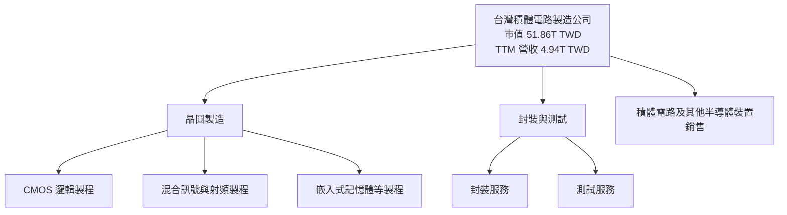
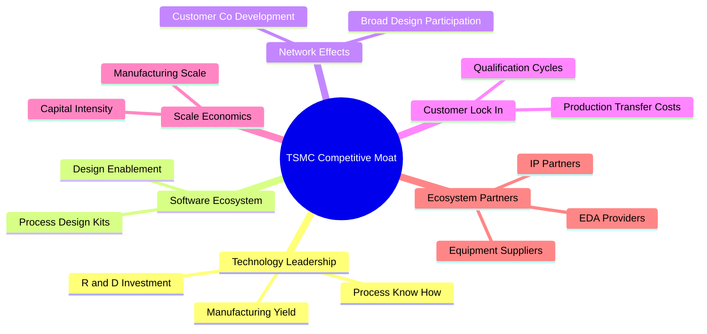
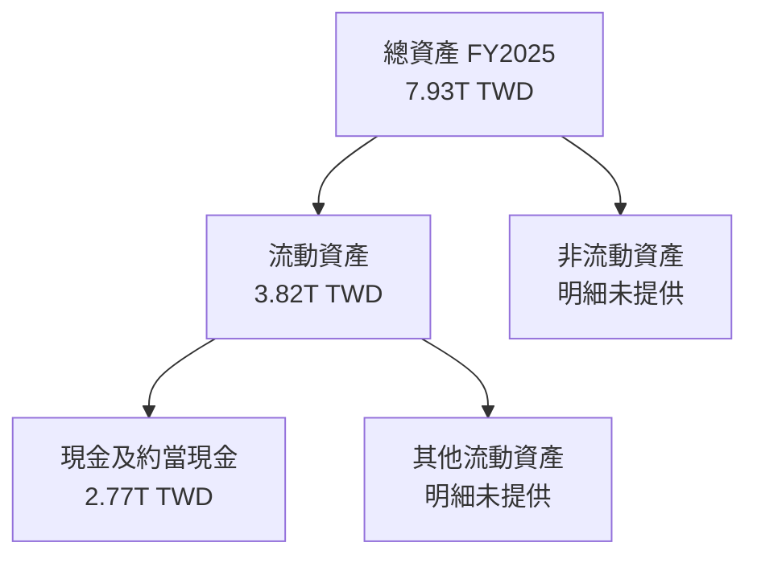
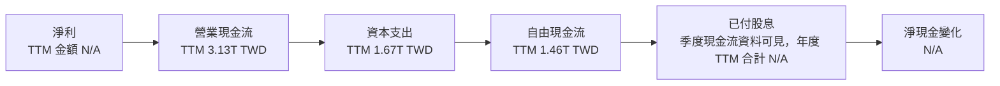
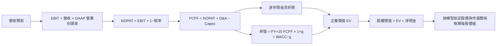
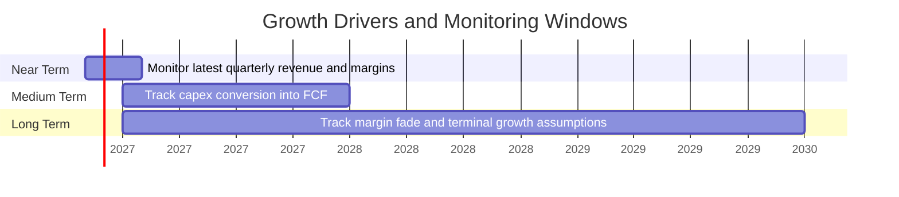
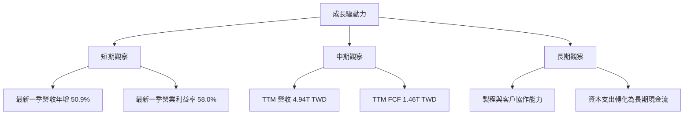
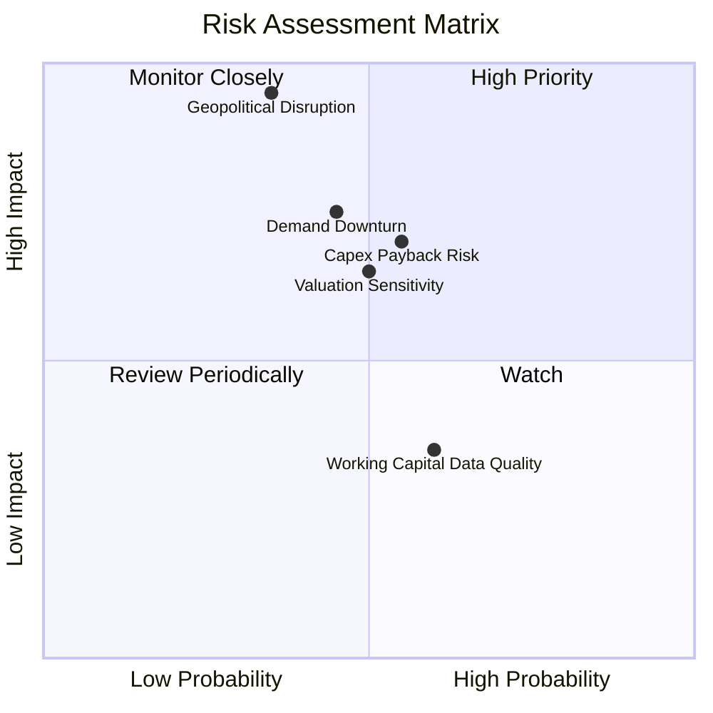
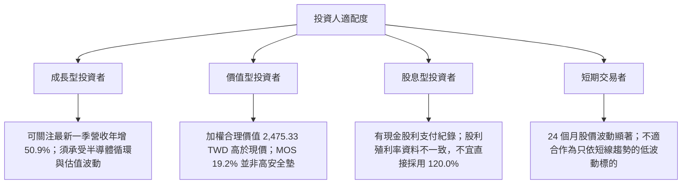

# 2330.TW 基本面深度分析報告
> **報告日期**：2026-11-22 ｜ **語言**：繁體中文 ｜ **數據來源**：Yahoo Finance、Roic.ai ｜ **分析師**：CFA 級機構研究

## 目錄

| # | 章節 | 核心結論 |
|---|------|----------|
| 1 | 執行摘要 | 買入；加權合理價值 2,475.33 TWD；MOS 19.2% |
| 2 | 公司概覽與商業模式 | 先進製程、規模與客戶協作構成主要護城河；市場份額數據未提供 |
| 3 | 損益表深度分析 | TTM 營收 4.94T TWD；最新一季營收年增 50.9%，營業利益率 58.0% |
| 4 | 資產負債表分析 | 淨現金 2.95T TWD；流動比率 2.584 |
| 5 | 現金流量深度分析 | TTM FCF 1.46T TWD；FCF Yield 2.81% |
| 6 | 獲利能力與資本效率 | WACC 10.49%；最新 ROIC 未提供，無法判斷當期 ROIC−WACC |
| 7 | 相對估值分析 | Forward P/E 13.37x；同業倍數支持度低於 DCF 基準價值 |
| 8 | DCF 內在價值評估 | DCF 基準價值 2,924.21 TWD；終值佔 EV 61.0% |
| 9 | 成長催化劑 | 最新一季營收年增 50.9%；TAM 與催化劑量化時程未提供 |
| 10 | 風險矩陣 | 地緣政治、資本支出回收與估值敏感性為主要風險 |
| 11 | 投資建議 | 依 MOS 評級買入；以 2,227.80 TWD 作 MOS 10% 的估值上限參考 |

## 1. 執行摘要

### 1.0 一頁式投資儀表板

| 項目 | 內容 |
|------|------|
| **投資論點（3 句）** | ① 2026-09-30 最新一季營收年增 **50.9%**，顯示當前需求動能強於歷史年度趨勢。② TTM 營業利益率 **58.0%**、毛利率 **65.8%**，高毛利及營業槓桿支撐獲利。③ TTM FCF **1.46T TWD**、淨現金 **2.95T TWD**，但 FCF Yield 僅 **2.81%**，現價已反映相當程度的成長預期。 |
| **綜合評分** | **8.2/10**（引用 1.1 評分卡） |
| **財務健康** | 🟢 現金及短期投資 4.02T TWD、總債務 1.07T TWD，淨現金 2.95T TWD；流動比率 2.584。 |
| **ROIC vs WACC** | 最新 ROIC **N/A**；WACC **10.49%**。缺乏同期間 ROIC，不能把價值創造結論視為已確認。 |
| **FCF 趨勢** | 2022–2025 年 FCF 依序 520.97B、286.57B、861.20B、992.38B TWD；TTM FCF 1.46T TWD，FCF Yield **2.81%**。 |
| **估值** | Forward P/E **13.37x** ｜ EV/EBITDA **13.6x** ｜ FCF Yield **2.81%** |
| **DCF 內在價值（基準）** | **2,924.21 TWD**；現價相對 DCF 折價 **31.6%**（即折溢價 −31.6%，基準為 DCF）。 |
| **安全邊際（MOS）** | **19.2%**＝(加權合理價值 2,475.33 − 現價 2,000) ÷ 加權合理價值 2,475.33｜🟡 有限 |
| **預期報酬（基準情境 12M）** | DCF 基準情境相對現價 **+46.2%**；但這是模型情境值，不等同確定的 12 個月報酬預測。 |
| **關鍵風險（前二）** | 地緣政治與供應鏈中斷；高資本支出在需求降溫時侵蝕 FCF。 |
| **評級 + 信心度** | 🟢 **買入** ｜ 信心：中（估值模型依賴長期成長及終值，且最新 ROIC、同業部分倍數資料不足）。 |

### 1.1 綜合評分卡

| 維度 | 評分（1–10） | 主要依據（引用數字與其來源章節） |
|------|--------------|----------------------------------|
| 成長性 | 9.0 | 最新一季營收年增 50.9%；2022–2025 年營收由 2.26T 增至 3.81T TWD，詳見第 3 章。 |
| 獲利能力 | 9.0 | TTM 毛利率 65.8%、營業利益率 58.0%、淨利率 51.1%；最新 ROIC 與 F-Score 未提供，詳見第 3、6 章。 |
| 財務健康 | 9.0 | 淨現金 2.95T TWD、流動比率 2.584、速動比率 2.287，詳見第 4 章。 |
| 估值 | 6.5 | MOS 19.2%，同業 Forward P/E 中位數 13.7x；現價 2,000 TWD 已高於同業 EV/EBITDA 回推值 1,815.14 TWD，詳見第 7、8 章。 |
| 護城河 | 9.0 | TTM 營業利益率 58.0%，最新一季營收年增 50.9%；定性證據及限制詳見第 2 章。 |
| 管理層與資本配置 | 6.5 | 年度 Capex 2025 年為 1.28T TWD，對應大額再投資；年度 SBC 1.25B TWD、股數歷史約 25.93B，詳見第 3、5 章。 |
| **綜合評分** | **8.2** | 六項算術平均：(9.0 + 9.0 + 9.0 + 6.5 + 9.0 + 6.5) ÷ 6 = **8.2**。 |

### 1.2 五大投資論點 + 三大核心風險

| 類型 | 項目 | 具體依據 | 信心度 |
|------|------|----------|--------|
| 🟢 **投資論點①** | 最新需求與收入動能 | 2026-09-30 單季營收 1.49T TWD，年增 50.9%；代表近期需求及產品組合推升收入，但單季增速不能外推為 TTM 成長率。 | 🟢 高 |
| 🟢 **投資論點②** | 高營業獲利能力 | TTM 營業利益率 58.0%、毛利率 65.8%；高毛利有利吸收研發與固定成本，惟持續性取決於產品組合及產能利用率。 | 🟢 高 |
| 🟢 **投資論點③** | 現金流與資產負債表 | TTM OCF 3.13T、Capex 1.67T、FCF 1.46T TWD；淨現金 2.95T TWD，提供擴產及景氣逆風緩衝。 | 🟢 高 |
| 🟢 **投資論點④** | 資本成本下估值仍有折價 | DCF 基準 2,924.21 TWD，高於 2,000 TWD 收盤價；但終值佔 EV 61.0%，結論對長期假設敏感。 | 🟡 中 |
| 🟢 **投資論點⑤** | SBC 對盈餘稀釋有限 | 2025 年 SBC 1.25B TWD，相對年度營收 3.81T TWD 約 0.03%；直接稀釋成本不高，但需持續監測股數變化。 | 🟢 中 |
| 🟡 **風險①** | 資本支出及景氣循環 | 2025 年 Capex 1.28T TWD；若需求放緩或新產能爬坡延遲，折舊與閒置成本可能壓縮利潤及 FCF。 | 🟡 中 |
| 🔴 **風險②** | 地緣政治與供應鏈集中 | 公司製造資產及供應鏈具地域集中特徵；數據未提供可量化的中斷機率，但一旦發生可能影響營收、成本與客戶交付。 | 🔴 高衝擊 |
| 🟡 **風險③** | 長期估值及終值假設 | DCF 終值現值佔 EV 61.0%；WACC 上升或永續成長率下修，將顯著降低估值。 | 🟡 中 |

### 1.3 快速統計卡片

| 指標 | 公司實際值（期間） | 同業中位數 | 狀態 |
|------|--------------------|------------|------|
| 營收成長（TTM） | **N/A** | — | 🟡 未提供 TTM 對前一 TTM 成長率 |
| 營收成長（最新一季年增） | **50.9%** | **20.9%**（UMC、GFS、INTC 中位數） | 🟢 |
| 毛利率（TTM） | **65.8%** | **31.7%**（UMC、GFS、INTC 中位數） | 🟢 |
| 營業利益率（TTM） | **58.0%** | — | 🟢 |
| ROIC（TTM） | **N/A** | — | 🟡 最新值未提供 |
| Forward P/E | **13.37x** | **13.7x**（UMC、GFS、INTC 中位數） | 🟢 |
| FCF Yield（TTM） | **2.81%** | — | 🟡 |
| Piotroski F-Score | **N/A / 9** | — | 🟡 缺少可比兩個年度的申報資料計算 |

### 1.4 投資結論

```text
╔══════════════════════════════════════════════════════════════════╗
║                    📊 投資結論摘要                               ║
╠══════════════════════════════════════════════════════════════════╣
║  評級：買入（MOS 19.2%，依規則 20；未作一級調整）                ║
║  價格（2026-11-20 收盤）：2,000.00 TWD                           ║
║  DCF 內在價值（基準）：2,924.21 TWD（折價 31.6%）               ║
║  安全邊際 MOS：19.2%（以加權合理價值為分母）                    ║
║  加權合理價值（8.8）：2,475.33 TWD                               ║
║  DCF 情境價值：悲觀 1,240.55（−38.0%）                          ║
║                基準 2,924.21（+46.2%）                          ║
║                樂觀 6,526.44（+226.3%）                         ║
║  綜合評分：8.2/10（引用 1.1）                                    ║
║  適合投資人：可承受晶圓代工循環、地緣政治風險的長期投資人        ║
╚══════════════════════════════════════════════════════════════════╝
```

## 2. 公司概覽與商業模式

### 2.1 業務結構與收入來源

公司從事晶圓製造、封裝、測試及積體電路等半導體裝置的製造與銷售，業務遍及台灣、中國、歐洲、中東、非洲、日本、美國及其他市場。可引用的公司市值為 51.86T TWD，TTM 營收為 4.94T TWD。各製程、終端市場、客戶或服務的收入占比未提供，因此不拆分假設性收入比例。



### 2.2 市場份額

市場份額數據未提供，故不呈現市占比例或圓餅圖。從收入規模與獲利能力看，公司 TTM 營收 4.94T TWD、營業利益率 58.0%，而同業資料中 UMC、GFS、INTC 最新一季營收年增率中位數為 20.9%；公司最新一季年增 50.9%，短期增長及獲利指標均高於這組同業數據。這些指標不能直接替代市場份額。

### 2.3 競爭護城河分析



### 2.4 護城河強度

| 護城河項目 | 強度（強／中／弱） | 證據（引用數字或事實） | 會削弱它的情況 |
|------------|--------------------|------------------------|----------------|
| 技術與製造能力 | 強 | 2025 年研發支出 246.43B TWD；TTM 營業利益率 58.0%，反映較高的技術附加價值及營運效率。 | 製程進展受阻、良率或客戶導入不及預期。 |
| 客戶鎖定與設計協作 | 強 | 製程、封裝、測試及客戶產品設計需跨環節配合；財務資料未提供客戶留存率或轉換成本量化數據。 | 競爭者縮小性能、成本差距，客戶具備足夠替代方案。 |
| 規模效應 | 強 | TTM 營收 4.94T TWD，且 2025 年 Capex 1.28T TWD，資本投入規模高。 | 資本投入超前需求，產能利用率下降。 |
| 軟體生態系統 | 中 | 企業仰賴設計流程、製程規則及工具鏈協作；相關收入與黏著度數據未提供。 | 客戶設計流程對特定製程依賴下降。 |
| 網路效應 | 中 | 多方合作可增強設計與製造互補性；缺乏可量化的生態參與者數據。 | 生態夥伴轉向替代製造平台。 |
| 生態夥伴 | 中 | 半導體製程需要設備、材料、EDA 及 IP 夥伴協同；供應商集中度資料未提供。 | 關鍵設備或材料供應中斷。 |

1.1「護城河」評分 **9.0/10**，主要依據為 TTM 營業利益率 58.0%、高研發投入及規模化製造能力；客戶黏著度與市場份額缺少可直接量化的資料，故不以單一財務比率替代完整競爭證據。

## 3. 損益表深度分析

### 3.1 年度收入成長趨勢（近4年）

年度金額及 YoY 由 Yahoo Finance 年度損益表計算；CAGR 為 2022 至 2025 三年間的複合成長率。

```text
╔══════════════════════════════════════════════════════════════════╗
║      台灣積體電路製造公司年度收入趨勢（FY2022–FY2025）           ║
╠══════════════════════════════════════════════════════════════════╣
║  FY2022  2.26T TWD  ████████████░░░░░░░░  YoY：基期             ║
║  FY2023  2.16T TWD  ███████████░░░░░░░░░  YoY：−4.4% 🟡        ║
║  FY2024  2.89T TWD  ███████████████░░░░░  YoY：+33.8% 🟢       ║
║  FY2025  3.81T TWD  ████████████████████  YoY：+31.8% 🟢       ║
║                                                                  ║
║  FY2022–FY2025 CAGR：(3.81 ÷ 2.26)^(1/3) − 1 = 約 19.0%        ║
╚══════════════════════════════════════════════════════════════════╝
```

2023 年營收下滑 4.4%，顯示半導體需求具有循環性；2024、2025 年恢復成長，年度營收 YoY 分別為 33.8% 與 31.8%。2026 年最新一季年增 50.9%，若需求及高階產品組合延續，可帶來營業槓桿；惟不可將單季增幅誤標為 TTM 成長率，TTM 對前一 TTM 成長率目前為 N/A。

### 3.2 季度收入趨勢分析

季度數據採 ROIC.ai 歷史季度收入，金額換算為 TWD 兆元；YoY、QoQ 由季度收入計算。2026 Q3 YoY 同時引用已核實的 50.9%。

| 季度 | 營收（TWD T） | QoQ | YoY | 備註 |
|------|--------------:|----:|----:|------|
| 2025 Q3 | 0.990 | — | — | ROIC.ai 季度資料 |
| 2025 Q4 | 1.046 | +5.7% | — | 由 2025 Q3 比較 |
| 2026 Q1 | 1.134 | +8.4% | +35.1% | 同比 2025 Q1 |
| 2026 Q2 | 1.270 | +12.0% | +36.0% | 同比 2025 Q2 |
| 2026 Q3 | 1.494 | +17.6% | **+50.9%** | 最新一季年增率；不是 TTM 成長率 |

連續季度收入增加與最新季度 YoY 加速，可能反映需求提升及出貨組合改善；未提供產品別收入，不能量化各因素的貢獻。季度財報表中的四季收入為四捨五入數，與 ROIC.ai 明細可能有小幅差異。

### 3.3 利潤率演變分析

年度毛利率、營業利益率及淨利率為年度損益表中相應金額除以營收計算；TTM 數字直接引用 Yahoo Finance 合併數據，不與年度比率混用。

| 利潤率指標 | FY2022 | FY2023 | FY2024 | FY2025 | 趨勢 | 評估 |
|------------|-------:|-------:|-------:|-------:|------|------|
| **毛利率** | 59.7% | 54.6% | 56.1% | 59.8% | 2023 下滑後回升 | 🟢 |
| **營業利益率** | 49.6% | 42.7% | 45.7% | 50.9% | 2023 收縮，後續改善 | 🟢 |
| **淨利率** | 43.9% | 39.4% | 40.1% | 44.6% | 隨營運恢復回升 | 🟢 |
| **TTM 毛利率** | — | — | — | **65.8%** | TTM 統計口徑 | 🟢 |
| **TTM 營業利益率** | — | — | — | **58.0%** | TTM 統計口徑 | 🟢 |

年度營業利益率 2023 年降至 42.7%，之後回升至 2025 年 50.9%；可能反映需求、產能利用率及產品組合改善。這些因素未有公司產品別拆分數據可直接驗證。TTM 營業利益率 58.0% 高於 2025 年年度數字，應以最新 TTM 口徑觀察，但不可僅憑兩種不同期間數字便推斷長期利潤率已永久提高。

### 3.4 費用結構分析

年度損益表提供研發支出，未提供足以完整分解營業成本、銷售費用、管理費用與其他營運費用的資料，故不繪製比例不完整的費用結構圓餅圖。2025 年研發支出為 246.43B TWD；相較 2024 年 204.18B，年增約 **20.7%**，顯示研發投入隨業務規模提高，但其營收占比及費用分類明細未提供。

### 3.5 季度 EPS 趨勢與盈餘品質（Quality of Earnings）

| 季度 | EPS 實際值（TWD／股） | EPS surprise | 說明 |
|------|-----------------------:|-------------|------|
| 2025 Q4 | 18.72 | N/A | EPS 估計值與實際值欄位為 nan，無法判定超預期或不及預期。 |
| 2026 Q1 | 22.08 | N/A | 同上；財報數據顯示獲利增加，但無可用一致預期數字。 |
| 2026 Q2 | 27.25 | N/A | 同上。 |
| 2026 Q3 | 29.43 | N/A | 另有核實單季 EPS YoY 成長 68.7%；不得將缺失的 surprise 說成超預期。 |

| 盈餘品質項目 | 數值/佔比 | 評估 |
|--------------|-----------|------|
| 股權薪酬 SBC / 營收 | 2025 年 SBC 1.25B ÷ 營收 3.81T = 約 **0.033%** | 🟢 占比低；股權稀釋成本相對營收有限。 |
| SBC / 營業現金流 | 2025 年 SBC 1.25B ÷ OCF 2.27T = 約 **0.055%** | 🟢 低；年度 OCF 不依賴高額 SBC 加回。 |
| FCF / 淨利（現金轉換率） | 2025 年 992.38B ÷ 1.70T = 約 **58.4%** | 🟡 Capex 高，使 FCF 低於會計淨利；現金轉換仍具正向，但需結合投資週期看待。 |
| 一次性/非經常性損益 | N/A（未提供拆分） | 無法確認是否有一次性項目影響盈餘。 |
| 有效稅率異常 | 最新年有效稅率 **17.0%** | 未見資料顯示稅務利益是主要獲利驅動；仍需年度明細檢驗。 |
| 資本化支出 vs 費用化 | TTM Capex 1.67T TWD；資本化政策明細 N/A | 高資本支出會透過折舊在多年內進入費用；資本化與費用化明細未提供，不能判斷是否遞延成本。 |

**盈餘品質結論**：SBC 占營收及 OCF 比例低，淨利並非主要由高額股權薪酬調整形成；但 2025 年 FCF/淨利約 58.4%，顯示高資本支出使會計盈餘轉化為股東可用現金的比例受限。估值應重視維持性 Capex 與投資回收，而非只看 EPS。

## 4. 資產負債表分析

### 4.1 資產結構分解

2025-12-31 資產負債表提供總資產 7.93T TWD、流動資產 3.82T TWD。兩者差額為非流動資產的近似值，但為避免把差額當作申報項目，圖中只列有來源的數字。



最新 TTM 現金及短期投資為 4.02T TWD，與 2025 年底現金餘額屬不同日期及口徑，後續分析以相應期間分開引用。

### 4.2 流動性與營運資金分析

| 指標 | 最新 TTM | 一年前 TTM | 變化 | 解讀 |
|------|----------|------------|------|------|
| 流動比率 | 2.584 | N/A | N/A | 短期資產覆蓋流動負債能力充足；歷史同比數未提供。 |
| 速動比率 | 2.287 | N/A | N/A | 排除存貨後仍有較高流動性。 |
| 淨現金 | 2.95T TWD | N/A | N/A | 現金及短期投資 4.02T 高於總債務 1.07T。 |
| DSO 應收帳款天數 | **1 天** | N/A | N/A | 一年前天數未提供；最新值異常偏低，須留意季度資產負債表數據口徑。 |
| DIO 存貨天數 | **92 天** | N/A | N/A | 缺一年前數據，無法判斷庫存是否正在累積或改善。 |
| DPO 應付帳款天數 | **91 天** | N/A | N/A | 缺一年前數據，無法判斷供應商付款天數變化。 |
| CCC 現金轉換週期 | **2 天** | N/A | N/A | 由 DSO + DIO − DPO 得出的核實數值照錄；方向變化無法比較。 |

### 4.3 債務結構分析

```text
╔══════════════════════════════════════════════════════════════════╗
║                台灣積體電路製造公司債務健康診斷                  ║
╠══════════════════════════════════════════════════════════════════╣
║  總債務：          1.07T TWD                                     ║
║  現金+短期投資：   4.02T TWD                                     ║
║  淨現金：          2.95T TWD  🟢                                 ║
║                                                                  ║
║  Debt/EBITDA：     N/A（缺同期間 TTM EBITDA 絕對金額）           ║
║  Interest Coverage：N/A（利息費用金額未提供）                   ║
║  流動比率：        2.584  🟢                                     ║
║  速動比率：        2.287  🟢                                     ║
╚══════════════════════════════════════════════════════════════════╝
```

淨現金提供財務韌性，也可支應部分擴產需求。但不能僅以淨現金推論擴產必然產生高回報；資本回報取決於產能利用、產品組合及需求持續性。

### 4.4 股東權益趨勢

| 年度 | 股東權益（TWD T） | YoY |
|------|------------------:|----:|
| 2022 | 2.90 | — |
| 2023 | 3.43 | +18.3% |
| 2024 | 4.24 | +23.6% |
| 2025 | 5.36 | +26.4% |

```text
╔══════════════════════════════════════════════════════════════════╗
║                 股東權益趨勢（年度，TWD T）                      ║
╠══════════════════════════════════════════════════════════════════╣
║  2022  2.90  ███████████                                         ║
║  2023  3.43  █████████████                                       ║
║  2024  4.24  ████████████████                                    ║
║  2025  5.36  ████████████████████                                ║
╚══════════════════════════════════════════════════════════════════╝
```

股東權益增長伴隨盈利累積及資產擴張；缺少完整股利與其他綜合損益橋接，無法逐項將權益變化歸因至留存盈餘、匯兌或其他項目。

## 5. 現金流量深度分析

### 5.1 現金流量瀑布圖

淨利到 OCF 的完整調節項未提供；因此圖中不填淨利至 OCF 的差額或股利後淨現金變化金額。



### 5.2 FCF 轉換率趨勢

| 年度 | FCF（TWD B） | 淨利（TWD T） | FCF / 淨利 |
|------|-------------:|--------------:|-----------:|
| 2022 | 520.97 | 0.993 | 52.5% |
| 2023 | 286.57 | 0.852 | 33.6% |
| 2024 | 861.20 | 1.16 | 74.2% |
| 2025 | 992.38 | 1.70 | 58.4% |

FCF 轉換率在 2023 年降至 33.6%，2024 年升至 74.2%，2025 年為 58.4%。波動與資本支出週期有關：Capex 2025 年達 1.28T TWD，較 2024 年 964.98B 高。年度淨利與 FCF 均受會計期間及投資節奏影響，不能把單一年份轉換率當作穩態水準。

### 5.3 自由現金流趨勢

| 年度／期間 | FCF（TWD B） | FCF Yield |
|------------|-------------:|----------:|
| 2022 | 520.97 | N/A |
| 2023 | 286.57 | N/A |
| 2024 | 861.20 | N/A |
| 2025 | 992.38 | N/A |
| 最新 TTM 至 2026-09-30 | **1,460** | **2.81%** |

```text
╔══════════════════════════════════════════════════════════════════╗
║                 自由現金流趨勢（TWD B）                          ║
╠══════════════════════════════════════════════════════════════════╣
║  FY2022   520.97  ███████                                       ║
║  FY2023   286.57  ████                                          ║
║  FY2024   861.20  ████████████                                  ║
║  FY2025   992.38  ██████████████                                ║
║  TTM     1460.00  ████████████████████  FCF Yield 2.81%         ║
╚══════════════════════════════════════════════════════════════════╝
```

年度 FCF 於 2023 年回落後反彈；最新 TTM FCF 高於 2025 年度值，顯示近期香港現金流增加。FCF Yield 2.81% 代表現價相對現金流的收益率有限，估值仍仰賴未來成長和資本回報。

### 5.4 資本配置評估

可量化的現金使用項目以 Capex、股利及現金留存為主；回購金額未提供，且未提供足以重建同一期間資本配置比例的完整數據，因此不以假設比例繪製資本配置圓餅圖。

| 項目 | 已提供數據 | 評估 |
|------|-----------|------|
| Capex | 2025 年 1.28T TWD；TTM 1.67T TWD | 主要資金用途；需持續驗證投資轉化為產能、收入及 FCF 的效率。 |
| 現金股利 | 2025 年現金股利支付 466.78B TWD | 有現金回饋股東；股利支付仍應與擴產需求平衡。 |
| 股票回購 | N/A | 未提供回購資料。 |
| 留存現金 | TTM 現金及短期投資 4.02T TWD | 淨現金 2.95T TWD，具備流動性緩衝。 |
| SBC | 2025 年 1.25B TWD | 相對營收比例低。 |

數據中的「Dividend Yield 120.0%」與股利、價格等其他欄位口徑不一致，疑似資料異常；本報告不採用該值作投資結論。

## 6. 獲利能力與資本效率

### 6.1 ROE / ROA / ROIC 趨勢

| 指標 | 最新可用值 | 歷史資料 | 評估 |
|------|-----------|----------|------|
| ROE | TTM **41.9%** | 歷年完整趨勢未提供 | 獲利相對帳面權益高，但須與資產效率及資本結構一併評估。 |
| ROA | TTM **20.6%** | 歷年完整趨勢未提供 | 資產獲利能力高；非本報告自行推導的 DuPont 數字。 |
| ROIC | TTM **N/A** | ROIC.ai 提供 2013–2018 年歷史值；2018 年 **19.11%** | 歷史數據不能代替最新 TTM ROIC。 |
| 行業均值 | N/A | 未提供一致口徑同業 ROIC | 不列無來源的行業均值。 |

### 6.2 ROIC vs WACC 分析（核心價值創造判斷）

```text
╔══════════════════════════════════════════════════════════════════╗
║                  ROIC vs WACC 深度分析                          ║
╠══════════════════════════════════════════════════════════════════╣
║  WACC（成本資本資料）：10.49%                                    ║
║  ├── 無風險利率（10Y 美債）：4.91%                               ║
║  ├── ERP：5.00%                                                  ║
║  ├── Beta 原始值：1.23；調整後採用值：1.16                       ║
║  ├── 股權成本（資料列示）：10.69%                                ║
║  ├── 稅前債務成本：1.16%；有效稅率：17.0%                        ║
║  ├── 股權／債務權重：98.0%／2.0%                                 ║
║  └── WACC（資料列示）：10.49%                                    ║
║                                                                  ║
║  最新 ROIC：N/A（缺少最新投入資本／NOPAT 的一致口徑數據）         ║
║  ROIC − WACC：N/A                                                ║
║  EVA：N/A                                                         ║
║                                                                  ║
║  結論：歷史 ROIC 不能替代最新 ROIC；當期價值創造判定需待補數據。  ║
╚══════════════════════════════════════════════════════════════════╝
```

ROIC.ai 歷史資料顯示 2013–2018 年 ROIC 約在 18.31%–20.55% 的區間，均高於目前採用的 10.49% WACC；但這是跨年度歷史參考，不能直接證明 2026 年仍有相同資本回報。Cost of capital 資料列示的 Beta 1.23 經調整為 1.16；股權成本、債務權重與 WACC 採用資料列示值，未另建替代 WACC。

### 6.3 杜邦三因素分解

**N/A（數據未提供：Quality Figures 顯示缺少完成杜邦分解所需的一致期間淨利、營收、總資產或正權益輸入；依要求不自行補算。）**

### 6.4 財務體質：Piotroski F-Score

**N/A（Quality Figures 指出欠缺相隔一年的兩個 TTM SEC 申報資料，九項測試均無法可靠判定。）**  
因此不能將缺失的測試解讀為通過或未通過，也不以財務比率推測 F-Score。

## 7. 相對估值分析

### 7.1 同業估值比較表格

同業倍數採 Yahoo Finance Peer multiples；本公司倍數採當前估值資料。P/S、EV/EBITDA 等數據為混合幣別的 UMC 欄位不作換算，也不填補缺值。

| 估值指標 | **2330.TW** | **UMC** | **GFS** | **INTC** | 本公司評估 |
|----------|------------:|-------:|------:|-------:|-----------|
| **Trailing P/E** | 20.52x | 11.4x | 101.6x | N/A | 🟡 高於 UMC；GFS 受盈餘基期影響可能不具代表性。 |
| **Forward P/E** | 13.37x | 13.4x | 13.7x | 28.6x | 🟢 低於同業中位數 13.7x。 |
| **P/S Ratio** | 10.49x | N/A（混合幣別） | 2.8x | 4.6x | 🔴 高；公司毛利與成長差異需納入比較。 |
| **EV / EBITDA** | 13.6x | N/A（混合幣別） | 9.5x | 14.9x | 🟡 高於 GFS、低於 INTC。 |
| **最新一季營收 YoY** | 50.9% | 25.6% | 12.5% | 20.9% | 🟢 高於三家同業。 |
| **TTM 毛利率** | 65.8% | 31.7% | 28.5% | 40.2% | 🟢 明顯高於列示同業。 |

同業中位數 Forward P/E 為 13.7x；本公司 Forward P/E 13.37x，接近同業中位數。中位數 EV/EBITDA 僅由 GFS 與 INTC 的 9.5x、14.9x 計算，未納入缺值 UMC；該倍數低於本公司目前 13.6x，但公司成長與利潤率也不同。

### 7.2 歷史估值區間分析

**N/A（數據未提供：未提供「Valuation vs own history」的歷史估值區間或百分位資料。）**  
24 個月股價資料顯示 2026 年 9 月月收盤價 2,480 TWD，2026 年 11 月收盤價 2,000 TWD；這是價格走勢，不等同歷史 P/E 區間。

### 7.3 情境價值（Bear / Base / Bull，照抄 DCF MODEL 的 Scenarios）

| 情境 | 第 1 年營收成長 | 期末營業利潤率 | WACC | 每股價值 | 相對現價 | 機率 | 會發生的條件 |
|------|----------------:|---------------:|-----:|---------:|---------:|-----:|--------------|
| 🔴 悲觀 | 15.0% | 42.1% | 11.49% | 1,240.55 TWD | −38.0% | 25% | 需求成長顯著低於基準，成本或競爭使長期利潤率收縮，資本成本上升。 |
| 🟡 基準 | 30.0% | 49.5% | 10.49% | 2,924.21 TWD | +46.2% | 50% | 近期增長延續，之後逐步回歸長期較成熟增速，利潤率緩慢收斂。 |
| 🟢 樂觀 | 45.0% | 54.5% | 9.49% | 6,526.44 TWD | +226.3% | 25% | 需求及高階產品組合優於基準，利潤率維持較高水平，資本成本下降。 |

模型未提供三情境每一年完整收入、FCFF 及終值路徑；因此上表照錄情境輸出，不反向編造中間年度現金流。

### 7.4 相對估值隱含價格區間

```text
╔══════════════════════════════════════════════════════════════════╗
║          相對估值回推每股價值與現價（TWD／股）                   ║
╠══════════════════════════════════════════════════════════════════╣
║  1,815.14 ─────── 2,000.00 ─────── 2,046.45 ─────── 2,924.21   ║
║  EV/EBITDA          現價          Forward P/E          DCF       ║
╚══════════════════════════════════════════════════════════════════╝
```

- **同業 Forward P/E：2,046.45 TWD**，依同業中位數 **13.7x × Forward EPS 149.60 TWD** 回推。
- **同業 EV/EBITDA：1,815.14 TWD**，依 GFS、INTC 中位數 **12.2x × TTM EBITDA，再加淨現金** 回推。精確的同業倍數推算輸入及每股橋接明細未另提供，以核實回推值為準。
- 分析師共識目標價 3,402.51 TWD 是另一種參考估值，非相對同業倍數。

## 8. DCF 內在價值評估（Discounted Cash Flow）

### 8.0 估值推理鏈（Thinking Logic）

**Step 1 — 價值由哪些變數決定？**  
本模型主要把價值拆為現有晶圓製造及封裝測試業務產生的現金流，以及長期增長帶來的終值；各事業營收占比未提供，故不能量化新業務或單一產品的收入貢獻。模型敏感度顯示 WACC 與永續成長率對估值有明顯影響，主導風險是遠期現金流及終值假設，而非已證實的單季增長可否原樣延續。

**Step 2 — 模型選擇**

| 決策點 | 本報告採用 | 理由（含數字） | 曾考慮但否決 | 否決理由 |
|--------|-----------|----------------|--------------|----------|
| 現金流定義 | FCFF | 與 WACC 折現、先求 EV 再橋接股權價值一致。 | FCFE | 資本結構權重已在 WACC 中反映。 |
| 預測期 N | 10 年 | 模型指定 10 年，允許成長與利潤率逐步收斂。 | 5 年 | 不符合核實 DCF 模型指定期間。 |
| 終值方法 | Gordon Growth | 模型給定終值永續成長率 3.0%，低於 WACC 10.49%。 | 退出倍數作主方法 | DCF 模型未提供退出倍數估值，不能自行補建。 |
| EBIT 基礎 | GAAP EBIT | 模型使用 GAAP EBIT，SBC 已列為費用。 | 非 GAAP EBIT | 會造成與模型既定假設不一致。 |

**Step 3 — 關鍵假設推導鏈**

- **營收成長路徑**：錨點＝最新一季單季 YoY 50.9%，但不是 TTM 成長率；模型將其限制在最高 30.0%，並由 FY+1 的 30.0% 線性降至 FY+10 的 3.0% → 調整理由＝單季高增速不宜直接外推十年，故逐步收斂 → **採用模型年度路徑 30.0%、27.0%、24.0%、21.0%、18.0%、15.0%、12.0%、9.0%、6.0%、3.0%** → 曾考慮將 50.9% 作為 FY+1，因模型明確以 30.0% 作上限且單季年增不代表 TTM，故不採用。
- **期末營業利益率**：錨點＝TTM 58.0%；模型以最近五個財政年度中位數作收斂錨點 → **FY+10 採用 49.5%**，由 FY+1 58.0% 逐年下降 → 此假設反映成熟期利潤率回歸，不代表管理層指引。
- **永續成長率 g**：資料沒有長期宏觀預測，模型採用 **3.0%**，且 3.0% < 10.49% WACC → 不採用更高 g，避免終值分母過度收窄及永續成長超越折現率。
- **預測期 N**：採用 **10 年**，來源為模型指定期間；不改成較短預測期，以維持核實模型一致性。
- **Capex／營收**：錨點＝TTM Capex／營收約 33.8%；模型由 FY+1 **33.8%** 逐步降至 FY+10 **16.6%**，後期與 D&A 1.1 倍規則相連 → 高度依賴投資效率改善；不採用固定維持 33.8%，因模型假設投資強度逐步下降。
- **D&A／營收**：錨點及採用值均為 **15.1%**，模型固定比率。
- **營運資金**：模型明確未建模；不是估計零變動。因無法用現有資料可靠重建各年 ΔWC，FCFF 表依模型定義列作未納入。
- **EBIT 與 SBC**：採用 **組合 A：GAAP EBIT + 固定股數**。模型說明 GAAP EBIT 已含 SBC 費用，不再另扣 SBC，股數不另作稀釋；因此 SBC 影響在模型中計入一次。
- **WACC**：採用核實值 **10.49%**；不以自行計算的替代值取代。無風險利率、Beta、ERP、資本成本資料列於 8.2。
- **終值方法**：以 Gordon Growth 作主估值。沒有提供退出倍數及相應模型結果，故不另建退出倍數。
- **年稀釋率**：組合 A 採用 **0%**；股數不逐年放大，因模型把 SBC 成本反映於 GAAP EBIT。

**Step 4 — 最脆弱假設**  
最脆弱的是 10 年收入與利潤率路徑及 3.0% 永續成長率；終值現值佔 EV 61.0%，若需求、利潤率或折現率偏離基準，價值可向敏感度表所示的 2,111.44–4,805.70 TWD 範圍移動。

**Step 5 — 計算路徑圖**



### 8.1 模型假設總表（Model Inputs）

| 假設項目 | 採用值 | 依據 / 來源 | 敏感度 |
|----------|--------|-------------|--------|
| 預測期長度 N | **10 年** | DCF 模型指定；逐年列示 FY+1 至 FY+10。 | 🟡 中 |
| 營收成長 | FY+1 **30.0%**；FY+10 **3.0%**，逐年線性遞減 | 最新單季 YoY 50.9% 不是 TTM 增長；模型以 30% 封頂並逐步收斂。 | 🔴 高 |
| 營業利潤率 | **58.0% → 49.5%** | 起點 TTM 營業利益率 58.0%；終點依模型最近五個財政年度中位數。 | 🔴 高 |
| 有效稅率 | **17.0%** | 最新年度有效稅率。 | 🟢 低 |
| Capex／營收 | **33.8% → 16.6%** | TTM 資本支出比率起點；模型逐步降至約 D&A 的 1.1 倍。 | 🔴 高 |
| D&A／營收 | **15.1%** | TTM 模型假設，固定至預測期。 | 🟢 低 |
| 營運資金變動 | **未建模** | 模型明確不納入營運資金；未自行假設為零。 | 🟡 中 |
| EBIT 基礎 | **GAAP** | DCF 模型使用 GAAP EBIT。 | 🟡 中 |
| SBC 處理 | **組合 A** | SBC 已含在 GAAP EBIT；不再減一次。 | 🟡 中 |
| 年稀釋率 | **0%** | 固定股數組合 A；模型不另稀釋。 | 🟡 中 |
| 永續成長率 g | **3.0%** | 模型指定；低於 WACC 10.49%。 | 🔴 高 |
| 終值方法 | **Gordon Growth** | DCF 模型已給出 Gordon Growth 終值。退出倍數模型值未提供。 | 🔴 高 |
| WACC | **10.49%** | Cost of capital 核實值；詳見 8.2。 | 🔴 高 |
| FCF 定義 | **FCFF = NOPAT + D&A − Capex** | 依模型定義，未建模 ΔWC。 | 🟡 中 |

### 8.2 折現率推導（WACC）

```text
╔══════════════════════════════════════════════════════════════════╗
║                    WACC 推導（折現率）                           ║
╠══════════════════════════════════════════════════════════════════╣
║  股權成本 Ke（CAPM，採資料列示值）：10.69%                       ║
║  ├── 無風險利率 Rf（10Y 美債）：4.91%                            ║
║  ├── ERP（假設值）：5.00%                                        ║
║  ├── 原始 Beta：1.23                                             ║
║  ├── 調整 Beta：⅔ × 1.23 + ⅓ = 1.16                             ║
║  └── 資料列示 Ke：10.69%                                         ║
║                                                                  ║
║  債務成本：                                                      ║
║  ├── 稅前 Kd：1.16%                                              ║
║  ├── 有效稅率：17.0%                                             ║
║  └── 稅後 Kd = 1.16% × (1 − 17.0%) = 約 0.96%                   ║
║                                                                  ║
║  資本結構（資料列示權重）：股權 98.0%，債務 2.0%                 ║
║  └── 採用 WACC：10.49%                                           ║
║     （計算所用未四捨五入輸入與市值未在財務資料完整列出）          ║
╚══════════════════════════════════════════════════════════════════╝
```

逐步演算與可核對限制：

1. **Ke（CAPM）**：無風險利率 4.91%、調整後 Beta 1.16、ERP 5.00%；Cost of capital 資料列示 **Ke = 10.69%**。以顯示到兩位小數的數字直接相乘會因輸入未四捨五入而有小幅差異，故以核實列示 Ke 為準。
2. **稅前 Kd**：資料列示 **1.16%**；利息費用及平均計息負債金額未提供，不能以總負債自行反推。
3. **稅後 Kd**：`1.16% × (1 − 17.0%) = 約 0.96%`。
4. **權重**：資料列示 E/D 權重為 **98.0%／2.0%**，總和 100.0%；市值與計息負債詳細分母未提供，不能用帳面股東權益替代市值重建權重。
5. **WACC**：直接採用 Cost of capital 列示 **10.49%**；不另算替代值。第 6.2 節採同一 WACC。

完整的利息費用、平均計息負債、市值權重原始金額及無風險利率觀察日期未提供，因此不能把上述資料列示值擴寫成完全可從原始美元或台幣金額重建的五步算式。

### 8.3 逐年自由現金流預測（基準情境）

金額單位為 TWD B；折現因子依 DCF 模型逐年列示，SBC 不另扣、ΔWC 未建模。表格數字依模型原值照錄。

| 年度 | FY+1 | FY+2 | FY+3 | FY+4 | FY+5 | FY+6 | FY+7 | FY+8 | FY+9 | FY+10 |
|------|-----:|-----:|-----:|-----:|-----:|-----:|-----:|-----:|-----:|------:|
| 營收 | 6,428.26 | 8,163.89 | 10,123.23 | 12,249.11 | 14,453.94 | 16,622.04 | 18,616.68 | 20,292.18 | 21,509.71 | 22,155.00 |
| 營收 YoY | 30.0% | 27.0% | 24.0% | 21.0% | 18.0% | 15.0% | 12.0% | 9.0% | 6.0% | 3.0% |
| 營業利潤率 | 58.0% | 57.0% | 56.1% | 55.2% | 54.2% | 53.3% | 52.3% | 51.4% | 50.5% | 49.5% |
| EBIT（GAAP） | 3,726.88 | 4,656.49 | 5,679.00 | 6,756.58 | 7,837.06 | 8,856.56 | 9,744.56 | 10,431.05 | 10,854.96 | 10,972.60 |
| − 稅 | (632.56) | (790.34) | (963.90) | (1,146.79) | (1,330.18) | (1,503.22) | (1,653.94) | (1,770.46) | (1,842.41) | (1,862.38) |
| NOPAT | 3,094.32 | 3,866.14 | 4,715.10 | 5,609.79 | 6,506.88 | 7,353.34 | 8,090.62 | 8,660.59 | 9,012.55 | 9,110.22 |
| + D&A | 970.20 | 1,232.15 | 1,527.86 | 1,848.72 | 2,181.48 | 2,508.71 | 2,809.75 | 3,062.63 | 3,246.39 | 3,343.78 |
| − Capex | (2,171.05) | (2,601.47) | (3,032.68) | (3,435.84) | (3,778.51) | (4,028.15) | (4,156.32) | (4,143.23) | (3,981.42) | (3,678.16) |
| ΔWC | 未建模 | 未建模 | 未建模 | 未建模 | 未建模 | 未建模 | 未建模 | 未建模 | 未建模 | 未建模 |
| **FCFF** | **1,893.46** | **2,496.82** | **3,210.29** | **4,022.67** | **4,909.85** | **5,833.90** | **6,744.04** | **7,579.99** | **8,277.52** | **8,775.85** |
| 折現因子 | 0.905 | 0.819 | 0.741 | 0.671 | 0.607 | 0.550 | 0.497 | 0.450 | 0.407 | 0.369 |
| **FCFF 現值 PV** | **1,713.66** | **2,045.15** | **2,379.85** | **2,698.92** | **2,981.35** | **3,206.07** | **3,354.31** | **3,412.09** | **3,372.25** | **3,235.77** |

**預測期 FCF 現值合計：**

`1,713.66 + 2,045.15 + 2,379.85 + 2,698.92 + 2,981.35 + 3,206.07 + 3,354.31 + 3,412.09 + 3,372.25 + 3,235.77 = 28,399.42 TWD B`

**逐步演算示例（FY+1）**：以下因模型公布的比率、金額經個別四捨五入，部分欄位無法僅用表上已四捨五入的輸入精確重現；以模型核實輸出為準，不以重算值改寫模型。

1. **營收**：`4,944.82 × (1 + 30.0%)`；模型列示 **6,428.26 TWD B**。
2. **EBIT**：模型列示 **3,726.88 TWD B**；營業利潤率列示 **58.0%**。
3. **稅**：模型列示 **632.56 TWD B**；有效稅率列示 **17.0%**。
4. **NOPAT**：`3,726.88 − 632.56 = 3,094.32 TWD B`。
5. **D&A**：模型列示 **970.20 TWD B**。
6. **Capex**：模型列示 **2,171.05 TWD B**。
7. **ΔWC**：模型未建模。
8. **FCFF**：`3,094.32 + 970.20 − 2,171.05 = 1,893.47 TWD B`；模型列示 **1,893.46 TWD B**，差 0.01 TWD B，來自逐項四捨五入。
9. **折現及 PV**：模型折現因子列示 **0.905**、PV 列示 **1,713.66 TWD B**；因折現因子只列 3 位小數，無法僅以顯示值精確復原模型未四捨五入折現結果。

模型未提供可直接比較的同口徑歷史 TTM FCF 序列以計算十年預測 FCF CAGR，也未提供同業最佳 FCF 利潤率，故不填入推算數字。FY+10 FCFF 為正，模型內各年 FCFF 均為正。

```text
╔══════════════════════════════════════════════════════════════════╗
║            自由現金流：歷史實際 vs 模型預測（TWD B）             ║
╠══════════════════════════════════════════════════════════════════╣
║  FY2023（實）   286.57  █                                        ║
║  FY2024（實）   861.20  ██                                       ║
║  FY2025（實）   992.38  ██                                       ║
║  TTM（實）    1,460.00  ███                                      ║
║  FY+1（預）   1,893.46  ████                                     ║
║  FY+10（預）  8,775.85  ████████████████████                     ║
╠══════════════════════════════════════════════════════════════════╣
║  預測期間延伸至十年；模型使用營收逐年減速及 Capex 比率下降。     ║
║  預測 FCF CAGR 的可比歷史基期未提供，避免自建另一套模型。         ║
╚══════════════════════════════════════════════════════════════════╝
```

### 8.4 終值計算（Terminal Value）

**適用性檢查**：`WACC 10.49% vs g 3.0% → WACC > g？✅`

| 方法 | 計算式 | 終值 TV（TWD B） | TV 現值（TWD B） | 佔總 EV |
|------|--------|----------------:|-----------------:|--------:|
| Gordon Growth | 8,775.85 × (1 + 3.0%) ÷ (10.49% − 3.0%) | 120,649.27 | 44,485.02 | 61.0% |
| 退出倍數法 | N/A（DCF MODEL 未提供退出倍數及對應計算） | N/A | N/A | N/A |

逐步演算（Gordon Growth，依模型原值照錄）：

1. **FY+N FCFF**：FY+10 = **8,775.85 TWD B**。
2. **分子**：`8,775.85 × (1 + 3.0%)`；模型列示終值計算結果 **120,649.27 TWD B**。
3. **分母**：`10.49% − 3.0% = 7.49%`；模型列示 **TV = 120,649.27 TWD B**。
4. **PV(TV)**：模型列示 **44,485.02 TWD B**，折現因子列示 0.369。
5. **終值佔比**：`44,485.02 ÷ 72,884.44 = 61.0%`。

終值計算所用未四捨五入折現因子及輸入未完整列出；顯示數字可能有尾差。終值佔 EV 61.0%，低於 75% 警戒線，但仍是估值的重要來源。

### 8.5 企業價值 → 每股內在價值（Bridge）

```text
╔══════════════════════════════════════════════════════════════════╗
║              企業價值 → 每股內在價值橋接（TWD B）                ║
╠══════════════════════════════════════════════════════════════════╣
║  預測期 FCF 現值合計             +28,399.42                      ║
║  終值現值 PV(TV)                 +44,485.02                      ║
║  ─────────────────────────────────────────────                  ║
║  = 企業價值 EV                    72,884.44                      ║
║  + 淨現金                         +2,947.23                      ║
║  = 股權價值                       75,831.67                      ║
║                                                                  ║
║  每股內在價值（模型列示）         2,924.21 TWD                   ║
║  當前股價（2026-11-20 收盤）      2,000.00 TWD                   ║
║  折溢價（現價÷DCF價值−1）         −31.6%（折價）                 ║
╚══════════════════════════════════════════════════════════════════╝
```

逐步橋接：

1. **EV**：`28,399.42 + 44,485.02 = 72,884.44 TWD B`。
2. **股權價值**：`72,884.44 + 2,947.23 = 75,831.67 TWD B`。
3. **每股內在價值**：DCF 模型列示 **2,924.21 TWD／股**；模型換算行為「股權價值 × 價格 ÷ 市值」，其所用股數／市值未四捨五入明細未完整提供，故不以另取股數自行重算或替換模型值。
4. **折溢價**：`2,000.00 ÷ 2,924.21 − 1 = −31.6%`；這是相對 DCF 基準價值的折溢價，不是 MOS。
5. **本節不計算 MOS**：MOS 僅以第 8.8 節加權合理價值為分母。

DCF 模型的淨現金採用值為 2,947.23 TWD B；最新市場數據列示淨現金 2.95T TWD，兩者均為台幣且為相近數值。公司最新季報稀釋股數及模型股數明細未完整列示；模型說明採組合 A 固定股數、不逐年稀釋。

### 8.6 敏感性分析（WACC × 永續成長率）

下表照錄 DCF MODEL 的每股價值；括號內上行／下行為相對 2,000.00 TWD 現價計算後取一位小數。

| g（列）／WACC（欄） | 8.49% | 9.49% | **10.49%（基準）** | 11.49% | 12.49% |
|-----------|------:|------:|-------------------:|-------:|-------:|
| 2.0% | 3,691.24（+84.6%） | 3,131.35（+56.6%） | 2,707.51（+35.4%） | 2,376.46（+18.8%） | 2,111.44（+5.6%） |
| 2.5% | 3,900.11（+95.0%） | 3,274.16（+63.7%） | 2,809.08（+40.5%） | 2,450.93（+22.5%） | 2,167.39（+8.4%） |
| 3.0% | 4,147.01（+107.4%） | 3,438.97（+71.9%） | **2,924.21（+46.2%）** | 2,534.18（+26.7%） | 2,229.23（+11.5%） |
| 3.5% | 4,443.37（+122.2%） | 3,631.29（+81.6%） | 3,055.80（+52.8%） | 2,627.83（+31.4%） | 2,297.96（+14.9%） |
| 4.0% | 4,805.70（+140.3%） | 3,858.62（+92.9%） | 3,207.66（+60.4%） | 2,733.99（+36.7%） | 2,374.77（+18.7%） |

逐步重算候選格無法只用提供的摘要資料精確重建：矩陣有完整核實輸出，但新 WACC 下逐年未四捨五入折現因子及 PV 合計未提供。為避免自建模型，本報告不自行重算非基準格；矩陣數值直接引用 DCF 模型輸出。

**三情境 DCF（模型核實輸出）**

| 情境 | 年 1 營收成長 | 期末營業利潤率 | 永續成長率 g | WACC | 每股內在價值 | 相對現價 | 主觀機率 |
|------|---------------:|---------------:|--------------:|-----:|--------------:|---------:|----------:|
| 🔴 悲觀 | 15.0% | 42.1% | 模型未另列 | 11.49% | 1,240.55 TWD | −38.0% | 25% |
| 🟡 基準 | 30.0% | 49.5% | 3.0% | 10.49% | 2,924.21 TWD | +46.2% | 50% |
| 🟢 樂觀 | 45.0% | 54.5% | 模型未另列 | 9.49% | 6,526.44 TWD | +226.3% | 25% |
| **機率加權** | — | — | — | — | **3,403.85 TWD** | **+70.2%** | **100%** |

情境表提供情境價值及部分假設，但未提供每個情境完整逐年營收、FY+N FCFF 與終值路徑；因此不能誠實地列出題定的完整三情境算式。已提供的機率加權核對為：

`1,240.55 × 25% + 2,924.21 × 50% + 6,526.44 × 25% = 3,403.85 TWD`

敏感度方向依核實矩陣可見：g 上升時價值增加；WACC 上升時價值下降。資料未提供期末利潤率單獨變動的敏感度數字，故不杜撰每增加 1 個百分點的價格彈性。基準估值對折現率及終值假設均敏感，與 8.0 所指的長期現金流／終值主導因素一致。

### 8.7 反推 DCF（Reverse DCF：市場在預期什麼）

DCF MODEL 直接提供兩個單變數反推結果，未提供其餘變數及迭代軌跡。

| 求解的變數（一次一個） | 其餘變數設定 | 市場隱含值 | 公司歷史實際 | 判斷 |
|------------------------|--------------|--------------|--------------|------|
| 第 1 年營收成長率 | 其餘假設固定於基準 DCF | **19.6%**（基準 30.0%） | 2026 最新一季 YoY 50.9%；年度營收 2022–2025 CAGR 約 19.0% | 🟡 現價所隱含的首年成長低於基準，但仍需高於零。 |
| 固定營業利潤率 | 其餘假設固定於基準 DCF | **36.3%**（基準路徑 58.0%→49.5%） | FY2023 年營業利益率約 42.7%；歷史 2013–2018 ROIC.ai 營業利益率約 35.18%–39.87% | 🟢 相對基準 DCF 偏保守；不可把不同期間歷史利潤率當成未來保證。 |
| 永續成長率 g | N/A（模型未提供解值） | 未計算 | — | 不作反推。 |
| 預測期長度 N | N/A（模型未提供解值） | 未計算 | — | 不作反推。 |

模型未提供逐級試算點，因此不能補寫未曾由模型給出的收斂軌跡。反推結論：在其他基準假設固定時，模型顯示現價約對應 19.6% 年 1 收入成長或 36.3% 固定營業利益率；但這兩者是分別一次放開一個變數所得，不能視為同時成立的市場預期。

### 8.8 估值三角驗證與安全邊際

| 估值方法 | 隱含每股價值 | 上行空間（÷現價） | 權重 | 說明 |
|----------|--------------:|-------------------:|-----:|------|
| DCF（基準） | 2,924.21 TWD | +46.2% | 40% | 10 年 FCFF、WACC 10.49%、g 3.0%。 |
| 同業 Forward P/E | 2,046.45 TWD | +2.3% | 25% | 同業中位數 13.7x × Forward EPS 149.60。 |
| 同業 EV/EBITDA | 1,815.14 TWD | −9.2% | 25% | 同業中位數 12.2x × TTM EBITDA，再加淨現金。 |
| 分析師共識目標價 | 3,402.51 TWD | +70.1% | 10% | 35 位分析師平均目標價；作為參考。 |
| **加權合理價值** | **2,475.33 TWD** | **+23.8%** | **100%** | 估值方法固定權重。 |

**逐步演算（權重外顯）**：

`2,924.21 × 40% + 2,046.45 × 25% + 1,815.14 × 25% + 3,402.51 × 10% = 2,475.33 TWD`

計算細項：`1,169.684 + 511.6125 + 453.785 + 340.251 = 2,475.3325 TWD`，四捨五入至小數二位為 **2,475.33 TWD**。公司類型為 profitable；四種方法均照列，沒有方法被剔除。

```text
╔══════════════════════════════════════════════════════════════════╗
║                  估值區間與安全邊際（TWD／股）                   ║
╠══════════════════════════════════════════════════════════════════╣
║  1,240.55 ─── 2,000.00 ─── [2,475.33] ─── 2,924.21 ─── 6,526.44║
║  悲觀 DCF       現價        加權合理值       基準 DCF     樂觀 DCF║
║                                                                  ║
║  MOS = (2,475.33 − 2,000.00) ÷ 2,475.33 = 19.2%                 ║
║  MOS 評估：🟡 10%–25%，有限                                     ║
║  上行空間 = (2,475.33 − 2,000.00) ÷ 2,000.00 = 23.8%            ║
║                                                                  ║
║  MOS 10% 對應價格上限：2,475.33 × (1 − 10%) = 2,227.80 TWD     ║
║  買入參考區間：1,815.14–2,227.80 TWD                            ║
║  合理持有參考：2,227.80–2,924.21 TWD                            ║
║  減碼考慮：高於基準 DCF 2,924.21 TWD；仍需依基本面更新判斷       ║
╚══════════════════════════════════════════════════════════════════╝
```

> 🔎 **程式複算（Python，依本節各項自動重算）**
>
> 加權合理價值 = $2,924.21 × 40% + $2,046.45 × 25% + $1,815.14 × 25% + $3,402.51 × 10% = **$2,475.33**（權重合計 100%）
>
> 以價格 $2,000.00 計：MOS = **+19.2%**，上行空間 = **+23.8%**
>
> ✅ 與本節所寫數值一致。

### 8.9 DCF 模型的局限與失效條件

- **終值依賴度**：PV(TV) 44,485.02 ÷ EV 72,884.44 = **61.0%**，代表價值中相當大部分由 FY+10 後的假設決定。
- **最脆弱假設**：若成長、利潤率與 WACC 同時落入悲觀情境，模型值為 **1,240.55 TWD**；若只改變 WACC 或 g，價值可由矩陣顯示的不同格位大幅移動。
- **資本支出敏感性**：模型 Capex／營收由 33.8% 逐步降至 16.6%；若資本強度未下降，預測 FCF 將低於基準。模型未提供此單變數敏感度，不估算價格影響。
- **營運資金與稀釋**：營運資金未建模；模型採固定股數。實際工作資本需求或股數上升均可能使股權價值低於模型。
- **適用性**：公司已有正 FCF，DCF 可作為估值工具；但對高資本支出、景氣循環及技術投資企業，應配合同業倍數及資本支出回收率檢驗。
- **與第 10 章的連結**：需求或產能利用率下降會壓低收入及 EBIT；資本成本上升會提高 WACC；供應鏈或地緣政治事件可能同時衝擊營收、Capex 與風險溢酬。

### 8.10 複算檢核表（Audit Trail）

| # | 檢核項目 | 檢查方式 | 結果 |
|---|----------|----------|------|
| 1 | 高／中敏感度輸入都有推導 | 逐項核對 8.0、8.1；模型未提供部分替代值及逐情境路徑，已明示。 | ⚠️ |
| 2 | 每個假設都有來歷 | 已列模型、財務數據錨點；未提供項目標為 N/A。 | ✅ |
| 3 | WACC 五步算式及相乘相加 | WACC、權重採核實列示值；原始 E、D 及平均計息負債金額不足以完整復算。 | ⚠️ |
| 4 | Kd 分母與 D 範圍一致 | 利息金額及平均計息負債明細未提供，不能確認逐項範圍。 | ⚠️ |
| 5 | WACC 與 6.2 同值 | 兩處均為 10.49%。 | ✅ |
| 6 | 預測年度數等於 N 且無省略 | FY+1 至 FY+10 共十年。 | ✅ |
| 7 | FY+1 計算可複算 | 顯示數字有 0.01 TWD B 尾差，模型列示值照錄。 | ⚠️ |
| 8 | 預測期 PV 合計 | 十個 PV 相加為 28,399.42 TWD B。 | ✅ |
| 9 | WACC > g | 10.49% > 3.0%。 | ✅ |
| 10 | 終值基於 FY+N 並折現 N 期 | 模型以 FY+10 FCFF、折現因子 0.369 計算。 | ✅ |
| 11 | 橋接 EV 至每股價值 | EV 與股權價值可核對；股數、市值未四捨五入明細不足以獨立重建每股值。 | ⚠️ |
| 12 | SBC 組合相容 | GAAP EBIT、無 −SBC 列、年稀釋率 0%，組合 A。 | ✅ |
| 13 | 敏感性基準格等於 DCF 基準值 | 矩陣基準格 2,924.21 TWD，等於 8.5。 | ✅ |
| 14 | 矩陣有效性 | 所列所有格 WACC 均大於 g。 | ✅ |
| 15 | 情境機率加總 | 25% + 50% + 25% = 100%；機率加權值照錄模型。 | ✅ |
| 16 | 反推每列只放開一個變數 | 模型提供收入成長率與固定利潤率兩個單變數結果；未提供迭代軌跡。 | ⚠️ |
| 17 | MOS 與折溢價分母一致性 | MOS 以加權合理價值計，折溢價以 DCF 價值計；儀表板一致。 | ✅ |
| 18 | 報告完整至第 11 章 | 已列出第 1 至第 11 章。 | ✅ |
| 19 | 加權合理價值等於方法加權總和 | 加總為 2,475.3325，四捨五入 2,475.33 TWD，未另行調整。 | ✅ |
| 20 | 評級符合 MOS 門檻 | MOS 19.2%，落在買入門檻 10%–25%。 | ✅ |

未能完全複算的項目已明確標註為資料精度或輸入缺漏，並直接引用模型輸出；因此 DCF 的信心度為中，而非把缺失資料當成已驗證。

## 9. 成長催化劑

### 9.1 催化劑時間軸

財務資料及新聞未提供具體產品量產日期或管理層時程，因此以下時間軸只按財務觀察期間分類，不虛構事件日期。



### 9.2 TAM 市場規模分析

**N/A（TAM 數據未提供）。** 最新一季營收年增 50.9%，TTM 營收 4.94T TWD，顯示公司目前收入規模大且近期成長較快；但沒有 TAM 金額、來源及年份，不能計算滲透率或把單季增長外推成市場規模。

### 9.3 成長驅動力結構圖



## 10. 風險矩陣

### 10.1 風險評分矩陣

以下位置為定性分析用的**分析師估計**，不是財務資料庫的歷史機率統計。



### 10.2 風險清單詳細分析

以下機率與風險評分是研究判斷，非公司或資料來源提供的統計預測；財務衝擊以情境方向描述，不將未提供的收入衝擊編造成數字。

| # | 風險項目 | 發生機率 | 財務衝擊 | 風險評分 | 緩解措施 |
|---|----------|----------|----------|----------|----------|
| 1 | 🔴 **地緣政治／供應鏈中斷** | 中（分析師估計） | 高；可能影響產能、交付、營收及供應鏈成本，未提供可量化收入衝擊。 | 🔴 9/10（分析師估計） | 追蹤產能地域分布、客戶交付、供應商替代安排與現金緩衝；投資組合避免單一地區風險過度集中。 |
| 2 | 🔴 **需求與半導體景氣反轉** | 中（分析師估計） | 中至高；2023 年年度營收曾年減 4.4%，顯示營收具循環性。 | 🔴 8/10（分析師估計） | 每季監控營收 YoY、毛利率、產能利用率及庫存天數；不要把 50.9% 單季增長直線外推。 |
| 3 | 🟠 **高 Capex 回收不及預期** | 中偏高（分析師估計） | 高；TTM Capex 1.67T TWD，若利用率下降會拖累 FCF。 | 🟠 7/10（分析師估計） | 將新增產能投產、營收增量和 FCF 同步追蹤；若 Capex 上升但 FCF 持續下降，降低估值假設。 |
| 4 | 🟡 **估值對 WACC 與 g 敏感** | 中（分析師估計） | 高；終值佔 DCF EV 61.0%，矩陣顯示不同 WACC／g 組合導致明顯價值差異。 | 🟡 7/10（分析師估計） | 使用多方法估值，避免只依賴 DCF；定期更新利率、ERP 與長期成長假設。 |
| 5 | 🟡 **資料品質與口徑差異** | 中（分析師估計） | 中；TTM 與年度欄位、股利殖利率等有口徑差異，可能誤導決策。 | 🟡 5/10（分析師估計） | 以財報及明確期間的數據為優先；對異常股利殖利率和缺失 EPS surprise 不作結論。 |

## 11. 投資建議

### 11.1 最終評級與評分

依加權合理價值 **2,475.33 TWD** 與 2026-11-20 收盤價 **2,000.00 TWD** 計算，MOS 為 **19.2%**，依評級門檻屬 **買入**；未作一級調整。1.1 綜合評分為 **8.2/10**，六項分數為成長性 9.0、獲利能力 9.0、財務健康 9.0、估值 6.5、護城河 9.0、管理層與資本配置 6.5。

### 11.2 合理價值與隱含報酬率

| 方法／情境 | 每股價值 | 相對現價 | 權重／機率 |
|------------|---------:|---------:|-----------:|
| 加權合理價值 | **2,475.33 TWD** | **+23.8%** | 估值方法加權 100% |
| DCF 悲觀 | 1,240.55 TWD | −38.0% | 25% |
| DCF 基準 | 2,924.21 TWD | +46.2% | 50% |
| DCF 樂觀 | 6,526.44 TWD | +226.3% | 25% |
| DCF 情境機率加權（參考） | 3,403.85 TWD | +70.2% | 100% |

評級依規則使用加權合理價值的 MOS，而非以 DCF 基準價值或機率加權 DCF 替代。

### 11.3 買入時機與觸發因素

```text
╔══════════════════════════════════════════════════════════════════╗
║                  ✅ 買入觸發因素 Checklist                      ║
╠══════════════════════════════════════════════════════════════════╣
║  立即分批建立部位的條件：                                        ║
║  ✅ 現價 2,000 TWD 低於加權合理價值 2,475.33 TWD                 ║
║  ✅ MOS 19.2%，落在規則所定買入區間                              ║
║  ✅ 淨現金 2.95T TWD、TTM FCF 1.46T TWD                          ║
║                                                                  ║
║  加碼觸發條件：                                                  ║
║  ☐ 季營收年增維持正成長，且 TTM 營業利益率維持在 50% 以上       ║
║  ☐ FCF 不因 Capex 加速而連續兩季轉負                             ║
║  ☐ 股價回落至 2,227.80 TWD 以下，對應 MOS 約 10% 或以上          ║
║                                                                  ║
║  減碼／重新估值條件：                                            ║
║  ☐ TTM 營業利益率由 58.0% 回落並低於 49.5%                      ║
║  ☐ TTM FCF 轉負或淨現金由 2.95T TWD 明顯惡化                    ║
║  ☐ 股價高於 DCF 基準 2,924.21 TWD，且獲利預期未同步上修          ║
╚══════════════════════════════════════════════════════════════════╝
```

上述 50% 營業利益率及連續兩季等監控門檻是投資管理觸發條件，不是公司財測或經核實的管理層指引；若實際公司營運出現結構性變化，應重新估值。

### 11.4 投資人適配度分析



### 11.5 每季財報監控清單（Quarterly Watch List）

| 監控指標 | 最新基準 | 加碼觀察條件 | 減碼／重估條件 |
|----------|----------|--------------|----------------|
| 季營收年增 | 最新一季 **50.9%** | 維持正成長，且未連續兩季大幅減速 | 連續兩季年增低於 10%（投資人自訂警戒線） |
| TTM 營業利益率 | **58.0%** | 維持 50% 以上 | 低於 49.5%，或快速下降且無產品組合改善 |
| TTM FCF | **1.46T TWD** | Capex 上升仍能維持正 FCF | FCF 轉負或 OCF 持續不足以覆蓋 Capex |
| Capex | TTM **1.67T TWD** | 新增投資能伴隨營收與 FCF 成長 | Capex 持續增加但營收、FCF 不增長 |
| DIO 庫存天數 | **92 天** | 庫存天數穩定或下降 | 連續上升且營收增長同步轉弱 |
| 淨現金 | **2.95T TWD** | 維持正淨現金 | 淨現金快速下降、債務上升且投資回報未改善 |
| EPS surprise | 最近四季估計／實際值缺失 | 補足一致預期後再評估 | 不能以缺失的 nan 資料推斷超預期或不及預期 |
| SBC／流通股數 | 2025 SBC **1.25B TWD**；股數約 25.93B | SBC 仍維持低於營收 0.1% | SBC 或流通股數持續上升而獲利未同步提升 |

### 11.6 反面論證：什麼會證明論點錯誤（What Would Change My Mind）

```text
╔══════════════════════════════════════════════════════════════════╗
║              ⚠️ 論點失效條件（Disconfirming Evidence）           ║
╠══════════════════════════════════════════════════════════════════╣
║  本投資論點在下列情況成立時應重新檢視或退出：                    ║
║  ☐ 季營收年增連續兩季低於 10%                                    ║
║  ☐ TTM 營業利益率低於 49.5%，且無合理的短期投資／產品組合原因    ║
║  ☐ TTM FCF 轉負，或連續兩季 OCF 低於 Capex                       ║
║  ☐ 淨現金 2.95T TWD 顯著下滑並轉為淨負債                        ║
║  ☐ 最新 ROIC 低於 WACC 10.49% 並持續兩個年度                     ║
║  ☐ Capex／營收無法按模型假設由 33.8% 向 16.6% 收斂                ║
║  ☐ 地緣政治或供應鏈中斷對營運造成持續性而非短期的重大影響        ║
╚══════════════════════════════════════════════════════════════════╝
```

若上述條件出現，應重新檢查 DCF 的收入成長、利潤率、Capex、WACC 及終值假設，不應僅因長期產業敘事而維持原評級。

> **免責聲明**：本報告為 AI 自動生成，僅供研究參考，不構成投資建議。投資有風險，入市需謹慎。

---

## 資料與來源

| 項目 | 內容 |
|------|------|
| 價格 | 2,000.00 TWD，2026-11-20 收盤（Yahoo Finance 日線） |
| 財務報表 | Yahoo quarterly statements (no SEC filing data)，最新季度 2026-09-30（TTM = four quarters to this date） |
| 有回應的資料來源 | Yahoo Finance、Roic.ai |
| 未回應的資料來源 | SEC 申報資料 (XBRL)、Finviz、StockAnalysis |
| 由程式計算 | TTM 數字、WACC、DCF 模型、估值方法與權重、加權合理價值、MOS、評級門檻、F-Score、杜邦分解、營運資金天數、綜合評分 |
| 撰寫模型 | openai / gpt-6-luna |

> 本區塊由產生報告的程式依實際取得的資料填寫，非模型撰寫。「由程式計算」的數字不是模型的估計；其餘判斷（評分、情境、策略）是模型的分析。
