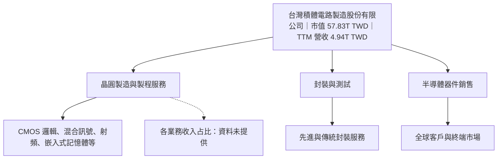
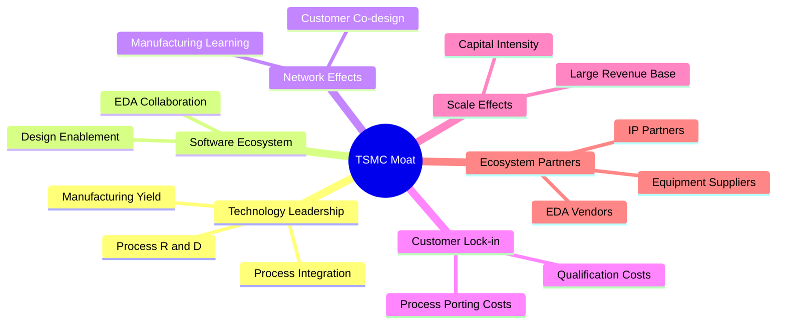
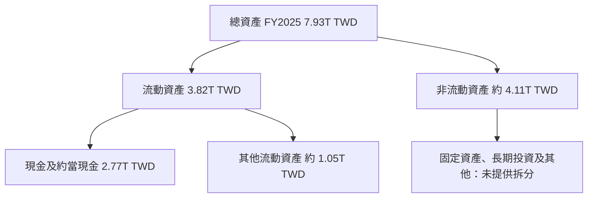
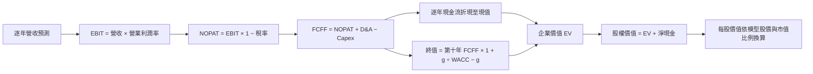
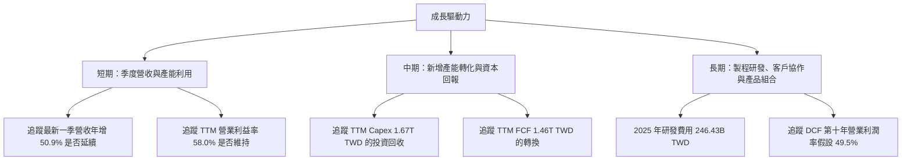
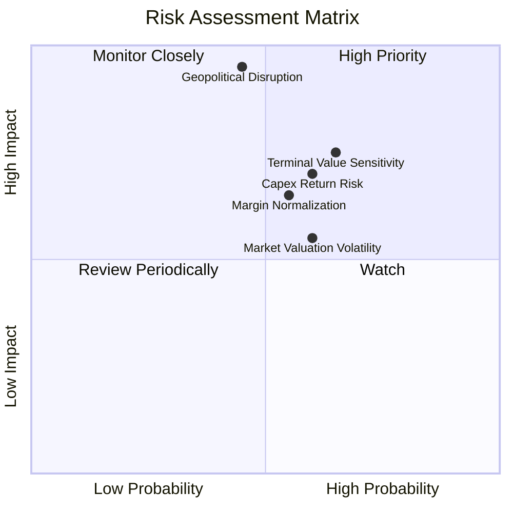
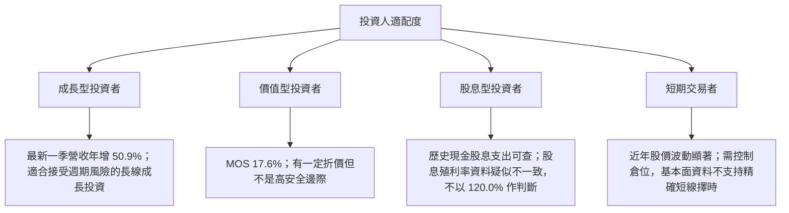

# 2330.TW 基本面深度分析報告
> **報告日期**：2026-11-24 ｜ **語言**：繁體中文 ｜ **數據來源**：Yahoo Finance、Roic.ai ｜ **分析師**：CFA 級機構研究  
> **資料狀態**：Finviz、StockAnalysis 與近期新聞資料未提供可用內容；財務報表資料以 Yahoo Finance 季度資料為主，並參考 Roic.ai 歷史資料。財報幣別與股價均為新台幣。

## 目錄

| # | 章節 | 核心結論 |
|---|------|----------|
| 1 | 執行摘要 | 買入；加權合理價值 2,463.86 TWD；MOS +17.6% |
| 2 | 公司概覽與商業模式 | 先進製程、規模與客戶協作構成主要護城河 |
| 3 | 損益表深度分析 | TTM 營收 4.94T TWD；最新一季年增 50.9%；TTM 營業利益率 58.0% |
| 4 | 資產負債表分析 | 淨現金 2.95T TWD；流動比率 2.584 |
| 5 | 現金流量深度分析 | TTM FCF 1.46T TWD；資本支出高，FCF 轉換受再投資影響 |
| 6 | 獲利能力與資本效率 | 最新 ROIC 缺值；可取得的 2018 年 ROIC 高於目前 WACC |
| 7 | 相對估值分析 | Forward P/E 14.9x；同業比較顯示估值並非所有指標皆便宜 |
| 8 | DCF 內在價值評估 | 基準 DCF 2,651.56 TWD；加權合理價值 2,463.86 TWD |
| 9 | 成長催化劑 | 2026 年最新一季營收年增 50.9%；TAM 數據未提供 |
| 10 | 風險矩陣 | 地緣政治、資本支出與估值終值依賴為主要風險 |
| 11 | 投資建議 | 買入；建議買入區間 1,125.71–2,217.47 TWD，並設營運監控門檻 |

---

## 1. 執行摘要

### 1.0 一頁式投資儀表板（Portfolio Manager 30 秒速讀）

| 項目 | 內容 |
|------|------|
| **投資論點（3 句）** | ① 2026-09-30 止 TTM 營收為 **4.94T TWD**，最新一季營收年增 **50.9%**，但 TTM 營收年增率未提供。② TTM 營業利益率 **58.0%**、TTM FCF **1.46T TWD**，顯示高獲利伴隨顯著資本支出。③ 2026-11-23 收盤價 **2,030 TWD**，加權合理價值 **2,463.86 TWD**，MOS **+17.6%**，依規則 20 評級為買入。 |
| **綜合評分** | **8.2/10**（引用 1.1 評分卡） |
| **財務健康** | 🟢 現金與短期投資 **4.02T TWD**、總債務 **1.07T TWD**、淨現金 **2.95T TWD**；流動比率 **2.584**。 |
| **ROIC vs WACC** | 最新 ROIC：**N/A**；WACC **10.52%**。可取得的 Roic.ai 2018 年 ROIC 為 **19.11%**，高於目前 WACC，但不能代替最新 ROIC。 |
| **FCF 趨勢** | TTM FCF **1.46T TWD**，FCF Yield **2.52%**；年度 FCF 由 2023 年 **286.57B** 增至 2025 年 **992.38B TWD**。 |
| **估值** | Forward P/E **14.906114x** ｜ EV/EBITDA **13.816x** ｜ FCF Yield **2.52%** |
| **DCF 內在價值（基準）** | **2,651.56 TWD** ｜ 現價相對 DCF 折價 **−23.4%**，即現價／DCF 價值 − 1。 |
| **安全邊際（MOS）** | **+17.6%**＝(加權合理價值 **2,463.86** − 現價 **2,030**) ÷ 加權合理價值 **2,463.86**｜🟡 有限 |
| **預期報酬（基準情境 12M）** | **+21.4%**，由加權合理價值相對現價計算；屬估值隱含上行空間，不是保證報酬。 |
| **關鍵風險（前二）** | 地緣政治與供應鏈中斷；資本支出高且 DCF 終值現值占企業價值 **60.9%**。 |
| **評級 + 信心度** | 🟢 **買入** ｜ 信心：中。評級依 MOS 門檻；季度 EPS 預估值、最新 ROIC、歷史估值區間均缺資料，降低信心。 |

### 1.1 綜合評分卡（全報告唯一）

| 維度 | 評分（1–10） | 主要依據（引用數字與其來源章節） |
|------|--------------|----------------------------------|
| 成長性 | 8.0 | 最新一季營收年增 **50.9%**；但 TTM 營收成長率 N/A（第 3 章）。 |
| 獲利能力 | 9.0 | TTM 營業利益率 **58.0%**、毛利率 **65.8%**；最新 ROIC 與 Piotroski F-Score N/A（第 3、6 章）。 |
| 財務健康 | 9.0 | 淨現金 **2.95T TWD**、流動比率 **2.584**、CCC **2 天**（第 4 章）。 |
| 估值 | 6.0 | MOS **17.6%**，但 Forward P/E **14.906114x** 仍需對照高成長持續性及資本支出（第 7、8 章）。 |
| 護城河 | 10.0 | 長期製程研發、資本規模與客戶協作；2025 年研發費用 **246.43B TWD**（第 2 章）。 |
| 管理層與資本配置 | 7.0 | 年度 FCF 由 2023 年 **286.57B** 增至 2025 年 **992.38B TWD**；2025 年股權薪酬 **1.25B TWD**，但回購與資本回報效率資料不完整（第 5 章）。 |
| **綜合評分** | **8.2** | 六項算術平均＝(8.0 + 9.0 + 9.0 + 6.0 + 10.0 + 7.0) ÷ 6＝**8.2**。 |

### 1.2 五大投資論點 + 三大核心風險

| 類型 | 項目 | 具體依據 | 信心度 |
|------|------|----------|--------|
| 🟢 **投資論點①** | 營收動能正在加速 | 2026-09-30 單季營收 **1.49T TWD**，年增 **50.9%**；若需求與交付延續，固定成本吸收有利於維持高營業利潤率。 | 🟢 高 |
| 🟢 **投資論點②** | 營運獲利率高 | TTM 營業利益率 **58.0%**、毛利率 **65.8%**；顯示產品組合與產能利用度對盈利有強支撐，但不能假設永遠維持現況。 | 🟢 高 |
| 🟢 **投資論點③** | 資產負債表有緩衝 | 現金及短期投資 **4.02T**、總債務 **1.07T TWD**，淨現金 **2.95T TWD**。 | 🟢 高 |
| 🟢 **投資論點④** | FCF 規模已大 | TTM FCF **1.46T TWD**，2025 年年度 FCF **992.38B TWD**；有能力支持高額投資及股東分配。 | 🟢 中高 |
| 🟢 **投資論點⑤** | 估值仍有正向折價空間 | 加權合理價值 **2,463.86 TWD**，高於收盤價 **2,030 TWD**；MOS 為 **17.6%**，屬有限而非充足安全邊際。 | 🟡 中 |
| 🟡 **風險①** | 地緣政治與營運中斷 | 公司在多地營運，但重要製造與供應鏈集中風險可能影響出貨與資本使用；資料未提供可量化的地緣政治損失機率。 | 🔴 高衝擊 |
| 🟡 **風險②** | 高資本支出壓低現金轉換 | TTM 資本支出 **1.67T TWD**，占營業現金流 **3.13T TWD** 的重要部分；若投資回收慢於預期，FCF Yield 可能維持低位。 | 🟡 中高 |
| 🔴 **風險③** | DCF 對終值及長期假設敏感 | DCF 終值現值占企業價值 **60.9%**；若 WACC 上升或長期成長、利潤率下修，估值會顯著降低。 | 🔴 高衝擊 |

### 1.3 快速統計卡片

| 指標 | 公司實際值（期間） | 同業中位數 | 狀態 |
|------|--------------------|------------|------|
| 營收成長（TTM） | **N/A** | — | 🟡 TTM 對照期資料未提供 |
| 營收成長（最新一季年增） | **50.9%** | **20.9%**（UMC、GFS、INTC 中位數） | 🟢 |
| 毛利率（TTM） | **65.8%** | **31.7%**（三家中位數） | 🟢 |
| 營業利益率（TTM） | **58.0%** | — | 🟢 |
| ROIC（TTM） | **N/A** | — | 🟡 |
| Forward P/E | **14.906114x** | **16.0x** | 🟢 相對同業中位數較低 |
| FCF Yield（TTM） | **2.52%** | — | 🟡 |
| Piotroski F-Score | **N/A / 9** | — | 🟡 缺少兩個相隔一年的 SEC 申報期資料 |

### 1.4 投資結論

```text
╔══════════════════════════════════════════════════════════════════╗
║                    📊 投資結論摘要                               ║
╠══════════════════════════════════════════════════════════════════╣
║  評級：買入（依 MOS 規則；未作質化一級調整）                     ║
║  價格（2026-11-23 收盤）：2,030.00 TWD                           ║
║  DCF 內在價值（基準）：2,651.56 TWD（現價折價 23.4%）           ║
║  安全邊際 MOS：+17.6%（＝(加權合理價值−現價)÷加權合理價值）     ║
║  加權合理價值（8.8）：2,463.86 TWD                              ║
║  DCF 情境價值：                                                   ║
║    悲觀情境：1,125.71 TWD（−44.5%）                             ║
║    基準情境：2,651.56 TWD（+30.6%）                             ║
║    樂觀情境：5,913.41 TWD（+191.3%）                            ║
║  綜合評分：8.2/10（引用 1.1）                                    ║
║  適合投資人：能承受半導體週期、地緣政治與估值波動的長線投資人   ║
╚══════════════════════════════════════════════════════════════════╝
```

---

## 2. 公司概覽與商業模式

### 2.1 業務結構與收入來源

公司主要業務為半導體製造、封裝、測試及銷售，涵蓋 CMOS 邏輯、混合訊號、射頻、嵌入式記憶體及其他製程。財務資料未提供各業務板塊收入占比，故不推估占比或金額，也不畫比例圖。



**收入結構限制**：上述分類依公司業務描述整理；分部營收、毛利貢獻及軟體／服務收入拆分未提供，不能將總營收任意分配至細分業務。

### 2.2 市場份額

市場份額數據未提供，亦沒有可引用的新聞或產業資料年份與來源。以財務資料觀察，公司 TTM 營收 **4.94T TWD**、最新一季營收年增 **50.9%**，高於同業資料中 UMC 的 **25.6%**、GFS 的 **12.5%**、INTC 的 **20.9%**；此比較顯示近期營收增速較快，但不能代替市場份額。

### 2.3 競爭護城河分析



### 2.4 護城河強度

| 護城河項目 | 強度（強／中／弱） | 證據（引用數字或事實） | 會削弱它的情況 |
|------------|--------------------|------------------------|----------------|
| 技術與製程累積 | 強 | 2025 年研發費用 **246.43B TWD**，高於 2024 年 **204.18B TWD**。 | 製程迭代失速、良率爬坡不順或競爭者縮小差距。 |
| 客戶鎖定與共同設計 | 強 | 晶片製程、設計工具與客戶產品週期需協同，替換供應商可能涉及重新設計與驗證；資料未提供轉換成本金額。 | 客戶採用多來源策略、製程相容性提高或競爭者量產能力改善。 |
| 規模效應 | 強 | 2025 年營收 **3.81T TWD**，2022 年為 **2.26T TWD**；規模有助吸收龐大研發與設備投資。 | 產能利用率下降，或新增產能未能按期轉化為有效出貨。 |
| 供應鏈生態 | 中至強 | 公司與設備、IP、EDA、設計客戶的協作是製造業務的重要條件；量化夥伴數與依賴比例未提供。 | 關鍵設備、材料或跨境供應鏈中斷。 |
| 軟體生態 | 中 | 設計支援及製程規則與客戶工作流程相互配合；財務數據未單獨揭露軟體收入。 | 客戶設計流程轉移成本下降或替代平台成熟。 |
| 網路效應 | 中 | 生產學習與客戶量產經驗可累積，但並非典型消費者網路效應。 | 產業技術路線改變，或競爭者取得同等規模的量產經驗。 |

**1.1 護城河評分理由**：評分 **10.0/10**，依據為 2025 年營收 **3.81T TWD**、研發支出 **246.43B TWD**及長期資本密集與客戶協作特性；此分數反映質化與規模優勢，不代表沒有地緣政治或執行風險。

---

## 3. 損益表深度分析

### 3.1 年度收入成長趨勢（近 4 年）

年度數字取自年度損益表，年度成長率由相鄰年度營收計算；四年數列指 2022–2025 四個財年，CAGR 跨越三個年度區間。

```text
╔══════════════════════════════════════════════════════════════════╗
║              台灣積體電路年度收入趨勢（FY2022-FY2025）          ║
╠══════════════════════════════════════════════════════════════════╣
║  FY2022  2.26T TWD  ███████████████            起始年           ║
║  FY2023  2.16T TWD  ██████████████             YoY: -4.4% 🟡    ║
║  FY2024  2.89T TWD  ███████████████████        YoY:+33.8% 🟢    ║
║  FY2025  3.81T TWD  █████████████████████████  YoY:+31.8% 🟢    ║
╠══════════════════════════════════════════════════════════════════╣
║  2022-2025 營收 CAGR：(3.81 ÷ 2.26)^(1/3) − 1 = 約 19.0%        ║
╚══════════════════════════════════════════════════════════════════╝
```

2023 年營收較 2022 年下降約 **4.4%**，反映年度營收並非直線成長；2024、2025 年分別年增約 **33.8%**、**31.8%**，顯示後續需求與產品組合改善。由於 TTM 對比 TTM 的成長率未提供，不能把最新單季年增 **50.9%** 代稱為 TTM 成長率。

### 3.2 季度收入趨勢分析

| 季度 | 營收（約） | QoQ 成長 | YoY 成長 | 備註 |
|------|------------:|---------:|---------:|------|
| 2025-12-31 | 1.05T TWD | — | 約 **20.5%** | YoY 以 Roic.ai 2024 年 Q4 **868.461B** 與 2025 年 Q4 **1,046.090B** 比較計算。 |
| 2026-03-31 | 1.13T TWD | 約 **8.4%** | 約 **35.1%** | Roic.ai 季度營收 **1,134.103B**；依其 2025 年 Q1 **839.254B** 計算。 |
| 2026-06-30 | 1.27T TWD | 約 **12.0%** | 約 **36.1%** | Roic.ai 營收 **1,270.380B**；依 2025 年 Q2 **933.792B** 計算。 |
| 2026-09-30 | 1.49T TWD | 約 **17.6%** | **50.9%** | 最新一季年增率以 VERIFIED FIGURES 原值引用；Roic.ai 單季數列顯示營收升至 **1,494.243B**。 |

QoQ 計算使用 Roic.ai 精確季度序列；報表季度表格以兩位小數的兆元呈現，因此顯示值與計算基礎會有四捨五入差異。連續三季 QoQ 增長、且最新一季 YoY 加速，代表近期出貨與需求動能擴大；仍需以後續季度毛利率、產能與資本支出驗證持續性。

### 3.3 利潤率演變分析

| 利潤率指標 | FY2022 | FY2023 | FY2024 | FY2025 | 趨勢 | 評估 |
|------------|--------|--------|--------|--------|------|------|
| **毛利率** | 約 59.7% | 約 54.6% | 約 56.1% | 約 59.8% | 2023 下行後連續回升 | 🟢 |
| **營業利益率** | 約 49.6% | 約 42.7% | 約 45.7% | 約 50.9% | 2023 下行後回升至高於 2022 | 🟢 |
| **淨利率** | 約 43.9% | 約 39.4% | 約 40.1% | 約 44.6% | 隨營業獲利回升 | 🟢 |

以上年度利潤率以年度毛利、營業利益、淨利除以年度營收計算，為四捨五入值。TTM 毛利率 **65.8%**、TTM 營業利益率 **58.0%**、TTM 淨利率 **51.1%**，與年度指標期間不同，不可直接視為同一財年趨勢。

**利潤率演變深度解析**：2023 年年度營收由 **2.26T** 降至 **2.16T TWD**，營業利益率同步由約 **49.6%** 降至 **42.7%**，顯示半導體週期與產能利用率對毛利、營業槓桿有影響。2024–2025 年營收恢復成長，營業利益率回升至約 **50.9%**。最新 TTM 營業利益率 **58.0%** 更高，可能受產品組合、需求與產能利用率影響；但資料未提供按製程或產品拆分，無法把改善精確歸因到單一因素。

### 3.4 費用結構分析

財務資料提供年度研發費用，但未提供完整營業費用拆分，亦未提供可直接重建的費用結構百分比，因此不繪製比例型 pie chart，避免以估算比例冒充實際結構。

| 項目 | 數值 | 解讀 |
|------|------:|------|
| 2025 年研發費用 | **246.43B TWD** | 約為 2025 年營收 **3.81T TWD** 的 **6.5%**；研發是維持製程與客戶設計支援的重要投入。 |
| 2024 年研發費用 | **204.18B TWD** | 2025 年增加 **42.25B TWD**，約年增 **20.7%**。 |
| 2023 年研發費用 | **182.37B TWD** | 低於 2024–2025 年水準。 |
| 2022 年研發費用 | **163.26B TWD** | 2022–2025 年投入逐步增加。 |

```text
╔══════════════════════════════════════════════════════════════════╗
║                   2025 年費用結構可見項目                        ║
╠══════════════════════════════════════════════════════════════════╣
║  研發費用       246.43B TWD  約為營收 6.5%                       ║
║  其他營業費用   N/A          未提供可核對拆分                     ║
║  利息、稅項等   不作營業費用比例圖，避免混用損益表層級           ║
╚══════════════════════════════════════════════════════════════════╝
```

### 3.5 季度 EPS 趨勢與盈餘品質（Quality of Earnings）

Roic.ai 提供 EPS 數列：2025 Q4 **18.72 TWD**、2026 Q1 **22.08 TWD**、2026 Q2 **27.25 TWD**、2026 Q3 **29.43 TWD**。季度 EPS 由 2025 Q4 至 2026 Q3 逐季增加；但 Yahoo Finance 的 EPS Est 與 EPS Act 均為 `nan`，故無法判定過去四季是否超預期或不及預期，亦不推測原因。

| 盈餘品質項目 | 數值／佔比 | 評估 |
|--------------|-----------|------|
| 股權薪酬 SBC / 營收 | 最近四個季度 SBC 合計 **513.37M TWD**；約占 TTM 營收 **0.010%** | 🟢 目前數據顯示稀釋性費用占比低；季度 SBC 與年度 SBC 資料來源期間不同，應留意口徑。 |
| SBC / 營業現金流 | 約 **0.016%**（513.37M ÷ 3.13T） | 🟢 對現金流與股東稀釋的量級影響低。 |
| FCF / 淨利（現金轉換率） | 約 **57.8%**（TTM FCF 1.46T ÷ 最近四季淨利約 2.53T） | 🟡 FCF 低於淨利，主要應結合高資本支出評估，而非單純視為盈餘品質差。 |
| 一次性／非經常性損益 | N/A（未提供分項資料） | 無法判定是否有一次性項目顯著影響當期盈餘。 |
| 有效稅率異常 | **17.0%**（最新年度有效稅率） | 稅率來源有提供，未見足以判定異常的多年期完整資料。 |
| 資本化支出 vs 費用化 | TTM 資本支出 **1.67T TWD**；資本支出主要形成長期資產，並未提供資本化政策細目 | 高資本支出降低當期 FCF；僅憑現有資料不能認定公司透過資本化遞延費用或虛增利潤。 |

**盈餘品質結論**：SBC 相對營收與營業現金流占比很低；TTM FCF 約為最近四季淨利的 **57.8%**，現金轉換低於淨利的主要可見解釋是高資本支出，TTM Capex 為 **1.67T TWD**。缺少一次性損益與資本化政策細節，因此對盈餘含金量判斷為中等信心；估值應以扣除資本投資後的 FCF 與產能回報為核心觀察。

---

## 4. 資產負債表分析

### 4.1 資產結構分解

最新季度資產負債表總資產未提供。以下以 2025-12-31 年度資產負債表數字呈現；非流動資產以總資產減流動資產計算，並明確標為衍生值。



非流動資產估算式：**7.93T − 3.82T = 約 4.11T TWD**。該差額只是同年度總資產與流動資產之差，不代表財報提供了細項分類。

### 4.2 流動性與營運資金分析

| 指標 | 最新 TTM | 一年前 TTM | 變化 | 解讀 |
|------|----------|------------|------|------|
| DSO 應收帳款天數 | **1 天** | N/A（未提供） | N/A | 數據顯示收款天數低；但應收帳款餘額與其他資料來源有異常差異，解讀需保守。 |
| DIO 存貨天數 | **92 天** | N/A（未提供） | N/A | 存貨天數可反映生產與供應鏈週期，缺乏去年同口徑資料，不能判定是否惡化。 |
| DPO 應付帳款天數 | **91 天** | N/A（未提供） | N/A | 與供應商付款週期相近；無法單憑天數判定議價力變化。 |
| CCC 現金轉換週期 | **2 天** | N/A（未提供） | N/A | 依品質指標原值引用，不另重算；缺少一年前數字，無法判斷趨勢。 |

流動比率 **2.584**、速動比率 **2.287**，顯示短期資產對短期負債有覆蓋能力。品質指標的一年前營運資金天數缺失，因此不補值、不推導趨勢。

### 4.3 債務結構分析

```text
╔══════════════════════════════════════════════════════════════════╗
║                   台灣積體電路債務健康診斷                       ║
╠══════════════════════════════════════════════════════════════════╣
║  總債務：          1.07T TWD  ██░░░░░░░░░░░░░░░░░  可由現金覆蓋  ║
║  現金及短期投資：  4.02T TWD  ████████████████████  高於總債務  ║
║  淨現金：          2.95T TWD  ██████████████░░░░░░  🟢           ║
║                                                                  ║
║  流動比率：        2.584      🟢                                 ║
║  速動比率：        2.287      🟢                                 ║
║  Debt/EBITDA：     約 0.39x（1.07T ÷ TTM EBITDA 約 2.74T）       ║
║  利息保障倍數：    N/A（未提供利息費用及可核對 EBIT）            ║
╚══════════════════════════════════════════════════════════════════╝
```

Debt/EBITDA 約 **0.39x** 的分子、分母取自總債務 **1.07T TWD** 與 EBITDA 約 **2.74T TWD**，為近似計算；不同財報期間與取整可能造成差異。雖有淨現金緩衝，仍不應把現金餘額等同於可全部分配的資金，因公司需要持續投入資本支出。

### 4.4 股東權益趨勢

```text
╔══════════════════════════════════════════════════════════════════╗
║             股東權益趨勢（年度財報，TWD）                        ║
╠══════════════════════════════════════════════════════════════════╣
║  FY2022  2.90T  ████████████                                   ║
║  FY2023  3.43T  ██████████████                                 ║
║  FY2024  4.24T  █████████████████                               ║
║  FY2025  5.36T  █████████████████████                           ║
╚══════════════════════════════════════════════════════════════════╝
```

股東權益由 2022 年 **2.90T TWD** 增至 2025 年 **5.36T TWD**。增加與公司累積獲利及資產規模擴大相符；但未提供完整權益變動表，故不將權益增加歸因於單一因素。

---

## 5. 現金流量深度分析

### 5.1 現金流量瀑布圖

單季現金流數據以最近四季加總；淨現金變化的完整構成未提供，故不畫出不存在的數值。


圖中淨利與股息為季度數列加總；TTM OCF、Capex、FCF 按 VERIFIED FIGURES 原值引用。FCF 並非股息後自由現金流，不能以「FCF − 股息」直接推算淨現金變化，因尚有投資、融資及匯率等項目。

### 5.2 FCF 轉換率趨勢

| 年度 | FCF | 淨利 | FCF／淨利 | 趨勢與解讀 |
|------|----:|-----:|----------:|------------|
| 2022 | 520.97B TWD | 992.92B TWD | 約 **52.5%** | 資本支出對淨利現金轉換有顯著影響。 |
| 2023 | 286.57B TWD | 851.74B TWD | 約 **33.6%** | 年度 FCF 下滑，與週期及投資支出共同影響相符。 |
| 2024 | 861.20B TWD | 1.16T TWD | 約 **74.2%** | FCF 恢復，現金轉換改善。 |
| 2025 | 992.38B TWD | 1.70T TWD | 約 **58.4%** | 絕對 FCF 增加，但淨利增幅與投資支出使比率回落。 |

比率由年度 FCF 除以年度淨利計算，採財報已列示數字並四捨五入。TTM 口徑下 FCF **1.46T TWD**、FCF Yield **2.52%**，與單一年度數據期間不同。

### 5.3 自由現金流趨勢

```text
╔══════════════════════════════════════════════════════════════════╗
║                年度自由現金流趨勢（TWD）                         ║
╠══════════════════════════════════════════════════════════════════╣
║  FY2022  520.97B  ██████████                                     ║
║  FY2023  286.57B  ██████                                         ║
║  FY2024  861.20B  █████████████████                              ║
║  FY2025  992.38B  ████████████████████                           ║
║  TTM     1.46T    █████████████████████████████                  ║
╠══════════════════════════════════════════════════════════════════╣
║  TTM FCF Yield：2.52%（按 VERIFIED FIGURES 原值引用）             ║
╚══════════════════════════════════════════════════════════════════╝
```

年度 FCF 由 2023 年低點 **286.57B TWD** 回升至 2025 年 **992.38B TWD**，TTM 為 **1.46T TWD**。趨勢支持現金創造能力提升，但不能忽略 TTM 資本支出已達 **1.67T TWD**，高資本需求仍是 FCF 變動的重要來源。

### 5.4 資本配置評估

分配比例資料不足，不繪製 pie chart。可辨識的現金用途如下：

| 配置項目 | 數值 | 評估 |
|----------|------:|------|
| 資本支出 | TTM **1.67T TWD**；2025 年 **1.28T TWD** | 核心產能與製程投資需求高，回報需透過未來出貨、毛利與產能利用率驗證。 |
| 股息 | 2025 年現金股息支付 **466.78B TWD** | 2025 年有實際現金分配；季度股息現金流資料亦有列示。 |
| 股票回購 | N/A（未提供） | 不對回購規模作推定。 |
| 留存現金／其他投資 | N/A（無完整現金流橋接） | 無法計算其占比。 |

---

## 6. 獲利能力與資本效率

### 6.1 ROE / ROA / ROIC 趨勢

| 指標 | 可用期間 | 數值 | 評估 |
|------|----------|-----:|------|
| ROE | TTM | **41.9%** | 高；代表股東權益報酬良好，但 DuPont 品質指標未提供，不能分解槓桿貢獻。 |
| ROA | TTM | **20.6%** | 高；顯示資產盈利能力良好。 |
| ROIC | 最新 TTM | **N/A** | 最新 ROIC 未提供，不以 ROE 或 ROA 替代。 |
| ROIC | Roic.ai 2018 年歷史值 | **19.11%** | 為歷史觀察值，不代表目前回報。 |

行業均值沒有可靠數值來源，故不列同業均值欄。可取得的歷史 ROIC 指標來自 Roic.ai 2018 年資料，與 2026 年 WACC 對比僅供歷史參考。

### 6.2 ROIC vs WACC 分析（核心價值創造判斷）

```text
╔══════════════════════════════════════════════════════════════════╗
║                ROIC vs WACC 深度分析                             ║
╠══════════════════════════════════════════════════════════════════╣
║  WACC（VERIFIED FIGURES）：10.52%                                 ║
║  ├── 無風險利率（10Y Treasury）：4.92%                           ║
║  ├── 市場風險溢酬 ERP：5.00%                                    ║
║  ├── Beta（原始 Yahoo）：1.23                                   ║
║  ├── Beta used（調整後）：1.16                                  ║
║  ├── 股權成本（提供值）：10.69%                                 ║
║  ├── 稅前債務成本：1.16%                                        ║
║  ├── 有效稅率：17.0%                                            ║
║  ├── 股權／債務權重：98.2%／1.8%                                ║
║  └── WACC（採用值）：10.52%                                     ║
║                                                                  ║
║  最新 ROIC：N/A（未提供）                                        ║
║  歷史 ROIC：2018 年 19.11%（Roic.ai）                           ║
║  歷史 ROIC − 目前 WACC：19.11% − 10.52% = +8.59 個百分點        ║
║                                                                  ║
║  結論：歷史數值顯示曾高於資本成本；最新期間是否仍創造超額價值， ║
║        需待最新 ROIC 資料驗證。                                  ║
╚══════════════════════════════════════════════════════════════════╝
```

依指定原值引用，調整後 Beta 為 **1.16**，其調整方式為 **⅔ × 原始 Beta 1.23 + ⅓**。提供的股權成本 **10.69%** 與展示至兩位小數的 Rf、Beta、ERP 直接代入可能出現微小差異；本報告使用 VERIFIED FIGURES 的 WACC **10.52%**，不另建或替換 WACC。另因未提供利息費用金額及平均計息負債明細，無法獨立重建 Kd；不推導缺失輸入。

### 6.3 杜邦三因素分解

**N/A**（Quality Figures：淨利、營收、總資產或正股東權益必要資料不齊，杜邦三因素分解未計算）。因此不以報表中 ROE **41.9%** 自行反推淨利率、資產週轉率或權益乘數。

### 6.4 財務體質：Piotroski F-Score

**N/A**（需要相隔一年的兩個 TTM 期間及 SEC 申報資料；目前數據來源為 Yahoo Finance 季度報表，九項測試結果未提供）。因此不補造九項測試分數，也不從單一期資料推斷得分。

---

## 7. 相對估值分析

### 7.1 同業估值比較表格

公司倍數取市場估值資料；同業倍數取 Yahoo Finance 同業比較資料。市銷率與 EV/EBITDA 的部分 UMC 資料因幣別混合而不可比，依規則保留 N/A，不以其他數據替代。

| 估值指標 | **TSMC** | **UMC** | **GFS** | **INTC** | 本公司評估 |
|----------|---------:|------:|-----:|------:|-----------|
| **Trailing P/E** | **22.541191x** | 13.6x | 111.3x | N/A | 🟡 相較 UMC 較高；GFS 受極高 TTM 倍數影響。 |
| **Forward P/E** | **14.906114x** | 16.0x | 15.0x | 33.3x | 🟢 低於同業中位數 **16.0x**；需同時考量成長與地緣風險。 |
| **P/S Ratio（TTM）** | **11.694906x** | N/A | 3.0x | 5.3x | 🔴 公司市銷率高於可用同業；公司利潤率也較高，不能只看 P/S。 |
| **EV/EBITDA（TTM）** | **13.816x** | N/A | 10.4x | 17.2x | 🟡 高於 GFS、低於 INTC；UMC 混合幣別不可比。 |
| 最新一季營收年增 | **50.9%** | 25.6% | 12.5% | 20.9% | 🟢 高於三家同業的中位數 **20.9%**。 |
| 毛利率（TTM） | **65.8%** | 31.7% | 28.5% | 40.2% | 🟢 高於三家同業的中位數 **31.7%**。 |

同業營收成長率中位數為 **20.9%**，毛利率中位數為 **31.7%**，Forward P/E 中位數為 **16.0x**。同業差異甚大，尤其 GFS Trailing P/E **111.3x**，因此相對估值需與利潤率、成長及資本需求同看。

### 7.2 歷史估值區間分析

**N/A**（未提供 VERIFIED FIGURES 的「Valuation vs own history」數值）。因此不推估歷史 P/E 分位數或歷史區間。

### 7.3 情境價值（Bear / Base / Bull，照抄 DCF MODEL 的 Scenarios）

| 情境 | 第 1 年營收成長 | 期末營業利潤率 | WACC | 每股價值 | 相對現價 | 機率 | 會發生的條件 |
|------|----------------:|----------------:|-----:|---------:|---------:|-----:|--------------|
| 🔴 悲觀 | 15.0% | 42.1% | 11.52% | **1,125.71 TWD** | **−44.5%** | 25% | 需求放緩、資本回收較慢，利潤率較基準下降，風險折現率上升。 |
| 🟡 基準 | 30.0% | 49.5% | 10.52% | **2,651.56 TWD** | **+30.6%** | 50% | 高成長逐步衰退，期末營業利潤率回落至模型採用值。 |
| 🟢 樂觀 | 45.0% | 54.5% | 9.52% | **5,913.41 TWD** | **+191.3%** | 25% | 成長延續、利潤率維持較高水平，資本成本下降。 |

機率加權情境價值為 **3,085.56 TWD**（+52.0%）；此數值僅作情境參考，不替代第 8.8 節依固定方法權重計算的加權合理價值。

### 7.4 相對估值隱含價格區間

```text
╔══════════════════════════════════════════════════════════════════╗
║             相對估值方法回推每股價值（TWD）                      ║
╠══════════════════════════════════════════════════════════════════╣
║  1,858.96 ───────── 2,030.00 ───────── 2,392.97 ───── 2,651.56 ║
║  EV/EBITDA             現價            Forward P/E      DCF 基準 ║
╚══════════════════════════════════════════════════════════════════╝
```

| 方法 | 每股價值 | 依據 |
|------|---------:|------|
| 同業 Forward P/E | **2,392.97 TWD** | UMC、GFS、INTC 同業中位數 **16.0x** × Forward EPS **149.60 TWD**。 |
| 同業 EV/EBITDA | **1,858.96 TWD** | GFS、INTC 中位數 **13.8x** × TTM EBITDA，再加淨現金；方法輸出依估值資料原值引用。 |

---

## 8. DCF 內在價值評估（Discounted Cash Flow）

> 金額單位為 **TWD billions**，每股價格為 TWD。DCF 模型輸出依程式計算值原樣引用；四捨五入精度為金額兩位小數、比率一位小數、折現因子三位小數。股數／市值資料另有口徑不一致，於 8.5 與 8.9 說明。

### 8.0 估值推理鏈（Thinking Logic：在算之前先想清楚）

**Step 1 — 價值由哪些變數決定？**  
模型價值由既有晶圓製造現金流、未來營收增長與利潤率、以及資本支出轉化為出貨及 FCF 的效率決定。資料未提供收入分部占比，因此不能替特定製程或新業務分配營收。DCF 對終值折現高度敏感：終值現值占 EV **60.9%**；因此長期利潤率、WACC 與永續成長率是重要估值變數。

**Step 2 — 模型選擇**

| 決策點 | 本報告採用 | 理由（含數字） | 曾考慮但否決 | 否決理由 |
|--------|-----------|----------------|--------------|----------|
| 現金流定義 | FCFF | 與 WACC 折現相配；模型列示 FCFF = NOPAT + D&A − Capex。 | FCFE | 模型以企業價值 EV 作橋接，故採 FCFF。 |
| 預測期 N | 10 年 | DCF MODEL 固定輸入為 10 年，並逐年列示 FY+1 至 FY+10。 | 5 年 | 與程式模型不一致，不能自行更換。 |
| 終值方法 | Gordon Growth | 模型提供永續成長率 **3.0%** 與 Gordon Growth 終值。 | 自行另建退出倍數 | DCF MODEL 未提供退出倍數終值及相應價值，不另行建模。 |
| EBIT 基礎 | GAAP EBIT | 模型明確採 GAAP EBIT。 | 非 GAAP EBIT | 避免把 SBC 或其他費用調整為未提供的非 GAAP 數值。 |

**Step 3 — 關鍵假設推導鏈**

- **營收成長**：錨點＝最新一季營收年增 **50.9%**（單季，不是 TTM）→ 程式將第一年成長設為 **30.0%**，並按年線性下降至第十年 **3.0%** → 採用模型列示的逐年成長率 → 否決直接把 **50.9%** 當作十年持續成長，因為那是單季同比，不是長期成長率，也沒有足夠資料支持延續。
- **期末營業利益率**：錨點＝TTM 營業利益率 **58.0%**；模型依近五年中位數設定第十年 **49.5%** → 採用 FY+1 **58.0%** 逐年下滑至 FY+10 **49.5%** → 否決十年維持 **58.0%**，因模型明確假設利潤率正常化，且歷史年度營業利益率曾在 2023 年約 **42.7%**。
- **永續成長率 g**：錨點＝模型輸入 **3.0%**，低於 WACC **10.52%** → 採用 **3.0%** → 否決更高的長期成長率，因缺乏公司長期 GDP、通膨或產業成熟期資料支持。
- **預測期 N**：錨點＝程式模型 **10 年** → 採用 **10 年**，完整展開十年現金流 → 否決改為其他年數，因規則要求使用既有模型。
- **Capex／營收**：錨點＝TTM Capex／營收約 **33.8%** → 模型由 FY+1 **33.8%** 逐步下滑至 FY+10 **16.6%**，後者接近模型所述約為 D&A 的 1.1 倍 → 採用模型路徑 → 否決把目前高資本支出比率永久固定，因模型預設再投資強度隨成熟度下降。
- **GAAP EBIT、SBC 與股數**：錨點＝模型以 GAAP EBIT 為基礎；模型註明 SBC 已在 GAAP EBIT 作為費用，股數不再進一步稀釋 → 採用組合 **(A)**：GAAP EBIT + 不再扣 SBC + 年稀釋率 0% → 否決額外扣 SBC 或加稀釋率，避免同一經濟成本重複計算。
- **WACC**：錨點＝Cost of capital 提供的 **10.52%** → 直接採用，不另行建立 WACC → 否決自行調整國別溢酬或替代 Beta，因沒有額外輸入依據且規定不得另算。
- **有效稅率**：錨點與採用值均為 **17.0%**，取自最新年度有效稅率。
- **D&A／營收**：錨點與採用值均為 **15.1%**（TTM 模型輸入）。
- **營運資金變動**：模型沒有建模營運資金，不新增 ΔWC 假設或現金流列。
- **終值方法**：錨點＝模型 Gordon Growth 終值；採用 **3.0%** 永續成長率與 **10.52%** WACC → 否決自行增加退出倍數交叉驗證，因模型未提供該倍數與計算結果。

**Step 4 — 最脆弱的一環**  
最脆弱的是長期現金流、利潤率與終值假設；若 WACC 上升至 **12.52%** 且永續成長仍為 **3.0%**，模型每股價值由基準 **2,651.56 TWD** 降至 **2,022.95 TWD**，接近現價 **2,030 TWD**。

**Step 5 — 計算路徑圖**



### 8.1 模型假設總表（Model Inputs）

| 假設項目 | 採用值 | 依據／來源 | 敏感度 |
|----------|--------|-------------|--------|
| 預測期長度 N | **10 年** | DCF MODEL 固定輸入 | 🟡 中 |
| 營收成長路徑 | FY+1 **30.0%**，FY+10 **3.0%**，逐年線性遞減 | FY+1 錨定最新單季 YoY **50.9%**，並依模型限制至 30%；長期下降至 3.0% | 🔴 高 |
| 營業利潤率 | FY+1 **58.0%** → FY+10 **49.5%** | TTM **58.0%**，第十年採近五年中位數模型值 | 🔴 高 |
| 有效稅率 | **17.0%** | 最新年度有效稅率 | 🟢 低 |
| Capex／營收 | FY+1 **33.8%** → FY+10 **16.6%** | TTM 比率向模型設定的成熟期水準遞減 | 🔴 高 |
| D&A／營收 | **15.1%** | TTM 模型輸入，固定 | 🟢 低 |
| ΔWC／營收增額 | 未建模 | DCF MODEL 註明 working capital is not modelled | 🟢 低 |
| EBIT 基礎 | GAAP | DCF MODEL 明確使用 GAAP EBIT | 🟡 中 |
| SBC 處理 | GAAP EBIT 已含 SBC 費用；FCFF 不再扣 SBC | 模型註明採組合 A | 🟡 中 |
| 年稀釋率 | **0%**（固定股數） | 與組合 A 相容；模型不再額外稀釋 | 🟡 中 |
| 永續成長率 g | **3.0%** | DCF MODEL 固定輸入，且低於 WACC | 🔴 高 |
| 終值方法 | Gordon Growth | DCF MODEL 提供 Gordon Growth 終值；未提供退出倍數計算 | 🔴 高 |
| WACC | **10.52%** | Cost of capital 提供值，8.2 說明 | 🔴 高 |

本模型採用 **(A) GAAP EBIT + 固定股數**，故 SBC 影響已計入一次；FCFF 不再減 SBC，股數亦不逐年擴大。FCFF 定義依模型為 **NOPAT + D&A − Capex**，不含營運資金變動。

### 8.2 折現率推導（WACC）

```text
╔══════════════════════════════════════════════════════════════════╗
║                    WACC 推導（折現率）                           ║
╠══════════════════════════════════════════════════════════════════╣
║  股權成本 Ke（CAPM，引用程式提供值）：                           ║
║  ├── 無風險利率 Rf（10Y Treasury）：4.92%                       ║
║  ├── 市場風險溢酬 ERP：5.00%（假設值，來源為資本成本輸入）      ║
║  ├── Beta 原始值：1.23；採用調整後 Beta：1.16                   ║
║  ├── 調整方式：⅔ × 1.23 + ⅓ = 1.153，顯示為 1.16               ║
║  ├── 規模／國別溢酬：未另加計，輸入資料未提供                    ║
║  └── Ke（提供值）：10.69%                                       ║
║                                                                  ║
║  債務成本 Kd：                                                   ║
║  ├── 稅前 Kd（提供值）：1.16%                                   ║
║  ├── 有效稅率：17.0%                                            ║
║  └── 稅後 Kd：1.16% × (1 − 17.0%) = 約 0.96%                   ║
║                                                                  ║
║  資本結構權重（提供值）：                                        ║
║  ├── 股權權重：98.2%                                             ║
║  ├── 債務權重：1.8%                                              ║
║  └── WACC（採用）：10.52%                                        ║
╚══════════════════════════════════════════════════════════════════╝
```

**WACC 五步複算與限制**

1. **Ke**：Cost of capital 原值為 **10.69%**。以畫面上四捨五入的 Rf、Beta、ERP 直接計算，`4.92% + 1.16 × 5.00% = 10.72%`；與提供的 **10.69%** 相差 **0.03 個百分點**，可能來自底層精度差異。本報告不替換提供值。
2. **稅前 Kd**：資料提供 **1.16%**，但利息費用金額及平均計息負債餘額未提供，故不能完整重建「利息費用 ÷ 平均計息負債」。
3. **稅後 Kd**：`1.16% × (1 − 17.0%) = 0.9628%`，約 **0.96%**。
4. **權重**：VERIFIED FIGURES 提供 E/D 權重為 **98.2%／1.8%**，合計 **100.0%**。提供市場市值 **57.83T TWD**；債務按成本資本資料採用，因缺少同一口徑的市值計算明細，不另行反算權重。
5. **WACC**：依資本成本資料原值採用 **10.52%**。以顯示至兩位小數的權重和成本重算可能有約 0.01 個百分點尾差；估值模型仍使用原值 **10.52%**，並與 6.2 節一致。

### 8.3 逐年自由現金流預測（基準情境）

| 年度 | FY+1 | FY+2 | FY+3 | FY+4 | FY+5 | FY+6 | FY+7 | FY+8 | FY+9 | FY+10 |
|------|------:|------:|------:|------:|------:|------:|------:|------:|------:|-------:|
| 營收 | 6,428.26 | 8,163.89 | 10,123.23 | 12,249.11 | 14,453.94 | 16,622.04 | 18,616.68 | 20,292.18 | 21,509.71 | 22,155.00 |
| 營收 YoY | 30.0% | 27.0% | 24.0% | 21.0% | 18.0% | 15.0% | 12.0% | 9.0% | 6.0% | 3.0% |
| 營業利潤率 | 58.0% | 57.0% | 56.1% | 55.2% | 54.2% | 53.3% | 52.3% | 51.4% | 50.5% | 49.5% |
| EBIT（GAAP） | 3,726.88 | 4,656.49 | 5,679.00 | 6,756.58 | 7,837.06 | 8,856.56 | 9,744.56 | 10,431.05 | 10,854.96 | 10,972.60 |
| − 稅（17.0%） | (632.56) | (790.34) | (963.90) | (1,146.79) | (1,330.18) | (1,503.22) | (1,653.94) | (1,770.46) | (1,842.41) | (1,862.38) |
| = NOPAT | 3,094.32 | 3,866.14 | 4,715.10 | 5,609.79 | 6,506.88 | 7,353.34 | 8,090.62 | 8,660.59 | 9,012.55 | 9,110.22 |
| + D&A | 970.20 | 1,232.15 | 1,527.86 | 1,848.72 | 2,181.48 | 2,508.71 | 2,809.75 | 3,062.63 | 3,246.39 | 3,343.78 |
| − Capex | (2,171.05) | (2,601.47) | (3,032.68) | (3,435.84) | (3,778.51) | (4,028.15) | (4,156.32) | (4,143.23) | (3,981.42) | (3,678.16) |
| **= FCFF** | **1,893.46** | **2,496.82** | **3,210.29** | **4,022.67** | **4,909.85** | **5,833.90** | **6,744.04** | **7,579.99** | **8,277.52** | **8,775.85** |
| 折現因子 | 0.905 | 0.819 | 0.741 | 0.670 | 0.607 | 0.549 | 0.497 | 0.449 | 0.407 | 0.368 |
| **FCFF 現值 PV** | **1,713.26** | **2,044.19** | **2,378.19** | **2,696.40** | **2,977.87** | **3,201.58** | **3,348.83** | **3,405.72** | **3,365.17** | **3,228.23** |

**預測期 FCF 現值合計：**  
`1,713.26 + 2,044.19 + 2,378.19 + 2,696.40 + 2,977.87 + 3,201.58 + 3,348.83 + 3,405.72 + 3,365.17 + 3,228.23 = 28,359.44 TWD billions`（各列已四捨五入，微小尾差以模型合計原值 **28,359.44** 為準。）

**FY+1 逐步演算**

1. **營收** = 4,944.82 × (1 + 30.0%) = **6,428.27**；模型表列 **6,428.26**，差異來自底層未取整數值。
2. **EBIT** = 6,428.26 × 58.0% = **3,728.39**，但模型列示 EBIT 為 **3,726.88**。  
3. **稅** = 模型列示 **632.56**；模型表列 NOPAT **3,094.32**。
4. **NOPAT** = 3,726.88 − 632.56 = **3,094.32**。
5. **D&A** = 模型列示 **970.20**。
6. **Capex** = 模型列示 **2,171.05**。
7. **ΔWC** = 未建模。
8. **FCFF** = 3,094.32 + 970.20 − 2,171.05 = **1,893.47**；模型列示 **1,893.46**。
9. **折現因子** = 模型列示 **0.905**；`1,893.46 × 0.905 = 1,713.08`，與模型 PV **1,713.26** 的差異源於折現因子僅顯示三位小數，底層精度未提供。

> **重要複核註記**：FY+1 表格中營收、EBIT、FCFF 與顯示精度下的直接乘算存在小幅差異；以上採用 DCF MODEL 原值，不靜默改動任何一格。由於未提供未取整底層輸入，不能把差異消除到完全可重現的精度。

**合理性自檢**

- 預測期 FCFF 由 **1,893.46** 增至 **8,775.85**；九個年度間隔的年複合成長約 **18.6%**。歷史年度 FCF 2022–2025 CAGR 約 **24.0%**；模型預測較低，反映增長放緩，但歷史期間較短且含週期波動。
- FY+10 FCF 利潤率＝`8,775.85 ÷ 22,155.00`＝約 **39.6%**；TTM FCF 利潤率約 `1.46T ÷ 4.94T`＝**29.6%**。同業最佳 FCF 利潤率未提供，不能判斷是否超越同業最高水準。
- 模型十年 FCFF 均為正；惟 FCFF 包含未建模的營運資金變動，若營運資金需求明顯增加，模型現金流會偏高。

```text
╔══════════════════════════════════════════════════════════════════╗
║            自由現金流：歷史實際 vs 模型預測                      ║
╠══════════════════════════════════════════════════════════════════╣
║  FY2023(實)  286.57B TWD  ██████                                 ║
║  FY2024(實)  861.20B TWD  █████████████████                      ║
║  FY2025(實)  992.38B TWD  ████████████████████                   ║
║  FY+1 (預) 1,893.46B TWD  █████████████████████████              ║
║  FY+10(預) 8,775.85B TWD  ██████████████████████████████████████ ║
╠══════════════════════════════════════════════════════════════════╣
║  FY+1 至 FY+10 FCFF CAGR 約 18.6%；歷史 2022-2025 FCF CAGR 約24% ║
║  模型預測低於歷史 CAGR，但 FY+1 FCF 已高於年度歷史最高值。       ║
╚══════════════════════════════════════════════════════════════════╝
```

### 8.4 終值計算（Terminal Value）

**適用性檢查：** `WACC 10.52% vs g 3.0% → WACC > g？✅`

| 方法 | 計算式 | 終值 TV | TV 現值 | 佔總 EV 比重 |
|------|--------|---------:|---------:|--------------:|
| Gordon Growth | 8,775.85 × (1 + 3.0%) ÷ (10.52% − 3.0%) | **120,235.22** | **44,228.97** | **60.9%** |
| 退出倍數法 | N/A（DCF MODEL 未提供退出倍數與輸出） | N/A | N/A | N/A |

**逐步演算**

1. **FY+N 的 FCFF** = FY+10 FCFF **8,775.85 TWD billions**。
2. **分子** = `8,775.85 × (1 + 3.0%)`＝**9,039.13 TWD billions**（按顯示值計算；模型終值使用底層精度）。
3. **分母** = `10.52% − 3.0% = 7.52%`；模型終值為 `8,775.85 × 1.03 ÷ 0.0752`＝**120,235.22 TWD billions**。
4. **PV(TV)** = `120,235.22 × 0.368`＝**44,228.97 TWD billions**（折現因子 0.368 為顯示值，模型使用底層精度）。
5. **終值佔比** = `44,228.97 ÷ 72,588.41`＝**60.9%**。

終值占 EV **60.9%**，低於 75% 警示門檻，但仍代表估值相當依賴 FY+10 之後的現金流假設。退出倍數法缺少模型輸出，不能自行填入倍數與交叉驗證價格。

### 8.5 企業價值 → 每股內在價值（Bridge）

```text
╔══════════════════════════════════════════════════════════════════╗
║              企業價值 → 每股內在價值 橋接表                      ║
╠══════════════════════════════════════════════════════════════════╣
║  預測期 FCF 現值合計             +28,359.44 TWD billions         ║
║  終值現值 PV(TV)                 +44,228.97 TWD billions         ║
║  ─────────────────────────────────────────────                  ║
║  = 企業價值 EV                    72,588.41 TWD billions         ║
║  + 淨現金                          +2,947.23 TWD billions         ║
║  ─────────────────────────────────────────────                  ║
║  = 股權價值                       75,535.64 TWD billions         ║
║  每股價值換算：股權價值 × 價格 ÷ 市值                            ║
║  ★ DCF 每股內在價值                 2,651.56 TWD                  ║
║    現價（2026-11-23 收盤）          2,030.00 TWD                  ║
║    折溢價（現價÷DCF價值−1）          −23.4%（折價）               ║
╚══════════════════════════════════════════════════════════════════╝
```

**逐步演算**

1. **EV** = `28,359.44 + 44,228.97` = **72,588.41 TWD billions**。
2. **股權價值** = `72,588.41 + 2,947.23` = **75,535.64 TWD billions**。此處採模型所列淨現金橋接，與現金及總債務明細在四捨五入上可能略有差異。
3. **每股內在價值** = `75,535.64 × 2,030 ÷ 57,830` = **2,651.56 TWD**（依模型原公式及原值引用）。
4. **折溢價** = `2,030 ÷ 2,651.56 − 1` = 約 **−23.4%**，即現價相對 DCF 基準內在價值折價。DCF 基準上行空間另為模型原值 **+30.6%**，分母為現價。
5. **本節不計算 MOS**；MOS 只在 8.8 以加權合理價值為分母計算。

**股數與幣別口徑**：報價與財報均為 TWD，不需匯率換算。模型每股換算依指定公式使用市場市值 **57.83T TWD** 與收盤價 **2,030 TWD**。另一方面，市場資料列示流通股 **25.93B 股**，其與價格相乘約為 **52.64T TWD**，不等於市值 **57.83T TWD**；模型隱含股數口徑因此與股數欄位不一致。依規則保留 DCF 模型價值，不另改模型分母；此差異是每股估值的重要資料限制。

### 8.6 敏感性分析（WACC × 永續成長率）

以下每股價值與矩陣原值引用；括號上行空間依 **(每股價值 − 2,030) ÷ 2,030** 計算，百分比四捨五入至一位小數。

| g（列）／WACC（欄） | 8.52% | 9.52% | **10.52%（基準）** | 11.52% | 12.52% |
|-----------|------:|------:|------------------:|------:|------:|
| **2.0%** | 3,345.01（+64.8%） | 2,839.21（+39.9%） | 2,455.98（+21.0%） | 2,156.43（+6.2%） | 1,916.49（−5.6%） |
| **2.5%** | 3,533.18（+74.0%） | 2,968.02（+46.2%） | 2,547.67（+25.5%） | 2,223.70（+9.5%） | 1,967.06（−3.1%） |
| **3.0%** | 3,755.45（+85.0%） | 3,116.59（+53.5%） | **2,651.56（+30.6%）** | 2,298.88（+13.2%） | 2,022.95（−0.3%） |
| **3.5%** | 4,022.01（+98.1%） | 3,289.85（+62.1%） | 2,770.25（+36.5%） | 2,383.43（+17.4%） | 2,085.03（+2.7%） |
| **4.0%** | 4,347.58（+114.2%） | 3,494.51（+72.1%） | 2,907.15（+43.2%） | 2,479.23（+22.1%） | 2,154.40（+6.1%） |

**逐步演算限制**：矩陣的非基準格只提供最終每股值，未提供各 WACC 下完整十年折現因子與中間 PV，且規則要求不另建模型，因此不虛構中間計算值。有效格示例：`WACC 11.52% > g 3.0% ✅`；該格 DCF MODEL 原值為 **2,298.88 TWD**。可核對其相對現價變化：`(2,298.88 − 2,030) ÷ 2,030`＝約 **+13.2%**。完整中間 EV 橋接無法由已列資料獨立重建。

**三情境 DCF（模型原值）**

| 情境 | 營收成長假設 | 期末營業利潤率 | g | WACC | 每股內在價值 | 相對現價 | 主觀機率 |
|------|-------------|----------------:|---:|-----:|--------------:|---------:|---------:|
| 🔴 悲觀 | 第 1 年 15.0% | 42.1% | 3.0%（模型基準，其他假設依情境模型） | 11.52% | **1,125.71** | **−44.5%** | 25% |
| 🟡 基準 | 第 1 年 30.0% | 49.5% | 3.0% | 10.52% | **2,651.56** | **+30.6%** | 50% |
| 🟢 樂觀 | 第 1 年 45.0% | 54.5% | 3.0%（模型基準，其他假設依情境模型） | 9.52% | **5,913.41** | **+191.3%** | 25% |
| **機率加權** | — | — | — | — | **3,085.56** | **+52.0%** | 100% |

情境模型未提供各情境逐年營收、FCFF 與終值中間值，故不能在不重建模型的前提下逐項寫出每個情境的完整數值推導。基準機率加權式可複核：`1,125.71 × 25% + 2,651.56 × 50% + 5,913.41 × 25% = 3,085.56 TWD`。

**敏感度結論（基於模型矩陣）**

- **g 每 +1pp**：在 WACC 10.52% 下，價值由 g=2.0% 的 **2,455.98** 增至 g=3.0% 的 **2,651.56 TWD**，即 `2,651.56 − 2,455.98 = 195.58 TWD`，約 **+8.0%**。
- **WACC 每 +1pp**：在 g=3.0% 下，價值由 WACC 10.52% 的 **2,651.56** 降至 11.52% 的 **2,298.88 TWD**，即 `2,298.88 − 2,651.56 = −352.68 TWD`，約 **−13.3%**。
- **期末營業利潤率每 +1pp**：N/A（敏感度矩陣未提供此單一變數測試，不能另建模型）。
- **影響最大者**：就可核對的敏感度資料，WACC 上升 1pp 的估值影響大於 g 上升 1pp；這與 8.0 指出終值、折現率是主要估值驅動變數一致。

### 8.7 反推 DCF（Reverse DCF：市場在預期什麼）

市場價格採 **2026-11-23 收盤 2,030 TWD**。Reverse DCF 原值只解出兩項變數，其他列按資料條件標示未計算。

| 求解的變數（一次一個） | 其餘變數設定 | 市場隱含值（令 DCF = 現價） | 公司歷史實際 | 判斷 |
|------------------------|--------------|------------------------------|--------------|------|
| 年 1 營收成長率 | 其他維持基準模型 | **22.7%** | 最新一季 YoY **50.9%**，但不是多年歷史 CAGR | 🟡 價格隱含成長低於基準假設 **30.0%**，但高於成熟期成長。 |
| 固定營業利潤率 | 其他維持基準模型 | **40.1%** | 最新 TTM 營業利益率 **58.0%** | 🟢 市場隱含固定利潤率低於當前 TTM，反映一定程度正常化。 |
| 永續成長率 g | 未提供求解結果 | 未計算 | — | N/A |
| 高成長持續年數 N | 未提供求解結果 | 未計算 | 護城河年限數據未提供 | N/A |

Reverse DCF 可提供的結果顯示，市場價格對應的年 1 營收成長 **22.7%**，低於基準情境 **30.0%**；固定營業利潤率隱含 **40.1%**，低於目前 TTM **58.0%**。不過因缺少逐次試算軌跡及未取整輸入，不能宣稱有可獨立複現的疊代收斂表。市場要被證明合理，需要公司在未來成長與利潤率正常化之間取得平衡，而非永久維持當前 TTM 利潤率。

### 8.8 估值三角驗證與安全邊際

| 估值方法 | 隱含每股價值 | 上行空間（÷現價） | 權重 | 說明 |
|----------|--------------:|-------------------:|------:|------|
| DCF（基準） | **2,651.56 TWD** | **+30.6%** | 40% | 10 年 FCFF、WACC 10.52%、永續成長率 3.0%。 |
| 同業 Forward P/E | **2,392.97 TWD** | **+17.9%** | 25% | 同業中位數 16.0x × Forward EPS 149.60。 |
| 同業 EV/EBITDA | **1,858.96 TWD** | **−8.4%** | 25% | GFS、INTC 同業中位數 13.8x × TTM EBITDA，再加淨現金。 |
| 分析師共識目標價 | **3,402.51 TWD** | **+67.6%** | 10% | 35 位分析師平均目標價；作為參考，不作主要估值錨。 |
| **加權合理價值** | **2,463.86 TWD** | **+21.4%** | **100%** | 公司類型為 profitable，使用指定固定權重；沒有其他方法被增刪。 |

**逐步演算（權重外顯）**  
`2,651.56 × 40% + 2,392.97 × 25% + 1,858.96 × 25% + 3,402.51 × 10%`  
`= 1,060.624 + 598.2425 + 464.740 + 340.251`  
`= 2,463.8575 TWD ≈ 2,463.86 TWD`。權重合計 `40% + 25% + 25% + 10% = 100%`。

```text
╔══════════════════════════════════════════════════════════════════╗
║                  估值區間與安全邊際                              ║
╠══════════════════════════════════════════════════════════════════╣
║  1,125.71 ───── 2,030.00 ───── [2,463.86] ───── 2,651.56 ─ 5,913.41║
║  悲觀DCF          現價           加權合理值        基準DCF    樂觀DCF║
║                                                                  ║
║  安全邊際 MOS = (2,463.86 − 2,030) ÷ 2,463.86 = +17.6%          ║
║  MOS 評估：🟡 10%-25% 有限                                      ║
║  上行空間 = (2,463.86 − 2,030) ÷ 2,030 = +21.4%                 ║
║                                                                  ║
║  建議買入區間：1,125.71 – 2,217.47 TWD                          ║
║  合理持有區間：2,217.47 – 2,651.56 TWD                          ║
║  減碼考慮區間：高於樂觀情境 5,913.41 TWD，需重新評估估值前提     ║
╚══════════════════════════════════════════════════════════════════╝
```

買入區間上限採「加權合理價值 × 90%」以對應至少 10% MOS：`2,463.86 × 90% = 2,217.474 TWD`，四捨五入為 **2,217.47 TWD**；下限採悲觀 DCF 情境 **1,125.71 TWD** 作情境參考，不是保證支撐價。現價低於買入區間上限，因此與買入評級一致。

> 🔎 **程式複算（Python，依本節各項自動重算）**
>
> 加權合理價值 = $2,651.56 × 40% + $2,392.97 × 25% + $1,858.96 × 25% + $3,402.51 × 10% = **$2,463.86**（權重合計 100%）
>
> 以價格 $2,030.00 計：MOS = **+17.6%**，上行空間 = **+21.4%**
>
> ✅ 與本節所寫數值一致。

### 8.9 DCF 模型的局限與失效條件

- **終值依賴度**：PV(TV) 占 EV **60.9%**，估值過半來自預測期後的現金流。
- **最脆弱假設**：一是 WACC，基準 WACC **10.52%**，升至 **11.52%** 且 g=3.0% 時每股價值降至 **2,298.88 TWD**；二是長期營運利潤率，基準第十年採 **49.5%**，但資料未提供營業利潤率敏感度的逐項重估值。
- **營運資金缺口**：模型未建模 ΔWC；若營收擴張需要額外庫存、應收或其他營運資金，FCFF 可能高估。
- **資本支出正常化風險**：模型 Capex／營收由 **33.8%** 下降到 **16.6%**；若實際投資需求高於該路徑，現金流與終值均下修。
- **股數與市值口徑差異**：市值 **57.83T TWD**、收盤價 **2,030 TWD** 與流通股 **25.93B 股** 彼此不完全吻合；模型依公式計算出的每股價值可能受資料口徑影響。
- **適用性**：公司目前 TTM FCF 為正 **1.46T TWD**，可使用 DCF；但半導體週期、龐大資本支出與地緣政治可能使正常化 FCF 難以精確預測，故應以相對估值交叉驗證。
- **風險連結**：供應鏈中斷會衝擊營收與產能利用率；價格競爭或製程成本上升會侵蝕營業利潤率；投資延遲回收會使 Capex／營收高於模型假設；利率上行則透過 WACC 降低估值。

### 8.10 複算檢核表（Audit Trail：輸出前自我驗算）

| # | 檢核項目 | 檢查方式 | 結果 |
|---|----------|----------|------|
| 1 | 所有 🔴高／🟡中敏感度輸入都有推導 | 對照 8.0、8.1；對模型有完整輸入者已說明，缺少底層資料者標示限制 | ⚠️ 部分受限 |
| 2 | 每個假設都有來歷 | 逐項列出模型值、財務錨點或明示缺值 | ✅ |
| 3 | WACC 五步算式及乘加 | 原值 WACC 10.52%；顯示精度下部分組成有小幅尾差，且缺利息費用金額 | ⚠️ 原值採用，無法完全獨立重建 |
| 4 | Kd 分母與債務權重範圍一致 | 利息費用、平均計息負債與同口徑債務明細未提供 | ⚠️ 無法獨立確認 |
| 5 | WACC 與第 6.2 節同值 | 兩處均為 **10.52%** | ✅ |
| 6 | 年度數等於 N 且無省略 | FY+1 至 FY+10 共 10 年 | ✅ |
| 7 | FY+1 九步算式可複算 | 模型列值因未取整輸入與顯示精度出現小幅差異 | ⚠️ 已揭露，保留模型原值 |
| 8 | 預測期 PV 加總 | 10 年 PV 合計採模型原值 **28,359.44** | ✅（以模型合計為準） |
| 9 | WACC > g | 10.52% > 3.0% | ✅ |
| 10 | 終值基期與折現期 | 使用 FY+10 FCFF，折現 10 期 | ✅ |
| 11 | EV 到每股價值橋接 | EV、股權價值與原模型換算式已列出；市值與股數口徑有差異 | ⚠️ 已揭露 |
| 12 | SBC 三要素相容 | GAAP EBIT、不另扣 SBC、股數稀釋率 0% | ✅ |
| 13 | 敏感性基準格等於 8.5 | 基準格 **2,651.56 TWD** | ✅ |
| 14 | 矩陣有效格 | WACC 測試均高於 g 測試格；示範選取 11.52% > 3.0% | ✅ |
| 15 | 情境機率加總及加權 | 25% + 50% + 25% = 100%；加權值 **3,085.56 TWD** | ✅ |
| 16 | Reverse DCF 一列一變數與試算軌跡 | 僅原模型提供年 1 成長率、固定利潤率解；未提供逐次軌跡 | ⚠️ 只能引用結果 |
| 17 | MOS／折溢價基準 | MOS 以 8.8 加權合理價值為分母；DCF 折溢價以 8.5 DCF 價值為基準 | ✅ |
| 18 | 完整輸出至第 11 章 | 逐章完整呈現 | ✅ |
| 19 | 加權價值總和 | 逐項權重相乘加總為 **2,463.8575 ≈ 2,463.86 TWD** | ✅ |
| 20 | 評級符合 MOS 門檻 | MOS **17.6%**，規則 20 為買入 | ✅ |

**未能完全複算項目說明**：DCF 底層未取整輸入、完整計息債務明細、估值換算股數與部分 Reverse DCF 逐次軌跡未提供；另 FY+1 顯示欄位存在小幅算術尾差。本報告保留模型原值、不自行重建或改寫，故相應估值信心為中等。

---

## 9. 成長催化劑

### 9.1 催化劑時間軸

近期新聞與公司催化劑日程未提供，無法以有來源的日期建立甘特圖。可監控的時間尺度與數據如下：

| 時間尺度 | 可觀察催化劑 | 數據基礎 | 後續驗證 |
|----------|-------------|----------|----------|
| 短期：下一次季度財報 | 營收、營業利益率及 Capex 是否延續 | 最新一季營收年增 **50.9%**、營業利益率 **58.0%** | 追蹤季度營收年增是否減速、利潤率是否收縮。 |
| 中期：未來數季 | 新產能與高資本支出能否轉化為 FCF | TTM Capex **1.67T TWD**、FCF **1.46T TWD** | 觀察 Capex／營收、營運現金流及 FCF。 |
| 長期：數年 | 成熟期營業利潤率、產能回報及現金流 | DCF 假設第十年營業利潤率 **49.5%**、永續成長 **3.0%** | 以實際營業利潤率與投資回報驗證模型路徑。 |

### 9.2 TAM 市場規模分析

**N/A（TAM 數據未提供）**。公司 TTM 營收 **4.94T TWD**、最新一季營收年增 **50.9%**，顯示近期營運規模與成長速度可觀；但沒有可引用的 TAM 金額、來源及年份，故不推算市場滲透率或可服務市場規模。

### 9.3 成長驅動力結構圖

以下為質化催化劑結構，不為未提供的業務分部營收或市場規模填入數字。



---

## 10. 風險矩陣

### 10.1 風險評分矩陣

下圖的機率與衝擊座標是分析師定性估計，並非公司財報數字；因沒有可引用的事件機率統計，不應視為精確統計預測。



### 10.2 風險清單詳細分析

| # | 風險項目 | 發生機率 | 財務衝擊 | 風險評分 | 緩解措施 |
|---|----------|----------|----------|----------|----------|
| 1 | 🔴 **地緣政治與供應鏈中斷** | 中（分析師估計） | 高；營收與產能可能受影響，資料未提供可量化降幅 | 🔴 高衝擊 | 分散產能與供應來源；投資人追蹤跨區域產能進度及供應鏈依賴。 |
| 2 | 🔴 **高資本支出回收不及預期** | 中高（分析師估計） | 高；TTM Capex **1.67T TWD**，若產能需求低於計畫，FCF 受壓 | 🔴 高衝擊 | 逐季比較 Capex、出貨、營業利益率與 FCF；避免只以營收增長判斷投資回報。 |
| 3 | 🟠 **利潤率由高位正常化** | 中（分析師估計） | 中高；TTM 營業利益率 **58.0%**，DCF 第十年採 **49.5%** | 🟠 中高 | 追蹤毛利率、營業利益率、產品組合及產能利用率。 |
| 4 | 🟠 **估值受 WACC 與終值假設牽動** | 中高（模型敏感度） | 高；WACC 10.52% 升至 11.52%，基準 g 下價值由 **2,651.56** 降至 **2,298.88 TWD** | 🟠 高 | 以多方法估值交叉驗證；每次更新利率、營收及利潤率假設。 |
| 5 | 🟡 **價格波動及市場估值收縮** | 中（分析師估計） | 中；2026 年月收盤資料曾由 6 月 **2,402.93** 降至 11 月 **2,030 TWD** | 🟡 中 | 分批買入，並以基本面門檻而非單一股價波動作決策。 |

---

## 11. 投資建議

### 11.1 最終評級與評分

2026-11-23 收盤價 **2,030 TWD**，第 8.8 節加權合理價值 **2,463.86 TWD**，MOS **+17.6%**，依規則 20 評級為 **買入**；沒有作質化一級調整。綜合評分 **8.2/10**，引用 1.1 評分卡六項：成長性 **8.0**、獲利能力 **9.0**、財務健康 **9.0**、估值 **6.0**、護城河 **10.0**、管理層與資本配置 **7.0**；該評分描述公司品質與估值印象，不取代 MOS 評級。

### 11.2 合理價值與隱含報酬率

| 估值項目 | 每股價值 | 相對現價 | 機率／權重 | 說明 |
|----------|---------:|---------:|-----------:|------|
| 加權合理價值 | **2,463.86 TWD** | **+21.4%** | 估值權重合計 100% | MOS **+17.6%**，以合理價值為分母。 |
| DCF 悲觀情境 | **1,125.71 TWD** | **−44.5%** | 25% | 低成長、低期末利潤率及較高 WACC。 |
| DCF 基準情境 | **2,651.56 TWD** | **+30.6%** | 50% | 年 1 成長 30.0%、期末營業利益率 49.5%、WACC 10.52%。 |
| DCF 樂觀情境 | **5,913.41 TWD** | **+191.3%** | 25% | 年 1 成長 45.0%、期末營業利益率 54.5%、WACC 9.52%。 |
| 情境機率加權參考值 | **3,085.56 TWD** | **+52.0%** | 100% | 僅為 DCF 情境機率加權，不取代加權合理價值。 |

### 11.3 買入時機與觸發因素

```text
╔══════════════════════════════════════════════════════════════════╗
║                  ✅ 買入觸發因素 Checklist                      ║
╠══════════════════════════════════════════════════════════════════╣
║  立即建倉／分批買入條件：                                        ║
║  ✅ 現價不高於加權合理價值 × 90%：2,217.47 TWD                   ║
║  ✅ 季度營收年增維持正成長，且營業利益率未顯著低於 58.0%基準     ║
║  ✅ 資產負債表維持淨現金，現值為 2.95T TWD                       ║
║                                                                  ║
║  加碼觸發條件（出現以下任一並經財報確認）：                      ║
║  ☐ 股價回落至合理價值 80% 以下，且營收及利潤率假設未惡化         ║
║  ☐ FCF 較最近 TTM 1.46T TWD 增長，且非僅因短期壓低投資所致       ║
║  ☐ Capex 投入逐步轉化為營收與現金流，FCF Yield 改善               ║
║                                                                  ║
║  減碼／重新評估條件：                                            ║
║  ☐ 股價顯著高於 DCF 樂觀情境 5,913.41 TWD，且基本面未同步上修     ║
║  ☐ 營業利益率連續兩季低於 49.5%                                  ║
║  ☐ FCF 轉負或淨現金 2.95T TWD 持續下降且無合理投資回報解釋         ║
╚══════════════════════════════════════════════════════════════════╝
```

### 11.4 投資人適配度分析



### 11.5 每季財報監控清單（Quarterly Watch List）

| 監控指標 | 目前錨點 | 觸發加碼的觀察條件 | 觸發減碼／重估條件 |
|----------|----------|--------------------|---------------------|
| 營收年增 | 最新一季 **50.9%** | 年增維持正值且營收逐季擴張 | 連續兩季營收年增低於 **20%**，需下修成長假設 |
| 營業利益率 | 最新一季 **58.0%**；TTM **58.0%** | 維持在 **49.5%** 以上且營收成長仍正 | 連續兩季低於 **49.5%**，重新評估基準 DCF |
| 資本支出 | TTM **1.67T TWD** | 支出增加後營收、EBIT 與 FCF 同步改善 | Capex／營收高於模型 FY+1 **33.8%** 且投資回報未改善 |
| FCF | TTM **1.46T TWD**；FCF Yield **2.52%** | TTM FCF 增長且現金轉換率改善 | FCF 轉負，或連續兩季低於可比期間並無週期性解釋 |
| 淨現金 | **2.95T TWD** | 維持正淨現金並持續支持投資 | 淨現金持續下降，且債務增加未轉化為產能回報 |
| 存貨與 CCC | DIO **92 天**；CCC **2 天** | 依最新同口徑比較，庫存天數穩定、CCC 不持續拉長 | DIO 連續上升且營收／毛利未同步改善 |
| 研發投入 | 2025 年 **246.43B TWD** | 研發投入支撐新製程與客戶需求 | 投入增加但產能與毛利率未見改善 |
| EPS 與預期差 | 最近四季 EPS Est／Act 缺失 | 後續可取得一致口徑預估與實際 EPS 時追蹤 | 不以缺少預估數據的 beat/miss 標籤作交易依據 |

### 11.6 反面論證：什麼會證明論點錯誤（What Would Change My Mind）

```text
╔══════════════════════════════════════════════════════════════════╗
║              ⚠️ 論點失效條件（Disconfirming Evidence）           ║
╠══════════════════════════════════════════════════════════════════╣
║  本投資論點在下列情況成立時應重新檢視或退出：                    ║
║  ☐ 最新一季營收年增連續兩季低於 20%，且無明確週期性復甦證據       ║
║  ☐ 營業利益率連續兩季低於 DCF 第十年假設 49.5%                   ║
║  ☐ TTM FCF 轉負，或 Capex 持續高於 TTM 1.67T 而現金流未改善       ║
║  ☐ 淨現金由 2.95T TWD 持續下降，且債務／產能投資回報惡化         ║
║  ☐ 最新 ROIC 可核對後低於 WACC 10.52%，代表資本配置未創造價值     ║
║  ☐ 地緣政治或供應鏈事件造成重大產能中斷、客戶流失或長期出貨下降 ║
║  ☐ DCF 的營收、利潤率及資本支出假設持續低於實際表現，估值需重建   ║
╚══════════════════════════════════════════════════════════════════╝
```

> **免責聲明**：本報告為 AI 自動生成，僅供研究參考，不構成投資建議。投資有風險，入市需謹慎。

---

## 資料與來源

| 項目 | 內容 |
|------|------|
| 價格 | 2,030.00 TWD，2026-11-23 收盤（Yahoo Finance 日線） |
| 財務報表 | Yahoo quarterly statements (no SEC filing data)，最新季度 2026-09-30（TTM = four quarters to this date） |
| 有回應的資料來源 | Yahoo Finance、Roic.ai |
| 未回應的資料來源 | SEC 申報資料 (XBRL)、Finviz、StockAnalysis |
| 由程式計算 | TTM 數字、WACC、DCF 模型、估值方法與權重、加權合理價值、MOS、評級門檻、F-Score、杜邦分解、營運資金天數、綜合評分 |
| 撰寫模型 | openai / gpt-6-luna |

> 本區塊由產生報告的程式依實際取得的資料填寫，非模型撰寫。「由程式計算」的數字不是模型的估計；其餘判斷（評分、情境、策略）是模型的分析。
