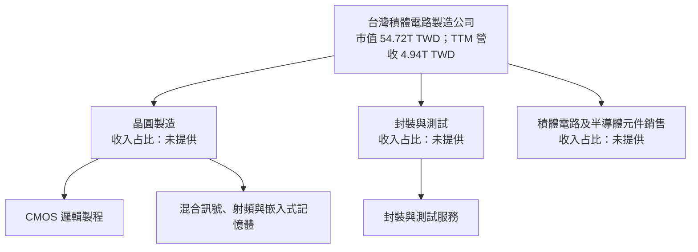
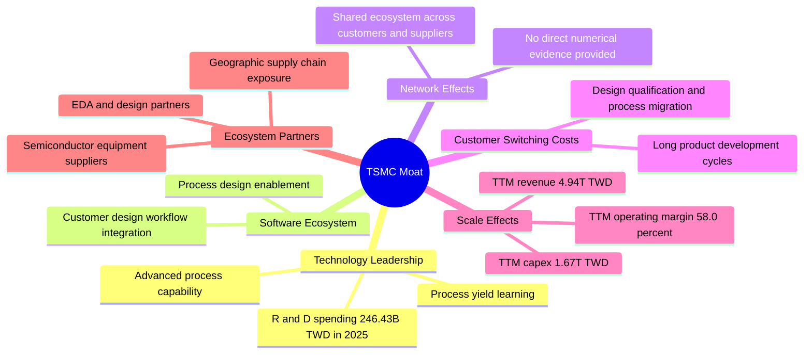
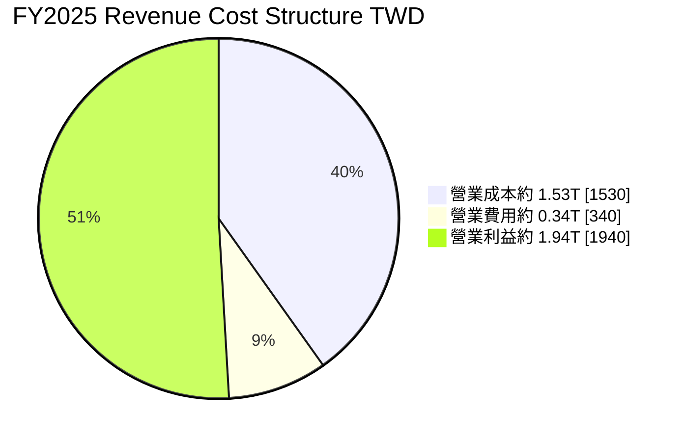
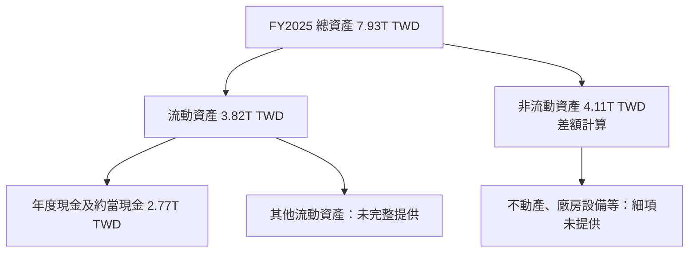
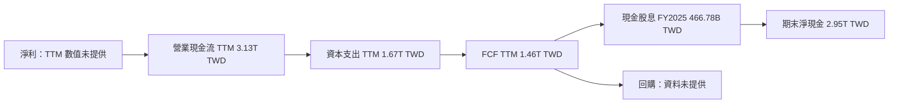
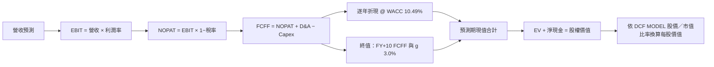
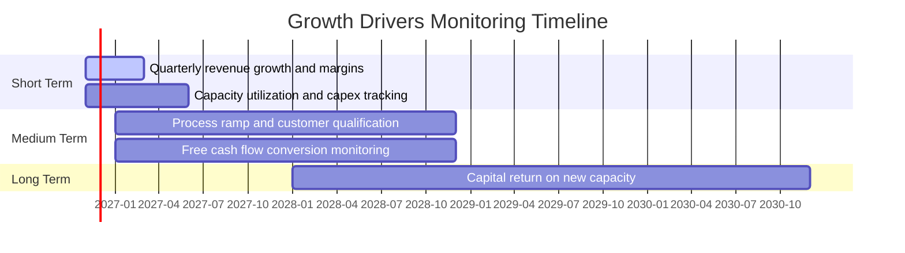
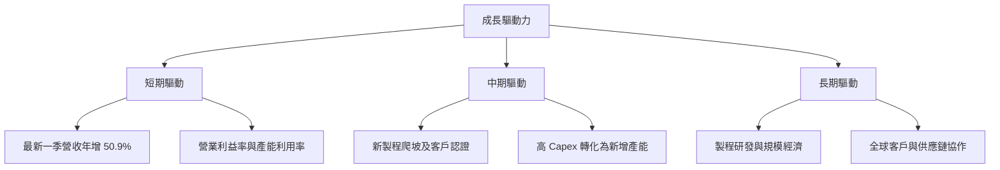
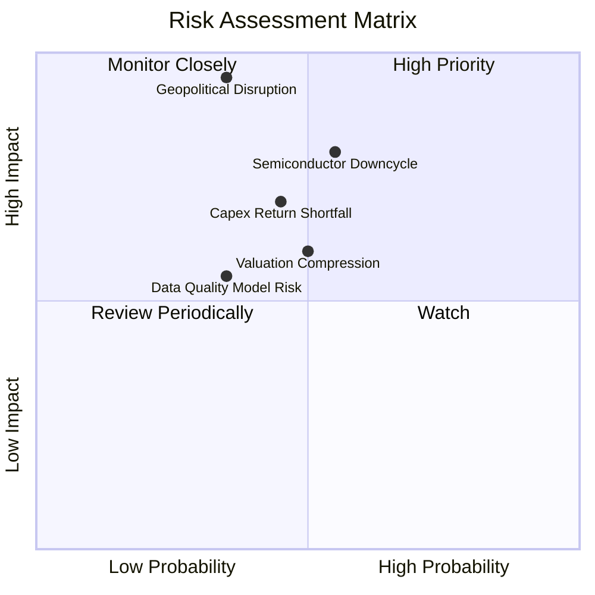
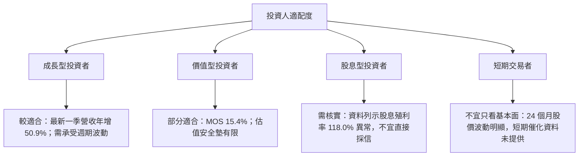

# 2330.TW 基本面深度分析報告
> **報告日期**：2026-11-25 ｜ **語言**：繁體中文 ｜ **數據來源**：Yahoo Finance、Roic.ai ｜ **分析師**：CFA 級機構研究

## 目錄

| # | 章節 | 核心結論 |
|---|------|----------|
| 1 | 執行摘要 | 買入；加權合理價值 2,635.12 TWD；MOS +15.4% |
| 2 | 公司概覽與商業模式 | 晶圓代工具技術、規模與客戶認證壁壘；業務收入占比未提供 |
| 3 | 損益表深度分析 | TTM 營收 4.94T TWD；最新一季營收年增 50.9%；TTM 營業利益率 58.0% |
| 4 | 資產負債表分析 | 淨現金 2.95T TWD；流動比率 2.584 |
| 5 | 現金流量深度分析 | TTM FCF 1.46T TWD；FCF Yield 2.66% |
| 6 | 獲利能力與資本效率 | WACC 10.49%；最新 ROIC 缺資料，無法直接判斷當期 ROIC 利差 |
| 7 | 相對估值分析 | Forward P/E 14.1x；同業 Forward P/E 中位數 14.9x |
| 8 | DCF 內在價值評估 | DCF 基準價值 3,089.48 TWD；加權合理價值 2,635.12 TWD |
| 9 | 成長催化劑 | 最新一季營收年增 50.9%；TAM 數據未提供 |
| 10 | 風險矩陣 | 地緣政治、資本密集與需求／估值回落是主要風險 |
| 11 | 投資建議 | 買入；以加權合理價值與季度營運指標設定監控框架 |

---

## 1. 執行摘要

本報告先以財務數據與估值交叉驗證，再作評級：2330.TW 的 TTM 營收為 4.94T TWD、TTM 營業利益率 58.0%、TTM FCF 1.46T TWD，淨現金 2.95T TWD；2026-11-24 收盤價為 2,230.00 TWD。程式計算的基準 DCF 每股價值為 3,089.48 TWD，但四種估值方法加權後合理價值為 2,635.12 TWD，MOS 為 +15.4%。依 MOS 評級門檻為**買入**；最新 ROIC 未提供，故不以缺失資料宣稱當期 ROIC 已高於 WACC。DCF 模型的終值算式與橋接存在可檢出的算術差異，降低對單一 DCF 數字的信心，應以加權估值及後續營運驗證為主。

### 1.0 一頁式投資儀表板

| 項目 | 內容 |
|------|------|
| **投資論點（3 句）** | ① 最新一季營收年增 50.9%，反映營收動能加速，但此為單季成長率、不是 TTM 成長率。② TTM 營業利益率 58.0%、TTM FCF 1.46T TWD，顯示高營運獲利與現金創造能力。③ 加權合理價值 2,635.12 TWD，高於 2,230.00 TWD 收盤價；但終值占 DCF 企業價值 61.0%，估值對長期假設敏感。 |
| **綜合評分** | **8.2/10**（引用 1.1 評分卡） |
| **財務健康** | 🟢 現金及短期投資 4.02T TWD、總債務 1.07T TWD、淨現金 2.95T TWD；流動比率 2.584。 |
| **ROIC vs WACC** | 最新 ROIC：N/A；WACC：10.49%。歷史 ROIC 欄位只提供 2018 年 20.61%，不足以代表最新 TTM，故當期價值利差未能確認。 |
| **FCF 趨勢** | TTM FCF 1.46T TWD；FCF Yield 2.66%。歷年 FCF 由 2023 年 286.57B 增至 2025 年 992.38B TWD。 |
| **估值** | Forward P/E 14.1039915x ｜ EV/EBITDA 15.257x ｜ FCF Yield 2.66% |
| **DCF 內在價值（基準）** | 3,089.48 TWD；現價相對 DCF 折價 **−27.8%**（折溢價 = 現價 ÷ DCF 基準價值 − 1）。 |
| **安全邊際（MOS）** | **+15.4%**＝(加權合理價值 2,635.12 − 現價 2,230.00) ÷ 加權合理價值 2,635.12；🟡 有限。 |
| **預期報酬（基準情境 12M）** | +38.5%（DCF 基準情境相對現價；非加權估值的預期報酬）。 |
| **關鍵風險（前二）** | 地緣政治與供應鏈中斷；高資本支出使現金流與估值對產能利用率敏感。 |
| **評級 + 信心度** | 🟢 **買入** ｜ 信心：中（估值模型存在算術差異，需以財報追蹤驗證）。 |

### 1.1 綜合評分卡（全報告唯一）

| 維度 | 評分（1–10） | 主要依據（引用數字與其來源章節） |
|------|--------------|----------------------------------|
| 成長性 | 9.0 | 最新一季營收年增 50.9%；TTM 營收成長率 N/A，見第 3 章。 |
| 獲利能力 | 9.0 | TTM 營業利益率 58.0%、淨利率 51.1%；最新 ROIC 與 F-Score 缺資料，見第 3、6 章。 |
| 財務健康 | 9.0 | 淨現金 2.95T TWD、流動比率 2.584、CCC 2 天，見第 4 章。 |
| 估值 | 6.0 | MOS +15.4%，屬有限安全邊際；DCF 基準價值高於現價，但其終值敏感且算術需核對，見第 7、8 章。 |
| 護城河 | 9.0 | 晶圓製程、規模與客戶認證壁壘；TTM 營業利益率 58.0%為財務佐證，但市場份額數據未提供，見第 2 章。 |
| 管理層與資本配置 | 7.0 | 2025 年 Capex 1.28T TWD、股息支付 466.78B TWD；未提供回購與資本回報門檻的完整資料，見第 5 章。 |
| **綜合評分** | **8.2** | 六項算術平均 = (9.0 + 9.0 + 9.0 + 6.0 + 9.0 + 7.0) ÷ 6 = 8.1667，四捨五入至一位小數。 |

### 1.2 五大投資論點 + 三大核心風險

| 類型 | 項目 | 具體依據 | 信心度 |
|------|------|----------|--------|
| 🟢 **投資論點①** | 營收動能加速 | 2026-09 季營收 1.49T TWD，較 2025-09 季年增 50.9%；單季動能若延續，將支撐營業槓桿，但不能直接外推成 TTM 成長率。 | 🟢 高 |
| 🟢 **投資論點②** | 獲利能力高 | TTM 毛利率 65.8%、營業利益率 58.0%、淨利率 51.1%；形成高額內部再投資與現金創造能力。 | 🟢 高 |
| 🟢 **投資論點③** | 現金流與資產負債表有韌性 | TTM OCF 3.13T、Capex 1.67T、FCF 1.46T TWD；淨現金 2.95T TWD，提供資本支出與景氣下行緩衝。 | 🟢 高 |
| 🟢 **投資論點④** | 相對估值不高於同業中位數 | Forward P/E 14.1039915x，低於同業中位數 14.9x；若預估 EPS 實現，估值具一定支撐。 | 🟡 中 |
| 🟢 **投資論點⑤** | DCF 與共識目標價高於市價 | DCF 基準 3,089.48 TWD、分析師均值 3,402.51 TWD；但 DCF 算術差異與共識分散使其只作參考。 | 🟡 中 |
| 🟡 **風險①** | 景氣與客戶資本支出波動 | 半導體需求若轉弱，單季 50.9% 年增可能快速回落；固定成本高會放大利潤率下行。 | 🟡 中 |
| 🔴 **風險②** | 地緣政治與營運集中 | 生產基地及關鍵供應鏈受區域事件影響時，可能造成出貨中斷、額外資本支出及估值折價。 | 🔴 高衝擊 |
| 🟡 **風險③** | 高資本支出與估值終值依賴 | TTM Capex 1.67T TWD；DCF 終值現值占 EV 61.0%，折現率或長期成長假設變動可顯著改變價值。 | 🟡 中 |

### 1.3 快速統計卡片

| 指標 | 公司實際值（期間） | 同業中位數 | 狀態 |
|------|--------------------|------------|------|
| 營收成長（TTM） | **N/A** | — | 🟡 資料缺漏 |
| 營收成長（最新一季年增） | **50.9%** | 20.9%（UMC、GFS、INTC） | 🟢 高於可得同業數值 |
| 毛利率（TTM） | **65.8%** | 31.7%（UMC）、28.5%（GFS）、40.2%（INTC）；中位數 31.7% | 🟢 高於同業 |
| 營業利益率（TTM） | **58.0%** | — | 🟢 高 |
| ROIC（TTM） | **N/A** | — | 🟡 無法驗證 |
| Forward P/E | **14.1039915x** | 14.9x | 🟢 略低於中位數 |
| FCF Yield（TTM） | **2.66%** | — | 🟡 殖利率有限 |
| Piotroski F-Score | **N/A / 9** | — | 🟡 缺兩期 SEC 申報資料 |

### 1.4 投資結論

```text
╔══════════════════════════════════════════════════════════════════╗
║                    📊 投資結論摘要                               ║
╠══════════════════════════════════════════════════════════════════╣
║  評級：買入（MOS +15.4%，依規則 20）                             ║
║  價格（2026-11-24 收盤）：2,230.00 TWD                           ║
║  DCF 內在價值（基準）：3,089.48 TWD（折價 -27.8%）               ║
║  安全邊際 MOS：+15.4%（以加權合理價值為分母）                    ║
║  加權合理價值（8.8）：2,635.12 TWD                              ║
║  DCF 情境價值：                                                  ║
║    悲觀情境：1,310.75 TWD（-41.2%）                              ║
║    基準情境：3,089.48 TWD（+38.5%）                              ║
║    樂觀情境：6,894.85 TWD（+209.2%）                             ║
║  綜合評分：8.2/10（引用 1.1）                                    ║
║  適合投資人：能承受半導體週期與地緣風險的中長期成長型投資人      ║
╚══════════════════════════════════════════════════════════════════╝
```

---

## 2. 公司概覽與商業模式

### 2.1 業務結構與收入來源

公司從事積體電路與半導體元件的製造、封裝、測試與銷售，服務範圍涵蓋台灣、亞洲、歐洲、中東、非洲與美國。財務資料未提供各業務板塊收入與占比，因此不將營收拆分為未經證實的產品或終端市場比例。



### 2.2 市場份額

市場份額數據及其來源年份未提供，因此不繪製市占率圖，也不填入推測比例。可確認的相對營運規模是 TTM 營收 4.94T TWD、最新一季營收年增 50.9%；Peer 數據中的 UMC、GFS、INTC 最新一季營收年增率分別為 25.6%、12.5%、20.9%，但不同公司幣別與業務組合不宜直接推導市占率。

### 2.3 競爭護城河分析



### 2.4 護城河強度

| 護城河項目 | 強度（強／中／弱） | 證據（引用數字或事實） | 會削弱它的情況 |
|------------|--------------------|------------------------|----------------|
| 技術與製程能力 | 強 | 2025 年研發支出 246.43B TWD；TTM 營業利益率 58.0%。 | 製程良率落後、競爭者縮小技術差距或關鍵設備受限。 |
| 客戶鎖定與認證 | 強 | 晶圓製程需與客戶設計流程及量產驗證配合；具體客戶集中度數字未提供。 | 客戶採取多來源策略、轉廠成功或內製比例增加。 |
| 規模效應 | 強 | TTM 營收 4.94T TWD、TTM Capex 1.67T TWD，反映高資本投入與大規模生產。 | 產能利用率下降，或新廠折舊先於收入放量。 |
| 軟體生態系統 | 中 | 製程設計套件與工作流程形成配套；量化生態收入數據未提供。 | 競爭製程兼容性提升，降低客戶遷移成本。 |
| 網路效應 | 中 | 客戶與供應商協作可改善製程與量產效率；直接量化資料未提供。 | 客戶設計需求分散、供應鏈合作弱化。 |
| 生態夥伴 | 中 | 公司跨區域經營並需依賴設備及材料供應鏈；供應商集中度未提供。 | 地緣政治、出口管制或供應商中斷。 |

1.1「護城河」評分為 9.0/10，依據是 TTM 營業利益率 58.0%、2025 年研發支出 246.43B TWD，以及高資本投入所形成的規模與製程壁壘；市場份額與客戶集中度缺資料，故不把質化判斷視為完整量化證據。

---

## 3. 損益表深度分析

### 3.1 年度收入成長趨勢（近 4 年）

年度營收：2022 年 2.26T、2023 年 2.16T、2024 年 2.89T、2025 年 3.81T TWD。YoY 依已列年度營收計算，因來源數字四捨五入，成長率為約值。

```text
╔══════════════════════════════════════════════════════════════════╗
║          台積電年度收入趨勢（FY2022–FY2025，TWD）               ║
╠══════════════════════════════════════════════════════════════════╣
║  FY2022  2.26T  ████████████░░░░░░░░░░░░  YoY：N/A              ║
║  FY2023  2.16T  ███████████░░░░░░░░░░░░░  YoY：-4.4% 🟡        ║
║  FY2024  2.89T  ███████████████░░░░░░░░░  YoY：+33.8% 🟢       ║
║  FY2025  3.81T  ████████████████████░░░░  YoY：+31.8% 🟢       ║
║                                                                  ║
║  FY2022–FY2025 CAGR = (3.81 ÷ 2.26)^(1/3) − 1 ≈ 19.0%          ║
╚══════════════════════════════════════════════════════════════════╝
```

2023 年收入下降約 4.4%，2024、2025 年分別回升約 33.8%、31.8%。近兩年增速回升顯示需求與產品組合改善；但這是年度收入趨勢，不能取代資料所列的 TTM 成長率（N/A）。

### 3.2 季度收入趨勢分析

| 季度 | 營收（TWD） | QoQ | YoY | 備註 |
|------|------------:|----:|----:|------|
| 2025-12 | 1.05T | N/A | N/A | 沒有 2025-09 季財務報表列值及 2024-12 對比數據。 |
| 2026-03 | 1.13T | +7.9% | +35.1% | QoQ = 1.13 ÷ 1.05 − 1；YoY 以 Roic.ai 季度營收 1,134.103B ÷ 839.254B − 1 計算，約 35.1%。 |
| 2026-06 | 1.27T | +12.0% | +36.0% | 對比 2025-06 的 933.792B TWD；最新季度報表金額取至 0.01T。 |
| 2026-09 | 1.49T | +17.6% | +50.9% | YoY 依指定最新一季年增率；QoQ 以 1.49 ÷ 1.27 − 1 計算。 |

季度營收加速，2026-09 季 QoQ 增幅高於前兩季。若是高階製程需求、產品組合及產能利用率共同推動，收入成長會帶動固定成本吸收；但財務數據沒有提供各製程或終端市場拆分，不能把成長完全歸因於單一需求來源。

### 3.3 利潤率演變分析

| 利潤率指標 | FY2022 | FY2023 | FY2024 | FY2025 | 趨勢 | 評估 |
|------------|-------:|-------:|-------:|-------:|------|------|
| 毛利率 | 59.7% | 54.6% | 56.1% | 59.8% | 2023 下滑，之後回升 | 🟢 |
| 營業利益率 | 49.6% | 42.7% | 45.7% | 50.9% | 2023 下滑，2025 回升至高於 2022 | 🟢 |
| 淨利率 | 43.9% | 39.4% | 40.1% | 44.6% | 隨營業利益率回升 | 🟢 |

年度毛利率、營業利益率與淨利率依各年度毛利、營業利益、淨利除以營收計算。2025 年營業利益率由 2023 年約 42.7% 回升至約 50.9%，與營收恢復及營運規模擴張相符；成本、匯率與製程別組合的個別貢獻沒有提供，不能量化拆分。TTM 營業利益率為 58.0%，高於 2025 全年比率，顯示近四季盈利水準更高，但 TTM 與完整年度期間不可混為一談。

### 3.4 費用結構分析

2025 年提供營收、毛利與營業利益資料，可推導營業成本約為 1.53T TWD（3.81T − 2.28T）；營業費用約 340B TWD（2.28T − 1.94T）。由於所列數字經四捨五入，以下為近似值。



以上三項依毛利與營業利益的關係推導，合計約 3.81T TWD。年度研發支出 246.43B TWD，約占營收 6.5%（246.43 ÷ 3,810）；其他營業費用未提供完整拆分，不能再細分為銷售、管理或其他項目。

### 3.5 季度 EPS 趨勢與盈餘品質（Quality of Earnings）

歷史 EPS Beats/Misses 資料中 2025-12、2026-03、2026-06、2026-09 的預估值及實際值均為 nan，無法判斷過去四季超預期或不及預期。Roic.ai 提供的每股盈餘序列為：2025Q4 18.72、2026Q1 22.08、2026Q2 27.25、2026Q3 29.43 TWD；此為季度 EPS 數值，並非預估差額。

| 盈餘品質項目 | 數值/佔比 | 評估 |
|--------------|-----------|------|
| 股權薪酬 SBC / 營收 | FY2025 SBC 1.25B ÷ FY2025 營收 3.81T ≈ 0.033% | 🟢 佔比低，所列期間的直接稀釋成本有限。 |
| SBC / 營業現金流 | FY2025 SBC 1.25B ÷ OCF 2.27T ≈ 0.055% | 🟢 相對現金流規模低。 |
| FCF / 淨利（現金轉換率） | TTM FCF 1.46T；可比期間 TTM 淨利未提供 | 🟡 無法以同一 TTM 期間計算；2025 FY FCF 992.38B ÷ 淨利 1.70T ≈ 58.4%。 |
| 一次性/非經常性損益 | N/A | 未提供損益明細或非經常性項目拆分。 |
| 有效稅率異常 | 17.0%（最近年度有效稅率） | DCF 採用此稅率；未提供多年度同期稅率細項以判斷一次性稅務影響。 |
| 資本化支出 vs 費用化 | FY2025 Capex 1.28T TWD；資本化政策細節 N/A | 高資本支出是製造業資產投入，不代表當期費用被低報；仍需追蹤折舊與產能利用率。 |

**盈餘品質結論**：SBC 佔營收及 OCF 比重低，削弱股東報酬的稀釋程度有限；但 TTM FCF 對 TTM 淨利的轉換率、一次性損益與資本化會計明細沒有同期間數據。2025 FY FCF 約為淨利 58.4%，主要須結合高 Capex 週期理解，不能據此直接推定盈餘品質偏差。

---

## 4. 資產負債表分析

### 4.1 資產結構分解

2025 年總資產為 7.93T TWD、流動資產 3.82T TWD；非流動資產為差額 4.11T TWD。流動資產細項未完整提供，故不拆分現金、存貨及其他流動項目。



### 4.2 流動性與營運資金分析

| 指標 | 最新值 | 歷史資料 | 評估 |
|------|-------:|----------|------|
| 流動比率 | 2.584 | 2025 年流動資產 3.82T ÷ 流動負債 1.52T ≈ 2.51x；資料來源及期間口徑可能不同 | 🟢 短期流動性充足 |
| 速動比率 | 2.287 | 歷史同口徑序列未提供 | 🟢 |
| 現金及短期投資 | 4.02T TWD | 2025 年現金及約當現金 2.77T TWD | 🟢 |
| 淨現金 | 2.95T TWD | 2025 年底現金 2.77T、債務 1.06T TWD | 🟢 |

營運資金天數照錄品質指標：最新 TTM DSO 1 天、DIO 92 天、DPO 91 天、CCC 2 天；一年前數值沒有提供，不推算年變化。DSO 1 天異常偏短，可能受期末餘額與季度流量口徑影響，不能單靠此數值認定收款效率突然改善。

| 指標 | 最新 TTM | 一年前 TTM | 變化 | 解讀 |
|------|----------:|-----------:|------|------|
| DSO 應收帳款天數 | 1 天 | N/A | N/A | 期末餘額／TTM 流量法所得，需留意資料口徑。 |
| DIO 存貨天數 | 92 天 | N/A | N/A | 反映存貨在生產流程中占用時間；未提供歷史比較。 |
| DPO 應付帳款天數 | 91 天 | N/A | N/A | 與 DIO 接近，表示營運資金占用的淨週期較短；不能單獨推論議價力。 |
| CCC 現金轉換週期 | 2 天 | N/A | N/A | 數據區塊給定值；一年變化方向無法判定。 |

### 4.3 債務結構分析

```text
╔══════════════════════════════════════════════════════════════════╗
║                   台積電債務健康診斷                            ║
╠══════════════════════════════════════════════════════════════════╣
║  總債務：       1.07T TWD   ██░░░░░░░░░░░░░░░░░░░  🟢          ║
║  現金及短期投資：4.02T TWD  ████████████████████░  🟢          ║
║  淨現金：       2.95T TWD   ███████████████░░░░░░  🟢          ║
║                                                                  ║
║  Debt/EBITDA：N/A（未提供可核對的同口徑 TTM EBITDA 與債務）      ║
║  Interest Coverage：N/A（利息費用未提供）                       ║
║  Debt/Equity：15.188（市場資料欄位；與資產負債表比率口徑需核對）║
╚══════════════════════════════════════════════════════════════════╝
```

淨現金以現金及短期投資 4.02T 減總債務 1.07T 計為 2.95T TWD，與指定數值一致。由於未提供利息支出及一致口徑 EBITDA，不以推算方式補出利息保障倍數或 Debt/EBITDA。

### 4.4 股東權益趨勢

| 年度 | 股東權益（TWD） | YoY |
|------|----------------:|----:|
| 2022 | 2.90T | N/A |
| 2023 | 3.43T | +18.3% |
| 2024 | 4.24T | +23.6% |
| 2025 | 5.36T | +26.4% |

```text
╔══════════════════════════════════════════════════════════════════╗
║                   股東權益趨勢（TWD）                           ║
╠══════════════════════════════════════════════════════════════════╣
║  2022  2.90T  ███████████░░░░░░░░░░░                              ║
║  2023  3.43T  █████████████░░░░░░░░                              ║
║  2024  4.24T  ████████████████░░░░░                              ║
║  2025  5.36T  ████████████████████                                ║
╚══════════════════════════════════════════════════════════════════╝
```

---

## 5. 現金流量深度分析

### 5.1 現金流量瀑布圖

TTM 數據提供 OCF、Capex、FCF，但沒有同期間淨利、回購金額或淨現金變化的完整流量項目。因此圖中只連接可核對數字，股息以 FY2025 已披露支付額標示，並與 TTM 流量區分。



### 5.2 FCF 轉換率趨勢

| 年度 | OCF（TWD） | Capex（TWD） | FCF（TWD） | 淨利（TWD） | FCF / 淨利 |
|------|-----------:|-------------:|-----------:|------------:|-----------:|
| 2022 | 1.61T | 1.09T | 520.97B | 992.92B | 52.5% |
| 2023 | 1.24T | 955.40B | 286.57B | 851.74B | 33.6% |
| 2024 | 1.83T | 964.98B | 861.20B | 1.16T | 74.2% |
| 2025 | 2.27T | 1.28T | 992.38B | 1.70T | 58.4% |
| TTM 至 2026-09-30 | 3.13T | 1.67T | 1.46T | N/A | N/A |

年度 FCF/淨利率受到 Capex 週期影響，2023 年降至 33.6%，2024 年回升至 74.2%，2025 年為 58.4%。TTM FCF 增至 1.46T TWD，但因未提供 TTM 淨利，不能計算同期間轉換率。

### 5.3 自由現金流趨勢

```text
╔══════════════════════════════════════════════════════════════════╗
║                自由現金流趨勢（TWD）                             ║
╠══════════════════════════════════════════════════════════════════╣
║  FY2022  520.97B  ██████████░░░░░░░░░░  FCF Yield：N/A         ║
║  FY2023  286.57B  ██████░░░░░░░░░░░░░░  FCF Yield：N/A         ║
║  FY2024  861.20B  █████████████████░░░  FCF Yield：N/A         ║
║  FY2025  992.38B  ████████████████████  FCF Yield：N/A         ║
║  TTM     1.46T    █████████████████████████████  Yield：2.66%  ║
╚══════════════════════════════════════════════════════════════════╝
```

歷年市值未按同一估值日提供，故年度 FCF Yield 不計算；TTM FCF Yield 直接引用 2.66%。

### 5.4 資本配置評估

FY2025 現金流資料：OCF 2.27T、Capex 1.28T、現金股息支付 466.78B TWD；回購與留存現金的完整用途資料未提供。由於資本配置分類不是同一套可加總流量，避免以不完整項目繪製比例圓餅圖。

| 資本配置項目 | 金額／資料 | 評估 |
|--------------|------------|------|
| 資本支出 | FY2025 1.28T TWD；TTM 1.67T TWD | 高額投入支撐產能與製程，但須以產能利用率及回報驗證。 |
| 股息 | FY2025 支付 466.78B TWD | 可觀現金回饋；年度支付約為 FY2025 淨利 27.5%。 |
| 回購 | N/A | 未提供。 |
| 留存／其他投資 | N/A | 資料不足，不反推。 |

---

## 6. 獲利能力與資本效率

### 6.1 ROE / ROA / ROIC 趨勢

| 指標 | 最新資料 | 歷史資料 | 評估 |
|------|---------:|----------|------|
| ROE | TTM 41.9% | 年度序列未提供 | 🟢 獲利相對帳面權益高；須注意不是 ROIC。 |
| ROA | TTM 20.6% | 年度序列未提供 | 🟢 資產獲利能力高。 |
| ROIC | TTM N/A | Roic.ai 2018 年 Return on Capital 20.61% | 🟡 最新期不可得，不用歷史單點替代當期。 |

### 6.2 ROIC vs WACC 分析（核心價值創造判斷）

```text
╔══════════════════════════════════════════════════════════════════╗
║                ROIC vs WACC 深度分析                            ║
╠══════════════════════════════════════════════════════════════════╣
║  WACC 估算（採用成本資本資料所列值）：                           ║
║  ├── 無風險利率（10Y 美債）：                 4.90%               ║
║  ├── 市場風險溢酬 ERP：                      5.00%               ║
║  ├── Beta 原始值 / 調整後值：                1.23 / 1.16         ║
║  ├── 股權成本：4.90% + 1.16 × 5.00% ≈       10.68%              ║
║  ├── 稅前債務成本：                          1.16%               ║
║  ├── 稅後債務成本：1.16% × (1−17.0%) ≈       0.96%               ║
║  ├── 股權／債務權重：                        98.1% / 1.9%        ║
║  └── ✅ 採用 WACC：                          10.49%              ║
║                                                                  ║
║  ROIC：最新 TTM N/A；歷史資料僅列 2018 年 20.61%                  ║
║  EVA = ROIC − WACC：最新值 N/A，無法據此判定當期價值利差          ║
║                                                                  ║
║  判斷：歷史 2018 ROIC 20.61% 高於當前 WACC 10.49%，但期間不同；  ║
║        不能把這一歷史差額視作最新期 ROIC 利差。                  ║
╚══════════════════════════════════════════════════════════════════╝
```

WACC 依成本資本資料所列 10.49% 採用。現有資料沒有最新投入資本與一致期間 NOPAT，故不自行拼湊最新 ROIC。歷史 2018 年 Return on Capital 20.61% 高於本次 WACC，但其年份不同；投資者需觀察 ROIC 是否持續高於 WACC，才能確認公司仍在創造經濟價值。

### 6.3 杜邦三因素分解

| 因素 | 數值（TTM） | 解讀 |
|------|-------------|------|
| 淨利率 | N/A（品質指標為 N/A） | DuPont 資料因缺少淨利、營收、總資產或正權益而未計算。 |
| 資產週轉率 | N/A | 同上。 |
| 權益乘數 | N/A | 同上。 |
| **ROE** | **N/A（杜邦分解）** | 報表另列 TTM ROE 41.9%，但不能用來替代缺失的品質指標分解。 |

### 6.4 財務體質：Piotroski F-Score

Piotroski F-Score 為 N/A：缺少相隔一年的兩個 TTM SEC 申報資料，九項測試結果均未提供，不能逐項補算。

| 測試 | 結果 | 解讀 |
|------|------|------|
| 九項 Piotroski 測試 | N/A | 缺少符合要求的 SEC 歷史資料，無法判定通過或未通過項目。 |
| 總分 | N/A / 9 | 不能由單一期間財務數字推定。 |

---

## 7. 相對估值分析

### 7.1 同業估值比較表格

本公司估值倍數採市場資料；競爭對手倍數採 Yahoo Finance 同業資料。對未提供的同業指標不以外部記憶補值。

| 估值指標 | **台積電** | **UMC** | **GFS** | **INTC** | 本公司評估 |
|----------|----------:|-------:|------:|-------:|-----------|
| **Trailing P/E** | 19.706734x | 12.6x | 104.1x | N/A | 🟡 UMC 較低；GFS 倍數偏高且 INTC 缺值，組合不可簡化成單一平均。 |
| **Forward P/E** | 14.1039915x | 14.9x | 14.0x | 30.6x | 🟢 低於三家中位數 14.9x。 |
| **P/S（TTM）** | 11.065583x | N/A | 2.8x | 4.9x | 🔴 相對 GFS、INTC 溢價；UMC 因幣別混合未提供。 |
| **EV/EBITDA（TTM）** | 15.257x | N/A | 9.8x | 15.9x | 🟡 位於 GFS 與 INTC 之間；不宜把不同成長與盈利能力視為同質。 |
| **最新一季營收 YoY** | 50.9% | 25.6% | 12.5% | 20.9% | 🟢 高於可得三家同業數值。 |
| **毛利率（TTM）** | 65.8% | 31.7% | 28.5% | 40.2% | 🟢 高於三家同業；反映盈利結構差異。 |

Forward P/E 同業中位數為 14.9x，EV/EBITDA 同業中位數為 12.8x（僅 GFS、INTC 可用）。相對估值法採用同業中位數，而非台積電自身倍數。

### 7.2 歷史估值區間分析

N/A（數據未提供：缺少「Valuation vs own history」估值區間及百分位資料）。24 個月股價歷史可用，但不足以反推歷史 P/E 區間。

### 7.3 情境價值（Bear / Base / Bull）

下表的估值及假設均取自 DCF MODEL。情境機率是模型所列權重；營運條件為對假設的解讀，而非額外財務預測。

| 情境 | 第 1 年營收成長 | 期末營業利潤率 | WACC | 每股價值 | 相對現價 | 機率 | 會發生的條件 |
|------|----------------:|----------------:|-----:|---------:|----------:|-----:|--------------|
| 🔴 悲觀 | 15.0% | 42.1% | 11.49% | 1,310.75 TWD | -41.2% | 25% | 需求放緩或產能利用率下降，且長期利潤率由現行高位顯著回落。 |
| 🟡 基準 | 30.0% | 49.5% | 10.49% | 3,089.48 TWD | +38.5% | 50% | 近期成長動能延續，之後逐步回歸較成熟的營收與利潤率水準。 |
| 🟢 樂觀 | 45.0% | 54.5% | 9.49% | 6,894.85 TWD | +209.2% | 25% | 高增長延續、利潤率維持高位且風險折現率下降。 |

機率加權 DCF 價值為 3,596.14 TWD（+61.3%），但第 8.8 節依規定採基準 DCF 值及固定權重估值，不以機率加權值取代。

### 7.4 相對估值隱含價格區間

```text
╔══════════════════════════════════════════════════════════════════╗
║           相對估值方法回推每股價值（TWD）                       ║
╠══════════════════════════════════════════════════════════════════╣
║  2,007.97 ───── 2,228.34 ── 2,230.00 ───── 3,089.48 ── 3,402.51║
║  EV/EBITDA      Forward P/E   現價           DCF        共識均值 ║
╚══════════════════════════════════════════════════════════════════╝
```

| 方法 | 每股價值 | 依據 |
|------|---------:|------|
| 同業 Forward P/E | 2,228.34 TWD | UMC、GFS、INTC 同業中位數 14.9x × Forward EPS 149.60 TWD。 |
| 同業 EV/EBITDA | 2,007.97 TWD | GFS、INTC 同業中位數 12.8x × TTM EBITDA，再加淨現金。 |
| DCF（基準） | 3,089.48 TWD | 10 年 FCFF、WACC 10.49%、終值成長率 3.0%。 |
| 分析師共識目標價 | 3,402.51 TWD | 35 位分析師平均目標價。 |

同業 Forward P/E 法回推 2,228.34 TWD，與現價 2,230.00 TWD 接近；EV/EBITDA 法為 2,007.97 TWD。DCF 與共識目標較高，但其長期假設不確定性較大。

---

## 8. DCF 內在價值評估（Discounted Cash Flow）

> 金額均為 TWD billions，除非另註明每股價格。DCF MODEL 為程式計算模型，以下假設與輸出照錄；模型列示算式中有可見的算術差異，於 8.10 明確揭露，不能將其當作已通過稽核的自行重算結果。

### 8.0 估值推理鏈（Thinking Logic）

**Step 1 — 價值由哪些變數決定？**  
模型以整體營收 4,944.82B TWD 為起點，因業務板塊占比未提供，不能把價值拆成可量化的主業、第二曲線或選擇權。估值主要由營收成長、營業利潤率與終值折現率共同決定；敏感度矩陣顯示 WACC 與永續成長率 g 對每股價值影響大。

**Step 2 — 模型選擇**

| 決策點 | 本報告採用 | 理由（含數字） | 曾考慮但否決 | 否決理由 |
|--------|-----------|----------------|--------------|----------|
| 現金流定義 | FCFF | 配合 WACC 折現，計算 EV；模型定義 FCFF = NOPAT + D&A − Capex。 | FCFE | 資本結構及債務不直接納入股權現金流模型。 |
| 預測期 N | 10 年 | DCF MODEL 固定列 FY+1 至 FY+10。 | 自行縮短或延長 | 會改動程式模型既定假設。 |
| 終值方法 | Gordon Growth | 模型採 g = 3.0%，WACC = 10.49%。 | 退出倍數終值 | 沒有模型列示的退出倍數與對應輸出，不能自建。 |
| EBIT 基礎 | GAAP EBIT | 模型明確採 GAAP EBIT。 | 非 GAAP EBIT | 避免改變模型口徑。 |

**Step 3 — 關鍵假設推導鏈**

- **營收成長**：錨點＝最新一季營收 YoY 50.9%（單季，不是 TTM）→ 模型將第一年限制於 0%–30%，並由 30.0% 線性遞減至第十年 3.0% → **採用年 1 30.0%、年 10 3.0%** → 不採全期維持 50.9%，因單季成長率不能視為長期 CAGR。
- **營業利潤率**：錨點＝TTM 58.0%；模型第十年採近五個財年中位數 49.5% → 由 58.0% 漸降至 49.5% → **採用年 1 58.0%、年 10 49.5%** → 不假設長期維持 58.0%，因成熟期與競爭、折舊投入可能壓低利潤率。
- **永續成長率 g**：錨點＝模型設定 3.0%；需低於 WACC 10.49% → 差距 7.49 個百分點，公式在數學上有效 → **採用 3.0%** → 不採用接近 WACC 的高 g，因會令終值過度放大。
- **預測期 N**：錨點＝模型設定 10 年 → 完整涵蓋逐年現金流預測 → **採用 10 年** → 不另改為 5 年，避免違反模型輸入。
- **Capex / 營收**：錨點＝TTM Capex／營收約 1.67T ÷ 4.94T ≈ 33.8%；模型逐步降至第十年 16.6% → **採用 FY+1 33.8%、FY+10 16.6%** → 不採用永久維持 TTM 高投入比率，因模型假設 Capex 向 1.1 倍 D&A 收斂。
- **EBIT 與 SBC**：錨點＝模型採 GAAP EBIT，SBC 已在費用內；FY2025 SBC 1.25B TWD → **採用組合 (A)：GAAP EBIT、FCFF 不再扣 SBC、固定股數／不另計年稀釋** → 不另扣 SBC 或額外放大股數，以免重複計算。**本模型採用 (A)，故 SBC 影響已計入一次。**
- **有效稅率**：錨點＝最近年度有效稅率 17.0% → 採用 17.0%。
- **D&A / 營收**：錨點＝TTM 15.1% → 採用固定 15.1%。
- **營運資金變動**：模型明確不建模營運資金；採用 ΔWC 未納入，而不是假定為某個數值。
- **WACC**：錨點＝成本資本資料提供 10.49%，並指定用於 DCF → 採用 10.49% → 不另自建 WACC，以保持與成本資本資料一致。
- **最脆弱一環**：終值假設與 WACC 對估值影響大；終值占 EV 61.0%。若長期成長、利潤率或折現率不如基準，價值會下修，悲觀情境為 1,310.75 TWD。

**Step 4 — 計算路徑**



### 8.1 模型假設總表（Model Inputs）

| 假設項目 | 採用值 | 依據 / 來源 | 敏感度 |
|----------|--------|-------------|--------|
| 預測期長度 N | 10 年 | DCF MODEL 預測 FY+1 至 FY+10。 | 🟡 中 |
| 營收成長 | FY+1 30.0% 線性降至 FY+10 3.0% | 最新一季 YoY 50.9%，模型限制最高 30.0%。 | 🔴 高 |
| 營業利潤率 | FY+1 58.0% → FY+10 49.5% | TTM 58.0%；期末採近五年中位數。 | 🔴 高 |
| 有效稅率 | 17.0% | 最近年度有效稅率。 | 🟢 低 |
| Capex / 營收 | FY+1 33.8% → FY+10 16.6% | TTM 資本支出比率，逐步降至 1.1×D&A。 | 🔴 高 |
| D&A / 營收 | 15.1% | TTM 比率，模型固定。 | 🟢 低 |
| 營運資金變動 | 未建模 | DCF MODEL 明確不納入 ΔWC。 | 🟡 中 |
| EBIT 基礎 | GAAP | DCF MODEL 指定 GAAP EBIT。 | 🟡 中 |
| SBC 處理 | GAAP EBIT 已含 SBC，不再扣除 | FY2025 SBC 1.25B TWD；模型採組合 (A)。 | 🟡 中 |
| 年稀釋率 | 0%；固定股數處理 | 組合 (A)；但模型每股公式以價格／市值比率換算。 | 🟡 中 |
| 永續成長率 g | 3.0% | DCF MODEL 假設；低於 WACC。 | 🔴 高 |
| 終值方法 | Gordon Growth | DCF MODEL 列示；退出倍數結果未提供。 | 🔴 高 |
| WACC | 10.49% | 成本資本資料提供值。 | 🔴 高 |

### 8.2 折現率推導（WACC）

```text
╔══════════════════════════════════════════════════════════════════╗
║                    WACC 推導（折現率）                           ║
╠══════════════════════════════════════════════════════════════════╣
║  股權成本 Ke（CAPM）：                                           ║
║  ├── 無風險利率 Rf：                       4.90%                 ║
║  ├── ERP：                                 5.00%                 ║
║  ├── 原始 Beta：1.23；調整後 Beta：         1.16                 ║
║  ├── Beta 調整：2/3 × 1.23 + 1/3 × 1.00 = 1.153 ≈ 1.16         ║
║  └── 指定 Ke：                            10.68%                 ║
║                                                                  ║
║  債務成本 Kd：                                                   ║
║  ├── 稅前成本：                           1.16%                  ║
║  ├── 稅率：                               17.0%                  ║
║  └── 稅後成本：1.16% × (1−17.0%) =        0.9628% ≈ 0.96%       ║
║                                                                  ║
║  資本權重：股權 98.1%；債務 1.9%                                 ║
║  指定 WACC：98.1% × 10.68% + 1.9% × 0.9628% ≈ 10.49%           ║
╚══════════════════════════════════════════════════════════════════╝
```

逐步演算及資料限制：

1. **Ke（CAPM）** = 4.90% + 1.16 × 5.00% = 10.70%；成本資本資料指定 Ke = 10.68%，差異來自底層未四捨五入輸入，報告採用指定值。  
2. **稅前 Kd** = 指定成本資本輸入 1.16%；利息費用與平均計息負債明細未提供，不能另行復算分子、分母。  
3. **稅後 Kd** = 1.16% × (1 − 17.0%) = 0.9628% ≈ 0.96%。  
4. **權重** = E / (E + D) = 98.1%；D 權重 = 1.9%；合計 100.0%。最新收盤價與市值資料為 TWD，但市值／股數口徑與財報股數不完全一致；本節直接採用指定權重。  
5. **WACC** = 98.1% × 10.68% + 1.9% × 0.9628% = 10.47708% + 0.0182932% = 10.4953732%，以未四捨五入底層輸入接近指定 10.49%；全報告按指定 WACC 10.49%使用。

原始 Beta 1.23 經指定調整方式 ⅔×原始值 + ⅓×1.00 得約 1.16。無風險利率資料沒有觀測日期細節，ERP 為假設輸入；未另加國別或規模溢價。第 6.2 與本節均採 10.49%。

### 8.3 逐年自由現金流預測（基準情境）

模型採 **FCFF = NOPAT + D&A − Capex**，且明確不建模 ΔWC。單位：TWD billions；折現因子照錄模型值。

| 年度 | FY+1 | FY+2 | FY+3 | FY+4 | FY+5 | FY+6 | FY+7 | FY+8 | FY+9 | FY+10 |
|------|-----:|-----:|-----:|-----:|-----:|-----:|-----:|-----:|-----:|------:|
| 營收 | 6,428.26 | 8,163.89 | 10,123.23 | 12,249.11 | 14,453.94 | 16,622.04 | 18,616.68 | 20,292.18 | 21,509.71 | 22,155.00 |
| 營收 YoY | 30.0% | 27.0% | 24.0% | 21.0% | 18.0% | 15.0% | 12.0% | 9.0% | 6.0% | 3.0% |
| 營業利潤率 | 58.0% | 57.0% | 56.1% | 55.2% | 54.2% | 53.3% | 52.3% | 51.4% | 50.5% | 49.5% |
| EBIT（GAAP） | 3,726.88 | 4,656.49 | 5,679.00 | 6,756.58 | 7,837.06 | 8,856.56 | 9,744.56 | 10,431.05 | 10,854.96 | 10,972.60 |
| − 稅 | (632.56) | (790.34) | (963.90) | (1,146.79) | (1,330.18) | (1,503.22) | (1,653.94) | (1,770.46) | (1,842.41) | (1,862.38) |
| NOPAT | 3,094.32 | 3,866.14 | 4,715.10 | 5,609.79 | 6,506.88 | 7,353.34 | 8,090.62 | 8,660.59 | 9,012.55 | 9,110.22 |
| + D&A | 970.20 | 1,232.15 | 1,527.86 | 1,848.72 | 2,181.48 | 2,508.71 | 2,809.75 | 3,062.63 | 3,246.39 | 3,343.78 |
| − Capex | (2,171.05) | (2,601.47) | (3,032.68) | (3,435.84) | (3,778.51) | (4,028.15) | (4,156.32) | (4,143.23) | (3,981.42) | (3,678.16) |
| **= FCFF** | **1,893.46** | **2,496.82** | **3,210.29** | **4,022.67** | **4,909.85** | **5,833.90** | **6,744.04** | **7,579.99** | **8,277.52** | **8,775.85** |
| 折現因子 @10.49% | 0.905 | 0.819 | 0.741 | 0.671 | 0.607 | 0.549 | 0.497 | 0.450 | 0.407 | 0.369 |
| **FCFF 現值 PV** | **1,713.63** | **2,045.06** | **2,379.71** | **2,698.70** | **2,981.05** | **3,205.68** | **3,353.84** | **3,411.54** | **3,371.65** | **3,235.13** |

預測期現值逐項加總：

`1,713.63 + 2,045.06 + 2,379.71 + 2,698.70 + 2,981.05 + 3,205.68 + 3,353.84 + 3,411.54 + 3,371.65 + 3,235.13 = 28,395.99B ≈ 28,396.00B`

**FY+1 逐步演算（依模型列值）**

1. 營收 = 4,944.82 × (1 + 30.0%) = 6,428.266，模型列值 6,428.26B。  
2. EBIT = 6,428.26 × 58.0% ≈ 3,728.39B；模型列值 3,726.88B，存在約 1.51B 差異。  
3. 稅 = 3,726.88 × 17.0% = 633.57B；模型列值 632.56B，存在約 1.01B 差異。  
4. NOPAT = 模型列值 3,094.32B；直接由表內 EBIT 減稅為 3,726.88 − 632.56 = 3,094.32B。  
5. D&A = 6,428.26 × 15.1% ≈ 970.67B；模型列值 970.20B。  
6. Capex = 6,428.26 × 33.8% ≈ 2,171.74B；模型列值 2,171.05B。  
7. ΔWC = 不建模，模型未列此項。  
8. FCFF = 3,094.32 + 970.20 − 2,171.05 = **1,893.47B**；模型列值為 1,893.46B，差 0.01B。  
9. 折現因子 = 模型列值 0.905；PV = 1,893.46 × 0.905 = 1,713.08B，模型列值 1,713.63B。因展示因子只保留三位小數，且模型內部可能採未顯示精度，不能用展示值完全復算其 PV。

**合理性自檢**

- 模型預測 FCF 自 FY+1 1,893.46B 增至 FY+10 8,775.85B；因未提供可直接比較的長期預測定義與同口徑歷史 CAGR，預測 FCF CAGR 對歷史 CAGR 的差距為 N/A。  
- FY+10 FCFF 利潤率 = 8,775.85 ÷ 22,155.00 = **39.6%**；目前 TTM FCF 利潤率 = 1.46T ÷ 4.94T ≈ **29.6%**；同業最佳 FCFF 利潤率未提供。模型隱含 FCF 利潤率提高，主要依賴 Capex／營收下降。  
- 模型每年 FCFF 均為正；因 Capex 比率逐步下降，遠期 FCF 對投資強度假設敏感。

```text
╔══════════════════════════════════════════════════════════════════╗
║            自由現金流：歷史實際 vs 模型預測                      ║
╠══════════════════════════════════════════════════════════════════╣
║  FY2023(實)  286.57B  █░░░░░░░░░░░░░░░░░░░░  YoY：-66.7%       ║
║  FY2024(實)  861.20B  ██░░░░░░░░░░░░░░░░░░░  YoY：+200.5%      ║
║  FY2025(實)  992.38B  ██░░░░░░░░░░░░░░░░░░░  YoY：+15.2%       ║
║  FY+1 (預)  1,893.46B  ████░░░░░░░░░░░░░░░░  模型預測          ║
║  FY+10(預) 8,775.85B  ████████████████████  模型預測          ║
╠══════════════════════════════════════════════════════════════════╣
║  預測高增長與 Capex／營收由 33.8% 降至 16.6% 的假設高度相關     ║
╚══════════════════════════════════════════════════════════════════╝
```

### 8.4 終值計算（Terminal Value）

**適用性檢查**：WACC 10.49% vs g 3.0% → WACC > g？✅

| 方法 | 計算式 | 終值 TV | TV 現值 | 佔總 EV 比重 |
|------|--------|---------|---------|--------------|
| Gordon Growth（模型列值） | 8,775.85 × (1 + 3.0%) ÷ (10.49% − 3.0%) | 120,613.75B | 44,463.05B | 61.0% |
| 退出倍數法 | N/A | N/A | N/A | N/A |

逐步演算：
1. FY+N FCFF = FY+10 FCFF **8,775.85B**。  
2. 分子 = 8,775.85 × 1.03 = **9,039.1255B**。  
3. 分母 = 10.49% − 3.0% = **7.49%**；代入算式的商為 9,039.1255 ÷ 0.0749，與模型列示的 120,613.75B 不完全相等。  
4. 模型列示 PV(TV) = **44,463.05B**；以列示 TV 乘 0.369 得 44,506.48B，與模型 PV 列值有差異。  
5. 模型列示終值現值占 EV **61.0%**；終值依賴程度高，長期假設是主要估值來源。

由於模型沒有退出倍數法的 EBITDA 倍數與輸出，依資料優先規則不自建退出倍數估值。模型的 Gordon Growth 列值照錄，但其展示輸入與結果有算術差異，需視為模型核對事項，而非已驗證結果。

### 8.5 企業價值 → 每股內在價值（Bridge）

```text
╔══════════════════════════════════════════════════════════════════╗
║              企業價值 → 每股內在價值 橋接表                      ║
╠══════════════════════════════════════════════════════════════════╣
║  預測期 FCF 現值合計            +28,396.00B                      ║
║  終值現值 PV(TV)                +44,463.05B                      ║
║  = 企業價值 EV                   72,859.04B                      ║
║  + 淨現金                        +2,947.23B                      ║
║  = 股權價值                      75,806.27B                      ║
║  每股價值：模型指定公式換算       3,089.48 TWD                   ║
║  當前股價（2026-11-24 收盤）       2,230.00 TWD                   ║
║  折溢價（現價÷DCF價值−1）         -27.8%（折價）                  ║
╚══════════════════════════════════════════════════════════════════╝
```

1. EV = 28,396.00 + 44,463.05 = **72,859.05B**；模型列示 EV 為 72,859.04B，差 0.01B。  
2. 股權價值 = 72,859.04 + 2,947.23 = **75,806.27B**。  
3. 每股價值依模型指定公式：股權價值 × 價格 ÷ 市值 = 75,806.27 × 2,230.00 ÷ 54,720 ≈ **3,089.48 TWD**。此公式使用市場市值換算；與資料列示流通股數 25.93B 直接相除的結果不一致，故不以股數另行改算。  
4. 折溢價 = 2,230.00 ÷ 3,089.48 − 1 = **−27.8%**。  
5. 本節不計算 MOS；MOS 僅於 8.8 以加權合理價值為分母計算。

淨現金取最新 TTM 數據；模型股數處理採組合 (A)，但模型每股計算使用價格與市值比率，而非直接列示稀釋股數除法。此處保留模型指定每股值並揭露口徑差異。

### 8.6 敏感性分析（WACC × 永續成長率）

格內括號為相對 2,230.00 TWD 現價的上行空間，數值照錄模型矩陣、上行比例按現價計算。

| g（列）／WACC（欄） | 8.49% | 9.49% | **10.49%（基準）** | 11.49% | 12.49% |
|-----------|------:|------:|------------------:|-------:|-------:|
| 2.0% | 3,899.66（+74.9%） | 3,308.31（+48.4%） | 2,860.63（+28.3%） | 2,510.93（+12.6%） | 2,230.96（+0.0%） |
| 2.5% | 4,120.21（+84.8%） | 3,459.13（+55.1%） | 2,967.90（+33.1%） | 2,589.58（+16.1%） | 2,290.06（+2.7%） |
| **3.0%（基準）** | 4,380.90（+96.5%） | 3,633.16（+62.9%） | **3,089.48（+38.5%）** | 2,677.50（+20.1%） | 2,355.38（+5.6%） |
| 3.5% | 4,693.80（+110.5%） | 3,836.24（+72.0%） | 3,228.45（+44.8%） | 2,776.42（+24.5%） | 2,427.97（+8.9%） |
| 4.0% | 5,076.31（+127.6%） | 4,076.27（+82.8%） | 3,388.81（+52.0%） | 2,888.53（+29.5%） | 2,509.09（+12.5%） |

**矩陣示範格：所選格 WACC 9.49% > g 3.0% ✅**  
模型矩陣對應每股價值為 **3,633.16 TWD**。逐年現金流及敏感度重算中間值沒有在模型輸出提供；因此不另造新的 PV、終值與股權價值數字，避免與要求的原模型值衝突。該格可直接由模型矩陣核對。

**三情境 DCF**

| 情境 | 營收假設 | 期末營業利潤率 | WACC | 每股內在價值 | 相對現價 | 主觀機率 |
|------|----------|----------------|-----:|--------------:|---------:|---------:|
| 🔴 悲觀 | 年 1 成長 15.0% | 42.1% | 11.49% | 1,310.75 TWD | -41.2% | 25% |
| 🟡 基準 | 年 1 成長 30.0% | 49.5% | 10.49% | 3,089.48 TWD | +38.5% | 50% |
| 🟢 樂觀 | 年 1 成長 45.0% | 54.5% | 9.49% | 6,894.85 TWD | +209.2% | 25% |
| **機率加權** | — | — | — | **3,596.14 TWD** | **+61.3%** | 100% |

各情境的完整逐年營收、FY+N FCFF 及情境終值明細未在模型輸出提供，不能自行補造。模型輸出的情境價值與假設照錄；機率加權值為模型提供的結果，非第 8.8 節加權合理價值。

**敏感度結論**

- g 由 2.5% 升至 3.5%，基準 WACC 下價值由 2,967.90 變為 3,228.45 TWD：增加 260.55 TWD，約 +8.8%。
- WACC 由 9.49% 升至 11.49%，基準 g 下價值由 3,633.16 變為 2,677.50 TWD：下降 955.66 TWD，約 −26.3%。
- 期末營業利潤率每 +1pp 的單獨估值彈性未提供；不能從三情境的多變數同時變動中單獨隔離。
- 可用矩陣顯示 WACC 在所列區間的變化影響顯著，與 8.0 指出終值折現率為主要估值變數一致。

### 8.7 反推 DCF（Reverse DCF）

反推模型僅提供兩個單變數解：年 1 營收成長 21.1%，以及固定營業利潤率 38.1%。其他變數解沒有提供，因此不自行反解。

| 求解的變數（一次一個） | 其餘變數設定 | 市場隱含值（令 DCF = 現價） | 可比較歷史值 | 判斷 |
|------------------------|--------------|------------------------------:|--------------|------|
| 年 1 營收成長 | 其他變數固定於基準模型 | 21.1%（基準模型 30.0%） | 最新一季 YoY 50.9%，單季不可直接與模型 CAGR 等同 | 🟡 基準成長低於模型假設，但仍需驗證。 |
| 固定營業利潤率 | 其他變數固定於基準模型 | 38.1% | TTM 58.0%；歷史年度 2023 約 42.7% | 🟢 市場價格可由低於當期 TTM 的固定利潤率假設解釋。 |
| 永續成長率 g | 未提供反解 | 未計算 | — | N/A |
| 預測期 N | 未提供反解 | 未計算 | — | N/A |

求解軌跡表未提供；不能虛構不同 CAGR 下的 FY+N 營收、FCFF 或每股價格試算。反推結果顯示，按模型其餘假設固定時，市場價可對應 21.1% 年 1 成長或 38.1% 固定營業利潤率；這些不是同時成立的假設，也不能由一條價格方程式同時反解。

### 8.8 估值三角驗證與安全邊際

| 估值方法 | 隱含每股價值 | 上行空間（÷現價） | 權重 | 說明 |
|----------|--------------:|-------------------:|-----:|------|
| DCF（基準） | 3,089.48 TWD | +38.5% | 40% | 10 年 FCFF、WACC 10.49%、g 3.0%。 |
| 同業 Forward P/E | 2,228.34 TWD | -0.1% | 25% | 同業中位數 14.9x × Forward EPS 149.60。 |
| 同業 EV/EBITDA | 2,007.97 TWD | -10.0% | 25% | 同業中位數 12.8x × TTM EBITDA，再加淨現金。 |
| 分析師共識目標價 | 3,402.51 TWD | +52.6% | 10% | 35 位分析師平均目標價。 |
| **加權合理價值** | **2,635.12 TWD** | **+18.2%** | **100%** | 公司類型：盈利公司；方法與權重依指定估值框架。 |

**加權演算**

`3,089.48 × 40% + 2,228.34 × 25% + 2,007.97 × 25% + 3,402.51 × 10%`  
`= 1,235.792 + 557.085 + 501.9925 + 340.251`  
`= 2,635.1205 ≈ 2,635.12 TWD`

MOS = (2,635.12 − 2,230.00) ÷ 2,635.12 = **+15.4%**。  
上行空間 = (2,635.12 − 2,230.00) ÷ 2,230.00 = **+18.2%**。  
折溢價若以 DCF 基準值為分母基準，現價相對 DCF 折價為 **−27.8%**。三者分母不同，不互換。

```text
╔══════════════════════════════════════════════════════════════════╗
║                  估值區間與安全邊際                              ║
╠══════════════════════════════════════════════════════════════════╣
║  1,310.75 ─── 2,230.00 ─── [2,635.12] ─── 3,089.48 ─── 6,894.85║
║  悲觀DCF       現價          加權合理值      基準DCF       樂觀DCF║
║                                                                  ║
║  MOS = (2,635.12−2,230.00) ÷ 2,635.12 = +15.4%                  ║
║  MOS 評估：🟡 10%–25% 有限                                      ║
║  上行空間 = (2,635.12−2,230.00) ÷ 2,230.00 = +18.2%             ║
║                                                                  ║
║  建議買入區間：不高於 2,371.61 TWD                               ║
║  計算：2,635.12 × (1−10%) = 2,371.608 TWD                       ║
╚══════════════════════════════════════════════════════════════════╝
```

> 🔎 **程式複算（Python，依本節各項自動重算）**
>
> 加權合理價值 = $3,089.48 × 40% + $2,228.34 × 25% + $2,007.97 × 25% + $3,402.51 × 10% = **$2,635.12**（權重合計 100%）
>
> 以價格 $2,230.00 計：MOS = **+15.4%**，上行空間 = **+18.2%**
>
> ✅ 與本節所寫數值一致。

### 8.9 DCF 模型的局限與失效條件

- **終值依賴度**：模型列示終值現值占 EV 61.0%，代表估值有相當部分取決於 FY+10 之後的假設。
- **最脆弱的假設**：其一是營收成長由年 1 的 30.0% 逐步下降至年 10 的 3.0%；其二是 Capex／營收由 33.8% 降至 16.6%。若長期現金流不如模型，悲觀情境價值為 1,310.75 TWD。
- **模型適用性**：公司目前 FCF 為正，DCF 可作為交叉驗證；但高資本支出與長預測期使遠期現金流不確定，建議並看同業 Forward P/E、EV/EBITDA 及現金流趨勢。
- **與第 10 章風險連結**：地緣政治可提高 WACC、降低成長假設；需求與利用率下滑會壓縮利潤率；新廠投資超出模型 Capex 假設會降低 FCFF。

### 8.10 複算檢核表（Audit Trail）

| # | 檢核項目 | 檢查方式 | 結果 |
|---|----------|----------|------|
| 1 | 所有高／中敏感度輸入有推導 | 對照 8.0 Step 3 與 8.1 | ⚠️ 已說明主要輸入；部分模型內部細節未提供 |
| 2 | 每個假設都有來歷 | 逐項核對依據欄 | ✅ |
| 3 | WACC 五步算式齊全且相乘相加正確 | 使用指定權重及 WACC；底層精度差異已揭露 | ⚠️ 指定 Ke 四捨五入後與 WACC 有尾差 |
| 4 | Kd 分母與權重 D 同一範圍 | 利息費用與計息負債明細未提供 | ⚠️ 無法獨立核對債務範圍 |
| 5 | WACC 與第 6.2 節同值 | 兩處均 10.49% | ✅ |
| 6 | 預測年度數等於 N，無省略 | FY+1 至 FY+10 共 10 年 | ✅ |
| 7 | FY+1 九步算式可複算 | 模型顯示值及差異已列明 | ❌ 模型列值與展示假設／折現因子存在差異 |
| 8 | 預測期 PV 加總 | 10 個 PV 相加 = 28,395.99B | ✅（與 28,396.00B 差 0.01B） |
| 9 | WACC > g | 10.49% > 3.0% | ✅ |
| 10 | 終值基於 FY+N、折現 N 期 | FY+10、10 年折現 | ⚠️ 期間符合；TV 與 PV 算式有數字差異 |
| 11 | EV、股權價值、每股橋接 | EV 及股權價值可按列值相加 | ⚠️ EV 和列示 PV 合計差 0.01B；每股換算與股數口徑不一致 |
| 12 | SBC 三要素組合相容 | GAAP、無額外 SBC 扣除、固定股數 | ✅ 採用組合 (A) |
| 13 | 矩陣基準格等於 DCF 基準值 | 基準格 3,089.48 TWD | ✅ |
| 14 | 矩陣有效格與 WACC > g | 所列矩陣各格 WACC 高於 g | ✅ |
| 15 | 三情境機率相加 | 25% + 50% + 25% = 100% | ✅ |
| 16 | 反推每列只放開一個變數且有軌跡 | 僅提供兩個單變數解，未提供試算軌跡 | ⚠️ 軌跡資料缺漏 |
| 17 | MOS 與折溢價基準正確 | MOS 以加權價值；折溢價以 DCF 值 | ✅ |
| 18 | 報告完整至第 11 章 | 章節 1 至 11 均列出 | ✅ |
| 19 | 加權合理價值等於各方法加權總和 | 計算得 2,635.1205 TWD | ✅ |
| 20 | 評級符合 MOS 門檻 | MOS +15.4%，評級買入 | ✅ |

**差異處理說明**：DCF MODEL 的 TV、PV(TV)、FY+1 計算列值及股數換算公式存在不可忽略的展示差異。依規則照錄模型內在價值 3,089.48 TWD，不擅自改寫模型數字；因此 DCF 結論信心度為中，應等待模型底層未四捨五入數據與市值／股數口徑核對。

---

## 9. 成長催化劑

### 9.1 催化劑時間軸

近期新聞及公司財測資料未提供，以下是依業務結構提出的監控時間軸，不代表已確認的公司催化事件。



### 9.2 TAM 市場規模分析

N/A（TAM 數據未提供）。目前可確認 TTM 營收為 4.94T TWD，最新一季營收年增 50.9%；這反映公司收入規模及短期增速，但沒有可引用的市場規模、滲透率或市場成長預測，故不推算 TAM。

### 9.3 成長驅動力結構圖

以下為產業與公司業務的質化驅動因素；未將未提供的市場數字或收入占比填入圖中。



---

## 10. 風險矩陣

### 10.1 風險評分矩陣

下圖機率與衝擊位置是質化風險排序，不是公司財務數據或統計發生率。



### 10.2 風險清單詳細分析

| # | 風險項目 | 發生機率 | 財務衝擊 | 風險評分 | 緩解措施 |
|---|----------|----------|----------|----------|----------|
| 1 | 🔴 **地緣政治與供應鏈中斷** | 中；無統計機率資料 | 高；可能導致產能受阻、資產風險及估值折價，無可靠收入衝擊百分比 | 🔴 高 | 追蹤海外產能進度、供應鏈備援與公司風險揭露；避免將單一生產地風險忽略在估值中。 |
| 2 | 🔴 **半導體景氣反轉** | 中；半導體需求具週期性 | 高；TTM 營業利益率 58.0%，若利用率下降，固定成本可能擴大利潤率跌幅 | 🔴 高 | 逐季監控營收 YoY、營業利益率、庫存天數及管理層展望。 |
| 3 | 🟡 **高 Capex 未轉化為現金流回報** | 中 | 高；TTM Capex 1.67T TWD，若新增產能延遲或利用率不足，FCF 受壓 | 🟡 中高 | 追蹤 Capex、D&A、FCF、產能爬坡與新投資回報。 |
| 4 | 🟡 **估值折現率或長期假設變動** | 中 | 中高；DCF 終值占 EV 61.0%，WACC 變動會大幅改變模型價值 | 🟡 中高 | 使用 8.8 加權合理價值，不單以 DCF 點估值決策；定期更新風險溢酬。 |
| 5 | 🟡 **資料口徑與模型算術風險** | 中 | 中；DCF 展示值及每股換算口徑存在差異 | 🟡 中 | 對照公司正式財報與底層模型，核對每股數、股數、市值及現金流。 |

---

## 11. 投資建議

### 11.1 最終評級與評分

MOS 為 +15.4%，依規則 20 評級為**買入**；未作質化調整。1.1 綜合評分為 **8.2/10**，六項分數依序為成長性 9.0、獲利能力 9.0、財務健康 9.0、估值 6.0、護城河 9.0、管理層與資本配置 7.0。評分代表公司品質與估值的綜合印象，不取代 MOS 評級。

### 11.2 合理價值與隱含報酬率

| 估值情境 | 每股價值 | 相對 2,230.00 TWD 現價 | 機率／權重 |
|----------|---------:|----------------------:|----------:|
| 加權合理價值 | 2,635.12 TWD | +18.2% 上行空間；MOS +15.4% | 估值方法加權 100% |
| 悲觀 DCF | 1,310.75 TWD | -41.2% | 25% |
| 基準 DCF | 3,089.48 TWD | +38.5% | 50% |
| 樂觀 DCF | 6,894.85 TWD | +209.2% | 25% |
| DCF 情境機率加權參考值 | 3,596.14 TWD | +61.3% | 100% |

情境價值呈現寬幅分布，尤其樂觀情境高度依賴成長、利潤率及 WACC 同時有利，不宜視為基準目標價。投資決策以 2,635.12 TWD 加權合理價值為主要估值錨。

### 11.3 買入時機與觸發因素

```text
╔══════════════════════════════════════════════════════════════════╗
║                  ✅ 買入觸發因素 Checklist                      ║
╠══════════════════════════════════════════════════════════════════╣
║  立即買入觸發條件（多數符合）：                                  ║
║  ✅ 現價 2,230.00 TWD 低於加權合理價值 2,635.12 TWD             ║
║  ✅ 最新一季營收年增 50.9%，且營業利益率維持約 58.0%            ║
║  ✅ 淨現金 2.95T TWD，流動比率 2.584                            ║
║                                                                  ║
║  加碼觸發條件（出現以下任一並確認財報）：                        ║
║  ☐ 股價低於 2,371.61 TWD，且加權價值假設未下修                  ║
║  ☐ 營收持續成長且季度營業利益率沒有明顯收縮                     ║
║  ☐ Capex 投入帶來營收與 FCF 成長，未出現 FCF 惡化               ║
║                                                                  ║
║  減碼／停損觸發條件（出現以下任一）：                            ║
║  ☐ 連續兩季營收年增轉負，且營業利益率同步下降                   ║
║  ☐ TTM FCF 轉負或淨現金大幅收縮，且非單季投資週期波動           ║
║  ☐ ROIC（取得可靠最新數據後）低於 WACC 10.49%                    ║
║  ☐ 估值回升至遠高於加權合理價值，且基本面未同步上修             ║
╚══════════════════════════════════════════════════════════════════╝
```

以加權合理價值的 90% 計算 10% MOS 價格門檻：2,635.12 × 0.90 = 2,371.61 TWD。因評級為買入，該參考區間上限高於現價，符合評級一致性要求；此為估值門檻，不代表價格必然到達。

### 11.4 投資人適配度分析



資料欄位列示 Dividend Yield 118.0%，與一般百分比殖利率尺度明顯不一致；本報告不將其視為可靠實際殖利率。股息型投資者應以公司正式公告與交易所資料核實股息金額、除息日期及殖利率。

### 11.5 每季財報監控清單（Quarterly Watch List）

| 監控指標 | 最新基準 | 觸發加碼／正面訊號 | 觸發減碼／負面訊號 |
|----------|---------|--------------------|--------------------|
| 營收 YoY | 最新一季 50.9% | 年增維持正成長且季增持續 | 連續兩季年增轉負或顯著低於市場預期 |
| 營業利益率 | TTM 58.0%；最新季 58.0% | 維持於 55% 以上且營收增長 | 低於 50% 且連續兩季惡化 |
| 毛利率 | TTM 65.8% | 高毛利結構維持 | 毛利率持續下降並伴隨營業利潤率下滑 |
| OCF、Capex、FCF | TTM 3.13T、1.67T、1.46T TWD | FCF 隨營收增加而提升 | FCF 轉負或 Capex 增速長期高於收入、回報未跟上 |
| DIO／CCC | 92 天／2 天 | 存貨週期穩定，CCC 未惡化 | DIO 明顯延長或 CCC 持續上升，需核對需求與庫存 |
| 淨現金 | 2.95T TWD | 保持正淨現金 | 淨現金快速下滑且伴隨投資回報惡化 |
| 新產能與資本回報 | Capex TTM 1.67T TWD | 新產能轉化為收入、利潤與 FCF | 產能延遲、利用率不足或折舊快於收入爬坡 |
| 財測與 EPS | EPS 預估／實際歷史數據缺漏 | 實際營運與公司財測相符或上修 | 財測下修或 EPS、利潤率連續落後預期 |
| SBC | FY2025 1.25B TWD | SBC 佔營收維持低位 | SBC 顯著上升並造成股數稀釋增加 |

以上門檻是投資監控觸發條件，不是公司管理層財測；需以正式季度財報確認，並按實際營運趨勢更新。

### 11.6 反面論證：什麼會證明論點錯誤（What Would Change My Mind）

```text
╔══════════════════════════════════════════════════════════════════╗
║              ⚠️ 論點失效條件（Disconfirming Evidence）           ║
╠══════════════════════════════════════════════════════════════════╣
║  本投資論點在下列情況成立時應重新檢視或退出：                    ║
║  ☐ 營收 YoY 連續兩季低於 0%，且並非單純季節性因素                ║
║  ☐ 營業利益率連續兩季低於 50%，相對 TTM 58.0% 顯著收縮          ║
║  ☐ TTM FCF 轉負，或 FCF 長期未隨 OCF 成長                        ║
║  ☐ 取得可靠最新 ROIC 後，ROIC 低於 WACC 10.49%                    ║
║  ☐ TTM Capex 持續增加，但收入、利潤率與 FCF 未改善               ║
║  ☐ DCF 基準價值因公司營運假設下修而低於現價，MOS 轉負            ║
║  ☐ 地緣政治事件導致關鍵產能或供應鏈持續中斷                      ║
╚══════════════════════════════════════════════════════════════════╝
```

> **免責聲明**：本報告為 AI 自動生成，僅供研究參考，不構成投資建議。投資有風險，入市需謹慎。

---

## 資料與來源

| 項目 | 內容 |
|------|------|
| 價格 | 2,230.00 TWD，2026-11-24 收盤（Yahoo Finance 日線） |
| 財務報表 | Yahoo quarterly statements (no SEC filing data)，最新季度 2026-09-30（TTM = four quarters to this date） |
| 有回應的資料來源 | Yahoo Finance、Roic.ai |
| 未回應的資料來源 | SEC 申報資料 (XBRL)、Finviz、StockAnalysis |
| 由程式計算 | TTM 數字、WACC、DCF 模型、估值方法與權重、加權合理價值、MOS、評級門檻、F-Score、杜邦分解、營運資金天數、綜合評分 |
| 撰寫模型 | openai / gpt-6-luna |

> 本區塊由產生報告的程式依實際取得的資料填寫，非模型撰寫。「由程式計算」的數字不是模型的估計；其餘判斷（評分、情境、策略）是模型的分析。
