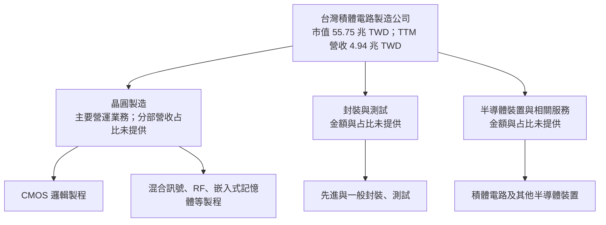
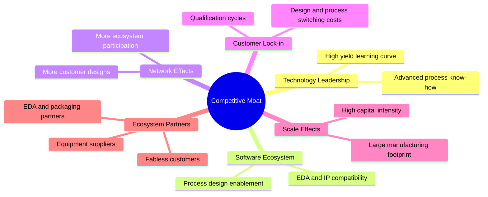
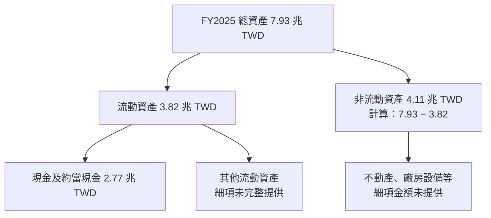
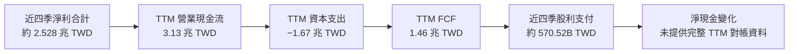
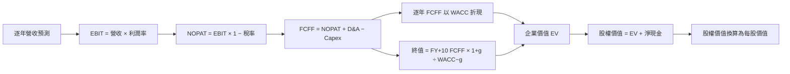
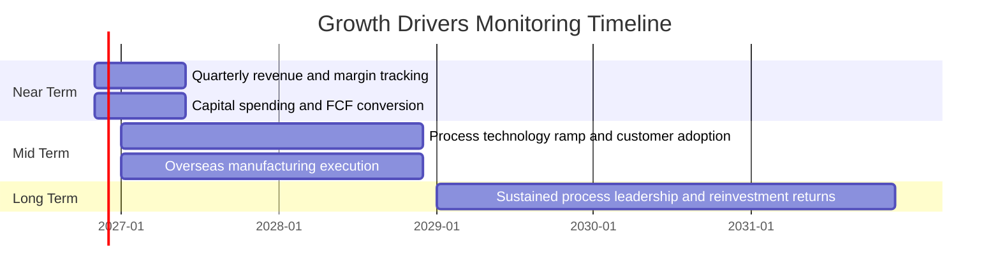
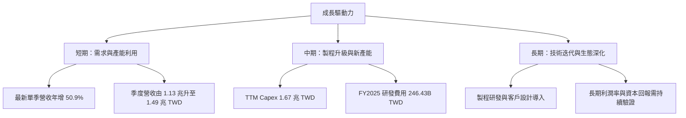
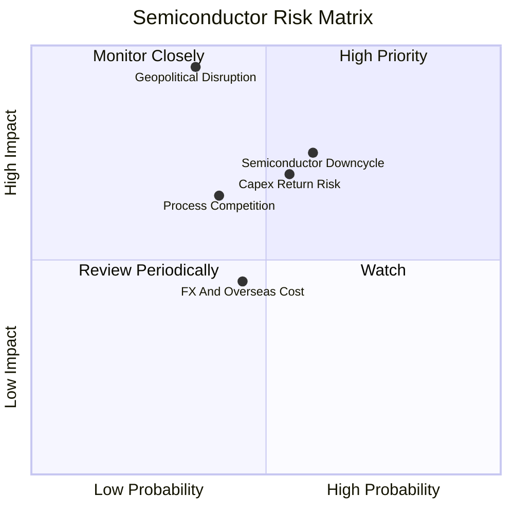
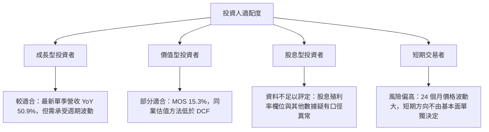

# 2330.TW 基本面深度分析報告
> **報告日期**：2026-11-26 ｜ **語言**：繁體中文 ｜ **數據來源**：Yahoo Finance、Roic.ai 

## 目錄

| # | 章節 | 核心結論 |
|---|------|----------|
| 1 | 執行摘要 | 買入；加權合理價值 2,539.39 TWD；MOS 15.3% |
| 2 | 公司概覽與商業模式 | 晶圓代工製程、規模與客戶導入構成主要競爭優勢；市場份額數據未提供 |
| 3 | 損益表深度分析 | TTM 營收 4.94 兆 TWD；最新單季年增 50.9%；TTM 營業利益率 58.0% |
| 4 | 資產負債表分析 | 淨現金 2.95 兆 TWD，現金與短期投資 4.02 兆 TWD |
| 5 | 現金流量深度分析 | TTM FCF 1.46 兆 TWD，FCF Yield 2.61%；高資本支出仍是核心特徵 |
| 6 | 獲利能力與資本效率 | 估計 ROIC 代理值約 44.1%，高於 WACC 10.44%；Piotroski 與 DuPont 不可計算 |
| 7 | 相對估值分析 | 同業倍數分歧；Forward P/E 14.37x，接近同業中位數估值方法的隱含值 |
| 8 | DCF 內在價值評估 | 基準 DCF 2,946.27 TWD；加權合理價值 2,539.39 TWD，MOS 15.3% |
| 9 | 成長催化劑 | 最新單季營收年增 50.9%；TAM 與市場份額數字未提供 |
| 10 | 風險矩陣 | 地緣政治、景氣循環與高資本支出為主要風險 |
| 11 | 投資建議 | 買入；現價 2,150 TWD，監控營收成長、毛利與資本支出回報 |

---

## 1. 執行摘要

截至 2026-11-25 收盤價 **2,150 TWD**，本報告依程式固定權重計算的加權合理價值為 **2,539.39 TWD**，故安全邊際 **MOS = 15.3%**、相對現價上行空間 **18.1%**，按規則 20 評級為**買入**。支持評級的營運證據包括 TTM 營收 **4.94 兆 TWD**、最新單季營收年增 **50.9%**、TTM 營業利益率 **58.0%**、TTM FCF **1.46 兆 TWD**及淨現金 **2.95 兆 TWD**；但 TTM 營收年增率缺值、EPS 預期差資料為 NaN，且 DCF 終值現值佔企業價值 **61.2%**，使評級信心為中等，而非單憑模型上行幅度追價。

### 1.0 一頁式投資儀表板（Portfolio Manager 30 秒速讀）

| 項目 | 內容 |
|------|------|
| **投資論點（3 句）** | ① TTM 營收 4.94 兆 TWD，最新單季年增 50.9%，顯示近期需求動能強。② TTM 營業利益率 58.0%、TTM FCF 1.46 兆 TWD，營運轉現能力仍高。③ 淨現金 2.95 兆 TWD，但 2026-11-25 收盤價 2,150 TWD 對加權合理價值 2,539.39 TWD 的 MOS 僅 15.3%，估值保護屬有限。 |
| **綜合評分** | **8.5/10**（引用 1.1 評分卡） |
| **財務健康** | 🟢 現金與短期投資 4.02 兆 TWD、總債務 1.07 兆 TWD，淨現金 2.95 兆 TWD。 |
| **ROIC vs WACC** | 估計 ROIC 代理值約 **44.1%** vs **10.44%**（估計值高於資本成本；方法見 6.2）。 |
| **FCF 趨勢** | TTM FCF 1.46 兆 TWD；FCF Yield **2.61%**。 |
| **估值** | Forward P/E **14.37x** ｜ EV/EBITDA **14.68x** ｜ FCF Yield **2.61%** |
| **DCF 內在價值（基準）** | **2,946.27 TWD** ｜ 相對現價折價 **27.0%**（折溢價＝現價÷DCF價值−1，見 8.5） |
| **安全邊際（MOS）** | **15.3%**＝(加權合理價值 2,539.39 − 現價 2,150) ÷ 2,539.39｜🟡 有限 |
| **預期報酬（基準情境 12M）** | DCF 基準情境對現價上行 **37.0%**；但加權合理價值上行為 **18.1%**，兩者不可混用。 |
| **關鍵風險（前二）** | 台海及海外營運地緣風險；半導體需求反轉與高資本支出造成現金流壓力。 |
| **評級 + 信心度** | 🟢 **買入**｜信心：中 |

### 1.1 綜合評分卡（全報告唯一）

| 維度 | 評分（1–10） | 主要依據（引用數字與其來源章節） |
|------|--------------|----------------------------------|
| 成長性 | 9.0 | 最新單季營收年增 50.9%，但 TTM 年增率 N/A（3.2 節）。 |
| 獲利能力 | 9.5 | TTM 營業利益率 58.0%、淨利率 51.1%；估計 ROIC 代理值約 44.1%（3、6.2 節）。 |
| 財務健康 | 9.0 | 淨現金 2.95 兆 TWD、流動比率 2.584、CCC 2 天（4.2 節）。 |
| 估值 | 6.5 | MOS 15.3%，Forward P/E 14.37x；相對估值與 DCF 結果存在分歧（7、8.8 節）。 |
| 護城河 | 9.5 | 製程技術、資本密集規模與客戶驗證／轉換成本；無市場份額數字可量化（2.3–2.4 節）。 |
| 管理層與資本配置 | 7.5 | 2025 年資本支出 1.28 兆 TWD、股利支付 466.78B TWD；回購及資本報酬目標資料未提供（5.4 節）。 |
| **綜合評分** | **8.5** | 六項算術平均： (9.0 + 9.5 + 9.0 + 6.5 + 9.5 + 7.5) ÷ 6 = **8.5** |

### 1.2 五大投資論點 + 三大核心風險

| 類型 | 項目 | 具體依據 | 信心度 |
|------|------|----------|--------|
| 🟢 **投資論點①** | 近期需求加速 | 最新一季營收年增 50.9%，單季營收 1.49 兆 TWD。 | 🟢 高 |
| 🟢 **投資論點②** | 高營運利潤率 | TTM 營業利益率 58.0%、毛利率 65.8%，每一元營收轉化為營業利益的比重高。 | 🟢 高 |
| 🟢 **投資論點③** | 現金流可觀 | TTM OCF 3.13 兆、資本支出 1.67 兆、FCF 1.46 兆 TWD。 | 🟢 高 |
| 🟢 **投資論點④** | 淨現金緩衝 | 現金與短期投資 4.02 兆、總債務 1.07 兆 TWD。 | 🟢 高 |
| 🟢 **投資論點⑤** | DCF 與市場價有折價 | DCF 基準價 2,946.27 TWD，較 2,150 TWD 現價高 37.0%。 | 🟡 中 |
| 🟡 **風險①** | DCF 終值依賴 | 終值現值佔 EV 61.2%；長期成長及 WACC 變動會顯著改變估值。 | 🟡 中 |
| 🔴 **風險②** | 地緣政治與供應集中 | 公司核心製造資產與營運所在地涉及台灣風險；財務數據無法量化尾端衝擊。 | 🔴 高衝擊 |
| 🔴 **風險③** | 景氣及投資循環 | TTM Capex 1.67 兆 TWD，占 TTM 營收約 33.8%；需求下行時高固定成本可能壓縮 FCF。 | 🔴 高 |

### 1.3 快速統計卡片

| 指標 | 公司實際值（期間） | 同業中位數 | 狀態 |
|------|--------------------|------------|------|
| 營收成長（TTM） | **N/A** | — | 🟡 不可判定 |
| 營收成長（最新一季年增） | **50.9%** | 20.9%（UMC、GFS、INTC 中位數） | 🟢 |
| 毛利率（TTM） | **65.8%** | 31.7%（UMC、GFS、INTC 中位數） | 🟢 |
| 營業利益率（TTM） | **58.0%** | — | 🟢 |
| ROIC（TTM） | **N/A**；估計 FY2025 ROIC 代理值約 44.1% | — | 🟡 |
| Forward P/E | **14.37x** | 14.7x（提供數值之 UMC、GFS、INTC 中位數） | 🟢 |
| FCF Yield（TTM） | **2.61%** | — | 🟡 |
| Piotroski F-Score | **N/A** | — | 🟡 |

### 1.4 投資結論

```text
╔══════════════════════════════════════════════════════════════════╗
║                    📊 投資結論摘要                               ║
╠══════════════════════════════════════════════════════════════════╣
║  評級：買入（MOS 15.3%，ROIC 代理值高於 WACC）                    ║
║  價格（2026-11-25 收盤）：2,150.00 TWD                            ║
║  DCF 內在價值（基準）：2,946.27 TWD（折價 27.0%）                 ║
║  安全邊際 MOS：15.3%（以加權合理價值為分母）                      ║
║  加權合理價值（8.8）：2,539.39 TWD                               ║
║  DCF 情境價值：                                                   ║
║    悲觀情境：1,248.15 TWD（-41.9%）                              ║
║    基準情境：2,946.27 TWD（+37.0%）                              ║
║    樂觀情境：6,585.31 TWD（+206.3%）                             ║
║  綜合評分：8.5/10（引用 1.1）                                     ║
║  適合投資人：可承受半導體週期與地緣風險的中長期成長型投資人      ║
╚══════════════════════════════════════════════════════════════════╝
```

---

## 2. 公司概覽與商業模式

### 2.1 業務結構與收入來源

公司從事積體電路及半導體裝置製造、封裝、測試與銷售，服務地區包括台灣、中國、日本、美國及其他國際市場。各製程、封裝、測試與服務收入分部金額及佔比未提供，因此不虛構占比圖。



### 2.2 市場份額

市場份額數據及其來源年份未提供，故不繪製份額圖或填入比例。可確認的是公司 TTM 營收 4.94 兆 TWD，最新單季營收年增 50.9%；同業資料中，UMC、GFS、INTC 最新單季營收年增分別為 25.6%、12.5%、20.9%。這顯示該季公司營收增速較所列同業高，但不能以此直接推算市場份額。

### 2.3 競爭護城河分析



### 2.4 護城河強度

| 護城河項目 | 強度（強／中／弱） | 證據（引用數字或事實） | 會削弱它的情況 |
|------------|--------------------|------------------------|----------------|
| 製程技術與良率 | 強 | TTM 毛利率 65.8%、營業利益率 58.0%，反映高附加價值製造及營運效率；未提供各節點營收。 | 競爭者縮小製程、良率或成本差距；製程轉換延誤。 |
| 客戶鎖定與驗證 | 強 | 晶片設計需配合製程、設計工具與量產驗證；客戶轉換涉及重新設計與認證。 | 客戶改採自有製造、轉單或多來源策略。 |
| 規模效應 | 強 | TTM 營收 4.94 兆 TWD、TTM Capex 1.67 兆 TWD，規模使研發與設備投資得以分攤。 | 產能過剩、資本報酬率下滑或需求長期低於預期。 |
| 軟體生態系統 | 中 | EDA、IP 與製程設計支援是晶圓代工的重要互補資產；數據未提供平台營收或生態系規模。 | 競爭製程生態改善、工具兼容性提高。 |
| 網路效應 | 中 | 客戶及設計數增加可加深工具、IP 與製程共用；未提供可量化網路效應指標。 | 客戶集中或競爭者形成相近生態。 |
| 生態夥伴 | 中 | 設備商、材料商、設計服務與封裝合作構成量產鏈；供應商集中度資料未提供。 | 供應鏈中斷、出口限制或關鍵設備受限。 |

1.1 的護城河評分 **9.5/10**，依據為高利潤率、龐大資本投入門檻與客戶導入轉換成本；未提供市場份額與分部收入，故不以未驗證數字加碼判斷。

---

## 3. 損益表深度分析

### 3.1 年度收入成長趨勢（近 4 年）

年度營收數據取自年度損益表，圖中柱長為相對視覺呈現；YoY 由所列年度收入計算，取一位小數。

```text
╔══════════════════════════════════════════════════════════════════╗
║              台積電年度收入趨勢（FY2022–FY2025）                 ║
╠══════════════════════════════════════════════════════════════════╣
║  FY2022  2.26 兆 TWD  ████████████░░░░░░░░░░░  YoY：基期       ║
║  FY2023  2.16 兆 TWD  ███████████░░░░░░░░░░░░  YoY：-4.4% 🔴   ║
║  FY2024  2.89 兆 TWD  ███████████████░░░░░░░░  YoY：+33.8% 🟢  ║
║  FY2025  3.81 兆 TWD  ████████████████████░░░  YoY：+31.8% 🟢  ║
║                                                                  ║
║  FY2022–FY2025 營收 CAGR：(3.81 ÷ 2.26)^(1/3) − 1 = 約 19.0%    ║
╚══════════════════════════════════════════════════════════════════╝
```

2023 年收入較 2022 年下滑 4.4%，與半導體循環疲弱相符；其後 2024、2025 年分別增長 33.8%、31.8%，顯示需求回升並帶動高基期營收續增。2026 年最新單季年增 50.9%，代表近期增速加快，但單季增長不能直接等同 TTM 增長。

### 3.2 季度收入趨勢分析

以下使用 Roic.ai 季度營收序列，單位為 TWD 十億；QoQ、YoY 為以來源數值計算後四捨五入至一位小數。

| 季度 | 營收（TWD B） | QoQ | YoY | 備註 |
|------|--------------:|----:|----:|------|
| 2025 Q4 | 1,046.09 | +5.7% | +20.4% | 相較 2025 Q3 989.918B；相較 2024 Q4 868.461B。 |
| 2026 Q1 | 1,134.10 | +8.4% | +35.1% | 年增加速；2025 Q1 為 839.254B。 |
| 2026 Q2 | 1,270.38 | +12.0% | +36.0% | 季增延續；2025 Q2 為 933.792B。 |
| 2026 Q3 | 1,494.24 | +17.6% | +51.0% | 與財務數據所列最新單季 YoY 50.9% 的四捨五入結果相符。 |

單季營收連續上升，2026 Q3 的 QoQ 亦加速至 17.6%。這可反映需求、產品組合或供應能力共同改善，但資料未提供分平台、製程或客戶拆分，無法精確分解各因素貢獻。

### 3.3 利潤率演變分析

| 利潤率指標 | FY2022 | FY2023 | FY2024 | FY2025 | 趨勢 | 評估 |
|------------|--------|--------|--------|--------|------|------|
| **毛利率** | 59.7% | 54.6% | 56.1% | 59.8% | FY2023 下探後回升 | 🟢 |
| **營業利益率** | 49.6% | 42.7% | 45.7% | 50.9% | 2023 下滑，兩年回升 | 🟢 |
| **淨利率** | 43.9% | 39.4% | 40.1% | 44.6% | 隨營收與營業利潤改善 | 🟢 |

毛利率與營業利益率以年度營收、毛利及營業利益相除計算。2023 年下降可能與半導體需求循環、產能利用及產品組合相關；但提供的財務表沒有公司對變動因素的定量拆解，因此不能將其中任一因素說成已證實的單一原因。2024–2025 年收入擴張與利潤率回升同時發生，顯示營收復甦對固定成本吸收有正面作用。最新 TTM 營業利益率為 58.0%，高於 FY2025 年度值，需持續觀察能否維持。

### 3.4 費用結構分析

完整營業費用細項、折舊及利息費用明細未提供，無法可靠拆出研發、銷管、製造成本、稅務與其他費用比例；因此不畫費用圓餅圖。可確認 FY2025 研發費用為 **246.43B TWD**，較 FY2024 的 **204.18B TWD**增加約 **20.7%**，有助維持製程與產品開發投入，但也需要以未來新製程收入及利潤回報驗證。

### 3.5 季度 EPS 趨勢與盈餘品質（Quality of Earnings）

| 盈餘品質項目 | 數值/佔比 | 評估 |
|--------------|-----------|------|
| 股權薪酬 SBC / 營收 | 約 **0.010%**；以四季 SBC 合計 513.37M TWD ÷ TTM 營收 4.94T TWD | 🟢 比重低，對股東稀釋影響有限；但此為四季數據加總估算。 |
| SBC / 營業現金流 | 約 **0.016%**；513.37M ÷ 3.13T | 🟢 占 OCF 極低。 |
| FCF / 淨利（現金轉換率） | 約 **57.8%**；TTM FCF 1.46T ÷ 近四季淨利合計 2.528T | 🟡 正值但低於 100%，主要需考慮高額資本投入；淨利合計由季度報表加總。 |
| 一次性/非經常性損益 | N/A（明細未提供） | 🟡 無法確認是否存在重大一次性項目。 |
| 有效稅率異常 | 17.0%（最新年度有效稅率） | 🟢 DCF 採用 17.0%；缺少歷年稅項明細，不能判斷是否異常。 |
| 資本化支出 vs 費用化 | TTM Capex 1.67T TWD；資本化政策與資產分類明細未提供 | 🟡 高 Capex 會以折舊分期進入損益，應追蹤資產利用率及後續現金回報。 |

最近四季 EPS 預估值與實際值均為 NaN，因此**無法判定超預期或不及預期**，也無法據此分析預期差原因。最新單季 EPS 年增率為 68.7%，季度淨利年增率亦為 68.7%；這是實際同比增長，不是 EPS beat/miss。整體看 SBC 占比很低，淨利有現金流支撐；但 FCF 僅約為淨利 57.8%，顯示高資本支出使會計盈餘不能全部轉為當期自由現金。

---

## 4. 資產負債表分析

### 4.1 資產結構分解

FY2025 總資產 7.93 兆 TWD、流動資產 3.82 兆 TWD；非流動資產為兩者相減的計算值 4.11 兆 TWD。流動資產細項中，現金及約當現金 2.77 兆 TWD；其餘細項未完整提供。



### 4.2 流動性與營運資金分析

| 指標 | FY2022 | FY2023 | FY2024 | FY2025 | 評估 |
|------|--------|--------|--------|--------|------|
| 流動比率 | 2.08 | 2.32 | 2.36 | 2.51 | 🟢 FY2025 以流動資產 3.82T ÷ 流動負債 1.52T 計算約 2.51；即時摘要另列 2.584，期間口徑可能不同。 |
| 快速比率 | N/A | N/A | N/A | 2.287（即時摘要） | 🟢 即時數據顯示短期償債資源充足；未提供歷史序列。 |

營運資金天數依品質指標照列；一年前數值未提供，不能補算。

| 指標 | 最新 TTM | 一年前 TTM | 變化 | 解讀 |
|------|----------|------------|------|------|
| DSO 應收帳款天數 | 1 天 | N/A | N/A | 來源期末應收帳款數值與其他來源有差異，須留意口徑；未提供前期比較。 |
| DIO 存貨天數 | 92 天 | N/A | N/A | 反映存貨週轉約三個月，對應半導體製造及在製品週期；無法判斷是否較前期惡化。 |
| DPO 應付帳款天數 | 91 天 | N/A | N/A | 供應商付款天數接近存貨天數；缺少前期資料，不能推論議價力變化。 |
| CCC 現金轉換週期 | 2 天 | N/A | N/A | 照抄程式品質指標；公式按 DSO + DIO − DPO，四捨五入後為 2 天。 |

### 4.3 債務結構分析

```text
╔══════════════════════════════════════════════════════════════════╗
║                   台積電債務健康診斷                             ║
╠══════════════════════════════════════════════════════════════════╣
║  總債務：          1.07 兆 TWD   ██░░░░░░░░░░░░░░░░░░  🟢       ║
║  現金+短期投資：   4.02 兆 TWD   ████████████████████  🟢       ║
║  淨現金：          2.95 兆 TWD   ██████████████░░░░░░  🟢       ║
║                                                                  ║
║  Debt/EBITDA： N/A（即時 TTM EBITDA 金額未列於 VERIFIED FIGURES）║
║  利息保障倍數：N/A（利息費用與精確營業利息資料未提供）          ║
║  流動比率：2.584（即時摘要）                                     ║
║  債務成本：稅前 1.16%（資本成本輸入）                             ║
╚══════════════════════════════════════════════════════════════════╝
```

公司淨現金為正，現金及短期投資約為總債務的 **3.76 倍**（4.02 ÷ 1.07），使資產負債表具備吸收景氣下行與維持資本支出的緩衝。債務到期分布與固定／浮動利率比例未提供，故不進一步推估再融資風險。

### 4.4 股東權益趨勢

```text
╔══════════════════════════════════════════════════════════════════╗
║                    FY2022–FY2025 股東權益                         ║
╠══════════════════════════════════════════════════════════════════╣
║  FY2022  2.90 兆 TWD  ███████████░░░░░░░░░░░                   ║
║  FY2023  3.43 兆 TWD  █████████████░░░░░░░░                   ║
║  FY2024  4.24 兆 TWD  ████████████████░░░░                   ║
║  FY2025  5.36 兆 TWD  ████████████████████                   ║
║                                                                  ║
║  FY2022–FY2025 增長：5.36 ÷ 2.90 − 1 = 約 84.8%                 ║
╚══════════════════════════════════════════════════════════════════╝
```

股東權益連年增加，與年度淨利及留存盈餘累積相符；但沒有完整權益變動表及回購資料，無法拆分保留盈餘、匯兌或其他權益項目的貢獻。

---

## 5. 現金流量深度分析

### 5.1 現金流量瀑布圖



股利支付按最近四季現金流資料加總；FCF 依定義為營業現金流減資本支出。現金流瀑布的各步驟並非完整會計對帳，因營運資金、借款、投資及其他融資流量明細未全部提供。

### 5.2 FCF 轉換率趨勢

| 年度 | FCF（TWD B） | 淨利（TWD B） | FCF / 淨利 | 解讀 |
|------|-------------:|-------------:|-----------:|------|
| 2022 | 520.97 | 992.92 | 52.5% | 現金轉換低於淨利，資本投資占用現金。 |
| 2023 | 286.57 | 851.74 | 33.6% | FCF 明顯下滑，與週期和高投資支出同時存在。 |
| 2024 | 861.20 | 1,160 | 74.2% | FCF 回升幅度高於淨利增幅。 |
| 2025 | 992.38 | 1,700 | 58.4% | 絕對 FCF 增加，但現金轉換率回落。 |
| TTM 至 2026-09-30 | 1,460 | 約 2,528 | 約 57.8% | TTM FCF 與季度淨利加總；資本支出仍是現金轉換的主要約束。 |

### 5.3 自由現金流趨勢

```text
╔══════════════════════════════════════════════════════════════════╗
║               自由現金流趨勢（年度及 TTM）                        ║
╠══════════════════════════════════════════════════════════════════╣
║  FY2022  520.97B TWD  ██████████░░░░░░░░░░  FCF Yield：N/A      ║
║  FY2023  286.57B TWD  ██████░░░░░░░░░░░░░░  FCF Yield：N/A      ║
║  FY2024  861.20B TWD  █████████████████░░░  FCF Yield：N/A      ║
║  FY2025  992.38B TWD  ████████████████████  FCF Yield：N/A      ║
║  TTM     1.46 兆 TWD  ████████████████████  FCF Yield：2.61%    ║
║                                                                  ║
║  年度 FCF 變化：2023 下滑，2024–2025 回升；TTM 達 1.46 兆 TWD。  ║
╚══════════════════════════════════════════════════════════════════╝
```

年度 FCF Yield 未提供同期間市值序列，故只列 TTM 的官方數值 2.61%。年度 FCF 由 2023 年 286.57B 回升至 2025 年 992.38B，但高資本支出仍使營收及淨利增長不能一比一轉成 FCF。

### 5.4 資本配置評估

回購金額未提供，且未提供完整 TTM 股利以外的投資與融資資金流，因此不能製作有財務依據的資本配置圓餅圖。

| 資本配置項目 | 金額／數據 | 評估 |
|--------------|------------|------|
| FY2025 資本支出 | 1.28 兆 TWD | 生產能力與製程投資的核心用途；回報需觀察未來產能利用率。 |
| TTM 資本支出 | 1.67 兆 TWD | 約占 TTM 營收 33.8%，投資強度高。 |
| FY2025 現金股利支付 | 466.78B TWD | 低於 FY2025 FCF 992.38B TWD。 |
| TTM 回購 | N/A | 回購資料未提供。 |
| 留存／其他投資 | N/A | 未提供完整現金流分類，不能反推。 |

---

## 6. 獲利能力與資本效率

### 6.1 ROE / ROA / ROIC 趨勢

| 指標 | FY2022 | FY2023 | FY2024 | FY2025／最新 | 評估 |
|------|--------|--------|--------|--------------|------|
| ROE | N/A | N/A | N/A | TTM 41.9% | 🟢 高，但品質指標的 DuPont 拆解為 N/A。 |
| ROA | N/A | N/A | N/A | TTM 20.6% | 🟢 資產獲利能力高。 |
| ROIC | N/A | N/A | N/A | TTM N/A；FY2025 代理估計約 44.1% | 🟢 代理值高於 WACC，但不是程式品質區塊的正式 ROIC。 |
| ROIC 同業／行業均值 | — | — | — | 未提供 | 不作無來源比較。 |

### 6.2 ROIC vs WACC 分析（核心價值創造判斷）

```text
╔══════════════════════════════════════════════════════════════════╗
║                ROIC vs WACC 深度分析                              ║
╠══════════════════════════════════════════════════════════════════╣
║  資本成本（採用程式提供值）：                                     ║
║  ├── 無風險利率：4.85%                                            ║
║  ├── ERP：5.00%                                                   ║
║  ├── Beta 原始：1.23；採用調整後 Beta：1.16                      ║
║  ├── 股權成本（提供值）：10.62%                                  ║
║  ├── 稅前債務成本：1.16%；稅後約 0.96%                           ║
║  ├── 股權／債務權重：98.1%／1.9%                                 ║
║  └── ✅ 採用 WACC：10.44%                                        ║
║                                                                  ║
║  FY2025 ROIC 代理估算（非正式品質指標）：                         ║
║  ├── NOPAT = 1.94 兆 × (1 − 17.0%) = 1.610 兆 TWD                ║
║  ├── 投入資本代理 = 權益 5.36 + 債務 1.06 − 現金 2.77             ║
║  │                  = 3.65 兆 TWD                                ║
║  └── ROIC 代理 = 1.610 ÷ 3.65 = 約 44.1%                         ║
║                                                                  ║
║  EVA 利差代理 = 44.1% − 10.44% = 約 +33.7 個百分點                ║
║  結論：在此簡化代理口徑下，報酬高於資本成本，呈現價值創造。       ║
║  限制：投入資本以 FY2025 年末權益、債務及現金近似，非平均資本。   ║
╚══════════════════════════════════════════════════════════════════╝
```

WACC 各組成以程式提供值為準，不另建立替代折現率。輸入間存在小幅算術差異：4.85% + 1.16 × 5.00% = 10.65%，與提供股權成本 10.62% 不完全相同；以提供的 10.62% 和 WACC 10.44% 作估值基準。由於股權與債務權重、債務成本四捨五入亦可能影響末位，無法用顯示值精確重建 10.44%。ROIC 代理值高於 WACC，但非正式 ROIC，應視為方向性判斷。

### 6.3 杜邦三因素分解

**N/A（數據未提供：品質指標計算所需的同口徑淨利、營收、總資產及正股東權益資料不足；程式品質數據將 DuPont 標示為 N/A。）**因此不自行用其他期末餘額重算杜邦因子。

### 6.4 財務體質：Piotroski F-Score

**N/A（需要相隔一年的兩組 TTM SEC 申報資料；目前資料為 Yahoo 季度報表，九項測試結果均未提供。）**因此不能將缺漏測試誤當成未通過，也不能推論 F-Score。

---

## 7. 相對估值分析

### 7.1 同業估值比較表格

| 估值指標 | **台積電** | **UMC** | **GFS** | **INTC** | 本公司評估 |
|----------|----------:|--------:|-------:|--------:|-----------|
| **Trailing P/E** | 22.88x | 12.4x | 103.4x | N/A | 🟡 低於 GFS，明顯高於 UMC；INTC 無可比數值。 |
| **Forward P/E** | 14.37x | 14.7x | 14.0x | 30.4x | 🟢 低於 INTC，接近 UMC、GFS。 |
| **P/S Ratio** | 11.28x | N/A | 2.8x | 4.8x | 🔴 高於有數值同業；跨市場及利潤率差異使單看 P/S 有局限。 |
| **EV/EBITDA** | 14.68x | N/A | 9.7x | 15.8x | 🟡 高於 GFS、低於 INTC。 |
| **最新單季營收 YoY** | 50.9% | 25.6% | 12.5% | 20.9% | 🟢 所列同業中最高。 |
| **TTM 毛利率** | 65.8% | 31.7% | 28.5% | 40.2% | 🟢 高於所列同業。 |

同業倍數依 Yahoo Finance 同業資料。估值差異反映成長、獲利能力、業務模式與地區風險不同；尤其 UMC 的 P/S、EV/EBITDA 因幣別混合標示為 N/A，不作自行換算。

### 7.2 歷史估值區間分析

**N/A（數據未提供：未提供「Valuation vs own history」歷史 P/E 區間與百分位數。）**不以價格歷史推估估值百分位。

### 7.3 情境價值（Bear / Base / Bull，照抄 DCF MODEL）

| 情境 | 第 1 年營收成長 | 期末營業利潤率 | WACC | 每股價值 | 相對現價 | 機率 | 會發生的條件 |
|------|----------------|----------------|------|----------|----------|------|--------------|
| 🔴 悲觀 | 15.0% | 42.1% | 11.44% | 1,248.15 TWD | -41.9% | 25% | 需求成長降速、利潤率長期收斂，且風險溢酬上升。 |
| 🟡 基準 | 30.0% | 49.5% | 10.44% | 2,946.27 TWD | +37.0% | 50% | 第一年營收延續高增長，十年後營業利潤率回落至長期中位數假設。 |
| 🟢 樂觀 | 45.0% | 54.5% | 9.44% | 6,585.31 TWD | +206.3% | 25% | 強勁需求持續、利潤率較基準更具韌性且資本成本下降。 |

模型另列機率加權情境值 **3,431.50 TWD（+59.6%）**，但固定估值方法與第 8.8 節採用 DCF 基準值，而非該機率加權值。

### 7.4 相對估值隱含價格區間

```text
╔══════════════════════════════════════════════════════════════════╗
║                  相對估值隱含每股價格                             ║
╠══════════════════════════════════════════════════════════════════╣
║  1,889.12         2,150.00        2,193.42        2,946.27       ║
║  EV/EBITDA        現價            Forward P/E     DCF 基準       ║
║  -12.1%           基準            +2.0%           +37.0%         ║
╚══════════════════════════════════════════════════════════════════╝
```

- **同業 Forward P/E：2,193.42 TWD**，依同業中位數 **14.7x** 乘公司 Forward EPS **149.60 TWD**。
- **同業 EV/EBITDA：1,889.12 TWD**，依 GFS、INTC 中位數倍數 **12.7x** 乘 TTM EBITDA，再加淨現金。
- DCF 基準 2,946.27 TWD 為現價的 1.37 倍；相對估值結果較低，顯示市場對長期成長與資本效率的假設是主要估值差異來源。

---

## 8. DCF 內在價值評估（Discounted Cash Flow）

### 8.0 估值推理鏈（Thinking Logic）

**Step 1 — 價值由哪些變數決定？**  
公司價值主要來自現有晶圓製造現金流基礎，以及未來營收成長與維持營業利潤率的能力；產品／製程分部收入占比未提供，不能將各成長曲線拆成可靠比例。最新 TTM 營收為 4.94 兆 TWD，營業利益率 58.0%。本模型最敏感的變數是 WACC、終值成長率與長期利潤率：敏感度表顯示在 g=3.0% 時，WACC 由 9.44% 升至 10.44%，每股價值由 3,468.63 降至 2,946.27 TWD，下降 522.36 TWD。

**Step 2 — 模型選擇**

| 決策點 | 本報告採用 | 理由（含數字） | 曾考慮但否決 | 否決理由 |
|--------|-----------|----------------|--------------|----------|
| 現金流定義 | FCFF | 以 WACC 10.44% 折現，先得 EV，再加淨現金。 | FCFE | 不符合提供模型的既定現金流定義。 |
| 預測期 N | 10 年 | DCF 模型已固定十年，營收增長由 30.0% 線性遞減至 3.0%。 | 5 年 | 不符合已提供模型，且不得重建另一套 DCF。 |
| 終值方法 | Gordon Growth，g=3.0% | WACC 10.44% 大於 g，公式可用。 | 退出倍數 | DCF 模型未提供退出倍數終值，不能自行另建。 |
| EBIT 基礎 | GAAP EBIT | 模型明示採 GAAP EBIT。 | 非 GAAP EBIT | 會造成 SBC 處理與模型定義不一致。 |

**Step 3 — 高／中敏感度假設的推導鏈**

- **營收成長**：錨點＝最新單季 YoY 50.9%，但 TTM YoY N/A → 模型限制並平滑極高單季成長，從 FY+1 30.0% 線性下降至 FY+10 3.0% → **採用年增率序列 30.0%、27.0%、24.0%、21.0%、18.0%、15.0%、12.0%、9.0%、6.0%、3.0%** → 否決把 50.9% 長期維持，因它是單季年增，不是 TTM 成長率。
- **期末營業利潤率**：錨點＝TTM 58.0%；模型以過去五個財年中位數作收斂參考 → 隨時間線性下降至 **49.5%** → 否決十年都維持 58.0%，因模型假設成熟期競爭與產品組合使利潤率回落。
- **永續成長率 g**：錨點＝模型採用 3.0%，屬長期名目增長假設 → 遠低於 WACC 10.44%，避免終值公式失效 → **採用 3.0%** → 否決更高 g，因其會大幅放大終值且缺少長期產業成長率資料支持。
- **預測期 N**：錨點＝模型固定 10 年 → 用十年呈現高增長逐步收斂至成熟增長 → **採用 10 年** → 否決其他期限，因程式模型固定為 10 年且禁止另建。
- **Capex/營收**：錨點＝TTM 約 33.8% → 隨收入成熟遞減至模型第十年 16.6%（模型以 D&A 倍數作下限規則）→ **採用 FY+1 33.8% 遞減至 FY+10 16.6%** → 否決全期維持 33.8%，因模型預設資本支出比率隨成熟下行；此為高敏感假設。
- **GAAP EBIT 與 SBC**：錨點＝模型明確使用 GAAP EBIT；FY2025 SBC 1.25B TWD、TTM 估算約 513.37M TWD → 不再於 FCFF 扣除 SBC，並固定股數 → **採組合 (A)** → 否決「再扣 SBC」或額外稀釋股數，避免重複計入股東成本。
- **終值方法**：錨點＝模型直接以 FY+10 FCFF 套 Gordon Growth → WACC 高於 g，終值可計算 → **採用 Gordon Growth** → 退出倍數沒有模型輸入且同業成熟期倍數未提供於 DCF 區塊，因此不自行補值。
- **WACC**：錨點＝資本成本資料給定 10.44% → 市值權重股權 98.1%、債務 1.9%，模型直接採此折現率 → **採用 10.44%** → 不以自行估算的替代 WACC 取代程式數值。

低敏感度輸入：有效稅率錨點及採用值均為 17.0%；D&A/營收採 TTM 15.1%；ΔWC 未建模，並非另填 0% 後納入計算，而是模型明示不含營運資金變動。

**Step 4 — 最脆弱的一環**  
最脆弱的是長期成長、利潤率與終值假設能否同時成立；若增長及利潤率落至悲觀情境，模型每股價值為 **1,248.15 TWD**，明顯低於現價，與 8.9 的失效情境一致。

**Step 5 — 計算路徑圖**



### 8.1 模型假設總表（Model Inputs）

| 假設項目 | 採用值 | 依據 / 來源 | 敏感度 |
|----------|--------|-------------|--------|
| 預測期長度 N | 10 年 | DCF 模型固定期間。 | 🟡 中 |
| 營收成長序列 | FY+1 30.0% 線性降至 FY+10 3.0% | FY+1 以最新單季 YoY 50.9% 為參照但設上限 30%；FY+10 3.0%。 | 🔴 高 |
| 營業利潤率 | 58.0% 降至 49.5% | 起點為 TTM 58.0%，期末為五年中位數假設。 | 🔴 高 |
| 有效稅率 | 17.0% | 最新年度有效稅率。 | 🟢 低 |
| Capex / 營收 | FY+1 33.8% 降至 FY+10 16.6% | TTM 比率起點，之後遞減至模型規則下限。 | 🟡 中 |
| D&A / 營收 | 15.1% | TTM 比率，模型固定。 | 🟢 低 |
| ΔWC / 營收增額 | 未建模 | DCF 模型明示 working capital is not modelled；不能補造。 | 🟢 低 |
| EBIT 基礎 | GAAP EBIT | 模型定義採 GAAP。 | 🟡 中 |
| SBC 處理 | GAAP EBIT 已含 SBC，不另扣 | 模型採組合 (A)。 | 🟡 中 |
| 年稀釋率 | 0%；固定股數 | 與組合 (A) 相容；按模型說明不再稀釋。 | 🟡 中 |
| 永續成長率 g | 3.0% | DCF 模型設定，且低於 WACC。 | 🔴 高 |
| 終值方法 | Gordon Growth | 模型已計算；退出倍數未提供。 | 🔴 高 |
| WACC | 10.44% | 資本成本資料與 DCF 模型固定值。 | 🔴 高 |

FCFF 定義為 **FCFF = NOPAT + D&A − Capex**；本模型沒有 ΔWC 列。模型採用 (A)：GAAP EBIT 已含 SBC，故不再扣 SBC，股數不再額外稀釋。

### 8.2 折現率推導（WACC）

```text
╔══════════════════════════════════════════════════════════════════╗
║                    WACC 推導（折現率）                            ║
╠══════════════════════════════════════════════════════════════════╣
║  股權成本 Ke（採用提供值）：                                      ║
║  ├── 無風險利率 Rf：4.85%（資本成本輸入；觀察日期未列）           ║
║  ├── ERP：5.00%（假設值；資料未附外部估算來源）                   ║
║  ├── 原始 Beta：1.23；調整後 Beta：1.16                           ║
║  ├── 調整：⅔×1.23 + ⅓×1 = 1.153 ≈ 1.16                           ║
║  ├── 股權成本提供值：10.62%                                       ║
║  ├── CAPM 顯示值計算：4.85% + 1.16×5.00% = 10.65%                ║
║  │   與提供 Ke 10.62% 有 0.03 個百分點差異；採用提供 Ke。         ║
║  ├── 規模／國別溢酬：未另加（成本資本輸入未提供）                 ║
║  ├── 稅前債務成本：1.16%；稅後 1.16%×(1−17.0%)=0.9628%           ║
║  ├── 股權／債務權重：98.1%／1.9%                                  ║
║  └── 採用 WACC：10.44%（程式提供，非另行重估）                   ║
╚══════════════════════════════════════════════════════════════════╝
```

WACC 五步與資料可複算程度說明：

1. **Ke**：依提供值採 **10.62%**；顯示輸入重算為 `4.85% + 1.16 × 5.00% = 10.65%`，與提供值差 0.03 個百分點，故不靜默替換。
2. **稅前 Kd**：提供的債務成本為 **1.16%**（利息÷債務口徑）；利息費用金額及平均計息負債明細未提供，無法重建其分子、分母。
3. **稅後 Kd**：`1.16% × (1 − 17.0%) = 0.9628%`，四捨五入為約 **0.96%**。
4. **權重**：直接採用程式提供的股權 **98.1%**、債務 **1.9%**；市值 55.75 兆 TWD、總債務 1.07 兆 TWD 為摘要值，但與資本成本計算使用的債務範圍未提供完整對帳。
5. **WACC**：採程式提供 **10.44%**；以顯示後 Ke、稅後 Kd 及權重相乘相加會因輸入末位四捨五入略有差異。由於指示要求直接採用程式 WACC，本報告不另算替代值。

WACC 日期、ERP 來源、利息費用與計息債務平均餘額缺少明細，故資本成本的可稽核性有限；折現率仍採模型固定值 10.44%，與 6.2 一致。

### 8.3 逐年自由現金流預測（基準情境）

金額單位 TWD B；模型數字原樣列示。模型逐年以 GAAP EBIT、17.0% 稅率、D&A/營收 15.1%、模型所列 Capex 推算 FCFF，**沒有 ΔWC 項**。

| 年度 | FY+1 | FY+2 | FY+3 | FY+4 | FY+5 | FY+6 | FY+7 | FY+8 | FY+9 | FY+10（= FY+N） |
|------|------:|------:|------:|------:|------:|------:|------:|------:|------:|------:|
| 營收 | 6,428.26 | 8,163.89 | 10,123.23 | 12,249.11 | 14,453.94 | 16,622.04 | 18,616.68 | 20,292.18 | 21,509.71 | 22,155.00 |
| 營收 YoY | 30.0% | 27.0% | 24.0% | 21.0% | 18.0% | 15.0% | 12.0% | 9.0% | 6.0% | 3.0% |
| 營業利潤率 | 58.0% | 57.0% | 56.1% | 55.2% | 54.2% | 53.3% | 52.3% | 51.4% | 50.5% | 49.5% |
| EBIT（GAAP） | 3,726.88 | 4,656.49 | 5,679.00 | 6,756.58 | 7,837.06 | 8,856.56 | 9,744.56 | 10,431.05 | 10,854.96 | 10,972.60 |
| − 稅（17.0%） | (632.56) | (790.34) | (963.90) | (1,146.79) | (1,330.18) | (1,503.22) | (1,653.94) | (1,770.46) | (1,842.41) | (1,862.38) |
| = NOPAT | 3,094.32 | 3,866.14 | 4,715.10 | 5,609.79 | 6,506.88 | 7,353.34 | 8,090.62 | 8,660.59 | 9,012.55 | 9,110.22 |
| + D&A | 970.20 | 1,232.15 | 1,527.86 | 1,848.72 | 2,181.48 | 2,508.71 | 2,809.75 | 3,062.63 | 3,246.39 | 3,343.78 |
| − Capex | (2,171.05) | (2,601.47) | (3,032.68) | (3,435.84) | (3,778.51) | (4,028.15) | (4,156.32) | (4,143.23) | (3,981.42) | (3,678.16) |
| **= FCFF** | **1,893.46** | **2,496.82** | **3,210.29** | **4,022.67** | **4,909.85** | **5,833.90** | **6,744.04** | **7,579.99** | **8,277.52** | **8,775.85** |
| 折現因子 @10.44% | 0.905 | 0.820 | 0.742 | 0.672 | 0.609 | 0.551 | 0.499 | 0.452 | 0.409 | 0.370 |
| **FCFF 現值 PV** | **1,714.43** | **2,046.97** | **2,383.05** | **2,703.75** | **2,988.02** | **3,214.67** | **3,364.81** | **3,424.30** | **3,385.84** | **3,250.26** |

預測期 FCF 現值合計：

**1,714.43 + 2,046.97 + 2,383.05 + 2,703.75 + 2,988.02 + 3,214.67 + 3,364.81 + 3,424.30 + 3,385.84 + 3,250.26 = 28,476.10 TWD B**；模型列示合計為 **28,476.08 TWD B**，差 0.02B，約 0.0001%，屬逐年顯示值四捨五入尾差，沿用模型合計。

**FY+1 逐步演算示範**

1. 營收：4,944.82 × (1 + 30.0%) = **6,428.266 ≈ 6,428.26 TWD B**（模型顯示 6,428.26）。
2. EBIT：6,428.26 × 58.0% = **3,728.39 TWD B**；模型表列 EBIT **3,726.88 TWD B**，與顯示營收及利潤率直接相乘有約 1.51B 差異，可能源於底層未四捨五入輸入或模型計算口徑；依要求保留模型輸出。
3. 稅：模型 EBIT 3,726.88 × 17.0% = **633.57 TWD B**；模型表列 632.56B，顯示值相差約 1.01B。
4. NOPAT：模型表列 **3,094.32 TWD B**；表列 EBIT 減表列稅為 3,726.88 − 632.56 = **3,094.32 TWD B**。
5. D&A：模型表列 **970.20 TWD B**。
6. Capex：模型表列 **2,171.05 TWD B**。
7. ΔWC：**未建模**，模型公式不含營運資金變動。
8. FCFF：3,094.32 + 970.20 − 2,171.05 = **1,893.47 TWD B**；模型列示 **1,893.46 TWD B**，差 0.01B 為底層精度／四捨五入差異。
9. 折現因子：1 ÷ (1 + 10.44%)¹ = **0.90547**；PV = 1,893.46 × 0.90547 = **1,714.43 TWD B**。

> **合理性自檢**
> - 預測 FCFF 由 FY+1 的 1,893.46B 增至 FY+10 的 8,775.85B；FY+1 至 FY+10 端點 CAGR 約 **18.6%**。歷史 FY2022–FY2025 FCF 端點 CAGR 約 **23.9%**〔(992.38 ÷ 520.97)^(1/3)−1〕，預測低約 5.3 個百分點；歷史中間年度波動大，端點比較不代表穩定趨勢。
> - FY+10 FCFF 利潤率 = 8,775.85 ÷ 22,155.00 = **39.6%**；TTM FCF 利潤率 = 1.46 ÷ 4.94 = **29.6%**。同業最佳 FCF 利潤率未提供，不能作比較。
> - 十個年度 FCFF 均為正；但預測依賴持續營收成長及 Capex/營收下降。

**自由現金流：歷史實際 vs 模型預測**

```text
╔══════════════════════════════════════════════════════════════════╗
║            自由現金流：歷史實際 vs 模型預測                      ║
╠══════════════════════════════════════════════════════════════════╣
║  FY2023(實)  286.57B  ██████░░░░░░░░░░░░░░  年增：-45.0%        ║
║  FY2024(實)  861.20B  █████████████████░░░  年增：+200.6%       ║
║  FY2025(實)  992.38B  ████████████████████  年增：+15.2%        ║
║  FY+1 (預)   1,893.46B ████████████████████  模型值             ║
║  FY+10(預)   8,775.85B ████████████████████  十年模型末值       ║
╠══════════════════════════════════════════════════════════════════╣
║  預測端點 CAGR 約18.6%，低於歷史 FY2022–FY2025 端點約23.9%；     ║
║  但預測假設 Capex/營收逐步下降，仍是 FCF 成長的重要來源。       ║
╚══════════════════════════════════════════════════════════════════╝
```

### 8.4 終值計算（Terminal Value）

**適用性檢查：WACC 10.44% vs g 3.0% → WACC > g？✅**

| 方法 | 計算式 | 終值 TV | TV 現值 | 佔總 EV 比重 |
|------|--------|---------|---------|--------------|
| Gordon Growth | 8,775.85 × (1 + 3.0%) ÷ (10.44% − 3.0%) | 121,449.04 TWD B | 44,980.35 TWD B | 61.2% |
| 退出倍數法 | DCF 模型未提供退出倍數輸入 | N/A | N/A | N/A |

逐步演算：

1. FY+N 的 FCFF = **8,775.85 TWD B**。
2. 分子 = 8,775.85 × (1 + 3.0%) = **9,039.1255 TWD B**。
3. 分母 = 10.44% − 3.0% = **7.44%**；TV = 9,039.1255 ÷ 7.44% = **約 121,493.62 TWD B**。模型列示 **121,449.04 TWD B**，約有 0.04% 差異，為模型底層未四捨五入輸入所致；依規定保留模型列示值。
4. PV(TV) = 模型列示 TV 121,449.04 × 模型折現因子 0.370 = **44,980.35 TWD B**（使用未四捨五入折現因子；0.370 為顯示值）。
5. 終值佔比 = 44,980.35 ÷ 73,456.43 = **61.2%**。

終值貢獻超過 EV 一半，代表估值對長期假設敏感；退出倍數法因缺少 DCF 模型指定倍數及相關預測 EBITDA，不另造計算。

### 8.5 企業價值 → 每股內在價值（Bridge）

```text
╔══════════════════════════════════════════════════════════════════╗
║              企業價值 → 每股內在價值 橋接表                      ║
╠══════════════════════════════════════════════════════════════════╣
║  預測期 FCF 現值合計            +28,476.08 TWD B                  ║
║  終值現值 PV(TV)                +44,980.35 TWD B                  ║
║  ─────────────────────────────────────────────                  ║
║  = 企業價值 EV                   73,456.43 TWD B                  ║
║  + 淨現金                        +2,947.23 TWD B                  ║
║  = 股權價值                      76,403.66 TWD B                  ║
║  ÷ 模型隱含流通股數              約25.93B 股                     ║
║  ─────────────────────────────────────────────                  ║
║  ★ 每股 DCF 內在價值             2,946.27 TWD                     ║
║    2026-11-25 收盤價             2,150.00 TWD                     ║
║    折溢價：現價÷DCF價值−1         -27.0%（折價）                  ║
╚══════════════════════════════════════════════════════════════════╝
```

逐步演算：

1. **EV** = 28,476.08 + 44,980.35 = **73,456.43 TWD B**。
2. **股權價值** = 73,456.43 + 2,947.23 = **76,403.66 TWD B**。
3. 每股價值 = 模型列示換算 `76,403.66 × 價格 ÷ 市值` = **2,946.27 TWD**；以約 25.93B 股數作簡化核對，76,403.66 ÷ 25.93 ≈ 2,946.2 TWD，差異來自模型精確股數及顯示精度。
4. 折溢價 = 2,150.00 ÷ 2,946.27 − 1 = **−27.0%**。
5. 本節不計算 MOS；MOS 固定以 8.8 加權合理價值為分母。

淨現金取自模型列示 2,947.23B TWD，接近財務摘要淨現金 2.95 兆 TWD。模型股數隱含約 25.93B 股，與股數摘要約 25.93B 相符；採 GAAP + 固定股數組合 (A)。

### 8.6 敏感性分析（WACC × 永續成長率）

下表直接照列程式計算矩陣；括號上行空間以 2,150 TWD 現價計算。

| g（列）／WACC（欄） | 8.44% | 9.44% | **10.44%（基準）** | 11.44% | 12.44% |
|-----------|------:|------:|------------------:|------:|------:|
| 2.0% | 3,723.51（+73.2%） | 3,155.33（+46.8%） | 2,725.97（+26.8%） | 2,391.07（+11.2%） | 2,123.26（-1.2%） |
| 2.5% | 3,936.60（+83.1%） | 3,300.70（+53.5%） | 2,829.19（+31.6%） | 2,466.65（+14.7%） | 2,179.97（+1.4%） |
| **3.0%（基準）** | 4,188.84（+94.8%） | 3,468.63（+61.3%） | **2,946.27（+37.0%）** | 2,551.17（+18.7%） | 2,242.70（+4.3%） |
| 3.5% | 4,492.11（+109.0%） | 3,664.82（+70.5%） | 3,080.21（+43.3%） | 2,646.34（+23.1%） | 2,312.44（+7.6%） |
| 4.0% | 4,863.64（+126.2%） | 3,897.06（+81.3%） | 3,234.94（+50.5%） | 2,754.30（+28.1%） | 2,390.43（+11.2%） |

**有效矩陣格逐步演算**：選 WACC = **11.44%**、g = **3.0%**，11.44% > 3.0% ✅。程式矩陣給定該格每股值 **2,551.17 TWD**；替代 WACC 下預測期 PV、TV 及橋接明細未提供，且指示禁止另建 DCF，故無法誠實補造三個中間值。該格相對現價計算為 `2,551.17 ÷ 2,150 − 1 = 18.7%`。

**三情境 DCF**

| 情境 | 營收成長假設 | 期末營業利潤率 | 永續成長 g | WACC | 每股內在價值 | 相對現價 | 機率 |
|------|--------------|----------------|------------|------|--------------|----------|------:|
| 🔴 悲觀 | 年 1 15.0% | 42.1% | 3.0%（模型情境未另列時按基準背景理解；非另行重算） | 11.44% | 1,248.15 | -41.9% | 25% |
| 🟡 基準 | 年 1 30.0%，年 10 3.0% | 49.5% | 3.0% | 10.44% | 2,946.27 | +37.0% | 50% |
| 🟢 樂觀 | 年 1 45.0% | 54.5% | 3.0%（模型情境未另列時按基準背景理解；非另行重算） | 9.44% | 6,585.31 | +206.3% | 25% |
| **機率加權** | — | — | — | — | **3,431.50** | **+59.6%** | **100%** |

模型只提供情境起點成長、期末利潤率、WACC 與價值，沒有各情境逐年營收、FY+N FCFF 與終值拆解。因此遵守固定模型數值，不反向編造「營收→FCFF→TV」的中間情境資料。

**敏感度結論**

- g 從 2.0% 升至 3.0%、WACC 固定 10.44%：2,725.97 → 2,946.27，**增加 220.30 TWD，+8.1%**。
- WACC 從 9.44% 升至 10.44%、g 固定 3.0%：3,468.63 → 2,946.27，**減少 522.36 TWD，−15.1%**。
- 期末營業利潤率每 +1 個百分點：模型未提供該維度矩陣或獨立試算，故 **N/A**，不另造彈性數字。
- 以已提供矩陣可檢驗的變數而言，WACC 變動影響較大，與 8.0 所述折現率及長期現金流估值高度敏感的判斷一致。

### 8.7 反推 DCF（Reverse DCF）

模型以一次只解一項變數方式提供兩項反推結果。其他變數固定於基準值：WACC 10.44%、稅率 17.0%、D&A/營收 15.1%、Capex 序列由 33.8% 遞減至 16.6%、預測期 10 年、g 3.0%、固定股數。ΔWC 未建模，而非另加入假設值。

| 求解的變數（一次一個） | 其餘變數設定 | 市場隱含值（令 DCF = 現價） | 公司歷史實際 | 判斷 |
|------------------------|--------------|------------------------------|--------------|------|
| 第 1 年營收成長 | 利潤率與其餘輸入固定為基準 | 21.4% | FY2022–FY2025 營收 CAGR 約 19.0%；最新單季 YoY 50.9% | 🟡 介於歷史 CAGR 與最新單季增長之間 |
| 固定營業利潤率 | 成長及其餘輸入固定為基準 | 38.4% | 最新 TTM 58.0% | 🟢 低於現行 TTM 利潤率 |
| 永續成長率 g | 成長、利潤率固定為基準 | 未計算 | — | N/A |
| 高成長持續年數 N | 成長、利潤率與 g 固定為基準 | 未計算 | — | N/A |

模型只提供上述兩個反推值，未提供試算級距或中間軌跡，故不能聲稱有獨立收斂迭代。可得結論是：若其他基準假設維持，現價所隱含的單年起始營收成長為 21.4%，低於 DCF 基準的 30.0%；現價並非要求利潤率維持 58.0%，因反推固定營業利潤率為 38.4%。

### 8.8 估值三角驗證與安全邊際

| 估值方法 | 隱含每股價值 | 上行空間（÷現價） | 權重 | 說明 |
|----------|--------------|-------------------|------|------|
| DCF（基準） | 2,946.27 TWD | +37.0% | 40% | 十年 FCFF、WACC 10.44%、g 3.0%。 |
| 同業 Forward P/E | 2,193.42 TWD | +2.0% | 25% | 同業中位數 14.7x × Forward EPS 149.60。 |
| 同業 EV/EBITDA | 1,889.12 TWD | -12.1% | 25% | 同業中位數 12.7x × TTM EBITDA，再加淨現金。 |
| 分析師共識目標價 | 3,402.51 TWD | +58.3% | 10% | 35 位分析師平均目標價，作參考。 |
| **加權合理價值** | **2,539.39 TWD** | **+18.1%** | **100%** | — |

逐步演算：

**2,946.27 × 40% + 2,193.42 × 25% + 1,889.12 × 25% + 3,402.51 × 10%  
= 1,178.508 + 548.355 + 472.280 + 340.251  
= 2,539.394 ≈ 2,539.39 TWD**。

權重對應公司類型為 **profitable**；未列方法依原估值方法清單，即沒有可計算的額外估值方法被加入或剔除。

```text
╔══════════════════════════════════════════════════════════════════╗
║                  估值區間與安全邊際                              ║
╠══════════════════════════════════════════════════════════════════╣
║  1,248.15 ─── 2,150.00 ─── [2,539.39] ─── 2,946.27 ─── 6,585.31║
║  悲觀DCF       現價           加權合理值       基準DCF      樂觀DCF║
║                                                                  ║
║  MOS = (2,539.39 − 2,150) ÷ 2,539.39 = 15.3%                    ║
║  MOS 評估：🟡 有限                                               ║
║  上行空間 = (2,539.39 − 2,150) ÷ 2,150 = 18.1%                  ║
║  折溢價（相對 DCF）= 2,150 ÷ 2,946.27 − 1 = -27.0%              ║
║                                                                  ║
║  買入區間上限（MOS ≥ 10%）：2,285.45 TWD                        ║
║  現價 2,150 TWD 仍在買入區間內；避免把 MOS 與上行空間混用。       ║
╚══════════════════════════════════════════════════════════════════╝
```

買入區間上限按 `2,539.39 × (1 − 10%) = 2,285.45 TWD` 計算；此為符合 MOS 至少 10% 的估值上限。該區間的下限無法由估值門檻唯一決定，故不虛構下限。MOS **15.3%** 與 1.0 儀表板一致，評級依規則為買入，不作質化升降級。

> 🔎 **程式複算（Python，依本節各項自動重算）**
>
> 加權合理價值 = $2,946.27 × 40% + $2,193.42 × 25% + $1,889.12 × 25% + $3,402.51 × 10% = **$2,539.39**（權重合計 100%）
>
> 以價格 $2,150.00 計：MOS = **+15.3%**，上行空間 = **+18.1%**
>
> ✅ 與本節所寫數值一致。

### 8.9 DCF 模型的局限與失效條件

- **終值依賴度**：終值 PV 佔 EV **61.2%**，因此長期假設相較近年現金流對估值的貢獻更大。
- **最脆弱假設**：十年營收與利潤率路徑、Capex/營收從 33.8% 遞減至 16.6%。若營收增長降至悲觀情境年 1 15.0%、期末營業利潤率降至 42.1%、WACC 升至 11.44%，每股情境值為 **1,248.15 TWD**。
- **模型口徑**：未建模營運資金；採 GAAP EBIT 並固定股數；TTM FCF 1.46 兆 TWD 為正，但公司仍處於高資本投資狀態。若折舊、資本支出或營運資金模式與假設差異大，DCF 可靠度下降。
- **其他估值參照**：同業 Forward P/E 隱含 2,193.42 TWD、EV/EBITDA 隱含 1,889.12 TWD，均低於基準 DCF 2,946.27 TWD，故不應只依賴 DCF。
- **與第 10 章風險連結**：需求衰退會壓低營收增長；製程競爭或產能利用率下降會壓低營業利潤率；利率或風險溢酬上升會提高 WACC；供應中斷與地緣事件則可能同時衝擊營收、成本與終值假設。

### 8.10 複算檢核表（Audit Trail）

| # | 檢核項目 | 檢查方式 | 結果 |
|---|----------|----------|------|
| 1 | 所有 🔴高 / 🟡中敏感度輸入都有推導 | 對照 8.0、8.1；模型未提供情境中間現金流與利潤率彈性時已明示 | ⚠️ 部分模型明細缺失 |
| 2 | 每個假設都有來歷 | 8.1 依據欄均列模型值或資料錨點；未提供處明確標示 | ✅ |
| 3 | WACC 算式齊全且可重算 | Ke 提供 10.62%，顯示 CAPM 輸入重算 10.65%；採用 WACC 10.44% | ⚠️ 來源末位不一致 |
| 4 | Kd 分母與債務權重 D 範圍一致 | 缺少利息費用、平均計息債務及期末計息債務明細 | ❌ 不足以核驗 |
| 5 | WACC 與 6.2 同值 | 兩處均採 10.44% | ✅ |
| 6 | 逐年數量等於 N 且無省略 | 列出 FY+1 至 FY+10，共 10 年 | ✅ |
| 7 | FY+1 算式可複算 | 模型表列 EBIT／稅／FCFF 與顯示精度有小額差異，已逐項揭露 | ⚠️ 底層精度不足 |
| 8 | 預測期 PV 加總 | 顯示年度 PV 相加 28,476.10B，模型合計 28,476.08B，差 0.02B | ✅（遠低於 1%） |
| 9 | WACC > g | 10.44% > 3.0% | ✅ |
| 10 | 終值以 FY+N 並折現 N 期 | 取 FY+10 FCFF 8,775.85B；模型 TV PV 44,980.35B | ✅（模型數字有末位差異） |
| 11 | Bridge 算式可複算 | 28,476.08 + 44,980.35 = 73,456.43；加淨現金 = 76,403.66B | ✅ |
| 12 | SBC 三要素相容 | GAAP EBIT、無 SBC 扣除列、固定股數 | ✅（組合 A） |
| 13 | 矩陣基準格等於 DCF 基準 | g=3.0%、WACC=10.44% 為 2,946.27 TWD | ✅ |
| 14 | 矩陣有效性 | 所列 WACC 均高於最大 g 4.0%，因此均有效 | ✅ |
| 15 | 情境機率加總 | 25% + 50% + 25% = 100%；模型機率加權值 3,431.50 TWD | ✅ |
| 16 | Reverse DCF 一次解一個變數 | 只列模型有提供的 21.4% 與 38.4%；未提供的列標 N/A | ⚠️ 未提供疊代軌跡 |
| 17 | MOS 與折溢價基準一致 | MOS 使用 8.8 加權值；折溢價使用 8.5 DCF 值 | ✅ |
| 18 | 報告完整至第 11 章 | 已列至投資建議 | ✅ |
| 19 | 加權合理價值等於加權總和 | 精確和 2,539.394，四捨五入 2,539.39 | ✅ |
| 20 | 評級符合 MOS 門檻 | MOS 15.3% 對應買入，未作級別調整 | ✅ |

模型已揭露而未修補的差異包括：CAPM 顯示值與提供 Ke 相差 0.03 個百分點、FY+1 表列數字末位差異、沒有債務權重分母與敏感度替代格的完整中間計算。DCF 結論信心因此列為**中等**，不自行重建程式模型。

---

## 9. 成長催化劑

### 9.1 催化劑時間軸

未提供明確管理層財測、產品上市或催化劑日期；以下僅按公司業務與已提供期間安排觀察窗口，不表示有確定事件日期。



### 9.2 TAM 市場規模分析

**N/A（TAM 數據未提供）**，因此不估算市場規模、滲透率或市占。可用的成長錨點為 TTM 營收 4.94 兆 TWD、最新單季營收年增 50.9%；此增長提供短期需求強度訊號，但不能替代長期市場規模資料。

### 9.3 成長驅動力結構圖



---

## 10. 風險矩陣

### 10.1 風險評分矩陣

下圖位置屬分析師定性排序，不是歷史損失機率統計；所用坐標為標準化相對位置，非財務數據點估計。



### 10.2 風險清單詳細分析

| # | 風險項目 | 發生機率 | 財務衝擊 | 風險評分 | 緩解措施 |
|---|----------|----------|----------|----------|----------|
| 1 | 🔴 **地緣政治／供應中斷** | N/A（無來源機率） | 可能影響營收、資產可用性與交付，無可靠量化百分比 | 🔴 高衝擊 | 追蹤海外產能進度、客戶多來源策略及供應鏈備援；不得把海外擴產視為完全消除風險。 |
| 2 | 🔴 **半導體景氣反轉** | N/A（無來源機率） | 最新單季年增 50.9%；若需求降溫，高固定成本可能使 58.0% TTM 營業利益率收縮 | 🔴 高 | 監控季度營收 YoY、營業利潤率、存貨天數及客戶需求變化。 |
| 3 | 🟡 **資本支出回報低於預期** | N/A（無來源機率） | TTM Capex 1.67 兆 TWD，若產能利用率不足會壓低 FCF 及 ROIC | 🟡 高影響 | 比較 Capex 增長與營收／FCF 增長，檢驗新增產能投產後的利潤率。 |
| 4 | 🟡 **製程競爭與客戶轉單** | N/A（無來源機率） | 若技術／良率優勢縮小，可能壓低 65.8% TTM 毛利率 | 🟡 中高 | 追蹤毛利率、營業利益率、研發投入及客戶驗證進度。 |
| 5 | 🟡 **估值與利率風險** | N/A（無來源機率） | WACC 由 9.44% 升至 10.44%，模型基準值下降 522.36 TWD | 🟡 中高 | 以 8.6 敏感度矩陣管理估值，不以單一 DCF 點估值作持倉依據。 |

資料不足以支持風險發生機率或精確財務損失百分比，故表內不虛構機率數字；風險優先次序依潛在營運衝擊與業務結構判斷。

---

## 11. 投資建議

### 11.1 最終評級與評分

按 8.8 的加權合理價值 2,539.39 TWD、現價 2,150 TWD 計算，MOS 為 15.3%，依規則 20 評級為**買入**，未作一級調整。公司綜合評分為 **8.5/10**；其中六項維度依序為成長性 9.0、獲利能力 9.5、財務健康 9.0、估值 6.5、護城河 9.5、管理層與資本配置 7.5。

### 11.2 合理價值與隱含報酬率

| 估值參考 | 每股價值 | 相對現價 | 機率／權重 | 主要假設 |
|----------|----------:|----------:|------------:|----------|
| 加權合理價值 | **2,539.39 TWD** | **+18.1%** | 固定方法權重合計 100% | DCF、同業 Forward P/E、同業 EV/EBITDA、分析師共識加權。 |
| 🔴 悲觀 DCF 情境 | 1,248.15 TWD | -41.9% | 25% | 年 1 營收成長 15.0%、期末營業利潤率 42.1%、WACC 11.44%。 |
| 🟡 基準 DCF 情境 | 2,946.27 TWD | +37.0% | 50% | 年 1 營收成長 30.0%、期末營業利潤率 49.5%、WACC 10.44%。 |
| 🟢 樂觀 DCF 情境 | 6,585.31 TWD | +206.3% | 25% | 年 1 營收成長 45.0%、期末營業利潤率 54.5%、WACC 9.44%。 |

### 11.3 買入時機與觸發因素

```text
╔══════════════════════════════════════════════════════════════════╗
║                  ✅ 買入觸發因素 Checklist                        ║
╠══════════════════════════════════════════════════════════════════╣
║  目前估值狀態：2,150 TWD < MOS 10% 對應上限 2,285.45 TWD          ║
║                                                                  ║
║  持續持有／分批買入的條件：                                      ║
║  ✅ 單季營收年增維持正值，且非僅單季基期效應                     ║
║  ✅ 營業利益率維持在近期 58.0% 附近，或下滑幅度可由投資解釋      ║
║  ✅ FCF 保持正值，Capex 增長逐步轉化為營收與現金流               ║
║                                                                  ║
║  加碼觸發條件：                                                  ║
║  ☐ 股價回到 2,285.45 TWD 以下，且營運假設未惡化                 ║
║  ☐ 季營收年增、利潤率及 FCF 同時改善                             ║
║                                                                  ║
║  減碼／重新估值條件：                                            ║
║  ☐ 加權合理價值 MOS 跌至 -10% 以下                               ║
║  ☐ 營業利益率連續下滑且無法以產品組合或投資週期解釋              ║
║  ☐ FCF 轉負或高額資本支出持續而產能回報未出現                    ║
╚══════════════════════════════════════════════════════════════════╝
```

2,285.45 TWD 為加權合理價值 2,539.39 TWD 留出 10% MOS 的計算上限，並非保證買入後報酬。考慮半導體循環與 DCF 假設風險，適合分批執行並以季度財報更新模型輸入。

### 11.4 投資人適配度分析



股息資料欄列示殖利率 108.0%，與一般殖利率尺度明顯不相稱，可能存在資料欄位或單位口徑異常；本報告不以該值作股息投資判斷。歷史季度股利每股資料雖有列示，但缺少可驗證的當期股息率口徑。

### 11.5 每季財報監控清單（Quarterly Watch List）

| 指標 | 最新參考值 | 加碼／正面觸發 | 減碼／負面觸發 |
|------|------------|----------------|----------------|
| 單季營收 YoY | 50.9% | 維持正成長且季營收未連續下滑 | 連續兩季 YoY 低於 20%，並伴隨利潤率下滑 |
| 營業利益率 | TTM 58.0%；最新單季 58.0% | 維持約 55% 以上且收入增長同步 | 低於 50% 或連續兩季下滑，需重估長期假設 |
| 毛利率 | TTM 65.8% | 產品組合與產能效率支撐穩定 | 顯著下滑且不是短期新產能爬坡 |
| Capex | TTM 1.67 兆 TWD | 新投資伴隨營收與 FCF 增長 | Capex 上升而 FCF 持續下滑 |
| FCF | TTM 1.46 兆 TWD | 維持正值並改善 FCF/淨利轉換 | 轉負，或現金轉換率持續低於 50% |
| DIO／CCC | 92 天／2 天 | 庫存天數穩定、CCC 未明顯拉長 | DIO 持續升高且需求增長放緩 |
| 淨現金 | 2.95 兆 TWD | 保持正淨現金及合理資本支出 | 淨現金快速消耗且新增資產回報不足 |
| 研發費用 | FY2025 246.43B TWD | 研發投入帶來製程及產品轉化 | 研發支出上升但競爭力與利潤率相對轉弱 |

### 11.6 反面論證：什麼會證明論點錯誤（What Would Change My Mind）

```text
╔══════════════════════════════════════════════════════════════════╗
║              ⚠️ 論點失效條件（Disconfirming Evidence）           ║
╠══════════════════════════════════════════════════════════════════╣
║  下列條件出現時，應重新檢視或下修投資論點：                      ║
║  ☐ 最新單季營收 YoY 連續兩季低於 20%，且季度營收轉為季減          ║
║  ☐ TTM 營業利益率由 58.0% 下滑至 50% 以下並持續兩季              ║
║  ☐ TTM FCF 轉負，或 FCF/淨利連續兩期低於 50%                     ║
║  ☐ ROIC 正式可比口徑跌至 WACC 10.44% 以下                        ║
║  ☐ TTM Capex 維持高於 1.67 兆 TWD，但營收與現金流未同步增長       ║
║  ☐ DCF 基準核心假設不再成立，悲觀情境價值成為更合理的營運路徑     ║
╚══════════════════════════════════════════════════════════════════╝
```

> **免責聲明**：本報告為 AI 自動生成，僅供研究參考，不構成個別投資建議。投資有風險，入市需謹慎。

---

## 資料與來源

| 項目 | 內容 |
|------|------|
| 價格 | 2,150.00 TWD，2026-11-25 收盤（Yahoo Finance 日線） |
| 財務報表 | Yahoo quarterly statements (no SEC filing data)，最新季度 2026-09-30（TTM = four quarters to this date） |
| 有回應的資料來源 | Yahoo Finance、Roic.ai |
| 未回應的資料來源 | SEC 申報資料 (XBRL)、Finviz、StockAnalysis |
| 由程式計算 | TTM 數字、WACC、DCF 模型、估值方法與權重、加權合理價值、MOS、評級門檻、F-Score、杜邦分解、營運資金天數、綜合評分 |
| 撰寫模型 | openai / gpt-6-luna |

> 本區塊由產生報告的程式依實際取得的資料填寫，非模型撰寫。「由程式計算」的數字不是模型的估計；其餘判斷（評分、情境、策略）是模型的分析。
