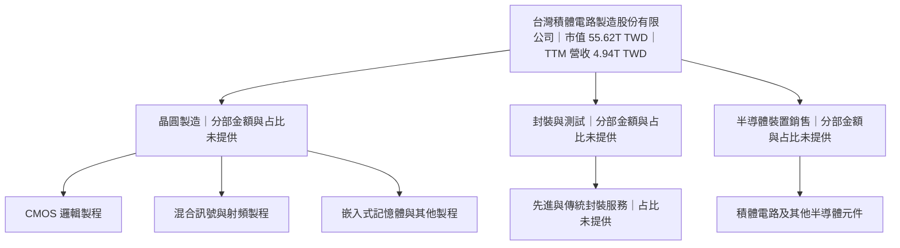
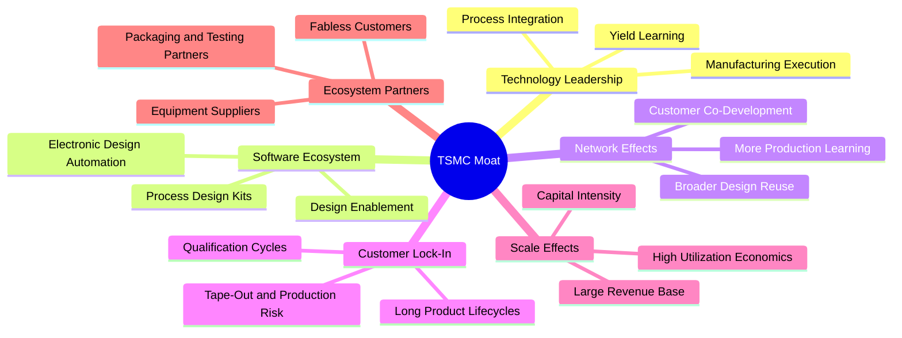
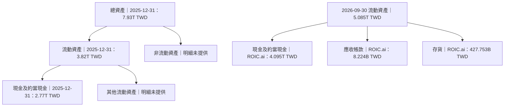
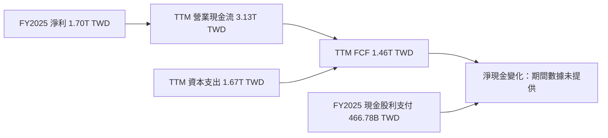
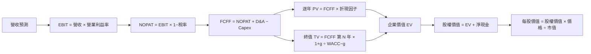
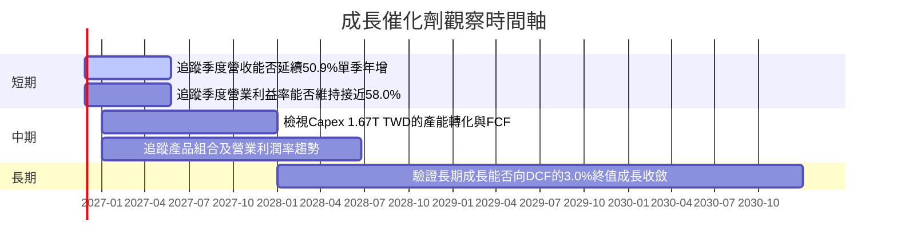
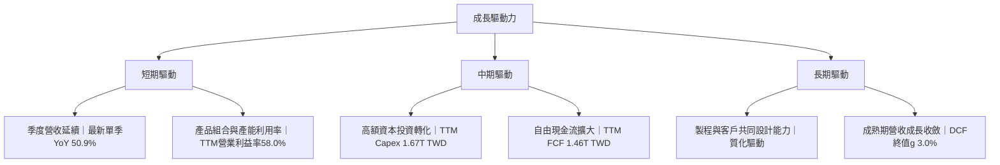
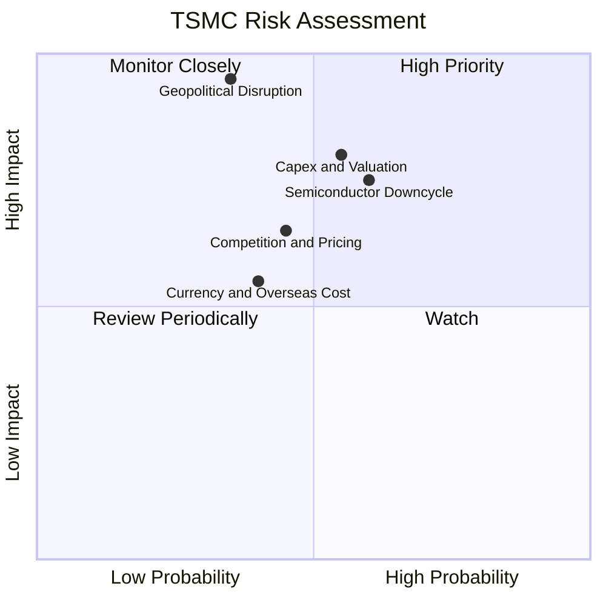
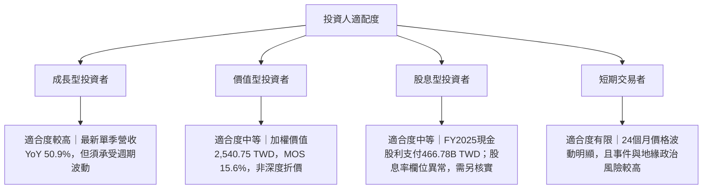

# 2330.TW 基本面深度分析報告
> **報告日期**：2026-11-27 ｜ **語言**：繁體中文 ｜ **數據來源**：Yahoo Finance、Roic.ai ｜ **分析師**：CFA 級機構研究

## 目錄

| # | 章節 | 核心結論 |
|---|------|----------|
| 1 | 執行摘要 | 買入；加權合理價值 2,540.75 TWD；MOS +15.6% |
| 2 | 公司概覽與商業模式 | 純晶圓代工模式、技術與規模壁壘深；分部營收明細未提供 |
| 3 | 損益表深度分析 | TTM 營收 4.94T TWD；最新一季營收年增 50.9%；TTM 營業利益率 58.0% |
| 4 | 資產負債表分析 | 淨現金 2.95T TWD；流動比率 2.584 |
| 5 | 現金流量深度分析 | TTM FCF 1.46T TWD；FCF Yield 2.62% |
| 6 | 獲利能力與資本效率 | WACC 10.44%；Roic.ai 最新 1 年資本報酬代理值 26.1%，高於 WACC，但非同口徑 ROIC |
| 7 | 相對估值分析 | 相對同業估值呈混合訊號；歷史估值區間未提供 |
| 8 | DCF 內在價值評估 | 基準 DCF 2,946.45 TWD；加權合理價值 2,540.75 TWD |
| 9 | 成長催化劑 | 最新一季營收年增 50.9%；TAM 數據未提供 |
| 10 | 風險矩陣 | 主要風險為地緣政治、資本密集度與半導體週期 |
| 11 | 投資建議 | 買入；參考買入區間 2,145–2,286.68 TWD，並以季度經營指標確認 |

---

## 1. 執行摘要

依估值方法加權結果，加權合理價值為 **2,540.75 TWD**，相對 2026-11-26 收盤價 **2,145.00 TWD** 的安全邊際（MOS）為 **+15.6%**，符合規則 20 的「買入」門檻。支持這一判斷的經營證據包括 TTM 營收 **4.94T TWD**、最新一季營收年增 **50.9%**、TTM 營業利益率 **58.0%**、TTM FCF **1.46T TWD**及淨現金 **2.95T TWD**；但估值並非深度折價，且 DCF 終值現值佔企業價值 **61.2%**，需承受長期成長、折現率與資本支出的模型風險。

### 1.0 一頁式投資儀表板

| 項目 | 內容 |
|------|------|
| **投資論點（3 句）** | ① 最新一季營收年增 **50.9%**，顯示需求及出貨動能仍高。② TTM 營業利益率 **58.0%**、淨現金 **2.95T TWD**，反映獲利與財務彈性。③ 加權合理價值 **2,540.75 TWD**，相對 2026-11-26 收盤 **2,145.00 TWD** 的 MOS 為 **+15.6%**，估值支持買入但緩衝有限。 |
| **綜合評分** | **8.0/10**（引用 1.1 評分卡） |
| **財務健康** | 🟢 現金及短期投資 **4.02T TWD**、總債務 **1.07T TWD**、淨現金 **2.95T TWD**；流動比率 **2.584**。 |
| **ROIC vs WACC** | Roic.ai 最新 1 年 Return on Capital **26.1%**（代理指標）vs WACC **10.44%**；指向價值創造，但口徑並非核實的 TTM ROIC。 |
| **FCF 趨勢** | FY2022–FY2025 FCF 由 **520.97B** 升至 **992.38B TWD**；TTM FCF Yield **2.62%**。 |
| **估值** | Forward P/E **14.304479x** ｜ EV/EBITDA **14.644x** ｜ FCF Yield **2.62%** |
| **DCF 內在價值（基準）** | **2,946.45 TWD** ｜ 現價相對 DCF 折價 **27.2%**（折溢價定義：現價 ÷ DCF 內在價值 − 1） |
| **安全邊際（MOS）** | **+15.6%**＝（加權合理價值 **2,540.75 TWD** − 現價 **2,145.00 TWD**）÷ 加權合理價值 **2,540.75 TWD**｜ 🟡 有限 |
| **預期報酬（基準情境 12M）** | DCF 基準情境 **+37.4%**；此為模型情境價值，不等同保證 12 個月報酬。 |
| **關鍵風險（前二）** | 台海與供應鏈中斷風險；高資本支出及終值假設造成估值敏感。 |
| **評級 + 信心度** | 🟢 **買入** ｜ 信心：中 |

### 1.1 綜合評分卡

| 維度 | 評分（1–10） | 主要依據（引用數字與其來源章節） |
|------|--------------|----------------------------------|
| 成長性 | 8.5 | 最新一季營收年增 **50.9%**；FY2022–FY2025 營收由 **2.26T** 增至 **3.81T TWD**，年複合成長約 **19.0%**（第 3 章）。TTM 成長率未提供。 |
| 獲利能力 | 9.5 | TTM 毛利率 **65.8%**、營業利益率 **58.0%**、淨利率 **51.1%**；Roic.ai 資本報酬代理值 **26.1%** 高於 WACC **10.44%**，但 Piotroski F-Score 與核實 TTM ROIC 缺資料（第 6 章）。 |
| 財務健康 | 9.0 | 淨現金 **2.95T TWD**、流動比率 **2.584**、速動比率 **2.287**；最新 CCC **2 天**（第 4 章）。 |
| 估值 | 6.5 | 加權合理價值 **2,540.75 TWD**、MOS **+15.6%**；DCF 基準價值高於現價，但同業 EV/EBITDA 對照估值 **1,889.12 TWD** 低於現價（第 7–8 章）。 |
| 護城河 | 9.0 | TTM 營業利益率 **58.0%**、毛利率 **65.8%**；FY2025 營收 **3.81T TWD**，最新一季營收年增 **50.9%**，反映規模與製程能力，但分部和市佔數據未提供（第 2 章）。 |
| 管理層與資本配置 | 7.5 | FY2025 資本支出 **1.28T TWD**、現金股利支付 **466.78B TWD**；2025 年 SBC **1.25B TWD**，相對營收低，但回購與資本配置回報率資料不足（第 5 章）。 |
| **綜合評分** | **8.3** | 六項算術平均：(**8.5 + 9.5 + 9.0 + 6.5 + 9.0 + 7.5**) ÷ 6 = **8.3**（四捨五入至小數一位）。 |

### 1.2 五大投資論點 + 三大核心風險

| 類型 | 項目 | 具體依據 | 信心度 |
|------|------|----------|--------|
| 🟢 **投資論點①** | 需求增長加快 | 2026-09-30 季營收 **1.49T TWD**，較 2025-09-30 年增 **50.9%**；若需求來自高附加價值先進製程，可能支持營收與產品組合。 | 🟢 高 |
| 🟢 **投資論點②** | 高利潤率提供抗壓能力 | TTM 毛利率 **65.8%**、營業利益率 **58.0%**、淨利率 **51.1%**；高固定成本下產能利用率提升可形成營業槓桿。 | 🟢 高 |
| 🟢 **投資論點③** | 淨現金支撐資本投資 | 現金及短期投資 **4.02T TWD**、總債務 **1.07T TWD**，淨現金 **2.95T TWD**；可降低融資壓力，但不能免除景氣下行時的資本支出風險。 | 🟢 高 |
| 🟢 **投資論點④** | FCF 絕對值持續增加 | FY2023、FY2024、FY2025 FCF 分別為 **286.57B、861.20B、992.38B TWD**；2024–2025 增長幅度收斂，仍需觀察資本支出週期。 | 🟢 中 |
| 🟢 **投資論點⑤** | 估值方法加權後仍有折價 | DCF 基準 **2,946.45 TWD**，加權合理價值 **2,540.75 TWD**，均高於現價 **2,145.00 TWD**；但相對估值法分歧明顯。 | 🟡 中 |
| 🟡 **風險①** | 地緣政治與供應鏈中斷 | 公司製造資產及營運高度集中於台灣；若停產或物流受阻，營收、利用率與客戶交付可能同時受損。 | 🔴 高衝擊 |
| 🔴 **風險②** | 高資本支出及折現率風險 | TTM Capex **1.67T TWD**；DCF 終值現值佔 EV **61.2%**。若需求降溫或 WACC 上升，價值可能顯著下降。 | 🔴 高衝擊 |
| 🟡 **風險③** | 同業競爭與景氣循環 | UMC、GFS、INTC 最新一季營收年增分別 **25.6%、12.5%、20.9%**；台積電成長較快，但半導體需求、價格及產能利用率仍可能週期性反轉。 | 🟡 中高 |

### 1.3 快速統計卡片

| 指標 | 公司實際值（期間） | 同業中位數 | 狀態 |
|------|--------------------|------------|------|
| 營收成長（TTM） | **N/A** | — | 🟡 未提供可比 TTM 成長率 |
| 營收成長（最新一季年增） | **50.9%** | **20.9%**（UMC、GFS、INTC 可得值中位數） | 🟢 高於同業 |
| 毛利率（TTM） | **65.8%** | **31.7%**（UMC、GFS、INTC 中位數） | 🟢 高於同業 |
| 營業利益率（TTM） | **58.0%** | — | 🟢 高 |
| ROIC（TTM） | **N/A**；Roic.ai 最新 1 年 Return on Capital 代理值 **26.1%** | — | 🟡 口徑不完全相同 |
| Forward P/E | **14.304479x** | **14.7x** | 🟢 略低於同業中位數 |
| FCF Yield（TTM） | **2.62%** | — | 🟡 絕對報酬率不高 |
| Piotroski F-Score | **N/A / 9** | — | 🟡 需兩個相隔一年的 SEC 申報期間 |

### 1.4 投資結論

╔══════════════════════════════════════════════════════════════════╗  
║                    📊 投資結論摘要                               ║  
╠══════════════════════════════════════════════════════════════════╣  
║  評級：買入（依 MOS 門檻，未作質化調整）                         ║  
║  價格（2026-11-26 收盤）：2,145.00 TWD                           ║  
║  DCF 內在價值（基準）：2,946.45 TWD（折價 27.2%）                ║  
║  安全邊際 MOS：+15.6%（以加權合理價值為分母）                    ║  
║  加權合理價值（8.8）：2,540.75 TWD                               ║  
║  DCF 情境價值：                                                   ║  
║    悲觀情境：1,248.22 TWD（-41.8%）                              ║  
║    基準情境：2,946.45 TWD（+37.4%）                              ║  
║    樂觀情境：6,585.81 TWD（+207.0%）                             ║  
║  綜合評分：8.3/10（引用 1.1）                                    ║  
║  適合投資人：能承受半導體週期、地緣政治波動的長期成長型投資人   ║  
╚══════════════════════════════════════════════════════════════════╝

---

## 2. 公司概覽與商業模式

### 2.1 業務結構與收入來源

財務資料顯示公司從事積體電路及其他半導體元件的製造、封裝、測試與銷售，提供 CMOS 邏輯、混合訊號、射頻、嵌入式記憶體等製程服務。分部營收、製程節點營收占比及封裝／測試收入金額未提供，故不把公司整體營收拆成未經核實的比例。

營運模式的經濟核心，是以高額且長週期的晶圓廠投資換取製程能力、良率、規模和客戶共同設計經驗。高固定成本意味利用率下降會放大利潤壓力；反之，TTM 營業利益率 **58.0%** 顯示在目前營運條件下，產能與產品組合能支持高營業槓桿。

### 2.2 市場份額

市場份額數據未提供，亦無近期新聞或可引用的市佔率來源，因此不製作市場份額圖表。以可得數據觀察，台積電 TTM 營收為 **4.94T TWD**，最新一季營收年增 **50.9%**，高於 UMC、GFS、INTC 的最新一季年增率；但不同公司產品組合、幣別及財報口徑不同，營收規模不能直接替代市場份額。

### 2.3 競爭護城河分析

### 2.4 護城河強度

| 護城河項目 | 強度（強／中／弱） | 證據（引用數字或事實） | 會削弱它的情況 |
|------------|--------------------|------------------------|----------------|
| 技術與製程執行 | 強 | TTM 毛利率 **65.8%**、營業利益率 **58.0%**；服務涵蓋邏輯、混合訊號、射頻與嵌入式記憶體製程。 | 良率爬坡失敗、製程轉換延誤，或競爭者縮小技術差距。 |
| 規模與資本投入 | 強 | FY2025 營收 **3.81T TWD**，TTM Capex **1.67T TWD**；資本需求提高新進者門檻，也提高週期下行時的固定成本風險。 | 需求長期不足導致產能利用率下降、設備回收期拉長。 |
| 客戶鎖定 | 中至強 | 晶圓製程需設計、驗證與量產銜接；客戶更換代工廠涉及產品可靠度及時程風險。量化客戶留存率未提供。 | 客戶為供應鏈分散而加速雙重來源，或替代平台成熟。 |
| 軟體與設計生態 | 中至強 | 公司服務包括多類製程，與設計流程及製程設計套件協同；可量化生態系統收入未提供。 | 設計工具或標準流程降低跨代工廠移植成本。 |
| 網路效應 | 中 | 客戶共同設計與製造學習可累積良率及流程經驗；缺少可量化網路效應指標。 | 技術標準化使客戶經驗能較容易轉移。 |
| 生態夥伴 | 中 | 晶圓代工依賴設備、材料、設計工具與封測合作夥伴；合作夥伴數量及依賴度資料未提供。 | 關鍵設備或材料供應中斷、供應商集中度過高。 |

**1.1 護城河評分為 9.0/10**：依據為 58.0% TTM 營業利益率、65.8% 毛利率及 4.94T TWD TTM 營收，但市場份額、客戶集中度與分部營收資料不足，故未給滿分。

---

## 3. 損益表深度分析

### 3.1 年度收入成長趨勢（近 4 年）

年度營收原始值來自 Yahoo Finance 年度損益表，以下同比增長率依相鄰年度營收計算。2022–2025 三年營收 CAGR 約 **19.0%**。

╔══════════════════════════════════════════════════════════════════╗  
║       台積電年度收入趨勢（FY2022–FY2025，TWD）                   ║  
╠══════════════════════════════════════════════════════════════════╣  
║ FY2022　2.26T　████████████████░░░░░░░░　基期                     ║  
║ FY2023　2.16T　███████████████░░░░░░░░░　YoY -4.4% 🟡            ║  
║ FY2024　2.89T　████████████████████░░░░　YoY +33.8% 🟢           ║  
║ FY2025　3.81T　████████████████████████　YoY +31.8% 🟢           ║  
╠══════════════════════════════════════════════════════════════════╣  
║ 2022–2025 三年營收 CAGR：約 +19.0%                               ║  
╚══════════════════════════════════════════════════════════════════╝

營收先在 2023 年下降 **4.4%**，後於 2024、2025 年分別成長 **33.8%**、**31.8%**。這種反彈顯示需求、產品組合與產能利用度可能同步恢復，但尚不足以證明半導體週期已永久消失；單年高增長不宜直接外推成長期 CAGR。

### 3.2 季度收入趨勢分析

下表依季度損益表計算 QoQ 與 YoY。部分 2025 季度數字以來源所列精度呈現，因此由表內數字推算的成長率有四捨五入差異；2026Q3 年增率則採用核實的單季年增率 **50.9%**。

| 季度 | 營收（TWD） | QoQ | YoY | 備註 |
|------|-------------|-----|-----|------|
| 2025Q4 | 1.05T | 約 +5.7% | 約 +27.7% | 相較 2025Q3 ROIC.ai 所列 989.918B TWD。 |
| 2026Q1 | 1.13T | 約 +8.0% | 約 +35.1% | 營收約 1.134T TWD；YoY 依 ROIC.ai 季度序列計算。 |
| 2026Q2 | 1.27T | 約 +12.0% | 約 +36.1% | 需求延續，季度收入較 Q1 提升。 |
| 2026Q3 | 1.49T | 約 +17.6% | **+50.9%** | 最新單季年增率；不得解讀為 TTM 成長率。 |

**QoQ 算式示例**：2026Q3 相對 2026Q2，\((1.494243 ÷ 1.270380) − 1 ≈ 17.6\%\)。季度收入連續上升，顯示近期出貨與需求動能加快；但季度增長可受產品組合、交付時點和季節性影響，應以後續季度確認。

### 3.3 利潤率演變分析

年度利潤率由毛利／營收、營業利益／營收及淨利／營收計算，數字依來源精度四捨五入至一位小數。

| 利潤率指標 | FY2022 | FY2023 | FY2024 | FY2025 | 趨勢 | 評估 |
|------------|--------|--------|--------|--------|------|------|
| **毛利率** | 59.7% | 54.6% | 56.1% | 59.8% | 2023 下滑後回升 | 🟢 |
| **營業利益率** | 49.6% | 42.7% | 45.7% | 50.9% | 2025 高於 FY2022 | 🟢 |
| **淨利率** | 43.9% | 39.4% | 40.1% | 44.6% | 2025 回復至高位 | 🟢 |
| **TTM 營業利益率** | — | — | — | **58.0%** | 最新 TTM 口徑 | 🟢 |

毛利率在 2023 年由 **59.7%** 降至 **54.6%**，同時營業利益率從 **49.6%** 降至 **42.7%**，符合半導體需求及產能利用率下行時固定成本吸收變差的特徵。2024、2025 年恢復，可能受需求回升、產品組合改善及利用率提升帶動；但資料未提供各製程、產品組合或價格變化的量化拆分，故不將利潤率回升全部歸因於單一因素。

### 3.4 費用結構分析

費用細項未提供完整年度成本分類，無法把營業成本、研發、銷售與管理等全部項目做成互斥比例的 pie chart。已知 FY2025 研發費用為 **246.43B TWD**，約為當年營收 **3.81T TWD** 的 **6.5%**；此比例僅代表研發支出占營收，不等同完整費用結構。

╔══════════════════════════════════════════════════════════════════╗  
║ FY2025 研發投入（非完整費用結構）                               ║  
╠══════════════════════════════════════════════════════════════════╣  
║ 營收：3.81T TWD                                                  ║  
║ 研發費用：246.43B TWD                                            ║  
║ 研發費用 ÷ 營收：246.43B ÷ 3,809.054B ≈ 6.5%                   ║  
╚══════════════════════════════════════════════════════════════════╝

### 3.5 季度 EPS 趨勢與盈餘品質（Quality of Earnings）

歷史 EPS 實際值可由 ROIC.ai 季度 EPS 序列觀察，但 EPS Est 及 EPS Act 的市場預期欄位為 nan，故無法核實「超預期／不及預期」。季度 EPS 大致由 2025Q4 **18.72 TWD** 升至 2026Q3 **29.43 TWD**；缺少一致的分析師預期值，不能把 EPS 上升解讀為連續超預期。

| 季度 | EPS 實際（TWD） | EPS 預期／盈餘驚喜 | 原因與判讀 |
|------|------------------|--------------------|------------|
| 2025Q4 | 18.72 | N/A | 預期與實際 EPS 欄位未提供有效數字。 |
| 2026Q1 | 22.08 | N/A | EPS 高於前季；收入增長與利潤率是可能支撐因素，但無法分解 EPS 變化來源。 |
| 2026Q2 | 27.25 | N/A | 延續季度上升；是否超預期無法核實。 |
| 2026Q3 | 29.43 | N/A | 最新 EPS；單季 EPS 年增率資料另列為 68.7%，但無預期值可比較。 |

| 盈餘品質項目 | 數值/佔比 | 評估 |
|--------------|-----------|------|
| 股權薪酬 SBC / 營收 | 最近四季 SBC 約 **0.513B TWD**；除以 TTM 營收 **4,944.82B TWD** 約 **0.010%** | 🟢 相對營收比例低；估算以季度 SBC 列值相加，來源單位需留意。 |
| SBC / 營業現金流 | 約 **0.016%**（0.513B ÷ 3,130B） | 🟢 對現金流與股東稀釋的量級有限；未提供 SBC 完整估值明細。 |
| FCF / 淨利（現金轉換率） | 最近四季淨利約 **2,527.57B TWD**；TTM FCF **1.46T TWD**；約 **57.7%** | 🟡 現金轉換低於 100%，主要需結合大額資本支出理解，不等於會計淨利失真。 |
| 一次性／非經常性損益 | N/A | 未提供足夠項目明細，無法判定是否有重大一次性損益。 |
| 有效稅率異常 | DCF 採用 **17.0%**；2025 年損益表未提供當期稅額明細 | 🟡 缺乏最新稅務調節表，不能確認是否有稅務利益。 |
| 資本化支出 vs 費用化 | TTM Capex **1.67T TWD**；資本化會透過折舊分年進損益 | 🟡 半導體業資本支出本身正常，但需追蹤產能利用率與投資回報，不能僅看當期淨利。 |

**盈餘品質結論**：目前數據顯示營業現金流 TTM **3.13T TWD**、FCF **1.46T TWD**，仍提供實際現金支撐；SBC 依資料列值計算約占營收 **0.010%**，不是主要稀釋來源。不過 FCF／淨利約 **57.7%**，反映資本支出吸收大量現金。由於一次性損益及稅務調節明細未提供，對 GAAP 盈餘品質的結論為中等信心，而非認定淨利被高估。

---

## 4. 資產負債表分析

### 4.1 資產結構分解

2025-12-31 總資產 **7.93T TWD**、流動資產 **3.82T TWD**；2026-09-30 ROIC.ai 資料列示流動資產 **5.085T TWD**。兩者來自不同期間與資料表，以下呈現原始項目，不反推未列示的非流動資產細項。

### 4.2 流動性與營運資金分析

| 指標 | 最新值 | 一年前 | 變化 | 評估 |
|------|--------|--------|------|------|
| 現金及短期投資 | **4.02T TWD** | N/A | N/A | 高於總債務 **1.07T TWD**，形成淨現金 **2.95T TWD**。 |
| 流動比率 | **2.584** | N/A | N/A | 🟢 短期流動資產對流動負債有緩衝。 |
| 速動比率 | **2.287** | N/A | N/A | 🟢 扣除存貨後仍高於 1。 |
| Debt/Equity | **15.188**（來源口徑） | N/A | N/A | 該數值與總債務、股東權益常見比率表達可能存在百分比口徑差異；本報告以淨現金和債務金額判斷償債能力。 |

**營運資金天數**：QUALITY FIGURES 只提供最新 TTM，未提供一年前可比天數。依規定不補算或推估前期值。

| 指標 | 最新 TTM | 一年前 TTM | 變化 | 解讀 |
|------|----------|------------|------|------|
| DSO 應收帳款天數 | **1 天** | N/A | N/A | 收款週期短；期末應收餘額數值異常低，應視為期末餘額除以 TTM 流量的機械計算，非平均收款天數。 |
| DIO 存貨天數 | **92 天** | N/A | N/A | 庫存週轉需配合先進製程備料及產品組合觀察；無前期數據判斷是否堆積。 |
| DPO 應付帳款天數 | **91 天** | N/A | N/A | 與 DIO 接近，代表供應商付款期部分抵銷庫存占用；不能單獨視為議價能力證據。 |
| CCC 現金轉換週期 | **2 天** | N/A | N/A | 資料提供值為 2 天；不以四捨五入後的 DSO、DIO、DPO 再計算取代原值。 |

### 4.3 債務結構分析

╔══════════════════════════════════════════════════════════════════╗  
║                   台積電債務健康診斷                             ║  
╠══════════════════════════════════════════════════════════════════╣  
║ 總債務：　　　　1.07T TWD　　相對現金部位低                     ║  
║ 現金及短期投資：4.02T TWD　　約為總債務 3.76 倍                 ║  
║ 淨現金：　　　　2.95T TWD　　🟢 淨現金狀態                      ║  
║ 流動比率：　　　2.584　　　　🟢 流動資產具緩衝                  ║  
║ 速動比率：　　　2.287　　　　🟢 排除存貨後仍有緩衝              ║  
║ Debt/EBITDA：　 N/A　　　　　缺少同口徑 EBITDA 與總債務明細      ║  
║ 利息保障倍數：　N/A　　　　　利息費用金額未提供                  ║  
╚══════════════════════════════════════════════════════════════════╝

現金／總債務倍數算式：**4.02 ÷ 1.07 ≈ 3.76 倍**。淨現金提供抗週期能力，但不能取代對海外廠投資、折舊負擔及資本回報的追蹤。

### 4.4 股東權益趨勢

年度股東權益逐年增加：FY2022 **2.90T TWD**、FY2023 **3.43T TWD**、FY2024 **4.24T TWD**、FY2025 **5.36T TWD**。資料未提供完整股東權益變動表，無法把增加額精確拆成淨利留存、股利、匯兌及其他項目。

╔══════════════════════════════════════════════════════════════════╗  
║ 台積電股東權益趨勢（年度，TWD）                                 ║  
╠══════════════════════════════════════════════════════════════════╣  
║ FY2022　2.90T　█████████████░░░░░░░░░░                           ║  
║ FY2023　3.43T　███████████████░░░░░░░░                           ║  
║ FY2024　4.24T　███████████████████░░░                            ║  
║ FY2025　5.36T　████████████████████████                           ║  
╚══════════════════════════════════════════════════════════════════╝

---

## 5. 現金流量深度分析

### 5.1 現金流量瀑布圖

FY2025 淨利與營業現金流是年度數；TTM OCF、Capex、FCF 是截至 2026-09-30 的 TTM 數。為避免混用期間，以下分別標示期間，不把年度淨利接成 TTM 瀑布。

### 5.2 FCF 轉換率趨勢

| 財年 | FCF（TWD） | 淨利（TWD） | FCF／淨利 |
|------|-----------|------------|----------|
| FY2022 | 520.97B | 992.92B | 52.5% |
| FY2023 | 286.57B | 851.74B | 33.6% |
| FY2024 | 861.20B | 1.16T | 74.2% |
| FY2025 | 992.38B | 1.70T | 58.4% |

FY2023 FCF 轉換率降至 **33.6%**，與當年營收和營業利益下滑、而資本支出仍高有關；FY2024 回升至 **74.2%**，FY2025 雖然 FCF 金額創近四年高點，但淨利增長更快，轉換率降至 **58.4%**。這反映 FCF 絕對值與轉換率需分開觀察。

### 5.3 自由現金流趨勢

╔══════════════════════════════════════════════════════════════════╗  
║ 台積電自由現金流（年度實際，TWD）                                ║  
╠══════════════════════════════════════════════════════════════════╣  
║ FY2022　520.97B　█████████████░░░░░░░░░　FCF／淨利 52.5%       ║  
║ FY2023　286.57B　███████░░░░░░░░░░░░░░░　FCF／淨利 33.6%       ║  
║ FY2024　861.20B　█████████████████████░░　FCF／淨利 74.2%       ║  
║ FY2025　992.38B　████████████████████████　FCF／淨利 58.4%      ║  
╠══════════════════════════════════════════════════════════════════╣  
║ TTM FCF（截至 2026-09-30）：1.46T TWD                           ║  
║ TTM FCF Yield：2.62%                                             ║  
╚══════════════════════════════════════════════════════════════════╝

TTM FCF 定義固定為 **營業現金流 3.13T − 資本支出 1.67T = 1.46T TWD**。2.62% FCF Yield 表示公司雖有高現金產生能力，但按當前市值計算的現金收益率不高，估值仍倚賴未來成長。

### 5.4 資本配置評估

可得資料沒有回購、留存現金及完整資本配置總額，故不以不完整資料製作 pie chart。

| 資本配置項目 | 可得數據 | 解讀 |
|--------------|----------|------|
| 資本支出 | FY2025 **1.28T TWD**；TTM **1.67T TWD** | 主要投資項目；高投入可擴大產能與製程能力，但需以利用率與長期回報驗證。 |
| 現金股利 | FY2025 **466.78B TWD** | FY2025 淨利 **1.70T TWD**，股利支付額約為淨利的 27.5%（以年度列值計算）。 |
| 股票回購 | N/A | 回購資料未提供。 |
| SBC | FY2025 **1.25B TWD** | 相對營收規模低；需持續核對來源單位及流通股數變化。 |
| 留存現金／淨現金變化 | N/A | 缺少完整現金流量表期初期末調節。 |

---

## 6. 獲利能力與資本效率

### 6.1 ROE / ROA / ROIC 趨勢

ROE、ROA 的可靠年度序列未完整提供；可引用的 TTM 指標為 ROE **41.9%**、ROA **20.6%**。ROIC.AI 歷史欄位提供 2026 年最新 1 年 Return on Capital **26.1%**，但其計算口徑與本報告所需的 TTM ROIC 不一定一致，故只作代理參考，不冒稱已核實 ROIC。

| 指標 | FY2022／歷史 | FY2023／歷史 | FY2024／歷史 | 最新可得 | 評估 |
|------|-------------|-------------|-------------|----------|------|
| ROE | N/A | N/A | N/A | TTM **41.9%** | 🟢 高，杜邦拆分缺數據。 |
| ROA | N/A | N/A | N/A | TTM **20.6%** | 🟢 資產獲利能力高。 |
| ROIC／資本報酬代理值 | ROIC.ai 2013–2018 Return on Capital 約 **19.7%–22.45%** | N/A | N/A | ROIC.ai 最新 1 年 **26.1%** | 🟢 指向高於 WACC，但非本報告同口徑 TTM ROIC。 |

行業均值未提供，不做未經來源支持的比較。

### 6.2 ROIC vs WACC 分析（核心價值創造判斷）

Cost of capital 數據提供 WACC **10.44%**、Beta 原始值 **1.23**、調整後 Beta **1.16**、股權成本 **10.62%**、稅前債務成本 **1.16%**及資本權重 **98.1%／1.9%**。ROIC 的核實 TTM 值缺失；因此只比較 ROIC.ai 最新 1 年 Return on Capital 代理值 **26.1%** 與 WACC，不把它當作精確的 TTM EVA。

╔══════════════════════════════════════════════════════════════════╗  
║                ROIC vs WACC 深度分析                             ║  
╠══════════════════════════════════════════════════════════════════╣  
║ 無風險利率（10Y 美債）：　　　　　4.85%                          ║  
║ 市場風險溢酬 ERP：　　　　　　　 5.00%                          ║  
║ 原始 Beta：　　　　　　　　　　　1.23                           ║  
║ 調整後 Beta：　　　　　　　　　　1.16                           ║  
║ 股權成本（資料列值）：　　　　　 10.62%                         ║  
║ 稅前債務成本：　　　　　　　　　 1.16%                          ║  
║ 有效稅率：　　　　　　　　　　　17.0%                          ║  
║ 股權／債務權重：　　　　　　　　98.1%／1.9%                    ║  
║ WACC（採用值）：　　　　　　　　10.44%                          ║  
║                                                                  ║  
║ ROIC.ai 最新 1 年資本報酬代理值： 26.1%                          ║  
║ 代理值 − WACC：　　　　　　　　26.1% − 10.44% = +15.66 pp       ║  
║ 結論：代理指標高於資金成本，方向上支持價值創造；                 ║  
║ 但核實 TTM ROIC 缺失，不能把代理差額視為精確 EVA。                ║  
╚══════════════════════════════════════════════════════════════════╝

**資本成本資料一致性提醒**：原始 Beta **1.23** 與 ERP **5.00%** 代入 CAPM，按列示 Rf **4.85%** 計算，會得到 \(4.85\% + 1.23 × 5.00\% = 11.00\%\)，而調整後 Beta **1.16** 對應 \(10.65\%\)；來源列示股權成本為 **10.62%**。本報告依規則採用來源提供的 **WACC 10.44%**，不自行替換，但把股權成本細微不一致列為資料稽核限制。

### 6.3 杜邦三因素分解

| 因素 | 數值（TTM） | 解讀 |
|------|-------------|------|
| 淨利率 | N/A | QUALITY FIGURES 的 DuPont 為 N/A；雖另有 TTM 淨利率 **51.1%**，不能在缺少同口徑資產及權益數據時拼接成官方杜邦分解。 |
| 資產週轉率 | N/A | QUALITY FIGURES 缺資料。 |
| 權益乘數 | N/A | QUALITY FIGURES 缺資料。 |
| **ROE** | **N/A（杜邦分解）** | QUALITY FIGURES 說明缺少淨利、營收、總資產或正權益的可用一致資料。另列 TTM ROE **41.9%**，但不以此反推杜邦因素。 |

### 6.4 財務體質：Piotroski F-Score

**Piotroski F-Score：N/A（需 SEC 申報資料中相隔一年的兩個 TTM 期間；現有來源為 Yahoo 季度報表，無法判定九項測試）**。因此不臆測任何單項得分，也不將缺數據解讀為未通過。

| 測試 | 結果 | 解讀 |
|------|------|------|
| 獲利能力九項測試 | N/A | 欠缺計算所需的兩期一致申報數據。 |
| 槓桿、流動性及融資九項測試 | N/A | 無法按 F-Score 標準逐項確認變化。 |
| 營運效率九項測試 | N/A | 缺乏一致的兩個 TTM 比較期。 |

---

## 7. 相對估值分析

### 7.1 同業估值比較表格

公司估值採 Yahoo Finance / Finviz 合併市場數據；同業倍數採 Yahoo Finance peer multiples。P/S、EV/EBITDA 等來源明列為 N/A 的公司不補值。

| 估值指標 | **台積電** | **UMC** | **GFS** | **INTC** | 本公司評估 |
|----------|-----------|---------|--------|---------|-----------|
| **Trailing P/E** | **22.058825x** | 12.4x | 103.4x | N/A | 🟡 台積電高於 UMC，遠低於 GFS；INTC 無可用 TTM 值。 |
| **Forward P/E** | **14.304479x** | 14.7x | 14.0x | 30.4x | 🟢 接近 UMC、GFS，低於 INTC。peer 中位數 **14.7x**。 |
| **P/S Ratio** | **11.249136x** | N/A（mixed ccy） | 2.8x | 4.8x | 🔴 台積電名目倍數較高；需考慮毛利率及幣別口徑。 |
| **EV/EBITDA** | **14.644x** | N/A（mixed ccy） | 9.7x | 15.8x | 🟡 高於 GFS、低於 INTC；peer 中位數 **12.7x**（GFS、INTC）。 |
| **最新一季營收 YoY** | **50.9%** | 25.6% | 12.5% | 20.9% | 🟢 台積電增長高於同業。 |
| **TTM 毛利率** | **65.8%** | 31.7% | 28.5% | 40.2% | 🟢 高於三家 peer；有助解釋部分估值溢價。 |

### 7.2 歷史估值區間分析

N/A（資料未提供「Valuation vs own history」的歷史 P/E 區間及當前百分位，故不自行估算歷史分位）。

### 7.3 情境價值（Bear / Base / Bull，照抄 DCF MODEL 的 Scenarios）

| 情境 | 第 1 年營收成長 | 期末營業利潤率 | WACC | 每股價值 | 相對現價 | 機率 | 會發生的條件 |
|------|----------------|----------------|------|----------|----------|------|--------------|
| 🔴 悲觀 | 15.0% | 42.1% | 11.44% | **1,248.22 TWD** | **-41.8%** | 25% | 需求低於基準、產能利用率或產品組合轉弱，利潤率較基準期末值低，資本成本上升。 |
| 🟡 基準 | 30.0% | 49.5% | 10.44% | **2,946.45 TWD** | **+37.4%** | 50% | 初期增長延續後逐步降速，營業利潤率向過去五年中位數收斂。 |
| 🟢 樂觀 | 45.0% | 54.5% | 9.44% | **6,585.81 TWD** | **+207.0%** | 25% | 成長高於基準且較長期維持高利潤率，市場風險成本下降。 |

### 7.4 相對估值隱含價格區間

╔══════════════════════════════════════════════════════════════════╗  
║ 相對估值回推每股價值（TWD）                                      ║  
╠══════════════════════════════════════════════════════════════════╣  
║ 同業 EV/EBITDA　1,889.12 ─── 現價 2,145.00 ─── 2,198.55 Forward P/E ║  
║ DCF 基準　　　 2,946.45　　分析師共識　　　　3,402.51            ║  
╚══════════════════════════════════════════════════════════════════╝

| 方法 | 每股價值 | 相對現價 | 依據 |
|------|----------|----------|------|
| 同業 Forward P/E | **2,198.55 TWD** | **+2.5%** | 同業 Forward P/E 中位數 **14.7x** × 公司 Forward EPS **149.95 TWD**。 |
| 同業 EV/EBITDA | **1,889.12 TWD** | **-11.9%** | GFS、INTC peer EV/EBITDA 中位數 **12.7x** × TTM EBITDA，再加回淨現金；完整底層橋接由估值方法資料提供。 |
| 分析師共識目標價 | **3,402.51 TWD** | **+58.6%** | 35 位分析師平均目標價；僅作交叉參照，不視為獨立基本面證據。 |

---

## 8. DCF 內在價值評估（Discounted Cash Flow）

> 本章採用程式計算的 DCF MODEL 原值。金額單位為 **TWD billions**，每股價值及股價為 **TWD**；模型輸入缺漏處明確標示 N/A 或假設值。模型未納入營運資金變動，且使用 GAAP EBIT 與固定股數（組合 A）。

### 8.0 估值推理鏈（Thinking Logic）

**Step 1 — 價值由哪些變數決定？**  
本模型以晶圓製造及相關服務的現金流為主，現有 TTM 營收基礎為 **4,944.82B TWD**；業務分部收入占比未提供，因此無法誠實地把先進製程、成熟製程或封裝拆成各自營收。估值的主要敏感變數是長期 FCFF、WACC 與永續成長率；這與終值佔 EV **61.2%** 的結果一致。

**Step 2 — 模型選擇**

| 決策點 | 本報告採用 | 理由（含數字） | 曾考慮但否決 | 否決理由 |
|--------|-----------|----------------|--------------|----------|
| 現金流定義 | FCFF | 以 WACC **10.44%** 折現，先得 EV，再加淨現金。 | FCFE | 直接股權現金流未提供一致融資預測。 |
| 預測期 N | 10 年 | DCF MODEL 固定預測 **10 年**，假設營收成長逐年由 30.0% 降至 3.0%。 | 5 年 | 對高資本強度且終值占比高的企業，5 年期會更依賴終值；模型已固定為 10 年。 |
| 終值方法 | Gordon Growth | 終值成長率 **3.0%**，低於 WACC **10.44%**。 | 退出倍數作主要終值 | DCF MODEL 未提供退出倍數估值，不能自行建立。 |
| EBIT 基礎 | GAAP EBIT | 模型列明 GAAP EBIT；SBC 已在費用中。 | 非 GAAP EBIT | 會改變模型定義，且缺少非 GAAP 調節表。 |

**Step 3 — 關鍵假設推導鏈**

- **營收成長**：錨點＝最新一季單季 YoY **50.9%**，而非 TTM 成長率；調整＝模型把最新單季增長限制在 0%–30%，並線性降至第十年 **3.0%**；**採用 FY+1 30.0%、FY+10 3.0%**；否決替代值＝把 50.9% 直接外推十年，因它是單季 YoY、不能代表長期 CAGR。
- **期末營業利益率**：錨點＝TTM 營業利益率 **58.0%**；調整＝模型逐年淡化至最近五個財年中位數（含 TTM）**49.5%**；**採用 FY+1 58.0% 至 FY+10 49.5%**；否決替代值＝長期維持 58.0%，因模型明確要求利潤率向歷史中位數回歸。
- **永續成長率 g**：錨點＝模型採用 **3.0%**，屬長期名目成長假設；**採用 3.0%** 且低於 WACC **10.44%**；否決較高值，因更高 g 會放大終值，降低估值可稽核性。
- **預測期 N**：錨點＝DCF MODEL 固定 **10 年**；採用 10 年，反映模型對成長逐步收斂的安排；否決任意縮短或延長，因程式模型已固定且不能改動。
- **Capex／營收**：錨點＝TTM **33.8%**；模型假設逐步淡化至第十年 **16.6%**，約為 D&A／營收 **15.1%** 的 1.1 倍；**採用第 1 年 33.8%、第 10 年 16.6%**；否決長期固定在 33.8%，因模型預設成熟後資本支出強度下降。
- **D&A／營收**：錨點＝TTM **15.1%**；模型固定該比率，採用 **15.1%**。
- **有效稅率**：錨點＝最新年度有效稅率 **17.0%**；採用 **17.0%**。
- **營運資金變動**：模型未納入 ΔWC；不是假設 ΔWC 為零，而是模型明確未建模，可能使成長期現金流被高估或低估。
- **EBIT 與 SBC**：錨點＝GAAP EBIT；**採用 (A) GAAP EBIT + 固定股數**，FCFF 不再減 SBC、年稀釋率為 0%；SBC 影響已計入一次。
- **終值方法**：採用 Gordon Growth；**WACC 10.44% > g 3.0%**，公式有效。否決自設退出倍數，因沒有 DCF 模型輸出可供引用。
- **WACC**：採用來源列示 **10.44%**，不另算替代 WACC；具體組成見 8.2。

**Step 4 — 最脆弱一環**  
最脆弱假設是終值所依賴的長期現金流、g 及 WACC；終值現值占 EV **61.2%**，故若折現率升高或長期成長不足，基準價值會明顯下降，幅度可參照敏感度矩陣與悲觀情境 **1,248.22 TWD**。

**Step 5 — 計算路徑圖**

### 8.1 模型假設總表（Model Inputs）

| 假設項目 | 採用值 | 依據／來源 | 敏感度 |
|----------|--------|-------------|--------|
| 預測期長度 N | **10 年** | DCF MODEL 固定值；營收與利潤率逐年收斂。 | 🟡 中 |
| 營收成長 | FY+1 **30.0%**；FY+10 **3.0%**，逐年線性遞減 | FY+1 參考最新一季 YoY **50.9%**，但封頂在 30%；FY+10 為模型終點假設。 | 🔴 高 |
| 營業利潤率 | FY+1 **58.0%** → FY+10 **49.5%** | TTM **58.0%**；終值年向最近五年中位數收斂。 | 🔴 高 |
| 有效稅率 | **17.0%** | 最新年度有效稅率。 | 🟢 低 |
| Capex／營收 | FY+1 **33.8%** → FY+10 **16.6%** | TTM **33.8%**，逐步淡化至模型設定。 | 🟡 中 |
| D&A／營收 | **15.1%** | TTM D&A／營收。 | 🟢 低 |
| 營運資金變動 | **未建模** | DCF MODEL 明列 working capital is not modelled；不將其改寫為零。 | 🟢 低／模型限制 |
| EBIT 基礎 | **GAAP EBIT** | DCF MODEL 標示 GAAP。 | 🟡 中 |
| SBC 處理 | **組合 (A)**：不另扣 SBC、固定股數 | GAAP EBIT 已含 SBC 費用；模型不再稀釋股數。 | 🟡 中 |
| 年稀釋率 | **0%（固定股數）** | 與組合 (A) 相容；採 DCF 模型所列 per-share 方法。 | 🟡 中 |
| 永續成長率 g | **3.0%** | DCF MODEL 固定值，且低於 WACC。 | 🔴 高 |
| 終值方法 | **Gordon Growth** | 模型提供 Gordon Growth TV；退出倍數法輸入未提供。 | 🔴 高 |
| WACC | **10.44%** | Cost of capital 輸出值，詳見 8.2。 | 🔴 高 |

FCFF 定義採 **FCFF = NOPAT + D&A − Capex**；DCF MODEL 未列 ΔWC，故不自行添加。**本模型採用 (A)，故 SBC 影響已計入一次。**

### 8.2 折現率推導（WACC）

╔══════════════════════════════════════════════════════════════════╗  
║                    WACC 推導（折現率）                            ║  
╠══════════════════════════════════════════════════════════════════╣  
║ 無風險利率 Rf（10Y 美債）：　　　　4.85%                          ║  
║ 市場風險溢酬 ERP：　　　　　　　　5.00%（假設值，來源列示值）    ║  
║ 原始 Beta（Yahoo）：　　　　　　　1.23                           ║  
║ 調整後 Beta：　　　　　　　　　　1.16＝⅔×1.23＋⅓×1.00           ║  
║ 股權成本（來源列示）：　　　　　　10.62%                         ║  
║ 稅前債務成本：　　　　　　　　　　1.16%                          ║  
║ 有效稅率：　　　　　　　　　　　　17.0%                          ║  
║ 資本權重：股權 98.1%／債務 1.9%                                  ║  
║ WACC（採用）：　　　　　　　　　　10.44%                         ║  
╚══════════════════════════════════════════════════════════════════╝

**逐步演算（WACC，依來源已計算的成本資本輸入）**

1. **Ke（CAPM）**：來源列示 Ke 為 **10.62%**。按原始 Beta 重算為  
   \(4.85\% + 1.23 × 5.00\% = 11.00\%\)；按調整後 Beta 重算為  
   \(4.85\% + 1.16 × 5.00\% = 10.65\%\)。兩者均與來源 Ke **10.62%** 有差異；依指示保留來源列示 Ke 與 WACC，不替換。
2. **稅前 Kd**：來源列示以利息／債務計得 **1.16%**。利息費用金額、平均計息負債明細未提供，故不能自行補出「利息費用 ÷ 平均計息負債」的金額算式；本報告採來源已計算比率。
3. **稅後 Kd**：\(1.16\% × (1 − 17.0\%) = 0.9628\%\)，四捨五入為 **0.96%**。
4. **權重**：來源列示股權權重 **98.1%**、債務權重 **1.9%**；\(98.1\% + 1.9\% = 100.0\%\)。市場市值 **55.62T TWD**、總債務 **1.07T TWD**；估值方法所採債務範圍與利息成本分母細項未完整提供，故不以這兩個總額重建權重。
5. **WACC**：使用來源列示值，\(WACC = 10.44\%\)。若將列示權重和 Ke、稅後 Kd 直接代入，\(98.1\%×10.62\% + 1.9\%×0.9628\% = 10.4365\% \approx 10.44\%\)。

Rf 日期未提供，故只引用列示的 10Y Treasury **4.85%**；ERP 是資料列示假設值 **5.00%**。資料未列國別或規模溢酬，本報告不另加。此 WACC 與第 6.2 節採用值一致。

### 8.3 逐年自由現金流預測（基準情境）

表格逐年照錄 DCF MODEL。金額為 **TWD billions**；折現因子保留三位小數。

| 年度 | FY+1 | FY+2 | FY+3 | FY+4 | FY+5 | FY+6 | FY+7 | FY+8 | FY+9 | FY+10 |
|------|------:|------:|------:|------:|------:|------:|------:|------:|------:|-------:|
| 營收 | 6,428.26 | 8,163.89 | 10,123.23 | 12,249.11 | 14,453.94 | 16,622.04 | 18,616.68 | 20,292.18 | 21,509.71 | 22,155.00 |
| 營收 YoY | 30.0% | 27.0% | 24.0% | 21.0% | 18.0% | 15.0% | 12.0% | 9.0% | 6.0% | 3.0% |
| 營業利潤率 | 58.0% | 57.0% | 56.1% | 55.2% | 54.2% | 53.3% | 52.3% | 51.4% | 50.5% | 49.5% |
| 營業利益 EBIT（GAAP） | 3,726.88 | 4,656.49 | 5,679.00 | 6,756.58 | 7,837.06 | 8,856.56 | 9,744.56 | 10,431.05 | 10,854.96 | 10,972.60 |
| − 稅（17.0%） | (632.56) | (790.34) | (963.90) | (1,146.79) | (1,330.18) | (1,503.22) | (1,653.94) | (1,770.46) | (1,842.41) | (1,862.38) |
| = NOPAT | 3,094.32 | 3,866.14 | 4,715.10 | 5,609.79 | 6,506.88 | 7,353.34 | 8,090.62 | 8,660.59 | 9,012.55 | 9,110.22 |
| + D&A | 970.20 | 1,232.15 | 1,527.86 | 1,848.72 | 2,181.48 | 2,508.71 | 2,809.75 | 3,062.63 | 3,246.39 | 3,343.78 |
| − Capex | (2,171.05) | (2,601.47) | (3,032.68) | (3,435.84) | (3,778.51) | (4,028.15) | (4,156.32) | (4,143.23) | (3,981.42) | (3,678.16) |
| − ΔWC | 未建模 | 未建模 | 未建模 | 未建模 | 未建模 | 未建模 | 未建模 | 未建模 | 未建模 | 未建模 |
| **= FCFF** | **1,893.46** | **2,496.82** | **3,210.29** | **4,022.67** | **4,909.85** | **5,833.90** | **6,744.04** | **7,579.99** | **8,277.52** | **8,775.85** |
| 折現因子 @10.44% | 0.905 | 0.820 | 0.742 | 0.672 | 0.609 | 0.551 | 0.499 | 0.452 | 0.409 | 0.370 |
| **FCFF 現值 PV** | **1,714.43** | **2,046.99** | **2,383.07** | **2,703.79** | **2,988.07** | **3,214.74** | **3,364.90** | **3,424.40** | **3,385.95** | **3,250.38** |

**預測期 FCF 現值合計：**  
\(1,714.43 + 2,046.99 + 2,383.07 + 2,703.79 + 2,988.07 + 3,214.74 + 3,364.90 + 3,424.40 + 3,385.95 + 3,250.38 = 28,476.72\)；DCF MODEL 列示合計 **28,476.73B TWD**，差額 **0.01B TWD** 為逐項四捨五入尾差（遠低於 1%），報告採用模型原列總額 **28,476.73B TWD**。

**逐步演算（FY+1，按模型列值展示）**

1. **營收**：\(4,944.82 × (1 + 30.0\%) = 6,428.266 \approx 6,428.26\) B TWD。
2. **EBIT**：\(6,428.26 × 58.0\% = 3,728.39\) B TWD；DCF MODEL 列值為 **3,726.88B**，兩者有約 **1.51B** 的差異，代表原模型內部未顯示的精度或計算口徑與表面四捨五入數不同。本報告遵守「模型數字照抄」，採用模型列值 **3,726.88B**，不另改。
3. **稅**：模型列值 **632.56B TWD**；依顯示 EBIT × 17.0% 得 \(3,726.88 × 17.0\% = 633.57\) B，存在約 **1.01B** 顯示值差異，沿用模型原列值。
4. **NOPAT**：\(3,726.88 − 632.56 = 3,094.32\) B TWD。
5. **D&A**：模型列值 **970.20B TWD**；以顯示營收 × 15.1% 計為 \(6,428.26 × 15.1\% = 970.67\) B，差異約 **0.47B**，採用模型列值。
6. **Capex**：模型列值 **2,171.05B TWD**；模型假設 Capex／營收 **33.8%**，以顯示營收計為 \(6,428.26 × 33.8\% = 2,172.75\) B，差異約 **1.70B**，採用模型列值。
7. **ΔWC**：模型未建模，並非以零填列。
8. **FCFF**：按模型列值 \(3,094.32 + 970.20 − 2,171.05 = 1,893.47\) B；DCF MODEL 列值 **1,893.46B**，為 **0.01B** 顯示精度差異，採用模型列值。
9. **折現與 PV**：\(1 ÷ (1+10.44\%)^1 \approx 0.905\)；模型 PV **1,714.43B**。用已四捨五入數 \(1,893.46×0.905=1,713.58\) 不會完全重現，因模型 PV 使用未四捨五入的折現因子及現金流；採用模型原值，不替代計算結果。

**合理性自檢**

- 預測 FCFF 由 FY+1 **1,893.46B** 增至 FY+10 **8,775.85B**；端點年化增幅約 **16.6%**。歷史年度 FCF FY2022–FY2025 為 **520.97B、286.57B、861.20B、992.38B TWD**，波動大且未提供可直接一致的多年 CAGR；模型預測顯著高於 FY2025 絕對值，依賴收入增長及資本支出率下降。
- FY+10 FCFF 利潤率：\(8,775.85 ÷ 22,155.00 ≈ 39.6\%\)；目前 TTM FCF／營收約 \(1.46T ÷ 4.94T ≈ 29.6\%\)。同業最佳 FCFF 利潤率未提供，不能作同業比較。
- 模型各年 FCFF 均為正；然而未建模 ΔWC，且終值現值占 EV **61.2%**，正 FCFF 不代表估值對假設不敏感。

╔══════════════════════════════════════════════════════════════════╗  
║            自由現金流：歷史實際 vs 模型預測                      ║  
╠══════════════════════════════════════════════════════════════════╣  
║ FY2022 實　520.97B　██░░░░░░░░░░░░░░░░░░░░　　　　　　　　　║  
║ FY2023 實　286.57B　█░░░░░░░░░░░░░░░░░░░░░　　　　　　　　　║  
║ FY2024 實　861.20B　███░░░░░░░░░░░░░░░░░░░░　　　　　　　　 ║  
║ FY2025 實　992.38B　███░░░░░░░░░░░░░░░░░░░░　　　　　　　　 ║  
║ FY+1 預　1,893.46B　██████░░░░░░░░░░░░░░░░░　　　　　　　　║  
║ FY+10 預 8,775.85B　████████████████████████　　　　　　　　║  
╠══════════════════════════════════════════════════════════════════╣  
║ 模型預測遠期 FCF 高於歷史年度值；關鍵支撐是營收增長與 Capex 率 ║  
║ 由 33.8% 下降至 16.6%，並非歷史 FCF CAGR 的直接延伸。          ║  
╚══════════════════════════════════════════════════════════════════╝

### 8.4 終值計算（Terminal Value）

**適用性檢查：** \(WACC 10.44\% > g 3.0\%\) → **✅ Gordon Growth 有效**。

| 方法 | 計算式 | 終值 TV | TV 現值 | 佔總 EV 比重 |
|------|--------|---------|---------|--------------|
| Gordon Growth | \(8,775.85 × (1+3.0\%) ÷ (10.44\%−3.0\%)\) | **121,455.83B** | **44,984.56B** | **61.2%** |
| 退出倍數法 | N/A（模型未提供 FY+10 EBITDA 退出倍數及估值） | N/A | N/A | N/A |

**逐步演算（Gordon Growth）**

1. FY+N FCFF：**8,775.85B TWD**（取 FY+10 模型原值）。
2. 分子：\(8,775.85 × (1+3.0\%) = 9,039.1255\) B TWD。
3. 分母：\(10.44\% − 3.0\% = 7.44\%\)；模型列示 \(9,039.1255 ÷ 7.44\% = \) **121,455.83B TWD**。
4. PV(TV)：模型列示 \(121,455.83 × 0.370 = \) **44,984.56B TWD**。展示因子取三位小數會有尾差；模型使用未四捨五入因子。
5. 終值佔比：\(44,984.56 ÷ 73,461.29 = 61.2\%\)。

退出倍數法所需的成熟期 EBITDA 倍數未提供，依規則不自行估算。

### 8.5 企業價值 → 每股內在價值（Bridge）

╔══════════════════════════════════════════════════════════════════╗  
║              企業價值 → 每股內在價值 橋接表                      ║  
╠══════════════════════════════════════════════════════════════════╣  
║ 預測期 FCF 現值合計　　　　　　+28,476.73B TWD                  ║  
║ 終值現值 PV(TV)　　　　　　　　+44,984.56B TWD                  ║  
║ = 企業價值 EV　　　　　　　　　 73,461.29B TWD                  ║  
║ + 淨現金　　　　　　　　　　　　+2,947.23B TWD                  ║  
║ = 股權價值　　　　　　　　　　　76,408.51B TWD                  ║  
║ 每股內在價值（模型方法）　　　　2,946.45 TWD                    ║  
║ 當前股價（2026-11-26 收盤）　　　2,145.00 TWD                    ║  
║ 折溢價（現價÷DCF價值−1）　　　　-27.2%（折價）                  ║  
╚══════════════════════════════════════════════════════════════════╝

**逐步演算（橋接）**

1. **EV**：\(28,476.73 + 44,984.56 = 73,461.29\) B TWD。
2. **股權價值**：模型採淨現金 **2,947.23B TWD**；\(73,461.29 + 2,947.23 = 76,408.52\) B，模型列示 **76,408.51B**，差 **0.01B** 為底層未四捨五入數的尾差，採模型原列值。
3. **每股內在價值**：DCF MODEL 公式為「股權價值 × 價格 ÷ 市值」，結果 **2,946.45 TWD**。DCF MODEL 未列出用於每股換算的股數／價格市值精度，因此不以股數自建替代值。
4. **折溢價**：\((2,145.00 ÷ 2,946.45) − 1 = -27.2\%\)。
5. **本節不計算 MOS**：MOS 固定以第 8.8 節加權合理價值為分母。

股數口徑採 DCF MODEL 的固定股數、價格／市值換算方法；市場資料列示流通股數 **25.93B 股**，但模型沒有以該值作為其 per-share 公式的明示分母。現金及債務採 DCF MODEL 淨現金 **2,947.23B TWD**，不是另行重建的資產負債表橋接。

### 8.6 敏感性分析（WACC × 永續成長率）

以下矩陣照錄 DCF MODEL；括號為相對現價 **2,145.00 TWD** 的上行空間，計算形式為模型每股價值除以現價再減 1。基準格為 **WACC 10.44%、g 3.0%**。

| g（列）／WACC（欄） | 8.44% | 9.44% | **10.44%（基準）** | 11.44% | 12.44% |
|--------------------|------:|------:|-------------------:|-------:|-------:|
| **2.0%** | 3,723.79（+73.5%） | 3,155.53（+47.1%） | 2,726.13（+27.1%） | 2,391.19（+11.5%） | 2,123.36（-1.0%） |
| **2.5%** | 3,936.91（+83.5%） | 3,300.92（+53.9%） | 2,829.36（+31.9%） | 2,466.78（+15.0%） | 2,180.08（+1.6%） |
| **3.0%** | 4,189.19（+95.3%） | 3,468.88（+61.7%） | **2,946.45（+37.4%）** | 2,551.32（+18.9%） | 2,242.81（+4.6%） |
| **3.5%** | 4,492.52（+109.4%） | 3,665.11（+70.9%） | 3,080.42（+43.6%） | 2,646.50（+23.4%） | 2,312.56（+7.8%） |
| **4.0%** | 4,864.13（+126.8%） | 3,897.39（+81.7%） | 3,235.17（+50.8%） | 2,754.47（+28.4%） | 2,390.57（+11.4%） |

**矩陣示範格完整重算資料未提供**：原模型只提供敏感度矩陣的每股價值，沒有各格的預測期 PV、TV 及股權價值中間表。為遵守不得重建或改動 DCF 模型的限制，本報告不虛構中間項；矩陣格值照錄原模型。基準格 **2,946.45 TWD** 與 DCF 基準值一致。

**三情境 DCF（照錄模型情境）**

| 情境 | 營收假設 | 期末營業利潤率 | g | WACC | 每股內在價值 | 相對現價 | 機率 |
|------|----------|----------------|---|------|--------------|----------|------|
| 🔴 悲觀 | 第 1 年增長 15.0%；完整逐年 CAGR 序列未提供 | 42.1% | 模型情境值未另列 | 11.44% | **1,248.22 TWD** | **-41.8%** | 25% |
| 🟡 基準 | 第 1 年增長 30.0%；完整逐年 CAGR 序列未提供 | 49.5% | 3.0% | 10.44% | **2,946.45 TWD** | **+37.4%** | 50% |
| 🟢 樂觀 | 第 1 年增長 45.0%；完整逐年 CAGR 序列未提供 | 54.5% | 模型情境值未另列 | 9.44% | **6,585.81 TWD** | **+207.0%** | 25% |
| **機率加權** | — | — | — | — | **3,431.73 TWD** | **+60.0%** | **100%** |

三個情境的中間逐年營收、FY+N FCFF、TV 明細未在模型輸出提供；本報告不另建情境模型。模型機率加權值按原列示：**3,431.73 TWD**，但第 8.8 節估值權重使用的是基準 DCF 價值，不使用機率加權值。

**敏感度結論（採用模型矩陣相鄰格）**

- **g 每 +1pp**：基準 WACC 下由 g **3.0%** 的 **2,946.45 TWD** 至 g **4.0%** 的 **3,235.17 TWD**，增加 **288.72 TWD**，約 **+9.8%**。
- **WACC 每 +1pp**：g **3.0%** 下由 WACC **10.44%** 的 **2,946.45 TWD** 至 **11.44%** 的 **2,551.32 TWD**，減少 **395.13 TWD**，約 **-13.4%**。
- **期末營業利潤率每 +1pp**：模型未提供單一變數敏感度矩陣，N/A；不可把樂觀與基準情境差異全部歸因於利潤率，因營收與 WACC 同時變動。
- 目前可量化的兩項中，WACC 每 +1pp 的影響大於 g 每 +1pp；這與 8.0 所指長期現金流及折現率為主導估值變數一致。

### 8.7 反推 DCF（Reverse DCF：市場在預期什麼）

DCF MODEL 提供兩個「一次只解一個變數」的反推結果，其他反推變數及完整迭代試算軌跡未提供，故不補成額外解。

| 求解的變數（一次一個） | 固定基準設定 | 市場隱含值 | 基準值／可比錨點 | 判斷 |
|------------------------|--------------|------------|------------------|------|
| FY+1 營收成長率 | 其他輸入維持基準 | **21.3%** | 基準模型 FY+1 **30.0%**；最新一季單季 YoY **50.9%** | 🟡 市場隱含低於模型首年假設，但仍高於成熟長期增速。 |
| 固定營業利潤率 | 其他輸入維持基準 | **38.4%** | 基準模型由 **58.0%** 淡化至 **49.5%** | 🟡 低於模型營業利潤率路徑，反映市場價格對利潤率回落有一定容忍度。 |
| 永續成長率 g | N/A | N/A | — | 模型未提供反推結果。 |
| 預測期長度 N | N/A | N/A | — | 模型未提供反推結果。 |

**反推結論**：模型給出的市場隱含首年成長 **21.3%**，低於 DCF 基準首年 **30.0%**，但市場亦隱含固定營業利潤率 **38.4%**，明顯低於基準模型區間。現價因此不是單純要求公司維持最高增長；估值同時反映對利潤率正常化的預期。資料未提供反推迭代表，不宣稱其求解精度或歷史可達性。

### 8.8 估值三角驗證與安全邊際

| 估值方法 | 隱含每股價值 | 上行空間（÷現價） | 權重 | 說明 |
|----------|--------------|-------------------|------|------|
| DCF（基準） | **2,946.45 TWD** | **+37.4%** | **40%** | 10 年 FCFF，WACC 10.44%、終值成長率 3.0%。 |
| 同業 Forward P/E | **2,198.55 TWD** | **+2.5%** | **25%** | 同業中位數 14.7x × 公司 Forward EPS 149.95。 |
| 同業 EV/EBITDA | **1,889.12 TWD** | **-11.9%** | **25%** | GFS、INTC 中位數 12.7x × TTM EBITDA，再加回淨現金。 |
| 分析師共識目標價 | **3,402.51 TWD** | **+58.6%** | **10%** | 35 位分析師平均目標價。 |
| **加權合理價值** | **2,540.75 TWD** | **+18.4%** | **100%** | — |

**逐步演算（權重外顯）**  
\(2,946.45×40\% + 2,198.55×25\% + 1,889.12×25\% + 3,402.51×10\%\)  
\(= 1,178.58 + 549.6375 + 472.28 + 340.251 = 2,540.7485 \approx \mathbf{2,540.75\ TWD}\)。  
方法為盈利型公司固定權重；此四種方法均有數值，沒有額外方法被加入或剔除。比重按模型指定，不是分析師自行調整。

\[
MOS = (2,540.75 - 2,145.00) ÷ 2,540.75 = \mathbf{+15.6\%}
\]

\[
上行空間 = (2,540.75 - 2,145.00) ÷ 2,145.00 = \mathbf{+18.4\%}
\]

╔══════════════════════════════════════════════════════════════════╗  
║                  估值區間與安全邊際                              ║  
╠══════════════════════════════════════════════════════════════════╣  
║ 1,248.22 ── 2,145.00 ── [2,540.75] ── 2,946.45 ── 6,585.81   ║  
║ 悲觀DCF　　　現價　　　 加權合理值　　 基準DCF　　　樂觀DCF     ║  
║                                                                  ║  
║ MOS = (2,540.75 − 2,145.00) ÷ 2,540.75 = +15.6%               ║  
║ MOS 評估：🟡 有限（10%–25%）                                    ║  
║ 上行空間 = (2,540.75 − 2,145.00) ÷ 2,145.00 = +18.4%          ║  
║                                                                  ║  
║ 建議買入區間：2,145.00–2,286.68 TWD                             ║  
║ 合理持有區間：2,286.68–2,794.83 TWD                             ║  
║ 減碼考慮區間：高於樂觀情境 6,585.81 TWD，需重新檢視假設          ║  
╚══════════════════════════════════════════════════════════════════╝

區間解讀：以加權合理價值為基準，MOS **10%** 對應股價 \(2,540.75×90\%=2,286.68\) TWD；MOS **−10%** 對應 \(2,540.75×110\%=2,794.83\) TWD。買入區間上限高於現價，與買入評級一致；不代表該價位具有無風險保護。

> 🔎 **程式複算（Python，依本節各項自動重算）**
>
> 加權合理價值 = $2,946.45 × 40% + $2,198.55 × 25% + $1,889.12 × 25% + $3,402.51 × 10% = **$2,540.75**（權重合計 100%）
>
> 以價格 $2,145.00 計：MOS = **+15.6%**，上行空間 = **+18.4%**
>
> ✅ 與本節所寫數值一致。

### 8.9 DCF 模型的局限與失效條件

- **終值依賴度**：終值現值佔 EV **61.2%**，代表估值相當程度由 FY+10 之後的成長和折現率決定，短期預測現值只占 EV 的其餘部分。
- **最脆弱假設**：其一，WACC 與 g；在 g 3.0% 下，WACC 由 10.44% 升至 11.44%，模型價值由 **2,946.45** 降至 **2,551.32 TWD**。其二，成長、期末利潤率及 WACC 同時惡化時，悲觀情境為 **1,248.22 TWD**。
- **營運資金缺漏**：模型沒有 ΔWC，對營收快速增長的企業可能忽略存貨、應收與應付的資金占用。
- **資本支出假設風險**：Capex／營收由 TTM **33.8%** 降至第十年 **16.6%**；若先進製程投資需求長期保持高位，FCFF 會低於模型。
- **股數與 SBC 處理限制**：模型採 GAAP EBIT、固定股數；當前 SBC 金額相對營收很低，但若未來股權薪酬或股份數變化顯著，固定股數假設需重估。
- **第 10 章連結**：地緣政治衝擊可同時壓低營收成長、利用率與終值利潤率；需求循環與競爭會影響營收及毛利率；利率上升則直接提高 WACC。
- **適用性**：公司目前 TTM FCF 為正 **1.46T TWD**，因此 DCF 可用作估值框架；但資本支出高、終值比重高、模型未含 ΔWC，故應與相對估值一同判斷，而非將單一 DCF 數字視為精確價格。

### 8.10 複算檢核表（Audit Trail）

| # | 檢核項目 | 檢查方式 | 結果 |
|---|----------|----------|------|
| 1 | 高／中敏感度假設有推導 | 逐項核對 8.0 Step 3 與 8.1 | ⚠️ 有列明推導，但模型未提供部分情境的年度中間表。 |
| 2 | 每個假設都有來歷 | 核對 8.1 依據欄 | ✅ 缺項均標 N/A 或說明模型限制。 |
| 3 | WACC 五步算式及相乘相加 | 核對來源 WACC 與輸入 | ⚠️ 來源 Ke 與 Beta、Rf、ERP 顯示值有小幅不一致；WACC 採來源原值。 |
| 4 | Kd 分母與債務權重範圍一致 | 核對債務定義 | ⚠️ 利息費用與平均計息負債分項未提供，未重建債務範圍。 |
| 5 | WACC 與第 6.2 節一致 | 比較兩節 | ✅ 均為 **10.44%**。 |
| 6 | 年度數等於 N、無省略年度 | 計數 FY+1 至 FY+10 | ✅ 共 10 年。 |
| 7 | 代表年度算式可複算 | 核對 FY+1 顯示值 | ⚠️ 模型列值與已四捨五入輸入有微小差異，已逐項揭露並照錄原模型。 |
| 8 | 預測期 PV 加總 | 逐項加總 10 個 PV | ✅ 相加 **28,476.72B**，模型合計 **28,476.73B**，差 **0.01B**，屬顯示尾差。 |
| 9 | WACC > g | 10.44% 比 3.0% | ✅ |
| 10 | 終值以 FY+N FCFF 為基礎 | 核對 FY+10 與折現因子 | ✅ 模型列示以 FY+10 FCFF、折現因子 0.370。 |
| 11 | 橋接可核對 | 28,476.73 + 44,984.56 | ✅ 得 EV **73,461.29B**；橋接尾差已揭露。 |
| 12 | SBC 組合合法 | GAAP／無 SBC 再扣／固定股數 | ✅ 組合 (A)。 |
| 13 | 敏感度基準格等於 8.5 | 比較基準格 | ✅ 均為 **2,946.45 TWD**。 |
| 14 | 敏感矩陣有效性 | 檢查全部 WACC 與 g | ✅ 所有格子 WACC > g。 |
| 15 | 三情境機率總和 | 25% + 50% + 25% | ✅ **100%**；機率加權數照錄模型。 |
| 16 | Reverse DCF 一次一變數 | 檢查模型提供結果 | ⚠️ 只提供兩個解，未提供逐步迭代軌跡，不補造。 |
| 17 | MOS、折溢價基準 | 核對 1.0、8.5、8.8 | ✅ MOS 以加權值；DCF 折溢價以 DCF 基準值。 |
| 18 | 報告完整至第 11 章 | 核對章節 | ✅ |
| 19 | 加權價值無事後調整 | 重算加權算式 | ✅ **2,540.75 TWD**。 |
| 20 | 評級符合 MOS 門檻 | MOS +15.6% 對照規則 | ✅ **買入**；未作一級質化調整。 |

---

## 9. 成長催化劑

### 9.1 催化劑時間軸

財務資料未提供管理層時間表或訂單能見度，以下以財報追蹤期間分類，不把未公布產品時程寫成確定事件。

### 9.2 TAM 市場規模分析

**N/A（TAM 數據未提供）**。公司 TTM 營收 **4.94T TWD**、最新一季營收年增 **50.9%**，表明目前營運增長高於所列同業；但沒有 TAM 金額及年份來源，不能推算滲透率或市場空間。

### 9.3 成長驅動力結構圖

---

## 10. 風險矩陣

### 10.1 風險評分矩陣

機率與影響座標為質化評估，不是歷史統計頻率；風險名稱及圖表文字依 Mermaid quadrantChart 英文限制使用英文。

### 10.2 風險清單詳細分析

| # | 風險項目 | 發生機率 | 財務衝擊 | 風險評分 | 緩解措施 |
|---|----------|----------|----------|----------|----------|
| 1 | 🔴 **地緣政治／供應鏈中斷** | 中（主觀 35%） | 極高；停產或交付受阻可影響收入、毛利與客戶信任，現有資料不足以量化營收跌幅 | 🔴 9.5/10 | 監控產能分散、供應鏈備援、公司營運公告及客戶交付變化；不把海外布局當作風險完全消除。 |
| 2 | 🔴 **半導體週期反轉** | 中高（主觀 60%） | 高；2023 年營收曾年減 **4.4%**，營業利益率由 FY2022 **49.6%** 降至 FY2023 **42.7%** | 🔴 8.0/10 | 追蹤季度營收、毛利率、庫存天數及產能利用率；若需求轉弱，重估營收與利潤假設。 |
| 3 | 🔴 **資本支出與估值假設** | 中（主觀 55%） | 高；TTM Capex **1.67T TWD**，DCF 終值占 EV **61.2%** | 🔴 8.0/10 | 檢查 Capex／營收、FCF、投產時程與新增產能利用；若 Capex 率無法向模型假設下降，降低 DCF 信心。 |
| 4 | 🟡 **價格競爭與替代供應** | 中（主觀 45%） | 中高；peer EV/EBITDA 中位數 **12.7x**，低於公司 **14.644x**，若利潤率收斂可能壓縮估值 | 🟡 7.0/10 | 跟蹤同業成長、毛利率、客戶分散及產品組合；觀察公司 58.0% TTM 營業利益率是否下滑。 |
| 5 | 🟡 **利率、折現率與終值風險** | 中（主觀 40%） | 高；WACC 上升 1pp，g 3.0% 下模型價值減少 **395.13 TWD／13.4%** | 🟡 7.5/10 | 定期更新無風險利率與 ERP；以敏感度矩陣而非單一 DCF 價格管理倉位。 |

---

## 11. 投資建議

### 11.1 最終評級與評分

評級為 **買入**：加權合理價值 **2,540.75 TWD** 相對 2026-11-26 收盤 **2,145.00 TWD** 的 MOS **+15.6%**，落在買入區間；未作質化一級調整。綜合評分 **8.3/10**，引用 1.1 六項分數：成長性 **8.5**、獲利能力 **9.5**、財務健康 **9.0**、估值 **6.5**、護城河 **9.0**、管理層與資本配置 **7.5**。

### 11.2 合理價值與隱含報酬率

| 估值參考 | 每股價值 | 相對現價 | 機率／權重 | 解讀 |
|----------|----------|----------|------------|------|
| 加權合理價值 | **2,540.75 TWD** | **+18.4%** 上行空間；MOS **+15.6%** | 方法權重 100% | 規則 20 的評級基礎。 |
| 悲觀 DCF 情境 | **1,248.22 TWD** | **-41.8%** | **25%** | 成長、利潤率及折現率均較不利。 |
| 基準 DCF 情境 | **2,946.45 TWD** | **+37.4%** | **50%** | 模型基準情境。 |
| 樂觀 DCF 情境 | **6,585.81 TWD** | **+207.0%** | **25%** | 高增長、高期末利潤率與較低 WACC 同時成立。 |
| DCF 機率加權值 | **3,431.73 TWD** | **+60.0%** | 情境機率加權 | 僅作情境參考；非第 8.8 節加權合理價值。 |

### 11.3 買入時機與觸發因素

╔══════════════════════════════════════════════════════════════════╗  
║                  ✅ 買入觸發因素 Checklist                       ║  
╠══════════════════════════════════════════════════════════════════╣  
║ 目前價格參考：2026-11-26 收盤 2,145.00 TWD                      ║  
║                                                                  ║  
║ 立即買入／分批建倉觸發條件（多數符合）：                         ║  
║ ✅ 股價不高於加權合理價值 2,540.75 TWD                           ║  
║ ✅ 加權合理價值所對應 MOS 不低於 10%                             ║  
║ ✅ 季營收成長維持正值，且不只由單一季度交付時點帶動             ║  
║ ✅ TTM 營業利益率大致維持在 58.0% 附近                           ║  
║                                                                  ║  
║ 加碼觸發條件（出現以下任一，且基本面未轉壞）：                   ║  
║ ☐ 股價回落至 2,286.68 TWD 以下，MOS 達 10% 或以上               ║  
║ ☐ 營收維持增長，且 Capex 投入轉化成營業現金流與 FCF              ║  
║ ☐ TTM 淨現金仍為正，且 FCF 未出現持續性轉負                     ║  
║                                                                  ║  
║ 減碼／重新估值觸發條件：                                         ║  
║ ☐ 加權合理價值 MOS 轉負，或股價高於合理價值且基本面未上修       ║  
║ ☐ 營業利益率較 58.0% 下滑並持續兩季，且非短期產品組合因素       ║  
║ ☐ Capex 維持高位但產能利用、FCF 或現金轉換率持續惡化             ║  
║ ☐ 地緣政治事件對生產、物流或客戶交付造成可確認的重大影響         ║  
╚══════════════════════════════════════════════════════════════════╝

### 11.4 投資人適配度分析

股息收益率資料列示 **112.0%**，與常見殖利率尺度顯著不一致，可能涉及資料欄位或單位錯誤；本報告不以此數值判斷股息吸引力，也不據此估算股息報酬。

### 11.5 每季財報監控清單（Quarterly Watch List）

| 指標 | 最新參考值 | 加碼觀察條件 | 減碼／重估條件 |
|------|------------|--------------|----------------|
| 營收 YoY | 2026Q3 **50.9%** | 連續季度維持正增長，且收入提升有產品需求支撐 | 連續兩季轉負，或顯著低於公司自身近期趨勢並伴隨產能利用下滑 |
| 營業利益率 | 最新季度 **58.0%** | 維持接近目前水平，反映價格與成本未明顯惡化 | 較 58.0% 收縮 **5pp 以上**並持續兩季 |
| 毛利率 | TTM **65.8%** | 高附加價值產品組合能支撐毛利率 | 毛利率較 TTM 水準下降 **5pp 以上**且無明確短期原因 |
| Capex | TTM **1.67T TWD** | 新投入逐步轉化為營收與營業現金流 | Capex 高位但收入、利用率與 FCF 同時惡化 |
| FCF | TTM **1.46T TWD** | 保持正值，且 FCF／淨利改善 | FCF 轉負，或連續兩季現金流顯著低於淨利 |
| 淨現金 | **2.95T TWD** | 仍為淨現金且能支撐投資 | 淨現金大幅下降並轉為淨負債，且投資回報未改善 |
| DIO／CCC | DIO **92 天**；CCC **2 天** | 庫存增加與出貨增長相匹配 | DIO 持續上升且 CCC 惡化，並伴隨營收減速 |
| 分析師財測與 EPS surprise | EPS Est／Act 為 N/A | 後續取得有效一致預期與實際 EPS，再判斷驚喜方向 | 盈餘下修與營收、利潤率同步惡化 |
| ROIC 對 WACC | ROIC.ai 最新 1 年代理值 **26.1%**；WACC **10.44%** | 同口徑 ROIC 持續高於 WACC | 核實 ROIC 跌破 WACC，代表新增投資回報不足 |

### 11.6 反面論證：什麼會證明論點錯誤（What Would Change My Mind）

╔══════════════════════════════════════════════════════════════════╗  
║              ⚠️ 論點失效條件（Disconfirming Evidence）            ║  
╠══════════════════════════════════════════════════════════════════╣  
║ 本投資論點在下列情況成立時應重新檢視或退出：                    ║  
║ ☐ 最新一季營收 YoY 轉負並連續兩季未恢復                         ║  
║ ☐ 營業利益率較 58.0% 收縮超過 5pp 並持續兩季                    ║  
║ ☐ TTM FCF 轉負，或 FCF／淨利低於 40% 且無資本支出回收改善       ║  
║ ☐ 經一致口徑核實的 ROIC 跌破 WACC 10.44%                         ║  
║ ☐ Capex／營收無法向模型假設的 FY+10 16.6% 方向收斂，且現金回報惡化║  
║ ☐ 地緣政治事件造成生產、物流或客戶交付的實質中斷                ║  
║ ☐ 加權合理價值低於現價，使 MOS 轉負，且基本面未同步上修          ║  
╚══════════════════════════════════════════════════════════════════╝

---

> **免責聲明**：本報告為 AI 自動生成，僅供研究參考，不構成投資建議。投資有風險，入市需謹慎。

---

## 資料與來源

| 項目 | 內容 |
|------|------|
| 價格 | 2,145.00 TWD，2026-11-26 收盤（Yahoo Finance 日線） |
| 財務報表 | Yahoo quarterly statements (no SEC filing data)，最新季度 2026-09-30（TTM = four quarters to this date） |
| 有回應的資料來源 | Yahoo Finance、Roic.ai |
| 未回應的資料來源 | SEC 申報資料 (XBRL)、Finviz、StockAnalysis |
| 由程式計算 | TTM 數字、WACC、DCF 模型、估值方法與權重、加權合理價值、MOS、評級門檻、F-Score、杜邦分解、營運資金天數、綜合評分 |
| 撰寫模型 | openai / gpt-6-luna |

> 本區塊由產生報告的程式依實際取得的資料填寫，非模型撰寫。「由程式計算」的數字不是模型的估計；其餘判斷（評分、情境、策略）是模型的分析。
