# 2330.TW 基本面深度分析報告
> **報告日期**：2026-11-28 ｜ **語言**：繁體中文 ｜ **數據來源**：Yahoo Finance、Roic.ai ｜ **分析師**：CFA 級機構研究

## 目錄

| # | 章節 | 核心結論 |
|---|------|----------|
| 1 | 執行摘要 | 買入；加權合理價值 2,560.29 TWD；MOS +14.9% |
| 2 | 公司概覽與商業模式 | 晶圓代工規模、技術與客戶製程整合構成主要護城河 |
| 3 | 損益表深度分析 | TTM 營收 4.94T TWD；最新一季單季營收年增 50.9% |
| 4 | 資產負債表分析 | 淨現金 2.95T TWD；流動比率 2.584 |
| 5 | 現金流量深度分析 | TTM FCF 1.46T TWD；FCF Yield 2.58% |
| 6 | 獲利能力與資本效率 | 2025 年 ROIC 代理估計高於 10.53% WACC；非官方 ROIC 指標 |
| 7 | 相對估值分析 | Forward P/E 低於多數同業，但同業估值口徑與成熟度不同 |
| 8 | DCF 內在價值評估 | 基準 DCF 2,906.77 TWD；加權合理價值 2,560.29 TWD |
| 9 | 成長催化劑 | 最新季度營收年增 50.9%；TAM 數據未提供 |
| 10 | 風險矩陣 | 地緣政治、資本密集與高成長預期為主要風險 |
| 11 | 投資建議 | 買入；依估值分段部署，持續監控毛利率、資本支出與現金流 |

---

## 1. 執行摘要

截至 2026-11-27 收盤價 **2,180.00 TWD**，加權合理價值為 **2,560.29 TWD**，安全邊際（MOS）為 **+14.9%**，依估值門檻屬「買入」。支持此結論的資料包括：TTM 營業利益率 58.0%、TTM FCF 1.46T TWD、淨現金 2.95T TWD，以及基準 DCF 每股價值 2,906.77 TWD；但 FCF Yield 僅 2.58%、估值仍對終值假設敏感，故不評為強烈買入。

### 1.0 一頁式投資儀表板（Portfolio Manager 30 秒速讀）

| 項目 | 內容 |
|------|------|
| **投資論點（3 句）** | ① 最新一季單季營收年增 **50.9%**，顯示需求與產能利用率改善，但不能把單季成長直接視為長期成長率。② TTM 營業利益率 **58.0%**、TTM FCF **1.46T TWD**，獲利能力轉化為現金，但 TTM FCF Yield 僅 **2.58%**。③ 加權合理價值 **2,560.29 TWD**，高於現價 **2,180.00 TWD**，但 MOS 只有 **14.9%**，安全墊有限。 |
| **綜合評分** | **7.6/10**（引用 1.1） |
| **財務健康** | 🟢 現金及短期投資 **4.02T TWD**、總債務 **1.07T TWD**、淨現金 **2.95T TWD** |
| **ROIC vs WACC** | **ROIC 代理估計 44.1% vs WACC 10.53%**；以 2025 年帳面資本計算的代理值高於資金成本，惟非官方 ROIC，口徑限制見第 6 章 |
| **FCF 趨勢** | 2022–2025 年 FCF 分別為 **520.97B、286.57B、861.20B、992.38B TWD**；近年回升，TTM FCF Yield **2.58%** |
| **估值** | Forward P/E **14.54x** ｜ EV/EBITDA **14.896x** ｜ FCF Yield **2.58%** |
| **DCF 內在價值（基準）** | **2,906.77 TWD** ｜現價相對 DCF 折價 **25.0%**（折溢價以 DCF 基準值為分母） |
| **安全邊際（MOS）** | **+14.9%＝(2,560.29 − 2,180.00) ÷ 2,560.29**；🟡 有限 |
| **預期報酬（基準情境 12M）** | **+33.3%**（DCF 基準情境相對現價；並非 12 個月保證報酬） |
| **關鍵風險（前二）** | 地緣政治與供應鏈中斷；高資本支出與終值假設對估值的影響 |
| **評級 + 信心度** | 🟢 **買入** ｜信心：中 |

> 折溢價計算：`2,180.00 ÷ 2,906.77 − 1 = −25.0%`。  
> 上行空間以現價為分母；MOS 則以加權合理價值為分母，兩者不可混用。

### 1.1 綜合評分卡（全報告唯一）

| 維度 | 評分（1–10） | 主要依據（引用數字與其來源章節） |
|------|--------------|----------------------------------|
| 成長性 | 8.5 | 2025 年營收年增 31.8%；最新一季單季年增 50.9%，但 TTM 成長率 N/A（第 3 章） |
| 獲利能力 | 9.0 | TTM 營業利益率 58.0%、毛利率 65.8%；ROIC 僅能以年度資料代理估計（第 3、6 章） |
| 財務健康 | 9.0 | 淨現金 2.95T TWD、流動比率 2.584、CCC 2 天（第 4 章） |
| 估值 | 6.0 | MOS +14.9%；Forward P/E 14.54x；歷史估值區間數據未提供（第 7、8 章） |
| 護城河 | 8.5 | 先進製程、規模及客戶製程整合；量化市場份額未提供（第 2 章） |
| 管理層與資本配置 | 5.5 | 2025 年 Capex 1.28T TWD、現金股利 466.78B TWD；買回股份與管理層資本配置紀錄資料不足（第 5 章） |
| **綜合評分** | **7.8** | 六項算術平均：`(8.5 + 9.0 + 9.0 + 6.0 + 8.5 + 5.5) ÷ 6 = 7.75 ≈ 7.8` |

> 儀表板綜合評分應以本表算術平均為準：**7.8/10**。

### 1.2 五大投資論點 + 三大核心風險

| 類型 | 項目 | 具體依據 | 信心度 |
|------|------|----------|--------|
| 🟢 **投資論點①** | 最新季度成長加速 | 2026-09-30 季營收 1.49T TWD，單季年增 50.9%；顯示需求擴張，但需觀察成長能否延續 | 🟢 高 |
| 🟢 **投資論點②** | 獲利率具韌性 | TTM 營業利益率 58.0%、毛利率 65.8%；高利潤率提供吸收成本與再投資的緩衝 | 🟢 高 |
| 🟢 **投資論點③** | 現金流可支撐資本投入 | TTM OCF 3.13T、Capex 1.67T、FCF 1.46T TWD；營運現金流仍高於投資支出 | 🟢 高 |
| 🟢 **投資論點④** | 資產負債表具緩衝 | 現金及短期投資 4.02T，總債務 1.07T，淨現金 2.95T TWD | 🟢 高 |
| 🟢 **投資論點⑤** | 基準估值仍有上行空間 | DCF 基準 2,906.77 TWD；加權合理價值 2,560.29 TWD，均高於 2,180.00 TWD 現價 | 🟡 中 |
| 🟡 **風險①** | 地緣政治與營運集中風險 | 財務資料沒有量化損失估計；若主要生產或物流受阻，營收、資本支出與估值均可能受壓 | 🔴 高衝擊 |
| 🔴 **風險②** | 巨額資本支出與折舊負擔 | 2025 年 Capex 1.28T TWD；TTM Capex 1.67T TWD，若需求不及預期，產能利用率與現金流可能同步下降 | 🔴 高衝擊 |
| 🟡 **風險③** | 估值依賴長期假設 | DCF 終值現值佔 EV 60.9%；WACC 或永續成長率變動會顯著改變估值 | 🟡 中高 |

### 1.3 快速統計卡片

| 指標 | 公司實際值（期間） | 同業中位數 | 狀態 |
|------|--------------------|------------|------|
| 營收成長（TTM） | **N/A** | — | 🟡 無法判定 |
| 營收成長（最新一季年增） | **50.9%** | **20.9%** | 🟢 高於同業中位數 |
| 毛利率（TTM） | **65.8%** | **31.7%** | 🟢 高於同業中位數 |
| 營業利益率（TTM） | **58.0%** | — | 🟢 |
| ROIC（TTM） | **N/A；2025 代理估計 44.1%** | — | 🟡 代理值非標準化 ROIC |
| Forward P/E | **14.54x** | **14.9x** | 🟢 略低於同業中位數 |
| FCF Yield（TTM） | **2.58%** | — | 🟡 |
| Piotroski F-Score | **N/A / 9** | — | 🟡 欠缺可計算所需的 SEC 歷史資料 |

### 1.4 投資結論

```text
╔══════════════════════════════════════════════════════════════════╗
║                    📊 投資結論摘要                               ║
╠══════════════════════════════════════════════════════════════════╣
║  評級：買入（依 MOS 門檻；MOS +14.9%）                           ║
║  價格（2026-11-27 收盤）：2,180.00 TWD                           ║
║  DCF 內在價值（基準）：2,906.77 TWD（現價折價 25.0%）           ║
║  安全邊際 MOS：+14.9%                                            ║
║  加權合理價值（8.8）：2,560.29 TWD                               ║
║  DCF 情境價值：悲觀 1,234.53；基準 2,906.77；樂觀 6,479.98 TWD ║
║  綜合評分：7.8/10（引用 1.1）                                    ║
║  適合投資人：可承受半導體週期及地緣政治波動的中長期投資人       ║
╚══════════════════════════════════════════════════════════════════╝
```

---

## 2. 公司概覽與商業模式

### 2.1 業務結構與收入來源

公司提供晶圓製造、封裝、測試與半導體相關服務。財務資料沒有按業務板塊提供營收金額或占比，因此以下不拆分板塊收入、不繪製比例圖；亦未提供軟體或服務收入的獨立金額。

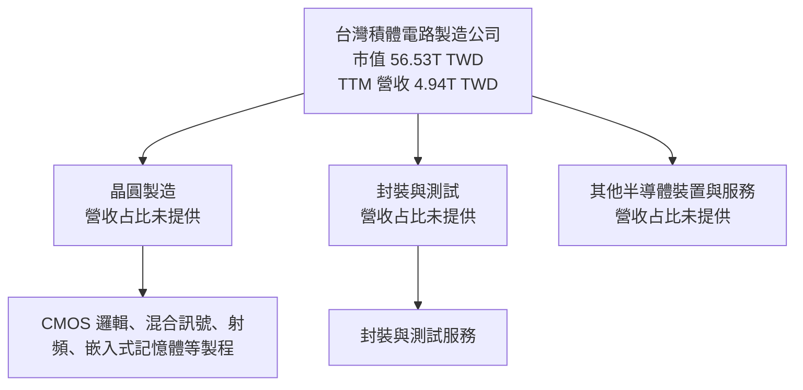

### 2.2 市場份額

市場份額數字未提供，亦無具來源與年份的可引用產業份額資料，因此不估算市占率。可確認的是，公司 TTM 營收 4.94T TWD，最新一季單季營收年增 50.9%；與 UMC、GFS、INTC 的最新一季營收年增率分別為 25.6%、12.5%、20.9% 相比，公司成長率較高，但各公司產品組合與會計幣別不同，不能直接視為市占率變化。

### 2.3 競爭護城河分析

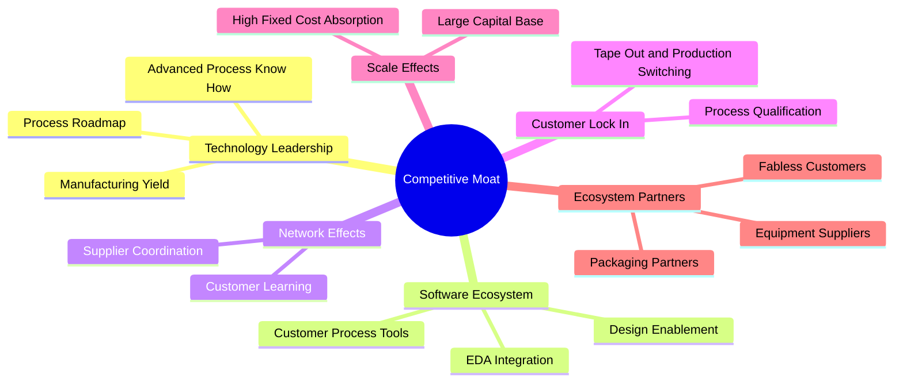

### 2.4 護城河強度

| 護城河項目 | 強度 | 證據 | 會削弱它的情況 |
|------------|------|------|----------------|
| 技術與製程能力 | 強 | 最新季度營業利益率 58.0%，顯示高附加價值製造能力；製程別數據未提供 | 製程優勢縮小、良率落後或客戶轉向其他供應商 |
| 客戶鎖定與轉換成本 | 強 | 晶片設計、製程驗證及量產需與代工流程協同；客戶集中度數據未提供 | 替代供應商成熟、客戶增加多來源生產 |
| 規模效應 | 強 | 2025 年營收 3.81T TWD，2025 年 Capex 1.28T TWD，規模可分攤研發與固定成本 | 需求下滑導致產能利用率下降或投資回報惡化 |
| 軟體／設計生態 | 中 | 公司概覽未提供平台收入或生態量化指標；其價值主要反映在製程協作 | 設計工具與製程支援差異化下降 |
| 網路效應 | 中 | 客戶與供應鏈協作可能形成學習與規模累積；未提供可量化網路效應數據 | 競爭者建立等效生態、客戶多來源化 |
| 生態夥伴 | 中 | 概覽確認跨區域製造、封裝與測試活動；夥伴營收貢獻未提供 | 供應商瓶頸、物流中斷或合作夥伴轉向 |

**1.1 護城河評分為 8.5/10**：主要依據是 58.0% TTM 營業利益率、4.94T TWD TTM 營收規模及高額資本投入所形成的製造能力；由於市場份額、客戶集中度與製程別數據未提供，評分未再上調。

---

## 3. 損益表深度分析

### 3.1 年度收入成長趨勢（近 4 年）

年度營收 YoY：2023 年 −4.4%、2024 年 +33.8%、2025 年 +31.8%。2022–2025 三年 CAGR 約 19.0%，公式為 `(3.81 ÷ 2.26)^(1/3) − 1`，數值依財報表列金額計算。

```text
╔══════════════════════════════════════════════════════════════════╗
║              台積電年度收入趨勢（FY2022–FY2025）                ║
╠══════════════════════════════════════════════════════════════════╣
║  FY2022  2.26T TWD  ████████████░░░░░░░░░░░  基準年             ║
║  FY2023  2.16T TWD  ███████████░░░░░░░░░░░░  YoY: -4.4% 🟡    ║
║  FY2024  2.89T TWD  ███████████████░░░░░░░░  YoY: +33.8% 🟢   ║
║  FY2025  3.81T TWD  ████████████████████░░░  YoY: +31.8% 🟢   ║
╠══════════════════════════════════════════════════════════════════╣
║  2022–2025 營收 CAGR：約 +19.0%                                   ║
╚══════════════════════════════════════════════════════════════════╝
```

2023 年營收較 2022 年下降，之後 2024–2025 年恢復兩位數成長；數據未提供各應用、節點與價格的收入拆分，因此不能將反彈歸因於單一產品。

### 3.2 季度收入趨勢分析

| 季度 | 營收（TWD） | QoQ 成長 | YoY 成長 | 備註 |
|------|-----------:|---------:|---------:|------|
| 2025-12-31 | 1.05T | N/A | N/A | 季度表列值 |
| 2026-03-31 | 1.13T | +7.6% | N/A | QoQ 以表列數字計算；單季 YoY 未提供 |
| 2026-06-30 | 1.27T | +12.4% | N/A | 季度營收續增；單季 YoY 未提供 |
| 2026-09-30 | 1.49T | +17.3% | **+50.9%** | 最新單季年增率；不得標成 TTM 成長率 |

QoQ 公式分別為 `(1.13 ÷ 1.05) − 1`、`(1.27 ÷ 1.13) − 1`、`(1.49 ÷ 1.27) − 1`。TTM 營收成長率為 N/A，不能用最新單季 50.9% 代替。

### 3.3 利潤率演變分析

| 利潤率指標 | FY2022 | FY2023 | FY2024 | FY2025 | 趨勢 | 評估 |
|------------|-------:|-------:|-------:|-------:|------|------|
| **毛利率** | 59.7% | 54.6% | 56.1% | 59.8% | 2023 下滑後連續回升 | 🟢 |
| **營業利益率** | 49.6% | 42.7% | 45.7% | 50.9% | 2023 收縮後恢復，2025 高於 2022 | 🟢 |
| **淨利率** | 43.9% | 39.4% | 40.1% | 44.6% | 近兩年改善 | 🟢 |

年度毛利率與營業利益率為毛利／營收及營業利益／營收計算值，採年度財報表列數字。TTM 毛利率 65.8%、TTM 營業利益率 58.0%，與年度指標期間不同，不可混為同一組比較。

利潤率先於 2023 年收縮、之後回升，與營收恢復及營運槓桿改善相一致；但資料沒有節點組合、折舊、匯率或地區成本拆分，不能精確量化各因素貢獻。

### 3.4 費用結構分析

以下為 FY2025 營收的簡化分配：營業成本以「營收 − 毛利」計算，毛利中扣除營業利益的部分為其他營業費用殘額，並非公司披露的單一費用科目。

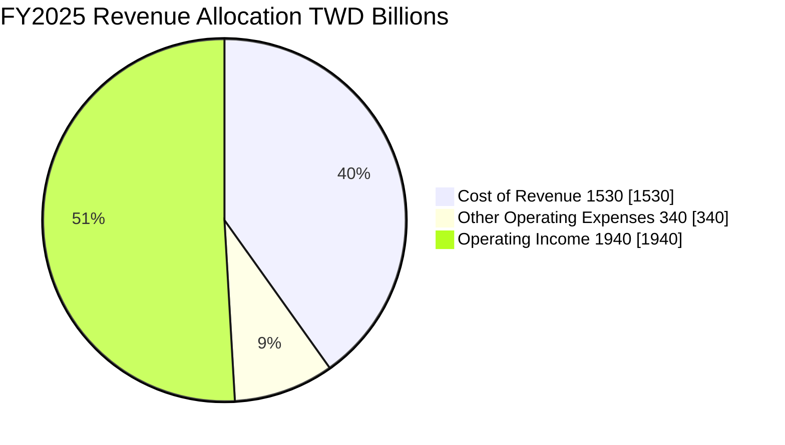

| FY2025 項目 | 金額 |
|------------|-----:|
| 營收 | 3.81T TWD |
| 毛利 | 2.28T TWD |
| 營業利益 | 1.94T TWD |
| 推算營業成本 | 約 1.53T TWD |
| 毛利至營業利益差額 | 約 0.34T TWD |
| 研發費用 | 246.43B TWD |

費用殘額包括毛利以下的各項營業費用，不能只解讀為研發或單一費用。FY2025 研發費用佔營收約 `246.43B ÷ 3.81T = 6.5%`。

### 3.5 季度 EPS 趨勢與盈餘品質（Quality of Earnings）

| 季度 | EPS 實際 | EPS 預估 | 超預期／不及預期 |
|------|---------:|---------:|------------------|
| 2025-12-31 | N/A | N/A | 無法判斷 |
| 2026-03-31 | N/A | N/A | 無法判斷 |
| 2026-06-30 | N/A | N/A | 無法判斷 |
| 2026-09-30 | N/A | N/A | 無法判斷 |

EPS Est 與 EPS Act 欄位為 nan，故過去四季是否超預期或不及預期、及其原因均無法可靠判定。另有 Roic.ai 2026 年 Q1–Q3 EPS 表列值 22.08、27.25、29.43，但來源與 Yahoo 季度 EPS 欄位不可直接拼接為一致的 beat/miss 序列。

| 盈餘品質項目 | 數值／佔比 | 評估 |
|--------------|------------|------|
| 股權薪酬 SBC / 營收 | 約 **0.010%**；TTM SBC 約 0.513B TWD ÷ TTM 營收 4.94T TWD | 🟢 佔比低，稀釋成本相對有限 |
| SBC / 營業現金流 | 約 **0.016%**；0.513B ÷ 3.13T | 🟢 |
| FCF / 淨利 | 約 **57.7%**；以最近四季淨利 2.528T 與 TTM FCF 1.46T 計 | 🟡 現金轉換為正，但高額 Capex 拉低 FCF／淨利 |
| 一次性／非經常性損益 | N/A；未提供明細 | 🟡 無法判定盈餘是否受一次性項目影響 |
| 有效稅率 | **17.0%**，最新年度有效稅率 | 🟢 DCF 採用該稅率；未見資料顯示異常稅務利益 |
| 資本化支出 vs 費用化 | TTM Capex **1.67T TWD**；資本化政策細項未提供 | 🟡 高 Capex 先進資產負債表，再透過折舊進入費用；需持續追蹤折舊與產能利用率 |

**盈餘品質結論**：SBC 比例很低，現金流與獲利方向一致；但 FCF 轉換率約 57.7%，主要需結合高 Capex 解讀，不能只看會計淨利。由於一次性損益明細及資本化政策資料不足，盈餘品質判斷為中性偏正面。

---

## 4. 資產負債表分析

### 4.1 資產結構分解

以下用 FY2025 年底資產數據；「其他流動資產」及非流動資產為按已披露總額相減的推算值，不代表報表細項名稱。

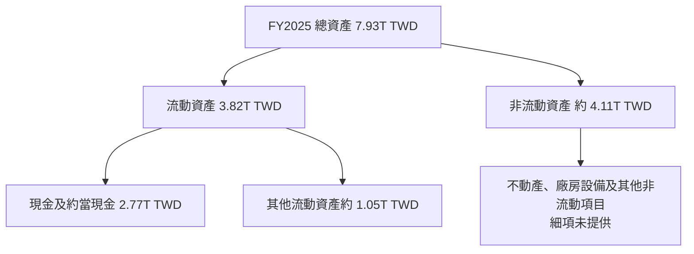

### 4.2 流動性與營運資金分析

| 指標 | FY2022 | FY2023 | FY2024 | FY2025／最新 | 評估 |
|------|-------:|-------:|-------:|-------------:|------|
| 流動比率 | 2.08 | 2.32 | 2.36 | **2.584** | 🟢 流動資產高於流動負債 |
| 速動比率 | N/A | N/A | N/A | **2.287** | 🟢 最新期指標充足；歷史序列未提供 |
| 現金及約當現金 | 1.34T | 1.47T | 2.13T | **4.02T TWD**（含短期投資） | 🟢 現金緩衝提升 |
| 淨現金 | N/A | N/A | N/A | **2.95T TWD** | 🟢 |

流動比率按年度流動資產除以流動負債計算；最新 2.584、速動比率 2.287 直接引用 Yahoo Finance 指標。

| 指標 | 最新 TTM | 一年前 TTM | 變化 | 解讀 |
|------|---------:|-----------:|-----:|------|
| DSO 應收帳款天數 | 1 天 | N/A | N/A | 一年前比較值未提供；最新數值照列 |
| DIO 存貨天數 | 92 天 | N/A | N/A | 存貨週轉週期較 DSO 長，需關注需求下滑時的庫存風險 |
| DPO 應付帳款天數 | 91 天 | N/A | N/A | 與供應商付款週期接近 DIO |
| CCC 現金轉換週期 | 2 天 | N/A | N/A | 最新營運資金週期短；因前期數據缺漏，不能判斷改善方向 |

以上營運資金天數採 QUALITY FIGURES 計算結果原值；一年前比較數據不足，不補算。

### 4.3 債務結構分析

```text
╔══════════════════════════════════════════════════════════════════╗
║                   台積電債務健康診斷                             ║
╠══════════════════════════════════════════════════════════════════╣
║  總債務：        1.07T TWD  █████░░░░░░░░░░░░░░░  🟢            ║
║  現金及短期投資：4.02T TWD  ████████████████████  🟢            ║
║  淨現金：        2.95T TWD  ███████████████░░░░░  🟢            ║
║                                                                  ║
║  Debt / EBITDA： 約 0.39x（1.07T ÷ FY2025 EBITDA 2.74T）        ║
║  利息保障倍數：  N/A（利息費用資料未提供）                       ║
║  流動比率：      2.584                                          ║
║  速動比率：      2.287                                          ║
╚══════════════════════════════════════════════════════════════════╝
```

### 4.4 股東權益趨勢

```text
╔══════════════════════════════════════════════════════════════════╗
║                 FY2022–FY2025 股東權益趨勢                       ║
╠══════════════════════════════════════════════════════════════════╣
║  FY2022  2.90T TWD  ███████████░░░░░░░░░░░░░░                   ║
║  FY2023  3.43T TWD  █████████████░░░░░░░░░░░░░                   ║
║  FY2024  4.24T TWD  █████████████████░░░░░░░░                   ║
║  FY2025  5.36T TWD  █████████████████████░░░░                   ║
╚══════════════════════════════════════════════════════════════════╝
```

股東權益 2022–2025 逐年增加，與累積獲利相一致；完整股利、其他綜合損益與資本交易變動拆分未提供。

---

## 5. 現金流量深度分析

### 5.1 現金流量瀑布圖

年度淨利、OCF、Capex 與 FCF 來自不同年度或 TTM 資料時不可直接當作同一期間的完整瀑布。以下採 FY2025 年度 OCF／Capex／FCF 及股利數字；淨利使用同年度數字作參照。

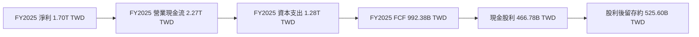

### 5.2 FCF 轉換率趨勢

| 年度 | FCF | 淨利 | FCF／淨利 |
|------|----:|-----:|----------:|
| 2022 | 520.97B | 992.92B | 52.5% |
| 2023 | 286.57B | 851.74B | 33.6% |
| 2024 | 861.20B | 1.16T | 74.2% |
| 2025 | 992.38B | 1.70T | 58.4% |

FCF 於 2023 年下降後回升。2025 年雖有 1.70T TWD 淨利，FCF／淨利仍低於 100%，反映資本支出是現金轉換的主要限制因素之一。

### 5.3 自由現金流趨勢

```text
╔══════════════════════════════════════════════════════════════════╗
║                  自由現金流歷史趨勢                              ║
╠══════════════════════════════════════════════════════════════════╣
║  FY2022  520.97B TWD  ███████████░░░░░░░░░                      ║
║  FY2023  286.57B TWD  ██████░░░░░░░░░░░░░░░                     ║
║  FY2024  861.20B TWD  ██████████████████░░                      ║
║  FY2025  992.38B TWD  ████████████████████                      ║
║  TTM     1.46T TWD    FCF Yield 2.58%                            ║
╚══════════════════════════════════════════════════════════════════╝
```

### 5.4 資本配置評估

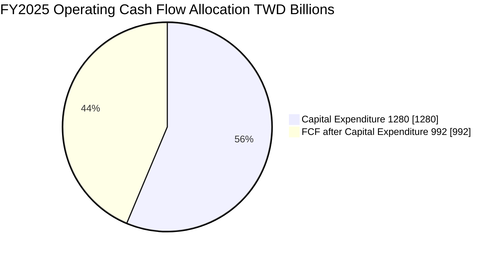

| 資本配置項目 | FY2025 數值 | 分析 |
|--------------|-----------:|------|
| 營業現金流 | 2.27T TWD | 資本支出的現金來源 |
| Capex | 1.28T TWD | 約佔 OCF 56.4%，反映持續投資需求 |
| FCF | 992.38B TWD | OCF 扣除 Capex 後餘額 |
| 現金股利 | 466.78B TWD | 約佔年度 FCF 47.0% |
| 股票回購 | N/A | 未提供 |
| 股利後 FCF 餘額 | 約 525.60B TWD | `992.38B − 466.78B`；未等同全部現金留存，其他投資與負債變動未提供 |

---

## 6. 獲利能力與資本效率

### 6.1 ROE / ROA / ROIC 趨勢

| 指標 | FY2022 | FY2023 | FY2024 | 最新可用 | 評估 |
|------|-------:|-------:|-------:|---------:|------|
| ROE | N/A | N/A | N/A | **41.9% TTM** | 🟢 高，但 DuPont 拆分依品質指標為 N/A |
| ROA | N/A | N/A | N/A | **20.6% TTM** | 🟢 |
| ROIC | N/A | N/A | N/A | **N/A；2025 代理估計 44.1%** | 🟡 代理估計與標準 ROIC 口徑不同 |
| ROIC.ai 歷史 Return on Capital | N/A | N/A | N/A | 2018 年 20.61% | 不作為當期 ROIC |

沒有可直接照抄的當期 ROIC 序列，因此不編造歷年 ROIC 或行業均值。

### 6.2 ROIC vs WACC 分析（核心價值創造判斷）

> ROIC 代理值僅用於方向性比較：採 FY2025 營業利益、17.0% 稅率及 FY2025 年底帳面股東權益、債務與現金。它不是品質指標計算的標準 ROIC，也不是 TTM ROIC。

```text
╔══════════════════════════════════════════════════════════════════╗
║                 ROIC vs WACC 深度分析                            ║
╠══════════════════════════════════════════════════════════════════╣
║  WACC（採用成本資本區塊數值）：10.53%                             ║
║  ├── 無風險利率（10Y 美債）：4.94%                               ║
║  ├── ERP：5.00%                                                   ║
║  ├── 原始 Beta：1.23；調整後 Beta：1.16                           ║
║  ├── 股權成本（來源值）：10.71%                                   ║
║  ├── 稅前債務成本（來源值）：1.16%                                ║
║  ├── 稅率：17.0%；股權／債務權重：98.1%／1.9%                    ║
║  └── 採用 WACC：10.53%                                            ║
║                                                                  ║
║  FY2025 ROIC 代理估算：                                           ║
║  ├── NOPAT = 1.94T × (1−17%) = 1.6102T TWD                      ║
║  ├── 投入資本代理 = 5.36T + 1.06T − 2.77T = 3.65T TWD          ║
║  └── ROIC 代理 = 1.6102T ÷ 3.65T = 44.1%                         ║
║                                                                  ║
║  EVA 利差代理 = 44.1% − 10.53% = +33.6 個百分點                 ║
║  結論：代理 ROIC 高於 WACC；方向上顯示創造價值，但口徑非官方。  ║
╚══════════════════════════════════════════════════════════════════╝
```

成本資本來源數值為 WACC 10.53%、Ke 10.71%、稅前 Kd 1.16%。因輸入值已經四捨五入，直接用顯示的 Ke、Kd 與權重重算會出現約 0.01 個百分點的尾差，採用成本資本資料所列 WACC，不另行替換。

ROIC 代理計算：
- `NOPAT = 2025 年營業利益 1.94T × (1 − 17.0%) = 1.6102T TWD`
- `投入資本代理 = 2025 年股東權益 5.36T + 總債務 1.06T − 現金 2.77T = 3.65T TWD`
- `ROIC 代理 = 1.6102T ÷ 3.65T = 44.1%`
- `EVA 利差代理 = 44.1% − 10.53% = 33.6 個百分點`

### 6.3 杜邦三因素分解

**N/A**：QUALITY FIGURES 指出缺少一致的淨利、營收、總資產或正股東權益數據，故不重算、不補列淨利率、資產週轉率與權益乘數。另可引用 Yahoo Finance 的 TTM ROE **41.9%**，但不能把它當作已完成的杜邦拆解。

### 6.4 財務體質：Piotroski F-Score

**N/A（0/9）**：需有相隔一年的兩組 TTM SEC 申報資料；現有來源為 Yahoo 季度財報，無法逐項判斷九個測試。故不以空白或推估結果填補測試表。

---

## 7. 相對估值分析

### 7.1 同業估值比較表格

| 估值指標 | **2330.TW** | **UMC** | **GFS** | **INTC** | 本公司評估 |
|----------|-----------:|-------:|-------:|--------:|-----------|
| **Trailing P/E** | 22.01x | 12.7x | 107.7x | N/A | 🟡 INTC 無值，其他兩家差異極大 |
| **Forward P/E** | 14.54x | 14.9x | 14.6x | 32.1x | 🟢 低於三家中位數 14.9x |
| **P/S Ratio** | 11.43x | N/A | 2.9x | 5.1x | 🔴 公司高於可用同業；UMC 缺值 |
| **EV/EBITDA** | 14.896x | N/A | 10.1x | 16.7x | 🟡 高於 GFS、低於 INTC；UMC 缺值 |
| **最新一季營收 YoY** | 50.9% | 25.6% | 12.5% | 20.9% | 🟢 高於三家可比值 |
| **TTM 毛利率** | 65.8% | 31.7% | 28.5% | 40.2% | 🟢 明顯較高 |

同業數值取 Yahoo Finance Peer multiples。Forward P/E 同業中位數為 **14.9x**；同業 EV/EBITDA 中位數為 **13.4x**（僅 GFS、INTC 可用，原資料已給定）。不同公司業務組合、周期位置及會計口徑差異，使倍數比較只適合作為交叉驗證。

### 7.2 歷史估值區間分析

**N/A（歷史估值區間與估值百分位數據未提供）**。目前 P/E 22.01x、Forward P/E 14.54x 可描述現況，但無法據此推導自身歷史估值區間或百分位。

### 7.3 情境價值（Bear / Base / Bull，照抄 DCF MODEL 的 Scenarios）

| 情境 | 第 1 年營收成長 | 期末營業利潤率 | WACC | 每股價值 | 相對現價 | 機率 | 會發生的條件 |
|------|----------------:|----------------:|-----:|---------:|---------:|-----:|--------------|
| 🔴 悲觀 | 15.0% | 42.1% | 11.53% | 1,234.53 TWD | −43.4% | 25% | 成長低於基準、利潤率收斂較深且風險折現率上升 |
| 🟡 基準 | 30.0% | 49.5% | 10.53% | 2,906.77 TWD | +33.3% | 50% | 需求與利潤率按模型逐步回歸 |
| 🟢 樂觀 | 45.0% | 54.5% | 9.53% | 6,479.98 TWD | +197.2% | 25% | 需求增長超出基準、長期利潤率保持較高且資金成本下降 |

情境估值只引用模型輸出；模型未披露各情境逐年完整營收、Capex 與 FCFF 表，因此不另行推導情境中間年度數字。

### 7.4 相對估值隱含價格區間

```text
╔══════════════════════════════════════════════════════════════════╗
║                 相對估值與股價位置（TWD／股）                    ║
╠══════════════════════════════════════════════════════════════════╣
║  1,983.31 ───── 2,180.00 ───── 2,240.22                          ║
║  EV/EBITDA          現價         Forward P/E                      ║
║  −9.0%                           +2.8%                             ║
╚══════════════════════════════════════════════════════════════════╝
```

- **同業 Forward P/E：2,240.22 TWD**，依同業中位數 **14.9x × Forward EPS 149.95 TWD**。
- **同業 EV/EBITDA：1,983.31 TWD**，依同業中位數 **13.4x** 乘以 TTM EBITDA，並加回淨現金；估值方法輸出直接引用，不另改算。

---

## 8. DCF 內在價值評估（Discounted Cash Flow）

### 8.0 估值推理鏈（Thinking Logic）

**Step 1 — 價值來源與主導變數**

本模型以晶圓製造及相關業務整體現金流估值；財務資料未按業務板塊披露營收比例，因此不能把先進製程、封裝或新業務拆成可加總的收入來源。DCF 輸入的營收基礎為 TTM **4,944.82B TWD**；價值最受 **WACC、永續成長率與長期 FCFF** 影響，模型終值 PV 佔 EV **60.9%**。

**Step 2 — 模型選擇**

| 決策點 | 本報告採用 | 理由 | 曾考慮但否決 | 否決理由 |
|--------|-----------|------|--------------|----------|
| 現金流定義 | FCFF | 與 WACC 折現一致，模型可先算 EV 再加淨現金 | FCFE | 模型已指定採 FCFF |
| 預測期 N | 10 年 | DCF MODEL 固定 10 年，營收成長率由 30.0% 線性降至 3.0% | 5 年 | 不符合已核定模型期間 |
| 終值方法 | Gordon Growth | 模型終值以 g=3.0% 計算 | 退出倍數 | DCF MODEL 未提供退出倍數終值計算，不自建 |
| EBIT 基礎 | GAAP EBIT | 模型已指定 GAAP EBIT | 非 GAAP EBIT | 會造成與模型口徑不一致 |

**Step 3 — 關鍵假設推導**

- **營收成長路徑**：錨點＝最新季度單季 YoY 50.9%，而 2022–2025 年營收 CAGR 約 19.0% → 單季成長不可直接外推，模型將首年成長限制為 30.0%，並線性降至第十年 3.0% → **採用 30.0% 至 3.0%** → 否決把 50.9% 維持十年，因其把單季增速視為可持續長期 CAGR。
- **期末營業利潤率**：錨點＝TTM 58.0%，模型以近五個財年中位數為收斂參照 → 模型逐年由 58.0% 降至 49.5% → **採用第十年 49.5%** → 否決長期維持 58.0%，因模型假設成熟期利潤率回落。
- **Capex／營收**：錨點＝TTM 33.8% → 模型依規則逐步淡化至 1.1 倍 D&A 附近 → **採用第 1 年 33.8%、第 10 年 16.6%** → 否決永久維持 33.8%，其會過度延續當期高投資強度；但下降速度仍是高敏感度風險。
- **永續成長率 g**：錨點＝模型採長期 3.0% → 低於 10.53% WACC，並低於 DCF 模型折現率 → **採用 3.0%** → 否決高於 WACC 的設定，因 Gordon Growth 公式將失效。
- **預測期 N**：錨點＝模型規定 10 年 → 以十年漸進式成長衰減及利潤率回歸反映成熟過程 → **採用 10 年** → 否決縮短至 5 年，因與模型預先設定不符。
- **WACC**：錨點＝成本資本資料採用 10.53% → 公司股權權重 98.1%，小比例低成本債務降低加權成本 → **採用 10.53%** → 否決另行重估 WACC，因應以成本資本計算值為準。
- **EBIT、SBC 與股數**：錨點＝模型以 GAAP EBIT、固定股數處理 → SBC 已列入 GAAP 費用，不再扣第二次，也不另做股數稀釋 → **採用組合 (A)** → 否決「GAAP EBIT 再扣 SBC」及再加稀釋率，避免重複計算。
- **ΔWC**：模型明確未建模，**採用不含 ΔWC 項**；營運資金天數資料不足以產生一致的逐年增量預測，未自行填入估算值。

**Step 4 — 最脆弱的一環**

最脆弱的是長期 FCFF 與終值假設：終值 PV 佔 EV 60.9%；若 WACC、g 或末年 FCFF 偏離，估值可顯著改變，敏感度見 8.6。

**Step 5 — 計算路徑圖**

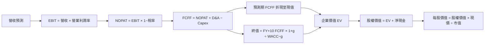

### 8.1 模型假設總表（Model Inputs）

| 假設項目 | 採用值 | 依據／來源 | 敏感度 |
|----------|-------|------------|--------|
| 預測期長度 N | 10 年 | DCF MODEL 固定設定 | 🟡 中 |
| 營收成長 | 第 1 年 30.0%，第 10 年 3.0%，逐年線性淡化 | 第 1 年取最新季度單季 YoY 50.9% 並限制在 0–30%；末年模型設定 3.0% | 🔴 高 |
| 營業利益率 | 第 1 年 58.0% → 第 10 年 49.5% | TTM 58.0%；向近五個財年中位數收斂 | 🔴 高 |
| 有效稅率 | 17.0% | 最新年度有效稅率 | 🟢 低 |
| Capex／營收 | 第 1 年 33.8% → 第 10 年 16.6% | TTM Capex／營收；依模型逐步降至 1.1 倍 D&A 附近 | 🟡 中 |
| D&A／營收 | 15.1% | TTM 比率，模型固定 | 🟢 低 |
| 營運資金變動 | 不建模 | DCF MODEL 明確不含 ΔWC | 🟡 中 |
| EBIT 基礎 | GAAP EBIT | DCF MODEL 指定 | 🟡 中 |
| SBC 處理 | 組合 (A)：GAAP EBIT、不另扣 SBC、固定股數 | SBC 已在 GAAP EBIT 費用化；模型設定股數不再稀釋 | 🟡 中 |
| 年稀釋率 | 0% | 與組合 (A) 配套，股數固定 | 🟡 中 |
| 永續成長率 g | 3.0% | DCF MODEL 設定；低於 WACC 10.53% | 🔴 高 |
| 終值方法 | Gordon Growth | DCF MODEL 提供終值計算 | 🔴 高 |
| WACC | 10.53% | 成本資本資料 | 🔴 高 |

**模型定義**：FCFF 為 `NOPAT + D&A − Capex`，工作資金變動未建模。  
**SBC 組合**：本模型採用 (A)，GAAP EBIT 已含 SBC 費用，因此不另扣 SBC、不另加股數稀釋。

### 8.2 折現率推導（WACC）

```text
╔══════════════════════════════════════════════════════════════════╗
║                    WACC 推導（採用值）                           ║
╠══════════════════════════════════════════════════════════════════╣
║  股權成本 Ke（成本資本資料原值）：10.71%                         ║
║  ├── 無風險利率 Rf：4.94%                                         ║
║  ├── ERP：5.00%                                                   ║
║  ├── 原始 Beta：1.23；調整後 Beta：1.16                           ║
║  ├── Beta 調整：⅔ × 1.23 + ⅓ × 1 = 1.16                         ║
║  ├── 額外規模／國別溢酬：未另加，來源未提供                       ║
║  └── 來源列示 Ke：10.71%                                          ║
║                                                                  ║
║  債務成本：                                                       ║
║  ├── 稅前 Kd：1.16%（來源值；利息金額與平均債務明細未提供）      ║
║  ├── 稅率：17.0%                                                  ║
║  └── 稅後 Kd：1.16% × (1−17.0%) = 0.9628%                       ║
║                                                                  ║
║  資本結構：股權 98.1%，債務 1.9%                                 ║
║  └── 採用 WACC：10.53%（成本資本資料原值）                       ║
╚══════════════════════════════════════════════════════════════════╝
```

逐步演算與資料限制：

1. **Ke**：來源給定無風險利率 4.94%、調整後 Beta 1.16、ERP 5.00%、Ke 10.71%。以顯示值代入 CAPM 得 `4.94% + 1.16 × 5.00% = 10.74%`，與來源列示 Ke 10.71% 相差 0.03 個百分點；屬輸入精度或原始資料未顯示精度差異，本報告採用來源 Ke **10.71%**，不自行替代。
2. **稅前 Kd**：利息金額及平均計息負債明細未提供；依成本資本資料原值採 **1.16%**，不以總負債倒推。
3. **稅後 Kd**：`1.16% × (1 − 17.0%) = 0.9628%`。
4. **權重**：成本資本資料列示股權 **98.1%**、債務 **1.9%**，相加為 100.0%；E／D 的精確市場價值明細沒有提供。
5. **WACC**：成本資本資料採用 **10.53%**。由於 Ke、Kd、權重只提供四捨五入後數值，用顯示值重算有尾差，因此不以重算結果取代官方採用值。

WACC 日期細節、ERP 假設來源以及計息負債平均餘額未提供，故不冒充為精確可重現輸入。第 6.2 節與本節採用同一 WACC **10.53%**。

### 8.3 逐年自由現金流預測（基準情境）

單位：TWD billions；折現因子依模型表列保留三位小數。ΔWC 不另列，因模型明確未建模；SBC 不另扣，採組合 (A)。

| 年度 | FY+1 | FY+2 | FY+3 | FY+4 | FY+5 | FY+6 | FY+7 | FY+8 | FY+9 | FY+10 |
|------|-----:|-----:|-----:|-----:|-----:|-----:|-----:|-----:|-----:|------:|
| 營收 | 6,428.26 | 8,163.89 | 10,123.23 | 12,249.11 | 14,453.94 | 16,622.04 | 18,616.68 | 20,292.18 | 21,509.71 | 22,155.00 |
| 營收 YoY | 30.0% | 27.0% | 24.0% | 21.0% | 18.0% | 15.0% | 12.0% | 9.0% | 6.0% | 3.0% |
| 營業利潤率 | 58.0% | 57.0% | 56.1% | 55.2% | 54.2% | 53.3% | 52.3% | 51.4% | 50.5% | 49.5% |
| EBIT（GAAP） | 3,726.88 | 4,656.49 | 5,679.00 | 6,756.58 | 7,837.06 | 8,856.56 | 9,744.56 | 10,431.05 | 10,854.96 | 10,972.60 |
| − 稅 | (632.56) | (790.34) | (963.90) | (1,146.79) | (1,330.18) | (1,503.22) | (1,653.94) | (1,770.46) | (1,842.41) | (1,862.38) |
| NOPAT | 3,094.32 | 3,866.14 | 4,715.10 | 5,609.79 | 6,506.88 | 7,353.34 | 8,090.62 | 8,660.59 | 9,012.55 | 9,110.22 |
| + D&A | 970.20 | 1,232.15 | 1,527.86 | 1,848.72 | 2,181.48 | 2,508.71 | 2,809.75 | 3,062.63 | 3,246.39 | 3,343.78 |
| − Capex | (2,171.05) | (2,601.47) | (3,032.68) | (3,435.84) | (3,778.51) | (4,028.15) | (4,156.32) | (4,143.23) | (3,981.42) | (3,678.16) |
| **FCFF** | **1,893.46** | **2,496.82** | **3,210.29** | **4,022.67** | **4,909.85** | **5,833.90** | **6,744.04** | **7,579.99** | **8,277.52** | **8,775.85** |
| 折現因子 @10.53% | 0.905 | 0.819 | 0.741 | 0.670 | 0.606 | 0.548 | 0.496 | 0.449 | 0.406 | 0.367 |
| **FCFF 現值 PV** | **1,713.05** | **2,043.69** | **2,377.31** | **2,695.07** | **2,976.03** | **3,199.20** | **3,345.93** | **3,402.35** | **3,361.43** | **3,224.23** |

預測期現值合計依 DCF MODEL 原值 **28,338.27B TWD**；表列年度 PV 已四捨五入到兩位小數，逐項相加可能有小額尾差，不以四捨五入後總和替代模型原值。

**FY+1 逐步演算**（模型內部可能使用未四捨五入值）：
1. 營收：`4,944.82 × (1 + 30.0%) = 6,428.266`，模型列示 **6,428.26B**。
2. EBIT：`6,428.26 × 58.0% ≈ 3,728.39B`；模型列示 **3,726.88B**，顯示其計算使用未公開的底層精確數值或輸入差異。
3. 稅：模型列示 **632.56B**。
4. NOPAT：`3,726.88 − 632.56 = 3,094.32B`。
5. D&A：模型列示 **970.20B**。
6. Capex：模型列示 **2,171.05B**。
7. ΔWC：DCF MODEL 未建模，不填數值。
8. FCFF：模型列示 **1,893.46B**；以表列四捨五入數字計 `3,094.32 + 970.20 − 2,171.05 = 1,893.47B`，差額 0.01B 為四捨五入尾差。
9. 折現：`1 ÷ (1 + 10.53%)^1 ≈ 0.905`；`1,893.46 × 0.905 ≈ 1,713.05B`，模型 PV 原值 **1,713.05B**。

**合理性自檢**
- FY+1 至 FY+10 FCFF：1,893.46B 增至 8,775.85B；模型的營收增速由 30.0% 降至 3.0%，不能僅以單季 50.9% 外推。
- FY+10 FCFF 利潤率：`8,775.85 ÷ 22,155.00 = 39.6%`；TTM FCF／營收約 `1.46T ÷ 4.94T = 29.6%`。同業最佳 FCFF 利潤率數據未提供，不能聲稱超越同業。
- 各年度 FCFF 均為正值；模型沒有呈現負 FCFF 年份。

```text
╔══════════════════════════════════════════════════════════════════╗
║            自由現金流：歷史實際 vs 模型預測                      ║
╠══════════════════════════════════════════════════════════════════╣
║  FY2023(實)  286.57B TWD  ██████░░░░░░░░░░░░░░░                  ║
║  FY2024(實)  861.20B TWD  █████████████████░░░                  ║
║  FY2025(實)  992.38B TWD  ████████████████████                  ║
║  FY+1 (預)   1,893.46B TWD  ███████████████████████████████████ ║
║  FY+10(預)   8,775.85B TWD  模型末年值                           ║
╠══════════════════════════════════════════════════════════════════╣
║  ⚠️ 模型末年 FCF 需配合十年營收與利潤率假設理解                  ║
╚══════════════════════════════════════════════════════════════════╝
```

### 8.4 終值計算（Terminal Value）

適用性檢查：`WACC 10.53% vs g 3.0% → WACC > g？✅`

| 方法 | 計算式 | 終值 TV | TV 現值 | 佔總 EV 比重 |
|------|--------|--------:|--------:|------------:|
| Gordon Growth | `8,775.85 × (1+3.0%) ÷ (10.53%−3.0%)` | 120,016.74B | 44,093.97B | 60.9% |
| 退出倍數法 | N/A | N/A | N/A | N/A |

退出倍數法沒有提供模型數值，不自行補算；估值以 Gordon Growth 為主。

逐步演算：
1. FY+10 FCFF：**8,775.85B TWD**。
2. 分子：`8,775.85 × (1 + 3.0%) = 9,039.1255B`。
3. 分母：`10.53% − 3.0% = 7.53%`；`9,039.1255 ÷ 7.53% ≈ 120,016.74B`。
4. PV(TV)：模型列示 **44,093.97B**；折現因子底層精度未完整顯示，模型表格顯示為 0.367。
5. 終值佔比：`44,093.97 ÷ 72,432.24 = 60.9%`。

終值占 EV 未超過 75%，但仍達 60.9%，代表估值對第十年後現金流假設有明顯依賴。

### 8.5 企業價值 → 每股內在價值（Bridge）

```text
╔══════════════════════════════════════════════════════════════════╗
║              企業價值 → 每股內在價值 橋接表                      ║
╠══════════════════════════════════════════════════════════════════╣
║  預測期 FCF 現值合計            +28,338.27B TWD                  ║
║  終值現值 PV(TV)                +44,093.97B TWD                  ║
║  = 企業價值 EV                   72,432.24B TWD                  ║
║  + 淨現金                        +2,947.23B TWD                  ║
║  = 股權價值                      75,379.46B TWD                  ║
║  每股內在價值（模型原值）        2,906.77 TWD                    ║
║  當前股價（2026-11-27）          2,180.00 TWD                    ║
║  折溢價（現價÷DCF價值−1）        −25.0%（折價）                   ║
╚══════════════════════════════════════════════════════════════════╝
```

逐步橋接：
1. `28,338.27 + 44,093.97 = 72,432.24B TWD`。
2. `72,432.24 + 2,947.23 = 75,379.47B TWD`；模型列示股權價值 **75,379.46B**，0.01B 為表列四捨五入差。
3. 每股價值依模型指定公式：`股權價值 × 現價 ÷ 市值`，模型原值為 **2,906.77 TWD**。已提供股數 25.93B、收盤價 2,180.00 TWD；股數及市值皆為四捨五入顯示，不能用 rounded share count 取代模型精確股數。
4. 折溢價：`2,180.00 ÷ 2,906.77 − 1 = −25.0%`。
5. 本節不計算 MOS；MOS 僅採 8.8 加權合理價值作分母。

淨現金 2.94723T TWD 為成本資本／DCF 模型列值，與 2026-09-30 現金及短期投資 4.02T、總債務 1.07T 的四捨五入差異可能來自精度或期間口徑。股數採 DCF 模型固定股數方式；SBC 組合為 (A)。

### 8.6 敏感性分析（WACC × 永續成長率）

格內為每股價值及相對現價上行空間。全部數值照 DCF MODEL 敏感度矩陣；基準格為 **WACC 10.53%、g 3.0%**。

| g（列）／WACC（欄） | 8.53% | 9.53% | **10.53%（基準）** | 11.53% | 12.53% |
|-----------|------:|------:|--------------------:|-------:|-------:|
| **2.0%** | 3,665.77（+68.2%） | 3,112.39（+42.8%） | 2,692.90（+23.5%） | 2,364.88（+8.5%） | 2,102.06（−3.6%） |
| **2.5%** | 3,871.35（+77.6%） | 3,253.20（+49.2%） | 2,793.18（+28.1%） | 2,438.49（+11.9%） | 2,157.41（−1.0%） |
| **3.0%** | 4,114.08（+88.7%） | 3,415.57（+56.7%） | **2,906.77（+33.3%）** | 2,520.72（+15.6%） | 2,218.56（+1.8%） |
| **3.5%** | 4,405.06（+102.1%） | 3,604.85（+65.4%） | 3,036.52（+39.3%） | 2,613.19（+19.9%） | 2,286.49（+4.9%） |
| **4.0%** | 4,760.26（+118.4%） | 3,828.36（+75.6%） | 3,186.14（+46.2%） | 2,717.94（+24.7%） | 2,362.37（+8.4%） |

**矩陣示範格**：所選格 WACC **9.53% > g 3.0% ✅**。模型矩陣列示該格每股價值 **3,415.57 TWD**；逐年 FCFF 現值、TV、股權價值沒有提供該格完整中間項，故不自行重建底層模型。

**三情境 DCF**

| 情境 | 第 1 年成長 | 期末營業利潤率 | WACC | 每股價值 | 相對現價 | 機率 |
|------|-----------:|---------------:|-----:|---------:|---------:|-----:|
| 🔴 悲觀 | 15.0% | 42.1% | 11.53% | 1,234.53 TWD | −43.4% | 25% |
| 🟡 基準 | 30.0% | 49.5% | 10.53% | 2,906.77 TWD | +33.3% | 50% |
| 🟢 樂觀 | 45.0% | 54.5% | 9.53% | 6,479.98 TWD | +197.2% | 25% |

模型情境輸出只提供第 1 年成長、期末利潤率、WACC、每股價值與機率，未提供各情境逐年營收、FCFF、Capex 路徑及 TV 中間值，因此不以假設補造完整情境算式。機率加權結果模型列示 **3,382.01 TWD**；它是背景參考，估值加權方法仍以 8.8 的基準 DCF 為輸入。

**敏感度結論**
- g 在 WACC 10.53% 下由 2.0% 升至 3.0%：`2,906.77 − 2,692.90 = +213.87 TWD`，約 **+7.9%**。
- WACC 在 g 3.0% 下由 9.53% 升至 10.53%：`2,906.77 − 3,415.57 = −508.80 TWD`，約 **−14.9%**。
- 期末營業利潤率每 +1pp 的獨立敏感度未提供，故不估算。
- 整體估值對 WACC 與終值敏感，與 8.0 指出的主導變數一致。

### 8.7 反推 DCF（Reverse DCF）

基準固定輸入：WACC 10.53%、稅率 17.0%、Capex 比率按基準模型路徑、ΔWC 不建模、預測期 10 年、股數按模型固定。模型提供兩項反推結果：

| 求解的變數（一次一個） | 固定的其他變數 | 市場隱含值 | 對照基準 | 判斷 |
|------------------------|---------------|-----------:|---------|------|
| 第 1 年營收成長 | 其餘基準假設固定 | **22.1%** | 基準首年 30.0% | 🟢 價格隱含成長低於基準模型 |
| 固定營業利潤率 | 其他基準假設固定 | **39.4%** | 基準 58.0% → 49.5% | 🟢 價格容許較低利潤率 |
| 永續成長率 g | 未提供解 | 未計算 | — | N/A |
| 預測期 N | 未提供解 | 未計算 | — | N/A |

模型只提供反推結果，沒有輸出試算軌跡或各候選值所對應的每股估值，故不編造收斂表。就已提供的兩個反推變數而言，現價並未要求模型基準首年成長 30.0% 或完整基準利潤率路徑；但仍須注意現價高於相對估值 EV/EBITDA 隱含價值。

### 8.8 估值三角驗證與安全邊際

| 估值方法 | 隱含每股價值 | 上行空間（÷現價） | 權重 | 說明 |
|----------|--------------:|------------------:|-----:|------|
| DCF（基準） | 2,906.77 TWD | +33.3% | 40% | 十年 FCFF，WACC 10.53%，g 3.0% |
| 同業 Forward P/E | 2,240.22 TWD | +2.8% | 25% | 同業中位數 14.9x × 公司 Forward EPS 149.95 |
| 同業 EV/EBITDA | 1,983.31 TWD | −9.0% | 25% | 同業中位數 13.4x × TTM EBITDA，加回淨現金 |
| 分析師共識目標價 | 3,417.00 TWD | +56.7% | 10% | 35 位分析師平均目標價 |
| **加權合理價值** | **2,560.29 TWD** | **+17.4%** | **100%** | 按盈利公司固定權重加權 |

逐步演算：
`2,906.77 × 40% + 2,240.22 × 25% + 1,983.31 × 25% + 3,417.00 × 10%`
`= 1,162.708 + 560.055 + 495.8275 + 341.700`
`= 2,560.2905 ≈ 2,560.29 TWD`。

MOS：`(2,560.29 − 2,180.00) ÷ 2,560.29 = +14.9%`。  
上行空間：`(2,560.29 − 2,180.00) ÷ 2,180.00 = +17.4%`。  
依 MOS 門檻為 **買入**；不作質化調級。

```text
╔══════════════════════════════════════════════════════════════════╗
║                  估值區間與安全邊際                              ║
╠══════════════════════════════════════════════════════════════════╣
║  1,234.53 ───── 2,180.00 ───── [2,560.29] ───── 2,906.77 ─ 6,479.98║
║  悲觀DCF        現價          加權合理值       基準DCF      樂觀DCF║
║                                                                  ║
║  MOS = (2,560.29 − 2,180.00) ÷ 2,560.29 = +14.9%                 ║
║  MOS 評估：🟡 有限                                                ║
║  上行空間 = (2,560.29 − 2,180.00) ÷ 2,180.00 = +17.4%            ║
║  建議買入區間：1,983.31 – 2,560.29 TWD                           ║
║  合理持有區間：2,560.29 – 2,906.77 TWD                           ║
║  減碼考慮區間：高於 2,906.77 TWD，需重新檢視成長假設             ║
╚══════════════════════════════════════════════════════════════════╝
```

買入區間以同業 EV/EBITDA 隱含價值 1,983.31 至加權合理價值 2,560.29 TWD 作觀察區間；評級為買入，區間上限高於現價。

> 🔎 **程式複算（Python，依本節各項自動重算）**
>
> 加權合理價值 = $2,906.77 × 40% + $2,240.22 × 25% + $1,983.31 × 25% + $3,417.00 × 10% = **$2,560.29**（權重合計 100%）
>
> 以價格 $2,180.00 計：MOS = **+14.9%**，上行空間 = **+17.4%**
>
> ✅ 與本節所寫數值一致。

### 8.9 DCF 模型的局限與失效條件

- **終值依賴度**：終值 PV 佔 EV **60.9%**，價值主要受 FY+10 之後現金流假設影響。
- **最脆弱假設**：WACC 與永續成長率。基準 WACC 下，g 由 2.0% 變 3.0% 對應價值由 2,692.90 升至 2,906.77 TWD；WACC 由 9.53% 升至 10.53%，基準 g 下價值由 3,415.57 降至 2,906.77 TWD。
- **資本支出路徑**：Capex／營收由 33.8% 降至 16.6%，若長期投資需求高於模型假設，FCFF 將低於預測。
- **不適用情境**：公司目前 FCF 為正，不屬於負 FCF 公司；但處於高投資期時，DCF 對 Capex、折舊與產能利用率的預測誤差可能較大。可用 EV/EBITDA 與同業 Forward P/E 交叉檢驗。
- **風險連結**：地緣政治可能衝擊營收與 WACC；產能利用率不足會壓低營業利益率；設備投資超預期會提高 Capex／營收並壓低 FCFF。

### 8.10 複算檢核表（Audit Trail）

| # | 檢核項目 | 檢查方式 | 結果 |
|---|----------|----------|------|
| 1 | 高／中敏感度假設均有推導 | 對照 8.0 與 8.1；資料缺漏處標示限制 | ✅ |
| 2 | 所有假設有來歷 | 逐項列出模型輸入與來源 | ✅ |
| 3 | WACC 五步輸入與尾差 | 成本資本原值採 10.53%；顯示精度下 CAPM 有 0.03pp 差 | 🟡 已揭露，不以重算值替代 |
| 4 | Kd 與債務權重範圍一致 | 利息與平均計息負債分項資料未提供 | 🟡 原值照用，限制已揭露 |
| 5 | WACC 與第 6.2 節相同 | 兩處均 10.53% | ✅ |
| 6 | 預測年度數等於 N | FY+1 至 FY+10，共 10 年 | ✅ |
| 7 | FY+1 算式可複算 | 表列 FCFF 出現 0.01B 四捨五入尾差 | 🟡 已揭露 |
| 8 | 預測期 PV 加總 | 模型原值 28,338.27B；年度列值四捨五入 | 🟡 原值照用 |
| 9 | WACC > g | 10.53% > 3.0% | ✅ |
| 10 | 終值使用 FY+N 並折現 10 期 | FY+10 FCFF 8,775.85B | ✅ |
| 11 | EV 至每股價值橋接 | 模型原值照用；四捨五入差 0.01B | 🟡 已揭露 |
| 12 | SBC 組合合法 | GAAP EBIT、不另扣 SBC、固定股數（A） | ✅ |
| 13 | 敏感度矩陣基準格 | 2,906.77 TWD，與 8.5 一致 | ✅ |
| 14 | 矩陣有效格 | 所有 WACC 均高於各列 g | ✅ |
| 15 | 三情境機率合計 | 25% + 50% + 25% = 100% | ✅ |
| 16 | Reverse DCF 每列單一變數 | 僅列出模型提供的兩項反推值；無試算軌跡 | 🟡 資料限制已揭露 |
| 17 | MOS 與折溢價分母 | MOS 用 8.8 加權值；折溢價用 8.5 DCF 值 | ✅ |
| 18 | 完整至第 11 章 | 全章節列示 | ✅ |
| 19 | 加權合理價值 | 計算結果 2,560.2905 ≈ 2,560.29 | ✅ |
| 20 | 評級符合 MOS 門檻 | MOS +14.9% 對應買入 | ✅ |

---

## 9. 成長催化劑

### 9.1 催化劑時間軸

下列為根據現有財務趨勢整理的監控時間軸，不代表公司公告了特定產品上市日期。

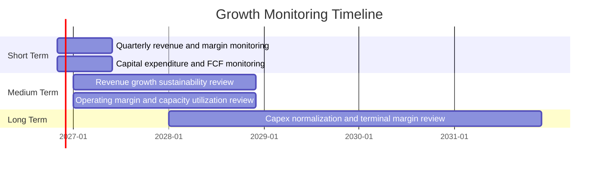

短期重點是最新季度 50.9% 單季營收年增能否延續，以及高 Capex 下 FCF 是否維持正值；中期應檢查營業利潤率及資本投入回報；長期則關注模型假設中的 Capex／營收收斂。

### 9.2 TAM 市場規模分析

**N/A（TAM 數據未提供）**。可觀察到 TTM 營收 4.94T TWD、最新一季營收單季年增 50.9%，以及年度營收 2024、2025 年分別年增 33.8%、31.8%。缺少具來源與年份的 TAM 金額，故不推算滲透率。

### 9.3 成長驅動力結構圖

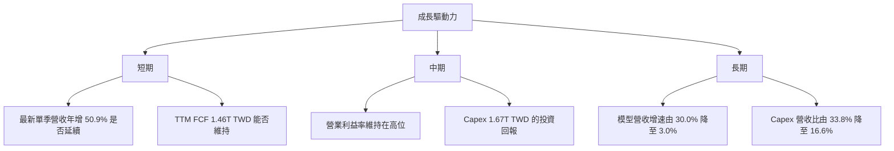

---

## 10. 風險矩陣

### 10.1 風險評分矩陣

下圖座標為研究者定性排序，不代表資料庫量化的發生機率；財務資料沒有提供地緣政治、需求下滑等風險的實際機率或損失百分比。

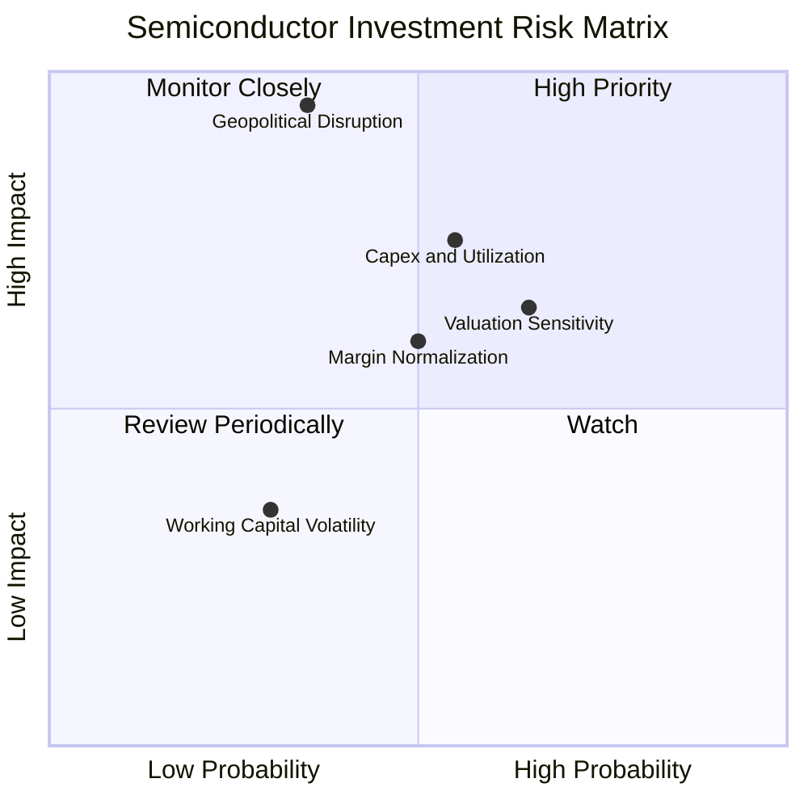

### 10.2 風險清單詳細分析

| # | 風險項目 | 發生機率 | 財務衝擊 | 風險評分 | 緩解措施 |
|---|----------|----------|----------|----------|----------|
| 1 | 🔴 **地緣政治與供應鏈中斷** | N/A；定性偏低至中 | N/A；公司地區集中度與事件損失未提供 | 🔴 高衝擊 | 追蹤產能地區分布、物流與客戶交付資訊；不把未公開產能比例當成事實 |
| 2 | 🔴 **Capex 高、產能利用率回落** | N/A；Capex 持續高 | TTM Capex 1.67T TWD；若產出不足，FCF 與利潤率均可能受壓 | 🔴 高 | 每季追蹤 Capex、OCF、FCF 與營業利益率 |
| 3 | 🟡 **估值對 WACC／終值敏感** | 情境風險 | 終值佔 EV 60.9%；WACC 9.53% 至 10.53% 使基準 g 下價值由 3,415.57 降至 2,906.77 TWD | 🟡 中高 | 以加權合理價值及相對估值交叉驗證，不只依賴 DCF |
| 4 | 🟡 **利潤率正常化** | N/A | TTM 營業利益率 58.0%；DCF 末年降至 49.5% | 🟡 中 | 追蹤季度毛利率及營業利益率連續變化 |
| 5 | 🟡 **營運資金／存貨風險** | N/A | DIO 92 天、DPO 91 天、CCC 2 天；無一年前比較值 | 🟡 中 | 每季追蹤存貨與應收帳款變化，確認 CCC 不持續惡化 |

---

## 11. 投資建議

### 11.1 最終評級與評分

依加權合理價值 2,560.29 TWD 與 2,180.00 TWD 現價計算，MOS 為 +14.9%，按規則 20 評級為 **買入**；未作質化調級。綜合評分為 **7.8/10**，引用 1.1 的六項分數：成長性 8.5、獲利能力 9.0、財務健康 9.0、估值 6.0、護城河 8.5、管理層與資本配置 5.5。

### 11.2 合理價值與隱含報酬率

| 估值基準 | 每股價值 | 相對現價 | 機率／權重 |
|----------|---------:|---------:|-----------:|
| 加權合理價值 | **2,560.29 TWD** | **+17.4%** | 權重合計 100% |
| DCF 悲觀情境 | 1,234.53 TWD | −43.4% | 25% |
| DCF 基準情境 | 2,906.77 TWD | +33.3% | 50% |
| DCF 樂觀情境 | 6,479.98 TWD | +197.2% | 25% |
| 機率加權 DCF 參考值 | 3,382.01 TWD | +55.1% | 100% |

投資決策主要以加權合理價值與 MOS 判斷；機率加權 DCF 只作情境參考，不替代 8.8 的估值結論。

### 11.3 買入時機與觸發因素

```text
╔══════════════════════════════════════════════════════════════════╗
║                  ✅ 買入觸發因素 Checklist                       ║
╠══════════════════════════════════════════════════════════════════╣
║  建議分段布局，觀察以下條件：                                     ║
║  ✅ 價格低於加權合理價值 2,560.29 TWD                             ║
║  ✅ 最新季度營收年增維持正成長，並同步檢查營業利益率              ║
║  ✅ TTM FCF 維持正值，Capex 未令現金流顯著惡化                    ║
║                                                                  ║
║  加碼觸發條件：                                                   ║
║  ☐ 股價回落至同業 EV/EBITDA 隱含價值 1,983.31 TWD 附近或以下      ║
║  ☐ FCF 保持正值且營業利益率未連續收縮                             ║
║                                                                  ║
║  減碼／重新評估條件：                                              ║
║  ☐ 股價顯著高於基準 DCF 2,906.77 TWD，而營運假設未同步上修        ║
║  ☐ 營收成長與獲利率同時低於基準，且 Capex 持續高於現金流承受力    ║
╚══════════════════════════════════════════════════════════════════╝
```

### 11.4 投資人適配度分析

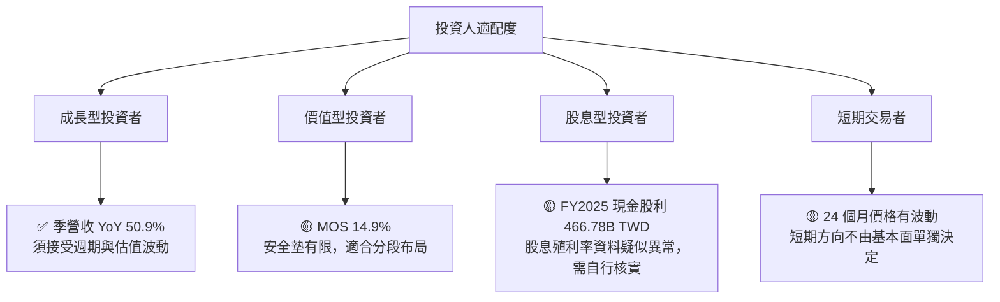

資料列示股息殖利率 112.0%，與公司財務及常見殖利率口徑明顯不協調，可能是資料欄位或單位問題；本報告不把 112.0% 當成可投資的真實殖利率依據。

### 11.5 每季財報監控清單（Quarterly Watch List）

| 監控指標 | 最新基準 | 加碼觀察條件 | 減碼／重估條件 |
|----------|---------:|-------------|---------------|
| 單季營收 YoY | 50.9% | 維持正成長，且 QoQ 未持續轉弱 | 連續兩季年增低於 10%（研究警戒線，非公司指引） |
| 營業利益率 | 最新季度 58.0% | 維持在 55% 以上 | 連續兩季低於 50% |
| 毛利率 | TTM 65.8% | 穩定或上升 | 顯著連續下滑並伴隨營業利益率收縮 |
| OCF | TTM 3.13T TWD | 維持正向並可覆蓋 Capex | OCF 連續季下滑且低於 Capex |
| Capex | TTM 1.67T TWD | 投資增加但需求與現金流同步成長 | Capex 上升、FCF 轉負或產能利用率惡化 |
| FCF | TTM 1.46T TWD | 保持正值；FCF Yield 改善 | FCF 轉負或 FCF Yield 進一步下滑 |
| 庫存與 CCC | DIO 92 天；CCC 2 天 | CCC 維持低位 | DIO 與 CCC 連續上升 |
| Forward EPS／估值 | Forward EPS 149.953 TWD；Forward P/E 14.54x | EPS 預期上修且估值未過度擴張 | EPS 下修、股價仍大幅高於合理價值 |
| 股東回報與 SBC | SBC 約 0.513B TWD TTM | SBC 佔營收維持低位 | SBC 或稀釋速度明顯上升 |

警戒門檻是投資監控線，不是公司財測；應以連續季度資料而非單季波動單獨觸發決策。

### 11.6 反面論證：什麼會證明論點錯誤（What Would Change My Mind）

| 可量化條件 | 為何會推翻論點 | 建議行動 |
|------------|----------------|----------|
| 單季營收年增連續兩季低於 10% | 成長假設顯著低於基準模型首年 30.0% | 下修營收預測並重估 DCF |
| 營業利益率連續兩季低於 50% | 將低於基準模型末年 49.5% 附近，且顯示利潤率提前正常化 | 檢查產品組合、成本與利用率 |
| TTM FCF 轉負 | 現有現金生成能力不足以覆蓋投資支出 | 暫停加碼，檢視 Capex 與需求 |
| 2025 年口徑 ROIC 代理持續下降並接近或低於 WACC 10.53% | 代表新增投資可能不再創造經濟價值；代理 ROIC 不等同標準 ROIC | 重算一致口徑 ROIC，必要時降低評級 |
| Capex 持續高於 OCF，或 FCF／淨利持續低於 30% | 高投資支出可能吞噬股東可分配現金 | 檢視投資回收期及資產利用率 |
| 股價高於基準 DCF 2,906.77 TWD，但營收、利潤率與現金流未上修 | 市場估值可能先於基本面擴張 | 重新檢視持有比例與預期報酬 |

> **免責聲明**：本報告為 AI 自動生成，僅供研究參考，不構成投資建議。投資有風險，入市需謹慎。

---

## 資料與來源

| 項目 | 內容 |
|------|------|
| 價格 | 2,180.00 TWD，2026-11-27 收盤（Yahoo Finance 日線） |
| 財務報表 | Yahoo quarterly statements (no SEC filing data)，最新季度 2026-09-30（TTM = four quarters to this date） |
| 有回應的資料來源 | Yahoo Finance、Roic.ai |
| 未回應的資料來源 | SEC 申報資料 (XBRL)、Finviz、StockAnalysis |
| 由程式計算 | TTM 數字、WACC、DCF 模型、估值方法與權重、加權合理價值、MOS、評級門檻、F-Score、杜邦分解、營運資金天數、綜合評分 |
| 撰寫模型 | openai / gpt-6-luna |

> 本區塊由產生報告的程式依實際取得的資料填寫，非模型撰寫。「由程式計算」的數字不是模型的估計；其餘判斷（評分、情境、策略）是模型的分析。
