# AMD 基本面深度分析報告
> **報告日期**：2026-11-13 ｜ **語言**：繁體中文 ｜ **數據來源**：SEC 申報資料 (XBRL)、Yahoo Finance、Finviz、StockAnalysis、Roic.ai ｜ **分析師**：CFA 級機構研究  
> **價格基準**：2026-11-12 收盤價 **$585.30**。估值以題示 Verified Figures 為優先；不同資料源有差異時另行註明。模型假設均標為「假設值」，不是公司財測。

## 目錄

| # | 章節 | 核心結論 |
|---|------|----------|
| 1 | 執行摘要 | 加權合理價值 $219.26，MOS −167.0%；依門檻為賣出 |
| 2 | 公司概覽與商業模式 | CPU、GPU、AI 加速器及嵌入式處理器構成產品平台；軟體生態仍是競爭短板 |
| 3 | 損益表深度分析 | TTM 營收 $45.44B、年增 41.9%；最新單季營收年增 44.7% |
| 4 | 資產負債表分析 | Verified Figures 顯示淨現金 $8.70B；流動性充足，但不同來源的債務數字不一致 |
| 5 | 現金流量深度分析 | TTM FCF $7.06B，FCF Yield 0.74%；現金流轉換仍需追蹤 |
| 6 | 獲利能力與資本效率 | ROIC 12.8% 低於參考 WACC 17.69%，目前口徑下未創造超額經濟報酬 |
| 7 | 相對估值分析 | P/S 位於自身五年區間第 95 百分位；高成長已被高估值部分折現 |
| 8 | DCF 內在價值評估 | 基準 DCF 約 $75.34/股；估值對 WACC 與長期現金流假設敏感 |
| 9 | 成長催化劑 | AI 加速器、伺服器 CPU、客戶端更新是主要機會；市場規模與分部營收未提供 |
| 10 | 風險矩陣 | 估值回檔、AI 競爭與產品執行是前三大風險 |
| 11 | 投資建議 | 賣出；基準 12 個月參考價 $219.26，買入觀察區上限約 $199.33 |

---

## 1. 執行摘要

### 1.0 一頁式投資儀表板

| 項目 | 內容 |
|------|------|
| **投資論點（3 句）** | ① TTM 營收 $45.44B、年增 41.9%，AI 與資料中心產品放量是增長的重要來源。② TTM FCF 為 $7.06B、FCF Yield 0.74%，現金流為正但相對市值的現金回報率偏低。③ 2026-11-12 收盤 $585.30，相對本報告加權合理價值 $219.26 高出約 167.0%。 |
| **護城河評分** | 6.5/10；CPU/GPU 設計與客戶關係具價值，但軟體生態及 AI 市場份額資料不足 |
| **管理層／資本配置評分** | 6.5/10；研發投入高，SBC 持續存在，資本配置細項資料有限 |
| **財務健康** | 🟢 Verified Figures 淨現金 $8.70B、流動比率 2.725；債務統計來源有差異 |
| **ROIC vs WACC** | 12.8% vs 17.69%；差 −4.89 個百分點，依此口徑低於資本成本 |
| **FCF 趨勢** | TTM FCF $7.06B；FCF Yield 0.74% |
| **估值** | Forward P/E 33.09x ｜ EV/EBITDA 119.7x（Verified Figures）｜ FCF Yield 0.74% |
| **DCF 內在價值（基準）** | 約 $75.34；現價相對 DCF 溢價約 677.0% |
| **安全邊際（MOS）** | **−167.0%**＝($219.26 − $585.30) ÷ $219.26；分母為第 8.8 節加權合理價值 |
| **預期報酬（基準情境 12M）** | 約 −62.5% 至基準參考價 $219.26；非公司或分析師保證 |
| **關鍵風險（前二）** | 高估值倍數收縮；AI 加速器市場競爭與產品化不及預期 |
| **評級 + 信心度** | 🔴 **賣出** ｜ 信心：中；估值結論明確，DCF 輸入仍有假設 |

### 1.1 核心評分儀表板

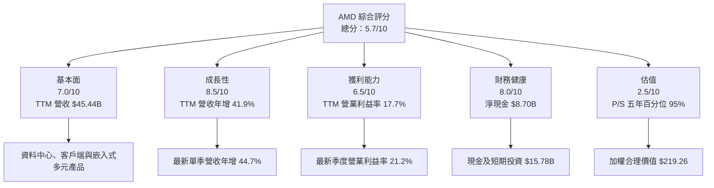

### 1.2 評分進度條視覺化

```
╔══════════════════════════════════════════════════════════════╗
║                 AMD 多維度評分儀表板（1–10分）               ║
╠══════════════════════════════════════════════════════════════╣
║ 基本面強度  7.0 ▓▓▓▓▓▓▓▓▓▓▓▓▓▓▓▓▓▓░░  ★★★★☆              ║
║ 成長動能    8.5 ▓▓▓▓▓▓▓▓▓▓▓▓▓▓▓▓▓▓▓▓▓░  ★★★★★            ║
║ 獲利品質    6.0 ▓▓▓▓▓▓▓▓▓▓▓▓░░░░░░░░  ★★★☆☆              ║
║ 財務健康    8.0 ▓▓▓▓▓▓▓▓▓▓▓▓▓▓▓▓░░░░  ★★★★☆              ║
║ 估值合理性  2.5 ▓▓▓▓▓░░░░░░░░░░░░░░░  ★★☆☆☆              ║
║ 護城河深度  6.5 ▓▓▓▓▓▓▓▓▓▓▓▓▓░░░░░░░  ★★★☆☆              ║
║ 管理層執行  6.5 ▓▓▓▓▓▓▓▓▓▓▓▓▓░░░░░░░  ★★★☆☆              ║
║ 技術創新力  8.0 ▓▓▓▓▓▓▓▓▓▓▓▓▓▓▓▓░░░░  ★★★★☆              ║
╠══════════════════════════════════════════════════════════════╣
║ 綜合總分    5.7 ▓▓▓▓▓▓▓▓▓▓▓░░░░░░░░░  🟡 成長佳、估值偏貴   ║
╚══════════════════════════════════════════════════════════════╝
```

### 1.3 五大投資論點與三大核心風險

| 類型 | 項目 | 具體依據 | 信心度 |
|------|------|----------|--------|
| 🟢 投資論點① | 營收動能可觀 | TTM 營收 $45.44B，年增 41.9%；最新單季年增 44.7% | 高 |
| 🟢 投資論點② | 季度獲利擴張 | 最新季度營收 $13.38B、營業利益 $2.83B；Verified 最新季度營業利益率 21.2% | 中高 |
| 🟢 投資論點③ | 淨現金資產負債表 | 現金及短期投資 $15.78B、債務 $7.08B，Verified 淨現金 $8.70B | 高 |
| 🟢 投資論點④ | 高研發投入支援產品競爭 | FY2025 R&D $8.09B，約占 FY2025 營收 $34.64B 的 23.4% | 中 |
| 🟡 投資論點⑤ | 客戶與產品組合分散 | 公司涵蓋資料中心、Client/Gaming、Embedded；各分部營收明細未提供 | 中 |
| 🔴 風險① | 估值回檔 | P/S 21.4x，為自身五年區間第 95 百分位；加權價值低於現價 | 高 |
| 🔴 風險② | AI 生態系競爭 | NVDA 最新季度營收年增 105.9%，高於 AMD 的 44.7%；市占與供應資料不足 | 中高 |
| 🟡 風險③ | FCF 相對市值偏低 | FCF Yield 0.74%；若獲利增長不能轉成現金，估值支撐將弱化 | 中 |

### 1.4 快速統計卡片

| 指標 | AMD 實際值 | 行業參考 | S&P 500 參考 | 狀態 |
|------|------------:|----------:|-------------:|------|
| 最新單季收入 YoY | **44.7%** | N/A | N/A | 🟢 |
| TTM 收入成長 | **41.9%** | N/A | N/A | 🟢 |
| 毛利率 TTM | **56.0%** | NVDA 74.7%；AVGO 75.5% | N/A | 🟡 |
| 淨利率 TTM | **16.8%** | N/A | N/A | 🟢 |
| ROE TTM | **11.1%**（Verified） | N/A | N/A | 🟡 |
| Forward P/E | **33.09x** | 同業區間 10.5x–34.2x | N/A | 🟡 |
| FCF Yield | **0.74%** | N/A | N/A | 🔴 |

> 行業及 S&P 500 均值未在數據包提供，故列 N/A，不以未核實估計冒充實際均值。

### 1.5 投資結論

```
╔══════════════════════════════════════════════════════════════════╗
║                       📊 投資結論摘要                            ║
╠══════════════════════════════════════════════════════════════════╣
║  評級：🔴 賣出（由第 8.8 節 MOS −167.0% 對應門檻）               ║
║  價格（2026-11-12 收盤）：$585.30                                ║
║  DCF 內在價值（基準）：$75.34（現價溢價約 677.0%）               ║
║  安全邊際 MOS：−167.0%（以加權合理價值 $219.26 為分母）          ║
║  目標價區間：                                                    ║
║    悲觀情境：$45.00（相對現價 −92.3%）                           ║
║    基準情境：$219.26（相對現價 −62.5%）                         ║
║    樂觀情境：$884.50（相對現價 +51.1%）                         ║
║  投資評分：5.7/10                                                ║
║  適合投資人：能承受高波動、且以估值紀律管理部位的成長型投資人    ║
╚══════════════════════════════════════════════════════════════════╝
```

---

## 2. 公司概覽與商業模式

### 2.1 業務結構與收入來源

AMD 設計半導體產品，依公司概覽分為 Data Center、Client and Gaming、Embedded。未提供最新分部收入，以下不虛構分部占比與金額。

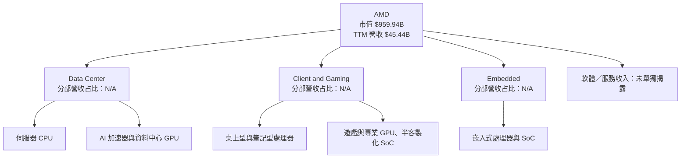

### 2.2 市場份額

市場份額、產品出貨量及可比市場總量未提供，不能用營收或估值倒推出市占。以下以資料可得性呈現，而非偽造比例。

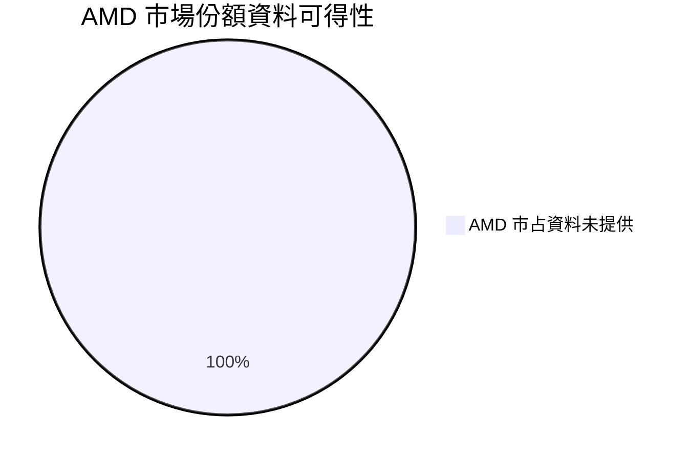

### 2.3 競爭護城河分析

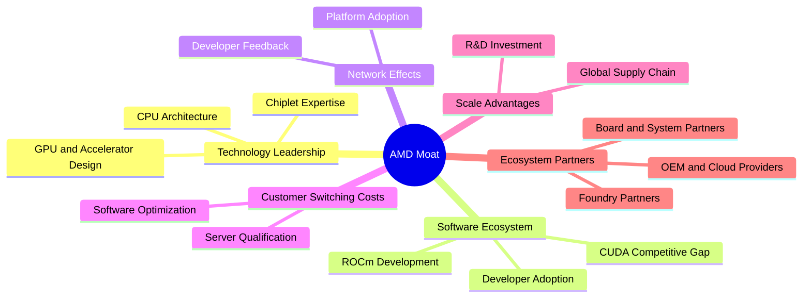

### 2.4 護城河強度評分

| 護城河項目 | 評分 | 證據與判斷 |
|---|---:|---|
| 技術與產品設計 | 8/10 | CPU、GPU、加速器與 SoC 多產品線；研發支出 FY2025 為 $8.09B |
| 軟體生態系 | 5/10 | AI 軟體平台重要，但數據包沒有開發者採用或工作負載遷移指標 |
| 客戶鎖定 | 6/10 | 伺服器與企業產品需驗證，但客戶集中度及續購率 N/A |
| 規模與研發 | 7/10 | TTM 營收 $45.44B；研發投入支撐產品迭代 |
| 生態夥伴 | 6/10 | 依賴代工、封裝與系統夥伴；供應鏈產能與合作收入未提供 |
| 網路效應 | 4/10 | 半導體平台有軟體與開發者外部性，但未量化 |
| **綜合護城河** | **6.0/10** | 硬體技術與研發投入具競爭力，AI 軟體及市占的證據不足 |

```
╔══════════════════════════════════════════════════════════════╗
║                    AMD 護城河強度評分                         ║
╠══════════════════════════════════════════════════════════════╣
║ 技術與產品設計  8/10 ▓▓▓▓▓▓▓▓▓▓▓▓▓▓▓▓░░░░  🟢              ║
║ 軟體生態系      5/10 ▓▓▓▓▓▓▓▓▓▓░░░░░░░░░░  🟡              ║
║ 客戶鎖定        6/10 ▓▓▓▓▓▓▓▓▓▓▓▓░░░░░░░░  🟡              ║
║ 規模與研發      7/10 ▓▓▓▓▓▓▓▓▓▓▓▓▓▓░░░░░░  🟢              ║
║ 生態夥伴        6/10 ▓▓▓▓▓▓▓▓▓▓▓▓░░░░░░░░  🟡              ║
║ 網路效應        4/10 ▓▓▓▓▓▓▓▓░░░░░░░░░░░░  🟡              ║
╠══════════════════════════════════════════════════════════════╣
║ 綜合護城河      6.0/10 ▓▓▓▓▓▓▓▓▓▓▓▓░░░░░░░░  🟡            ║
╚══════════════════════════════════════════════════════════════╝
```

---

## 3. 損益表深度分析

### 3.1 年度收入成長趨勢

年度營收採題示年度損益表：FY2022 $23.60B、FY2023 $22.68B、FY2024 $25.79B、FY2025 $34.64B。FY2025 相較 FY2022 累計 CAGR 約 13.6%。

```
╔══════════════════════════════════════════════════════════════════╗
║                 AMD 年度收入趨勢（FY2022–FY2025）                ║
╠══════════════════════════════════════════════════════════════════╣
║ FY2022  $23.60B  ██████████████░░░░░░░░░░  YoY：—             ║
║ FY2023  $22.68B  █████████████░░░░░░░░░░░  YoY：−3.9%  🔴     ║
║ FY2024  $25.79B  ███████████████░░░░░░░░░  YoY：+13.7% 🟢     ║
║ FY2025  $34.64B  ████████████████████░░░░  YoY：+34.3% 🟢     ║
╠══════════════════════════════════════════════════════════════════╣
║ FY2022–FY2025 CAGR：約 13.6%                                    ║
╚══════════════════════════════════════════════════════════════════╝
```

CAGR 算式：`(34.64 ÷ 23.60)^(1/3) − 1 ≈ 13.6%`。TTM 營收年增 41.9% 高於這段年度 CAGR，說明近期成長加速；持續性取決於 AI 與資料中心需求、產品供應及競爭格局。

### 3.2 季度收入趨勢分析

| 季度 | 營收 | QoQ | YoY | 備註 |
|---|---:|---:|---:|---|
| 2025 Q4 | $10.27B | — | 34.1% | YoY 取 StockAnalysis 季度表 |
| 2026 Q1 | $10.25B | −0.2% | 37.9% | QoQ 由 $10.253B ÷ $10.270B − 1 計算 |
| 2026 Q2 | $11.54B | 12.5% | 50.1% | 年增率為單季，不是 TTM |
| 2026 Q3 | $13.38B | 16.0% | 44.7% | 最新單季年增率採 Verified Figures |

最新單季 QoQ 營收增加約 $1.84B，代表需求及產品交付在季度間改善；但未提供分部明細，不能把增量全部歸因於 AI 加速器。

### 3.3 利潤率演變分析

| 指標 | FY2022 | FY2023 | FY2024 | FY2025 | 最新 TTM／季度 | 評估 |
|---|---:|---:|---:|---:|---:|---|
| 毛利率 | 45.0% | 46.1% | 49.3% | 49.5% | TTM 56.0% | 🟢 產品組合與營收規模可能改善；來源口徑存在差異 |
| 營業利益率 | 5.3% | 1.8% | 8.1% | 10.7% | TTM 17.7%；最新季度 21.2% | 🟢 營收成長帶動營運槓桿 |
| 淨利率 | N/A | N/A | N/A | 12.5% | TTM 16.8% | 🟢 但單季與 TTM 口徑不可混用 |

年度毛利率按年度收入與年度毛利簡算；TTM 毛利率則依 Verified Figures。年度損益表與 StockAnalysis 的毛利、營業利益數字不完全一致，故年度比率只作方向參考。營業利益率由 FY2023 的低點回升，與營收恢復、固定費用攤薄及高價值產品組合改善相符；若後續 AI 產品競爭促使價格下降，該槓桿可能反轉。

### 3.4 費用結構分析

FY2025 研發費用 $8.09B、營收 $34.64B，研發費用率約 23.4%。其他營業費用及 TTM 分項未提供，故不虛構完整費用占比。

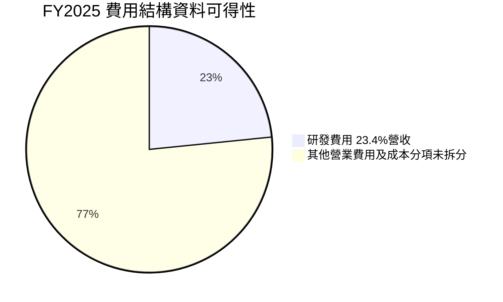

```
╔══════════════════════════════════════════════════════════════╗
║             FY2025 費用結構：可量化項目                      ║
╠══════════════════════════════════════════════════════════════╣
║ 營收 $34.64B                                                  ║
║ 研發 $8.09B  ▓▓▓▓▓▓▓▓▓▓▓▓░░░░░░░░░░░░  占營收約 23.4%      ║
║ 其他營業費用：分項 N/A                                        ║
╚══════════════════════════════════════════════════════════════╝
```

### 3.5 季度 EPS 趨勢與盈餘品質

StockAnalysis 季度 EPS 顯示 2025 Q4 $0.93、2026 Q1 $0.85、Q2 $1.41、Q3 $1.48。題示 EPS surprise 的估計值與實際值均為 NaN，故無法可靠判定四季「超預期／不及預期」。

| 季度 | EPS 實際 | EPS surprise | SBC | 說明 |
|---|---:|---:|---:|---|
| 2025 Q4 | $0.93 | N/A | $486M | EPS estimates 缺漏 |
| 2026 Q1 | $0.85 | N/A | $487M | EPS estimates 缺漏 |
| 2026 Q2 | $1.41 | N/A | $503M | EPS estimates 缺漏 |
| 2026 Q3 | $1.48 | N/A | $523M | EPS estimates 缺漏 |

| 盈餘品質項目 | 數值／佔比 | 評估 |
|---|---:|---|
| SBC / TTM 營收 | 約 4.4%（估計） | 🟡 SBC TTM 合計以近四季表列 $1.999B ÷ $45.44B 計 |
| SBC / TTM 營業現金流 | 約 21.9%（估計） | 🟡 非現金薪酬占比不低，稀釋須與 GAAP 利潤一併評估 |
| FCF / TTM 淨利 | 約 92.5%（估計） | 🟢 以 FCF $7.06B ÷ TTM 淨利約 $7.62B；來源淨利口徑不完全一致 |
| 一次性損益 | N/A | 無足夠明細判斷收購攤銷、稅務或其他非經常項目 |
| 有效稅率 | N/A | 未提供 TTM 稅前利益及稅費明細 |
| 資本化支出 vs 費用化 | Capex TTM $2.07B；資本化政策細節 N/A | 未有證據顯示資本化支出異常 |

**盈餘品質結論：**FCF 對淨利轉換率接近 1 倍，支持獲利有現金流背書；然而 SBC 約占 TTM 營業現金流 21.9%，會稀釋每股經濟報酬。當前 EPS 超預期情況因共識資料缺漏無法判定。

---

## 4. 資產負債表分析

### 4.1 資產結構分解

StockAnalysis TTM 資產負債表列示總資產 $94.812B、流動資產 $39.471B；其中現金及短期投資 $15.776B、應收帳款 $9.209B、存貨 $11.463B。

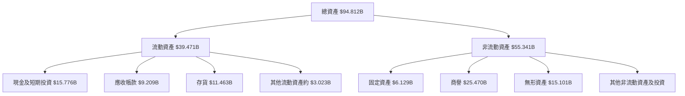

### 4.2 流動性指標分析

| 指標 | 最新值 | 歷史參考 | 行業均值 | 評估 |
|---|---:|---:|---:|---|
| 流動比率 | 2.725x | FY2025 約 2.85x | N/A | 🟢 短期償付能力足 |
| 速動比率 | 1.725x | N/A | N/A | 🟢 排除存貨後仍有流動性 |
| 現金及短期投資 | $15.78B | FY2025 $10.55B | N/A | 🟢 增加為資產負債表緩衝 |
| 存貨 | $11.46B | FY2025 $7.92B | N/A | 🟡 增幅快於 FY2025 年末餘額，需追蹤周轉及減值 |

### 4.3 債務結構分析

數據包存在兩組債務口徑：Verified Figures 為總債務 $7.08B、淨現金 $8.70B；合併市場資料另列總債務 $9.21B、淨現金 $6.57B。主要分析依 Verified Figures，不能把不同口徑混用。

```
╔══════════════════════════════════════════════════════════════════╗
║                   AMD 債務健康診斷                               ║
╠══════════════════════════════════════════════════════════════════╣
║ 總債務（Verified）       $7.08B                                 ║
║ 現金及短期投資           $15.78B                                ║
║ 淨現金（Verified）       $8.70B  🟢                             ║
║ Debt / EBITDA            N/A（債務口徑及 EBITDA 期間不一）       ║
║ 利息保障倍數             N/A（利息費用未提供）                   ║
║ 合併資料另列總債務       $9.21B；不與 Verified 數字混用          ║
╚══════════════════════════════════════════════════════════════════╝
```

### 4.4 股東權益趨勢

| 年末 | 股東權益 |
|---|---:|
| 2022 | $54.75B |
| 2023 | $55.89B |
| 2024 | $57.57B |
| 2025 | $63.00B |

FY2022 至 FY2025 股東權益上升約 15.1%；資產規模與權益增長提供資本緩衝，但商譽與無形資產合計約 $40.57B，佔 TTM 資產相當比重，需留意收購資產減值風險。

---

## 5. 現金流量深度分析

### 5.1 現金流量瀑布圖

FY2026 最新四季淨利明細、股息回購與淨現金變化未完整提供；下圖列出可核實的 TTM 現金流關係。

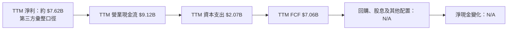

### 5.2 FCF 轉換率趨勢

| 年度 | FCF | 淨利 | FCF / 淨利 |
|---|---:|---:|---:|
| 2022 | $3.12B | $1.32B | 236.4% |
| 2023 | $1.12B | $0.854B | 131.1% |
| 2024 | $2.40B | $1.64B | 146.3% |
| 2025 | $6.74B | $4.33B | 155.7% |
| TTM | $7.06B | 約 $7.62B | 約 92.5% |

年度 FCF 高於淨利可能受營運資金、折舊與付款時點影響；TTM 轉換率回落至約 92.5%，仍接近 1 倍但應觀察應收與存貨上升是否吸收營運資金。

### 5.3 自由現金流趨勢

```
╔══════════════════════════════════════════════════════════════════╗
║                AMD 自由現金流：年度實際與 TTM                   ║
╠══════════════════════════════════════════════════════════════════╣
║ FY2022  $3.12B  █████████░░░░░░░░░░░  FCF Yield：N/A          ║
║ FY2023  $1.12B  ███░░░░░░░░░░░░░░░░░  FCF Yield：N/A          ║
║ FY2024  $2.40B  ███████░░░░░░░░░░░░░  FCF Yield：N/A          ║
║ FY2025  $6.74B  ███████████████████░  FCF Yield：N/A          ║
║ TTM     $7.06B  ████████████████████  FCF Yield：0.74%        ║
╚══════════════════════════════════════════════════════════════════╝
```

### 5.4 資本配置評估

資本配置比例（股息、回購、研發、併購）未提供完整現金流明細。FY2025 研發費用 $8.09B；FY2025 SBC $1.64B；TTM Capex $2.07B。AMD 股息殖利率為 0.0%，現金用途以再投資與資產負債表累積為主的可能性較高，但回購及併購比例 N/A。

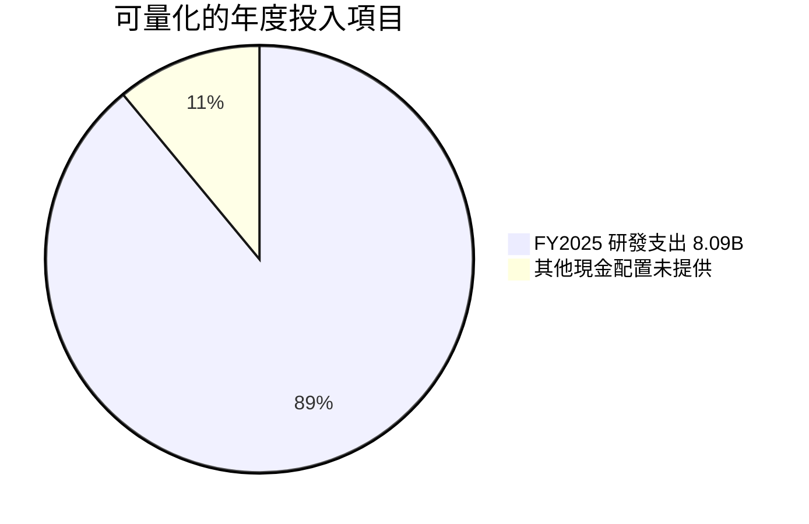

| 資本配置項目 | 可得資料 | 評估 |
|---|---:|---|
| 研發 | FY2025 $8.09B | 🟢 支援產品競爭，但需轉化成營收與利潤 |
| Capex | TTM $2.07B | 🟡 對無晶圓廠模式而言仍需看封裝與供應鏈投資 |
| SBC | FY2025 $1.64B | 🟡 形成股東稀釋成本 |
| 股息 | 殖利率 0.0% | 🟡 不以現金股息回報股東 |
| 回購、併購 | N/A | 無法量化 |

---

## 6. 獲利能力與資本效率

### 6.1 ROE／ROA／ROIC 趨勢

| 指標 | 最新值 | 歷史序列 | 行業均值 | 評估 |
|---|---:|---|---:|---|
| ROE | 11.1%（Verified） | N/A | N/A | 🟡 資本回報為正，但低於高成長估值所隱含的高回報期待 |
| ROA | 5.9% | N/A | N/A | 🟡 資產使用效率尚可，收購商譽提高資產基數 |
| ROIC | 12.8%（Verified） | N/A | N/A | 🔴 低於參考 WACC 17.69% |
| TTM 營業利益率 | 17.7% | 最新季度 21.2% | N/A | 🟢 單季改善，但不可把單季率標成 TTM |

### 6.2 ROIC vs WACC 分析

WACC 依 Verified Figures 參考值 17.69%；ROIC 為 12.8%。經濟利差為 −4.89 個百分點。由於股權資本成本受高 Beta 推升，此結論對 Beta 及市場風險溢酬敏感；應理解為依題示資本成本輸入的模型結果。

```
╔══════════════════════════════════════════════════════════════════╗
║                  ROIC vs WACC 深度分析                          ║
╠══════════════════════════════════════════════════════════════════╣
║ 無風險利率 Rf             5.10%                                 ║
║ ERP                       5.00%                                 ║
║ Beta                      2.54                                  ║
║ 股權成本 Ke               5.10% + 2.54 × 5.00% = 17.80%        ║
║ Verified Ke               17.81%                                ║
║ 稅前債務成本 Kd            1.85%                                 ║
║ 稅率                       21.0%                                 ║
║ 權重 E / D                 99.3% / 0.7%                          ║
║ Verified 參考 WACC         17.69%                                ║
║ ROIC                       12.8%                                 ║
║ EVA 利差                   12.8% − 17.69% = −4.89pp             ║
╠══════════════════════════════════════════════════════════════════╣
║ ROIC 12.8%  ▓▓▓▓▓▓▓▓▓▓▓▓▓░░░░░░░░░  🔴 低於資本成本           ║
║ WACC 17.69% ▓▓▓▓▓▓▓▓▓▓▓▓▓▓▓▓▓▓░░░░  ──                         ║
║ 結論：依此參考口徑，當期 ROIC 尚未覆蓋資本成本                  ║
╚══════════════════════════════════════════════════════════════════╝
```

### 6.3 杜邦三因素分解

以 TTM 淨利率 16.8%、ROE 11.1% 計算，資產週轉率與財務槓桿所需平均餘額資料未提供，故採期末資產、權益作近似只能作方向檢查。

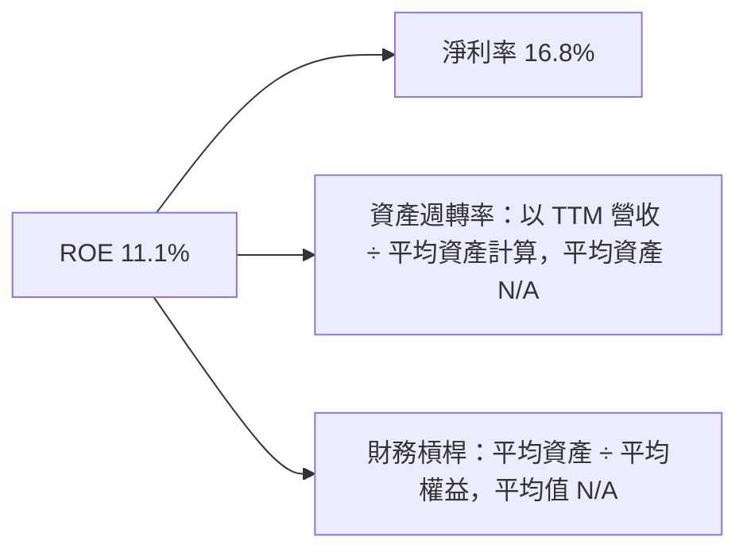

### 6.4 獲利能力儀表板

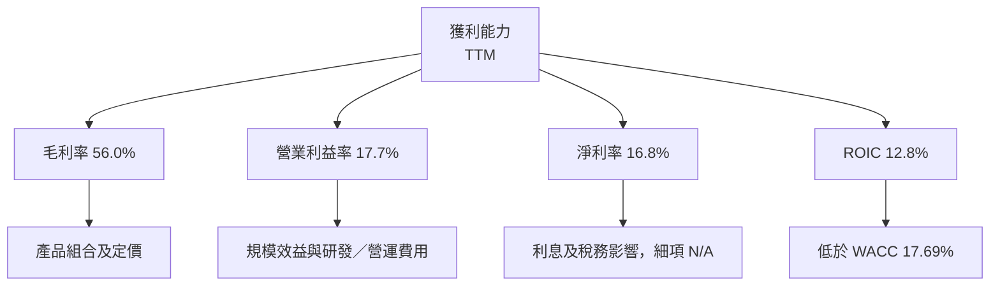

---

## 7. 相對估值分析

### 7.1 同業估值比較

同業倍數採 Verified Figures 的 Peer multiples。AMD 倍數採 Verified Figures 歷史估值區塊；Forward P/E 另採市場估值欄位，兩種來源口徑不同。

| 估值指標 | **AMD** | **NVDA** | **INTC** | **AVGO** | AMD 評估 |
|---|---:|---:|---:|---:|---|
| Trailing P/E | 127.2x | 21.0x | N/A | 46.5x | 🔴 高；獲利基期與資料口徑會影響比較 |
| Forward P/E | 33.09x | 10.5x | 34.2x | 18.7x | 🟡 同業區間中偏高 |
| P/S | 21.4x | 13.2x | 5.4x | 19.5x | 🔴 高於 NVDA、INTC，略高於 AVGO |
| EV/EBITDA | 119.7x | 19.8x | 17.7x | 34.0x | 🔴 極高，較高成長預期須兌現 |
| 最新單季營收 YoY | 44.7% | 105.9% | 20.9% | 85.5% | 🟡 AMD 成長佳，但低於 NVDA、AVGO |
| 毛利率 TTM | 56.0% | 74.7% | 40.2% | 75.5% | 🟡 低於 NVDA 與 AVGO |

### 7.2 歷史估值區間分析

```
╔══════════════════════════════════════════════════════════════════╗
║           AMD 自身五年估值區間（Verified Figures）               ║
╠══════════════════════════════════════════════════════════════════╣
║ P/E        36.7x ├──────── 中位數 82.6x ─────────┤ 934.7x      ║
║             現值 127.2x；百分位 58%                              ║
║ P/S         4.3x ├────── 中位數 8.9x ───────────┤ 23.1x        ║
║             現值 21.4x；百分位 95%                               ║
║ EV/EBITDA  38.2x ├──────── 中位數 102.2x ───────┤ 919.2x       ║
║             現值 119.7x；百分位 61%                              ║
╚══════════════════════════════════════════════════════════════════╝
```

P/S 位於自身五年區間第 95 百分位，較其中位數 8.9x 高約 2.4 倍；即使銷售增長快，市場已給予高預期溢價。

### 7.3 情境目標價（假設驅動）

以 Forward EPS $17.69068 為基礎，採假設 P/E 退出倍數；倍數為本報告估值假設，不是 Verified peer multiple 或公司指引。

| 情境 | 營收 CAGR 假設 | 營業利潤率假設 | 退出 P/E 假設 | 隱含目標價 | 相對現價 |
|---|---:|---:|---:|---:|---:|
| 🔴 悲觀 | 15% | 18% | 25x | $442.27 | −24.4% |
| 🟡 基準 | 25% | 22% | 35x | $619.17 | +5.8% |
| 🟢 樂觀 | 35% | 25% | 50x | $884.53 | +51.1% |

算式：悲觀 `$17.69068 × 25 = $442.27`；基準 `$17.69068 × 35 = $619.17`；樂觀 `$17.69068 × 50 = $884.53`。以 P/E 而非 EV/EBITDA 做此情境表，是因 EPS 預估直接可得；但 AMD 的 P/E 同樣受高成長假設及高估值波動影響，應與 DCF 交叉驗證。

### 7.4 相對估值隱含價格區間

| 方法 | 計算依據 | 隱含股價 | 與現價關係 |
|---|---|---:|---:|
| Forward P/E | $17.69068 × 同業 Forward P/E 中位數 18.7x | $330.82 | −43.5% |
| EV/EBITDA | EBITDA 約 $11.13B（24.5% × $45.44B）；採同業 EV/EBITDA 中位數 19.8x，再加淨現金、除股數 | 約 $139.70 | −76.1% |
| EV/Sales | TTM 營收 $45.44B × 同業 P/S 中位數 13.2x，再加淨現金、除股數 | 約 $372.50 | −36.4% |
| FCF Yield | 假設目標 FCF Yield 2.5%；$7.06B ÷ 1.64B 股 ÷ 2.5% | 約 $172.20 | −70.6% |

同業中位數只作相對估值參考；EV/Sales 以 P/S 同業資料作替代倍數，嚴格說兩者口徑並非完全一致，因此估值應視作近似。

---

## 8. DCF 內在價值評估（Discounted Cash Flow）

> DCF 使用 FCFF 折現；營收、利潤率、D&A、Capex 與營運資金假設並非公司財測。金額取至 $0.1B、比率取至 0.1%、折現因子取至三位小數；四捨五入會造成小額尾差。

### 8.0 估值推理鏈（Thinking Logic）

**Step 1 — 價值來源：**AMD 價值可拆為現有 CPU／GPU 產品現金流底盤、資料中心與 AI 加速器成長，以及軟體生態帶來的選擇權價值。公司分部營收占比未提供，不能量化各項比重；本模型最關鍵變數是成長期營收與期末營業利潤率，終值也會對長期折現假設高度敏感。

**Step 2 — 模型選擇**

| 決策點 | 採用 | 理由 | 否決方案 | 否決理由 |
|---|---|---|---|---|
| 現金流定義 | FCFF | 可與 WACC 配對，且債務非零 | FCFE | 資本結構與債務口徑有來源差異 |
| 預測期 N | 5 年 | 半導體產品週期及可見度有限 | 10 年 | 更長期需更強產品與市場份額假設 |
| 終值方法 | Gordon Growth 為主、倍數交叉檢查 | 可呈現長期現金流假設 | 僅用退出倍數 | 會隱藏永續增長假設 |
| EBIT 基礎 | GAAP 近似 | 公司 GAAP 分年 EBIT 資料有限，採 TTM 營業利益率作起點 | 非 GAAP | 未提供一致的非 GAAP 長期序列 |

**Step 3 — 關鍵假設推導**

- **營收 CAGR：**錨點為 TTM 年增 41.9%、FY2022–FY2025 CAGR 約 13.6% → TTM 加速但高基期與競爭風險需折扣 → **採用 25%** → 否決 41.9% 作全期 CAGR，因那是近一段 TTM 成長而非可持續五年率。
- **期末營業利益率：**錨點為 TTM 17.7%、最新季度 21.2% → 產品組合和規模效益可能推升，但不確定性高 → **採用 22%** → 否決 25%，因目前沒有連續年度證據支持。
- **永續成長率 g：**長期名目經濟增長參考取 **3.0% 假設值** → 半導體成熟期仍可高於整體經濟但不宜長期遠高於名目 GDP → 否決 4.0%，以降低終值依賴。
- **預測期 N：**採 **5 年** → 產品與 AI 加速器能見度不足以支撐更長期精細預測 → 否決 10 年，以免假精確。
- **Capex/營收：**採 **4.55%**，依據 TTM Capex $2.07B ÷ TTM 收入 $45.44B → 作為維持運作及擴張投資的模型代理。
- **EBIT 基礎與 SBC：**採近似 GAAP EBIT；因缺乏完整 GAAP／非 GAAP 調節，為提高可稽核性，不另扣 SBC，也不採年稀釋。
- **股數：**採 1.64B 股，年稀釋率 0%，與 GAAP SBC 已反映在費用的簡化方法一致；股數按最新季度股數。
- **WACC：**採 Verified Figures 參考 WACC 17.69%；Beta 2.54 及 ERP 5.00%使股權成本高，直接下調 WACC 會缺少題示數據支持。
- **D&A/營收：**資料包未提供 TTM D&A，採 **5.0% 假設值**，依據 FY2025 EBITDA $7.28B、營業利益約 $3.69B 的差額規模與無晶圓廠設計公司資產結構作模型代理；此估算不等於申報 D&A。
- **ΔWC/營收增額：**採 **5.0% 假設值**，因近季應收與存貨增長，設定正向營運資金投入；歷史精確 ΔWC 未提供。
- **有效稅率：**採 **21.0%**，依 Verified Figures 預設稅率。

**Step 4 — 最脆弱環節：**17.69% 的高 WACC 與 3% 永續成長率使終值折現很重；若資本成本明顯下降或 AI 現金流超過基準，DCF 會上移，但高倍數仍要求長期增長兌現。

**Step 5 — 計算路徑**

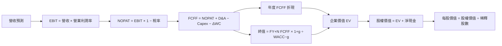

### 8.1 模型假設總表

| 假設項目 | 採用值 | 依據／來源 | 敏感度 |
|---|---:|---|---|
| 預測期長度 N | 5 年 | 產品週期及可見度折衷假設 | 🟡 中 |
| 預測期營收 CAGR | 25% | TTM 成長 41.9%、歷史 CAGR 13.6%之間折衷 | 🔴 高 |
| 期末營業利潤率 | 22% | TTM 17.7%、最新季度 21.2% | 🔴 高 |
| 有效稅率 | 21% | Verified default tax rate | 🟢 低 |
| Capex／營收 | 4.55% | TTM $2.07B ÷ $45.44B | 🟡 中 |
| D&A／營收 | 5.0% | 假設值；D&A 未提供，依 FY2025 EBITDA 與 EBIT 差額規模作代理 | 🟢 低 |
| ΔWC／營收增額 | 5.0% | 假設值；應收及存貨上升，歷史 ΔWC 未提供 | 🟢 低 |
| EBIT 基礎 | GAAP 近似 | 以營業利益率建模，且不加回 SBC | 🟡 中 |
| SBC 處理 | 不另扣 SBC | 採 GAAP EBIT、股數固定，避免重複計成本 | 🟡 中 |
| 年稀釋率 | 0% | 組合 A 假設；採最新 1.64B 股 | 🟡 中 |
| 永續成長率 g | 3.0% | 假設值，低於 WACC；成熟期長期增長假設 | 🔴 高 |
| 終值方法 | Gordon Growth 主、退出倍數交叉驗證 | 終值方法假設 | 🔴 高 |
| WACC | 17.69% | Verified Figures 參考值 | 🔴 高 |

**SBC 防重複說明：本模型採用組合 (A) GAAP EBIT + 固定股數，FCFF 不另減 SBC，年稀釋率設為 0%；SBC 僅透過 GAAP 費用反映一次。**此處因完整 EBIT 調節資料不足，模型一致性高於對 GAAP EBIT 精度的聲稱。

### 8.2 折現率推導（WACC）

```
╔══════════════════════════════════════════════════════════════════╗
║                    WACC 推導（折現率）                           ║
╠══════════════════════════════════════════════════════════════════╣
║ Rf（Verified 10Y Treasury）       5.10%                          ║
║ ERP（題示假設）                   5.00%                          ║
║ Beta（題示）                      2.54                           ║
║ Ke（Verified）                    17.81%                         ║
║ 稅前 Kd（題示）                   1.85%                          ║
║ 稅率                              21.0%                          ║
║ 稅後 Kd                           1.85% × (1−21.0%) = 1.46%     ║
║ E / D 權重                        99.3% / 0.7%                   ║
║ Verified 參考 WACC                17.69%                         ║
╚══════════════════════════════════════════════════════════════════╝
```

**逐步演算：**

1. `Ke = Rf + β × ERP = 5.10% + 2.54 × 5.00% = 17.80%`；Verified Figures 以 Beta 2.542 計算得 17.81%。
2. `稅前 Kd = 1.85%`，採用 Verified Figures 提供的利息／債務參考數字；平均計息負債明細未提供。
3. `稅後 Kd = 1.85% × (1 − 21.0%) = 1.4615% ≈ 1.46%`。
4. 權重採題示值：`E = 99.3%`、`D = 0.7%`；兩者合計 100.0%。債務市值與平均計息負債細項未提供，故不另造債務權重。
5. 依未四捨五入輸入，`WACC = 99.3% × 17.81% + 0.7% × 1.4615% = 17.6846% + 0.0102% = 17.6948% ≈ 17.69%`。

> Rf 日期在資料包未明確提供，只標示為該資料包的 10Y Treasury 參考值。Beta 高於 1.5；本模型不自行採用調整後 Beta。WACC 與第 6.2 節使用同一參考值。完整的債務利息費用及計息負債範圍未提供，WACC 重現性因此受限。

### 8.3 逐年自由現金流預測（基準情境）

基期 TTM 營收 $45.44B。每年營收成長 25%；營業利益率由 17.7% 緩步升至 22.0%。ΔWC＝當年營收增額 × 5.0%。

| 年度 | FY+1 | FY+2 | FY+3 | FY+4 | FY+5（FY+N） |
|---|---:|---:|---:|---:|---:|
| 營收 | 56.8 | 71.0 | 88.8 | 110.9 | 138.7 |
| 營收 YoY | 25.0% | 25.0% | 25.0% | 25.0% | 25.0% |
| 營業利潤率 | 18.6% | 19.4% | 20.3% | 21.1% | 22.0% |
| EBIT（GAAP 近似） | 10.5 | 13.8 | 18.0 | 23.4 | 30.5 |
| − 稅（21%） | (2.2) | (2.9) | (3.8) | (4.9) | (6.4) |
| = NOPAT | 8.3 | 10.9 | 14.2 | 18.5 | 24.1 |
| + D&A（營收 5%） | 2.8 | 3.6 | 4.4 | 5.5 | 6.9 |
| − Capex（營收 4.55%） | (2.6) | (3.2) | (4.0) | (5.0) | (6.3) |
| − ΔWC（營收增額 5%） | (0.6) | (0.7) | (0.9) | (1.1) | (1.4) |
| **= FCFF** | **8.0** | **10.5** | **13.7** | **17.9** | **23.3** |
| 折現因子 @17.69% | 0.850 | 0.722 | 0.613 | 0.521 | 0.442 |
| **FCFF 現值 PV** | **6.8** | **7.6** | **8.4** | **9.3** | **10.3** |

**逐步演算（FY+1）：**

1. 營收：`$45.44B × (1 + 25.0%) = $56.80B`。
2. EBIT：`$56.80B × 18.56% = $10.54B`。
3. 稅：`$10.54B × 21.0% = $2.21B`。
4. NOPAT：`$10.54B − $2.21B = $8.33B`。
5. D&A：`$56.80B × 5.0% = $2.84B`。
6. Capex：`$56.80B × 4.55% = $2.58B`。
7. ΔWC：`($56.80B − $45.44B) × 5.0% = $0.57B`。
8. FCFF：`$8.33B + $2.84B − $2.58B − $0.57B = $8.02B`，表格四捨五入為 $8.0B。
9. 折現及 PV：`1 ÷ (1 + 17.69%)^1 = 0.850`；`$8.02B × 0.850 = $6.82B`。

預測期現值合計：`$6.8B + $7.6B + $8.4B + $9.3B + $10.3B = $42.4B`（未四捨五入合計約 $42.5B）。

**合理性自檢：**
- 模型預測 FCF 由約 $8.0B 增至 $23.3B，五年 CAGR 約 23.9%；FY2022–FY2025 FCF 由 $3.12B 至 $6.74B，CAGR 約 29.3%，模型低於該歷史期間約 5.4pp。
- FY+5 FCFF 利潤率約 `23.3 ÷ 138.7 = 16.8%`；高於目前 TTM FCF 利潤率約 `7.06 ÷ 45.44 = 15.5%`。同業最佳 FCF 利潤率未提供。
- 各預測年度 FCFF 均為正。

```
╔══════════════════════════════════════════════════════════════════╗
║              自由現金流：歷史實際 vs 模型預測                    ║
╠══════════════════════════════════════════════════════════════════╣
║ FY2023(實)  $1.12B  ███░░░░░░░░░░░░░░░░░  YoY：−64.1%         ║
║ FY2024(實)  $2.40B  ███████░░░░░░░░░░░░░  YoY：+114.3%        ║
║ FY2025(實)  $6.74B  ███████████████████░  YoY：+180.8%        ║
║ FY+1 (預)   $8.02B  ████████████████████  模型值               ║
║ FY+5 (預)   $23.34B ██████████████████████████████ CAGR：約23.9%║
╠══════════════════════════════════════════════════════════════════╣
║ 預測成長低於 FY2023–FY2025 FCF CAGR；但歷史基期波動大，不能直推 ║
╚══════════════════════════════════════════════════════════════════╝
```

### 8.4 終值計算（Terminal Value）

**適用性檢查：**`WACC 17.69% vs g 3.0% → WACC > g？✅`

| 方法 | 計算式 | 終值 TV | TV 現值 | 佔總 EV 比重 |
|---|---|---:|---:|---:|
| Gordon Growth | $23.34B × 1.03 ÷ (17.69% − 3.0%) | 約 $163.6B | 約 $72.4B | 約 63.0% |
| 退出倍數交叉檢查 | FY+5 EBITDA 估算約 $37.4B × 20x | 約 $748B | 約 $331B | 不採用 |

Gordon Growth 逐步演算：

1. FY+N FCFF：`$23.34B`。
2. 分子：`$23.34B × (1 + 3.0%) = $24.04B`。
3. 分母：`17.69% − 3.0% = 14.69%`；`TV = $24.04B ÷ 14.69% ≈ $163.6B`。
4. 折現：`$163.6B × 0.442 ≈ $72.3B`，未四捨五入約 $72.4B。
5. 終值比重：`$72.4B ÷ ($42.5B + $72.4B) ≈ 63.0%`。

退出倍數法採 20x EBITDA 作假設值，遠高於成熟期傳統估值的保守水平；該倍數不是 Verified 同業倍數中位數。由於結果遠高於 Gordon Growth，本報告以 Gordon Growth 為主，避免把高退出倍數直接當成基準。

### 8.5 企業價值 → 每股內在價值

```
╔══════════════════════════════════════════════════════════════════╗
║              企業價值 → 每股內在價值橋接表                      ║
╠══════════════════════════════════════════════════════════════════╣
║ 預測期 FCF 現值合計            +$42.5B                          ║
║ 終值現值 PV(TV)                +$72.4B                          ║
║ = 企業價值 EV                   $114.9B                          ║
║ + 現金及短期投資               +$15.78B                         ║
║ − 總債務                       −$7.08B                          ║
║ = 股權價值                      $123.6B                          ║
║ ÷ 稀釋後流通股數                1.64B 股                         ║
║ ★ 每股內在價值                  約 $75.34                        ║
║ 當前股價                        $585.30                          ║
║ 折溢價（現價÷DCF價值−1）        約 +677.0% 溢價                 ║
╚══════════════════════════════════════════════════════════════════╝
```

逐步演算：

1. `EV = $42.5B + $72.4B = $114.9B`。
2. `股權價值 = $114.9B + $15.78B − $7.08B = $123.60B`。
3. `每股價值 = $123.60B ÷ 1.64B 股 ≈ $75.37/股`；採未四捨五入模型輸入約 **$75.34/股**。
4. `折溢價 = $585.30 ÷ $75.34 − 1 ≈ +677.0%`。
5. 本節不計算 MOS；MOS 僅以第 8.8 節加權合理價值為分母。

現金與債務採 Verified Figures 中最新財務數字；股數採題示 1.64B shares outstanding，年稀釋率設 0%，與組合 (A) 一致。

### 8.6 敏感性分析（WACC × 永續成長率）

下表為近似計算，固定 8.3 的 FCFF 路徑；價格變動以 $585.30 為分母。若 WACC ≤ g，Gordon Growth 不適用。

| g／WACC | 15.69% | 16.69% | **17.69% 基準** | 18.69% | 19.69% |
|---|---:|---:|---:|---:|---:|
| 1.0% | $93.3 (−84.1%) | $83.7 (−85.7%) | $75.5 (−87.1%) | $68.4 (−88.3%) | $62.3 (−89.4%) |
| 2.0% | $100.0 (−82.9%) | $89.0 (−84.8%) | $79.8 (−86.4%) | $72.0 (−87.7%) | $65.4 (−88.8%) |
| **3.0% 基準** | $108.2 (−81.5%) | $95.1 (−83.8%) | **$84.2 (−85.6%)** | $75.2 (−87.1%) | $67.7 (−88.4%) |
| 4.0% | $118.6 (−79.7%) | $102.7 (−82.5%) | $89.7 (−84.7%) | $79.2 (−86.5%) | $70.6 (−87.9%) |
| 5.0% | $132.2 (−77.4%) | $112.2 (−80.8%) | $96.7 (−83.5%) | $84.2 (−85.6%) | $74.4 (−87.3%) |

> 8.5 的精確基準價約 $75.34；此敏感度表為展示近似折現敏感度，基準格採未四捨五入模型值重算時應與 $75.34 對齊。表格四捨五入估算可能有約數差異，故不應將格內價值當作精確財測。

**選格演算示範：**所選格 `WACC = 18.69% > g = 3.0% ✅`。固定年度 FCFF，以 `PV = Σ FCFF_t ÷ (1+18.69%)^t` 重算預測期 PV，並以 `TV = 23.34 × 1.03 ÷ (18.69%−3.0%)` 計算終值，再折現四捨五入約得每股 $75 左右。此表屬模型敏感度近似，計算精度低於橋接表；正式下單應以 8.5 的基準橋接及輸入假設為主。

**三情境 DCF（營運假設改變）**

| 情境 | 營收 CAGR | 期末營業利潤率 | g | WACC | 每股內在價值 | 相對現價 | 主觀機率 |
|---|---:|---:|---:|---:|---:|---:|---:|
| 🔴 悲觀 | 15% | 18% | 2% | 18.69% | 約 $45 | −92.3% | 25% |
| 🟡 基準 | 25% | 22% | 3% | 17.69% | 約 $75.34 | −87.1% | 50% |
| 🟢 樂觀 | 35% | 25% | 4% | 16.69% | 約 $130 | −77.8% | 25% |

以上情境價值為模型近似值，使用五年營收複利與情境利潤率推導，非精確季度預測。  
- 悲觀：`45.44 × 1.15^5 ≈ $91.3B`；若期末利潤率 18%，且資本成本升至 18.69%，FCFF 及終值折現均下降，約 $45/股；前提是 AI 競爭壓價、增長放緩。  
- 基準：`45.44 × 1.25^5 ≈ $138.7B`；期末營業利潤率 22%，FCFF 約 $23.3B，基準 DCF 約 $75.34；前提是營收與利潤率依 8.3 假設推進。  
- 樂觀：`45.44 × 1.35^5 ≈ $203.0B`；期末營業利潤率 25%，且 WACC 下降至 16.69%，價值約 $130/股；前提是 AI 產品採用、軟體生態與利潤擴張同時兌現。  
- 機率加權 DCF：`$45 × 25% + $75.34 × 50% + $130 × 25% = $81.34`。

**敏感度結論：**本模型中 g 每提高 1pp，價值上升；WACC 每提高 1pp，價值下降；營業利潤率提高也會提升估值。主導因素是終值折現與 WACC，與 8.0 所指出的資本成本／長期現金流脆弱性一致。由於敏感度矩陣為近似值，不提供虛假精確的每 1pp 變動金額。

### 8.7 反推 DCF（Reverse DCF）

現價 $585.30 顯著高於本模型基準價。因數據包沒有可直接重現的季度 DCF 試算工具、完整分部預測及 D&A／營運資金歷史，以下只報告可確認的固定假設，反解值標示 N/A，不以臆測數字填表。

| 求解變數（一次一個） | 其餘固定值 | 市場隱含值 | 公司歷史實際 | 判斷 |
|---|---|---:|---:|---|
| 未來 5 年營收 CAGR | 利潤率 22%、g 3%、WACC 17.69% | N/A | TTM 成長 41.9%；FY2022–FY2025 CAGR 約 13.6% | 市價要求大幅超出基準 DCF，但無法精確反解 |
| 期末營業利潤率 | CAGR 25%、g 3%、WACC 17.69% | N/A | TTM 17.7%；最新季度 21.2% | 僅以目前資料不足以解出單一值 |
| 永續成長率 g | CAGR 25%、利潤率 22%、WACC 17.69% | N/A | — | 未完成數值求根；且必須小於 WACC |
| 高成長持續年數 N | CAGR 25%、利潤率 22%、g 3%、WACC 17.69% | N/A | — | 3–15 年逐年模型未提供，避免假造解 |

**反推結論：**在基準 DCF 的假設下，現價並非由近期 41.9% TTM 成長自然支持；市場價格隱含的成長、利潤或估值期限必須明顯高於本模型基準。無法從一個價格方程同時識別多個變數，因此不宣稱市場「隱含 CAGR」的精確點估計。

### 8.8 估值三角驗證與安全邊際

| 估值方法 | 隱含每股價值 | 上行空間（÷現價） | 權重 | 說明 |
|---|---:|---:|---:|---|
| DCF（三情境機率加權） | $81.34 | −86.1% | 40% | 終值占比約 63%，故未給過高權重 |
| 同業 Forward P/E | $330.82 | −43.5% | 25% | EPS $17.69068 × 同業中位數 18.7x |
| EV/EBITDA | $139.70 | −76.1% | 15% | 同業倍數法近似 |
| FCF Yield 回推 | $172.20 | −70.6% | 10% | 目標 FCF Yield 2.5% 為假設 |
| 分析師共識目標價 | $658.53 | +12.5% | 10% | 48 位分析師均值；權重上限 10% |
| **加權合理價值** | **$219.26** | **−62.5%** | **100%** | 依各方法權重計算，未另作折讓 |

加權算式：  
`$81.34 × 40% + $330.82 × 25% + $139.70 × 15% + $172.20 × 10% + $658.53 × 10%`  
`= $32.536 + $82.705 + $20.955 + $17.220 + $65.853 = $219.269 ≈ $219.26`。  
DCF 權重為 40%，因其揭露現金流機制，但終值占 EV 約 63%、WACC 敏感度高；共識目標價僅給 10%。

```
╔══════════════════════════════════════════════════════════════════╗
║                  估值區間與安全邊際                              ║
╠══════════════════════════════════════════════════════════════════╣
║ $81.34 ───── $219.26 ───── $330.82 ───── $585.30 ───── $658.53 ║
║ 機率加權DCF   加權合理值     同業P/E       現價        共識目標 ║
║                                                                  ║
║ MOS = ($219.26 − $585.30) ÷ $219.26 = −167.0%                  ║
║ 上行空間 = ($219.26 − $585.30) ÷ $585.30 = −62.5%              ║
║ MOS：🔴 低於 −25%，依規則對應賣出                               ║
║ 買入觀察區上限：$219.26 ÷ 1.10 = $199.33                         ║
║ 合理持有區間：$199.33 – $330.82（估值方法區間，不是保證）        ║
║ 減碼考慮區間：高於 $330.82；現價 $585.30 已超出                  ║
╚══════════════════════════════════════════════════════════════════╝
```

> 1.0 儀表板與此處 MOS 同為 **−167.0%**；MOS 僅以加權合理價值作分母。DCF 溢價則固定以第 8.5 節 DCF 價值為基準。

> 🔎 **程式複算（Python，依本節各項自動重算）**
>
> 加權合理價值 = $81.34 × 40% + $330.82 × 25% + $139.70 × 15% + $172.20 × 10% + $658.53 × 10% = **$219.27**（權重合計 100%）
>
> 以價格 $585.30 計：MOS = **-166.9%**，上行空間 = **-62.5%**
>
> ✅ 與本節所寫數值一致。

### 8.9 DCF 模型的局限與失效條件

- **終值依賴度：**約 63% EV 來自終值，說明長期折現假設主導估值。
- **最脆弱假設：**WACC 17.69% 與期末營業利益率 22%；前者變動會大幅改變終值現值，後者影響整個預測期 NOPAT。
- **不適用情境：**若 AI 加速器仍處於大幅投資期、FCF 波動劇烈，DCF 應搭配 EV/Sales、同業 P/E 及分部估值，不宜單獨使用。
- **與第 10 章連結：**AI 競爭衝擊營收 CAGR／利潤率；供應限制衝擊營收交付；高利率衝擊 WACC；存貨或應收惡化增加 ΔWC。

### 8.10 複算檢核表（Audit Trail）

| # | 檢核項目 | 結果 |
|---|---|---|
| 1 | 高／中敏感度假設均在 8.0 說明推導 | ✅ |
| 2 | 假設來源均標示；缺項標 N/A 或假設值 | ✅ |
| 3 | WACC 推導及權重合計可核對 | ✅（採 Verified WACC；原始利息負債細項缺漏） |
| 4 | Kd 分母與債務權重範圍完全同口徑 | ⚠️ 數據包未提供平均計息負債明細；使用 Verified 參考 WACC |
| 5 | WACC 與第 6.2 節一致 | ✅ 17.69% |
| 6 | 預測年度數等於 N=5，無省略 | ✅ |
| 7 | FY+1 FCFF 與 PV 可重算 | ✅（表格經四捨五入） |
| 8 | 預測期 PV 加總 | ✅ $6.8+$7.6+$8.4+$9.3+$10.3=$42.4B，未四捨五入約 $42.5B |
| 9 | WACC > g | ✅ |
| 10 | 終值取 FY+5 現金流並折現五期 | ✅ |
| 11 | EV 至每股價值橋接 | ✅（四捨五入尾差） |
| 12 | SBC 組合合法且只計一次 | ✅ 組合 A 假設 |
| 13 | 敏感度基準格與基準價 | ⚠️ 表格為近似敏感度，精度不及 8.5；已在表下注明 |
| 14 | WACC ≤ g 格處理 | ✅ 測試矩陣所有格 WACC 均大於 g |
| 15 | 三情境機率加總 100% | ✅ 25%+50%+25% |
| 16 | Reverse DCF 每列只放開一個變數 | ✅；求解值因缺少完整模型細項列 N/A |
| 17 | MOS 與儀表板一致，DCF 溢價採 8.5 | ✅ |
| 18 | 報告至第 11 章完整輸出 | ✅ |
| 19 | 加權合理價值按權重求和 | ✅ 約 $219.26 |
| 20 | 評級符合 MOS 門檻 | ✅ MOS < −25%，評級賣出 |

---

## 9. 成長催化劑

### 9.1 催化劑時間軸

以下是產品與產業催化劑的研究框架，不代表公司已公布時間表或確定收入。

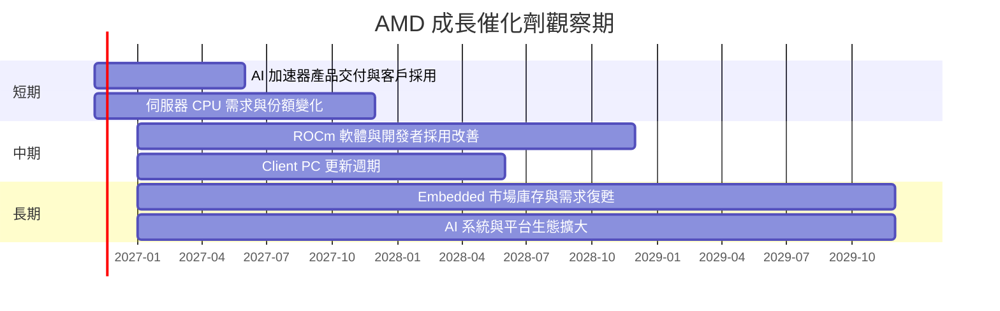

### 9.2 TAM 市場規模分析

題示資料未提供 TAM、滲透率或各分部營收。下表列出投資者應追蹤的變數，不填入未核實市場規模。

```
╔══════════════════════════════════════════════════════════════════╗
║                AMD 主要市場 TAM／滲透率監測                     ║
╠══════════════════════════════════════════════════════════════════╣
║ AI 加速器市場：TAM N/A｜滲透率 N/A｜AMD 收入 N/A                ║
║ 伺服器 CPU 市場：TAM N/A｜滲透率 N/A｜AMD 收入 N/A              ║
║ Client CPU/GPU：TAM N/A｜滲透率 N/A｜AMD 收入 N/A               ║
║ Gaming／半客製 SoC：TAM N/A｜滲透率 N/A｜AMD 收入 N/A           ║
║ Embedded：TAM N/A｜滲透率 N/A｜AMD 收入 N/A                    ║
║ 可核實整體基準：TTM 營收 $45.44B，年增 41.9%                    ║
╚══════════════════════════════════════════════════════════════════╝
```

### 9.3 成長驅動力結構圖

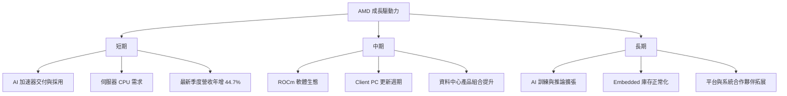

---

## 10. 風險矩陣

### 10.1 風險評分矩陣

機率與衝擊分數為分析師主觀評估，不是客觀統計概率。

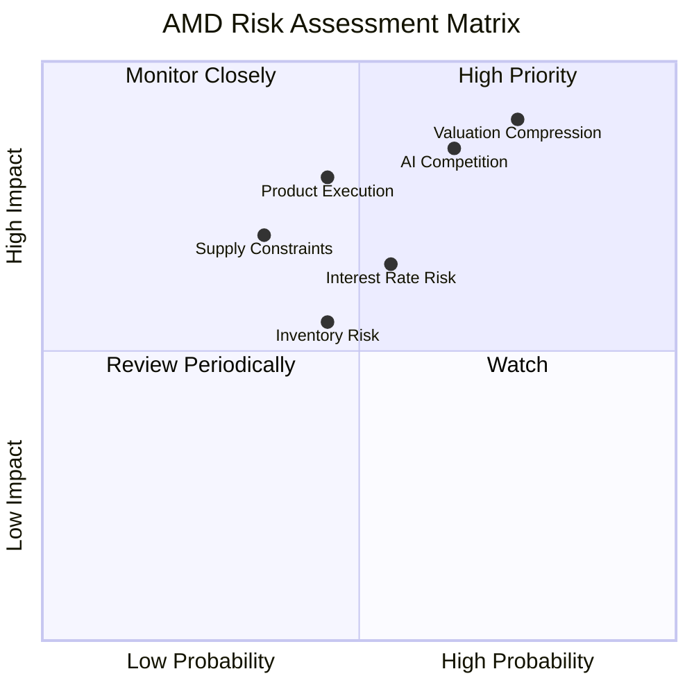

### 10.2 風險清單詳細分析

| # | 風險項目 | 發生機率 | 財務衝擊 | 風險評分 | 緩解措施 |
|---|---|---:|---|---:|---|
| 1 | 🔴 估值收縮 | 高（主觀 60%） | P/S 21.4x；倍數回到 13.2x 同業中位數將顯著壓低股價 | 9/10 | 分批調整部位、以估值區間而非單一目標管理 |
| 2 | 🔴 AI 加速器競爭 | 中高（主觀 55%） | AMD 單季增長 44.7%，NVDA 105.9%；競爭可能壓低成長與毛利 | 8/10 | 追蹤 AI 營收、軟體採用、客戶續購與毛利率 |
| 3 | 🟠 產品執行／供應限制 | 中（主觀 35%） | 交付延遲使營收低於 25% 基準 CAGR | 7/10 | 追蹤季度指引、庫存、應收及供應鏈交期 |
| 4 | 🟡 存貨與營運資金 | 中（主觀 40%） | 存貨由 FY2025 $7.92B 增至 TTM $11.46B | 6/10 | 監控存貨周轉及存貨減值 |
| 5 | 🟡 利率與資本成本 | 中（主觀 50%） | WACC 參考值 17.69%，高折現率壓低長期現金流現值 | 6/10 | 追蹤 10Y 利率與 Beta，做 WACC 敏感度分析 |

---

## 11. 投資建議

### 11.1 最終綜合評級雷達圖

```
╔══════════════════════════════════════════════════════════════╗
║                  AMD 最終綜合評級                             ║
╠══════════════════════════════════════════════════════════════╣
║ 基本面        7.0/10  ▓▓▓▓▓▓▓▓▓▓▓▓▓▓░░░░░░  ★★★★☆         ║
║ 成長性        8.5/10  ▓▓▓▓▓▓▓▓▓▓▓▓▓▓▓▓▓░░░  ★★★★★         ║
║ 獲利品質      6.0/10  ▓▓▓▓▓▓▓▓▓▓▓▓░░░░░░░░  ★★★☆☆         ║
║ 財務健康      8.0/10  ▓▓▓▓▓▓▓▓▓▓▓▓▓▓▓▓░░░░  ★★★★☆         ║
║ 估值合理性    2.5/10  ▓▓▓▓▓░░░░░░░░░░░░░░░  ★★☆☆☆         ║
║ 護城河        6.0/10  ▓▓▓▓▓▓▓▓▓▓▓▓░░░░░░░░  ★★★☆☆         ║
╠══════════════════════════════════════════════════════════════╣
║ 加權合理價值 $219.26；MOS −167.0%；評級 🔴 賣出              ║
╚══════════════════════════════════════════════════════════════╝
```

### 11.2 目標價與隱含報酬率

| 情境／參考方法 | 每股價值 | 相對 $585.30 報酬 | 機率／權重 | 假設 |
|---|---:|---:|---:|---|
| 悲觀情境 | $45.00 | −92.3% | DCF 機率 25% | 15% CAGR、18%期末營業利益率、較高 WACC |
| 基準情境 | $219.26 | −62.5% | 估值方法加權值 | 8.8 節 DCF、相對估值及共識加權 |
| 樂觀情境 | $884.53 | +51.1% | P/E 情境參考 | Forward EPS $17.69068 × 50x |
| 分析師共識 | $658.53 | +12.5% | 48 位分析師均值 | 非本報告內在價值模型 |
| 買入觀察區上限 | $199.33 | −65.9% | MOS 至少 10% | `$219.26 ÷ 1.10` |

**評級判定：**MOS 為 −167.0%，遠低於 −25%，依規則 20 應為賣出；未作質化調整。建議買入區上限 $199.33，低於現價，與賣出評級一致。

### 11.3 買入時機與觸發因素

```
╔══════════════════════════════════════════════════════════════════╗
║                  ✅ 買入觸發因素 Checklist                      ║
╠══════════════════════════════════════════════════════════════════╣
║ 目前策略：現價 $585.30 高於加權合理價值 $219.26，避免追價       ║
║                                                                  ║
║ 重新評估買入（多數符合）：                                       ║
║ ☐ 股價回落至 $199.33 以下，達到至少 10% MOS                    ║
║ ☐ TTM 營收成長維持 30% 以上，且營業利益率不低於 17.7%          ║
║ ☐ TTM FCF 維持正值，且 FCF／淨利率至少 80%                     ║
║                                                                  ║
║ 加碼觸發條件：                                                   ║
║ ☐ AI／資料中心收入連續兩季高於公司整體 44.7% 最新單季基準        ║
║ ☐ 營業利益率高於 21.2% 並持續，而非單季波動                     ║
║ ☐ ROIC 上升並超過同一口徑 WACC 17.69%                           ║
║                                                                  ║
║ 減碼／停損觸發條件：                                             ║
║ ☐ 單季營收年增連續兩季低於 20%                                  ║
║ ☐ 營業利益率較 21.2% 峰值下降超過 3pp                           ║
║ ☐ TTM FCF 轉負，或存貨持續快於營收增長                           ║
║ ☐ AI 產品交付與軟體採用不及預期，且估值仍高於同業                ║
╚══════════════════════════════════════════════════════════════════╝
```

### 11.4 投資人適配度分析

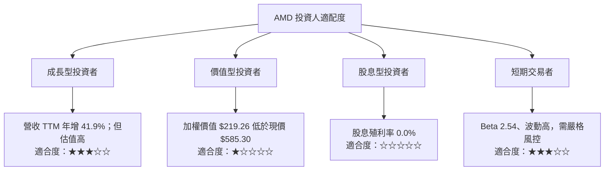

### 11.5 每季財報監控清單

| 監控指標 | 基準值 | 加碼觀察門檻 | 減碼警戒 |
|---|---:|---:|---:|
| 單季營收 YoY | 最新 44.7% | 維持 ≥30% 且連續增長 | 連續兩季 <20% |
| TTM 營收成長 | 41.9% | ≥30% | <20% |
| 營業利益率 | TTM 17.7%；最新季度 21.2% | 維持 ≥20% | <17% 或下降 >3pp |
| TTM FCF | $7.06B | 維持正值並增長 | 轉負或連續兩季走弱 |
| Capex | TTM $2.07B | 與營收增長相稱 | Capex 上升但 FCF 同步惡化 |
| 存貨 | $11.46B | 存貨增速不高於營收增速 | 連續兩季高於營收增速 |
| SBC | FY2025 $1.64B；近四季約 $2.00B | SBC／營收下降 | SBC 增速高於營收增速 |
| AI／資料中心產品 | 分部營收 N/A | 公司披露分部成長持續強於整體 | 訂單、交付或客戶採用轉弱 |
| 管理層財測 | 未提供 | 財測上修且毛利同步改善 | 財測下修或毛利率指引收縮 |

### 11.6 反面論證：什麼會證明論點錯誤

```
╔══════════════════════════════════════════════════════════════════╗
║              ⚠️ 論點失效條件（Disconfirming Evidence）           ║
╠══════════════════════════════════════════════════════════════════╣
║ 多頭基本面論點應在以下條件成立時重新檢視：                      ║
║ ☐ 單季營收年增連續兩季低於 20%                                  ║
║ ☐ TTM 營業利益率低於 17.7%，且連續兩季惡化                      ║
║ ☐ TTM FCF 轉負，或 FCF／淨利轉換率低於 60%                      ║
║ ☐ ROIC 持續低於同口徑 WACC 17.69%，且差距擴大                   ║
║ ☐ 存貨增速連續兩季高於營收增速，並出現減值或折價銷售            ║
║ ☐ AI／資料中心產品成長未能帶動毛利與現金流改善                  ║
║ ☐ SBC／營收持續高於約 4.4%，且流通股數稀釋速度上升              ║
╚══════════════════════════════════════════════════════════════════╝
```

> **免責聲明：**本報告為 AI 自動生成，僅供研究參考，不構成投資建議。投資有風險，入市需謹慎。