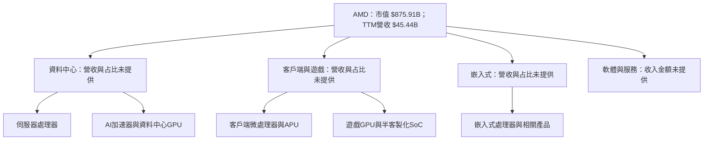
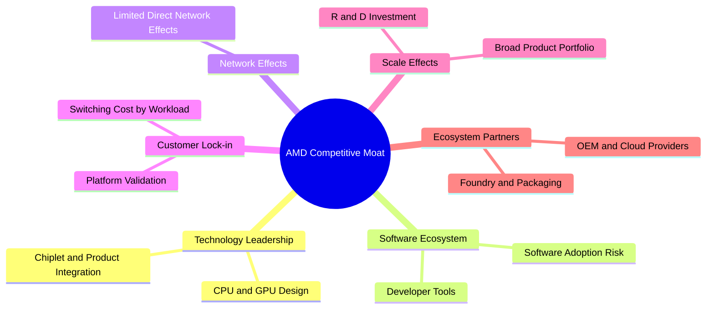
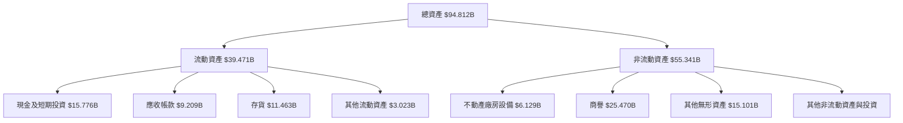
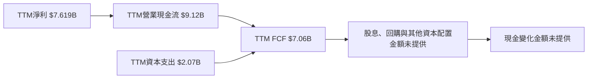
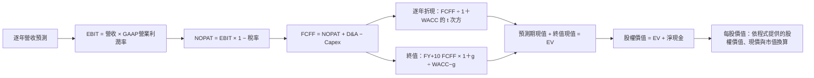
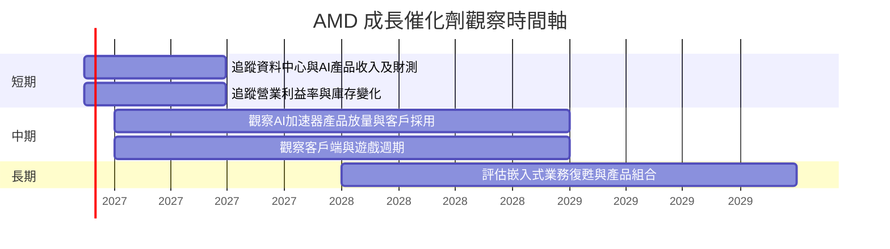
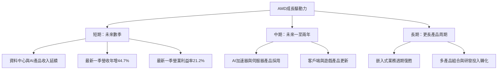
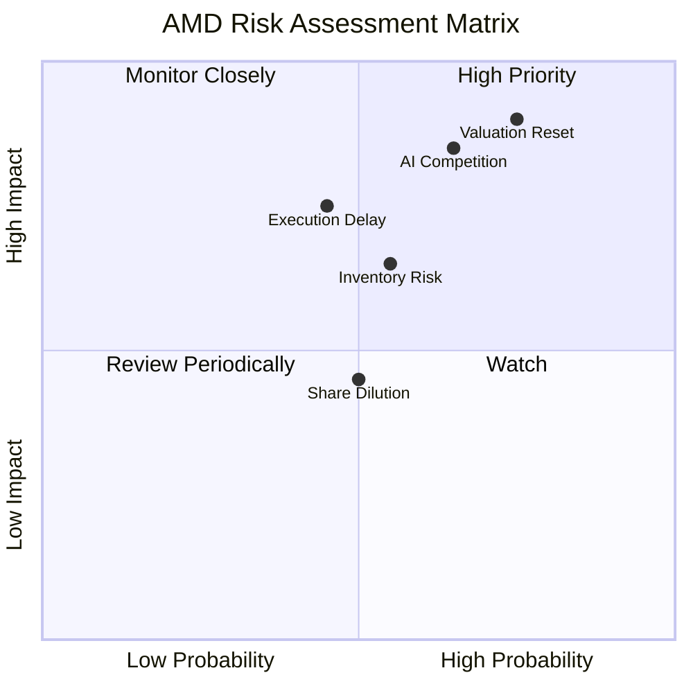
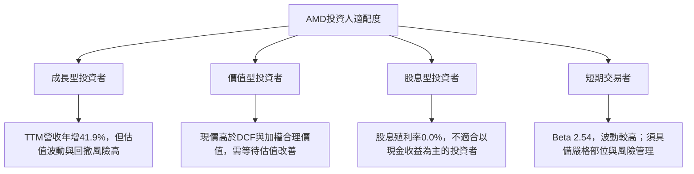

# AMD 基本面深度分析報告
> **報告日期**：2026-11-14 ｜ **語言**：繁體中文 ｜ **數據來源**：SEC 申報資料 (XBRL)、Yahoo Finance、Finviz、StockAnalysis、Roic.ai ｜ **分析師**：CFA 級機構研究

## 目錄

| # | 章節 | 核心結論 |
|---|------|----------|
| 1 | 執行摘要 | 賣出；加權合理價值 $209.43；MOS −155.0% |
| 2 | 公司概覽與商業模式 | 技術與產品組合具競爭力，但市場份額數據未提供，護城河仍受軟體生態與競爭限制 |
| 3 | 損益表深度分析 | TTM 營收 $45.44B、年增 41.9%；TTM 營業利益率 17.7% |
| 4 | 資產負債表分析 | 淨現金 $8.70B，流動性充足；存貨仍需監控 |
| 5 | 現金流量深度分析 | TTM FCF $7.06B、FCF Yield 0.81%；營運現金流轉換尚可 |
| 6 | 獲利能力與資本效率 | ROIC 12.8% 低於 WACC 14.0%，目前略微未達價值創造門檻 |
| 7 | 相對估值分析 | AMD 估值高於同業倍數及自身歷史中位數 |
| 8 | DCF 內在價值評估 | DCF 基準價值 $76.23；對現價折溢價 +600.6% |
| 9 | 成長催化劑 | 資料中心與 AI 產品需求是主要增長方向；TAM 數據未提供 |
| 10 | 風險矩陣 | 估值回落、AI 競爭與產品執行是主要風險 |
| 11 | 投資建議 | 不宜追價；依加權合理價值與情境估值設定風險控制與監控條件 |

## 1. 執行摘要

AMD TTM 營收為 **$45.44B**，TTM 年增 **41.9%**，最新一季營收年增 **44.7%**，營業利益率由 TTM **17.7%** 升至最新一季 **21.2%**；但 2026-11-13 收盤價 **$534.06** 相對 DCF 基準價值 **$76.23** 溢價 **600.6%**，相對四種方法加權合理價值 **$209.43** 的安全邊際（MOS）為 **−155.0%**。ROIC **12.8%** 低於採用 WACC **14.0%**，TTM FCF 雖達 **$7.06B**，FCF Yield 卻只有 **0.81%**。依 MOS 門檻應評為 **賣出**；本報告不作質化調級。

### 1.0 一頁式投資儀表板（Portfolio Manager 30 秒速讀）

| 項目 | 內容 |
|------|------|
| **投資論點（3 句）** | ① TTM 營收年增 **41.9%**，最新一季年增 **44.7%**，營運動能仍在。② 最新一季營業利益率 **21.2%** 高於 TTM **17.7%**，顯示近期營業槓桿改善。③ 但 DCF 基準價值 **$76.23**、加權合理價值 **$209.43**，均低於 **$534.06** 收盤價，預期已相當進取。 |
| **綜合評分** | **6.6/10**（引用 1.1） |
| **財務健康** | 🟢 淨現金 **$8.70B**；流動比率 **2.725**，短期償債緩衝充足 |
| **ROIC vs WACC** | **12.8% vs 14.0%**（低於資本成本，按此口徑未創造超額價值） |
| **FCF 趨勢** | 近年改善；TTM FCF **$7.06B**，FCF Yield **0.81%** |
| **估值** | Forward P/E **30.2x** ｜ EV/EBITDA（公司市場資料）**78.0x** ｜ FCF Yield **0.81%** |
| **DCF 內在價值（基準）** | **$76.23** ｜ 相對 DCF 折溢價 **+600.6%** |
| **安全邊際（MOS）** | **−155.0%＝($209.43 − $534.06) ÷ $209.43**（加權合理價值基準，非 DCF 基準）｜ 🔴 無 |
| **預期報酬（基準情境 12M）** | DCF 基準情境對現價為 **−85.7%**；非 12 個月價格預測 |
| **關鍵風險（前二）** | 現價估值過高；AI 加速器市場的競爭及產品放量不確定 |
| **評級 + 信心度** | 🔴 **賣出** ｜ 信心：中（營運數據充足，長期 DCF 假設不確定性高） |

### 1.1 綜合評分卡（全報告唯一）

| 維度 | 評分（1–10） | 主要依據（引用數字與其來源章節） |
|------|--------------|----------------------------------|
| 成長性 | 9.0 | TTM 營收年增 **41.9%**、最新一季年增 **44.7%**（第 3 章） |
| 獲利能力 | 7.5 | TTM 營業利益率 **17.7%**、ROIC **12.8%**；F-Score **7/9**（第 3、6 章） |
| 財務健康 | 8.0 | 淨現金 **$8.70B**、流動比率 **2.725**；CCC **138 天**（第 4 章） |
| 估值 | 1.0 | MOS **−155.0%**；P/S **19.5x** 高於自身五年中位數 **8.9x**（第 7、8 章） |
| 護城河 | 7.5 | 多產品線與處理器設計能力具差異化；市場份額與軟體生態量化資料未提供（第 2 章） |
| 管理層與資本配置 | 6.5 | FY2025 SBC **$1.64B**；Piotroski 股數測試未通過，稀釋風險仍在（第 3、6 章） |
| **綜合評分** | **6.6** | 六項算術平均：**(9.0 + 7.5 + 8.0 + 1.0 + 7.5 + 6.5) ÷ 6 = 6.6** |

### 1.2 五大投資論點 + 三大核心風險

| 類型 | 項目 | 具體依據 | 信心度 |
|------|------|----------|--------|
| 🟢 **投資論點①** | 營收動能具延續性 | TTM 營收 **$45.44B**、年增 **41.9%**；最新一季年增 **44.7%** | 🟢 高 |
| 🟢 **投資論點②** | 近期營業槓桿改善 | 最新一季營業利益率 **21.2%**，高於 TTM **17.7%** | 🟢 中高 |
| 🟢 **投資論點③** | 現金創造能力改善 | TTM 營業現金流 **$9.12B**、FCF **$7.06B** | 🟢 高 |
| 🟢 **投資論點④** | 資產負債表具韌性 | 現金及短期投資 **$15.78B**，總債務 **$7.08B**，淨現金 **$8.70B** | 🟢 高 |
| 🟢 **投資論點⑤** | 盈餘品質指標整體偏正面 | Piotroski F-Score **7/9**；營業現金流高於淨利（第 6 章） | 🟡 中 |
| 🟡 **風險①** | 估值回落風險 | 現價 **$534.06**，加權合理價值 **$209.43**，MOS **−155.0%** | 🔴 高衝擊 |
| 🔴 **風險②** | 成長預期過高 | Reverse DCF 隱含第 1 年營收成長 **97.2%**，遠高於基準模型 **30.0%** | 🔴 高衝擊 |
| 🟡 **風險③** | 庫存與股數稀釋 | DIO **199 天**；Piotroski 股數未增加測試未通過 | 🟡 中 |

### 1.3 快速統計卡片

| 指標 | 公司實際值（期間） | 同業中位數 | 狀態 |
|------|--------------------|------------|------|
| 營收成長（TTM） | **41.9%** | — | 🟢 |
| 營收成長（最新一季年增） | **44.7%** | **85.5%**（NVDA、INTC、AVGO） | 🟡 |
| 毛利率（TTM） | **56.0%** | **74.7%**（同業中位數） | 🟡 |
| 營業利益率（TTM） | **17.7%** | — | 🟢 |
| ROIC（TTM） | **12.8%** | — | 🟡 |
| Forward P/E | **30.2x** | **17.9x** | 🔴 |
| FCF Yield（TTM） | **0.81%** | — | 🔴 |
| Piotroski F-Score | **7 / 9** | — | 🟢 |

### 1.4 投資結論

```text
╔══════════════════════════════════════════════════════════════════╗
║                    📊 投資結論摘要                               ║
╠══════════════════════════════════════════════════════════════════╣
║  評級：🔴 賣出（依 MOS 門檻；未作質化調級）                      ║
║  價格（2026-11-13 收盤）：$534.06                               ║
║  DCF 內在價值（基準）：$76.23（折溢價 +600.6%）                 ║
║  安全邊際 MOS：−155.0%（以加權合理價值 $209.43 為基準）         ║
║  加權合理價值（8.8）：$209.43                                    ║
║  DCF 情境價值：                                                  ║
║    悲觀情境：$40.40（相對現價 −92.4%）                           ║
║    基準情境：$76.23（相對現價 −85.7%）                           ║
║    樂觀情境：$142.39（相對現價 −73.3%）                          ║
║  綜合評分：6.6/10（引用 1.1）                                    ║
║  適合投資人：可承受高波動、重視長期成長且願意等待估值回落者      ║
╚══════════════════════════════════════════════════════════════════╝
```

## 2. 公司概覽與商業模式

AMD 是美國半導體公司，提供資料中心處理器與 AI 加速器、客戶端處理器、遊戲 GPU／半客製化 SoC，以及嵌入式處理器。產品組合涵蓋 CPU、GPU、加速處理器與嵌入式產品；各分部營收與軟體／服務收入金額未提供，因此不推算其營收占比。

### 2.1 業務結構與收入來源

> 分部營收明細未提供；以下僅呈現公司已披露的業務分類，不以推估比例繪製。



### 2.2 市場份額

市場份額數據未提供。以公司整體表現觀察，AMD TTM 營收 **$45.44B**、年增 **41.9%**；同業最新一季營收年增率為 NVDA **105.9%**、AVGO **85.5%**、INTC **20.9%**。這些數字反映增長速度差異，不能直接替代市場份額或各公司可比業務的市占率。

### 2.3 競爭護城河分析



### 2.4 護城河強度

| 護城河項目 | 強度（強／中／弱） | 證據（引用數字或事實） | 會削弱它的情況 |
|------------|--------------------|------------------------|----------------|
| 技術與產品設計 | 中至強 | 同時涵蓋 CPU、GPU、AI 加速器及嵌入式產品；TTM 營收年增 **41.9%** | 產品效能、能效或上市時程落後 |
| 軟體生態系統 | 中 | 財務資料未提供開發者數、軟體收入或轉換成本量化數據 | 軟體工具成熟度不足、開發者偏向競品 |
| 客戶鎖定 | 中 | 企業級處理器與加速器通常涉及平台驗證，但客戶留存資料未提供 | 雲端客戶多供應商採購或自行設計晶片 |
| 規模效應 | 中 | FY2025 研發支出 **$8.09B**，可支援多產品線開發 | 研發支出增加未帶來收入與毛利提升 |
| 生態夥伴 | 中 | 產品經由資料中心、OEM、遊戲與嵌入式通路銷售；合作夥伴收入未提供 | 供應鏈瓶頸或合作夥伴採用競品 |
| 網路效應 | 弱至中 | 未見可量化、由用戶數直接增強產品價值的網路效應數據 | 競爭者建立更完整的軟硬體開發者生態 |

護城河評分引用 1.1 的 **7.5/10**：產品與研發範圍支持競爭優勢，但缺少市場份額、軟體採用和客戶留存量化證據。

## 3. 損益表深度分析

### 3.1 年度收入成長趨勢（近4年）

FY2022–FY2025 營收分別為 **$23.60B、$22.68B、$25.79B、$34.64B**。FY2025 較 FY2024 成長 **34.3%**。FY2022 至 FY2025 CAGR 為：

\[
(34.64 \div 23.60)^{1/3}-1 \approx 13.6\%
\]

```text
╔══════════════════════════════════════════════════════════════════╗
║                AMD 年度收入趨勢（FY2022–FY2025）                ║
╠══════════════════════════════════════════════════════════════════╣
║  FY2022  $23.60B  ██████████████░░░░░░░░░░  基期               ║
║  FY2023  $22.68B  █████████████░░░░░░░░░░░  YoY −3.9% 🟡       ║
║  FY2024  $25.79B  ███████████████░░░░░░░░░  YoY +13.7% 🟢      ║
║  FY2025  $34.64B  ████████████████████░░░░  YoY +34.3% 🟢      ║
║                                                                  ║
║  FY2022–FY2025 三年營收 CAGR：約 +13.6%                          ║
╚══════════════════════════════════════════════════════════════════╝
```

FY2023 收入下滑 **3.9%** 後，FY2024 與 FY2025 恢復成長；TTM 年增 **41.9%** 高於三年歷史 CAGR，表示近期增速加快，但也提高未來基期與高成長持續性的要求。

### 3.2 季度收入趨勢分析

| 季度 | 營收 | QoQ | YoY | 備註 |
|------|------:|----:|----:|------|
| 2025 Q4 | $10.270B | +11.1% | +34.1% | 相較 2025 Q3 成長 |
| 2026 Q1 | $10.253B | −0.2% | +37.9% | 營收大致持平；YoY 仍高 |
| 2026 Q2 | $11.536B | +12.5% | +50.1% | 季增與年增加速 |
| 2026 Q3 | $13.377B | +16.0% | +44.7% | 營收創所列四季最高；年增略低於 Q2 |

QoQ 計算使用相鄰季度營收，例如 2026 Q3：\((13.377 \div 11.536)-1=16.0\%\)。YoY 取同季比較；TTM 成長率另為 **41.9%**，不可與單季年增率混用。

### 3.3 利潤率演變分析

| 利潤率指標 | FY2022 | FY2023 | FY2024 | FY2025 | 趨勢 | 評估 |
|------------|-------:|-------:|-------:|-------:|------|------|
| **毛利率** | 44.9% | 46.1% | 49.3% | 49.5% | 逐年改善；TTM 升至 56.0% | 🟢 |
| **營業利益率** | 5.3% | 1.8% | 8.1% | 10.7% | FY2023 下探後回升 | 🟢 |
| **淨利率** | 5.6% | 3.8% | 6.4% | 12.5% | FY2025 改善明顯；TTM 為 16.8% | 🟢 |

年度毛利率及營業利益率以年度收入與毛利／營業利益計算。TTM 毛利率 **56.0%** 高於 FY2025，可能反映近季產品組合與營運結構改善；分部毛利率未提供，無法將提升定量分解至 AI、資料中心或其他產品。FY2026 Q3 營業利益率為 **21.2%**（依 DCF 區塊的最新季度口徑），高於 TTM **17.7%**；另一市場資料來源列示最新季 **17.8%**，期間口徑或來源口徑存在差異，本報告採用 SEC 計算的 21.2% 作為指定最新季度值。

### 3.4 費用結構分析

FY2025 營收 **$34.64B**、毛利 **$17.15B**、營業利益 **$3.69B**、研發支出 **$8.09B**。研發支出占營收：

\[
8.09 \div 34.64 = 23.4\%
\]

財務數據沒有完整的銷售管理費、其他營業費用等明細，故不製作可能造成誤讀的費用結構圓餅圖。研發投入占比高，支持產品開發，但若收入增速下降而研發投入維持，營業槓桿可能轉弱。

### 3.5 季度 EPS 趨勢與盈餘品質（Quality of Earnings）

| 盈餘品質項目 | 數值/佔比 | 評估 |
|--------------|-----------|------|
| 股權薪酬 SBC / 營收 | TTM SBC 未提供；FY2025 **$1.64B / $34.64B = 4.7%** | 🟡 對股東有稀釋成本 |
| SBC / 營業現金流 | FY2025 **$1.64B / $7.71B = 21.3%** | 🟡 SBC 仍占現金流規模的顯著比例 |
| FCF / 淨利（現金轉換率） | TTM **$7.06B / $7.619B = 92.7%** | 🟢 現金轉換接近淨利 |
| 一次性/非經常性損益 | 未提供足夠明細 | ⚠️ 無法判斷對淨利的具體影響 |
| 有效稅率異常 | N/A（TTM 有效稅率未提供） | 不據此判定稅務利益 |
| 資本化支出 vs 費用化 | TTM Capex **$2.07B**；資本化政策拆分未提供 | 需觀察投資是否帶來增量營收與現金流 |

| 季度 | EPS 實際值 | YoY EPS 成長 | 是否超預期 |
|------|-----------:|-------------:|------------|
| 2025 Q4 | $0.92 | +217.1% | N/A：一致預期 EPS 缺失 |
| 2026 Q1 | $0.84 | +91.2% | N/A：一致預期 EPS 缺失 |
| 2026 Q2 | $1.39 | +159.5% | N/A：一致預期 EPS 缺失 |
| 2026 Q3 | $1.48 | +93.8% | N/A：一致預期 EPS 缺失 |

季度 EPS 的預估值欄為缺失值，故不能將四季歸類為超預期或不及預期。提供的單季數據顯示 EPS 年增維持正值，淨利增長亦為正；但 SBC 的股東稀釋成本及有效稅率細節仍需追蹤。

**盈餘品質結論**：TTM FCF 對淨利轉換率約 **92.7%**，且營業現金流為正，支持盈餘具有現金流基礎；但 SBC 佔 FY2025 營收 **4.7%**，稀釋股數測試未通過，GAAP 盈餘仍需以每股股數與 SBC 變化一併評估。

## 4. 資產負債表分析

### 4.1 資產結構分解

以下為 2026-09-26 資產負債表資料；分類與細項金額來自 StockAnalysis 的季度資產負債表，總額 **$94.812B**。



非流動資產 **$55.341B** 為總資產減流動資產的算術差額；其中「其他非流動資產與投資」為未列示細項的集合，不應將其視為單一披露科目。

### 4.2 流動性與營運資金分析

| 指標 | 最新 TTM | 一年前 TTM | 變化 | 解讀 |
|------|----------:|------------:|------:|------|
| DSO 應收帳款天數 | 74 天 | 71 天 | +3 天 | 收款天數小幅增加；需留意大型客戶付款週期 |
| DIO 存貨天數 | 199 天 | 161 天 | +38 天 | 存貨週轉放慢，可能反映備貨或產品組合變化，也增加庫存風險 |
| DPO 應付帳款天數 | 135 天 | 77 天 | +58 天 | 付款週期延長，可能改善短期現金占用；需確認未損害供應條件 |
| CCC 現金轉換週期 | 138 天 | 155 天 | −17 天 | 現金轉換週期縮短，主要是 DPO 增長抵銷存貨天數上升 |

流動比率 **2.725**、速動比率 **1.725**，顯示流動性緩衝尚足；但 DIO 上升 **38 天**不宜忽視，因存貨變現速度較慢時，可能伴隨產品迭代、需求錯配或跌價風險。

### 4.3 債務結構分析

```text
╔══════════════════════════════════════════════════════════════════╗
║                     AMD 債務健康診斷                             ║
╠══════════════════════════════════════════════════════════════════╣
║  總債務：             $7.08B   ████████░░░░░░░░░░░░              ║
║  現金及短期投資：    $15.78B   ████████████████████              ║
║  淨現金：             $8.70B   🟢 現金高於債務                    ║
║  Debt/EBITDA：        N/A（依指定債務與 EBITDA 同口徑未提供）    ║
║  Interest Coverage： N/A（利息費用明細未提供）                  ║
║  流動比率：           2.725    🟢                               ║
╚══════════════════════════════════════════════════════════════════╝
```

其他市場資料來源列示總債務 **$9.21B**、淨現金 **$6.57B**，與 SEC 計算區塊的 **$7.08B** 及 **$8.70B** 不一致。本報告依要求以 SEC 計算區塊數值作為估值與 ROIC 分析口徑，不混用不同日期或口徑的債務數字。

### 4.4 股東權益趨勢

| 年度 | 股東權益 |
|------|---------:|
| FY2022 | $54.75B |
| FY2023 | $55.89B |
| FY2024 | $57.57B |
| FY2025 | $63.00B |

FY2022 至 FY2025 股東權益增加 **$8.25B**，但權益增長不等於每股價值等幅提升；股份稀釋、併購形成的商譽以及投資回報均會影響股東實際報酬。

## 5. 現金流量深度分析

### 5.1 現金流量瀑布圖

季度與年度資料提供 CFO、Capex 與 FCF，但未提供足夠的股息、回購與淨現金變動分配明細，故圖中只標示可確認的現金流項目。



### 5.2 FCF 轉換率趨勢

| 年度 | FCF | 淨利 | FCF / 淨利 |
|------|----:|-----:|-----------:|
| FY2022 | $3.12B | $1.32B | 236.4% |
| FY2023 | $1.12B | $0.854B | 131.1% |
| FY2024 | $2.40B | $1.64B | 146.3% |
| FY2025 | $6.74B | $4.33B | 155.7% |
| TTM | $7.06B | $7.619B | 92.7% |

年度 FCF/淨利比率高於 100% 的部分可能與營運資金、非現金費用及資本支出時點有關。TTM 比率下降至 **92.7%**，仍接近 1 倍，但需要觀察庫存與應收帳款是否繼續占用現金。

### 5.3 自由現金流趨勢

```text
╔══════════════════════════════════════════════════════════════════╗
║                     AMD 自由現金流趨勢                           ║
╠══════════════════════════════════════════════════════════════════╣
║  FY2022  $3.12B  ██████████░░░░░░░░░░  FCF Yield：N/A            ║
║  FY2023  $1.12B  ████░░░░░░░░░░░░░░░░  YoY −64.1%               ║
║  FY2024  $2.40B  ████████░░░░░░░░░░░░  YoY +114.3%              ║
║  FY2025  $6.74B  ████████████████████  YoY +180.8%              ║
║  TTM     $7.06B  FCF Yield：0.81%                                ║
╚══════════════════════════════════════════════════════════════════╝
```

### 5.4 資本配置評估

股息收益率與派息率均為 **0.0%**。年度資本支出 FY2025 為 **$0.974B**，FY2024 為 **$0.636B**；FY2025 SBC **$1.64B**。回購、投資及現金留存的完整金額拆分未提供，不以猜測比例繪製圓餅圖。

| 資本配置項目 | 可用數據 | 評估 |
|--------------|----------|------|
| 資本支出 | FY2025 $0.974B；TTM $2.07B | TTM 投資高於 FY2025，需追蹤新增產能與產品投入的現金回報 |
| 股息 | 股息殖利率 0.0% | 現金回報以再投資或其他方式為主 |
| 股權薪酬 | FY2025 $1.64B | 需與股數增長及每股盈餘一併檢視 |
| 回購／併購／其他投資 | N/A（未提供完整金額） | 無法判斷各項資本配置的淨回報 |

## 6. 獲利能力與資本效率

### 6.1 ROE / ROA / ROIC 趨勢

| 指標 | 最新可用數值 | 歷史趨勢 | 評估 |
|------|--------------:|----------|------|
| ROE | TTM **11.1%**（品質指標）；另一來源列示 **12.0%** | 歷史可比口徑未提供 | 🟡 |
| ROA | TTM **5.9%** | 歷史可比口徑未提供 | 🟡 |
| ROIC | TTM **12.8%** | 指定口徑歷史序列未提供 | 🟡 |

ROE 的兩個來源數值不同，杜邦分析採用品質指標區塊的 **11.1%**。不提供行業均值對比，因資料未列同業可比 ROE、ROA 或 ROIC。

### 6.2 ROIC vs WACC 分析（核心價值創造判斷）

ROIC **12.8%**，WACC **14.0%**，差額為 **−1.2 個百分點**。按此估算口徑，公司目前尚未達到覆蓋資本成本的門檻；若 ROIC 能隨營收規模與營業利益率提高而升至 14.0% 以上，價值創造結論才會轉正。

```text
╔══════════════════════════════════════════════════════════════════╗
║                ROIC vs WACC 深度分析                            ║
╠══════════════════════════════════════════════════════════════════╣
║  WACC 輸入（採用資本成本資料）：                                 ║
║  ├── 無風險利率 Rf：                    5.15%                    ║
║  ├── 股權風險溢酬 ERP：                 5.00%                    ║
║  ├── 原始 Beta：                        2.54                     ║
║  ├── 調整後 Beta：                      2.00                     ║
║  ├── 股權成本：                         15.15%                   ║
║  ├── 稅前債務成本：                     1.85%                    ║
║  ├── 股權／債務權重：                   99.2%／0.8%              ║
║  └── 採用 WACC：                        14.00%（上限調整後）     ║
║                                                                  ║
║  ROIC（TTM）：                         12.8%                     ║
║  ROIC − WACC：                        −1.2pp                    ║
║  判斷：目前未覆蓋資本成本；需提高營業回報率或降低資本成本        ║
╚══════════════════════════════════════════════════════════════════╝
```

WACC 的計算值為 **15.04%**，因指定模型將 WACC 限制在 **7%–14%** 區間，故採用 **14.00%**。Beta 採調整後 **2.00**；計算描述為原始 Beta **2.54** 經調整後約 **2.03**，並按 2.0 上限採用 **2.00**。

### 6.3 杜邦三因素分解

| 因素 | 數值（TTM） | 解讀 |
|------|-------------|------|
| 淨利率 | 16.8% | 盈利能力為 ROE 的主要貢獻因素 |
| 資產週轉率 | 0.48 | 每單位資產產生的營收有限，反映半導體資產及併購資產特性 |
| 權益乘數 | 1.39 | 槓桿並非 ROE 的主要來源 |
| **ROE** | **11.1%** | **16.8% × 0.48 × 1.39 = 11.2%**；來源列示 ROE 11.1%，差異為四捨五入 |

### 6.4 財務體質：Piotroski F-Score

Piotroski F-Score 為 **7/9**，以下逐項依 2026-09-26 TTM 與 2025-09-27 TTM 的品質指標列示。

| 測試 | 結果 | 解讀 |
|------|------|------|
| ROA > 0 | ✅ 通過 | 盈利資產回報為正 |
| 營業現金流 > 0 | ✅ 通過 | TTM 營業現金流 **$9.12B** |
| ROA 高於一年前 | ✅ 通過 | 資產回報改善 |
| 營業現金流 > 淨利 | ✅ 通過 | 應計品質測試為正面 |
| 長期負債 ÷ 總資產低於一年前 | ❌ 未通過 | 負債比率未改善 |
| 流動比率高於一年前 | ✅ 通過 | 短期流動性改善 |
| 稀釋股數未增加 | ❌ 未通過 | 股數增加造成每股價值稀釋風險 |
| 毛利率高於一年前 | ✅ 通過 | 毛利率改善 |
| 資產週轉率高於一年前 | ✅ 通過 | 資產使用效率改善 |

## 7. 相對估值分析

### 7.1 同業估值比較表格

| 估值指標 | **AMD** | **NVDA** | **INTC** | **AVGO** | AMD 評估 |
|----------|--------:|---------:|---------:|---------:|-----------|
| **Trailing P/E** | 116.1x | 20.6x | N/A | 44.3x | 🔴 高於可用同業 |
| **Forward P/E** | 30.2x | 10.3x | 33.3x | 17.9x | 🔴 高於同業中位數 **17.9x** |
| **P/S Ratio** | 19.5x | 13.0x | 5.3x | 18.6x | 🔴 高於兩家同業、接近 AVGO |
| **EV/EBITDA** | 109.1x（自身歷史區塊） | 19.4x | 17.2x | 32.4x | 🔴 顯著高於同業 |

同業最新一季營收年增率中位數為 **85.5%**（NVDA 105.9%、INTC 20.9%、AVGO 85.5%）；AMD 為 **44.7%**。同業增速與倍數並非完全同業務組合比較，宜視為估值參照，而非直接判定業務價值相同。

### 7.2 歷史估值區間分析

```text
╔══════════════════════════════════════════════════════════════════╗
║                 AMD 自身五年估值位置                             ║
╠══════════════════════════════════════════════════════════════════╣
║  P/E：      36.7x ───── 中位數 82.6x ───── 現值 116.1x           ║
║             歷史區間 36.7x–934.7x；目前百分位 53%               ║
║  P/S：       4.3x ───── 中位數  8.9x ───── 現值  19.5x           ║
║             歷史區間 4.3x–23.1x；目前百分位 90%                 ║
║  EV/EBITDA：38.2x ──── 中位數 102.2x ──── 現值 109.1x           ║
║             歷史區間 38.2x–919.2x；目前百分位 61%               ║
╚══════════════════════════════════════════════════════════════════╝
```

P/S 位於自身五年 **90 百分位**，代表營收倍數相對昂貴；P/E 與 EV/EBITDA 的歷史區間極寬，受盈利週期與低基期影響，百分位解讀需保守。

### 7.3 情境價值（Bear / Base / Bull，照抄 DCF MODEL）

| 情境 | 第 1 年營收成長 | 期末營業利潤率 | WACC | 每股價值 | 相對現價 | 機率 | 會發生的條件 |
|------|----------------:|---------------:|-----:|----------:|----------:|-----:|--------------|
| 🔴 悲觀 | 15.0% | 6.3% | 15.00% | $40.40 | −92.4% | 25% | AI／資料中心產品增長降速，且競爭或成本壓低長期利潤率 |
| 🟡 基準 | 30.0% | 7.4% | 14.00% | $76.23 | −85.7% | 50% | 按模型假設逐年減速，利潤率回落至歷史中位數 |
| 🟢 樂觀 | 45.0% | 8.1% | 13.00% | $142.39 | −73.3% | 25% | 初期收入增長高於基準、長期利潤率較高，資本成本下降 |

這些是 DCF 模型的整體情境輸出；情境機率加權價值為 **$83.81**，只作情境參考，不替代第 8.8 節固定權重的估值結果。

### 7.4 相對估值隱含價格區間

```text
╔══════════════════════════════════════════════════════════════════╗
║           估值方法隱含價格 vs 2026-11-13 收盤 $534.06            ║
╠══════════════════════════════════════════════════════════════════╣
║  DCF（基準）                 $76.23  ─────── 現價 $534.06        ║
║  同業 EV/EBITDA             $136.44  ─────── 現價 $534.06        ║
║  同業 Forward P/E           $316.21  ─────── 現價 $534.06        ║
║  分析師共識目標價           $657.74  ─────── 現價 $534.06        ║
╚══════════════════════════════════════════════════════════════════╝
```

同業 Forward P/E 方法採 NVDA、INTC、AVGO 的中位數 **17.9x × AMD Forward EPS $17.69 = $316.21**；同業 EV/EBITDA 方法採同業中位數 **19.4x**，乘以 TTM EBITDA 並加回淨現金，得到 **$136.44**。計算區塊未提供 EV/EBITDA 回推使用的 AMD TTM EBITDA 絕對額，故不另行反推。

## 8. DCF 內在價值評估（Discounted Cash Flow）

### 8.0 估值推理鏈（Thinking Logic）

**Step 1 — 價值由哪些變數決定？**  
本模型將價值視為現有主業現金流與資料中心、AI、客戶端、遊戲及嵌入式業務未來現金流的總和；各分部占營收比重未提供，因此不能將第二成長曲線拆成可稽核的分部價值。模型最敏感的變數包括長期營收成長、營業利潤率、WACC 與終值成長率。

**Step 2 — 模型選擇**

| 決策點 | 本報告採用 | 理由（含數字） | 曾考慮但否決 | 否決理由 |
|--------|-----------|----------------|--------------|----------|
| 現金流定義 | FCFF | 與 WACC 折現及企業價值橋接一致；TTM OCF $9.12B、Capex $2.07B | FCFE | 程式模型已固定採 FCFF |
| 預測期 N | 10 年 | DCF 模型固定 10 年；公司近年營收成長與產品周期有較大不確定性 | 5 年 | 無法呈現模型內設定的逐年增長減速路徑 |
| 終值方法 | Gordon Growth | 模型指定永續成長率 3.0%，低於 WACC 14.0% | 退出倍數作主方法 | DCF 模型未提供退出倍數終值結果 |
| EBIT 基礎 | GAAP | 模型固定採 GAAP EBIT，已將 SBC 作為費用 | 非 GAAP | 加回 SBC 會改變指定模型口徑 |

**Step 3 — 關鍵假設推導鏈**

- **營收增長**：錨點＝TTM 年增 **41.9%** → 模型將第 1 年增長限制在 **30.0%**，此後線性降至第 10 年 **3.0%** → 採用模型逐年路徑 → 否決第 1 年繼續採 **41.9%**，因近期高增長不宜直接延伸十年。
- **營業利益率**：錨點＝TTM **17.7%** → 模型逐步淡化至含 TTM 的五年歷史中位數 **7.4%** → 採用第 1 年 17.7% 至第 10 年 7.4% → 否決十年維持 17.7%，因模型預設半導體高利潤率會正常化。
- **預測期 N**：錨點＝模型明列 **10 年** → 以十年涵蓋逐年增長遞減與利潤率收斂 → 採用 10 年 → 不改為較短期限，以免與程式預先計算模型不一致。
- **Capex/營收**：錨點＝TTM **4.5%** → 模型維持 **4.5%**，並未呈現隨成熟而下降 → 採用 4.5% → 不採更低比例，避免擅自改動模型輸入。
- **終值成長率 g**：模型採 **3.0%** → 低於 14.0% WACC，且與成熟企業長期名目成長假設相容 → 採用 3.0% → 不採高於 3.0% 的基準值，以降低終值占比膨脹。
- **EBIT 基礎／SBC／股數**：採 GAAP EBIT；SBC 已在費用內扣除；股數不再額外稀釋 → 採模型組合 **(A)** → 否決再次扣 SBC 或另加年稀釋率，避免重複計算。
- **WACC**：採資本成本資料的上限調整後 **14.00%** → 計算值 **15.04%** 被限定在 7%–14% → 採用 14.00% → 不採未封頂計算值，以符合指定模型輸入。

**Step 4 — 最脆弱假設**  
市場價格遠高於基準 DCF；最脆弱之處是十年收入與長期利潤率假設仍無法解釋現價。敏感度矩陣中基準價值僅 **$76.23**，而樂觀情境為 **$142.39**，仍低於現價。

**Step 5 — 計算路徑圖**



### 8.1 模型假設總表（Model Inputs）

| 假設項目 | 採用值 | 依據 / 來源 | 敏感度 |
|----------|--------|-------------|--------|
| 預測期長度 **N** | 10 年 | DCF 模型固定值 | 🟡 中 |
| 營收增長率路徑 | FY+1 30.0% 線性降至 FY+10 3.0% | TTM 年增 41.9%；模型限制第 1 年增長上限 30.0% | 🔴 高 |
| 營業利益率路徑 | 17.7% 降至 7.4% | TTM 營業利益率；含 TTM 五年中位數 | 🔴 高 |
| 有效稅率 | 21.0% | 模型預設稅率；實際有效稅率明細未提供 | 🟢 低 |
| Capex / 營收 | 4.5% | TTM 比例，模型固定至第 10 年 | 🟡 中 |
| D&A / 營收 | 6.7% | TTM 比例，模型固定 | 🟢 低 |
| 營運資金變動 | 未納入 | DCF 模型明確不建模營運資金變化 | 🟡 中 |
| EBIT 基礎 | GAAP EBIT | 模型指定；不是非 GAAP EBIT | 🟡 中 |
| SBC 處理 | 已含於 GAAP EBIT，不再另扣 | 模型組合 (A) | 🟡 中 |
| 年稀釋率 | 0%（固定股數） | 模型不額外稀釋，SBC 已反映於 GAAP 費用 | 🟡 中 |
| 永續成長率 g | 3.0% | DCF 模型輸入，低於 WACC 14.0% | 🔴 高 |
| 終值方法 | Gordon Growth | DCF 模型指定 | 🔴 高 |
| WACC | 14.00% | 資本成本區塊；原計算 15.04%，受 14% 上限限制 | 🔴 高 |

本模型採用 **FCFF = NOPAT + D&A − Capex**，不含營運資金變動列。本模型採用組合 **(A)：GAAP EBIT + 固定股數；SBC 影響已計入一次，不再額外扣 SBC 或放大股數**。

### 8.2 折現率推導（WACC）

```text
╔══════════════════════════════════════════════════════════════════╗
║                    WACC 推導（折現率）                           ║
╠══════════════════════════════════════════════════════════════════╣
║  股權成本 Ke（CAPM）：                                           ║
║  ├── 無風險利率 Rf：                  5.15%                     ║
║  ├── ERP：                            5.00%                     ║
║  ├── 原始 Beta：                      2.54                      ║
║  ├── 調整後 Beta（採用）：             2.00                      ║
║  ├── 股權成本 Ke：                    15.15%                    ║
║                                                                  ║
║  債務成本 Kd：                                                   ║
║  ├── 稅前 Kd：                        1.85%                     ║
║  ├── 稅率：                           21.0%                     ║
║  └── 稅後 Kd：                        1.85% × (1−21.0%) = 1.46%║
║                                                                  ║
║  資本結構：股權權重 99.2%；債務權重 0.8%                        ║
║  未封頂計算值：15.04%；限制區間 7%–14%                          ║
║  ✅ 採用 WACC：14.00%                                            ║
╚══════════════════════════════════════════════════════════════════╝
```

逐步演算如下：

1. **Ke（CAPM）**：\(5.15\% + 2.00 \times 5.00\% = 15.15\%\)。原始 Beta **2.54**；指定調整方式 \(2/3 \times 2.54 + 1/3 \approx 2.03\)，並受上限限制採 **2.00**。
2. **稅前 Kd**：直接採資本成本區塊提供的 **1.85%**。利息費用總額與平均計息負債明細未提供，不反推。
3. **稅後 Kd**：\(1.85\% \times (1-21.0\%)=1.4615\%\approx1.46\%\)。
4. **權重**：採用股權 **99.2%**、債務 **0.8%**，合計 **100.0%**。資本成本區塊提供的是權重而非可重建的市值／計息負債餘額細分，因此不反推欠缺的債務構成。
5. **未封頂 WACC**：\(99.2\%\times15.15\% + 0.8\%\times1.46\% =15.0288\%+0.0117\%=15.0405\%\approx15.04\%\)。因模型限制區間為 7%–14%，**採用 14.00%**。

本節 WACC 與第 6.2 節一致。無風險利率、ERP 日期／具體觀測來源日與利息費用明細未提供，不另補造日期或金額。

### 8.3 逐年自由現金流預測（基準情境）

金額單位為 **$B**；折現因子列示至三位小數。表格數字依 DCF 模型逐年照錄。

| 年度 | FY+1 | FY+2 | FY+3 | FY+4 | FY+5 | FY+6 | FY+7 | FY+8 | FY+9 | FY+10 |
|------|-----:|-----:|-----:|-----:|-----:|-----:|-----:|-----:|-----:|------:|
| 營收 | 59.07 | 75.01 | 93.02 | 112.55 | 132.81 | 152.73 | 171.06 | 186.46 | 197.64 | 203.57 |
| 營收 YoY | 30.0% | 27.0% | 24.0% | 21.0% | 18.0% | 15.0% | 12.0% | 9.0% | 6.0% | 3.0% |
| 營業利潤率 | 17.7% | 16.6% | 15.4% | 14.3% | 13.1% | 12.0% | 10.8% | 9.7% | 8.5% | 7.4% |
| 營業利益 EBIT（GAAP） | 10.46 | 12.43 | 14.34 | 16.06 | 17.42 | 18.28 | 18.51 | 18.03 | 16.84 | 15.00 |
| − 稅 | (2.20) | (2.61) | (3.01) | (3.37) | (3.66) | (3.84) | (3.89) | (3.79) | (3.54) | (3.15) |
| = NOPAT | 8.27 | 9.82 | 11.33 | 12.69 | 13.76 | 14.44 | 14.62 | 14.24 | 13.30 | 11.85 |
| + D&A | 3.96 | 5.03 | 6.24 | 7.55 | 8.90 | 10.24 | 11.47 | 12.50 | 13.25 | 13.65 |
| − Capex | (2.69) | (3.41) | (4.23) | (5.12) | (6.04) | (6.95) | (7.78) | (8.48) | (8.99) | (9.26) |
| **= FCFF** | **9.54** | **11.43** | **13.33** | **15.11** | **16.63** | **17.73** | **18.31** | **18.26** | **17.56** | **16.24** |
| 折現因子 @14.00% | 0.877 | 0.769 | 0.675 | 0.592 | 0.519 | 0.456 | 0.400 | 0.351 | 0.308 | 0.270 |
| **FCFF 現值 PV** | **8.37** | **8.80** | **9.00** | **8.95** | **8.63** | **8.08** | **7.32** | **6.40** | **5.40** | **4.38** |

逐年現值合計依模型提供值為 **$75.32B**。表內四捨五入的逐項加總為 **$75.33B**，差額 **$0.01B**，低於 1% 尾差。

**FY+1 逐步演算**：以下為以模型顯示精度呈現的代入算式，模型內部未四捨五入數值會造成細小尾差。

1. 營收：\(45.44 \times (1+30.0\%)=59.072\approx\)$**59.07B**
2. EBIT：\(59.07\times17.7\%=10.4554\approx\)$**10.46B**
3. 稅：\(10.46\times21.0\%=2.1966\approx\)$**2.20B**
4. NOPAT：\(10.46-2.20=\)$**8.26B**；模型列示 **$8.27B**（以未四捨五入 EBIT 計算）
5. D&A：\(59.07\times6.7\%=3.9577\approx\)$**3.96B**
6. Capex：\(59.07\times4.5\%=2.6582\approx\)$**2.66B**；模型列示 **$2.69B**，表示其採用了內部未顯示的精確營收／比率口徑。
7. ΔWC：**不建模**，模型未納入營運資金變動。
8. FCFF：模型列示 \(NOPAT+D\&A-Capex=\)$**9.54B**；由表內四捨五入值重算會有細小尾差。
9. 折現因子：\(1\div(1+14.00\%)^1=0.8772\approx0.877\)；PV：模型列示 \(9.54\times0.877\approx\)$**8.37B**。

上述表格遵從程式計算結果，不自行改寫任一年度。因提供的逐年表格已四捨五入，部分中間列無法僅以顯示精度精確重現模型內部未四捨五入結果。

**合理性自檢**：模型提供 FY+1 FCFF **$9.54B**、FY+10 FCFF **$16.24B**；以十年端點計算的 FCFF CAGR 約 **5.5%**。歷史 FCF 受基期影響波動大：FY2022 **$3.12B** 至 FY2025 **$6.74B** 的三年 CAGR 約 **29.2%**，但期間 FY2023 曾降至 **$1.12B**，不能將高歷史增速直接外推。FY+10 FCFF 利潤率 \(16.24/203.57=8.0\%\)，高於當前 TTM FCF／營收約 \(7.06/45.44=15.5\%\) 的反向比較並不成立：模型口徑是 FCFF，而當前數值為 FCFOCF 減 Capex 的 FCF，兩者定義與成長階段不同。模型各年 FCFF 均為正。

```text
╔══════════════════════════════════════════════════════════════════╗
║            自由現金流：歷史實際 vs 模型預測                      ║
╠══════════════════════════════════════════════════════════════════╣
║  FY2023(實)  $1.12B  ███░░░░░░░░░░░░░░░░░░                      ║
║  FY2024(實)  $2.40B  ██████░░░░░░░░░░░░░░                      ║
║  FY2025(實)  $6.74B  ███████████████░░░░░                      ║
║  FY+1 (預)   $9.54B  ██████████████████░░                      ║
║  FY+10(預)  $16.24B  ████████████████████                      ║
╠══════════════════════════════════════════════════════════════════╣
║  歷史波動明顯；基準模型採 10 年收入減速與利潤率收斂路徑          ║
╚══════════════════════════════════════════════════════════════════╝
```

### 8.4 終值計算（Terminal Value）

**適用性檢查**：WACC **14.00%** vs g **3.00%** → **WACC > g ✅**

| 方法 | 計算式 | 終值 TV | TV 現值 | 佔總 EV 比重 |
|------|--------|---------|---------|--------------|
| Gordon Growth | \(16.24\times(1+3.0\%)\div(14.0\%-3.0\%)\) | $152.04B | $41.01B | 35.3% |
| 退出倍數法 | N/A（DCF 模型未提供退出倍數終值） | N/A | N/A | N/A |

1. FY+10 FCFF：**$16.24B**。
2. 分子：\(16.24\times1.03=16.7272\)。
3. 分母：\(14.00\%-3.00\%=11.00\%\)；模型列示終值 **$152.04B**。顯示值直接照錄程式結果；以四捨五入後 FCFF 重算會有小幅尾差。
4. PV(TV)：模型列示 **$152.04B × 0.270 = $41.01B**。
5. 終值占比：\(41.01\div116.33=35.3\%\)。

終值約占 EV **35.3%**，估值有相當部分依賴第十年後假設，但未超過 75% 高度依賴警戒線。

### 8.5 企業價值 → 每股內在價值（Bridge）

```text
╔══════════════════════════════════════════════════════════════════╗
║              企業價值 → 每股內在價值 橋接表                      ║
╠══════════════════════════════════════════════════════════════════╣
║  預測期 FCF 現值合計            +$75.32B                         ║
║  終值現值 PV(TV)                +$41.01B                         ║
║  = 企業價值 EV                   $116.33B                         ║
║  + 淨現金                        +$8.70B                          ║
║  = 股權價值                      $125.03B                         ║
║  每股內在價值（模型換算）        $76.23                           ║
║  2026-11-13 收盤價               $534.06                          ║
║  折溢價（現價÷DCF價值−1）        +600.6% 溢價                    ║
╚══════════════════════════════════════════════════════════════════╝
```

1. **EV**：\(75.32+41.01=\)$**116.33B**。
2. **股權價值**：\(116.33+8.70=\)$**125.03B**。
3. **每股價值**：照 DCF 模型公式，\(125.03\times534.06\div875.91=\)$**76.23**。
4. **折溢價**：\((534.06\div76.23)-1=+600.6\%\)。
5. **本節不計算 MOS**；MOS 僅以第 8.8 節加權合理價值作分母。

每股換算照錄模型所列 **「股權價值 × 價格 ÷ 市值」** 公式。模型沒有直接列示可核對的稀釋股數橋接；市場資料列示流通股數 **1.64B**，但不得用替代算法取代已提供模型的每股價值。現金與債務採指定估值區塊淨現金 **$8.70B**。

### 8.6 敏感性分析（WACC × 永續成長率）

下表每格為 DCF 模型直接提供的每股價值；括號為相對 **$534.06** 現價的上行空間 \((價值\div現價)-1\)。

| g（列）／WACC（欄） | 12.00% | 13.00% | **14.00%（基準）** | 15.00% | 16.00% |
|-----------|------:|------:|------:|------:|------:|
| 2.0% | $88.03（−83.5%） | $80.35（−85.0%） | $73.93（−86.2%） | $68.49（−87.2%） | $63.81（−88.1%） |
| 2.5% | $89.91（−83.2%） | $81.77（−84.7%） | $75.03（−85.9%） | $69.35（−87.0%） | $64.50（−87.9%） |
| **3.0%（基準）** | $92.00（−82.8%） | $83.34（−84.4%） | **$76.23（−85.7%）** | $70.29（−86.8%） | $65.24（−87.8%） |
| 3.5% | $94.33（−82.3%） | $85.08（−84.1%） | $77.55（−85.5%） | $71.31（−86.6%） | $66.05（−87.6%） |
| 4.0% | $96.96（−81.8%） | $87.00（−83.7%） | $79.00（−85.2%） | $72.42（−86.4%） | $66.91（−87.5%） |

**矩陣示範格**：選取非基準格 **WACC 13.00% > g 3.00% ✅**。模型預先計算值為 **$83.34/股**。新 WACC 下的逐年折現 PV、終值 PV 與完整股權橋接明細未提供；依要求不另建模型、不反推缺失中間值。

- g 由 **2.0%** 升至 **3.0%**，在 WACC 14% 欄內價值由 **$73.93** 升至 **$76.23**，增加 **$2.30**、約 **3.1%**。
- WACC 由 **13.0%** 升至 **14.0%**，g 3.0% 時價值由 **$83.34** 降至 **$76.23**，減少 **$7.11**、約 **8.5%**。
- 期末營業利益率每 +1pp 的模型價值彈性：N/A（未提供該維度敏感性矩陣）。
- 基準矩陣顯示折現率的 1pp 變化對估值影響顯著；但因收入與利潤率路徑沒有獨立敏感度表，不能據此宣稱 WACC 一定是所有輸入中影響最大的變數。

**DCF 三情境完整推導鏈**：模型提供第 1 年成長率、期末利潤率、WACC 與情境每股價值，但未提供各情境 FY+10 營收、FCFF、TV 的明細，故不反推中間值、不自行重建模型。

| 情境 | 營收增長 | 期末營業利潤率 | g | WACC | 每股內在價值 | 相對現價 | 主觀機率 |
|------|----------|----------------|---|------|--------------|----------|----------|
| 🔴 悲觀 | 第 1 年 15.0% | 6.3% | 3.0%（模型共同假設） | 15.00% | $40.40 | −92.4% | 25% |
| 🟡 基準 | 第 1 年 30.0% | 7.4% | 3.0% | 14.00% | $76.23 | −85.7% | 50% |
| 🟢 樂觀 | 第 1 年 45.0% | 8.1% | 3.0% | 13.00% | $142.39 | −73.3% | 25% |
| **機率加權** | — | — | — | — | **$83.81** | **−84.3%** | **100%** |

機率加權：\(40.40\times25\%+76.23\times50\%+142.39\times25\%=\)$**83.81**（依模型列示值）。

### 8.7 反推 DCF（Reverse DCF：市場在預期什麼）

模型提供的 Reverse DCF 結果如下；其他變數固定為基準值，未列示的求解變數不補算。

| 求解的變數（一次一個） | 其餘變數設定 | 市場隱含值 | 公司基準／實際 | 判斷 |
|------------------------|--------------|-------------:|----------------|------|
| 第 1 年營收成長 | 其餘採 DCF 基準假設 | **97.2%** | 基準第 1 年 **30.0%**；TTM 年增 **41.9%** | 🔴 要求極高 |
| 固定營業利潤率 | 其餘採 DCF 基準假設 | **93.5%** | 基準路徑 **17.7% → 7.4%** | 🔴 不具經濟合理性；不得視為可達預測 |
| 永續成長率 g | 未計算 | 未計算 | 基準 3.0% | N/A |
| 預測期 N | 未計算 | 未計算 | 基準 10 年 | N/A |

程式提供的反推結果沒有逐步試算軌跡，也未提供反推 97.2% 所對應的 FY+10 營收、FCFF 與內部精度；因此不虛構收斂表。此結果的方向性結論是：以基準 WACC、稅率與長期假設觀察，現價要求的成長或利潤率遠高於基準模型。

### 8.8 估值三角驗證與安全邊際

| 估值方法 | 隱含每股價值 | 上行空間（÷現價） | 權重 | 說明 |
|----------|--------------:|-------------------:|-----:|------|
| DCF（基準） | $76.23 | −85.7% | 40% | 10 年 FCFF、WACC 14.00%、g 3.0% |
| 同業 Forward P/E | $316.21 | −40.8% | 25% | 同業中位數 17.9x × Forward EPS $17.69 |
| 同業 EV/EBITDA | $136.44 | −74.5% | 25% | 同業中位數 19.4x × TTM EBITDA，加回淨現金 |
| 分析師共識目標價 | $657.74 | +23.2% | 10% | 49 位分析師平均目標價 |
| **加權合理價值** | **$209.43** | **−60.8%** | **100%** | 依獲利公司固定估值權重 |

加權價值完整算式：

\[
76.23\times40\%+316.21\times25\%+136.44\times25\%+657.74\times10\%
=30.492+79.0525+34.11+65.774=209.4285\approx\mathbf{209.43}
\]

MOS 與上行空間：

\[
MOS=(209.43-534.06)\div209.43=-154.96\%\approx\mathbf{-155.0\%}
\]

\[
上行空間=(209.43-534.06)\div534.06=-60.79\%\approx\mathbf{-60.8\%}
\]

```text
╔══════════════════════════════════════════════════════════════════╗
║                  估值區間與安全邊際                              ║
╠══════════════════════════════════════════════════════════════════╣
║  $40.40 ──── $76.23 ──── $209.43 ──── $534.06 ──── $657.74     ║
║  悲觀DCF      基準DCF       加權合理值       現價       共識目標價║
║                                                                  ║
║  MOS = (加權合理價值−現價) ÷ 加權合理價值 = −155.0%             ║
║  上行空間 = (加權合理價值−現價) ÷ 現價 = −60.8%                 ║
║  評級：🔴 賣出                                                    ║
║                                                                  ║
║  若要求 MOS ≥ 10%，價格上限 = $209.43 × 90% = $188.49           ║
║  若要求 MOS ≥ 25%，價格上限 = $209.43 × 75% = $157.07           ║
╚══════════════════════════════════════════════════════════════════╝
```

以上價格門檻是以加權合理價值作簡單反算，不是另行估值或單一情境目標價。估值方法權重固定，四種方法均有數值，沒有剔除方法。

> 🔎 **程式複算（Python，依本節各項自動重算）**
>
> 加權合理價值 = $76.23 × 40% + $316.21 × 25% + $136.44 × 25% + $657.74 × 10% = **$209.43**（權重合計 100%）
>
> 以價格 $534.06 計：MOS = **-155.0%**，上行空間 = **-60.8%**
>
> ✅ 與本節所寫數值一致。

### 8.9 DCF 模型的局限與失效條件

- **終值依賴度**：終值現值占 EV **35.3%**，代表估值仍受第十年後成長與折現率影響。
- **最脆弱假設**：WACC 若偏高、或收入與利潤率達不到模型路徑，DCF 價值會下降；模型基準 **$76.23**，樂觀情境也只有 **$142.39**。
- **模型口徑限制**：FCFF 未建模營運資金變動；但 AMD CCC **138 天**，DIO **199 天**，忽略營運資金可能高估或低估未來現金流。
- **SBC 與股數**：模型採 GAAP EBIT 並固定股數，避免重複扣除 SBC，但固定股數假設與 Piotroski 稀釋股數未通過存在張力。
- **不適用情境**：若產品週期造成利潤劇烈波動，單一十年 DCF 不宜作唯一估值依據；應搭配同業估值及分部現金流資料。
- **與第 10 章風險連結**：AI 產品競爭會衝擊營收增長及營業利潤率；庫存增加可能影響營運資金；利率變化會直接影響 WACC 與折現值。

### 8.10 複算檢核表（Audit Trail）

| # | 檢核項目 | 檢查方式 | 結果 |
|---|----------|----------|------|
| 1 | 高／中敏感度輸入有推導 | 對照 8.0 假設鏈 | ⚠️ 部分高敏感度項目受模型未提供細節限制 |
| 2 | 每個假設都有來歷 | 對照 8.1 依據欄 | ✅ 有列依據；部分為模型指定值 |
| 3 | WACC 算式與上限處理 | 未封頂 15.04%，封頂採 14.00% | ✅ |
| 4 | Kd 分母與債務權重範圍 | 利息與計息負債明細未提供；未反推 | ⚠️ 無法獨立核對負債範圍 |
| 5 | WACC 與第 6.2 節同值 | 兩處均 14.00% | ✅ |
| 6 | 逐年表格年度數 | FY+1 至 FY+10，共 10 年 | ✅ |
| 7 | FY+1 算式複算 | 受原表未四捨五入數字影響有尾差 | ⚠️ |
| 8 | 預測期 PV 加總 | 模型 $75.32B；顯示值加總 $75.33B | ✅ 差額 $0.01B，低於 1% |
| 9 | WACC > g | 14.00% > 3.00% | ✅ |
| 10 | 終值基期及折現期 | FY+10 FCFF，折現因子 0.270 | ✅ |
| 11 | EV 至每股橋接 | EV $116.33B、股權 $125.03B、每股 $76.23 | ✅ 依模型公式 |
| 12 | SBC 組合相容 | GAAP EBIT、無 SBC 再扣、股數固定 | ✅ 組合 (A) |
| 13 | 矩陣基準格一致 | 14%／3% = $76.23 | ✅ |
| 14 | 矩陣格有效性 | 所列 WACC 均大於 g | ✅ |
| 15 | 情境機率與加權價值 | 25% + 50% + 25% = 100%；模型加權值 $83.81 | ✅ |
| 16 | Reverse DCF 疊代軌跡 | 程式輸出無試算軌跡 | ⚠️ 不虛構軌跡 |
| 17 | MOS 與折溢價基準 | MOS 用 $209.43；折溢價用 $76.23 | ✅ |
| 18 | 報告章節完整性 | 已列至第 11 章 | ✅ |
| 19 | 加權合理價值加總 | 四種方法權重加總 100%，總值 $209.43 | ✅ |
| 20 | 評級符合 MOS 門檻 | MOS −155.0% 對應賣出 | ✅ |

**需揭露的資料限制**：FY+1 模型中間列使用顯示後數字無法完全重建未四捨五入結果；Kd 平均計息負債分母明細及 Reverse DCF 逐次試算未提供，故不反推、不創造缺失值。

## 9. 成長催化劑

### 9.1 催化劑時間軸

下表時間為分析觀察區間，不代表公司已發布的財測或確定上市日期。



### 9.2 TAM 市場規模分析

**N/A（TAM 數據未提供）**。目前可確認 AMD TTM 營收 **$45.44B**、TTM 年增 **41.9%**，顯示公司營收擴張速度快於 FY2022–FY2025 約 **13.6%** 的三年 CAGR；但缺少可引用的市場規模及份額資料，不能計算滲透率或以 TAM 推算收入。

### 9.3 成長驅動力結構圖



以上為業務驅動因素分析；除已列出的營收、成長率及利潤率外，未提供各產品收入或訂單資料，不將其量化為分部預測。

## 10. 風險矩陣

### 10.1 風險評分矩陣

下列機率與衝擊坐標是分析師的質化評估，不是公司財務預測。



### 10.2 風險清單詳細分析

| # | 風險項目 | 發生機率 | 財務衝擊 | 風險評分 | 緩解措施 |
|---|----------|----------|----------|----------|----------|
| 1 | 🔴 估值倍數回落 | 高（質化估計） | 高；DCF 基準價值 **$76.23**、加權合理價值 **$209.43**，均低於現價 **$534.06** | 🔴 9/10 | 控制部位，按估值區間分批進場；不以分析師共識目標價代替風險控制 |
| 2 | 🔴 AI 加速器競爭與產品採用低於預期 | 中高（質化估計） | 高；若營收增長低於基準模型第 1 年 **30.0%**，DCF 下行壓力增加 | 🔴 8/10 | 追蹤分部收入、出貨與財測；確認產品競爭力及供應能力 |
| 3 | 🟡 存貨累積與產品週期錯配 | 中（質化估計） | 中高；DIO **199 天**，同比增加 **38 天** | 🟠 7/10 | 追蹤存貨與收入成長是否同步，留意存貨跌價與毛利率 |
| 4 | 🟡 供應鏈與產品交付 | 中（質化估計） | 中高；供應瓶頸可能延後收入確認 | 🟠 6/10 | 追蹤產能供給、交期及管理層對出貨的說法 |
| 5 | 🟡 股權薪酬與稀釋 | 中（質化估計） | 中；FY2025 SBC **$1.64B**、占營收 **4.7%** | 🟡 5/10 | 比較稀釋股數、每股盈餘及 SBC／營收變化 |
| 6 | 🟡 高利率提高折現壓力 | 中（市場風險） | 高；模型 WACC **14.0%**，WACC 每提高 1pp 對估值有負面影響 | 🟠 6/10 | 以多情境估值管理風險，不將終值估值當成單點確定結果 |

## 11. 投資建議

### 11.1 最終評級與評分

AMD 的加權合理價值為 **$209.43**，相對 **$534.06** 收盤價的 MOS 為 **−155.0%**，依規則 20 評級為 **賣出**，未作一級調整。公司品質綜合評分引用 1.1 的 **6.6/10**：成長與財務健康較佳，但估值維度偏弱，且 ROIC **12.8%** 低於 WACC **14.0%**。

### 11.2 合理價值與隱含報酬率

| 估值參照 | 每股價值 | 相對現價 | 機率／權重 |
|----------|---------:|---------:|-----------:|
| DCF 悲觀情境 | $40.40 | −92.4% | 25% 情境機率 |
| DCF 基準情境 | $76.23 | −85.7% | 50% 情境機率 |
| DCF 樂觀情境 | $142.39 | −73.3% | 25% 情境機率 |
| DCF 情境機率加權 | $83.81 | −84.3% | 100% 情境機率 |
| **8.8 加權合理價值** | **$209.43** | **−60.8%** | **固定估值權重 100%** |
| 分析師共識目標價 | $657.74 | +23.2% | 49 位分析師平均值 |

分析師共識高於現價，但與 DCF 及同業倍數估值的差距很大；共識目標價的估值假設未提供，因此不以其替代可複算的估值方法。

### 11.3 買入時機與觸發因素

```text
╔══════════════════════════════════════════════════════════════════╗
║                  ✅ 買入觸發因素 Checklist                      ║
╠══════════════════════════════════════════════════════════════════╣
║  目前策略：避免在估值遠高於合理價值時追價                       ║
║                                                                  ║
║  重新考慮買入需同時檢視：                                        ║
║  ☐ 股價回落至加權合理價值附近，並重新核對基本面                  ║
║  ☐ TTM營收年增維持正值，且資料中心收入繼續擴大                   ║
║  ☐ 營業利益率維持或高於TTM 17.7%附近                             ║
║  ☐ DIO由199天改善，或存貨增長能由出貨與收入增長驗證              ║
║                                                                  ║
║  估值參考：MOS ≥10% 價格上限約 $188.49；MOS ≥25% 約 $157.07     ║
║                                                                  ║
║  減碼／風險控制條件：                                            ║
║  ☐ 營收年增連續兩季低於基準路徑且管理層下修展望                  ║
║  ☐ 營業利益率明顯跌破TTM 17.7%並伴隨毛利率下滑                   ║
║  ☐ 存貨增加但營收未同步，或FCF轉負                               ║
║  ☐ 股數稀釋加速、SBC占營收持續上升                                ║
╚══════════════════════════════════════════════════════════════════╝
```

目前賣出評級不代表基本面必然惡化，而是現價與估值基準差距過大；若價格及基本面改變，應重新估值，不以本報告買入價位視作保證。

### 11.4 投資人適配度分析



### 11.5 每季財報監控清單（Quarterly Watch List）

| 監控指標 | 基準／目前數值 | 觸發加碼觀察 | 觸發減碼／重估 |
|----------|----------------|--------------|----------------|
| 營收年增 | TTM **41.9%**；最新季 **44.7%** | 核心業務增長維持正值且未連續明顯減速 | 連續兩季營收年增低於 **30%**，並伴隨指引下修 |
| 營業利益率 | TTM **17.7%**；模型最新季數據 **21.2%** | TTM 逐季改善且增長帶來營業槓桿 | TTM 低於 **17.7%**並持續惡化 |
| 毛利率 | TTM **56.0%** | 維持或提升，並由產品組合支撐 | 連續下滑且無法由產品組合解釋 |
| 營業現金流 | TTM **$9.12B** | 跟上淨利與收入成長 | 營業現金流連續下降或轉負 |
| FCF | TTM **$7.06B**；Yield **0.81%** | FCF 增長且轉換率穩定 | FCF 轉負或低於淨利的 70% |
| 存貨／DIO | DIO **199 天**，一年前 **161 天** | DIO 回落或出貨成長足以消化存貨 | DIO 繼續升高且收入增速下降 |
| 應收帳款／DSO | **74 天**，一年前 **71 天** | 收款天數穩定 | DSO 持續升高並拖累營業現金流 |
| SBC／股數 | FY2025 SBC **$1.64B**；稀釋股數測試未通過 | SBC／營收下降、稀釋受控 | SBC 比例上升或股數增加加速 |
| 財測與產品放量 | 管理層分部財測未提供 | 預測與實際出貨逐季驗證 | 關鍵產品延遲或下修成長預期 |

### 11.6 反面論證：什麼會證明論點錯誤（What Would Change My Mind）

```text
╔══════════════════════════════════════════════════════════════════╗
║              ⚠️ 論點失效條件（Disconfirming Evidence）           ║
╠══════════════════════════════════════════════════════════════════╣
║  多頭論點若出現以下情況，應重新檢視或退出：                      ║
║  ☐ TTM營收年增連續兩季低於30%，且核心產品成長同步減速            ║
║  ☐ TTM營業利益率低於17.7%並連續兩季下滑                          ║
║  ☐ FCF轉負，或FCF／淨利低於70%且營業現金流惡化                   ║
║  ☐ ROIC持續低於WACC 14.0%，且差距擴大                            ║
║  ☐ DIO高於199天後仍持續上升，且收入增長未能消化庫存              ║
║  ☐ SBC占營收持續高於FY2025的4.7%，同時稀釋股數加速增加           ║
║  ☐ AI與資料中心產品未能達成公司財測或市場採用進度                 ║
╚══════════════════════════════════════════════════════════════════╝
```

> **免責聲明**：本報告為 AI 自動生成，僅供研究參考，不構成投資建議。投資有風險，入市需謹慎。

---

## 資料與來源

| 項目 | 內容 |
|------|------|
| 價格 | 534.06 USD，2026-11-13 收盤（Yahoo Finance 日線） |
| 財務報表 | SEC 10-Q filed 2026-11-04，最新季度 2026-09-26（FY2026 Q3） |
| 有回應的資料來源 | SEC 申報資料 (XBRL)、Yahoo Finance、Finviz、StockAnalysis、Roic.ai |
| 由程式計算 | TTM 數字、WACC、DCF 模型、估值方法與權重、加權合理價值、MOS、評級門檻、F-Score、杜邦分解、營運資金天數、綜合評分 |
| 撰寫模型 | openai / gpt-6-luna |

> 本區塊由產生報告的程式依實際取得的資料填寫，非模型撰寫。「由程式計算」的數字不是模型的估計；其餘判斷（評分、情境、策略）是模型的分析。
