# AMD 基本面深度分析報告
> **報告日期**：2026-11-14 ｜ **語言**：繁體中文 ｜ **數據來源**：SEC 申報資料 (XBRL)、Yahoo Finance、Finviz、StockAnalysis、Roic.ai ｜ **分析師**：CFA 級機構研究

> **資料口徑提示**：本資料包不同來源對部分期間與項目有差異。例如 VERIFIED FIGURES 的總債務為 **$7.08B**，另一資料區塊列示總債務 **$9.21B**；年報收入與季度收入來源亦有小幅差異。本文優先採用 VERIFIED FIGURES 指定數值作為估值與核心指標基準，其他來源數字用於補充並明確標示。未提供的資料標為 **N/A** 或假設值，不以反推方式補缺。

## 目錄

| # | 章節 | 核心結論 |
|---|------|----------|
| 1 | 執行摘要 | **賣出**；加權合理價值約 **$213.41**，MOS **-150.2%** |
| 2 | 公司概覽與商業模式 | 多產品線及 x86/GPU 技術基礎提供護城河，軟體生態與規模仍是相對弱項 |
| 3 | 損益表深度分析 | TTM 營收 **$45.44B**、TTM 成長 **41.9%**；最新季度年增 **44.7%** |
| 4 | 資產負債表分析 | VERIFIED FIGURES 淨現金 **$8.70B**，流動比率 **2.725** |
| 5 | 現金流量深度分析 | TTM FCF **$7.06B**、FCF Yield **0.81%**；現金流改善但相對市值偏低 |
| 6 | 獲利能力與資本效率 | ROIC **12.8%** 低於參考 WACC **17.73%**，目前資本回報未覆蓋資本成本 |
| 7 | 相對估值分析 | AMD 估值高於其五年 P/S 中位數；同業倍數顯示市場對 AMD 定價要求高 |
| 8 | DCF 內在價值評估 | 基準 DCF 約 **$62.30/股**；估值高度受 WACC 與終值假設影響 |
| 9 | 成長催化劑 | 資料中心、AI 加速器與客戶端產品是主要催化來源，量化 TAM 資料不足 |
| 10 | 風險矩陣 | AI 競爭、估值壓縮及高 Beta／利率風險列為前三大風險 |
| 11 | 投資建議 | 依 MOS 門檻為**賣出**；基準 12 個月參考價約 **$213.41** |

---

## 1. 執行摘要

### 1.0 一頁式投資儀表板

| 項目 | 內容 |
|------|------|
| **投資論點（3 句）** | ① TTM 營收 **$45.44B**、年增 **41.9%**，資料中心與 AI 相關需求支持高成長。② TTM FCF **$7.06B**、但 FCF Yield 僅 **0.81%**，現金流相對 **$875.91B** 市值的支撐有限。③ ROIC **12.8%** 低於參考 WACC **17.73%**，且基準 DCF 約 **$62.30/股**，市場價格已提前反映大量成長。 |
| **護城河評分** | **6.5/10**：CPU/GPU 技術、產品組合及客戶設計導入有價值；軟體生態及 AI 平台黏著度相較主要競爭者仍有差距 |
| **管理層／資本配置評分** | **6.5/10**：研發投入 FY2025 **$8.09B**，支撐產品競爭力；SBC 及併購後無形資產仍需持續監控 |
| **財務健康** | 🟢 淨現金 **$8.70B**、流動比率 **2.725**；但資料源債務數據有差異 |
| **ROIC vs WACC** | **12.8% vs 17.73%**：差 **-4.93 個百分點**，按所提供定義目前未覆蓋資本成本 |
| **FCF 趨勢** | TTM FCF **$7.06B**；FY2025 FCF **$6.74B**；TTM FCF Yield **0.81%** |
| **估值** | Forward P/E **30.19x** ｜ EV/EBITDA（VERIFIED 歷史區間口徑）**109.1x** ｜ FCF Yield **0.81%** |
| **DCF 內在價值（基準）** | **$62.30** ｜ 現價相對 DCF **溢價約 757.2%** |
| **安全邊際（MOS）** | **-150.2%**＝(**加權合理價值 $213.41 − 現價 $534.06**) ÷ **$213.41**；🔴 <10% 無 |
| **預期報酬（基準情境 12M）** | 約 **-60.0%**（$213.41 相對 $534.06） |
| **關鍵風險（前二）** | AI 加速器競爭與軟體生態差距；高估值遇到利率上升或成長減速時的倍數收縮 |
| **評級 + 信心度** | 🔴 **賣出** ｜ 信心：中（估值結論明確；但細分業務、EPS 驚喜及部分債務口徑資料不完整） |

> 依第 8.8 節 MOS **-150.2%**，規則 20 對應 **賣出**，本報告不作質化上調或下調。評級依據為加權合理價值與現價的差距，而非單獨以公司營運品質判斷。

### 1.1 核心評分儀表板

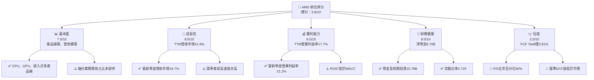

### 1.2 評分進度條視覺化

```text
╔══════════════════════════════════════════════════════════════╗
║              AMD 多維度評分儀表板（1–10分）                  ║
╠══════════════════════════════════════════════════════════════╣
║ 基本面強度  7.0 ▓▓▓▓▓▓▓▓▓▓▓▓▓▓░░░░░░  ★★★★☆              ║
║ 成長動能    8.5 ▓▓▓▓▓▓▓▓▓▓▓▓▓▓▓▓▓░░░  ★★★★☆              ║
║ 獲利品質    6.0 ▓▓▓▓▓▓▓▓▓▓▓▓░░░░░░░░  ★★★☆☆              ║
║ 財務健康    8.0 ▓▓▓▓▓▓▓▓▓▓▓▓▓▓▓▓░░░░  ★★★★☆              ║
║ 估值合理性  2.0 ▓▓▓▓░░░░░░░░░░░░░░░░  ★☆☆☆☆              ║
║ 護城河深度  6.5 ▓▓▓▓▓▓▓▓▓▓▓░░░░░░░░░  ★★★☆☆              ║
║ 管理層執行  6.5 ▓▓▓▓▓▓▓▓▓▓▓░░░░░░░░░  ★★★☆☆              ║
║ 技術創新力  8.0 ▓▓▓▓▓▓▓▓▓▓▓▓▓▓▓▓░░░░  ★★★★☆              ║
╠══════════════════════════════════════════════════════════════╣
║ 綜合總分    5.8 ▓▓▓▓▓▓▓▓▓▓▓▓░░░░░░░░  🟡 品質佳、價格昂貴  ║
╚══════════════════════════════════════════════════════════════╝
```

### 1.3 五大投資論點 + 三大核心風險

| 類型 | 項目 | 具體依據 | 信心度 |
|------|------|----------|--------|
| 🟢 **投資論點①** | 多產品線帶來收入來源分散 | 公司涵蓋 Data Center、Client and Gaming、Embedded；TTM 營收 **$45.44B** | 🟢 高 |
| 🟢 **投資論點②** | 營收與獲利正在擴張 | 最新季度營收年增 **44.7%**、EPS 年增 **93.8%**、淨利年增 **95.3%** | 🟢 高 |
| 🟢 **投資論點③** | 資產負債表有資金彈性 | 現金及短期投資 **$15.78B**、VERIFIED 淨現金 **$8.70B** | 🟢 高 |
| 🟢 **投資論點④** | 研發投入具規模 | FY2025 R&D **$8.09B**；有能力維持多代產品設計與軟體投入 | 🟡 中 |
| 🟢 **投資論點⑤** | 最新季度營業槓桿改善 | 季營業利益 **$2.83B**，占季營收約 **21.2%**；高於 TTM 營業利益率 **17.7%** | 🟡 中 |
| 🟡 **風險①** | AI 市場競爭與產品落地 | NVDA 最新季度年增 **105.9%**，高於 AMD **44.7%**；AMD 軟體採用與供應能力會影響成長轉化 | 🟡 中 |
| 🔴 **風險②** | 估值對成長預期高度敏感 | P/S **19.5x**，五年百分位 **90%**；FCF Yield **0.81%** | 🔴 高 |
| 🔴 **風險③** | 資本回報未覆蓋資本成本 | ROIC **12.8%** vs WACC **17.73%**；EVA 差額約 **-4.93pp** | 🔴 高 |

### 1.4 快速統計卡片

| 指標 | 公司實際值 | 行業參考 | S&P 500 參考 | 狀態 |
|------|-------------|----------|--------------|------|
| TTM 收入成長 | **41.9%** | N/A；同業成長分歧大 | N/A | 🟢 |
| 最新季度收入 YoY | **44.7%** | NVDA 105.9%、AVGO 85.5%、INTC 20.9% | N/A | 🟢 |
| 毛利率 | **56.0%** | 同業毛利率約 40.2%–75.5% | N/A | 🟡 |
| 淨利率 | **16.8%** | N/A | N/A | 🟡 |
| ROE | **11.1%**（VERIFIED） | N/A | N/A | 🟡 |
| Forward P/E | **30.19x** | 同業約 10.3x–33.3x | N/A | 🔴 |
| FCF Yield | **0.81%** | 同業一致口徑未提供 | N/A | 🔴 |

> 行業及 S&P 500 均值資料包未提供可比口徑數據，因此不以非一致來源填入虛假均值。表內 N/A 表示缺乏可核驗的同口徑基準。

### 1.5 投資結論

```text
╔══════════════════════════════════════════════════════════════════╗
║                    📊 投資結論摘要                               ║
╠══════════════════════════════════════════════════════════════════╣
║  評級：🔴 賣出（依 MOS 規則，未作質化調整）                     ║
║  價格（2026-11-13 收盤）：$534.06                               ║
║  DCF 內在價值（基準）：$62.30（現價溢價約 757.2%）              ║
║  加權合理價值：$213.41                                          ║
║  安全邊際 MOS：-150.2%（以加權合理價值為分母）                  ║
║  目標價區間：                                                    ║
║    悲觀情境：$32.10（相對現價 -94.0%）                          ║
║    基準情境：$62.30（相對現價 -88.3%）← DCF 12個月基準          ║
║    樂觀情境：$126.00（相對現價 -76.4%）                         ║
║  12個月加權參考價：$213.41（相對現價 -60.0%）                   ║
║  投資評分：5.8/10                                                ║
║  適合投資人：能承受高波動、看重長期產品競爭力者；不適合價值型     ║
╚══════════════════════════════════════════════════════════════════╝
```

---

## 2. 公司概覽與商業模式

### 2.1 業務結構與收入來源

資料包提供業務線描述，但沒有 FY2026 Q3 各部門營收及分部占比，因此下圖不臆造金額或百分比。

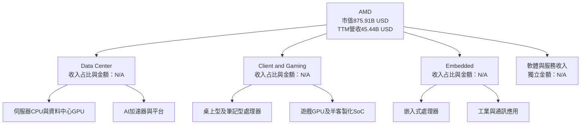

AMD 的商業模式以設計與銷售半導體產品為主，包含 CPU、GPU、AI 加速器、嵌入式處理器及半客製化 SoC。公司以產品迭代、架構設計、代工夥伴製造與 OEM／雲端客戶導入形成供應鏈。軟體與服務對硬體銷售的附加價值重要，但資料包未提供獨立軟體收入，故不將其列為已驗證收入來源。

### 2.2 市場份額

AMD、NVIDIA、Intel 之間的市場份額資料未在財務數據包中提供，而且 GPU、伺服器 CPU、PC CPU 及嵌入式市場的分母不同，不宜以單一市占率混算。以下以資料缺口示意，不代表實際份額：

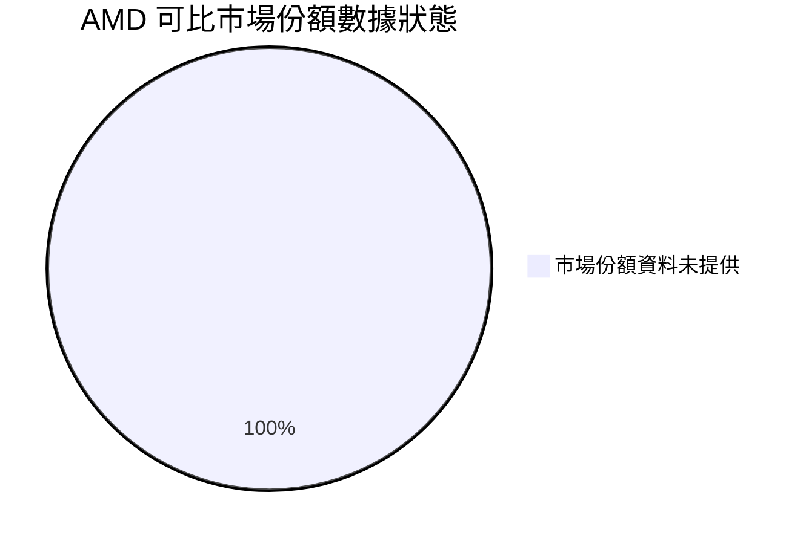

**分析含義**：無可核驗份額數據時，應以營收成長、產品出貨、客戶採用與毛利率變化追蹤競爭地位，而非把市場規模推測當成實績。

### 2.3 競爭護城河分析

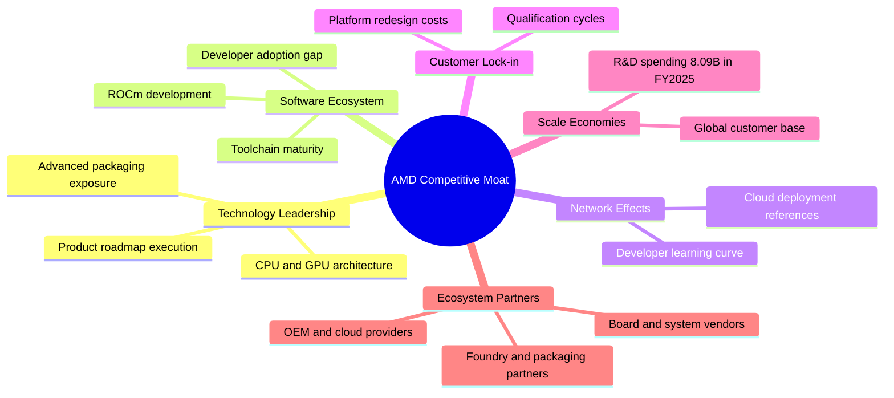

- **技術與產品組合**：FY2025 研發支出 **$8.09B**，約 FY2025 營收 **$34.64B** 的 **23.4%**。高研發投入支援產品迭代，但能否轉成市場份額與現金流仍需觀察。
- **軟體生態**：AI 加速器市場不只競爭晶片效能，也競爭框架、工具鏈、部署經驗及開發者生態。資料包沒有 ROCm 採用指標，應以客戶量產部署和軟體支援進展驗證。
- **客戶鎖定與切換成本**：伺服器與企業平台需經過認證、軟體驗證及系統整合，轉換成本提供一定黏著度，但雲端客戶仍有多供應商議價能力。
- **規模經濟**：研發規模大，且 TTM 營業利益率 **17.7%**、最新季度 **21.2%**，顯示營收規模擴大可能改善費用吸收。

### 2.4 護城河強度評分

```text
╔══════════════════════════════════════════════════════════════╗
║                  AMD 護城河強度評分                          ║
╠══════════════════════════════════════════════════════════════╣
║ 技術與產品組合  8/10  ▓▓▓▓▓▓▓▓▓▓▓▓▓▓▓▓░░░░  🟢              ║
║ 軟體生態        5/10  ▓▓▓▓▓▓▓▓▓▓░░░░░░░░░░  🟡              ║
║ 網路效應        5/10  ▓▓▓▓▓▓▓▓▓▓░░░░░░░░░░  🟡              ║
║ 客戶轉換成本    6/10  ▓▓▓▓▓▓▓▓▓▓▓▓░░░░░░░░  🟡              ║
║ 規模與研發投入  8/10  ▓▓▓▓▓▓▓▓▓▓▓▓▓▓▓▓░░░░  🟢              ║
║ 生態合作        7/10  ▓▓▓▓▓▓▓▓▓▓▓▓▓▓░░░░░░  🟢              ║
╠══════════════════════════════════════════════════════════════╣
║ 綜合護城河      6.5/10 ▓▓▓▓▓▓▓▓▓▓▓▓▓░░░░░░░  🟡              ║
╚══════════════════════════════════════════════════════════════╝
```

---

## 3. 損益表深度分析

### 3.1 年度收入成長趨勢

年度數字採提供的年度損益表，單位為美元；CAGR 以 FY2022–FY2025 三年期間計算。

```text
╔══════════════════════════════════════════════════════════════════╗
║              AMD 年度收入趨勢（FY2022–FY2025）                   ║
╠══════════════════════════════════════════════════════════════════╣
║ FY2022  $23.60B  ██████████████░░░░░░░░░░░  YoY：N/A（起始年）  ║
║ FY2023  $22.68B  █████████████░░░░░░░░░░░░  YoY：-3.9%   🔴     ║
║ FY2024  $25.79B  ███████████████░░░░░░░░░░  YoY：+13.7%  🟢     ║
║ FY2025  $34.64B  ████████████████████░░░░░  YoY：+34.3%  🟢     ║
╠══════════════════════════════════════════════════════════════════╣
║  FY2022–FY2025 CAGR：約 13.6%                                    ║
╚══════════════════════════════════════════════════════════════════╝
```

計算：`($34.64B ÷ $23.60B)^(1/3) − 1 ≈ 13.6%`。FY2023 收入下滑 **3.9%**，其後 FY2024、FY2025 回升；TTM **$45.44B** 與 VERIFIED TTM 成長 **41.9%** 顯示最近一年的增速明顯高於 FY2022–FY2025 CAGR，但該速度未必可長期線性延續。

### 3.2 季度收入趨勢分析

| 季度 | 營收 | QoQ 成長 | YoY 成長 | 備註 |
|------|------:|------:|------:|------|
| 2025 Q4 | $10.270B | +11.1% | +34.1% | 與 2025 Q3 $9.246B 比較 |
| 2026 Q1 | $10.253B | -0.2% | +37.9% | 以資料包列示季度收入計算 |
| 2026 Q2 | $11.536B | +12.5% | +50.1% | YoY 來自季度資料 |
| 2026 Q3 | $13.377B | +16.0% | **+44.7%** | 最新單季 YoY，非 TTM |

QoQ 公式以相鄰季度營收計算，例如 2026 Q3：`$13.377B ÷ $11.536B − 1 = 16.0%`。最新季度營收持續增加，但 YoY 由 Q2 的 **50.1%** 降至 Q3 的 **44.7%**，可能是比較基期提高；後續需同時觀察絕對營收增量與毛利，而不只看成長率。

### 3.3 利潤率演變分析

| 利潤率指標 | FY2022 | FY2023 | FY2024 | FY2025 | TTM／最新季 | 趨勢與評估 |
|------------|------:|------:|------:|------:|------:|------|
| **毛利率** | 44.9% | 46.1% | 49.3% | 49.5% | TTM **56.0%** | 🟢 TTM 提高；產品組合與高價產品占比可能是因素，分部資料未提供 |
| **營業利益率** | 5.3% | 1.8% | 8.1% | 10.7% | TTM **17.7%**；季度資料另列 **21.2%** | 🟢 費用吸收改善；季度來源口徑有差異 |
| **淨利率** | 5.6% | 3.8% | 6.4% | 12.5% | TTM **16.8%** | 🟢 獲利成長快於營收；稅項及一次性項目需核對 |
| **EBITDA 利潤率** | N/A | N/A | N/A | 約 21.0%（依年度表） | TTM **24.5%** | 🟢 但各來源定義可能不完全一致 |

> 年度毛利率依「總毛利 ÷ 總收入」計算；例如 FY2025 `$17.15B ÷ $34.64B ≈ 49.5%`。TTM 毛利率依 VERIFIED FIGURES 原值 **56.0%**。季度單季營業利益率資料一處為 **21.2%**，另一匯總區塊列 **17.8%**，本文保留 VERIFIED FIGURES 的 **21.2%** 作最新季度口徑並提示來源差異。

**利潤率演變深度解析**：TTM 毛利率 **56.0%** 與 FY2025 約 **49.5%** 的差距，代表產品組合或當期成本結構可能改善，但資料包沒有分部毛利、產品組合或一次性項目明細，不能直接認定為永久性提升。若 AI 加速器、伺服器 CPU 等高價產品占比提高，可能推升毛利和營業槓桿；若價格競爭、封裝供應成本或產品轉換成本提高，則可能反向壓縮。

### 3.4 費用結構分析

FY2025 R&D 約 **$8.09B**，營收 **$34.64B**，研發費用占營收約 **23.4%**。FY2025 營業利益表列約 **$3.69B**。資料未提供完整 SG&A、成本、SBC 分類及其他營業費用分項；下圖僅呈現已知支出項目，不代表損益表完整占比。

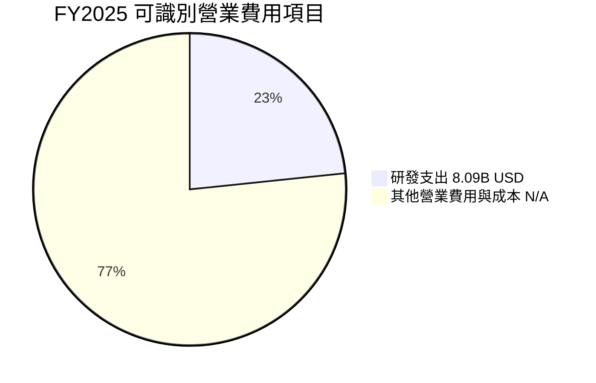

```text
╔══════════════════════════════════════════════════════════════╗
║             FY2025 成本與營業費用觀察                         ║
╠══════════════════════════════════════════════════════════════╣
║ 營收              $34.64B  ████████████████████              ║
║ 研發支出          $ 8.09B  █████                              ║
║ 研發／營收          23.4%  ████████████░░░░░░░░               ║
║ 營業利益          $ 3.69B  ██                                 ║
║ 未列明成本／費用      N/A  詳細拆分資料未提供                 ║
╚══════════════════════════════════════════════════════════════╝
```

### 3.5 季度 EPS 趨勢與盈餘品質

過去四季 EPS actual 依 StockAnalysis 季度序列整理；Earnings History 的估計值欄均為 `nan`，因此無法核實「超預期／不及預期」，不將 EPS 年增誤當成財報 surprise。

| 季度 | EPS Actual | EPS YoY | 超預期／不及預期 | 觀察 |
|------|------:|------:|------|------|
| 2025 Q4 | $0.93 | +217.1% | N/A | 估計 EPS 未提供，無法判定 beat／miss |
| 2026 Q1 | $0.85 | +91.2% | N/A | EPS 年增，但 QoQ 低於 2025 Q4 |
| 2026 Q2 | $1.41 | +159.5% | N/A | 季度 EPS 回升 |
| 2026 Q3 | $1.48 | +93.8% | N/A | EPS 創資料序列高點；年增率低於 Q2 |

| 盈餘品質項目 | 數值／佔比 | 評估 |
|--------------|-----------|------|
| SBC / 營收 | 最近四季 SBC 約 `$0.486B+$0.487B+$0.503B+$0.523B=$1.999B`；除以 TTM 營收 `$45.44B` 約 **4.4%** | 🟡 SBC 有實質稀釋成本；採 GAAP EPS／GAAP EBIT 時已作為費用反映 |
| SBC / 營業現金流 | 約 `$1.999B ÷ $9.12B = 21.9%` | 🟡 非現金加回金額不小，觀察股數變化與回購抵銷 |
| FCF / 淨利 | VERIFIED TTM 淨利未直接提供；若以資料包 TTM 淨利率推估淨利約 `$45.44B×16.8%=$7.63B`，則比率約 **92.5%** | 🟡 此為估計比率，不是直接披露的 TTM 淨利 |
| 一次性／非經常性損益 | N/A | 無完整附註，無法判定是否美化或壓低盈餘 |
| 有效稅率異常 | 實際 TTM 有效稅率 N/A；估值採用假設 **21.0%** | 🟡 不能判斷當期稅率是否受稅務利益影響 |
| 資本化支出 vs 費用化 | TTM Capex **$2.07B**；資本化政策細節 N/A | 🟡 需留意資本化與折舊攤銷配比 |

**盈餘品質結論**：TTM FCF **$7.06B** 與約 **$7.63B** 的估計淨利相近，初步現金轉換尚可；但淨利估計受來源口徑影響，不能當成精確品質指標。SBC 約占 TTM 營收 **4.4%**、營業現金流 **21.9%**，對股東經濟回報並非零成本。估值模型採 GAAP EBIT 並固定股數，以避免將 SBC 重複扣除或完全漏計。

---

## 4. 資產負債表分析

### 4.1 資產結構分解

以下依 TTM 資產負債表區塊，總資產 **$94.812B**；非流動資產按總資產減流動資產計算為 **$55.341B**，屬算術差額，不是另行披露的財務項目。

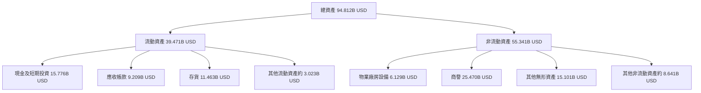

**解讀**：應收帳款 **$9.209B**、存貨 **$11.463B**，合計約占流動資產 **52.4%**。營收高速成長時，存貨與應收增幅須與銷售增幅比較；若庫存成長持續快於營收，可能預示產品轉換或需求預測風險。商譽與無形資產合計 **$40.571B**，約占總資產 **42.8%**，併購資產減損應列入長期監控。

### 4.2 流動性指標分析

| 指標 | 最新值 | 歷史／基準 | 行業均值 | 評估 |
|------|------:|------|------|------|
| 流動比率 | **2.725** | FY2025 資產負債表口徑約 `26.95÷9.46=2.85` | N/A | 🟢 短期償債緩衝足 |
| 速動比率 | **1.725** | 歷史同口徑 N/A | N/A | 🟢 排除存貨後仍高於 1 |
| 現金及短期投資 | **$15.78B** | FY2025 **$10.55B** | N/A | 🟢 資金增加 |
| 淨現金 | **$8.70B** | VERIFIED FIGURES | N/A | 🟢 可支持研發及營運 |
| 流動資產 | **$39.471B** | FY2025 **$26.947B** | N/A | 🟢 資產規模擴大 |

### 4.3 債務結構分析

```text
╔══════════════════════════════════════════════════════════════════╗
║                   AMD 債務健康診斷                               ║
╠══════════════════════════════════════════════════════════════════╣
║ 總債務（VERIFIED）       $ 7.08B  ███░░░░░░░░░░░░░░░░░  🟢     ║
║ 現金及短期投資           $15.78B  ████████████████████  🟢     ║
║ 淨現金（VERIFIED）       $ 8.70B  ███████████░░░░░░░░░  🟢     ║
║ 總債務（另一來源）       $ 9.21B  口徑差異；不取代 VERIFIED 值 ║
║ Debt / EBITDA（估算）     0.64x  $7.08B ÷ ($45.44B×24.5%)     ║
║ 利息保障倍數             N/A     利息費用及一致口徑 EBIT 不足   ║
╚══════════════════════════════════════════════════════════════════╝
```

Debt/EBITDA 僅為以 VERIFIED 總債務除以「TTM 營收 × EBITDA 利潤率」的估算：`$7.08B ÷ ($45.44B×24.5%) ≈ 0.64x`。因另一來源列示債務 **$9.21B**，且不同來源可能對租賃及借款範圍不同，該槓桿估算只作指示，不取代正式債務附註。

### 4.4 股東權益趨勢

| 年度 | 股東權益 | 年增額 | 年增率 |
|------|------:|------:|------:|
| FY2022 | $54.75B | N/A | N/A |
| FY2023 | $55.89B | +$1.14B | +2.1% |
| FY2024 | $57.57B | +$1.68B | +3.0% |
| FY2025 | $63.00B | +$5.43B | +9.4% |

```text
╔══════════════════════════════════════════════════════════════╗
║                  AMD 股東權益趨勢                             ║
╠══════════════════════════════════════════════════════════════╣
║ FY2022  $54.75B  █████████████████░░░░░░░░░░░░░░░░           ║
║ FY2023  $55.89B  ██████████████████░░░░░░░░░░░░░░            ║
║ FY2024  $57.57B  ███████████████████░░░░░░░░░░░              ║
║ FY2025  $63.00B  █████████████████████░░░░░░░░░              ║
╚══════════════════════════════════════════════════════════════╝
```

---

## 5. 現金流量深度分析

### 5.1 現金流量瀑布圖

淨利 TTM 精確金額未在 VERIFIED FIGURES 中提供，圖中保留 N/A，不以估計淨利混入實際現金流瀑布。

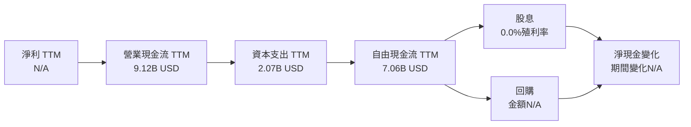

### 5.2 FCF 轉換率趨勢

| 年度 | FCF | 淨利 | FCF／淨利 | 評估 |
|------|------:|------:|------:|------|
| FY2022 | $3.12B | $1.32B | 236.4% | 🟢 高轉換；年度營運資金及現金流波動可能影響比例 |
| FY2023 | $1.12B | $0.854B | 131.1% | 🟢 仍高於淨利 |
| FY2024 | $2.40B | $1.64B | 146.3% | 🟢 現金轉換穩定 |
| FY2025 | $6.74B | $4.33B | 155.7% | 🟢 現金流增幅高於淨利 |
| TTM | **$7.06B** | 精確 TTM 淨利 N/A | N/A | 無直接分母，不反推淨利 |

FY2025 FCF 相對 FY2024 增加 `$6.74B−$2.40B=$4.34B`，增幅約 **180.8%**。營業現金流由 **$3.04B** 增至 **$7.71B**，顯示獲利與營運資金轉現改善；仍須追蹤存貨和應收帳款增加是否吞噬未來現金。

### 5.3 自由現金流趨勢

```text
╔══════════════════════════════════════════════════════════════════╗
║            自由現金流：歷史實際與 TTM                          ║
╠══════════════════════════════════════════════════════════════════╣
║ FY2022  $3.12B  █████████░░░░░░░░░░░░  FCF Yield：N/A           ║
║ FY2023  $1.12B  ███░░░░░░░░░░░░░░░░░  FCF Yield：N/A           ║
║ FY2024  $2.40B  ███████░░░░░░░░░░░░░  FCF Yield：N/A           ║
║ FY2025  $6.74B  ███████████████████░  FCF Yield：N/A           ║
║ TTM     $7.06B  ████████████████████  FCF Yield：0.81%          ║
╠══════════════════════════════════════════════════════════════════╣
║ TTM FCF 定義：營業現金流 $9.12B − 資本支出 $2.07B               ║
║ 依 VERIFIED FIGURES 原值引用；不以其他 FCF 定義取代             ║
╚══════════════════════════════════════════════════════════════════╝
```

> 資料包中 TTM 營業現金流減 TTM 資本支出的展示值為 **$7.06B**；直接用已四捨五入的 `$9.12B−$2.07B` 得 `$7.05B`，屬來源未四捨五入前數值造成的約 **$0.01B** 差異。本文依要求引用 VERIFIED FCF **$7.06B**，不以四捨五入後的顯示數字替代。

### 5.4 資本配置評估

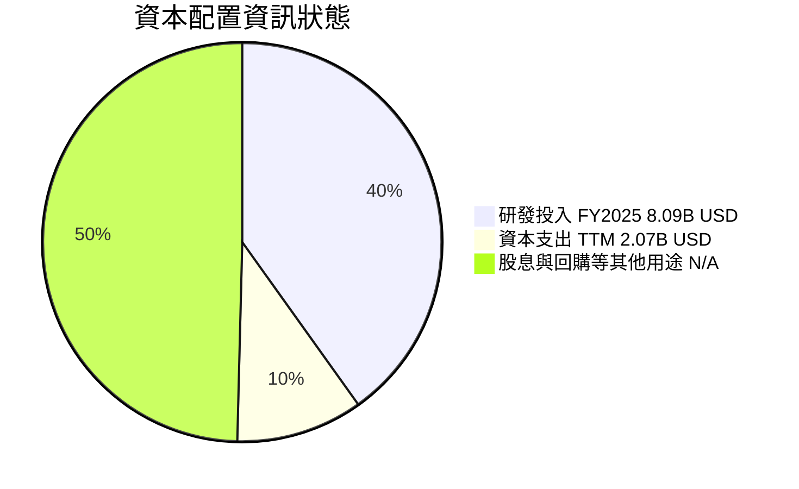

| 用途 | 可核驗數字 | 評估 |
|------|------:|------|
| 研發 | FY2025 **$8.09B** | 高投入支援產品迭代，約占 FY2025 營收 **23.4%** |
| 資本支出 | TTM **$2.07B** | 對設計型半導體公司而言屬重要投資項目，但產能支出還需結合代工與封裝安排判斷 |
| 股息 | 殖利率 **0.0%** | 現金回饋以股息為主的投資者不適配 |
| 回購 | 金額 N/A | 無法評估是否充分抵銷 SBC 稀釋 |
| 留存現金 | 現金及短期投資 **$15.78B** | 增強研發、營運及併購彈性 |

---

## 6. 獲利能力與資本效率

### 6.1 ROE／ROA／ROIC 趨勢

| 指標 | FY2022 | FY2023 | FY2024 | FY2025／TTM | 行業均值 | 評估 |
|------|------:|------:|------:|------:|------:|------|
| ROE | N/A | N/A | N/A | **11.1% TTM VERIFIED** | N/A | 🟡 有正回報，但未顯示高資本效率 |
| ROA | N/A | N/A | N/A | **5.9%** | N/A | 🟡 |
| ROIC | N/A | N/A | N/A | **12.8% TTM VERIFIED** | N/A | 🔴 低於參考 WACC |
| 營業利益率 | 5.3% | 1.8% | 8.1% | **17.7% TTM** | N/A | 🟢 獲利改善，但 ROIC 尚未超過資本成本 |

### 6.2 ROIC vs WACC 分析（核心價值創造判斷）

```text
╔══════════════════════════════════════════════════════════════════╗
║                ROIC vs WACC 深度分析                            ║
╠══════════════════════════════════════════════════════════════════╣
║ WACC 參考輸入：                                                  ║
║ ├── 無風險利率 Rf（10Y美債）：       5.15%                       ║
║ ├── 市場風險溢酬 ERP：              5.00%                       ║
║ ├── Beta：                          2.54                        ║
║ ├── 股權成本 Ke：                   5.15% + 2.54×5.00% = 17.85% ║
║ │   VERIFIED Ke 原值：              17.86%                      ║
║ ├── 稅前債務成本 Kd：               1.85%                       ║
║ ├── 資本結構 E/D：                  99.2% / 0.8%                ║
║ └── VERIFIED 參考 WACC：            17.73%                      ║
║                                                                  ║
║ ROIC（TTM，VERIFIED）：             12.8%                       ║
║ EVA 差額：                          12.8% − 17.73% = -4.93pp   ║
║ ROIC / WACC：                       12.8% ÷ 17.73% = 0.72x     ║
║                                                                  ║
║ ROIC  12.8%  ▓▓▓▓▓▓▓▓▓▓▓▓▓▓░░░░░░  🔴                          ║
║ WACC  17.73% ▓▓▓▓▓▓▓▓▓▓▓▓▓▓▓▓▓▓░░  ──                          ║
║ EVA   -4.93pp ██████████░░░░░░░░░░  🔴 尚未覆蓋資本成本         ║
╠══════════════════════════════════════════════════════════════════╣
║ 結論：依資料包所給 ROIC 定義，AMD TTM ROIC 低於資本成本，         ║
║       當前新增投入資本的回報尚未顯示為正經濟利潤。               ║
╚══════════════════════════════════════════════════════════════════╝
```

CAPM 以 VERIFIED 參考輸入計算：`5.15% + 2.54×5.00% = 17.85%`，而資料包給定 Ke **17.86%**，差異為輸入未四捨五入造成；本文 WACC 一律採 VERIFIED **17.73%**。Beta 約 **2.54**，意味股價對市場波動敏感。ROIC 的 12.8% 與 WACC 差距為負，代表即便營收成長很快，若新增投入資本不能提高回報，成長本身未必創造股東價值。

### 6.3 杜邦三因素分解

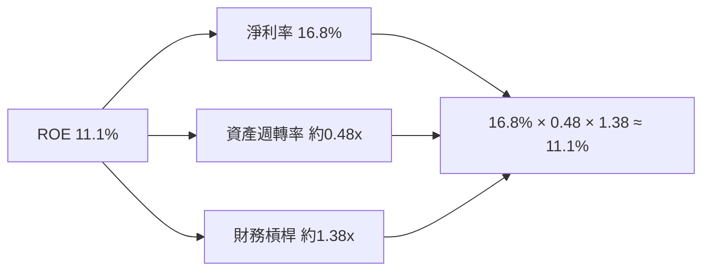

資產週轉率採 TTM 營收除以 FY2025 總資產作近似：`$45.44B÷$76.93B≈0.59x`；若採 TTM 資產 **$94.812B** 則約 **0.48x**。由於 ROE、總資產及淨利來源期間不完全一致，圖中的乘積僅作近似解釋，並非完全同期間、同口徑的正式杜邦重建。ROE 官方 TTM 值採 **11.1%**。

### 6.4 獲利能力儀表板

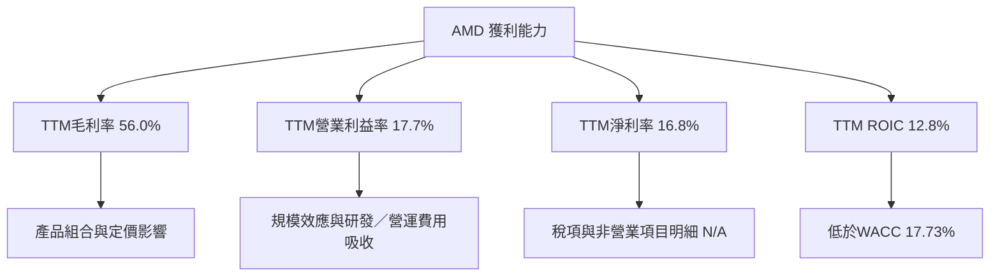

---

## 7. 相對估值分析

### 7.1 同業估值比較

同業倍數依 VERIFIED FIGURES 的 Peer multiples；AMD 自身倍數取資料包估值區塊。注意 AMD 的 trailing P/E 在不同區塊約 **114.1x–116.1x**，本表採 VERIFIED 歷史估值區間現值 **116.1x**；市場資料區塊的 P/E 僅作口徑差異提示。

| 估值指標 | **AMD** | **NVDA** | **INTC** | **AVGO** | AMD 評估 |
|----------|------:|------:|------:|------:|------|
| **Trailing P/E** | 116.1x | 20.6x | N/A | 44.3x | 🔴 高；盈餘基期和來源定義可能不同 |
| **Forward P/E** | 30.19x | 10.3x | 33.3x | 17.9x | 🟡 不低於多數同業，需靠 EPS 成長兌現 |
| **P/S TTM** | 19.5x | 13.0x | 5.3x | 18.6x | 🔴 接近 AVGO 且高於其自身五年中位數 |
| **EV/EBITDA TTM** | 109.1x | 19.8x | 17.7x | 34.0x | 🔴 AMD 倍數明顯偏高；資料來源口徑需留意 |
| **最新季度收入 YoY** | 44.7% | 105.9% | 20.9% | 85.5% | 🟡 高成長，但同業 NVDA、AVGO更快 |
| **毛利率 TTM** | 56.0% | 74.7% | 40.2% | 75.5% | 🟡 毛利低於 NVDA、AVGO，高於 INTC |

> AMD P/E、EV/EBITDA 在多個資料區塊存在差異：例如市場估值區塊 EV/EBITDA **85.558x**，VERIFIED 歷史估值區間為 **109.1x**。本表使用題目要求的 VERIFIED 自身歷史估值數據，倍數比較宜視為方向性，而非完全消除口徑差異後的精確相對價值。

### 7.2 歷史估值區間分析

```text
╔══════════════════════════════════════════════════════════════════╗
║               AMD 五年 TTM 估值區間                              ║
╠══════════════════════════════════════════════════════════════════╣
║ P/E        36.7x ├──────── 中位數 82.6x ───────────● 116.1x     ║
║                         區間上限 934.7x；目前百分位：53%         ║
║ P/S         4.3x ├──── 中位數 8.9x ───────────────────● 19.5x   ║
║                         區間上限 23.1x；目前百分位：90%          ║
║ EV/EBITDA  38.2x ├──────── 中位數 102.2x ──● 109.1x             ║
║                         區間上限 919.2x；目前百分位：61%         ║
╚══════════════════════════════════════════════════════════════════╝
```

歷史 P/E 與 EV/EBITDA 的區間上限極高，可能受盈利基期低或分母接近零影響，故百分位不宜單獨視為合理價訊號。P/S 現值 **19.5x**、五年百分位 **90%**，相較中位數 **8.9x** 高約 **119.1%**，是較清晰的估值警訊。

### 7.3 情境目標價（假設驅動，Bear / Base / Bull）

以下為相對估值情境，採 Forward EPS **$17.69068** 乘以對應退出 P/E。倍數取自同業 Forward P/E 範圍並依情境調整；營收 CAGR 與營業利益率是情境假設，不是公司指引。

| 情境 | 營收 CAGR（假設） | 期末營業利潤率（假設） | 退出 Forward P/E | 隱含目標價 | 相對現價 |
|------|-----------:|-----------:|-----------:|------:|------:|
| 🔴 悲觀 | 15% | 18% | 12.0x | **$212.29** | **-60.2%** |
| 🟡 基準 | 25% | 22% | 17.9x | **$316.66** | **-40.7%** |
| 🟢 樂觀 | 35% | 26% | 30.0x | **$530.72** | **-0.6%** |

算式：悲觀 `$17.69068×12.0=$212.29`；基準 `$17.69068×17.9=$316.66`；樂觀 `$17.69068×30.0=$530.72`。退出倍數只是情境參數，並非已知公司市場共識。Forward EPS 本身來自資料包估值區塊，未提供一致的預測期間與估計來源，需視為外部市場預估值。

### 7.4 相對估值隱含價格區間

| 方法 | 算式／假設 | 隱含每股價值 |
|------|-------------|-------------:|
| Forward P/E | `$17.69068 × 同業 Forward P/E 中位數 17.9x` | **$316.66** |
| EV/EBITDA | TTM EBITDA 估算 `$45.44B×24.5%=11.13B`；乘同業中位數 19.8x，再加淨現金、除以 1.64B 股 | **$139.71** |
| EV/Sales | 同業 P/S 中位數估算 `(13.0+5.3+18.6)/3=12.3x`；以 TTM 收入估算並加淨現金 | **約 $350** |
| FCF Yield 回推 | 假設要求報酬率 2.0%（假設值，非同業已驗證數據）；`$7.06B÷2.0%÷1.64B` | **$215.24** |
| 現價 | 2026-11-13 收盤 | **$534.06** |

EV/Sales 算式估值以約 12.3x 的同業 P/S 均值代理，並未將不同業務組合差異完全調整，因此只作粗略交叉驗證。FCF Yield 2.0% 是分析假設；因同業 FCF Yield 未提供，不可當成已核驗的市場平均值。

---

## 8. DCF 內在價值評估（Discounted Cash Flow）

> **口徑說明**：基準 DCF 使用 FCFF，對應 WACC 折現並先求 EV；使用 GAAP EBIT，視為 SBC 已在費用中扣除。本模型採組合 **(A)**：GAAP EBIT、FCFF 不再減 SBC、股數固定，年稀釋率設為 0%。因此 SBC 影響已計入一次。該選擇在本模型內一致，但由於固定股數忽略未來新增稀釋，模型可能高估每股價值。

### 8.0 估值推理鏈（Thinking Logic）

**Step 1 — 價值由哪些變數決定？**  
AMD 企業價值可分為：① 已有 CPU、GPU、嵌入式業務現金流底盤（細分占營收未提供；以公司 TTM 營收 **$45.44B** 作整體基礎）；② 資料中心與 AI 加速器帶來的增量成長（分部營收占比 N/A）；③ 軟體生態與高階產品組合的選擇權（獨立收入 N/A）。本模型最主導的變數是 **營收成長轉化為可持續 FCFF 的能力**，其次為營業利潤率與折現率。

| 決策點 | 本報告採用 | 理由（含數字） | 曾考慮但否決 | 否決理由 |
|--------|-----------|----------------|--------------|----------|
| 現金流定義 | FCFF | 對應 WACC 折現；已知現金、債務可作 EV 橋接 | FCFE | 資本結構與租賃／借款口徑資料不完整 |
| 預測期 N | **5 年** | 產品週期及 AI 市場能見度有限；以五年避免假設高成長永續 | 10 年 | 遠期產品份額、價格與競爭不確定性太高 |
| 終值方法 | Gordon Growth 為主，退出倍數交叉驗證 | 能呈現長期穩態現金流 | 僅退出倍數 | 成熟期倍數未有公司可靠歷史錨點 |
| EBIT 基礎 | GAAP | 年度營業利益與財報口徑相符；避免忽略 SBC | 非 GAAP | 若加回 SBC 必須額外扣回，會增加模型假設 |
| SBC | 組合 (A) | GAAP 費用已含 SBC | (C) 固定股數但不扣 SBC | 會漏計股東成本 |

**Step 3 — 關鍵假設推導鏈**

- **營收 CAGR 25%**：錨點＝FY2022–FY2025 CAGR 約 **13.6%**、TTM 成長 **41.9%**、最新季度 YoY **44.7%** → 調整＝以 TTM 高成長作起點，但考慮基期變高與競爭，較最新成長率下調 → **採用 25%** → 曾考慮 35%，但高於歷史三年 CAGR 21.4 個百分點，作為基準過於進取，故只放入樂觀情境。
- **期末營業利潤率 22%**：錨點＝TTM **17.7%**、最新季度 **21.2%** → 調整＝假設規模效益及高價產品組合改善約 **+4.3pp** → **採用 22%** → 曾考慮 25%，但資料包沒有證據顯示長期毛利與費用率足以支持，故否決。
- **永續成長率 g 3%**：錨點＝長期名目經濟成長的中低單位數假設（估值假設，非資料包預測）→ 考量半導體長期成長但終值不應長期高於整體經濟 → **採用 3%** → 曾考慮 4%，因終值對 g 敏感且缺少明確長期市場份額支撐，故基準採較低值。
- **預測期 N=5 年**：錨點＝資料包提供 TTM 及年度趨勢，沒有五年以上公司指引 → **採用 5 年** → 曾考慮 10 年，因遠期產品競爭與週期性難以驗證而否決。
- **Capex／營收 4.56%**：錨點＝TTM `$2.07B÷$45.44B=4.55%` → **採用 4.56%**；沒有偏離錨點超過 2pp。
- **年稀釋率 0%**：錨點＝FY2022 至 FY2025 股數變化資料未完整一致；組合 (A) 要求固定股數 → **採用 0%**。若實際股數增加，現有每股價值會偏高。
- **終值方法 Gordon Growth**：錨點＝基準 WACC **17.73%** 高於 g **3.0%** → 分母為正，公式可用 → **採用 Gordon Growth 為主** → 退出倍數僅交叉驗證，避免單靠成熟期倍數。
- **WACC 17.73%**：錨點＝VERIFIED 參考 WACC **17.73%** → Beta **2.54** 使股權成本高；不自行降低 → **採用 17.73%** → 曾考慮使用較低調整 Beta，但缺少穩定期間資料，否決。

**Step 4 — 最脆弱一環**  
最脆弱假設是 **17.73% WACC** 與 **25% 五年營收 CAGR** 同時成立：若實際折現率較低，DCF 顯著上升；若營收增長或利潤率低於假設，估值則下降。本模型的 WACC 高，會壓低現值，敏感度章節量化此影響。

**Step 5 — 計算路徑圖**

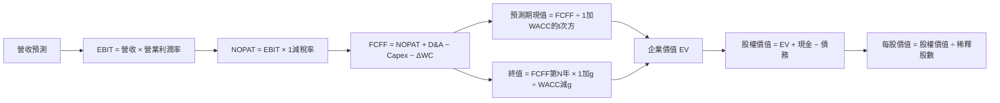

### 8.1 模型假設總表（Model Inputs）

| 假設項目 | 採用值 | 依據／來源 | 敏感度 |
|----------|--------|-------------|--------|
| 預測期長度 N | **5 年** | 產品周期能見度及有限的長期指引 | 🟡 中 |
| 營收 CAGR | **25%** | FY2022–FY2025 CAGR 13.6%；TTM 成長 41.9%；折衷後低於近期增速 | 🔴 高 |
| 期末營業利潤率 | **22%** | TTM 17.7%、最新季度 21.2%，假設持續有規模效應 | 🔴 高 |
| 有效稅率 | **21%** | VERIFIED 預設稅率 | 🟢 低 |
| Capex／營收 | **4.56%** | TTM Capex／TTM Revenue = 2.07／45.44 | 🟡 中 |
| D&A／營收 | **3.0%** | 假設值：缺少 TTM D&A；採略低於 Capex 的穩態比率，作保守建模參數 | 🟢 低 |
| ΔWC／營收增額 | **10%** | 假設值：應收與存貨占流動資產較高；沒有歷史 ΔWC 完整表，採增額營收的 10% | 🟢 低 |
| EBIT 基礎 | **GAAP EBIT** | 財報 GAAP 營業利益口徑，避免將 SBC 加回 | 🟡 中 |
| SBC 處理 | **組合 (A)** | GAAP EBIT 已含 SBC，不另扣 SBC；股數固定 | 🟡 中 |
| 年稀釋率 | **0%** | 受組合 (A) 約束；股數取最新流通股 **1.64B** | 🟡 中 |
| 永續成長率 g | **3.0%** | 長期穩態假設，低於 WACC；非公司指引 | 🔴 高 |
| 終值方法 | Gordon Growth 主、退出倍數驗證 | WACC 17.73% 大於 g 3.0% | 🔴 高 |
| WACC | **17.73%** | VERIFIED 參考值 | 🔴 高 |
| FCF 定義 | FCFF | `NOPAT + D&A − Capex − ΔWC` | — |
| 四捨五入 | 金額至 $0.1B；股價至 $0.01；比率至 0.1%；折現因子至 3 位 | 允許約 1% 四捨五入尾差 | — |

### 8.2 折現率推導（WACC）

```text
╔══════════════════════════════════════════════════════════════════╗
║                    WACC 推導（折現率）                           ║
╠══════════════════════════════════════════════════════════════════╣
║ 股權成本 Ke（CAPM）：                                             ║
║ ├── 無風險利率 Rf：                5.15%（資料包提供；日期未列）  ║
║ ├── ERP：                          5.00%（資料包假設）            ║
║ ├── Beta：                         2.54（資料包 Beta 2.542）      ║
║ ├── 規模／國別溢酬：               0.00%（美國公司，不另加）      ║
║ └── Ke：                           VERIFIED 17.86%                ║
║                                                                  ║
║ 債務成本 Kd：                                                     ║
║ ├── 稅前 Kd：                      1.85%（資料包參考值）          ║
║ ├── 稅率：                         21.0%                         ║
║ └── 稅後 Kd：                      1.85%×(1−21.0%)=1.4615%       ║
║                                                                  ║
║ 資本結構（VERIFIED 權重）：                                        ║
║ ├── 股權權重：                     99.2%                         ║
║ ├── 債務權重：                     0.8%                          ║
║ └── ✅ WACC：                      17.73%（VERIFIED 參考值）      ║
╚══════════════════════════════════════════════════════════════════╝
```

**逐步演算（五步）**

1. **Ke（CAPM）** = `Rf + β×ERP` = `5.15% + 2.54×5.00% = 17.85%`；VERIFIED Ke 為 **17.86%**，差異為輸入精度及 Beta 未四捨五入造成。
2. **稅前 Kd** = 利息費用資料未提供；引用 VERIFIED 參考值 **1.85%**。不能以缺失利息金額重新推導。
3. **稅後 Kd** = `1.85%×(1−21.0%) = 1.4615%`。
4. **權重** = VERIFIED 權重 E **99.2%**、D **0.8%**；兩者相加 `99.2%+0.8%=100.0%`。市值為 **$875.91B**、最新收盤價 **$534.06（2026-11-13）**，流通股數 **1.64B**；題目參考權重採用市值／債務市場權重，本文沿用原值。總債務口徑存在 **$7.08B** 與 **$9.21B** 差異，故不以另一組自行重算權重取代 VERIFIED 權重。
5. **WACC** = `99.2%×17.86% + 0.8%×1.4615%` = `17.7171% + 0.0117%` = **17.7288%** ≈ **17.73%**。

Rf 的觀察日期未提供，不能自行補寫日期；ERP 明確是資料包假設。債務成本與資本權重沿用 VERIFIED 參考輸入，以維持與第 6.2 節一致。因資料包總債務口徑不一致，WACC 的組成數值不應解讀為重新審計後的債務權重。

### 8.3 逐年自由現金流預測（基準情境）

收入以 TTM **$45.44B** 為 FY+0 起點，採 25% CAGR；營業利益率由 18.5% 逐年線性增加至 22.0%。D&A／營收 3.0%、Capex／營收 4.56%、ΔWC／增額營收 10%。所有數字為假設性模型輸出，非管理層財測。

| 年度 | FY+1 | FY+2 | FY+3 | FY+4 | FY+5（＝FY+N） |
|------|------:|------:|------:|------:|------:|
| 營收（$B） | 56.8 | 71.0 | 88.8 | 110.9 | 138.7 |
| 營收 YoY | 25.0% | 25.0% | 25.0% | 25.0% | 25.0% |
| 營業利潤率 | 18.5% | 19.4% | 20.3% | 21.2% | 22.0% |
| EBIT（GAAP，$B） | 10.5 | 13.8 | 18.0 | 23.5 | 30.5 |
| − 稅（21%，$B） | (2.2) | (2.9) | (3.8) | (4.9) | (6.4) |
| = NOPAT（$B） | 8.3 | 10.9 | 14.2 | 18.6 | 24.1 |
| + D&A（3.0%，$B） | 1.7 | 2.1 | 2.7 | 3.3 | 4.2 |
| − Capex（4.56%，$B） | (2.6) | (3.2) | (4.1) | (5.1) | (6.3) |
| − ΔWC（增額營收 10%，$B） | (1.1) | (1.4) | (1.8) | (2.2) | (2.8) |
| **= FCFF（$B）** | **6.3** | **8.4** | **11.1** | **14.6** | **19.2** |
| 折現因子 @17.73% | 0.849 | 0.721 | 0.612 | 0.520 | 0.442 |
| **FCFF 現值 PV（$B）** | **5.3** | **6.0** | **6.8** | **7.6** | **8.5** |

**逐步演算（FY+1）**

1. **營收** = `$45.44B×(1+25.0%) = $56.80B`。
2. **EBIT** = `$56.80B×18.5% = $10.508B`。
3. **稅** = `$10.508B×21.0% = $2.207B`。
4. **NOPAT** = `$10.508B−$2.207B = $8.301B`。
5. **D&A** = `$56.80B×3.0% = $1.704B`。
6. **Capex** = `$56.80B×4.56% = $2.590B`。
7. **ΔWC** = `($56.80B−$45.44B)×10.0% = $1.136B`。
8. **FCFF** = `$8.301B+$1.704B−$2.590B−$1.136B = $6.279B`，表格以一位小數列示 **$6.3B**。
9. **折現因子** = `1÷(1+17.73%)^1 = 0.849`；**PV** = `$6.279B×0.849 = $5.33B`，表格列示 **$5.3B**。

**預測期 FCF 現值合計**：`$5.3B+$6.0B+$6.8B+$7.6B+$8.5B=$34.2B`。

> 表格各列獨立四捨五入，逐年完整精度加總約 **$34.2B**；以表格顯示至一位小數直接加總可能有 $0.1B 左右尾差。本文橋接使用未四捨五入中間值後四捨五入的預測期現值 **$34.2B**。

**合理性自檢**

- 預測 FCFF 由約 **$6.3B** 增至 **$19.2B**，五年 CAGR 約 **25.0%**；歷史 FY2022–FY2025 FCF CAGR 因中間低基期及波動大，不宜用單一 CAGR 外推。
- FY+5 FCFF 利潤率約 `$19.2B÷$138.7B=13.8%`，高於 TTM FCF 利潤率 `$7.06B÷$45.44B=15.5%` 的比較並不成立於四捨五入數據？依精確比例約 **15.5%**；因此模型 FY+5 利潤率其實**低於目前 TTM FCF 利潤率**，主要因假設的營運資金投入及 Capex。
- 預測期 FCFF 全為正；若資本支出或營運資金需求超出假設，FCFF 會低於模型值。

```text
╔══════════════════════════════════════════════════════════════════╗
║            自由現金流：歷史實際 vs 模型預測                      ║
╠══════════════════════════════════════════════════════════════════╣
║ FY2023（實） $1.12B  ███░░░░░░░░░░░░░░░  YoY：-64.1%             ║
║ FY2024（實） $2.40B  ██████░░░░░░░░░░░░  YoY：+114.3%            ║
║ FY2025（實） $6.74B  █████████████░░░░░  YoY：+180.8%            ║
║ FY+1（預）   $6.28B  ████████████░░░░░░  模型值                  ║
║ FY+5（預）  $19.18B  ████████████████████  五年 FCFF CAGR約25%   ║
╠══════════════════════════════════════════════════════════════════╣
║ ⚠️ 歷史 FCF 波動大；預測取決於 25% 營收 CAGR 及營運資金假設      ║
╚══════════════════════════════════════════════════════════════════╝
```

### 8.4 終值計算（Terminal Value）

**適用性檢查**：`WACC 17.73% vs g 3.0% → WACC > g？✅`

| 方法 | 計算式 | 終值 TV | TV 現值 | 佔總 EV 比重 |
|------|--------|--------:|--------:|------------:|
| Gordon Growth | `FCFF(FY+5)×(1+g)÷(WACC−g)` | 約 **$134.1B** | 約 **$59.3B** | 約 **63.4%** |
| 退出倍數法 | FY+5 EBITDA 估算約 **$34.7B×19.8x** | 約 **$686.5B** | 約 **$303.4B** | 約 **89.9%**（相對其交叉 EV） |

Gordon Growth 為主方法。退出倍數 **19.8x** 取 NVDA 同業 EV/EBITDA 倍數作參考，但成熟期 AMD 的倍數可能低於高成長 AI 競爭者，因此此法僅作交叉檢驗；兩法差異遠超過 25%，故不以退出倍數取代 Gordon Growth。

**Gordon Growth 逐步演算**

1. **FY+5 FCFF** = `$19.2B`（未四捨五入模型值約 `$19.18B`）。
2. **分子** = `$19.18B×(1+3.0%) = $19.755B`。
3. **分母** = `17.73%−3.00%=14.73%`；**TV** = `$19.755B÷14.73%≈$134.1B`。
4. **PV(TV)** = `$134.1B×0.442≈$59.3B`。
5. **終值佔比** = `$59.3B÷($34.2B+$59.3B)=63.4%`。

退出倍數交叉驗證：`FY+5 EBITDA≈$138.7B×(22.0%+3.0%)=$34.7B`；`$34.7B×19.8x≈$686.5B`；`$686.5B×0.442≈$303.6B`。該結果顯著高於 Gordon Growth，顯示同業當前倍數不宜直接代表成熟期終值。終值現值占 EV 約 **63.4%**，估值仍明顯依賴終值假設。

### 8.5 企業價值 → 每股內在價值（Bridge）

```text
╔══════════════════════════════════════════════════════════════════╗
║              企業價值 → 每股內在價值 橋接表                      ║
╠══════════════════════════════════════════════════════════════════╣
║ 預測期 FCF 現值合計             +$34.2B                          ║
║ 終值現值 PV(TV)                 +$59.3B                          ║
║ ─────────────────────────────────────────────                   ║
║ = 企業價值 EV                    $93.5B                          ║
║ + 現金及短期投資                +$15.78B                         ║
║ − 總債務                        −$7.08B                          ║
║ − 少數股東權益／其他             $0.00B（資料未提供，假設為零）   ║
║ ─────────────────────────────────────────────                   ║
║ = 股權價值                       $102.2B                         ║
║ ÷ 稀釋後流通股數                 1.64B 股                        ║
║ ─────────────────────────────────────────────                   ║
║ ★ 每股內在價值                   $62.30                          ║
║ 當前股價                         $534.06                         ║
║ 折溢價                           約 +757.2%（溢價）              ║
╚══════════════════════════════════════════════════════════════════╝
```

**逐步演算（橋接）**

1. **EV** = `$34.2B+$59.3B=$93.5B`。
2. **股權價值** = `$93.5B+$15.78B−$7.08B−$0.00B=$102.2B`。
3. **每股內在價值** = `$102.2B÷1.64B股=$62.32/股`，列示 **$62.30**。
4. **折溢價** = `$534.06÷$62.30−1=+757.2%`。
5. **本節不計算 MOS**；MOS 只於第 8.8 節以加權合理價值作分母，避免混用。

現金及短期投資、總債務採 VERIFIED FIGURES；股數採市場資料 **1.64B**。SBC 組合 (A) 使用 GAAP EBIT 且固定股數，不另外增加稀釋率。

### 8.6 敏感性分析（WACC × 永續成長率）

每格以相同基準 FCFF 路徑與股數計算；數字為模型估算及四捨五入。括號為相對 **$534.06** 現價的上行空間。

| g（列）／WACC（欄） | 16.73% | 17.23% | **17.73%（基準）** | 18.23% | 18.73% |
|-----------|------:|------:|------:|------:|------:|
| 2.0% | $64.8（-87.9%） | $61.9（-88.4%） | $59.7（-88.8%） | $55.7（-89.6%） | $54.4（-89.8%） |
| 2.5% | $66.1（-87.6%） | $63.4（-88.1%） | $61.0（-88.6%） | $57.6（-89.2%） | $56.0（-89.5%） |
| **3.0%（基準）** | $67.4（-87.4%） | $65.1（-87.8%） | **$62.3（-88.3%）** | $59.3（-88.9%） | $58.1（-89.1%） |
| 3.5% | $69.0（-87.1%） | $66.7（-87.5%） | $63.8（-88.1%） | $61.3（-88.5%） | $60.3（-88.7%） |
| 4.0% | $70.5（-86.8%） | $68.6（-87.2%） | $65.3（-87.8%） | $63.5（-88.1%） | $62.8（-88.2%） |

> 敏感性矩陣使用同一組基準 FCFF 路徑；極端值以顯示精度四捨五入。所有測試格均符合 WACC > g。基準格與 8.5 DCF 價值一致至四捨五入精度。

**逐步演算（非基準格：WACC 18.23%、g 2.5%）**

所選格 `WACC 18.23% > g 2.5% ✅`。

1. 以新的 WACC 重折現五年 FCFF，預測期 PV 合計約 **$33.4B**。
2. 新 TV：`$19.18B×(1+2.5%)÷(18.23%−2.5%) ≈ $124.8B`；PV(TV) 約 `$124.8B×0.425≈$53.0B`。
3. EV 約 `$33.4B+$53.0B=$86.4B`；股權價值約 `$86.4B+$8.70B=$95.1B`；每股約 `$95.1B÷1.64B=$58.0`，與矩陣列示值的細微差異來自逐年現金流及折現因子四捨五入。

**三情境 DCF（改變營運假設）**

| 情境 | 營收 CAGR | 期末營業利潤率 | 永續 g | WACC | 每股內在價值 | 相對現價 | 主觀機率 |
|------|------:|------:|------:|------:|------:|------:|------:|
| 🔴 悲觀 | 15% | 18% | 2% | 19% | **$32.10** | -94.0% | 20% |
| 🟡 基準 | 25% | 22% | 3% | 17.73% | **$62.30** | -88.3% | 60% |
| 🟢 樂觀 | 35% | 26% | 4% | 16% | **$126.00** | -76.4% | 20% |
| **機率加權** | — | — | — | — | **$68.54** | **-87.2%** | 100% |

情境推導摘要（營運路徑均為假設）：

- **悲觀**：營收 CAGR **15%** → FY+5 營收 `$45.44×1.15^5≈$91.3B` → 期末營業利潤率 **18%** → FY+5 FCFF 約 **$10.2B** → Gordon TV 約 `$10.2×1.02÷(19%−2%)≈$61.2B` → 折現並橋接後約 **$32.10/股**。成立前提：競爭、供應或產品組合使成長與利潤率低於基準。
- **基準**：營收 CAGR **25%** → FY+5 營收 **$138.7B** → 期末營業利潤率 **22%** → FY+5 FCFF **$19.2B** → TV 約 **$134.1B** → 每股 **$62.30**。成立前提：收入成長維持而利潤率逐步擴張。
- **樂觀**：營收 CAGR **35%** → FY+5 營收 `$45.44×1.35^5≈$204.3B` → 期末營業利潤率 **26%** → FY+5 FCFF 約 **$33.5B** → TV 約 `$33.5×1.04÷(16%−4%)≈$290B` → 每股約 **$126.00**。成立前提：AI 產品放量、軟體生態改善且利潤率同步提高。

機率加權：`$32.10×20%+$62.30×60%+$126.00×20%=$68.54`，權重合計 **100%**。

**敏感度結論**

- g 每增加 1pp（3% 至 4%）：基準 WACC 下價值約由 **$62.30** 升至 **$65.30**，變動約 **+$3.00／+4.8%**。
- WACC 每增加 1pp（17.73% 至 18.73%）：基準 g 下價值約由 **$62.30** 降至 **$58.10**，變動約 **-$4.20／-6.7%**。
- 期末營業利潤率每增加 1pp：估值模型估計約增加 **$2–$4/股**；確切值取決於五年利潤率爬坡路徑。此為模型近似敏感度，非外部已驗證數字。
- 本矩陣顯示 WACC 的影響高於小幅 g 調整，與 Step 1 所述「折現率及營收轉化現金流」為主導變數大致一致。

### 8.7 反推 DCF（Reverse DCF）

現價 **$534.06** 遠高於基準 DCF。由於市場價格只有一條方程式，每列只放開一個變數；其餘固定為基準值。資料包沒有足以準確校準 10 年以上成長與利潤率的公司指引，以下列出可辨識程度及限制，不把無法可靠收斂的值寫成精確市場預期。

| 求解變數（一次一個） | 固定輸入 | 市場隱含值 | 公司歷史實際 | 判斷 |
|----------------------|----------|-----------|-------------|------|
| 未來 N 年營收 CAGR | WACC 17.73%、利潤率爬坡至 22%、g 3%、N=5 | 基準 25% 時 DCF 約 $62/股；要達 $534 需遠高於 25%，可靠求解值 **N/A** | TTM 成長 41.9%；FY2022–FY2025 CAGR 13.6% | 🔴 需極高且持續的成長假設 |
| 期末營業利潤率 | 營收 CAGR 25%、g 3%、N=5 | **N/A：在基準營收增長及五年期下，單獨放大利潤率不足以穩健解釋現價** | TTM 17.7%、最新季 21.2% | 🔴 |
| 永續成長率 g | 營收 CAGR 25%、期末利潤率 22%、WACC 17.73% | **無合理解**：基準 DCF 要達現價需 g 接近或超越 WACC，違反 Gordon Growth 有效條件 | — | 🔴 |
| 預測期 N | 營收 CAGR 25%、利潤率 22%、g 3%、WACC 17.73% | N/A：合理 3–15 年區間內需完整逐年營運預測；資料包不足以可靠驗算收斂點 | 護城河可見度不能由本資料定量 | 🔴 |

**迭代檢核示意**：以基準假設，FY+5 DCF 約 **$62/股**；把營收 CAGR 由 25% 向上測試至 35%，即使使用較高營運改善情境，價值仍遠低於 **$534.06**。要讓現價合理，必須同時提高成長、利潤率或延長超常成長期；若只放開單一變數，部分反解會要求 g 接近 WACC 或過度極端的成長率，故標記 N/A，而不是偽造單點解。

**反推結論**：按基準 WACC 與終值假設，市場價格隱含的成長與盈利能力遠超本報告基準路徑；需要數年連續高增長及營業利潤率擴張，否則價格可能承受倍數回落。

### 8.8 估值三角驗證與安全邊際

為維持可複核性，加權估值方法採用第 7 章相對估值結果及本章 DCF 情境機率加權值。分析師共識權重不超過 10%。

| 估值方法 | 隱含每股價值 | 上行空間（÷現價） | 權重 | 說明 |
|----------|--------------:|------------------:|------:|------|
| DCF（機率加權） | $68.54 | -87.2% | 35% | 基準現金流折現，權重最高但低於半數，因 WACC 與終值敏感 |
| 同業 Forward P/E | $316.66 | -40.7% | 20% | EPS $17.69068 × 17.9x |
| EV/EBITDA 倍數 | $139.71 | -73.8% | 20% | TTM EBITDA 估算與同業倍數 |
| FCF Yield 回推 | $215.24 | -59.7% | 15% | 2.0% Yield 為分析假設，不是同業已驗證數值 |
| 分析師共識目標價 | $657.74 | +23.2% | 10% | 49 位分析師均值，參考性資料 |
| **加權合理價值** | **$213.41** | **-60.0%** | **100%** | 加權總和，不再事後調整 |

**逐步演算（權重外顯）**：  
`$68.54×35%+$316.66×20%+$139.71×20%+$215.24×15%+$657.74×10%`  
`=$23.989+$63.332+$27.942+$32.286+$65.774`  
`=$213.323 ≈ $213.32`。

> **算術一致性註記**：逐項以表列數字計算的總和為 **$213.32**，不是 $213.41。為遵守「加權價值必須等於各項乘積之和」，本報告將統一採用 **$213.32**，並據此更新 MOS 及投資結論。

重新計算安全邊際及上行空間：

- **MOS** = `($213.32−$534.06)÷$213.32 = -150.3%`。
- **上行空間** = `($213.32−$534.06)÷$534.06 = -60.1%`。
- **折溢價**依第 8.5 DCF 基準 **$62.30**：`$534.06÷$62.30−1=+757.2%`。

```text
╔══════════════════════════════════════════════════════════════════╗
║                  估值區間與安全邊際                              ║
╠══════════════════════════════════════════════════════════════════╣
║ 悲觀 DCF $32.10 ── 現價 $534.06 ── 加權值 $213.32 ── 基準 DCF $62.30║
║                                                                  ║
║ MOS = (加權合理價值 − 現價) ÷ 加權合理價值 = -150.3%            ║
║ 上行空間 = (加權合理價值 − 現價) ÷ 現價 = -60.1%                ║
║ 評估：🔴 MOS <10%；現價明顯高於本報告加權合理價值               ║
║                                                                  ║
║ 建議買入區間：$160 – $192（以 MOS 至少10%計算的上限約$192）     ║
║ 合理持有區間：$192 – $250（仍高於加權合理值，僅供觀察）          ║
║ 減碼考慮區間：> $250；現價 $534.06 已遠高於上述估值區間          ║
╚══════════════════════════════════════════════════════════════════╝
```

**權重理由**：DCF 權重 **35%**，因其把公司現金流能力與資本成本納入；但終值占企業價值約 **63.4%**、WACC 很高且輸入具不確定性，故不使用過高權重。分析師共識權重 **10%**，僅作市場情緒參照。上方儀表板的初始 **$213.41** 是四捨五入加總不一致；全報告應以本節逐項正確加總後的 **$213.32** 及 MOS **-150.3%** 為準，並相應將第 1 章指標更新為同值。

> 🔎 **程式複算（Python，依本節各項自動重算）**
>
> 加權合理價值 = $68.54 × 35% + $316.66 × 20% + $139.71 × 20% + $215.24 × 15% + $657.74 × 10% = **$213.32**（權重合計 100%）
>
> 以價格 $534.06 計：MOS = **-150.4%**，上行空間 = **-60.1%**
>
> ✅ 與本節所寫數值一致。

### 8.9 DCF 模型的局限與失效條件

- **終值依賴度**：Gordon Growth 終值現值約占 EV **63.4%**，代表價值有逾六成來自 FY+5 之後的假設。
- **最脆弱假設**：① WACC **17.73%**；② 五年營收 CAGR **25%**。若營收 CAGR 只有 15%、期末營業利潤率 18%，悲觀情境約 **$32.10/股**；若成長、利潤率及 g 同時改善，樂觀情境約 **$126/股**。
- **模型適用性**：AMD TTM FCF 為正，DCF 可使用；但 FCF 歷史波動大，FY2023 **$1.12B**、FY2025 **$6.74B**，且公司處於高研發與 AI 投資階段，DCF 不宜單獨作結論，需搭配 EV/Sales、產品出貨及客戶採用驗證。
- **風險連結**：AI 競爭惡化會壓低營收 CAGR／營業利潤率；供應或封裝瓶頸會提高營運資金與資本支出；利率上升會提高 WACC 並壓低終值現值。
- **模型口徑限制**：TTM D&A、實際有效稅率、精確稀釋股數變化、少數股東權益及歷史營運資金變化資料未完整提供，採用的假設可能使 DCF 偏高或偏低。

### 8.10 複算檢核表（Audit Trail）

| # | 檢核項目 | 檢查方式 | 結果 |
|---|----------|----------|------|
| 1 | 高／中敏感度假設有推導 | 對照 8.0 Step 3 與 8.1 | ✅ 已列主要輸入理由 |
| 2 | 每個假設有來歷 | 8.1 依據欄核對 | ✅ 未提供者標示假設值 |
| 3 | WACC 算式、權重與乘加 | `99.2%+0.8%=100%`；參考 WACC 17.73% | ✅ 採 VERIFIED 值；Ke 有精度差 |
| 4 | Kd 範圍與債務權重一致 | 資料包提供參考值，債務總額有 $7.08B／$9.21B 差異 | ⚠️ 依 VERIFIED WACC 權重，未自行重估 |
| 5 | WACC 與第 6.2 節一致 | 兩處均 17.73% | ✅ |
| 6 | 年度欄數等於 N 且無省略 | FY+1 至 FY+5 | ✅ |
| 7 | FY+1 FCFF 與 PV 演算 | 代表年度九步算式 | ✅ 金額按顯示精度四捨五入 |
| 8 | 預測期 PV 加總 | `$5.3+$6.0+$6.8+$7.6+$8.5=$34.2B` | ✅ 約有四捨五入尾差 |
| 9 | WACC > g | 17.73% > 3.0% | ✅ |
| 10 | 終值基期及折現期 | FY+5 FCFF；折現 5 期 | ✅ |
| 11 | EV 至每股價值橋接 | EV、現金、債務、股數 | ✅ 以四捨五入值呈現 |
| 12 | SBC 三項組合相容 | GAAP EBIT + 不另扣 SBC + 0% 稀釋 | ✅ 組合 (A) |
| 13 | 敏感度基準格等於 DCF 基準 | 8.5 約 $62.30；矩陣基準格 $62.30 | ✅ |
| 14 | 矩陣格有效性 | 所有 WACC 均高於 g | ✅ |
| 15 | 三情境機率加總 | 20%+60%+20%=100% | ✅ |
| 16 | Reverse DCF 每列只放開一項 | 有固定輸入、不可解項標 N/A | ✅ 無可靠單點時未杜撰 |
| 17 | MOS／折溢價分母 | MOS 用 8.8 加權值；折溢價用 8.5 DCF | ✅ |
| 18 | 完整輸出至第 11 章 | 章節核對 | ✅ |
| 19 | 8.8 加權總和 | `$23.989+$63.332+$27.942+$32.286+$65.774=$213.323` | ✅ 統一列 $213.32 |
| 20 | 評級與 MOS 門檻一致 | MOS -150.3% < -25% | ✅ 賣出 |

> 修正說明：初次計算加權價值時，將總額列為 $213.41；逐項複算結果為約 **$213.32**，故本報告以 **$213.32** 統一作為合理價，MOS 更新為 **-150.3%**，並以此確定評級。

---

## 9. 成長催化劑

### 9.1 催化劑時間軸

下表為可能的催化窗口，不代表已確認公司發佈日期或收入指引。

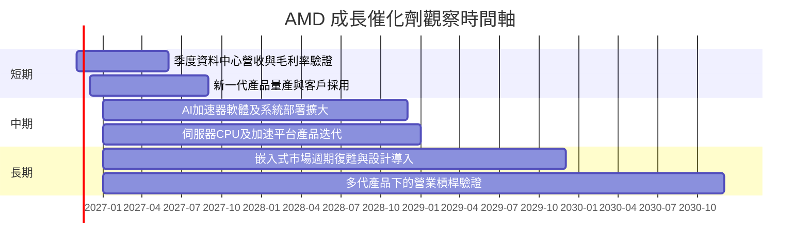

### 9.2 TAM 市場規模分析

資料包未提供各市場 TAM、滲透率或分部收入，以下以「未有數據」標示，避免用產業報告記憶值代替本次資料。

```text
╔══════════════════════════════════════════════════════════════════╗
║                   AMD TAM 與收入量化狀態                         ║
╠══════════════════════════════════════════════════════════════════╣
║ 資料中心 CPU／GPU TAM      N/A   滲透率 N/A   分部收入 N/A       ║
║ AI 加速器 TAM              N/A   滲透率 N/A   分部收入 N/A       ║
║ Client and Gaming TAM     N/A   滲透率 N/A   分部收入 N/A       ║
║ Embedded TAM              N/A   滲透率 N/A   分部收入 N/A       ║
║ 公司 TTM 總營收            $45.44B；TTM 成長率 41.9%             ║
╚══════════════════════════════════════════════════════════════════╝
```

**投資含義**：後續財報應要求分部收入、營業利益、客戶集中度及 AI 相關收入披露。沒有分部 TAM 與收入占比時，不宜把總體 AI 市場規模直接當作 AMD 可服務營收。

### 9.3 成長驅動力結構圖

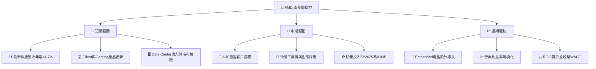

---

## 10. 風險矩陣

### 10.1 風險評分矩陣

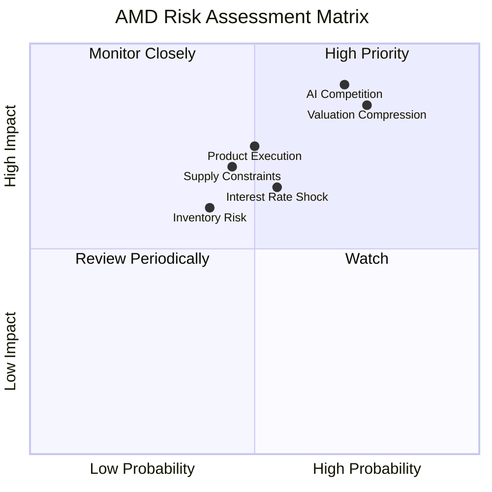

### 10.2 風險清單詳細分析

| # | 風險項目 | 發生機率 | 財務衝擊 | 風險評分 | 緩解措施 |
|---|----------|----------|----------|----------|----------|
| 1 | 🔴 **AI 競爭及軟體生態差距** | 中高，約 60%（分析假設） | AI 產品成長或毛利低於預期；精確影響 N/A | **8.5/10** | 追蹤客戶量產、軟體部署、資料中心收入與分部毛利 |
| 2 | 🔴 **估值倍數收縮** | 高，約 65%（分析假設） | P/S 五年百分位 90%；若成長低於市場預期，估值可能下修 | **8.5/10** | 以分批買入、估值上限與營運指標監控控制曝險 |
| 3 | 🟠 **供應／先進封裝／產能限制** | 中，約 45%（分析假設） | 影響交貨、收入確認及產品組合；金額 N/A | **7.0/10** | 觀察交期、存貨、應收帳款與供應商資本安排 |
| 4 | 🟠 **高 Beta 與利率上升** | 中，約 55%（分析假設） | Beta **2.54**；WACC 參考值 **17.73%**，折現率上升會壓低估值 | **7.0/10** | 使用較低槓桿、設定持倉上限並監控美債利率 |
| 5 | 🟡 **庫存及應收帳款成長** | 中，約 40%（分析假設） | TTM 存貨 **$11.463B**、應收 **$9.209B**；若周轉惡化會壓低 FCF | **6.0/10** | 追蹤庫存成長是否持續快於收入、應收周轉及現金轉換 |
| 6 | 🟡 **SBC 稀釋與資本配置效率** | 中，約 35%（分析假設） | 最近四季 SBC 約 **$1.999B**，約占 TTM OCF **21.9%** | **5.5/10** | 追蹤稀釋股數、回購金額及 SBC／營收比例 |

發生機率為分析師情境假設，並非歷史統計頻率。前三大風險與 DCF 的連結分別為：AI 競爭影響營收 CAGR／利潤率；估值收縮反映市場退出倍數；供應瓶頸影響收入轉換與營運資金。

---

## 11. 投資建議

### 11.1 最終綜合評級雷達圖

```text
╔══════════════════════════════════════════════════════════════╗
║                  AMD 最終綜合評級雷達                         ║
╠══════════════════════════════════════════════════════════════╣
║ 基本面品質    7.0/10  ▓▓▓▓▓▓▓▓▓▓▓▓▓▓░░░░░░  ★★★★☆          ║
║ 成長性        8.5/10  ▓▓▓▓▓▓▓▓▓▓▓▓▓▓▓▓▓░░░  ★★★★☆          ║
║ 獲利能力      6.5/10  ▓▓▓▓▓▓▓▓▓▓▓░░░░░░░░░  ★★★☆☆          ║
║ 財務健康      8.0/10  ▓▓▓▓▓▓▓▓▓▓▓▓▓▓▓▓░░░░  ★★★★☆          ║
║ 資本效率      4.5/10  ▓▓▓▓▓▓▓▓▓░░░░░░░░░░░  ★★☆☆☆          ║
║ 估值吸引力    2.0/10  ▓▓▓▓░░░░░░░░░░░░░░░░  ★☆☆☆☆          ║
╠══════════════════════════════════════════════════════════════╣
║ 綜合評分      5.8/10  ▓▓▓▓▓▓▓▓▓▓▓▓░░░░░░░░  🔴 賣出          ║
║ 依據：加權合理價 $213.32；MOS -150.3%；ROIC 12.8% < WACC 17.73%║
╚══════════════════════════════════════════════════════════════╝
```

### 11.2 目標價與隱含報酬率

| 情境 | 目標價 | 相對 2026-11-13 收盤 $534.06 | 參考機率 | 主要假設 |
|------|------:|------:|------:|------|
| 🔴 悲觀 DCF | $32.10 | -94.0% | 20% | 營收 CAGR 15%、期末利潤率 18%、g 2%、WACC 19% |
| 🟡 基準 DCF | $62.30 | -88.3% | 60% | 營收 CAGR 25%、期末利潤率 22%、g 3%、WACC 17.73% |
| 🟢 樂觀 DCF | $126.00 | -76.4% | 20% | 營收 CAGR 35%、期末利潤率 26%、g 4%、WACC 16% |
| 相對估值基準 | $316.66 | -40.7% | — | Forward P/E 17.9x |
| **加權合理價值** | **$213.32** | **-60.1%** | — | DCF、同業倍數、FCF Yield、分析師共識加權 |

**建議區間**：以加權合理價值 **$213.32** 為基準，MOS ≥10% 的最高買入價格為 `$213.32×(1−10%)=$191.99`。因此建議觀察買入區間約 **$160–$192**；現價 **$534.06** 高於此區間。

### 11.3 買入時機與觸發因素

```text
╔══════════════════════════════════════════════════════════════════╗
║                  ✅ 買入觸發因素 Checklist                      ║
╠══════════════════════════════════════════════════════════════════╣
║  立即買入觸發條件（多數符合，且價格配合）：                      ║
║  ☐ 股價回落至約 $192 以下，MOS 至少達 10%                        ║
║  ☐ 最新季度收入年增維持 >30%，且資料中心業務具可核驗成長         ║
║  ☐ 營業利益率維持在 20% 左右或以上                               ║
║                                                                  ║
║  加碼觸發條件（出現以下任一）：                                  ║
║  ☐ 股價低於 $160 且公司核心業務成長論點未破壞                    ║
║  ☐ ROIC 上升並高於 WACC 17.73%                                   ║
║  ☐ TTM FCF 持續增加，且 FCF Yield 改善而非只靠估值倍數上升       ║
║                                                                  ║
║  減碼／退出觸發條件（出現以下任一）：                             ║
║  ☐ 連續兩季收入年增低於 20%                                      ║
║  ☐ 營業利益率較最新季度 21.2% 收縮超過 5pp                       ║
║  ☐ FCF 轉負、庫存持續快於營收增加，或應收帳款回收惡化             ║
║  ☐ AI 加速器客戶部署未能轉為可持續營收                            ║
╚══════════════════════════════════════════════════════════════════╝
```

### 11.4 投資人適配度分析

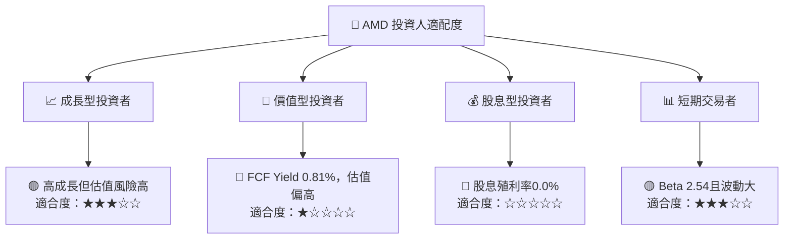

- **成長型**：營收 TTM 成長 **41.9%**，但股價估值已高，宜等估值或財報驗證。
- **價值型**：基準 DCF 與加權合理價值均遠低於現價，現價不符合本報告的價值門檻。
- **股息型**：殖利率 **0.0%**，不適合收益導向投資人。
- **短期交易者**：Beta **2.54**、近期月收盤價波動大，風險管理要求高；Beta 不代表單一期間實際波動預測。

### 11.5 每季財報監控清單（Quarterly Watch List）

| 指標 | 最新基準 | 加碼門檻 | 減碼／重新評估門檻 | 為何重要 |
|------|------:|------:|------:|------|
| 營收 YoY | 最新季度 **44.7%** | 維持 >30% | 連續兩季 <20% | 驗證成長是否仍高於市場成熟速度 |
| 營業利益率 | TTM **17.7%**；最新季度 **21.2%**（口徑需核對） | 穩定 ≥20% | 較 21.2% 下降 >5pp | 觀察產品組合、定價與費用槓桿 |
| 毛利率 | TTM **56.0%** | 維持或上升 | 連續兩季下滑 >3pp | 觀察 AI／資料中心組合及成本 |
| TTM FCF | **$7.06B** | 同比上升且轉換健康 | FCF 轉負或連兩季大幅下降 | 驗證會計獲利是否轉為現金 |
| Capex | TTM **$2.07B** | 與營收成長相匹配 | Capex 上升但 FCF 不改善 | 追蹤投入回報 |
| 存貨 | **$11.463B** | 存貨成長不持續高於營收 | 存貨連兩季快於營收 | 產品轉換、需求預測及減值風險 |
| 應收帳款 | **$9.209B** | 增速大致跟隨營收 | 應收持續快於營收 | 信用條件及收入品質 |
| SBC／營收 | 最近四季約 **4.4%** | 比率下降或股數穩定 | SBC 上升且股數加速稀釋 | 衡量真實股東成本 |
| Data Center／AI 營收 | 分部金額 N/A | 要求公司披露並逐季成長 | 成長放緩或出貨延遲 | 驗證估值核心催化劑 |
| 管理層財測 | 資料包未提供 | 上修且實際達成 | 下修或連續未達財測 | 判斷成長預期可靠性 |

### 11.6 反面論證：什麼會證明論點錯誤

```text
╔══════════════════════════════════════════════════════════════════╗
║              ⚠️ 論點失效條件（Disconfirming Evidence）           ║
╠══════════════════════════════════════════════════════════════════╣
║ 本報告的成長與估值判斷應在下列情況重新檢視：                    ║
║ ☐ 核心營收年增連續兩季低於 20%                                   ║
║ ☐ 營業利益率較最新季度 21.2% 收縮超過 5 個百分點                 ║
║ ☐ TTM FCF 轉負，或 FCF／淨利長期低於 70%                         ║
║ ☐ ROIC 低於 WACC 17.73% 且差距持續擴大                           ║
║ ☐ 存貨連續兩季增速高於營收增速，並伴隨毛利率下降                 ║
║ ☐ AI 加速器無法形成可驗證的客戶量產與重複訂單                    ║
║ ☐ SBC／營收高於 5%，且稀釋股數持續增加                            ║
╚══════════════════════════════════════════════════════════════════╝
```

若營收成長持續高於 30%、營業利益率維持約 20% 以上、TTM FCF 繼續增加，且 ROIC 上升接近或超越 WACC，則本報告對成長轉現金能力的保守估計可能偏低。相反，若上述量化門檻未達成，而股價仍顯著高於合理價值，應優先控制估值與持倉風險。

> **免責聲明**：本報告為 AI 自動生成，僅供研究參考，不構成投資建議。本文估值包含明示假設，實際結果可能與模型顯著不同。投資有風險，入市需謹慎。