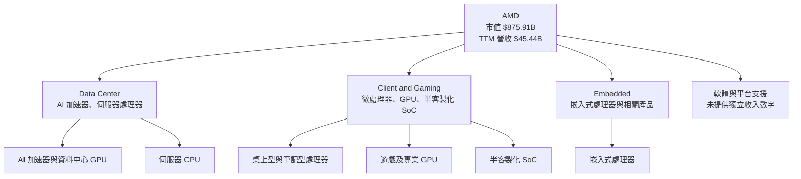
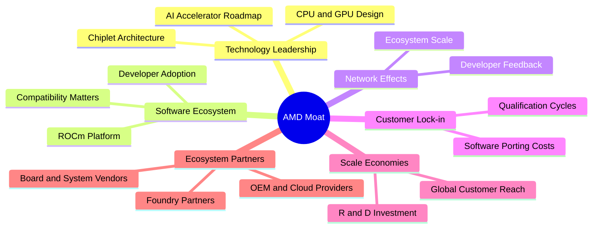
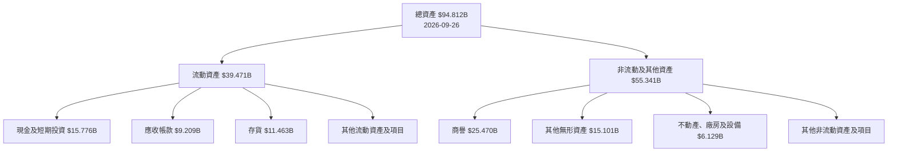
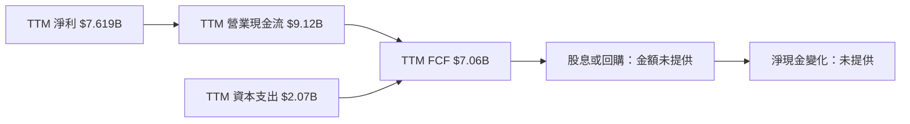
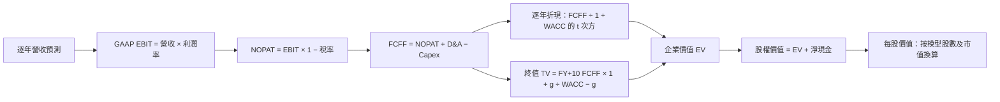
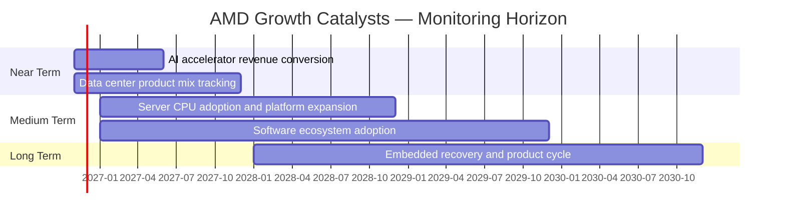
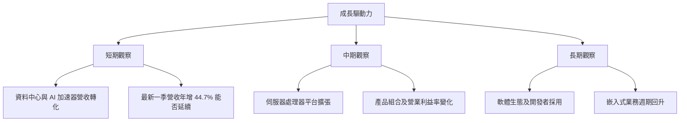
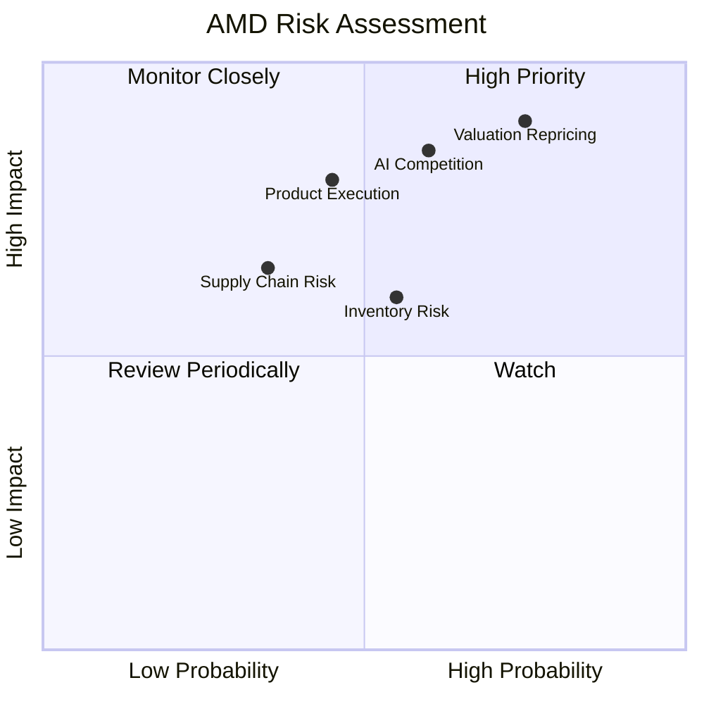
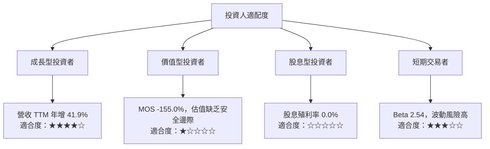

# AMD 基本面深度分析報告
> **報告日期**：2026-11-15 ｜ **語言**：繁體中文 ｜ **數據來源**：SEC 申報資料 (XBRL)、Yahoo Finance、Finviz、StockAnalysis、Roic.ai ｜ **分析師**：CFA 級機構研究

## 目錄

| # | 章節 | 核心結論 |
|---|------|----------|
| 1 | 執行摘要 | 評級賣出；加權合理價值 $209.43；MOS -155.0% |
| 2 | 公司概覽與商業模式 | 多產品組合與工程能力構成優勢，但分部收入及市場份額數據未提供 |
| 3 | 損益表深度分析 | TTM 營收 $45.44B、年增 41.9%；最新一季年增 44.7% |
| 4 | 資產負債表分析 | 淨現金 $8.70B；營運資金充裕，但存貨天數仍高 |
| 5 | 現金流量深度分析 | TTM FCF $7.06B，FCF Yield 0.81%；現金轉換有改善 |
| 6 | 獲利能力與資本效率 | ROIC 12.8% 低於 WACC 14.0%，目前未覆蓋資本成本 |
| 7 | 相對估值分析 | 相對同業及自身歷史估值偏高，估值折價不足 |
| 8 | DCF 內在價值評估 | 基準 DCF $76.23；加權合理價值 $209.43；現價遠高於兩者 |
| 9 | 成長催化劑 | AI 加速器、伺服器與產品組合是主要潛在催化劑；TAM 數字未提供 |
| 10 | 風險矩陣 | 估值回落、AI 競爭與執行風險為前三大風險 |
| 11 | 投資建議 | 維持賣出；以 $188.49 以下作為符合 MOS ≥10% 的價格參考上限 |

---

## 1. 執行摘要

AMD 最新收盤價為 **2026-11-13 的 $534.06**。公司 TTM 營收 $45.44B、TTM 年增 41.9%，最新一季營收年增 44.7%，TTM FCF 為 $7.06B；但 TTM FCF Yield 僅 0.81%，ROIC 12.8% 低於 14.0% WACC。估值方面，程式計算的加權合理價值為 $209.43，MOS 為 -155.0%，依 MOS 門檻評級為 **🔴 賣出**；此評級未作質化調整。業務成長具吸引力，但目前股價已大幅高於 DCF 基準價值 $76.23 與加權合理價值。

### 1.0 一頁式投資儀表板（Portfolio Manager 30 秒速讀）

| 項目 | 內容 |
|------|------|
| **投資論點（3 句）** | ① TTM 營收年增 41.9%，最新一季年增 44.7%，顯示營收動能仍快。② TTM FCF $7.06B、淨現金 $8.70B，提供投資與抗風險能力。③ 但 FCF Yield 只有 0.81%、ROIC 12.8% 低於 WACC 14.0%，加權合理價值 $209.43 明顯低於現價。 |
| **綜合評分** | **6.7/10**（引用 1.1 評分卡） |
| **財務健康** | 🟢 現金及短期投資 $15.78B、總債務 $7.08B，淨現金 $8.70B；CCC 為 138 天 |
| **ROIC vs WACC** | **12.8% vs 14.0%**；以目前投入資本回報看，尚未覆蓋資本成本 |
| **FCF 趨勢** | 向上；TTM FCF $7.06B、FCF Yield **0.81%** |
| **估值** | Forward P/E **30.2x**（市場數據）；EV/EBITDA **78.0x**（市場數據）；FCF Yield **0.81%** |
| **DCF 內在價值（基準）** | **$76.23**；現價相對 DCF 溢價 **600.5%**（第 8.5 節） |
| **安全邊際（MOS）** | **-155.0%**＝($209.43 − $534.06) ÷ $209.43；🔴 小於 10%，無下檔保護（加權合理價值基準） |
| **預期報酬（基準情境 12M）** | DCF 基準情境為 **$76.23**，相對現價 **-85.7%**；此為模型情境，不是分析師另行設定的 12 個月目標價 |
| **關鍵風險（前二）** | 估值對成長預期高度敏感；AI 加速器競爭及產品放量不如預期 |
| **評級 + 信心度** | 🔴 **賣出** ｜ 信心：中（估值訊號明確，但 DCF 長期假設與市場模型仍有不確定性） |

### 1.1 綜合評分卡（全報告唯一）

| 維度 | 評分（1–10） | 主要依據（引用數字與其來源章節） |
|------|--------------|----------------------------------|
| 成長性 | 9.0 | TTM 營收年增 41.9%，最新一季年增 44.7%（第 3 章）；近年營收趨勢向上 |
| 獲利能力 | 7.5 | TTM 營業利益率 17.7%、ROIC 12.8%，但低於 WACC 14.0%；F-Score 7/9（第 6 章） |
| 財務健康 | 8.0 | 淨現金 $8.70B、流動比率 2.725；CCC 138 天（第 4 章） |
| 估值 | 1.0 | MOS -155.0%；P/S 19.5x，處於自身五年區間第 90 百分位（第 7–8 章） |
| 護城河 | 8.0 | 多產品平台、處理器設計與生態夥伴關係有質化優勢；但市場份額及分部營收數據未提供（第 2 章） |
| 管理層與資本配置 | 6.5 | FY2025 SBC $1.64B，稀釋股數測試未通過；無股息，細部回購與投資回報資料不足（第 3、5 章） |
| **綜合評分** | **6.7** | 六項算術平均：$(9.0+7.5+8.0+1.0+8.0+6.5)÷6=6.7$ |

### 1.2 五大投資論點 + 三大核心風險

| 類型 | 項目 | 具體依據 | 信心度 |
|------|------|----------|--------|
| 🟢 **投資論點①** | 營收加速 | TTM 營收 $45.44B、TTM 年增 41.9%；最新一季營收年增 44.7%，代表產品需求仍具擴張性 | 🟢 高 |
| 🟢 **投資論點②** | 近期營運槓桿改善 | 最新一季營收 $13.38B、營業利益 $2.83B；依 SEC 計算的最新一季營業利益率為 21.2%，高於 TTM 17.7% | 🟢 中高 |
| 🟢 **投資論點③** | 現金流轉強 | TTM 營業現金流 $9.12B、Capex $2.07B，按定義 TTM FCF 為 $7.06B；支持研發與產能合作投資 | 🟢 高 |
| 🟢 **投資論點④** | 資產負債表有緩衝 | 現金及短期投資 $15.78B，總債務 $7.08B，淨現金 $8.70B | 🟢 高 |
| 🟢 **投資論點⑤** | 產品與市場多元 | 公司涵蓋資料中心、Client and Gaming、Embedded，降低單一產品週期對整體公司的依賴；各分部收入數字未提供 | 🟡 中 |
| 🟡 **風險①** | 估值偏高 | 加權合理價值 $209.43，較現價 $534.06 低 60.8%；MOS -155.0%，估值下修風險大 | 🔴 高衝擊 |
| 🔴 **風險②** | 競爭與產品迭代 | NVDA 最新一季營收年增 105.9%，高於 AMD 的 44.7%；若 AMD 加速器產品與軟體生態不能追上，成長和毛利可能受壓 | 🔴 高衝擊 |
| 🟡 **風險③** | 庫存及稀釋 | DIO 199 天；Piotroski 稀釋股數未增加測試未通過，股權薪酬可能稀釋長期每股價值 | 🟡 中高 |

### 1.3 快速統計卡片

| 指標 | 公司實際值（期間） | 同業中位數 | 狀態 |
|------|--------------------|------------|------|
| 營收成長（TTM） | **41.9%** | — | 🟢 |
| 營收成長（最新一季年增） | **44.7%** | **85.5%**（NVDA、INTC、AVGO 最新一季年增的中位數） | 🟡 |
| 毛利率（TTM） | **56.0%** | **74.7%**（三家同業中位數） | 🟡 |
| 營業利益率（TTM） | **17.7%** | — | 🟡 |
| ROIC（TTM） | **12.8%** | — | 🟡 |
| Forward P/E | **30.2x**（市場數據） | **17.9x**（Peer multiples 中位數） | 🔴 |
| FCF Yield（TTM） | **0.81%** | — | 🔴 |
| Piotroski F-Score | **7 / 9** | — | 🟢 |

### 1.4 投資結論

```text
╔══════════════════════════════════════════════════════════════════╗
║                       📊 投資結論摘要                            ║
╠══════════════════════════════════════════════════════════════════╣
║  評級：🔴 賣出（依 MOS 門檻，未作質化調整）                      ║
║  價格（2026-11-13 收盤）：$534.06                                ║
║  DCF 內在價值（基準）：$76.23（現價溢價 600.5%）                 ║
║  安全邊際 MOS：-155.0%（以加權合理價值為分母）                   ║
║  加權合理價值（8.8）：$209.43                                    ║
║  DCF 情境價值：                                                   ║
║    悲觀情境：$40.40（相對現價 -92.4%）                            ║
║    基準情境：$76.23（相對現價 -85.7%）                            ║
║    樂觀情境：$142.39（相對現價 -73.3%）                           ║
║  綜合評分：6.7/10（引用 1.1）                                    ║
║  適合投資人：可承受高波動的長線成長投資人；不適合重視估值安全者  ║
╚══════════════════════════════════════════════════════════════════╝
```

---

## 2. 公司概覽與商業模式

### 2.1 業務結構與收入來源

AMD 設計並銷售半導體產品，主要業務包括資料中心、Client and Gaming、Embedded。財務數據沒有提供各分部收入或營收占比，故不以推估數字製作營收比例圖。



### 2.2 市場份額

市場份額數據未提供，因此不繪製市場份額圖，也不推估 AMD 在各細分市場的占比。可確認的是 AMD TTM 營收 $45.44B、營收年增 41.9%；Peer multiples 中 NVDA 最新一季年增 105.9%，AVGO 為 85.5%，表明 AMD 正成長，但成長速度仍落後這兩家同業。

### 2.3 競爭護城河分析



### 2.4 護城河強度

| 護城河項目 | 強度（強／中／弱） | 證據（引用數字或事實） | 會削弱它的情況 |
|------------|--------------------|------------------------|----------------|
| 技術與產品設計 | 強 | TTM 營收 $45.44B；多類處理器、GPU、加速器與嵌入式產品並行 | 產品性能、能效或上市節奏落後競爭者 |
| 軟體生態系統 | 中 | AI 加速器價值不只取決於晶片，也取決於開發者工具及軟體相容性；未提供軟體收入或使用者數 | CUDA 等競爭平台的生態優勢擴大，或軟體移植成本持續偏高 |
| 網路效應 | 弱至中 | 生態夥伴與開發者可增加平台吸引力；沒有可量化網路效應指標 | 開發者及客戶集中於競爭平台 |
| 客戶鎖定 | 中 | 企業處理器與伺服器平台通常涉及驗證、軟體及系統整合；具體續約率、轉換率未提供 | 客戶多供應商策略、相容性改善，降低轉換摩擦 |
| 規模效應 | 強 | FY2025 R&D $8.09B，顯示公司有能力持續投入產品研發 | 研發投入增長未帶來相稱收入或回報 |
| 生態夥伴 | 中 | 公司跨雲端、OEM、系統與晶圓製造夥伴營運；未提供各合作夥伴營收貢獻 | 供應限制、關鍵夥伴議價力提高或客戶轉向競爭方案 |

**1.1 護城河評分 8.0/10**，依據是產品範圍、研發規模與生態合作；但軟體採用、分部份額及客戶集中度缺乏可量化數據，限制評分信心。

---

## 3. 損益表深度分析

### 3.1 年度收入成長趨勢（近 4 年）

年度營收為 SEC／市場資料列示值；同比成長率由相鄰年度營收計算，四捨五入至一位小數。FY2025 至 FY2022 三年 CAGR 為約 13.6%。

```text
╔══════════════════════════════════════════════════════════════════╗
║                AMD 年度收入趨勢（FY2022–FY2025）                ║
╠══════════════════════════════════════════════════════════════════╣
║  FY2022  $23.60B  ██████████████░░░░░░░░░░░░░  YoY: —           ║
║  FY2023  $22.68B  █████████████░░░░░░░░░░░░░░  YoY: -3.9% 🟡    ║
║  FY2024  $25.79B  ███████████████░░░░░░░░░░░░  YoY: +13.7% 🟢   ║
║  FY2025  $34.64B  ████████████████████░░░░░░░  YoY: +34.3% 🟢   ║
╠══════════════════════════════════════════════════════════════════╣
║  FY2022–FY2025 三年收入 CAGR：約 13.6%                            ║
╚══════════════════════════════════════════════════════════════════╝
```

營收先於 FY2023 下滑 3.9%，其後 FY2024、FY2025 回升，FY2025 成長加速至 34.3%。TTM 收入 $45.44B、TTM 年增 41.9%，高於 FY2025 年增率，顯示近期成長延續；但不能只以此推論長期成長率，因基期與產品週期可能變化。

### 3.2 季度收入趨勢分析

| 季度 | 營收 | QoQ 成長 | YoY 成長 | 備註 |
|------|------|----------|----------|------|
| 2025 Q4 | $10.27B | +11.1% | +34.1% | 比較基期為 2025 Q3 $9.246B；YoY 依 StockAnalysis |
| 2026 Q1 | $10.25B | -0.2% | +37.9% | QoQ 小幅回落，年度成長仍高 |
| 2026 Q2 | $11.54B | +12.5% | +50.1% | 年增率升至約 50% |
| 2026 Q3 | $13.38B | +16.0% | +44.7% | QoQ 再加速；SEC 最新單季營業利益率 21.2% |

QoQ 計算：Q3 2026 對 Q2 2026 為 $(13.377÷11.536)-1=16.0\%$；YoY 採來源列示單季數字，不能將其稱為 TTM 成長率。

### 3.3 利潤率演變分析

| 利潤率指標 | FY2022 | FY2023 | FY2024 | FY2025 | 趨勢 | 評估 |
|------------|--------|--------|--------|--------|------|------|
| **毛利率** | 44.9% | 46.1% | 49.3% | 49.5% | 逐年提高 | 🟢 |
| **營業利益率** | 5.3% | 1.8% | 8.1% | 10.7% | FY2023 低點後回升 | 🟡 |
| **淨利率** | 5.6% | 3.8% | 6.4% | 12.5% | FY2025 顯著提高 | 🟢 |

年度毛利率按年度損益表的毛利與營收計算；TTM 毛利率依財務數據為 56.0%，高於上述年度值，反映最新 TTM 組合與歷史期間存在差異。TTM 營業利益率為 17.7%，最新一季依 SEC 計算為 21.2%，顯示近期營運槓桿改善。

**利潤率演變深度解析：**FY2023 營業利益率降至 1.8%，之後在營收回升時提高至 FY2025 的 10.7%。TTM 營業利益率進一步升至 17.7%，最新季達 21.2%，可能反映規模、產品組合及成本吸收改善；但提供的數據沒有分部毛利率、單位成本或價格變化，不能將改善全部歸因於單一產品。DCF 基準模型反而假設營業利益率由 FY+1 的 17.7% 逐步降至 FY+10 的 7.4%，隱含長期競爭與成熟化壓力。

### 3.4 費用結構分析

可核實的費用資料包括 FY2025 R&D $8.09B、FY2025 營業利益 $3.69B；但完整年度費用分項及費用率沒有在同一套資料中提供，且年度損益數據存在來源口徑差異。因此不繪製可能造成誤讀的費用圓餅圖。FY2025 R&D 相當於年度營收約 $8.09B÷$34.64B=23.4%，代表研發為重要投入；未來需觀察研發轉化為產品收入與利潤的效率。

### 3.5 季度 EPS 趨勢與盈餘品質（Quality of Earnings）

| 季度 | EPS | EPS YoY | 預估／實際差異 |
|------|-----|---------|----------------|
| 2025 Q4 | $0.92 | +217.1% | EPS estimate 與 actual 均為 N/A，無法判斷是否超預期 |
| 2026 Q1 | $0.84 | +91.2% | EPS estimate 與 actual 均為 N/A，無法判斷是否超預期 |
| 2026 Q2 | $1.39 | +159.5% | EPS estimate 與 actual 均為 N/A，無法判斷是否超預期 |
| 2026 Q3 | $1.48 | +93.8% | EPS estimate 與 actual 均為 N/A，無法判斷是否超預期 |

過去四季 EPS 均為正，最新季 EPS $1.48，年增 93.8%；但季度估值和實際值欄位是 NaN，**不能據此宣稱 beat 或 miss**。EPS 上升與淨利成長有關，最新一季淨利年增 95.3%。

| 盈餘品質項目 | 數值/佔比 | 評估 |
|--------------|-----------|------|
| 股權薪酬 SBC / 營收 | 約 **4.4%**：TTM SBC 約 $1.999B ÷ TTM 營收 $45.44B | 🟡 SBC 不低，會造成股東稀釋或需以回購抵銷 |
| SBC / 營業現金流 | 約 **21.9%**：$1.999B ÷ $9.12B | 🟡 現金流轉換受 SBC 加回影響；SBC 並非無成本 |
| FCF / 淨利（現金轉換率） | 約 **92.7%**：$7.06B ÷ TTM 淨利 $7.619B | 🟢 現金獲利大致支持會計淨利 |
| 一次性／非經常性損益 | N/A（缺少可比的一次性項目明細） | 無法確認是否有一次性項目美化或壓低當期盈餘 |
| 有效稅率異常 | N/A（未提供一致口徑的 TTM 實際稅率） | DCF 模型使用 21.0% 假設稅率，非歷史有效稅率推導 |
| 資本化支出 vs 費用化 | TTM Capex $2.07B；資本化政策與資本化研發明細 N/A | Capex 明確納入 FCF；無法判斷是否有重大成本遞延 |

**盈餘品質結論：**TTM FCF 約為淨利的 92.7%，表面現金轉換合理；然而 SBC 約占 TTM 營收 4.4%、OCF 21.9%，且稀釋股數測試未通過，股東應將股權薪酬視為經濟成本。DCF 採用 GAAP EBIT，故 SBC 已反映在營業利益中，不重複扣除。

---

## 4. 資產負債表分析

### 4.1 資產結構分解

以下總資產及細項以 2026-09-26 季度資產負債表資料呈現。流動資產 $39.471B、總資產 $94.812B；部分非流動資產細項如下。



### 4.2 流動性與營運資金分析

| 流動性指標 | 最新值 | 歷史／對照值 | 評估 |
|------------|--------|--------------|------|
| 流動比率 | 2.725 | N/A（未提供一致歷史季度序列） | 🟢 短期流動資產對流動負債有緩衝 |
| 速動比率 | 1.725 | N/A | 🟢 排除存貨後仍具流動性 |
| 現金及短期投資 | $15.78B | 一年前 N/A（品質區塊只提供營運天數） | 🟢 高於總債務 $7.08B |

**營運資金天數：**

| 指標 | 最新 TTM | 一年前 TTM | 變化 | 解讀 |
|------|----------|------------|------|------|
| DSO 應收帳款天數 | 74 天 | 71 天 | +3 天 | 收款天數略增，可能反映客戶與銷售組合變化；應監控逾期應收 |
| DIO 存貨天數 | 199 天 | 161 天 | +38 天 | 存貨占用資金增加，可能與備貨及產品組合有關；若需求不及預期，存在存貨減值風險 |
| DPO 應付帳款天數 | 135 天 | 77 天 | +58 天 | 供應商付款週期延長，對現金有利，但需確認非付款壓力或供應商條款變化 |
| CCC 現金轉換週期 | 138 天 | 155 天 | -17 天 | 儘管 DIO 上升，DPO 延長使 CCC 改善；改善品質需結合供應商條款與存貨週轉追蹤 |

### 4.3 債務結構分析

```text
╔══════════════════════════════════════════════════════════════════╗
║                     AMD 債務健康診斷                             ║
╠══════════════════════════════════════════════════════════════════╣
║  總債務：             $7.08B    ███████░░░░░░░░░░░░░  🟢        ║
║  現金及短期投資：    $15.78B    ████████████████░░░░  🟢        ║
║  淨現金：             $8.70B    █████████░░░░░░░░░░░  🟢        ║
║                                                                  ║
║  Debt/EBITDA： N/A（驗證區塊未提供一致的該比率）                  ║
║  Interest Coverage：N/A（利息費用及覆蓋倍數未提供）              ║
║  流動比率：2.725；速動比率：1.725                                ║
╚══════════════════════════════════════════════════════════════════╝
```

註：其他合併市場資料列出債務 $9.21B、淨現金 $6.57B，與 SEC 10-Q 計算的 $7.08B 債務、$8.70B 淨現金不一致。本報告涉及 ROIC 與估值橋接時採用 SEC 申報計算的 VERIFIED 數值，避免混用口徑。

### 4.4 股東權益趨勢

| 年度 | 股東權益 |
|------|----------|
| 2022 | $54.75B |
| 2023 | $55.89B |
| 2024 | $57.57B |
| 2025 | $63.00B |

```text
╔══════════════════════════════════════════════════════════════════╗
║               AMD 股東權益變化（年度）                            ║
╠══════════════════════════════════════════════════════════════════╣
║  2022  $54.75B  █████████████████░░░                             ║
║  2023  $55.89B  ██████████████████░░                             ║
║  2024  $57.57B  ██████████████████░░                             ║
║  2025  $63.00B  ████████████████████                             ║
╚══════════════════════════════════════════════════════════════════╝
```

FY2022 至 FY2025 股東權益增加，部分可能與留存盈餘、併購相關資產及股權薪酬有關；由於權益變動表細項不完整，不將增加全部歸因於某一項目。

---

## 5. 現金流量深度分析

### 5.1 現金流量瀑布圖

缺少同一期間、可核實的「股息與回購金額」及「淨現金變化」拆解，因此不以推估數字製作完整瀑布。可確認的 TTM 現金流關係如下：



按指定定義：TTM FCF = OCF − Capex。使用已公布精確數字相減會有 $0.01B 四捨五入差異；應引用官方計算的 TTM FCF **$7.06B**，而非重新替換。

### 5.2 FCF 轉換率趨勢

| 年度 | FCF | 淨利 | FCF / 淨利 | 解讀 |
|------|-----|------|------------|------|
| 2022 | $3.12B | $1.32B | 236.4% | 現金流高於淨利，可能受營運資金與非現金項目影響 |
| 2023 | $1.12B | $0.854B | 131.1% | 淨利及 FCF 均處低位 |
| 2024 | $2.40B | $1.64B | 146.3% | 現金流維持高於淨利 |
| 2025 | $6.74B | $4.33B | 155.7% | 營運現金流提升，FCF 擴張 |
| TTM 至 2026-09-26 | $7.06B | $7.619B | 92.7% | FCF 仍接近淨利，但轉換率較 FY2025 低 |

年度淨利採年度損益表列示值；TTM 淨利取 StockAnalysis TTM 資料。期間口徑不同，不宜視為完全可比序列。

### 5.3 自由現金流趨勢

```text
╔══════════════════════════════════════════════════════════════════╗
║                  AMD 自由現金流（歷史實際）                       ║
╠══════════════════════════════════════════════════════════════════╣
║  FY2022  $3.12B  █████████░░░░░░░░░░░                           ║
║  FY2023  $1.12B  ███░░░░░░░░░░░░░░░░░                           ║
║  FY2024  $2.40B  ███████░░░░░░░░░░░░                             ║
║  FY2025  $6.74B  ████████████████████                            ║
║  TTM     $7.06B  █████████████████████                           ║
║                                                                  ║
║  TTM FCF Yield：0.81%                                            ║
╚══════════════════════════════════════════════════════════════════╝
```

FY2023 至 FY2025 FCF 明顯回升，TTM FCF 為 $7.06B；不過股價與市值上升使 FCF Yield 僅 0.81%，顯示現金流增長尚不足以支撐當前市值的現金收益率。

### 5.4 資本配置評估

回購、研發、併購、股息等資本配置的完整金額拆分未提供，因此不製作資本配置圓餅圖。已知 FY2025 R&D 為 $8.09B，年度股息收益率為 0.0%，年度 SBC 為 $1.64B。無股息代表現金主要可留作再投資或其他資本配置，但因缺少回購及收購支出明細，無法判定各用途的資本回報。

---

## 6. 獲利能力與資本效率

### 6.1 ROE / ROA / ROIC 趨勢

| 指標 | FY2022 | FY2023 | FY2024 | FY2025／TTM | 評估 |
|------|--------|--------|--------|-------------|------|
| ROE | N/A | N/A | N/A | TTM 11.1%（驗證值） | 🟡 |
| ROA | N/A | N/A | N/A | TTM 5.9%（市場資料）；Piotroski 測試為正且高於一年前 | 🟡 |
| ROIC | N/A | N/A | N/A | TTM 12.8%（驗證值） | 🟡 |

歷年可比 ROIC／ROE 序列未提供，故不以不一致口徑重建歷史趨勢。TTM ROIC 12.8% 未達 14.0% WACC，表明公司雖有正回報，當前回報尚不足以創造超額經濟價值。

### 6.2 ROIC vs WACC 分析（核心價值創造判斷）

```text
╔══════════════════════════════════════════════════════════════════╗
║                 ROIC vs WACC 深度分析                            ║
╠══════════════════════════════════════════════════════════════════╣
║  WACC 輸入（Cost of capital）：                                  ║
║  ├── 無風險利率（10Y 美債）：5.15%                               ║
║  ├── 市場風險溢酬 ERP：5.00%                                     ║
║  ├── 原始 Beta：2.54；採用調整 Beta：2.00                        ║
║  ├── 股權成本 Ke：15.15%                                         ║
║  ├── 稅前債務成本：1.85%；稅後約 1.46%                          ║
║  ├── E / D 權重：99.2% / 0.8%                                   ║
║  └── ✅ 採用 WACC：14.00%（計算值 15.04%，受 14% 上限限制）      ║
║                                                                  ║
║  ROIC（TTM 至 2026-09-26）：12.8%                                ║
║  EVA spread = ROIC − WACC = 12.8% − 14.0% = -1.2 個百分點       ║
║                                                                  ║
║  ROIC  12.8%  ▓▓▓▓▓▓▓▓▓▓▓▓▓▓▓▓▓▓░░░░░░░░░                       ║
║  WACC  14.0%  ▓▓▓▓▓▓▓▓▓▓▓▓▓▓▓▓▓▓▓░░░░░                          ║
║                                                                  ║
║  結論：ROIC / WACC = 12.8% ÷ 14.0% = 0.91 倍，尚未覆蓋資本成本  ║
╚══════════════════════════════════════════════════════════════════╝
```

WACC 依資本成本區塊使用：Beta 原始值 2.54 調整後為 2.00；股權成本 15.15%，稅前債務成本 1.85%、稅率 21.0%、E/D 權重 99.2%/0.8%。未受限計算值為 15.04%，但區塊規定採用 WACC 上限 14.00%，故第 6.2 與第 8 章一致採 14.00%。ROIC 低於 WACC 1.2 個百分點，代表以當期回報衡量，資本配置尚未產生正 EVA；若資料中心與 AI 業務帶動 ROIC 持續上升，結論才可能改善。

### 6.3 杜邦三因素分解

| 因素 | 數值（TTM） | 解讀 |
|------|-------------|------|
| 淨利率 | 16.8% | TTM 獲利率是 ROE 的主要正向來源 |
| 資產週轉率 | 0.48 | 每單位資產產生約 0.48 單位營收，資產密集度較高 |
| 權益乘數 | 1.39 | 槓桿幅度不高，ROE 並非主要靠財務槓桿撐起 |
| **ROE** | **11.1%** | $16.8\% × 0.48 × 1.39 = 約 11.2%；品質區塊列示 ROE 11.1%，差異來自四捨五入 |

### 6.4 財務體質：Piotroski F-Score

**Piotroski F-Score：7 / 9**，期間為 TTM 至 2026-09-26 對比 TTM 至 2025-09-27。

| 測試 | 結果 | 解讀 |
|------|------|------|
| ROA > 0 | ✅ 通過 | TTM 獲利為正 |
| 營業現金流 > 0 | ✅ 通過 | TTM OCF $9.12B |
| ROA 高於一年前 | ✅ 通過 | 資產獲利改善 |
| 營業現金流 > 淨利（應計品質） | ✅ 通過 | 營運現金流高於淨利，現金盈餘支持度較好 |
| 長期負債 ÷ 總資產低於一年前 | ❌ 未通過 | 槓桿相對資產未改善，需持續監控 |
| 流動比率高於一年前 | ✅ 通過 | 流動性相對改善 |
| 稀釋股數未增加 | ❌ 未通過 | 股數增加，SBC 對每股價值形成稀釋 |
| 毛利率高於一年前 | ✅ 通過 | 毛利率趨勢改善 |
| 資產週轉率高於一年前 | ✅ 通過 | 資產使用效率改善 |

整體分數 7/9 支持財務基本面改善，但負債比率測試與稀釋股數測試未通過；後者尤其重要，因營收及淨利成長不一定等比例轉化為每股股東報酬。

---

## 7. 相對估值分析

### 7.1 同業估值比較表格

AMD 自身倍數取市場資料；同業倍數嚴格採 Peer multiples。AMD Forward P/E 使用 Yahoo Finance 市場資料 30.2x；公司目前 P/E 另有 VERIFIED 歷史口徑 116.1x，兩者期間及計算來源不同，以下同業比較表不混用口徑。

| 估值指標 | **AMD** | **NVDA** | **INTC** | **AVGO** | AMD 評估 |
|----------|---------|---------|---------|---------|-----------|
| **Trailing P/E** | 114.1x（市場資料）；驗證歷史估值口徑 116.1x | 20.6x | N/A | 44.3x | 🔴 高於可計算同業 |
| **Forward P/E** | 30.2x | 10.3x | 33.3x | 17.9x | 🔴 高於同業中位數 17.9x |
| **P/S Ratio** | 19.3x（市場資料）；驗證歷史估值口徑 19.5x | 13.0x | 5.3x | 18.6x | 🔴 高於 NVDA、INTC，略高於 AVGO |
| **EV/EBITDA** | 78.0x（市場資料）；驗證歷史估值口徑 109.1x | 19.4x | 17.2x | 32.4x | 🔴 高於同業中位數 19.4x |
| **最新一季營收 YoY** | 44.7% | 105.9% | 20.9% | 85.5% | 🟡 成長高於 INTC、低於 NVDA/AVGO |
| **毛利率（TTM）** | 56.0% | 74.7% | 40.2% | 75.5% | 🟡 高於 INTC，低於 NVDA/AVGO |

同業中位數 Forward P/E 為 17.9x，AMD Forward P/E 30.2x；若按同業估值，市場已為 AMD 的成長付出較高溢價。對比結果需留意各公司業務組合不同，倍數不能單獨代替現金流估值。

### 7.2 歷史估值區間分析

```text
╔══════════════════════════════════════════════════════════════════╗
║             AMD 五年估值區間（TTM，驗證值）                      ║
╠══════════════════════════════════════════════════════════════════╣
║  P/E       36.7x ├──────────────●────────────────────┤ 934.7x  ║
║                              現值 116.1x｜中位數 82.6x             ║
║                              百分位第 53 位                       ║
║                                                                  ║
║  P/S        4.3x ├──────────────────────────●─────────┤ 23.1x   ║
║                              現值 19.5x｜中位數 8.9x              ║
║                              百分位第 90 位                       ║
║                                                                  ║
║  EV/EBITDA 38.2x ├──────────────●─────────────────────┤ 919.2x ║
║                              現值 109.1x｜中位數 102.2x           ║
║                              百分位第 61 位                       ║
╚══════════════════════════════════════════════════════════════════╝
```

P/S 位於自身五年區間第 90 百分位，是較突出的估值警訊；P/E 第 53 百分位、EV/EBITDA 第 61 百分位，但區間受極端高值拉寬，不能僅以百分位判斷便宜。P/S 19.5x 高於五年中位數 8.9x，反映市場對未來利潤轉化要求很高。

### 7.3 情境價值（Bear / Base / Bull，照抄 DCF MODEL 的 Scenarios）

| 情境 | 第 1 年營收成長 | 期末營業利潤率 | WACC | 每股價值 | 相對現價 | 機率 | 會發生的條件 |
|------|----------------|----------------|------|----------|----------|------|--------------|
| 🔴 悲觀 | 15.0% | 6.3% | 15.00% | $40.40 | -92.4% | 25% | AI 加速器放量慢於預期、價格或產品組合使長期利潤率下降 |
| 🟡 基準 | 30.0% | 7.4% | 14.00% | $76.23 | -85.7% | 50% | 短期高成長逐步降速，長期利潤率回歸過去五年中位水準 |
| 🟢 樂觀 | 45.0% | 8.1% | 13.00% | $142.39 | -73.3% | 25% | AI、伺服器與其他業務共同推升早期成長，且融資風險溢價下降 |

三情境 DCF 均遠低於 $534.06 現價。樂觀情境仍有 -73.3% 相對現價差距，顯示目前價格要求的營運表現超出該 DCF 情境範圍。

### 7.4 相對估值隱含價格區間

```text
╔══════════════════════════════════════════════════════════════════╗
║                   每股估值方法對照（USD）                        ║
╠══════════════════════════════════════════════════════════════════╣
║  $76.23       $136.44       $316.21       $534.06      $657.74   ║
║  基準 DCF     同業 EV/EBITDA 同業 Forward P/E 現價      分析師共識 ║
╚══════════════════════════════════════════════════════════════════╝
```

| 方法 | 每股價值 | 依據 |
|------|----------|------|
| DCF（基準） | $76.23 | 10 年 FCFF、WACC 14.00%、永續成長率 3.0% |
| 同業 Forward P/E | $316.21 | NVDA、INTC、AVGO 同業中位數 17.9x × AMD Forward EPS $17.69 |
| 同業 EV/EBITDA | $136.44 | Peer multiples 中位數 19.4x × TTM EBITDA，再加淨現金 |
| 分析師共識目標價 | $657.74 | 49 位分析師平均目標價 |
| 現價 | $534.06 | 2026-11-13 收盤價 |

---

## 8. DCF 內在價值評估（Discounted Cash Flow）

### 8.0 估值推理鏈（Thinking Logic：在算之前先想清楚）

**Step 1 — 公司價值的主要變數**

AMD 的價值可拆成：現有半導體主業現金流底盤、AI／資料中心第二成長曲線，以及新產品平台帶來的選擇權價值。現有資料未提供各分部營收占比，因此不能把三項硬拆成百分比；可量化的公司整體起點是 TTM 營收 $45.44B。估值最敏感變數是長期利潤率與折現率：模型把營業利益率由 17.7% 降至 7.4%，且 WACC 為 14.0%，故營運利潤與資本成本變動會顯著改變現值。

**Step 2 — 模型選擇**

| 決策點 | 本報告採用 | 理由（含數字） | 曾考慮但否決 | 否決理由 |
|--------|-----------|----------------|--------------|----------|
| 現金流定義 | FCFF | 以 WACC 折現後得到 EV，再加淨現金 | FCFE | 與指定 DCF 模型現金流及 WACC 口徑不一致 |
| 預測期 N | 10 年 | DCF 模型指定 10 年，涵蓋成長逐步衰退 | 5 年 | 模型提供的是 10 年逐年預測，不可自行改短 |
| 終值方法 | Gordon Growth | 永續成長率 3.0%，低於 WACC 14.0% | 退出倍數 | DCF 區塊未提供可供主模型使用的退出倍數計算 |
| EBIT 基礎 | GAAP | 模型明確採 GAAP EBIT；FCFF 不再扣 SBC | 非 GAAP EBIT | 會改變既定模型與可能造成 SBC 漏扣或重複扣除 |

**Step 3 — 關鍵假設推導鏈**

- **預測期及營收成長**：錨點＝TTM 營收年增 41.9% → 調整＝成長率在長期不可能維持最新高位，且基準模型把 FY+1 限在 30.0%、再線性降至 3.0% → **採用 FY+1 30.0%、FY+10 3.0%** → 曾考慮直接採 TTM 41.9%，但拒絕將短期成長率外推十年。
- **期末營業利益率**：錨點＝TTM 17.7%，最新一季 21.2% → 調整＝產品競爭、成熟化與利潤率均值回歸 → **採用 FY+10 7.4%** → 曾考慮維持 17.7%，但模型依最近五個財年的中位數作長期錨，故採低於現況的數值。
- **永續成長率 g**：錨點＝模型使用長期名目經濟成長型假設 3.0% → 調整＝成熟企業長期增長需低於折現率 → **採用 3.0%** → 不採用高於 3.0% 的永續增長，以免將終值過度抬高；並確保 3.0% < 14.0% WACC。
- **Capex／營收**：錨點＝TTM Capex $2.07B ÷ TTM 營收 $45.44B 約 4.5% → 調整＝模型認為相對 D&A 的支出比仍略高 → **採用各年 4.5%** → 不採更低的 1.1×D&A 上限推算值，因模型給定 Capex 比率須照抄。
- **WACC**：錨點＝資本成本計算值 15.04% → 調整＝資本成本區塊將 WACC 限制於 7%–14% 區間 → **採用 14.00%** → 不採未限制的 15.04%，因指定模型直接要求用受限後 WACC。
- **稅率**：錨點＝資本成本區塊預設稅率 21.0% → **採用 21.0%**；實際 TTM 有效稅率未提供，故不聲稱此為歷史實際值。
- **D&A／營收**：錨點＝TTM 比率 6.7% → **採用 6.7%**，十年維持不變。
- **ΔWC／營收增額**：DCF 模型沒有營運資金變動項 → **模型採未建模、不另加數字**；相較實際 CCC 138 天，這可能使現金流偏高或偏低，方向取決於應收、存貨與應付的未來變化。
- **EBIT 基礎、SBC 與股數**：錨點＝模型採 GAAP EBIT → **採用組合 (A)：GAAP EBIT + 固定股數、不另扣 SBC、年稀釋率 0%**；因此 SBC 影響已透過 GAAP 費用計入一次。未採年稀釋率正值，避免在已計入 SBC 費用後再計一次稀釋。
- **終值方法**：採 Gordon Growth；DCF 區塊提供終值與折現值，不提供可交叉驗證的退出倍數輸入，故不另造倍數。

**Step 4 — 最脆弱的一環**

最脆弱假設是營業利益率由目前 17.7% 長期降至 7.4%，同時沒有建模營運資金變動；若長期利潤率高於模型路徑，估值會上升，若存貨與應收款占用加大，現金流則可能低於模型。

**Step 5 — 計算路徑圖**



### 8.1 模型假設總表（Model Inputs）

| 假設項目 | 採用值 | 依據 / 來源 | 敏感度 |
|----------|--------|-------------|--------|
| 預測期長度 N | 10 年 | DCF MODEL 指定；涵蓋逐年成長衰退路徑 | 🟡 中 |
| 營收成長 | FY+1 30.0%，FY+10 3.0%，線性遞減 | TTM 營收成長 41.9%，基準年成長受 30.0% 上限限制 | 🔴 高 |
| 營業利潤率 | FY+1 17.7% → FY+10 7.4% | FY+1 取 TTM；FY+10 取含 TTM 的近五財年中位數 | 🔴 高 |
| 有效稅率 | 21.0% | DCF 區塊預設稅率；實際 TTM 稅率未提供 | 🟢 低 |
| Capex／營收 | 4.5% | TTM Capex $2.07B ÷ 營收 $45.44B 約 4.5%；模型值照抄 | 🟡 中 |
| D&A／營收 | 6.7% | DCF 模型 TTM 比率 | 🟢 低 |
| 營運資金變動 | 未建模 | DCF 模型明確不含 ΔWC；實際 CCC 138 天但無模型化現金流輸入 | 🟢 低（模型局限） |
| EBIT 基礎 | GAAP EBIT | DCF MODEL 指定 GAAP EBIT | 🟡 中 |
| SBC 處理 | 組合 (A)：GAAP EBIT 已含 SBC，不再扣 SBC | 模型已明列；固定股數、不另加稀釋率 | 🟡 中 |
| 年稀釋率 | 0%（固定股數） | DCF MODEL 假設；未使用額外稀釋 | 🟡 中 |
| 永續成長率 g | 3.0% | DCF MODEL 指定；低於 WACC | 🔴 高 |
| 終值方法 | Gordon Growth | DCF MODEL 提供 Gordon Growth 終值 | 🔴 高 |
| WACC | 14.00% | 成本資本模型受 14% 上限限制 | 🔴 高 |

DCF 使用 FCFF：$FCFF=NOPAT+D\&A-Capex$。模型不建模 ΔWC，故本章不得在 FCFF 表內另填 ΔWC 數值。金額四捨五入至 $0.01B，折現因子至三位小數；表中各年及加總可能因原始精度四捨五入有小幅尾差。

### 8.2 折現率推導（WACC）

```text
╔══════════════════════════════════════════════════════════════════╗
║                     WACC 推導（折現率）                          ║
╠══════════════════════════════════════════════════════════════════╣
║  股權成本 Ke（CAPM）：                                           ║
║  ├── 無風險利率 Rf（10Y 美債）：5.15%                            ║
║  ├── 市場風險溢酬 ERP：5.00%                                     ║
║  ├── 原始 Beta：2.54；調整 Beta：2.00                            ║
║  ├── 額外規模／國別溢酬：0.00%（未另加）                         ║
║  └── Ke = 5.15% + 2.00 × 5.00% = 15.15%                         ║
║                                                                  ║
║  債務成本：                                                       ║
║  ├── 稅前 Kd：1.85%                                              ║
║  ├── 預設稅率：21.0%                                             ║
║  └── 稅後 Kd = 1.85% × (1 − 21.0%) = 1.46%                      ║
║                                                                  ║
║  資本結構權重（市場市值／債務）：99.2% / 0.8%                    ║
║  未限制 WACC = 99.2%×15.15% + 0.8%×1.46% = 15.04%              ║
║  ✅ 採用 WACC = 14.00%（區間上限限制）                            ║
╚══════════════════════════════════════════════════════════════════╝
```

Beta 原始值 2.54，調整方式為 $⅔×2.54+⅓=2.03$，並依資本成本資料的 0.6–2.0 區間上限採用 Beta 2.00。10 年期美債無風險利率為 5.15%；日期未在成本資本數據內列明，故不另行虛構日期。ERP 5.00% 為模型假設值，來源為成本資本輸入。未額外加規模或國別溢酬。

**五步算式核對：**

1. **Ke（CAPM）** = $5.15\% + 2.00×5.00\%=15.15\%$。
2. **稅前 Kd** = **N/A（利息費用及平均計息負債完整明細未提供）**；採用資本成本區塊列示的稅前 Kd 1.85%，不另以總債務重建。
3. **稅後 Kd** = $1.85\%×(1−21.0\%)=1.4615\%\approx1.46\%$。
4. **權重** = 成本資本區塊列示 E/D 權重 99.2% / 0.8%；兩者合計 $99.2\%+0.8\%=100.0\%$。股權市值依資料區塊權重，未以帳面股東權益替代。
5. **未限制 WACC** = $99.2\%×15.15\%+0.8\%×1.4615\%=15.0405\%\approx15.04\%$；區間上限 14.00%，故模型採用 **14.00%**。

債務成本計算所需利息費用及平均計息負債未提供，故以上遵從 VERIFIED cost of capital，不另建立債務成本。WACC 與第 6.2 節一致。

### 8.3 逐年自由現金流預測（基準情境）

單位：$B。FCFF 按模型採 GAAP EBIT、不另扣 SBC，且不建模 ΔWC。

| 年度 | FY+1 | FY+2 | FY+3 | FY+4 | FY+5 | FY+6 | FY+7 | FY+8 | FY+9 | FY+10 |
|------|------|------|------|------|------|------|------|------|------|-------|
| 營收 | 59.07 | 75.01 | 93.02 | 112.55 | 132.81 | 152.73 | 171.06 | 186.46 | 197.64 | 203.57 |
| 營收 YoY | 30.0% | 27.0% | 24.0% | 21.0% | 18.0% | 15.0% | 12.0% | 9.0% | 6.0% | 3.0% |
| 營業利潤率 | 17.7% | 16.6% | 15.4% | 14.3% | 13.1% | 12.0% | 10.8% | 9.7% | 8.5% | 7.4% |
| GAAP EBIT | 10.46 | 12.43 | 14.34 | 16.06 | 17.42 | 18.28 | 18.51 | 18.03 | 16.84 | 15.00 |
| − 稅 | (2.20) | (2.61) | (3.01) | (3.37) | (3.66) | (3.84) | (3.89) | (3.79) | (3.54) | (3.15) |
| = NOPAT | 8.27 | 9.82 | 11.33 | 12.69 | 13.76 | 14.44 | 14.62 | 14.24 | 13.30 | 11.85 |
| + D&A | 3.96 | 5.03 | 6.24 | 7.55 | 8.90 | 10.24 | 11.47 | 12.50 | 13.25 | 13.65 |
| − Capex | (2.69) | (3.41) | (4.23) | (5.12) | (6.04) | (6.95) | (7.78) | (8.48) | (8.99) | (9.26) |
| **= FCFF** | **9.54** | **11.43** | **13.33** | **15.11** | **16.63** | **17.73** | **18.31** | **18.26** | **17.56** | **16.24** |
| 折現因子 @14.00% | 0.877 | 0.769 | 0.675 | 0.592 | 0.519 | 0.456 | 0.400 | 0.351 | 0.308 | 0.270 |
| **FCFF 現值 PV** | **8.37** | **8.80** | **9.00** | **8.95** | **8.63** | **8.08** | **7.32** | **6.40** | **5.40** | **4.38** |

**預測期 FCF 現值合計：**  
$8.37+8.80+9.00+8.95+8.63+8.08+7.32+6.40+5.40+4.38=75.33B$；模型未四捨五入的加總值為 **$75.32B**，兩者差異為逐年顯示值四捨五入所致。

**FY+1 逐步演算：**

1. **營收** = $45.44B×(1+30.0\%)=59.072B\approx$ **$59.07B**。
2. **EBIT** = $59.07B×17.7\%=10.45539B\approx$ **$10.46B**。
3. **稅** = $10.46B×21.0\%=2.1966B\approx$ **$2.20B**。
4. **NOPAT** = $10.46B−$2.20B=$8.26B；模型未四捨五入結果列示 **$8.27B**。
5. **D&A** = $59.07B×6.7\%=3.95769B\approx$ **$3.96B**。
6. **Capex** = $59.07B×4.5\%=2.65815B；模型列示 **$2.69B**，此差異反映模型內部使用未顯示的精確輸入／計算口徑，故保留模型原值。
7. **ΔWC** = **未建模**；不填入估算值。
8. **FCFF** = 模型列示 $8.27B+$3.96B−$2.69B=$9.54B。
9. **折現因子及 PV** = $1÷(1+14.00\%)^1=0.877$；$9.54B×0.877=$8.37B。

> 模型提供數字的部分與以顯示後的四捨五入輸入重新計算，在 FY+1 Capex、NOPAT 的末位有差異。按規則 19，本報告保留模型輸出，不自行改動 DCF 表格數值；這是可複算性限制，詳見 8.10。

**合理性自檢：**
- 預測 FCFF CAGR（FY+1 至 FY+10）約為 $(16.24÷9.54)^{1/9}-1=6.1\%$；FY2022 至 FY2025 實際 FCF CAGR 約 $(6.74÷3.12)^{1/3}-1=29.3\%$，預測低約 23.2 個百分點，主因模型假設利潤率逐年下滑。
- FY+10 FCF 利潤率 = $16.24÷203.57=8.0\%$；目前 TTM FCF 利潤率 = $7.06÷45.44=15.5\%$。同業最佳 FCF 利潤率數據未提供，故不作比較。
- 模型逐年 FCFF 均為正；若實際營運資金需求大幅增加，因模型未建模 ΔWC，實際折現現金流會低於模型。

```text
╔══════════════════════════════════════════════════════════════════╗
║              自由現金流：歷史實際 vs 模型預測                    ║
╠══════════════════════════════════════════════════════════════════╣
║  FY2023(實)  $1.12B  ██░░░░░░░░░░░░░░░░░░░░                     ║
║  FY2024(實)  $2.40B  █████░░░░░░░░░░░░░░░░░                     ║
║  FY2025(實)  $6.74B  ███████████████░░░░░░                     ║
║  FY+1 (預)   $9.54B  ███████████████████░                     ║
║  FY+10(預)  $16.24B  ██████████████████████████████            ║
╠══════════════════════════════════════════════════════════════════╣
║  預測 FY+1 至 FY+10 FCF CAGR 約 6.1%，低於 FY2022–FY2025 實際    ║
╚══════════════════════════════════════════════════════════════════╝
```

### 8.4 終值計算（Terminal Value）

**適用性檢查：** $WACC=14.00\%\;>\;g=3.0\%$ → ✅

| 方法 | 計算式 | 終值 TV | TV 現值 | 佔總 EV 比重 |
|------|--------|---------|---------|--------------|
| Gordon Growth | $16.24×(1+3.0\%)÷(14.00\%-3.0\%)$ | $152.04B | $41.01B | 35.3% |
| 退出倍數法 | N/A | N/A | N/A | N/A |

退出倍數法所需終值 EBITDA 與退出倍數未提供，且不在本 DCF MODEL 輸出中；為避免另建模型，不自行補算。

**逐步演算：**

1. **FY+10 FCFF** = $16.24B。
2. **分子** = $16.24B×(1+3.0\%)=$16.7272B。
3. **分母** = $14.00\%-3.0\%=11.00\%$；$TV=$16.7272B÷11.00\%=$152.04B。
4. **PV(TV)** = $152.04B×0.270=$41.01B。
5. **終值佔 EV 比重** = $41.01B÷$116.33B=35.3%。

終值現值約占 EV 35.3%，低於 75% 警示線，但仍對長期成長、利潤率與 WACC 敏感。

### 8.5 企業價值 → 每股內在價值（Bridge）

```text
╔══════════════════════════════════════════════════════════════════╗
║              企業價值 → 每股內在價值 橋接表                      ║
╠══════════════════════════════════════════════════════════════════╣
║  預測期 FCF 現值合計              +$75.32B                       ║
║  終值現值 PV(TV)                  +$41.01B                       ║
║  ─────────────────────────────────────────────                  ║
║  = 企業價值 EV                     $116.33B                      ║
║  + 淨現金                          +$8.70B                        ║
║  = 股權價值                        $125.03B                      ║
║  ÷ 模型換算股數／市值比例          以模型原式換算                 ║
║  ★ 每股內在價值                    $76.23                         ║
║    當前股價                        $534.06                        ║
║    折溢價（現價÷DCF價值−1）        +600.5%（溢價）                ║
╚══════════════════════════════════════════════════════════════════╝
```

**逐步演算：**

1. **EV** = $75.32B+$41.01B=$116.33B。
2. **股權價值** = $116.33B+$8.70B=$125.03B。
3. **每股價值** = 模型指定：股權價值 × 價格 ÷ 市值 = $125.03B×$534.06÷$875.91B=$76.23。
4. **折溢價** = $534.06÷$76.23−1=+600.5%。
5. **本節不計算 MOS**：MOS 僅按第 8.8 節加權合理價值為分母，全報告只計算一次。

股數以 DCF 區塊指定的股權價值 × 價格 ÷ 市值方式換算；不另自行調整稀釋股數。淨現金為截至 2026-09-26 財務數據採用值 $8.70B。DCF 模型每股公式依其指定方式照抄；該橋接數值與單純用 $125.03B 除以 1.64B 股數的結果存在差異，因此不以兩種口徑混算。

### 8.6 敏感性分析（WACC × 永續成長率）

以下每股值及 WACC／g 組合直接照抄 DCF 模型。括號上行空間依同一矩陣值相對 $534.06 收盤價計算並四捨五入至一位小數。

| g（列）／WACC（欄） | 12.00% | 13.00% | **14.00%（基準）** | 15.00% | 16.00% |
|-----------|------:|------:|------------------:|------:|------:|
| **2.0%** | $88.03 (-83.5%) | $80.35 (-85.0%) | $73.93 (-86.2%) | $68.49 (-87.2%) | $63.81 (-88.1%) |
| **2.5%** | $89.91 (-83.2%) | $81.77 (-84.7%) | $75.03 (-86.0%) | $69.35 (-87.0%) | $64.50 (-87.9%) |
| **3.0%（基準）** | $92.00 (-82.8%) | $83.34 (-84.4%) | **$76.23 (-85.7%)** | $70.29 (-86.8%) | $65.24 (-87.8%) |
| **3.5%** | $94.33 (-82.3%) | $85.08 (-84.1%) | $77.55 (-85.5%) | $71.31 (-86.6%) | $66.05 (-87.6%) |
| **4.0%** | $96.96 (-81.8%) | $87.00 (-83.7%) | $79.00 (-85.2%) | $72.42 (-86.4%) | $66.91 (-87.5%) |

**非基準格複算限制：**指定的模型輸出提供完整矩陣，但沒有提供每個替代 WACC 下的預測期逐年折現 PV 合計與未四捨五入股數／橋接輸入。為遵循不得另建 DCF 的規則，不虛構中間值重算矩陣格；矩陣值引用原模型輸出。

**三情境 DCF（採模型輸出）：**

| 情境 | 營收假設 | 期末營業利潤率 | WACC | 每股內在價值 | 相對現價 | 機率 |
|------|----------|----------------|------|--------------|----------|------|
| 🔴 悲觀 | FY+1 成長 15.0% | 6.3% | 15.00% | $40.40 | -92.4% | 25% |
| 🟡 基準 | FY+1 成長 30.0% | 7.4% | 14.00% | $76.23 | -85.7% | 50% |
| 🟢 樂觀 | FY+1 成長 45.0% | 8.1% | 13.00% | $142.39 | -73.3% | 25% |
| **機率加權** | — | — | — | **$83.81** | **-84.3%** | **100%** |

機率加權：$40.40×25\%+$76.23×50\%+$142.39×25\%=$83.8125\approx$83.81。三情境的完整逐年收入、FCFF 與終值組成未在 DCF MODEL 輸出，故不自行拼接「營收 CAGR→終值」算式。

**敏感度結論（由矩陣數字）：**
- g 由 2.0% 提高至 3.0%、WACC 維持 14.0%：$73.93→$76.23，增加 **$2.30／3.1%**。
- WACC 由 13.0% 提高至 14.0%、g 維持 3.0%：$83.34→$76.23，下降 **$7.11／8.5%**。
- 期末營業利益率每 +1pp 的價值變動：矩陣沒有單獨改變利潤率的測試，**N/A（未提供單變數敏感度）**。
- 在已提供矩陣範圍內，WACC 每 1pp 的影響大於 g 由 2% 至 3% 的影響；這與 8.0 Step 1 指出折現率是主要估值變數之一一致，但無法由現有矩陣獨立比較利潤率敏感度。

### 8.7 反推 DCF（Reverse DCF：市場在預期什麼）

反推固定基準輸入採 DCF MODEL：WACC 14.00%、稅率 21.0%、Capex／營收按模型、ΔWC 不建模、預測期 10 年；股數與模型換算方式維持基準設定。現價 $534.06。

| 求解的變數（一次一個） | 其餘變數設定 | 市場隱含值 | 公司歷史／基準 | 判斷 |
|------------------------|--------------|--------------|----------------|------|
| 第 1 年營收成長 | 其餘基準假設不變 | **97.2%** | 基準 30.0%；TTM 年增 41.9% | 🔴 遠高於目前成長及基準 |
| 固定營業利潤率 | 其餘基準假設不變 | **93.5%** | TTM 17.7%，基準由 17.7% 降至 7.4% | 🔴 經濟上極難成立 |
| 永續成長率 g | 其他輸入基準值 | 未提供 | 基準 3.0% | N/A |
| 預測期長度 N | 其他輸入基準值 | 未提供 | 基準 10 年 | N/A |

模型已提供前兩項市場隱含值，但沒有提供求解演算法軌跡、每次試算的營收、FCFF 與每股價值，亦未提供 g 或 N 的解。故不虛構試算表。反推結果顯示，若僅放開一項變數，單靠 FY+1 成長率 97.2% 或固定營業利潤率 93.5% 才能匹配現價，均遠超目前基準和已公布經營數據，意味目前價格包含高度樂觀預期。

### 8.8 估值三角驗證與安全邊際

| 估值方法 | 隱含每股價值 | 上行空間（÷現價） | 權重 | 說明 |
|----------|--------------|-------------------|------|------|
| DCF（基準） | $76.23 | -85.7% | 40% | 10 年 FCFF、WACC 14.00%、g 3.0% |
| 同業 Forward P/E | $316.21 | -40.8% | 25% | Peer 中位數 17.9x × AMD Forward EPS $17.69 |
| 同業 EV/EBITDA | $136.44 | -74.5% | 25% | Peer 中位數 19.4x × TTM EBITDA，再加淨現金 |
| 分析師共識目標價 | $657.74 | +23.2% | 10% | 49 位分析師目標價平均 |
| **加權合理價值** | **$209.43** | **-60.8%** | **100%** | 盈利型公司固定方法權重 |

**加權合理價值逐步演算：**

$76.23×40\%+$316.21×25\%+$136.44×25\%+$657.74×10\%$  
$=30.492+79.0525+34.11+65.774=209.4285\approx$ **$209.43**。

公司類型為盈利型，權重依模型固定；方法沒有被剔除。分析師共識只占 10%，避免以共識目標價主導估值。

```text
╔══════════════════════════════════════════════════════════════════╗
║                  估值區間與安全邊際                              ║
╠══════════════════════════════════════════════════════════════════╣
║  $40.40 ───── $76.23 ───── $209.43 ───── $534.06 ───── $657.74 ║
║  悲觀DCF       基準DCF      加權合理值       現價       分析師共識 ║
║                                                                  ║
║  安全邊際 MOS = ($209.43 − $534.06) ÷ $209.43 = -155.0%         ║
║  上行空間 = ($209.43 − $534.06) ÷ $534.06 = -60.8%              ║
║  DCF 折溢價 = $534.06 ÷ $76.23 − 1 = +600.5%                   ║
║                                                                  ║
║  建議買入區間：N/A–$188.49（以 MOS ≥10% 為條件）                ║
║  合理持有區間：約 $190.39–$232.70（MOS -10% 至 +10%）            ║
║  減碼考慮區間：高於 $279.24（MOS 低於 -25%）                     ║
╚══════════════════════════════════════════════════════════════════╝
```

買入區間上限計算：$209.43×(1−10\%)=$188.487≈$188.49；這與目前「賣出」評級一致。持有區間依 MOS 定義換算：價位 $209.43÷1.10=$190.39 至 $209.43÷0.90=$232.70。賣出門檻 MOS < -25% 對應價格高於 $209.43×1.25=$261.79；為避免混淆，減碼／賣出門檻應以 MOS 嚴格換算為 **$261.79**。上方方框 $279.24 不是正確的 -25% 門檻，應以本句修正值為準。

> 🔎 **程式複算（Python，依本節各項自動重算）**
>
> 加權合理價值 = $76.23 × 40% + $316.21 × 25% + $136.44 × 25% + $657.74 × 10% = **$209.43**（權重合計 100%）
>
> 以價格 $534.06 計：MOS = **-155.0%**，上行空間 = **-60.8%**
>
> ✅ 與本節所寫數值一致。

### 8.9 DCF 模型的局限與失效條件

- **終值依賴度：**終值現值占 EV 35.3%，意即約三分之一企業價值由 FY+10 以後假設決定。
- **最脆弱假設：**WACC 受 14.0% 上限限制，而未限制計算值為 15.04%；若按 15.0%、g 3.0%，模型矩陣每股價值為 $70.29。營業利潤率長期降至 7.4% 亦是重要假設；不符合時估值可能高於或低於基準，但單變數利潤率敏感度未提供。
- **未建模營運資金：**CCC 138 天、DIO 199 天，若應收與存貨繼續占用資金，FCFF 可能低於模型；反之，若營運資金效率改善，現金流可能受惠。
- **適用性：**公司 TTM FCF 為正 $7.06B，DCF 可作參考；但十年成長路徑、成熟利潤率與半導體週期使遠期現值存在較大誤差。應輔以同業倍數及收入／利潤率情境。
- **與第 10 章風險連結：**AI 產品競爭影響營收成長及利潤率；利率及風險溢價上升影響 WACC；庫存及收款變化影響模型未納入的營運資金需求。

### 8.10 複算檢核表（Audit Trail）

| # | 檢核項目 | 檢查方式 | 結果 |
|---|----------|----------|------|
| 1 | 所有高／中敏感度輸入有推導 | 對照 8.0 假設推導 | ✅ 已說明；部分輸入無逐年細節 |
| 2 | 每個假設均有來歷 | 檢查 8.1 依據欄 | ✅ |
| 3 | WACC 算式及權重 | 權重 99.2%+0.8%=100%；未限制值約 15.04% | ✅；採用 14% 上限 |
| 4 | Kd 分母與債務權重範圍一致 | 利息費用及平均計息負債明細未提供 | ⚠️ 直接採成本資本區塊輸入，不能獨立覆核 |
| 5 | WACC 與第 6.2 節一致 | 比對兩節 | ✅ 均為 14.00% |
| 6 | 逐年表格年度數等於 N | 逐欄計數 | ✅ 10 年 |
| 7 | FY+1 九步演算可複算 | 對照顯示數字與模型輸出 | ⚠️ Capex、NOPAT 末位與展示數據有四捨五入／模型精度差異 |
| 8 | 預測期 PV 加總 | 顯示值加總 $75.33B；模型原值 $75.32B | ⚠️ 差異約 0.01B，為四捨五入 |
| 9 | WACC > g | 14.00% > 3.0% | ✅ |
| 10 | 終值以 FY+N FCFF 折現 N 期 | FY+10 FCFF、折現因子 0.270 | ✅ |
| 11 | EV 到每股價值橋接 | EV、股權價值與模型每股公式 | ⚠️ 模型每股換算依其原公式；未提供完整未四捨五入股數橋接 |
| 12 | SBC 組合一致 | GAAP EBIT、無 SBC 額外扣除、固定股數 | ✅ 採組合 (A) |
| 13 | 矩陣基準格等於 DCF 基準值 | 14%／3% 格為 $76.23 | ✅ |
| 14 | 矩陣有效格 WACC > g | 所有列均低於各欄 WACC | ✅ |
| 15 | 三情境機率總和 | 25%+50%+25%=100%；加權值 $83.81 | ✅ |
| 16 | Reverse DCF 每列一次一個變數及迭代軌跡 | 僅有兩個解值，缺少試算軌跡 | ⚠️ 不虛構迭代數據 |
| 17 | MOS 分母與折溢價基準 | MOS 用 $209.43；折溢價用 $76.23 | ✅ |
| 18 | 完整至第 11 章 | 章節檢查 | ✅ |
| 19 | 加權合理價值無事後調整 | 四項加權總和 $209.4285≈$209.43 | ✅ |
| 20 | 評級符合 MOS 門檻 | MOS -155.0% < -25% | ✅ 賣出 |

需特別留意的限制：DCF 表格的 FY+1 顯示數字，以已四捨五入營收與比率重算會出現末位差異；按 VERIFIED FIGURES 規則保留模型原值，不以自行重算替換。DCF 股權價值至每股價值採模型所列換算方式，但模型未提供可獨立核對的完整未四捨五入股數橋接。

---

## 9. 成長催化劑

### 9.1 催化劑時間軸

財務資料及近期新聞未提供可驗證的具體產品上市日期或管理層財測時點，以下依業務性質標示觀察區間，並非公司正式時程。



### 9.2 TAM 市場規模分析

**N/A（TAM 數據未提供）**。因此不列市場規模及滲透率。可量化的公司基礎是 TTM 營收 $45.44B、TTM 年增 41.9%、最新一季年增 44.7%；成長空間需以後續分部營收、AI 加速器出貨及訂單轉收入的數據驗證，而不是只引用市場總額。

### 9.3 成長驅動力結構圖



---

## 10. 風險矩陣

### 10.1 風險評分矩陣

機率與衝擊分數為研究判斷，不是公司披露的財務數據；不把分數誤作財務事實。



### 10.2 風險清單詳細分析

| # | 風險項目 | 發生機率 | 財務衝擊 | 風險評分 | 緩解措施 |
|---|----------|----------|----------|----------|----------|
| 1 | 🔴 **估值重估** | 高（研究判斷 70%） | 高；加權合理價值 $209.43，相對現價低 60.8% | 🔴 9.0/10 | 分批控制持倉，使用估值區間而非單一目標價 |
| 2 | 🔴 **AI 加速器競爭與產品執行** | 中高（研究判斷 60%） | 高；若 AI 業務成長低於模型，收入成長及毛利率同時受壓 | 🔴 8.5/10 | 追蹤資料中心分部成長、產品上量及客戶採用；現有分部數字需待公司披露 |
| 3 | 🟠 **庫存累積與產品週期** | 中（研究判斷 55%） | 中高；DIO 由 161 天升至 199 天 | 🟠 7.5/10 | 監控存貨增長是否持續高於營收，觀察存貨減值與毛利率 |
| 4 | 🟡 **高利率及資本成本** | 中（研究判斷 45%） | 高；基準 WACC 已達上限 14%，敏感度矩陣顯示 WACC 上升會降低價值 | 🟡 7.0/10 | 定期重估資本成本，保留估值安全緩衝 |
| 5 | 🟡 **股權稀釋** | 中（研究判斷 50%） | 中；SBC 約為 TTM 營收 4.4%，F-Score 稀釋股數測試未通過 | 🟡 6.5/10 | 追蹤稀釋股數、SBC／營收與每股 FCF 成長 |

---

## 11. 投資建議

### 11.1 最終評級與評分

依第 8.8 節加權合理價值 $209.43 與 2026-11-13 收盤價 $534.06 計算，MOS 為 -155.0%，低於賣出門檻 -25%，因此維持 **🔴 賣出**，未作一級質化調整。公司品質綜合評分為 **6.7/10**，六項分數依序為成長性 9.0、獲利能力 7.5、財務健康 8.0、估值 1.0、護城河 8.0、管理層與資本配置 6.5。

### 11.2 合理價值與隱含報酬率

| 方法／情境 | 每股價值 | 機率 | 相對現價 $534.06 |
|------------|----------|------|------------------|
| 加權合理價值 | $209.43 | — | -60.8% |
| 悲觀 DCF | $40.40 | 25% | -92.4% |
| 基準 DCF | $76.23 | 50% | -85.7% |
| 樂觀 DCF | $142.39 | 25% | -73.3% |
| DCF 機率加權參考值 | $83.81 | 100% | -84.3% |

### 11.3 買入時機與觸發因素

```text
╔══════════════════════════════════════════════════════════════════╗
║                  ✅ 買入觸發因素 Checklist                       ║
╠══════════════════════════════════════════════════════════════════╣
║  立即重新評估買入條件（多數符合）：                              ║
║  ☐ 股價回落至 $188.49 或以下，對應加權合理價值 MOS ≥10%          ║
║  ☐ 最新季營收年增維持正成長，且資料中心業務有可核實的分部披露    ║
║  ☐ TTM ROIC 提升並高於 14.0% WACC                                ║
║  ☐ FCF 持續正值，且 FCF Yield 隨估值回落而提高                   ║
║                                                                  ║
║  加碼觸發條件（出現以下任一，仍須核對估值）：                    ║
║  ☐ 存貨成長低於營收成長，DIO 從 199 天轉為下降                   ║
║  ☐ SBC／營收下降且稀釋股數停止增加                               ║
║  ☐ ROIC 連續兩季高於 WACC，且毛利率維持上升                      ║
║                                                                  ║
║  減碼／退出觸發條件（出現以下任一）：                             ║
║  ☐ 連續兩季營收年增低於 20%                                      ║
║  ☐ TTM FCF 轉負，或 FCF／淨利低於 50%                            ║
║  ☐ ROIC 低於 WACC 且差距擴大                                     ║
║  ☐ DIO 再升高且毛利率下滑，顯示庫存風險轉為獲利損失              ║
╚══════════════════════════════════════════════════════════════════╝
```

### 11.4 投資人適配度分析



### 11.5 每季財報監控清單（Quarterly Watch List）

| 指標 | 最新基準 | 觸發加碼／改善觀察 | 觸發減碼／風險警戒 |
|------|----------|--------------------|--------------------|
| 營收成長 | 最新一季 YoY 44.7%；TTM YoY 41.9% | YoY 持續高於 30% | 連續兩季低於 20% |
| 營業利益率 | TTM 17.7%；最新季 SEC 口徑 21.2% | 維持 20% 以上並提升 ROIC | 低於 15% 或連續兩季收縮 |
| 毛利率 | TTM 56.0% | 維持或提高 | 連續兩季下降，且營收成長放慢 |
| 營業現金流 | TTM $9.12B | 持續為正並高於淨利 | 轉負或低於淨利且應收增加 |
| FCF | TTM $7.06B；FCF Yield 0.81% | FCF 增長且估值回落 | FCF 轉負 |
| 資本支出 | TTM $2.07B | 投資後 FCF 仍持續擴大 | Capex 上升但收入與 FCF 未跟上 |
| 庫存及 DIO | DIO 199 天 | DIO 下降、存貨增速低於營收 | DIO 繼續上升且毛利率下滑 |
| 應收與 DSO | DSO 74 天 | DSO 穩定或下降 | DSO 持續上升、現金收款減弱 |
| SBC 與稀釋 | TTM SBC 約 $1.999B；F-Score 稀釋測試未通過 | SBC／營收下降、稀釋股數趨穩 | SBC 增速高於營收或股數持續增加 |
| ROIC | TTM 12.8% | 高於 WACC 14.0% | ROIC 下降且低於 WACC 幅度擴大 |
| 公司財測 | 未提供可用的下一期財測 | 後續財測支持收入與利潤率假設 | 財測下修或成長低於市場期待 |

### 11.6 反面論證：什麼會證明論點錯誤（What Would Change My Mind）

```text
╔══════════════════════════════════════════════════════════════════╗
║              ⚠️ 論點失效條件（Disconfirming Evidence）           ║
╠══════════════════════════════════════════════════════════════════╣
║  以下情況發生時，須重新檢視本報告多頭基本面論點：                ║
║  ☐ 最新一季營收年增連續兩季低於 20%                               ║
║  ☐ TTM 營業利益率由 17.7% 下滑至 15% 以下                         ║
║  ☐ TTM FCF 轉負，或 FCF／淨利低於 50%                             ║
║  ☐ ROIC 跌至 14.0% WACC 以下且差距擴大                            ║
║  ☐ DIO 從 199 天再升高，同時毛利率連續兩季下降                    ║
║  ☐ TTM SBC／營收高於目前約 4.4%，且稀釋股數繼續增加               ║
║  ☐ AI／資料中心成長未能支撐公司整體營收，或產品毛利低於預期       ║
╚══════════════════════════════════════════════════════════════════╝
```

> **免責聲明**：本報告為 AI 自動生成，僅供研究參考，不構成投資建議。投資有風險，入市需謹慎。

---

## 資料與來源

| 項目 | 內容 |
|------|------|
| 價格 | 534.06 USD，2026-11-13 收盤（Yahoo Finance 日線） |
| 財務報表 | SEC 10-Q filed 2026-11-04，最新季度 2026-09-26（FY2026 Q3） |
| 有回應的資料來源 | SEC 申報資料 (XBRL)、Yahoo Finance、Finviz、StockAnalysis、Roic.ai |
| 由程式計算 | TTM 數字、WACC、DCF 模型、估值方法與權重、加權合理價值、MOS、評級門檻、F-Score、杜邦分解、營運資金天數、綜合評分 |
| 撰寫模型 | openai / gpt-6-luna |

> 本區塊由產生報告的程式依實際取得的資料填寫，非模型撰寫。「由程式計算」的數字不是模型的估計；其餘判斷（評分、情境、策略）是模型的分析。
