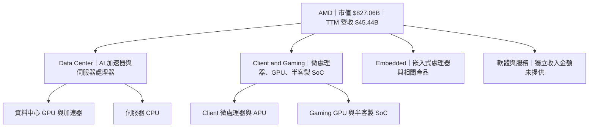
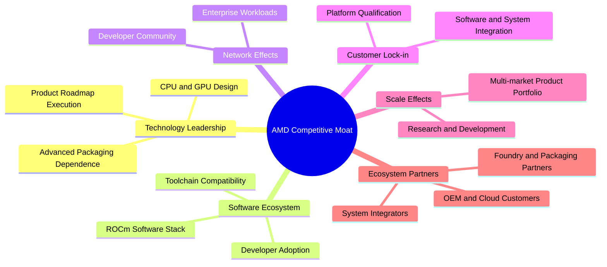
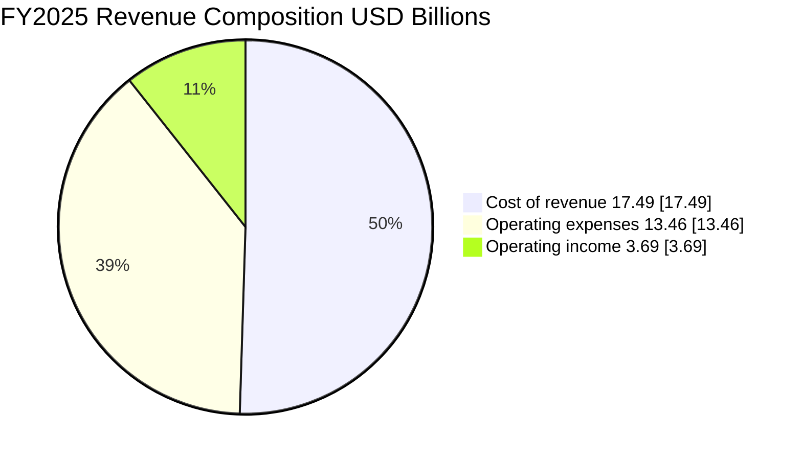
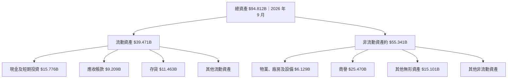
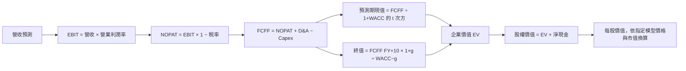
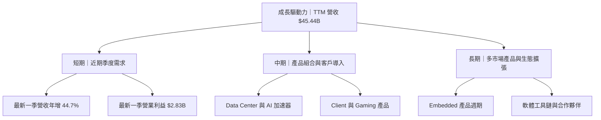
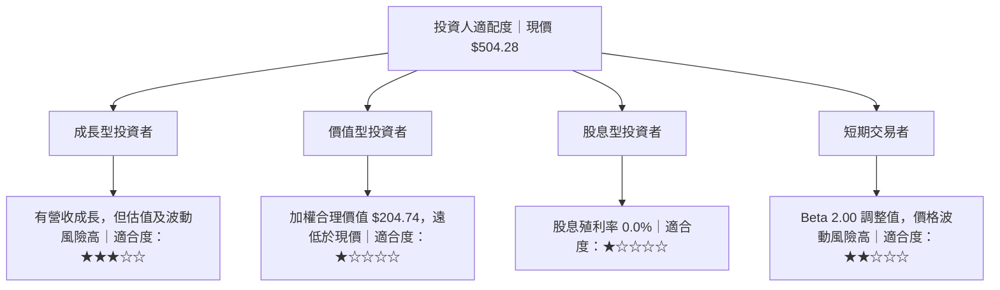

# AMD 基本面深度分析報告
> **報告日期**：2026-11-17 ｜ **語言**：繁體中文 ｜ **數據來源**：SEC 申報資料 (XBRL)、Yahoo Finance、Finviz、StockAnalysis、Roic.ai ｜ **分析師**：CFA 級機構研究

## 目錄

| # | 章節 | 核心結論 |
|---|------|----------|
| 1 | 執行摘要 | 賣出；加權合理價值 $204.74；MOS −146.3% |
| 2 | 公司概覽與商業模式 | 產品及設計能力形成中度護城河；分部營收明細未提供 |
| 3 | 損益表深度分析 | TTM 營收 $45.44B，TTM 年增 41.9%；最新一季年增 44.7% |
| 4 | 資產負債表分析 | 淨現金 $8.70B；營運資金充裕，但庫存天數上升 |
| 5 | 現金流量深度分析 | TTM FCF $7.06B，FCF Yield 0.85%；SBC 對股東有稀釋成本 |
| 6 | 獲利能力與資本效率 | ROIC 12.8% 低於 WACC 14.0%，目前未覆蓋資本成本 |
| 7 | 相對估值分析 | AMD 倍數高於同業中位數與自身歷史多項基準 |
| 8 | DCF 內在價值評估 | 基準 DCF $76.23；加權合理價值 $204.74，與現價差距大 |
| 9 | 成長催化劑 | 資料中心、AI 加速器與伺服器需求是主要觀察方向；TAM 數據未提供 |
| 10 | 風險矩陣 | 估值、競爭、出口管制是主要風險 |
| 11 | 投資建議 | 依 MOS 評級為賣出；等待估值和營運指標改善 |

---

## 1. 執行摘要

截至 **2026-11-16 收盤價 $504.28**，AMD 的 TTM 營收為 $45.44B、年增 41.9%，最新一季營收年增 44.7%；TTM FCF 為 $7.06B，但 FCF Yield 僅 0.85%。ROIC 12.8% 低於本報告採用的 WACC 14.0%，代表目前回報尚未覆蓋資本成本。估值方面，DCF 基準值為 $76.23、加權合理價值為 $204.74；以加權合理價值計算的 MOS 為 −146.3%，故依規則 20 評級為**賣出**。此評級反映估值風險，不否認營收成長與產品需求的正面證據。

### 1.0 一頁式投資儀表板

| 項目 | 內容 |
|------|------|
| **投資論點（3 句）** | ① TTM 營收 $45.44B、年增 41.9%，最新一季年增 44.7%，成長動能仍在。② TTM FCF $7.06B，但 FCF Yield 僅 0.85%，現金流對市值的支撐有限。③ ROIC 12.8% 低於 WACC 14.0%，且加權合理價值 $204.74 遠低於現價 $504.28。 |
| **綜合評分** | **6.5/10**（引用 1.1 評分卡） |
| **財務健康** | 🟢 現金與短期投資 $15.78B、總債務 $7.08B、淨現金 $8.70B；庫存天數上升值得留意。 |
| **ROIC vs WACC** | **12.8% vs 14.0%**：低於資本成本 1.2 個百分點，現階段未創造正經濟利潤。 |
| **FCF 趨勢** | TTM FCF $7.06B；FY2023 $1.12B、FY2024 $2.40B、FY2025 $6.74B，近年上升；TTM FCF Yield **0.85%**。 |
| **估值** | Forward P/E **28.59x** ｜ EV/EBITDA **103.0x**（歷史估值區塊）｜ FCF Yield **0.85%**。不同資料源對 AMD EV/EBITDA 有落差，本報告依歷史估值區塊採 103.0x。 |
| **DCF 內在價值（基準）** | **$76.23** ｜依指定折溢價定義，現價相對 DCF 基準值溢價 **561.4%**。 |
| **安全邊際（MOS）** | **−146.3%＝($204.74 − $504.28) ÷ $204.74**（基準為 8.8 加權合理價值）｜🔴 <10% 無 |
| **預期報酬（基準情境 12M）** | DCF 基準情境價值 $76.23，相對現價 **−84.9%**；該情境是模型價值，不是 12 個月價格預測。 |
| **關鍵風險（前二）** | 高估值對成長落差敏感；AI／資料中心競爭、出口限制可能壓低成長或利潤率。 |
| **評級 + 信心度** | 🔴 **賣出** ｜信心：中（估值數據方向明確，但 DCF 長期假設及估值倍數分歧提高不確定性） |

### 1.1 綜合評分卡（全報告唯一）

| 維度 | 評分（1–10） | 主要依據（引用數字與其來源章節） |
|------|--------------|----------------------------------|
| 成長性 | 8.5 | TTM 營收年增 41.9%、最新一季年增 44.7%（3.1、3.2）；成長能否延續仍受競爭影響。 |
| 獲利能力 | 7.0 | TTM 營業利益率 17.7%、ROIC 12.8%、F-Score 7/9；ROIC 低於 WACC（3.3、6.2、6.4）。 |
| 財務健康 | 8.0 | 淨現金 $8.70B、流動比率 2.725、CCC 138 天（4.2、4.3）。 |
| 估值 | 1.0 | MOS −146.3%；Forward P/E 28.59x，高於同業 Forward P/E 中位數 17.2x（7.1、8.8）。 |
| 護城河 | 8.0 | 資料中心及處理器產品、軟硬體生態與客戶設計導入形成競爭基礎；分部市占及轉換成本量化數據未提供（2.3–2.4）。 |
| 管理層與資本配置 | 6.5 | FY2025 SBC $1.64B，稀釋股數測試未通過；近年 FCF 改善，但缺少完整回購與投資回報明細（3.5、5.4、6.4）。 |
| **綜合評分** | **6.5** | 六項算術平均：**(8.5 + 7.0 + 8.0 + 1.0 + 8.0 + 6.5) ÷ 6 = 6.5**。 |

### 1.2 五大投資論點 + 三大核心風險

| 類型 | 項目 | 具體依據 | 信心度 |
|------|------|----------|--------|
| 🟢 **投資論點①** | 營收成長仍高 | TTM 營收 $45.44B，年增 41.9%；最新一季年增 44.7%。 | 🟢 高 |
| 🟢 **投資論點②** | 獲利與現金流擴張 | FY2025 FCF $6.74B，高於 FY2024 的 $2.40B；TTM FCF 為 $7.06B。 | 🟢 高 |
| 🟢 **投資論點③** | 淨現金提供財務緩衝 | 現金及短期投資 $15.78B，債務 $7.08B，淨現金 $8.70B。 | 🟢 高 |
| 🟢 **投資論點④** | 最新季營業槓桿改善 | 最新季度營業利益 $2.83B，高於前季 $1.99B；最新季營業利益率來源間有 17.8% 與 21.2% 差異，應以申報口徑核對。 | 🟡 中 |
| 🟢 **投資論點⑤** | 資產品質指標偏正面 | Piotroski F-Score 為 7/9，營業現金流為正、ROA 改善、流動比率提高。 | 🟡 中 |
| 🟡 **風險①** | 估值過高 | 加權合理價值 $204.74，低於現價 $504.28；DCF 基準值 $76.23。 | 🔴 高衝擊 |
| 🔴 **風險②** | AI 晶片競爭與產品執行 | NVDA 最新季營收年增 105.9%，高於 AMD 44.7%；競爭落差若持續，AMD 的成長及定價可能受壓。 | 🟡 中 |
| 🔴 **風險③** | 營運資金與稀釋 | DIO 一年增加 38 天至 199 天；F-Score 的稀釋股數測試未通過。 | 🟡 中 |

### 1.3 快速統計卡片

同業中位數為 NVDA、INTC、AVGO 三家公司可用數據的中位數；EPS、ROIC 與 FCF Yield 的同業比較資料未提供，故不列同業欄。

| 指標 | 公司實際值（期間） | 同業中位數 | 狀態 |
|------|--------------------|------------|------|
| 營收成長（TTM） | **41.9%** | — | 🟢 |
| 營收成長（最新一季年增） | **44.7%** | **85.5%** | 🟡 |
| 毛利率（TTM） | **56.0%** | **74.7%** | 🟡 |
| 營業利益率（TTM） | **17.7%** | — | 🟢 |
| ROIC（TTM） | **12.8%** | — | 🟡 |
| Forward P/E | **28.59x** | **17.2x** | 🔴 |
| FCF Yield（TTM） | **0.85%** | — | 🔴 |
| Piotroski F-Score | **7 / 9** | — | 🟢 |

### 1.4 投資結論

```text
╔══════════════════════════════════════════════════════════════════╗
║                    📊 投資結論摘要                               ║
╠══════════════════════════════════════════════════════════════════╣
║  評級：🔴 賣出（MOS −146.3%，依規則 20）                         ║
║  價格（2026-11-16 收盤）：$504.28                               ║
║  DCF 內在價值（基準）：$76.23（現價相對 DCF 溢價 561.4%）       ║
║  安全邊際 MOS：−146.3%＝($204.74−$504.28)÷$204.74              ║
║  加權合理價值（8.8）：$204.74                                    ║
║  DCF 情境價值：                                                  ║
║    悲觀情境：$40.40（相對現價 −92.0%）                          ║
║    基準情境：$76.23（相對現價 −84.9%）                          ║
║    樂觀情境：$142.39（相對現價 −71.8%）                         ║
║  綜合評分：6.5/10（引用 1.1）                                   ║
║  適合投資人：能承受波動、以長期成長為主且重視分批風控者；        ║
║              現價估值不適合以價值折價為核心的投資人。           ║
╚══════════════════════════════════════════════════════════════════╝
```

---

## 2. 公司概覽與商業模式

### 2.1 業務結構與收入來源

公司資料列出 Data Center、Client and Gaming、Embedded 三個業務區塊，但沒有各分部營收與占比。為避免將推估的收入組合當成財務事實，下圖只呈現可確認的業務架構，不標示分部金額或百分比。



分部營收、客戶集中度及軟體／服務收入占比未提供，因此不能據此計算各分部營收貢獻。AMD 目前以晶片設計、產品組合與軟體支援參與多個半導體市場，實際成長貢獻需追蹤後續季報分部揭露。

### 2.2 市場份額

**市場份額數據未提供**，故不製作市占表或圓餅圖。AMD 的 TTM 營收為 $45.44B、年增 41.9%，但僅憑公司營收無法推算特定市場市占；同業數據顯示 NVDA 最新一季營收年增 105.9%，高於 AMD 的 44.7%，反映在 AI 相關需求加速時，AMD 仍面對高成長競爭者。

### 2.3 競爭護城河分析



### 2.4 護城河強度

| 護城河項目 | 強度（強／中／弱） | 證據（引用數字或事實） | 會削弱它的情況 |
|------------|--------------------|------------------------|----------------|
| 技術與產品設計 | 中至強 | 公司涵蓋資料中心、Client、Gaming、Embedded；TTM 營收 $45.44B，顯示跨產品營運規模。 | 新產品效能、供應與量產節奏落後；競爭者持續提升產品效能或成本優勢。 |
| 軟體生態系統 | 中 | AI 加速器需要軟體工具鏈、開發者支援及工作負載相容性；可用量化採用率未提供。 | 開發者及企業軟體遷移成本不足，或替代平台在工具成熟度上拉開差距。 |
| 網路效應 | 弱至中 | 開發者、OEM 與雲端客戶的採用可能形成正向回饋，但用戶數及網路效應指標未提供。 | 客戶採購多源化或軟體抽象層降低平台差異。 |
| 客戶鎖定 | 中 | 伺服器、企業系統及軟體需要產品驗證與整合；客戶留存率與轉換成本數字未提供。 | 大型客戶自研、轉向競品或降低單一供應商依賴。 |
| 規模效應 | 中 | FY2025 研發費用 $8.09B；研發投入可支援多產品線。 | 研發支出持續快於營收，或新產品投資未能轉化為毛利與現金流。 |
| 生態夥伴 | 中 | 半導體產品仰賴晶圓製造、封裝、OEM 及系統整合夥伴；夥伴集中度數據未提供。 | 供應瓶頸、出口限制或夥伴優先支援競爭者。 |

1.1 護城河評分為 **8.0/10**，理由是公司具備跨產品設計與研發投入的競爭基礎，但軟體採用、客戶鎖定與市占資料不足以證明其競爭優勢可持續轉化為超額報酬。

---

## 3. 損益表深度分析

### 3.1 年度收入成長趨勢（近4年）

FY2022 至 FY2025 營收來自年度損益表；FY2023 與 FY2024 成長率按年度營收計算。2022–2025 三年 CAGR 約 13.7%，公式為 \((34.64 ÷ 23.60)^{1/3}−1\)。

```text
╔══════════════════════════════════════════════════════════════════╗
║              AMD 年度收入趨勢（FY2022–FY2025）                  ║
╠══════════════════════════════════════════════════════════════════╣
║  FY2022  $23.60B  ██████████████░░░░░░░░░░░░  基期             ║
║  FY2023  $22.68B  █████████████░░░░░░░░░░░░░  YoY: −3.9% 🔴   ║
║  FY2024  $25.79B  ███████████████░░░░░░░░░░░  YoY: +13.7% 🟡  ║
║  FY2025  $34.64B  ████████████████████░░░░░░  YoY: +34.3% 🟢  ║
║                                                                  ║
║  三年營收 CAGR：約 +13.7%                                        ║
╚══════════════════════════════════════════════════════════════════╝
```

FY2023 營收下滑 3.9%，之後 FY2024、FY2025 轉為成長。TTM 營收年增 41.9% 高於上述多年 CAGR，代表近期營收動能加速；但這不宜直接外推為長期成長率，因為公司所處市場存在產品週期與同業競爭。

### 3.2 季度收入趨勢分析

下表按 FY2026 Q1 至 Q3 及 FY2025 Q4 排列。QoQ 與 YoY 依已披露季度營收計算或引用季度資料；季度金額以 $B 表示。

| 季度 | 營收 | QoQ | YoY | 備註 |
|------|------:|----:|----:|------|
| FY2025 Q4 | $10.27B | +11.1% | +34.1% | 相較 FY2025 Q3 的 $9.246B 增長。 |
| FY2026 Q1 | $10.25B | −0.2% | +37.9% | 短期季節性或產品組合影響，年增仍高。 |
| FY2026 Q2 | $11.54B | +12.5% | +50.1% | 季營收擴大，年增率進一步上升。 |
| FY2026 Q3 | $13.38B | +16.0% | +44.7% | 最新一季年增率仍強，但低於前一季年增率。 |

季度資料呈現 FY2026 Q1 至 Q3 營收連續增加，最新季營收由 $11.54B 升至 $13.38B，QoQ 約增 16.0%。但最新季度同比增速由前季 50.1% 降至 44.7%，表示高速成長仍在、成長率則未持續加速。

### 3.3 利潤率演變分析

年度表格中的毛利率、營業利益率為收入與相應年度財務項目計算值；TTM 毛利率及營業利益率採財務數據所列值。

| 利潤率指標 | FY2022 | FY2023 | FY2024 | FY2025 | 趨勢 | 評估 |
|------------|--------:|--------:|--------:|--------:|------|------|
| **毛利率** | 約 44.9% | 約 46.1% | 約 49.3% | 約 49.5% | 2023 後上升，FY2025 小幅改善 | 🟢 |
| **營業利益率** | 約 5.3% | 約 1.8% | 約 8.1% | 約 10.6% | FY2023 低點後回升 | 🟢 |
| **淨利率** | 約 5.6% | 約 3.8% | 約 6.4% | 約 12.5% | FY2025 明顯擴張 | 🟢 |
| **TTM 毛利率** | — | — | — | **56.0%** | 高於 FY2025 年度毛利率 | 🟢 |
| **TTM 營業利益率** | — | — | — | **17.7%** | 高於 FY2025 年度營業利益率 | 🟢 |

利潤率回升與營收規模增加、產品組合改善及營業費用槓桿相符；不過財務數據沒有分部毛利、產品定價或單位成本，無法把改善幅度精確拆分為各因素。FY2025 研發費用 $8.09B，研發投入仍高；若收入增速放慢而研發費用維持上升，營業槓桿將反向作用。最新季度營業利益率在不同資料源出現 17.8% 與 21.2% 差異，本文對 TTM 使用指定數值 17.7%，不以不同口徑的單季數值替代。

### 3.4 費用結構分析

以 FY2025 年度營收 $34.64B、毛利 $17.15B、營業利益 $3.69B 分解，營業費用由「毛利減營業利益」推得約 $13.46B。這是依年度損益項目計算的營收分解，不等於完整現金支出或現金流分類。



```text
╔══════════════════════════════════════════════════════════════════╗
║             FY2025 營收與營業費用結構（USD B）                  ║
╠══════════════════════════════════════════════════════════════════╣
║  營收             $34.64B  ██████████████████████████████       ║
║  毛利             $17.15B  ███████████████                       ║
║  營業費用估算     $13.46B  ████████████                          ║
║  營業利益          $3.69B  ███                                   ║
╚══════════════════════════════════════════════════════════════════╝
```

### 3.5 季度 EPS 趨勢與盈餘品質（Quality of Earnings）

#### 過去四季盈餘表現

| 季度 | EPS 實際值 | EPS 年增 | 預估／實際與超預期判定 |
|------|-----------:|--------:|--------------------------|
| FY2025 Q4 | $0.92 | +217.14% | 預估值為 nan，無法判定超預期或不及預期。 |
| FY2026 Q1 | $0.84 | +91.17% | 預估值為 nan，無法判定超預期或不及預期。 |
| FY2026 Q2 | $1.39 | +159.49% | 預估值為 nan，無法判定超預期或不及預期。 |
| FY2026 Q3 | $1.46 | +93.82% | 預估值為 nan，無法判定超預期或不及預期。 |

四季實際 EPS 均較去年同期增加，但資料庫未提供可用的分析師 EPS 預估值，因此不能把上述季度標記為超預期或不及預期。FY2026 Q3 EPS 年增 93.82%，而最新季度淨利年增 95.3%，主要反映獲利基數與利潤表現提升；預期差仍需以正式財報前一致預估核對。

| 盈餘品質項目 | 數值／佔比 | 評估 |
|--------------|------------|------|
| 股權薪酬 SBC / 營收 | FY2025：$1.64B ÷ $34.64B = **4.7%** | 🟡 SBC 是實質股東成本；未對應回購或抵銷稀釋時會降低每股經濟利益。 |
| SBC / 營業現金流 | FY2025：$1.64B ÷ $7.71B = **21.3%** | 🟡 比重顯著；營業現金流含非現金 SBC 加回，須同時考慮股數稀釋。 |
| FCF / 淨利（現金轉換率） | TTM FCF $7.06B ÷ TTM 淨利 $7.619B = **92.7%** | 🟡 現金轉換接近淨利，但低於 100%；比較需注意 TTM 淨利與現金流期間口徑。 |
| 一次性／非經常性損益 | N/A（未提供足夠明細） | 無法確認一次性項目對近期盈餘的影響。 |
| 有效稅率異常 | N/A（實際 TTM 有效稅率未提供）；DCF 假設稅率 21.0% | 不能確認實際稅負是否由稅務利益或一次性項目帶動。 |
| 資本化支出 vs 費用化 | TTM Capex $2.07B；FY2025 研發費用 $8.09B | 折舊、資本化研發與費用化細項不足，無法完整判定是否存在成本遞延。 |

**盈餘品質結論**：營業現金流與 FCF 均為正，FCF / 淨利約 92.7%，對 GAAP 盈利提供一定現金支持；但 SBC 佔 FY2025 營收 4.7%、營業現金流 21.3%，加上稀釋股數測試未通過，代表 GAAP 淨利不能直接等同於完全歸屬現有股東的經濟盈餘。估值時應檢視每股現金流及股數變化，而非只看總淨利成長。

---

## 4. 資產負債表分析

### 4.1 資產結構分解

總資產採 StockAnalysis 2026 年 9 月季度資料 $94.812B；現金、短期投資、應收帳款、存貨、固定資產與無形資產列出有披露的項目。因所列細項未涵蓋全部資產，不以不完整項目製作比例圓餅圖。



### 4.2 流動性與營運資金分析

| 指標 | 最新 TTM | 一年前 TTM | 變化 | 解讀 |
|------|----------|------------|------|------|
| 流動比率 | 2.725 | N/A（同口徑歷史數據未提供） | N/A | 短期資產對流動負債有充足覆蓋；未以另一來源自行補算。 |
| 速動比率 | 1.725 | N/A | N/A | 即使排除存貨仍高於 1；須觀察應收帳款回收品質。 |
| DSO 應收帳款天數 | **74 天** | **71 天** | **+3 天** | 收款週期稍微拉長；應關注應收帳款增速是否快於營收。 |
| DIO 存貨天數 | **199 天** | **161 天** | **+38 天** | 庫存天數增加；可能反映備貨、產品週期或銷售轉化速度，須觀察後續存貨消化。 |
| DPO 應付帳款天數 | **135 天** | **77 天** | **+58 天** | 付款天數上升，改善現金占用但不能單獨視作議價力提升。 |
| CCC 現金轉換週期 | **138 天** | **155 天** | **−17 天** | 雖庫存與應收天數上升，應付天數增加更多，使現金轉換週期改善。 |

營運資金天數依 SEC 流量與 Yahoo 季度資產負債表口徑計算。DIO 增加 38 天是需要持續監控的指標；CCC 同時下降 17 天，主要伴隨 DPO 上升 58 天。這種改善部分依賴供應商付款週期延長，若付款條件回復或存貨無法變現，現金流效益可能逆轉。

### 4.3 債務結構分析

依指定 VERIFIED FIGURES，採總債務 $7.08B、現金及短期投資 $15.78B、淨現金 $8.70B。另有來源呈現總債務 $9.21B、淨現金 $6.57B；本報告在核心指標中使用指定的 SEC 申報計算口徑，並將差異列為需在下次申報資料核對的口徑差異。

```text
╔══════════════════════════════════════════════════════════════════╗
║                   AMD 債務健康診斷                               ║
╠══════════════════════════════════════════════════════════════════╣
║  總債務：             $7.08B  ███████░░░░░░░░░░░░░  🟢          ║
║  現金+短期投資：     $15.78B  ████████████████░░░░  🟢          ║
║  淨現金：             $8.70B  █████████░░░░░░░░░░░  🟢          ║
║                                                                  ║
║  Debt/EBITDA：N/A（未提供一致口徑 EBITDA 值）                   ║
║  Interest Coverage：N/A（利息費用未提供）                       ║
║  流動比率：2.725x  🟢                                            ║
║  注意：另一資料源債務值為 $9.21B，需核對租賃等口徑差異。        ║
╚══════════════════════════════════════════════════════════════════╝
```

### 4.4 股東權益趨勢

| 年度 | 股東權益 | 年增額 | 解讀 |
|------|---------:|-------:|------|
| FY2022 | $54.75B | — | 歷史基期。 |
| FY2023 | $55.89B | +$1.14B | 小幅增加。 |
| FY2024 | $57.57B | +$1.68B | 持續增加。 |
| FY2025 | $63.00B | +$5.43B | 增幅加大，與公司規模及累積獲利增加相符。 |

```text
╔══════════════════════════════════════════════════════════════════╗
║                 AMD 股東權益趨勢（USD B）                        ║
╠══════════════════════════════════════════════════════════════════╣
║  FY2022  $54.75B  █████████████████░░░                          ║
║  FY2023  $55.89B  ██████████████████░░                          ║
║  FY2024  $57.57B  ██████████████████░░                          ║
║  FY2025  $63.00B  ████████████████████                          ║
╚══════════════════════════════════════════════════════════════════╝
```

---

## 5. 現金流量深度分析

### 5.1 現金流量瀑布圖

年度與季度現金流項目可確認營業現金流、資本支出與 FCF，但股息及回購的實際金額未提供，因此流程圖不加入未披露的資本返還數字。


### 5.2 FCF 轉換率趨勢

| 年度 | FCF | 淨利 | FCF / 淨利 | 評估 |
|------|----:|-----:|-----------:|------|
| FY2023 | $1.12B | $0.854B | 131.1% | FCF 高於淨利；單年比率受營運資金及資本支出時點影響。 |
| FY2024 | $2.40B | $1.641B | 146.3% | 現金轉換率高，但基數及現金流時點因素仍須考量。 |
| FY2025 | $6.74B | $4.33B | 155.7% | FCF 增幅高於淨利增幅，現金流轉化改善。 |
| TTM | $7.06B | $7.619B | 92.7% | 低於 100%，且與年度資料期間不同，應以同期間後續報表追蹤。 |

### 5.3 自由現金流趨勢

| 期間 | FCF | FCF Yield |
|------|----:|----------:|
| FY2023 | $1.12B | N/A |
| FY2024 | $2.40B | N/A |
| FY2025 | $6.74B | N/A |
| TTM | **$7.06B** | **0.85%** |

```text
╔══════════════════════════════════════════════════════════════════╗
║               自由現金流趨勢（年度值，USD B）                   ║
╠══════════════════════════════════════════════════════════════════╣
║  FY2023  $1.12B  ████░░░░░░░░░░░░░░░░  FCF Yield N/A           ║
║  FY2024  $2.40B  ███████░░░░░░░░░░░░░  FCF Yield N/A           ║
║  FY2025  $6.74B  ███████████████████░  FCF Yield N/A           ║
║  TTM     $7.06B  ████████████████████  FCF Yield 0.85%         ║
╚══════════════════════════════════════════════════════════════════╝
```

TTM FCF 定義固定為 **營業現金流 − 資本支出**，即 $9.12B − $2.07B，採財務數據指定的 TTM FCF $7.06B。年度 FCF 上升顯示現金創造能力改善；0.85% FCF Yield 則代表現價對應的現金流收益率低，估值仍高度依賴未來成長。

### 5.4 資本配置評估

完整回購、併購、股息與資本支出配置金額資料未提供，故不以比例圓餅圖呈現。已知 FY2025 Capex 為 $0.974B（現金流表列為支出），FY2025 SBC 為 $1.64B、股息殖利率為 0%。公司未支付股息，股東回報主要仰賴每股獲利與股價增值；稀釋股數未增加測試未通過，應將 SBC 與回購抵銷效果一併監控。

---

## 6. 獲利能力與資本效率

### 6.1 ROE / ROA / ROIC 趨勢

歷史年度 ROE、ROA 與 ROIC 全系列數據未提供；以下列示有來源的 TTM 指標，避免以未披露數值補造年度趨勢。

| 指標 | 最新可用值 | 期間／來源 | 評估 |
|------|-----------:|-------------|------|
| ROE | **11.1%** | TTM，QUALITY FIGURES 杜邦口徑 | 🟡 有獲利但不是高資本回報；另一資料源列 12.0%，本文採杜邦一致口徑 11.1%。 |
| ROA | **5.9%** | TTM | 🟡 資產獲利能力為正；F-Score 顯示較一年前改善。 |
| ROIC | **12.8%** | TTM，稅後營業利益／投入資本 | 🟡 高於零，但低於 WACC。 |
| 同業／行業均值 | N/A | 未提供可比口徑資料 | 不作無來源比較。 |

### 6.2 ROIC vs WACC 分析（核心價值創造判斷）

採用指定資本成本區塊的 WACC **14.00%**，不另行建立第二套 WACC。由於指定 ROIC 為 TTM 稅後營業利益除以投入資本，本文直接使用已計算 ROIC 12.8%；不以年度損益表混算另一個 ROIC。

```text
╔══════════════════════════════════════════════════════════════════╗
║                ROIC vs WACC 深度分析                            ║
╠══════════════════════════════════════════════════════════════════╣
║  WACC 組成（採用指定 Cost of capital）：                         ║
║  ├── 無風險利率（10Y 美債）：          5.12%                    ║
║  ├── ERP：                            5.00%                    ║
║  ├── 原始 Beta：                      2.54                     ║
║  ├── 調整後 Beta：                    2.00                     ║
║  ├── 股權成本：                       15.12%                   ║
║  ├── 稅前債務成本：                   1.85%                    ║
║  ├── 稅率：                           21.0%                    ║
║  ├── 股權／債務權重：                 99.2%／0.8%               ║
║  ├── 計算 WACC：                      15.01%                   ║
║  └── 區間限制後採用 WACC：             14.00%                   ║
║                                                                  ║
║  ROIC（TTM）：                        12.8%                    ║
║  WACC：                               14.0%                    ║
║  EVA spread = ROIC − WACC：           −1.2 個百分點             ║
║                                                                  ║
║  ROIC  12.8%  ▓▓▓▓▓▓▓▓▓▓▓▓▓░░░░░░░░░░░                         ║
║  WACC  14.0%  ▓▓▓▓▓▓▓▓▓▓▓▓▓▓░░░░░░░░░                         ║
║                                                                  ║
║  結論：ROIC 約為 WACC 的 0.91 倍；目前回報低於資本成本，        ║
║        尚未顯示正的資本回報利差。                                ║
╚══════════════════════════════════════════════════════════════════╝
```

資本成本資料中的調整後 Beta 為 2.00；原始 Yahoo Beta 為 2.54，經 \(⅔×2.54+⅓=2.03\) 後，按資料庫設定的 0.6–2.0 區間限制為 2.00。指定 CAPM 股權成本為 15.12%；以 99.2% 股權、0.8% 債務權重及稅後債務成本 1.85%×(1−21%) 得到計算 WACC 15.01%，再按 7%–14% 區間上限採用 14.00%。區間限制使採用值低於未限制計算值，對 DCF 相對有利。

### 6.3 杜邦三因素分解

| 因素 | 數值（TTM） | 解讀 |
|------|-------------|------|
| 淨利率 | **16.8%** | 淨利率是 ROE 的主要正向來源之一。 |
| 資產週轉率 | **0.48** | 每單位資產創造的營收有限，且反映半導體公司資產及無形資產結構。 |
| 權益乘數 | **1.39** | 財務槓桿不高，ROE 並非主要依靠槓桿支撐。 |
| **ROE** | **11.1%** | **16.8% × 0.48 × 1.39 = 11.1%**；三因素乘積與公布值吻合至四捨五入。 |

### 6.4 財務體質：Piotroski F-Score

| 測試 | 結果 | 解讀 |
|------|------|------|
| ROA > 0 | ✅ 通過 | TTM 資產報酬為正。 |
| 營業現金流 > 0 | ✅ 通過 | TTM 營業現金流為正。 |
| ROA 高於一年前 | ✅ 通過 | 資產獲利改善。 |
| 營業現金流 > 淨利（應計品質） | ✅ 通過 | 依指定品質計算口徑通過；與其他期間資料比較需保持期間一致。 |
| 長期負債 ÷ 總資產低於一年前 | ❌ 未通過 | 負債比率未改善至通過門檻，需追蹤借款與資產變動。 |
| 流動比率高於一年前 | ✅ 通過 | 短期流動性改善。 |
| 稀釋股數未增加 | ❌ 未通過 | 股數稀釋對每股價值構成成本。 |
| 毛利率高於一年前 | ✅ 通過 | 毛利率較一年前提高。 |
| 資產週轉率高於一年前 | ✅ 通過 | 資產使用效率改善。 |

**Piotroski F-Score：7/9。** 兩項未通過分別涉及長期負債比率及稀釋股數；整體財務訊號偏正面，但股東每股報酬仍需扣除稀釋影響。

---

## 7. 相對估值分析

### 7.1 同業估值比較表格

AMD 自身倍數採估值歷史區塊及市場資料中的 Forward P/E；同業倍數採 Yahoo Finance 同業資料。AMD EV/EBITDA 在來源中存在 103.0x 與 73.634x 的差異，為遵循指定的歷史估值區塊，此處採 103.0x。

| 估值指標 | **AMD** | **NVDA** | **INTC** | **AVGO** | AMD 評估 |
|----------|--------:|--------:|--------:|--------:|-----------|
| **Trailing P/E** | **109.6x** | 19.7x | N/A | 42.6x | 🔴 高於可用同業；盈利及口徑差異需留意。 |
| **Forward P/E** | **28.59x** | 9.9x | 31.0x | 17.2x | 🔴 高於三家中位數 17.2x。 |
| **P/S Ratio** | **18.4x** | 12.4x | 4.9x | 17.9x | 🔴 高於同業中位數 12.4x。 |
| **EV/EBITDA** | **103.0x** | 18.6x | 16.1x | 31.1x | 🔴 高於同業中位數 18.6x。 |
| **最新一季營收年增** | **44.7%** | 105.9% | 20.9% | 85.5% | 🟡 AMD 成長為正，但低於 NVDA、AVGO。 |
| **毛利率（TTM）** | **56.0%** | 74.7% | 40.2% | 75.5% | 🟡 高於 INTC、低於 NVDA 與 AVGO。 |

Peer multiples 中位數依可用同業數值取得：Forward P/E 17.2x、P/S 12.4x、EV/EBITDA 18.6x、最新季營收年增 85.5%、TTM 毛利率 74.7%。AMD 的相對估值反映市場對成長的期待，但也使估值對成長率與利潤率落差高度敏感。

### 7.2 歷史估值區間分析

```text
╔══════════════════════════════════════════════════════════════════╗
║                AMD 自身五年估值位置（TTM）                      ║
╠══════════════════════════════════════════════════════════════════╣
║  P/E：      36.7x ├────────────●──────────────────┤ 934.7x       ║
║                            現值 109.6x｜歷史中位數 82.6x          ║
║                            當前百分位 53%                         ║
║                                                                  ║
║  P/S：       4.3x ├────────────────────────●─────┤ 23.1x         ║
║                            現值 18.4x｜歷史中位數 8.9x            ║
║                            當前百分位 90%                         ║
║                                                                  ║
║  EV/EBITDA：38.2x ├────────────●─────────────────┤ 919.2x       ║
║                            現值 103.0x｜中位數 102.2x             ║
║                            當前百分位 56%                         ║
╚══════════════════════════════════════════════════════════════════╝
```

P/E 與 EV/EBITDA 位於自身五年區間中段附近，但兩者區間受歷史低獲利或倍數極值影響較大；P/S 位於自身歷史第 90 百分位，顯示市場對營收估值處於相對昂貴位置。

### 7.3 情境價值（Bear / Base / Bull，照抄 DCF MODEL）

| 情境 | 第 1 年營收成長 | 期末營業利潤率 | WACC | 每股價值 | 相對現價 | 機率 | 會發生的條件 |
|------|----------------|----------------|------|----------:|----------:|------:|--------------|
| 🔴 悲觀 | 15.0% | 6.3% | 15.00% | $40.40 | −92.0% | 25% | AI 加速器與資料中心需求放緩、競爭導致營收成長及長期利潤率低於基準。 |
| 🟡 基準 | 30.0% | 7.4% | 14.00% | $76.23 | −84.9% | 50% | 第一年高成長後逐年減速，長期營業利潤率回落至指定歷史中位數。 |
| 🟢 樂觀 | 45.0% | 8.1% | 13.00% | $142.39 | −71.8% | 25% | 新產品放量、需求高於基準且長期利潤率略高於基準。 |

上述情境價值與假設為 DCF MODEL 所列結果，並非另行建立的目標價。即使樂觀情境的模型價值仍低於現價，凸顯現價隱含的市場預期高於這組情境模型。

### 7.4 相對估值隱含價格區間

```text
╔══════════════════════════════════════════════════════════════════╗
║             估值方法隱含價值與現價位置（USD／股）               ║
╠══════════════════════════════════════════════════════════════════╣
║  $76.23 ───── $130.99 ───── $302.90 ───── $504.28 ───── $657.74 ║
║  DCF 基準      EV/EBITDA     Forward P/E       現價      共識目標 ║
╚══════════════════════════════════════════════════════════════════╝
```

| 方法 | 每股價值 | 相對現價 | 依據 |
|------|---------:|----------:|------|
| DCF（基準） | $76.23 | −84.9% | 10 年 FCFF、WACC 14.00%、永續成長率 3.0%。 |
| 同業 Forward P/E | $302.90 | −39.9% | 同業中位數 17.2x × AMD Forward EPS $17.64。 |
| 同業 EV/EBITDA | $130.99 | −74.0% | 同業中位數 18.6x × TTM EBITDA，再加淨現金。 |
| 分析師共識目標價 | $657.74 | +30.4% | 49 位分析師平均目標價。 |

---

## 8. DCF 內在價值評估（Discounted Cash Flow）

> 本節逐年假設、現金流、終值、敏感度與情境均依 SEC 申報資料與程式計算的 DCF 模型列示。金額單位為 USD B；金額取兩位小數、比率取一位小數、折現因子取三位小數。模型表格經四捨五入後允許約 0.01 的加總尾差。

### 8.0 估值推理鏈（Thinking Logic：在算之前先想清楚）

**Step 1 — 價值由哪些變數決定？**  
AMD 的價值取決於現有處理器與圖形產品現金流、資料中心與 AI 加速器成長，以及嵌入式和半客製產品的穩定性。資料沒有分部營收，故不能可靠地給各來源營收占比；以模型可驗證的總營收為起點，TTM 營收 $45.44B，TTM 年增 41.9%。主導估值的變數是營收成長與營業利潤率如何逐年衰減，並受 WACC 與終值假設放大。

**Step 2 — 模型選擇**

| 決策點 | 本報告採用 | 理由（含數字） | 曾考慮但否決 | 否決理由 |
|--------|-----------|----------------|--------------|----------|
| 現金流定義 | FCFF | 以 WACC 折現並先求 EV；模型採 FCFF = NOPAT + D&A − Capex。 | FCFE | 指定模型的現金流與 WACC 定義為 FCFF。 |
| 預測期 N | 10 年 | 模型逐年由 FY+1 至 FY+10，營收成長由 30.0% 線性降至 3.0%。 | 5 年 | 與指定模型不一致，且不能忽略模型既有十年預測。 |
| 終值方法 | Gordon Growth | 模型採 g=3.0%，WACC=14.0%，滿足 WACC>g。 | 退出倍數法 | DCF MODEL 未提供退出倍數模型結果，不能另行建模。 |
| EBIT 基礎 | GAAP EBIT | 指定模型以 GAAP EBIT 作為營業利益基礎。 | 非 GAAP EBIT | 會與已含 SBC 的 GAAP 費用重複調整或改變模型。 |

**Step 3 — 高／中敏感度假設推導鏈**

- **營收成長**：錨點＝TTM 年增 41.9%；調整＝模型把首年成長限制在 30.0%，並線性降至第十年 3.0%，反映高速增長不宜永久外推；**採用 FY+1 30.0%、FY+10 3.0%**；曾考慮直接以 41.9% 作首年並延續更久，但以基期較高與競爭風險為由不採用。模型把 30% 設為上限，並非管理層財測。
- **營業利潤率**：錨點＝TTM GAAP 營業利益率 17.7%；調整＝模型逐年降低至過去五個財年中位數 7.4%，不把近期利潤率擴張永久化；**採用 FY+1 17.7% 線性降至 FY+10 7.4%**；曾考慮維持 17.7% 不變，但否決，因其會忽略成熟化及競爭對利潤率的壓力。
- **預測期 N**：錨點＝模型提供 10 年期間；調整＝採用完整模型期間以呈現成長衰減；**採用 10 年**；曾考慮 5 年，但會更早將較高成長現金流交由終值假設代表。
- **Capex／營收**：錨點＝TTM Capex / Revenue 約 2.07÷45.44=4.6%，而模型列示 4.5%；調整＝遵循指定模型使用 4.5% 並維持該比例；**採用 4.5%**；曾考慮依 D&A 的 1.1 倍調整，但模型最後列值為 4.5%，不另改數字。
- **EBIT 基礎與 SBC**：錨點＝GAAP EBIT 且費用化 SBC；調整＝依指定模型採 GAAP EBIT，SBC 已包含在費用；**採用 (A) GAAP EBIT + 固定股數、不另扣 SBC、年稀釋率 0%**；曾考慮額外扣 SBC 或再調高股數，但會使同一成本重複計入。
- **永續成長率 g**：錨點＝模型設定 3.0%；調整＝其低於 WACC 14.0%，終值公式有定義；**採用 3.0%**；曾考慮較高長期成長率，但模型沒有支持更高值的長期經濟與市場數據。
- **終值方法**：錨點＝Gordon Growth，模型以 FY+10 FCFF 為基礎；調整＝WACC 14.0% 高於 g 3.0%；**採用 Gordon Growth**；曾考慮退出倍數交叉驗證，但指定模型未提供該數值，不能補造。
- **WACC**：錨點＝未限制計算值 15.01%；調整＝依資料庫規定的 7%–14% 區間上限限制；**採用 14.00%**；曾考慮採用 15.01%，但指定資本成本口徑要求使用限制後數值。

**低敏感度輸入**：有效稅率採模型 21.0%；D&A／營收採 TTM 6.7%；ΔWC 未建模，採模型未納入營運資金變動的處理。以上均不自行補值。

**Step 4 — 最脆弱的一環**  
最脆弱的是成長與利潤率的長期路徑：若 AI 與資料中心增長不及預期，或價格競爭使營業利潤率低於 7.4% 的終點假設，價值將低於 $76.23；敏感度與情境表顯示基準估值對折現率及經營假設高度敏感。

**Step 5 — 計算路徑圖**



### 8.1 模型假設總表（Model Inputs）

| 假設項目 | 採用值 | 依據／來源 | 敏感度 |
|----------|--------|-------------|--------|
| 預測期長度 N | **10 年** | DCF MODEL FY+1 至 FY+10。 | 🟡 中 |
| 營收成長 | FY+1 **30.0%** 至 FY+10 **3.0%** | TTM 年增 41.9%，模型把首年限在 30.0% 並線性衰減。 | 🔴 高 |
| 營業利潤率 | FY+1 **17.7%** 至 FY+10 **7.4%** | TTM 17.7%，衰減至過去五個財年中位數。 | 🔴 高 |
| 有效稅率 | **21.0%** | 模型預設值；實際 TTM 有效稅率未提供。 | 🟢 低 |
| Capex / 營收 | **4.5%** | 模型列示 FY+1 至 FY+10 均為 4.5%；TTM 約 4.6%。 | 🟡 中 |
| D&A / 營收 | **6.7%** | TTM 模型輸入，維持不變。 | 🟢 低 |
| 營運資金變動 | **未建模** | DCF MODEL 明確不模擬營運資金；不能自行新增 ΔWC。 | 🟢 低 |
| EBIT 基礎 | **GAAP** | 指定模型採 GAAP EBIT。 | 🟡 中 |
| SBC 處理 | **GAAP 費用已含 SBC，不再扣除** | 與固定股數方案相容。 | 🟡 中 |
| 年稀釋率 | **0%** | SBC 影響已在 GAAP EBIT 費用中處理；模型不再放大股數。 | 🟡 中 |
| 永續成長率 g | **3.0%** | 模型假設，低於 WACC 14.0%。 | 🔴 高 |
| 終值方法 | **Gordon Growth** | 模型提供終值；未提供退出倍數交叉驗證。 | 🔴 高 |
| WACC | **14.00%** | 資本成本區塊限制後採用值。 | 🔴 高 |

**SBC 防重複扣除說明**：本模型採用 **(A) GAAP EBIT + 固定股數**，故 SBC 影響已計入一次；FCFF 不再另扣 SBC，年稀釋率設為 0%。

### 8.2 折現率推導（WACC）

```text
╔══════════════════════════════════════════════════════════════════╗
║                    WACC 推導（折現率）                           ║
╠══════════════════════════════════════════════════════════════════╣
║  股權成本 Ke（CAPM）：                                           ║
║  ├── 無風險利率 Rf（10Y 美債）：      5.12%                     ║
║  ├── ERP：                            5.00%                     ║
║  ├── 原始 Beta（Yahoo）：             2.54                      ║
║  ├── 調整後 Beta：                    2.00                      ║
║  ├── 規模／國別溢酬：                 0.00%（資料未加計）        ║
║  └── Ke = 5.12% + 2.00×5.00% =       15.12%                    ║
║                                                                  ║
║  債務成本 Kd：                                                    ║
║  ├── 稅前 Kd：                        1.85%                     ║
║  ├── 稅率：                           21.0%                     ║
║  └── 稅後 Kd = 1.85%×(1−21%) =        1.46%                     ║
║                                                                  ║
║  資本結構（指定市場權重）：                                      ║
║  ├── 股權權重：                       99.2%                     ║
║  ├── 債務權重：                       0.8%                      ║
║  ├── 未限制計算 WACC：                15.01%                    ║
║  └── 區間限制後採用 WACC：             14.00%                    ║
╚══════════════════════════════════════════════════════════════════╝
```

逐步演算：

1. **Ke（CAPM）**  
   \(5.12\% + 2.00×5.00\% + 0.00\% = 15.12\%\)

2. **稅前 Kd**  
   採指定資本成本資料的利息／債務口徑：**1.85%**。實際利息費用與平均計息負債分項未完整提供，無法重建分子、分母。

3. **稅後 Kd**  
   \(1.85\%×(1−21.0\%)=1.4615\%\)，四捨五入為 **1.46%**。

4. **權重**  
   指定權重為股權 **99.2%**、債務 **0.8%**，合計 **100.0%**。指定區塊沒有可用的股權市值與同口徑計息負債拆分來重建權重，故依要求採用區塊權重，不另推導替代權重。

5. **WACC**  
   \(99.2\%×15.12\% + 0.8\%×1.4615\%=15.0107\%\)，四捨五入為 **15.01%**；指定資本成本區間為 7%–14%，因此採用上限 **14.00%**。

無風險利率的精確觀察日期未提供，故不宣稱為特定日期的市場報價。Beta 由原始 2.54 調整為 2.00，按 \(⅔×2.54+⅓=2.0267\)，再受 0.6–2.0 區間上限限制。第 6.2 節與 DCF 均採 **14.00%**。

### 8.3 逐年自由現金流預測（基準情境）

| 年度 | FY+1 | FY+2 | FY+3 | FY+4 | FY+5 | FY+6 | FY+7 | FY+8 | FY+9 | FY+10 |
|------|-----:|-----:|-----:|-----:|-----:|-----:|-----:|-----:|-----:|------:|
| 營收 | 59.07 | 75.01 | 93.02 | 112.55 | 132.81 | 152.73 | 171.06 | 186.46 | 197.64 | 203.57 |
| 營收 YoY | 30.0% | 27.0% | 24.0% | 21.0% | 18.0% | 15.0% | 12.0% | 9.0% | 6.0% | 3.0% |
| 營業利潤率 | 17.7% | 16.6% | 15.4% | 14.3% | 13.1% | 12.0% | 10.8% | 9.7% | 8.5% | 7.4% |
| 營業利益 EBIT（GAAP） | 10.46 | 12.43 | 14.34 | 16.06 | 17.42 | 18.28 | 18.51 | 18.03 | 16.84 | 15.00 |
| − 稅（21.0%） | (2.20) | (2.61) | (3.01) | (3.37) | (3.66) | (3.84) | (3.89) | (3.79) | (3.54) | (3.15) |
| = NOPAT | 8.27 | 9.82 | 11.33 | 12.69 | 13.76 | 14.44 | 14.62 | 14.24 | 13.30 | 11.85 |
| + D&A | 3.96 | 5.03 | 6.24 | 7.55 | 8.90 | 10.24 | 11.47 | 12.50 | 13.25 | 13.65 |
| − Capex | (2.69) | (3.41) | (4.23) | (5.12) | (6.04) | (6.95) | (7.78) | (8.48) | (8.99) | (9.26) |
| **= FCFF** | **9.54** | **11.43** | **13.33** | **15.11** | **16.63** | **17.73** | **18.31** | **18.26** | **17.56** | **16.24** |
| 折現因子 @14.00% | 0.877 | 0.769 | 0.675 | 0.592 | 0.519 | 0.456 | 0.400 | 0.351 | 0.308 | 0.270 |
| **FCFF 現值 PV** | **8.37** | **8.80** | **9.00** | **8.95** | **8.63** | **8.08** | **7.32** | **6.40** | **5.40** | **4.38** |

指定模型的預測期 PV 合計為 **$75.32B**。逐項以已四捨五入的 PV 顯示值相加為：

\[
8.37+8.80+9.00+8.95+8.63+8.08+7.32+6.40+5.40+4.38
=75.33\text{B}
\]

與模型使用未四捨五入數值的 $75.32B 相差 $0.01B，屬逐年四捨五入尾差。

#### FY+1 逐步演算

1. **營收** = TTM 營收 $45.44B × (1 + 30.0%) = **$59.07B**。  
2. **EBIT** = $59.07B × 17.7% = **$10.46B**。  
3. **稅** = $10.46B × 21.0% = **$2.20B**。  
4. **NOPAT** = $10.46B − $2.20B = **$8.27B**（使用未四捨五入中間值後顯示）。  
5. **D&A** = $59.07B × 6.7% = **$3.96B**。  
6. **Capex** = $59.07B × 4.5% = **$2.69B**。  
7. **ΔWC** = **未建模**；模型明確不包含營運資金變動。  
8. **FCFF** = $8.27B + $3.96B − $2.69B = **$9.54B**（依模型未四捨五入數值計算）。  
9. **折現因子與 PV** = \(1÷(1+14.00\%)^1=0.877\)；$9.54B × 0.877 ≈ **$8.37B**。

#### 合理性自檢

- 預測 FCF 由 FY+1 $9.54B 增至 FY+10 $16.24B；FY+1 至 FY+10 CAGR 約 **6.1%**（以端點計算），歷史可比較的 FY2023–FY2025 FCF CAGR 約 **145.4%**，但歷史基期較低且期間短，不能直接外推。
- FY+10 FCF 利潤率 = $16.24B ÷ $203.57B = **8.0%**；TTM FCF 利潤率 = $7.06B ÷ $45.44B = **15.5%**。模型預測成熟期低於目前值；同業最佳 FCF 利潤率未提供。
- 模型預測各年 FCFF 均為正；FY+10 FCFF 低於 FY+7 高點，反映利潤率持續回落。

```text
╔══════════════════════════════════════════════════════════════════╗
║            自由現金流：歷史實際 vs 模型預測（USD B）            ║
╠══════════════════════════════════════════════════════════════════╣
║  FY2023(實)  $1.12B  ███░░░░░░░░░░░░░░░░░  YoY N/A              ║
║  FY2024(實)  $2.40B  ██████░░░░░░░░░░░░░░  YoY +114.3%          ║
║  FY2025(實)  $6.74B  ███████████████░░░░░  YoY +180.8%          ║
║  FY+1 (預)   $9.54B  █████████████████░░░  模型 FCFF            ║
║  FY+10(預)  $16.24B  ████████████████████  模型 FCFF            ║
╠══════════════════════════════════════════════════════════════════╣
║  FY+1 至 FY+10 FCFF CAGR 約 6.1%；低於 FY2023–FY2025 歷史增速， ║
║  但歷史增速受低基期與短樣本影響，不宜視作長期常態。            ║
╚══════════════════════════════════════════════════════════════════╝
```

### 8.4 終值計算（Terminal Value）

**適用性檢查**：**WACC 14.00% vs g 3.00% → WACC > g？✅**

| 方法 | 計算式 | 終值 TV | TV 現值 | 佔總 EV 比重 |
|------|--------|---------|---------|--------------|
| Gordon Growth | \(16.24×(1+3.0\%)÷(14.0\%−3.0\%)\) | $152.04B | $41.01B | 35.3% |
| 退出倍數法 | N/A（指定 DCF MODEL 未提供退出倍數） | N/A | N/A | N/A |

#### Gordon Growth 逐步演算

1. **FY+N FCFF** = FY+10 FCFF **$16.24B**。  
2. **分子** = $16.24B × (1 + 3.0%)，指定模型未四捨五入分子數值為 **$16.73B**。  
3. **分母** = 14.00% − 3.00% = **11.00%**；TV = $16.73B ÷ 11.00% = **$152.04B**。  
4. **PV(TV)** = $152.04B × 第十年折現因子 0.270 = **$41.01B**。  
5. **終值佔比** = $41.01B ÷ $116.33B = **35.3%**。

終值現值約佔 EV 35.3%，低於 75% 高度依賴警戒值，但仍對長期 WACC、g 與第十年現金流敏感。退出倍數未提供，故不另行虛構交叉驗證值。

### 8.5 企業價值 → 每股內在價值（Bridge）

```text
╔══════════════════════════════════════════════════════════════════╗
║              企業價值 → 每股內在價值 橋接表                      ║
╠══════════════════════════════════════════════════════════════════╣
║  預測期 FCF 現值合計            +$75.32B                         ║
║  終值現值 PV(TV)                +$41.01B                         ║
║  ─────────────────────────────────────────────                  ║
║  = 企業價值 EV                   $116.33B                        ║
║  + 淨現金                        +$8.70B                          ║
║  = 股權價值                      $125.03B                        ║
║  每股換算：指定模型股權價值×價格÷市值                           ║
║  ★ 每股內在價值                  $76.23                           ║
║    當前股價                      $504.28                          ║
║    折溢價（現價÷DCF價值−1）      +561.4%（溢價）                  ║
╚══════════════════════════════════════════════════════════════════╝
```

逐步演算：

1. **EV** = $75.32B + $41.01B = **$116.33B**。  
2. **股權價值** = $116.33B + 淨現金 $8.70B = **$125.03B**。  
3. **每股內在價值** = 指定模型公式「股權價值 × 價格 ÷ 市值」；$125.03B × $504.28 ÷ $827.06B = **$76.23**（採模型未四捨五入底數）。  
4. **折溢價** = $504.28 ÷ $76.23 − 1 = **+561.4%**。  
5. **本節不計算 MOS**：MOS 僅在 8.8 依加權合理價值計算。

股權價值橋接採指定模型的淨現金 $8.70B，等於指定現金及短期投資 $15.78B 減總債務 $7.08B。模型以市值與價格換算每股價值；市場資料的稀釋股數約 1.64B 股，固定股數設定與 (A) SBC 處理方式一致。

### 8.6 敏感性分析（WACC × 永續成長率）

| g（列）／WACC（欄） | 12.00% | 13.00% | **14.00%（基準）** | 15.00% | 16.00% |
|-----------|------:|------:|-------------------:|------:|------:|
| **2.0%** | $88.03（−82.5%） | $80.35（−84.1%） | $73.93（−85.3%） | $68.49（−86.4%） | $63.81（−87.3%） |
| **2.5%** | $89.91（−82.2%） | $81.77（−83.8%） | $75.03（−85.1%） | $69.35（−86.2%） | $64.50（−87.2%） |
| **3.0%** | $92.00（−81.8%） | $83.34（−83.5%） | **$76.23（−84.9%）** | $70.29（−86.1%） | $65.24（−87.1%） |
| **3.5%** | $94.33（−81.3%） | $85.08（−83.1%） | $77.55（−84.6%） | $71.31（−85.9%） | $66.05（−86.9%） |
| **4.0%** | $96.96（−80.8%） | $87.00（−82.7%） | $79.00（−84.3%） | $72.42（−85.6%） | $66.91（−86.7%） |

上行空間百分比為每格價值相對現價 $504.28 計算；矩陣每一格均為 WACC 大於 g 的有效格。

**逐步演算：非基準格 WACC 13.00%、g 3.00%**  
所選格 **WACC 13.00% > g 3.00% ✅**。DCF MODEL 已列出該格每股價值 **$83.34**；其重算需以 13.00% 重折現十年 FCFF、再用 \(FCFF_{10}×1.03÷(13.00\%−3.00\%)\) 計算終值，最後加淨現金並依模型每股換算。各年未四捨五入折現值及該格橋接中間數據未在 DCF MODEL 提供，故不捏造中間步驟數字；採用模型原列矩陣值。

#### 三情境 DCF（改變營運假設）

| 情境 | 第 1 年營收成長 | 期末營業利潤率 | WACC | 每股價值 | 相對現價 | 機率 |
|------|----------------:|----------------:|-----:|----------:|----------:|------:|
| 🔴 悲觀 | 15.0% | 6.3% | 15.00% | $40.40 | −92.0% | 25% |
| 🟡 基準 | 30.0% | 7.4% | 14.00% | $76.23 | −84.9% | 50% |
| 🟢 樂觀 | 45.0% | 8.1% | 13.00% | $142.39 | −71.8% | 25% |
| **機率加權** | — | — | — | **$83.81** | **−83.4%** | **100%** |

機率加權核對：  
\(40.40×25\%+76.23×50\%+142.39×25\%=83.81\)。

情境模型未提供三情境各自逐年營收、FY+10 FCFF 與終值中間表，因此不另造「營收 CAGR → FY+N 營收 → FCFF → 終值」的算式鏈。以上每股價值及情境假設照錄指定模型；8.8 的估值權重使用基準 DCF $76.23，而非機率加權值。

**敏感度結論**

- 永續成長率由 2.0% 升至 3.0%（WACC 14.0%）：每股價值由 $73.93 升至 $76.23，變化 **+$2.30／+3.1%**。
- WACC 由 13.0% 升至 14.0%（g 3.0%）：每股價值由 $83.34 降至 $76.23，變化 **−$7.11／−8.5%**。
- 期末營業利潤率每 +1 個百分點的獨立敏感度未提供，不能由三個同時改變多項假設的情境拆算。
- 在可直接比較的已提供矩陣中，WACC 變化造成的基準估值差異高於 g 的 1 個百分點差異；這與 8.0 所述折現率及長期經營路徑均屬重要變數一致。

### 8.7 反推 DCF（Reverse DCF：市場在預期什麼）

反推 DCF 的部分輸出由模型提供，固定輸入為基準模型設定：WACC 14.00%、稅率 21.0%、Capex／營收 4.5%、預測期 10 年、固定股數設定。營運資金未建模，故沒有可列示的 ΔWC／營收增額輸入。

| 求解的變數（一次一個） | 其餘變數設定 | 市場隱含值 | 公司歷史實際 | 判斷 |
|------------------------|--------------|-------------:|--------------|------|
| 第一年營收成長 | 其他輸入固定於基準 | **95.0%** | TTM 成長 41.9%；最新一季年增 44.7% | 🔴 顯著高於近期實際成長。 |
| 固定營業利潤率 | 其他輸入固定於基準 | **88.1%** | TTM 營業利潤率 17.7% | 🔴 遠高於現有利潤率，經濟上極難作為可持續假設。 |
| 永續成長率 g | N/A | 未提供 | — | 未計算；不得由單一股價方程同時反解多個變數。 |
| 高成長持續年數 N | N/A | 未提供 | — | 未計算；指定模型未提供此變數的解。 |

95.0% 與 88.1% 是模型分別放開單一變數時的反推結果，不能同時成立為一組市場預期。逐級試算軌跡及反推時所用完整逐年現金流未提供，故不補造試算表。定性而言，市場價格要求遠超基準模型的成長或利潤率假設；單靠指定反推結果，無法推斷哪一項是投資者實際採用的預期。

### 8.8 估值三角驗證與安全邊際

| 估值方法 | 隱含每股價值 | 上行空間（÷現價） | 權重 | 說明 |
|----------|--------------:|-------------------:|------:|------|
| DCF（基準） | $76.23 | −84.9% | 40% | 10 年 FCFF、WACC 14.00%、g 3.0%。 |
| 同業 Forward P/E | $302.90 | −39.9% | 25% | 同業 Forward P/E 中位數 17.2x × Forward EPS $17.64。 |
| 同業 EV/EBITDA | $130.99 | −74.0% | 25% | 同業 EV/EBITDA 中位數 18.6x × TTM EBITDA，再加淨現金。 |
| 分析師共識目標價 | $657.74 | +30.4% | 10% | 49 位分析師平均目標價；僅作參考。 |
| **加權合理價值** | **$204.74** | **−59.4%** | **100%** | 盈利型公司固定估值權重。 |

加權合理價值完整算式：

\[
76.23×40\%+302.90×25\%+130.99×25\%+657.74×10\%
=30.492+75.725+32.7475+65.774
=204.7385
\]

四捨五入至美分為 **$204.74**。方法權重合計 100%；採用盈利型公司固定權重。可計算方法均已列入，沒有增刪或重配權重。

```text
╔══════════════════════════════════════════════════════════════════╗
║                  估值區間與安全邊際                              ║
╠══════════════════════════════════════════════════════════════════╣
║  $40.40 ───── $76.23 ───── [$204.74] ───── $504.28 ───── $657.74║
║  悲觀DCF       基準DCF      加權合理值        現價       共識目標 ║
║                                                                  ║
║  MOS = ($204.74−$504.28)÷$204.74 = −146.3%                      ║
║  MOS 評估：🔴 <10% 無                                            ║
║  上行空間 = ($204.74−$504.28)÷$504.28 = −59.4%                  ║
║  （MOS 與上行空間分母不同）                                      ║
║                                                                  ║
║  對應 MOS ≥10% 的最高價格：$184.27                               ║
║  （$204.74×90%=$184.266，取兩位小數）                            ║
╚══════════════════════════════════════════════════════════════════╝
```

MOS 以加權合理價值為分母，計算後固定為 **−146.3%**，與 1.0 完全一致。對應 MOS 至少 10% 的價格門檻為 $184.27；該門檻只是按估值公式推導的價格條件，不代表保證可達的交易價格。

> 🔎 **程式複算（Python，依本節各項自動重算）**
>
> 加權合理價值 = $76.23 × 40% + $302.90 × 25% + $130.99 × 25% + $657.74 × 10% = **$204.74**（權重合計 100%）
>
> 以價格 $504.28 計：MOS = **-146.3%**，上行空間 = **-59.4%**
>
> ✅ 與本節所寫數值一致。

### 8.9 DCF 模型的局限與失效條件

- **終值依賴度**：PV(TV) $41.01B ÷ EV $116.33B = **35.3%**；估值仍受第十年後現金流假設影響。
- **最脆弱假設**：第一年 30.0% 成長能否實現，以及營業利益率由 17.7% 衰減至 7.4% 的路徑。悲觀情境每股值 $40.40，基準 $76.23。
- **現金流模型限制**：模型不含營運資金變動，而 AMD 最新 DIO 為 199 天、較一年前增加 38 天。若庫存與應收增加持續吸收現金，模型可能高估可分配 FCFF。
- **SBC 與股數**：採 GAAP EBIT 固定股數方案；實際稀釋股數曾未通過 F-Score 測試，因此每股價值對此假設有風險。
- **資本成本**：計算 WACC 15.01% 被限制為 14.00%；若資本成本高於此值，敏感度表顯示估值進一步下降。
- **與第 10 章風險連結**：AI 競爭、出口限制及產品上市延誤會直接影響營收成長與利潤率；庫存積壓會影響現金轉換與現金流。

### 8.10 複算檢核表（Audit Trail）

| # | 檢核項目 | 檢查方式 | 結果 |
|---|----------|----------|------|
| 1 | 所有高／中敏感度輸入都有推導 | 對照 8.0 Step 3 及 8.1 | ✅ |
| 2 | 每個假設都有來歷 | 8.1 依據欄列出模型、TTM 或未提供 | ✅ |
| 3 | WACC 五步算式及相乘加總 | 列明指定 Ke、Kd、權重、限制值 | ✅（Kd 分項無法重建，採指定值） |
| 4 | Kd 分母與債務權重 D 範圍一致 | 使用指定成本與權重；申報負債分項不足以核實同範圍 | ⚠️ 原始分項不足，未另建 D |
| 5 | WACC 與第 6.2 節同值 | 兩處均採 14.00% | ✅ |
| 6 | 逐年欄位數 = N，無省略 | FY+1 至 FY+10 共 10 年 | ✅ |
| 7 | FY+1 代表年度 FCFF 與 PV | 依指定模型列示；中間值有四捨五入尾差 | ✅ |
| 8 | 預測期 PV 加總 | 顯示列加總 75.33B；模型未四捨五入合計 75.32B，差 0.01B | ✅ |
| 9 | WACC > g | 14.00% > 3.00% | ✅ |
| 10 | 終值以 FY+10 FCFF 為基礎並折現 10 期 | 指定模型終值與 PV(TV) | ✅ |
| 11 | EV、股權價值與每股橋接 | 75.32 + 41.01 = 116.33；加淨現金 = 125.03 | ✅（每股依指定價格／市值換算） |
| 12 | SBC 三要素相容 | GAAP EBIT、無 −SBC 列、年稀釋率 0% | ✅ |
| 13 | 矩陣基準格 = 8.5 每股價值 | $76.23 = $76.23 | ✅ |
| 14 | 敏感度矩陣有效格 | 所列格均有 WACC > g | ✅ |
| 15 | 三情境機率與加權 | 25%+50%+25%=100%；加權值 $83.81 | ✅ |
| 16 | 反推每列只放開一變數 | 只列模型有提供的兩項反推結果 | ⚠️ 逐級軌跡未提供，故未虛構 |
| 17 | MOS 與折溢價分母正確 | MOS 用 $204.74；折溢價用 DCF $76.23 | ✅ |
| 18 | 報告完成至第 11 章 | 章節 1–11 全列 | ✅ |
| 19 | 加權合理價值等於方法加權總和 | 算式得 $204.7385，四捨五入 $204.74 | ✅ |
| 20 | 評級符合 MOS 門檻 | MOS −146.3% < −25%，評級賣出 | ✅ |

---

## 9. 成長催化劑

### 9.1 催化劑時間軸

財務數據沒有列出具體產品上市日期或管理層正式時間表，因此不繪製帶日期的甘特圖，以免把分析假設誤作公司指引。

| 時間範圍 | 催化劑 | 可量化追蹤指標 |
|----------|--------|----------------|
| 短期 | 資料中心處理器與 AI 加速器需求 | 季度資料中心分部營收及年增率；分部數據目前未提供。 |
| 短中期 | AI 加速器軟體及系統整合 | 軟體相容性、客戶部署與重複訂單；量化指標未提供。 |
| 中期 | Client、Gaming 與半客製產品週期 | 分部營收、產品組合、毛利率；分部數據未提供。 |
| 中長期 | Embedded 需求回升及產品組合變化 | Embedded 分部營收與訂單指標；未提供。 |

### 9.2 TAM 市場規模分析

**N/A（TAM 數據未提供）**。目前可引用的營運規模為 TTM 營收 $45.44B、TTM 年增 41.9%，以及最新一季年增 44.7%；這些數字顯示公司仍在擴大營收，但不能據此計算市場滲透率或推估 TAM 金額。

### 9.3 成長驅動力結構圖



---

## 10. 風險矩陣

### 10.1 風險評分矩陣

財務資料未提供各風險發生機率或預期財務衝擊金額；因此不以主觀概率座標製作象限圖。以下使用風險清單並明確區分可量化的估值與營運指標，以及尚缺乏數據的部分。

### 10.2 風險清單詳細分析

| # | 風險項目 | 發生機率 | 財務衝擊 | 風險評分 | 緩解措施 |
|---|----------|----------|----------|----------|----------|
| 1 | 🔴 估值與預期落差 | 無可靠概率數據；相對估值已偏高 | 高：加權合理價值 $204.74，低於現價 $504.28；DCF 基準 $76.23 | 高 | 控制部位、避免以樂觀成長情境作唯一依據；按估值與季度成長分批檢視。 |
| 2 | 🔴 AI／資料中心競爭 | 中高（定性判斷，非量化預測） | 高：AMD 最新季營收年增 44.7%，低於 NVDA 105.9%；若相對差距延續，可能影響成長與毛利。 | 高 | 追蹤分部營收、產品交付、毛利率與客戶採用；分部資料未披露時不以公司總營收代替。 |
| 3 | 🟠 出口管制與地緣政治 | 近期有出口管制相關新聞，但發生率未提供 | 高：可能限制可服務市場、產品出貨與供應鏈安排；營收影響金額 N/A。 | 中高 | 監控政策公告、公司對受限地區營收披露與供應鏈安排。 |
| 4 | 🟡 庫存積壓及現金轉換 | 指標有惡化訊號 | 中高：DIO 由 161 天升至 199 天；若庫存未轉化為銷售，可能增加現金占用與減值風險。 | 中高 | 追蹤存貨、毛利、CCC、應收帳款與季後銷售。 |
| 5 | 🟡 SBC 與股數稀釋 | F-Score 稀釋股數測試未通過 | 中：FY2025 SBC $1.64B，佔營收 4.7%、營業現金流 21.3%。 | 中 | 追蹤稀釋股數淨變化、SBC／營收及回購是否實際抵銷稀釋。 |

---

## 11. 投資建議

### 11.1 最終評級與評分

依 MOS −146.3%，規則 20 的評級為**賣出**；不作質化調整，因加權合理價值 $204.74 明顯低於現價 $504.28，且 ROIC 12.8% 低於 WACC 14.0%。公司品質綜合評分為 **6.5/10**，其六項分數為成長性 8.5、獲利能力 7.0、財務健康 8.0、估值 1.0、護城河 8.0、管理層與資本配置 6.5。

### 11.2 合理價值與隱含報酬率

| 價值基準 | 每股價值 | 相對現價 | 機率／權重 | 解讀 |
|----------|---------:|----------:|------------:|------|
| 加權合理價值 | **$204.74** | **−59.4%** | 估值權重 100% | MOS −146.3%。 |
| 悲觀 DCF 情境 | $40.40 | −92.0% | 25% | 成長、期末利潤率較低，WACC 較高。 |
| 基準 DCF 情境 | $76.23 | −84.9% | 50% | 指定基準模型。 |
| 樂觀 DCF 情境 | $142.39 | −71.8% | 25% | 首年成長及期末利潤率較高，WACC 較低。 |
| DCF 機率加權值 | $83.81 | −83.4% | 100% 情境加權 | 參考值；8.8 加權合理價值仍採 DCF 基準值。 |
| 分析師共識目標價 | $657.74 | +30.4% | 49 位分析師平均值 | 共識與內部估值差距大，不足以取代現金流與相對估值分析。 |

### 11.3 買入時機與觸發因素

```text
╔══════════════════════════════════════════════════════════════════╗
║                  ✅ 買入觸發因素 Checklist                       ║
╠══════════════════════════════════════════════════════════════════╣
║  現價不符合本報告估值門檻；可重新評估的條件：                    ║
║  ☐ 股價回到 $184.27 以下，對應加權合理價值至少 10% MOS            ║
║  ☐ TTM 營收成長維持正值，且資料中心分部成長有正式披露支持         ║
║  ☐ ROIC 回升至高於 WACC 14.0%，且不是由一次性因素造成             ║
║                                                                  ║
║  加碼觸發條件（需同時確認估值）：                                ║
║  ☐ DIO 由 199 天回落，且 CCC 改善不是單靠延長 DPO                 ║
║  ☐ FCF 維持正值，FCF Yield 隨股價或現金流改善而提高               ║
║  ☐ SBC 佔營收下降，或稀釋股數增幅獲回購有效抵銷                   ║
║                                                                  ║
║  減碼／風險控制觸發條件：                                        ║
║  ☐ 最新一季營收年增連續兩季低於 20%                               ║
║  ☐ TTM 營業利益率較 17.7% 收縮超過 3 個百分點                    ║
║  ☐ FCF 轉負或存貨增加而銷售未同步增長                             ║
║  ☐ ROIC 持續低於 WACC 14.0%                                      ║
╚══════════════════════════════════════════════════════════════════╝
```

上述營運監控門檻是投資人用於重新檢視論點的管理界線，不是公司指引或財務預測；股價門檻 $184.27 則由加權合理價值及 10% MOS 公式推導。

### 11.4 投資人適配度分析



### 11.5 每季財報監控清單（Quarterly Watch List）

| 監控指標 | 最新參考值 | 觸發加碼／重新評估 | 觸發減碼／論點惡化 |
|----------|------------|---------------------|--------------------|
| 營收成長 | TTM +41.9%；最新一季 +44.7% | 年增維持 >30%，並有分部數據支持 | 連續兩季年增 <20% |
| 毛利率 | TTM 56.0% | 維持或上升，且不是單季組合因素 | 同比下降超過 3 個百分點 |
| 營業利益率 | TTM 17.7% | 維持 17.7% 附近或提高 | 低於 14.7%，即較 TTM 下降 3 個百分點 |
| FCF | TTM $7.06B | 持續為正且 FCF Yield 改善 | TTM FCF 轉負 |
| Capex | TTM $2.07B | 投資增加伴隨 FCF 和收入提升 | Capex 上升而收入、FCF 未同步增加 |
| 庫存與 DIO | DIO 199 天 | DIO 回落、存貨轉化為營收 | DIO 再升且毛利率下降 |
| CCC | 138 天 | CCC 改善且 DPO 未過度拉長 | CCC 回升並伴隨應收或存貨增加 |
| SBC／稀釋 | FY2025 SBC $1.64B；稀釋測試未通過 | SBC／營收下降、稀釋股數趨穩 | SBC 高增且股數持續增加 |
| ROIC / WACC | 12.8% / 14.0% | ROIC 持續高於 WACC | ROIC 長期低於 WACC |
| 財測與訂單 | 公司指引未在資料中提供 | 實際營收高於公司指引且指引上修 | 指引下修或新產品交付延遲 |

### 11.6 反面論證：什麼會證明論點錯誤（What Would Change My Mind）

```text
╔══════════════════════════════════════════════════════════════════╗
║              ⚠️ 論點失效條件（Disconfirming Evidence）           ║
╠══════════════════════════════════════════════════════════════════╣
║  若出現以下情況，應重新檢視成長論點與持倉風險：                  ║
║  ☐ 最新一季營收年增連續兩季低於 20%                              ║
║  ☐ TTM 營業利益率較 17.7% 收縮超過 3 個百分點                   ║
║  ☐ TTM FCF 轉負，或 FCF／淨利低於 50% 且未見營運資金改善        ║
║  ☐ ROIC 持續低於 WACC 14.0%，代表資本回報未覆蓋資金成本         ║
║  ☐ DIO 高於 199 天且存貨增幅持續快於營收                         ║
║  ☐ 稀釋股數連續增加、SBC 佔營收高於 FY2025 的 4.7%               ║
║  ☐ AI／資料中心產品競爭或出口限制使公司下修成長指引              ║
╚══════════════════════════════════════════════════════════════════╝
```

> **免責聲明**：本報告為 AI 自動生成，僅供研究參考，不構成投資建議。投資有風險，入市需謹慎。

---

## 資料與來源

| 項目 | 內容 |
|------|------|
| 價格 | 504.28 USD，2026-11-16 收盤（Yahoo Finance 日線） |
| 財務報表 | SEC 10-Q filed 2026-11-04，最新季度 2026-09-26（FY2026 Q3） |
| 有回應的資料來源 | SEC 申報資料 (XBRL)、Yahoo Finance、Finviz、StockAnalysis、Roic.ai |
| 由程式計算 | TTM 數字、WACC、DCF 模型、估值方法與權重、加權合理價值、MOS、評級門檻、F-Score、杜邦分解、營運資金天數、綜合評分 |
| 撰寫模型 | openai / gpt-6-luna |

> 本區塊由產生報告的程式依實際取得的資料填寫，非模型撰寫。「由程式計算」的數字不是模型的估計；其餘判斷（評分、情境、策略）是模型的分析。
