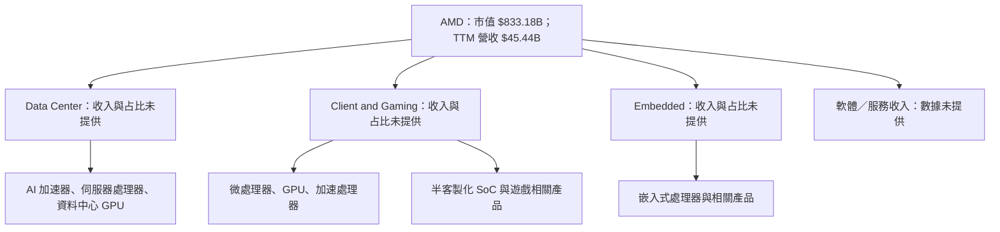
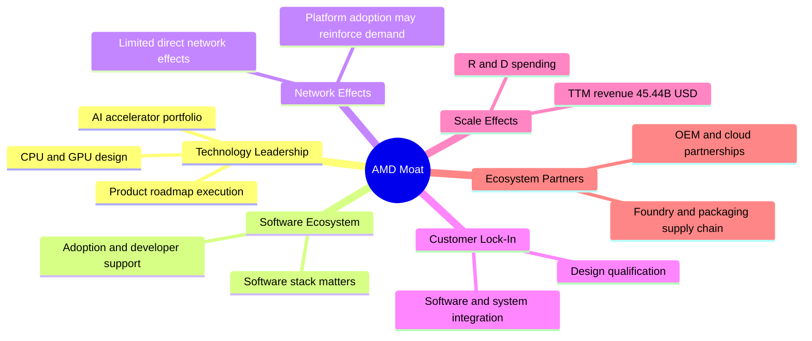
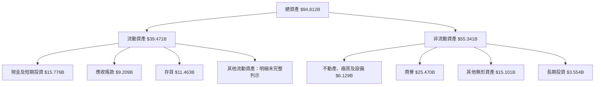
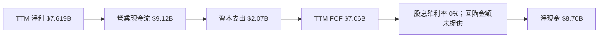
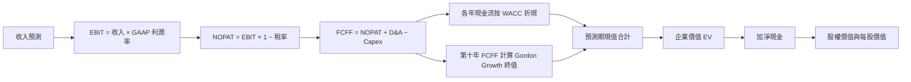
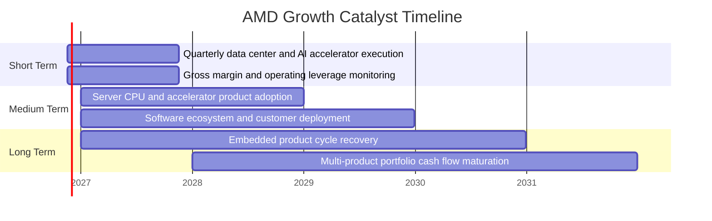
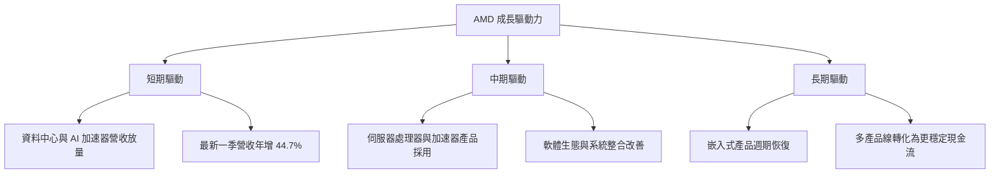
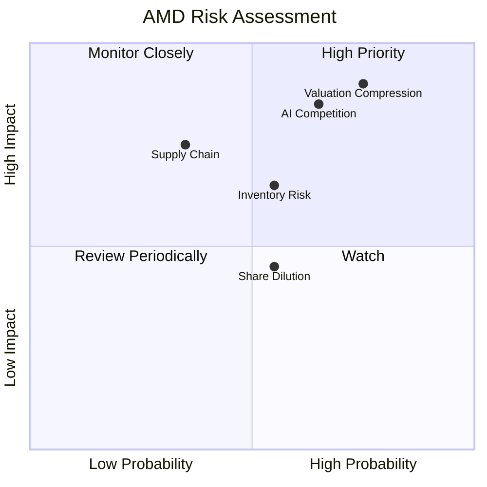
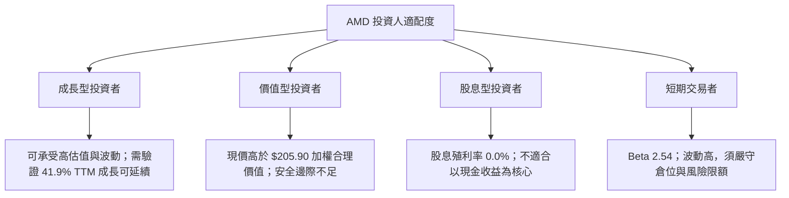

# AMD 基本面深度分析報告
> **報告日期**：2026-11-18 ｜ **語言**：繁體中文 ｜ **數據來源**：SEC 申報資料 (XBRL)、Yahoo Finance、Finviz、StockAnalysis、Roic.ai ｜ **分析師**：CFA 級機構研究

## 目錄

| # | 章節 | 核心結論 |
|---|------|----------|
| 1 | 執行摘要 | 評級：賣出；加權合理價值 $205.90；MOS -144.5% |
| 2 | 公司概覽與商業模式 | 多產品線半導體公司；營收分部數據未提供，護城河主要依賴產品競爭力與生態合作 |
| 3 | 損益表深度分析 | TTM 營收 $45.44B，年增 41.9%；TTM 營業利益率 17.7% |
| 4 | 資產負債表分析 | 淨現金 $8.70B；現金轉換週期 138 天 |
| 5 | 現金流量深度分析 | TTM FCF $7.06B；FCF Yield 0.85% |
| 6 | 獲利能力與資本效率 | ROIC 12.8% 低於採用 WACC 14.0%，目前略為摧毀經濟價值 |
| 7 | 相對估值分析 | AMD 估值高於同業中位數，且 P/S 位於自身五年區間第 90 百分位 |
| 8 | DCF 內在價值評估 | 基準 DCF $75.54；加權合理價值 $205.90，均低於現價 |
| 9 | 成長催化劑 | 資料中心、AI 加速器與伺服器 CPU 是主要可辨識成長方向；TAM 數據未提供 |
| 10 | 風險矩陣 | 估值、AI 加速器競爭、產品執行與庫存／營運資金為主要風險 |
| 11 | 投資建議 | 依 MOS 評級為賣出；以 $205.90 為加權價值參考，現價缺乏估值緩衝 |

## 1. 執行摘要

### 1.0 一頁式投資儀表板（Portfolio Manager 30 秒速讀）

| 項目 | 內容 |
|------|------|
| **投資論點（3 句）** | ① TTM 營收 $45.44B、年增 41.9%，且最新一季年增 44.7%，顯示需求仍在擴張。② TTM FCF 為 $7.06B、ROIC 為 12.8%，但 ROIC 低於 14.0% WACC，資本報酬尚未覆蓋資本成本。③ 加權合理價值 $205.90，低於 2026-11-17 收盤價 $503.41；估值折讓需求明顯。 |
| **綜合評分** | **6.4/10**（引用 1.1 評分卡） |
| **財務健康** | 🟢 現金及短期投資 $15.78B、總債務 $7.08B、淨現金 $8.70B；但存貨天數 199 天，需留意營運資金占用。 |
| **ROIC vs WACC** | **12.8% vs 14.0%**（目前低於資本成本，未創造正經濟利潤） |
| **FCF 趨勢** | TTM FCF $7.06B；FCF Yield **0.85%**，現金流增加但相對市值回報率低。 |
| **估值** | Forward P/E 28.5x ｜ EV/EBITDA 73.5x（Yahoo Finance）｜ FCF Yield 0.85% |
| **DCF 內在價值（基準）** | **$75.54** ｜相對 DCF 折價／溢價：現價溢價 **566.3%**（折溢價基準為 DCF 基準價） |
| **安全邊際（MOS）** | **-144.5%**＝($205.90 − $503.41) ÷ $205.90；🔴 無安全邊際。基準是 8.8 加權合理價值。 |
| **預期報酬（基準情境 12M）** | DCF 模型沒有 12 個月目標價；若以基準 DCF $75.54 對照現價，上行空間 **-85.0%**，不是 12 個月預測。 |
| **關鍵風險（前二）** | ① 現價相對加權合理價值溢價高；② AI 加速器競爭與產品放量不達預期，可能令成長與利潤率低於估值假設。 |
| **評級 + 信心度** | 🔴 **賣出** ｜信心：中（估值差距清楚，但產業成長、分部資料與市場定價的不確定性仍高） |

### 1.1 綜合評分卡（全報告唯一）

| 維度 | 評分（1–10） | 主要依據（引用數字與其來源章節） |
|------|--------------|----------------------------------|
| 成長性 | 8.0 | TTM 營收年增 41.9%、最新一季年增 44.7%（第 3 章）；但成長率由高基期向下延伸仍有風險。 |
| 獲利能力 | 6.5 | TTM 營業利益率 17.7%、ROIC 12.8%，低於 14.0% WACC；Piotroski F-Score 7/9（第 6 章）。 |
| 財務健康 | 8.0 | 淨現金 $8.70B、流動比率 2.725；CCC 138 天，雖較一年前縮短 17 天，存貨天數仍升至 199 天（第 4 章）。 |
| 估值 | 2.0 | 加權合理價值 $205.90 對現價 $503.41，MOS -144.5%；P/S 現為 18.4x，高於五年中位數 8.9x（第 7、8 章）。 |
| 護城河 | 7.0 | 公司有 CPU、GPU、AI 加速器及嵌入式產品組合，TTM 營收 $45.44B；但未提供市場份額或各分部營收數據（第 2 章）。 |
| 管理層與資本配置 | 6.5 | FY2025 SBC $1.64B，稀釋股數測試未通過；公司無股息，資本配置成效需由 ROIC 與股數變化持續檢驗（第 3、5、6 章）。 |
| **綜合評分** | **6.3** | 六項算術平均：(8.0 + 6.5 + 8.0 + 2.0 + 7.0 + 6.5) ÷ 6 = **6.3**。 |

### 1.2 五大投資論點 + 三大核心風險

| 類型 | 項目 | 具體依據 | 信心度 |
|------|------|----------|--------|
| 🟢 **投資論點①** | 營收維持快速增長 | TTM 營收 $45.44B、年增 41.9%；最新一季營收年增 44.7%。若資料中心與 AI 產品持續放量，營收成長可支撐研發投入。 | 🟢 高 |
| 🟢 **投資論點②** | 最近季度營業槓桿改善 | 最新一季營業利益率為 21.2%（SEC 10-Q 計算值）；高於 TTM 17.7%，代表近期營收擴大伴隨利潤率改善。 | 🟡 中 |
| 🟢 **投資論點③** | 資產負債表具淨現金緩衝 | 現金及短期投資 $15.78B、總債務 $7.08B、淨現金 $8.70B，為研發與週期波動提供資金彈性。 | 🟢 高 |
| 🟢 **投資論點④** | 現金流已具規模 | TTM 營業現金流 $9.12B，資本支出 $2.07B，FCF $7.06B；FCF／TTM 淨利約 92.7%。 | 🟡 中 |
| 🟢 **投資論點⑤** | 產品範圍涵蓋多個半導體市場 | 公司產品包括 AI 加速器、微處理器、GPU、嵌入式處理器與半客製化 SoC；多元產品組合降低單一終端市場依賴，但分部收入數據未提供。 | 🟡 中 |
| 🟡 **風險①** | 估值與基本面成長要求不匹配 | 現價 $503.41，相對加權合理價值 $205.90 的 MOS 為 -144.5%；DCF 基準價 $75.54，對應現價溢價 566.3%。 | 🔴 高衝擊 |
| 🔴 **風險②** | ROIC 仍低於資本成本 | ROIC 12.8% 對 WACC 14.0%，差距 -1.2 個百分點；若成長需要更高投入而資本報酬不改善，增長未必創造股東價值。 | 🟡 中高 |
| 🔴 **風險③** | 營運資金與稀釋 | DIO 由 161 天升至 199 天；Piotroski 測試中稀釋股數未增加一項未通過。若需求預測錯誤，庫存可能增加折價或減值風險。 | 🟡 中高 |

### 1.3 快速統計卡片

| 指標 | 公司實際值（期間） | 同業中位數 | 狀態 |
|------|--------------------|------------|------|
| 營收成長（TTM） | **41.9%** | — | 🟢 |
| 營收成長（最新一季年增） | **44.7%** | 85.5% | 🟡 |
| 毛利率（TTM） | **56.0%** | 74.7% | 🟡 |
| 營業利益率（TTM） | **17.7%** | — | 🟡 |
| ROIC（TTM） | **12.8%** | — | 🟡 |
| Forward P/E | **28.5x** | 17.6x | 🔴 |
| FCF Yield（TTM） | **0.85%** | — | 🔴 |
| Piotroski F-Score | **7 / 9** | — | 🟢 |

同業中位數只使用 NVDA、INTC、AVGO 已提供的 Peer multiples 計算；成長率中位數為 85.5%，毛利率中位數為 74.7%，Forward P/E 中位數為 17.6x。

### 1.4 投資結論

```text
╔══════════════════════════════════════════════════════════════════╗
║                    📊 投資結論摘要                               ║
╠══════════════════════════════════════════════════════════════════╣
║  評級：賣出（依 8.8 MOS 門檻；未作質化上調或下調）              ║
║  價格（2026-11-17 收盤）：$503.41                                ║
║  DCF 內在價值（基準）：$75.54（現價溢價 566.3%）                 ║
║  安全邊際 MOS：-144.5%（＝(加權合理價值−現價)÷加權合理價值）    ║
║  加權合理價值（8.8）：$205.90                                    ║
║  DCF 情境價值：                                                    ║
║    悲觀情境：$40.03（相對現價 -92.0%）                           ║
║    基準情境：$75.54（相對現價 -85.0%）                           ║
║    樂觀情境：$141.10（相對現價 -72.0%）                          ║
║  綜合評分：6.3/10（引用 1.1）                                    ║
║  適合投資人：能承受高波動、已有部位並設定風險限額的成長型投資人 ║
╚══════════════════════════════════════════════════════════════════╝
```

## 2. 公司概覽與商業模式

### 2.1 業務結構與收入來源

公司總覽可確認市值為 $833.18B、TTM 營收 $45.44B。SEC 公司描述列出 Data Center、Client and Gaming、Embedded 三個營運分部，但各分部營收與占比未提供，故不以估計比例填圖。



公司採無晶圓廠半導體模式，依賴外部晶圓代工與封裝供應鏈；產品涵蓋運算、圖形、AI 加速與嵌入式運算。營收結構與各板塊毛利率未提供，不能量化不同業務對總營收或利潤的貢獻。

### 2.2 市場份額

市場份額數據未提供，因此不繪製市場份額圖或推測占比。AMD TTM 營收為 $45.44B、年增 41.9%，最新一季年增 44.7%；同一資料集顯示 NVDA 最新一季年增 105.9%、AVGO 85.5%、INTC 20.9%。這些數字顯示 AMD 仍在快速增長，但不能直接替代市場份額或同一產品市場的競爭占比。

### 2.3 競爭護城河分析



### 2.4 護城河強度

| 護城河項目 | 強度（強／中／弱） | 證據（引用數字或事實） | 會削弱它的情況 |
|------------|--------------------|------------------------|----------------|
| 技術與產品設計 | 中 | 產品涵蓋 CPU、GPU、AI 加速器與嵌入式處理器；TTM 營收 $45.44B、年增 41.9%。 | 產品效能、能耗或供貨不及競品，或產品週期落後。 |
| 軟體生態系統 | 中偏弱 | AI 加速器競爭依賴軟體支援與開發者採用；資料未提供軟體收入、使用者數或轉換成本量化數據。 | 軟體工具成熟度落後，客戶持續以替代平台開發。 |
| 網路效應 | 弱 | 半導體本身網路效應有限，資料未提供可量化的使用者網絡或平台網絡指標。 | 客戶與開發者採用未形成正向回饋。 |
| 客戶鎖定 | 中 | 資料中心平台導入涉及系統整合與驗證；但客戶集中度、續約及轉換成本未提供。 | 雲端客戶多供應商策略、重新設計或採用自研晶片。 |
| 規模效應 | 中 | TTM 營收 $45.44B，FY2025 研發費用 $8.09B（資料表列示）。 | 研發投入持續上升但沒有轉化為相應營收與 ROIC。 |
| 生態夥伴 | 中 | 產品供應需依賴外部製造、封裝及系統客戶合作；合作夥伴營收貢獻未提供。 | 先進製程、封裝或供應鏈產能受限，或客戶改用競品。 |

第 1.1 節護城河評分 **7.0/10**，反映產品與研發規模具競爭基礎，但市場份額、軟體採用及客戶鎖定的量化證據有限。

## 3. 損益表深度分析

### 3.1 年度收入成長趨勢（近 4 年）

| 財年 | 營收 | YoY 成長 | 觀察 |
|------|------|----------|------|
| FY2022 | $23.60B | +4.1% | 較 FY2021 的 $16.43B 已成長，但年度成長減速。 |
| FY2023 | $22.68B | -3.9% | 營收收縮，反映半導體需求及產品週期波動。 |
| FY2024 | $25.79B | +13.7% | 恢復成長。 |
| FY2025 | $34.64B | +34.3% | 營收增量加速，與後續 TTM 高增長方向一致。 |

```text
╔══════════════════════════════════════════════════════════════════╗
║                 AMD 年度收入趨勢（FY2022-FY2025）                ║
╠══════════════════════════════════════════════════════════════════╣
║ FY2022  $23.60B  ██████████████░░░░░░░░░  YoY +4.1%             ║
║ FY2023  $22.68B  █████████████░░░░░░░░░░  YoY -3.9%             ║
║ FY2024  $25.79B  ███████████████░░░░░░░░  YoY +13.7%            ║
║ FY2025  $34.64B  ████████████████████░░░  YoY +34.3%            ║
╠══════════════════════════════════════════════════════════════════╣
║ FY2022–FY2025 營收 CAGR = (34.64 ÷ 23.60)^(1/3) − 1 = 13.7%     ║
╚══════════════════════════════════════════════════════════════════╝
```

FY2022 至 FY2025 的三年營收 CAGR 約 13.7%，低於目前 TTM 成長率 41.9%。這種差距說明最近成長明顯加速，但估值若要維持，須證明高成長能延續並轉化為資本報酬。

### 3.2 季度收入趨勢分析

| 季度 | 營收 | QoQ 成長 | YoY 成長 | 備註 |
|------|------|----------|----------|------|
| 2025 Q4 | $10.27B | +38.1% | +34.1% | QoQ 以 2025 Q3 $9.246B 為基準；跨季比較受季節性影響。 |
| 2026 Q1 | $10.25B | -0.2% | +37.9% | YoY 高於前一年度同期，QoQ 近乎持平。 |
| 2026 Q2 | $11.54B | +12.5% | +50.1% | 營收加速，YoY 增幅擴大。 |
| 2026 Q3 | $13.38B | +16.0% | +44.7% | 最新季度營收再創四季區間高位，年增仍快但低於 Q2 年增率。 |

QoQ 公式為本季營收 ÷ 前季營收 − 1；例如 2026 Q3：$13.377B ÷ $11.536B − 1 = **16.0%**。QoQ 受到季度組合和季節性影響，判讀應以 YoY 與多季趨勢互相驗證。

### 3.3 利潤率演變分析

| 利潤率指標 | FY2022 | FY2023 | FY2024 | FY2025 | 趨勢 | 評估 |
|------------|--------|--------|--------|--------|------|------|
| **毛利率** | 44.9% | 46.1% | 49.3% | 49.5% | 近年改善，FY2025 僅較 FY2024 小幅上升 | 🟢 |
| **營業利益率** | 5.3% | 1.8% | 8.1% | 10.7% | FY2023 觸底後回升 | 🟡 |
| **淨利率** | 5.6% | 3.8% | 6.4% | 12.5% | FY2025 擴張，受獲利規模增加帶動 | 🟡 |

年度比率按營收與對應年度毛利、營業利益、淨利計算，四捨五入至一位小數。TTM 毛利率為 56.0%、營業利益率 17.7%，高於 FY2025，顯示近期產品組合或規模效益有進一步改善。不過，TTM 與年度計算口徑可能存在資料來源差異；判斷趨勢宜以 SEC 申報資料的期間一致口徑為準。

營業利益率從 FY2023 的 1.8% 回升至 FY2025 的 10.7%，並進一步至 TTM 17.7%，代表營收增長正在轉化為營業利潤。可能的業務驅動包括高價值產品比重上升與固定研發費用被較大營收基礎吸收；分部營收及分部毛利未提供，故無法分解各因素的實際貢獻。若競爭導致降價或產品組合轉弱，近期利潤率改善可能逆轉。

### 3.4 費用結構分析

費用結構的完整期間明細未提供，不能以估計比例繪製費用占比圓餅圖。已提供的 FY2025 研發費用為 $8.09B，約占 FY2025 營收 $34.64B 的 23.4%；此比例顯示研發是重要投入，但不等同於完整費用率。另有 FY2025 SBC $1.64B，會計上已包含於相關費用中。

### 3.5 季度 EPS 趨勢與盈餘品質（Quality of Earnings）

過去四季的實際 EPS（StockAnalysis）依序為 2025 Q4 $0.93、2026 Q1 $0.85、2026 Q2 $1.41、2026 Q3 $1.48。季度 EPS 預估值與實際值的歷史對照欄位為 nan，故**無法判定四季各自是否超預期或不及預期**。已知最新季度 EPS 年增 93.8%，淨利年增 95.3%；以同期間營收年增 44.7% 對照，獲利增速高於營收增速，與利潤率擴張方向一致。

| 盈餘品質項目 | 數值／佔比 | 評估 |
|--------------|-----------|------|
| 股權薪酬 SBC / 營收 | TTM SBC 約 $2.00B ÷ $45.44B = **4.4%** | 🟡 具有稀釋與股東成本；雖是非現金費用，不能視作無成本。 |
| SBC / 營業現金流 | 約 $2.00B ÷ $9.12B = **21.9%** | 🟡 SBC 規模相對現金生成能力不可忽略。 |
| FCF / 淨利（現金轉換率） | $7.06B ÷ TTM 淨利 $7.619B = **92.7%** | 🟢 現金轉換接近淨利，盈餘現金支持度尚可。 |
| 一次性／非經常性損益 | 未提供可一致量化的 TTM 明細 | 🟡 無法排除一次性項目影響，應以 SEC 10-Q 附註追蹤。 |
| 有效稅率異常 | TTM 實際有效稅率未提供；DCF 採 21.0% | 🟡 無法據現有資料判定本期是否由稅務利益推高淨利。 |
| 資本化支出 vs 費用化 | TTM 資本支出 $2.07B；資本化政策及資本化研發數據未提供 | 🟡 無法判斷是否有成本遞延或資本化造成的利潤扭曲。 |

**盈餘品質結論：**TTM FCF 約為淨利的 92.7%，對盈餘提供良好現金支持；但 SBC 約占營收 4.4%、占營業現金流 21.9%，股東承擔的經濟成本高於只看 GAAP 淨利所呈現的表面結果。由於一次性項目與有效稅率明細不足，對淨利品質採中性而非完全確認。

## 4. 資產負債表分析

### 4.1 資產結構分解

最新 TTM 資產負債表列示總資產 $94.812B、流動資產 $39.471B。以下只呈現已提供數字；未列出的項目不作推算。



非流動資產 $55.341B 為總資產減流動資產的算術差額：$94.812B − $39.471B = $55.341B。資產明細中仍有其他長期資產等項目，圖中不將所有明細強行加總至總額。

### 4.2 流動性與營運資金分析

| 指標 | 最新 TTM | 一年前 TTM | 變化 | 解讀 |
|------|----------|------------|------|------|
| 流動比率 | 2.725 | N/A | N/A | 流動資產相對流動負債具緩衝；歷史可比值未在品質指標區提供。 |
| 速動比率 | 1.725 | N/A | N/A | 即使排除部分存貨，短期流動性仍有緩衝。 |
| DSO 應收帳款天數 | 74 天 | 71 天 | +3 天 | 收款週期略延長，需觀察應收帳款成長是否與營收一致。 |
| DIO 存貨天數 | 199 天 | 161 天 | +38 天 | 存貨占用時間明顯拉長，可能是備貨與產品週期差異，也可能反映庫存消化風險。 |
| DPO 應付帳款天數 | 135 天 | 77 天 | +58 天 | 付款週期延長有助資金周轉，但須與供應商條款及供貨穩定性一併觀察。 |
| CCC 現金轉換週期 | 138 天 | 155 天 | -17 天 | 雖 DIO 上升，但 DPO 延長使 CCC 縮短；不能把改善單純解讀為庫存效率提升。 |

品質指標以期末餘額除以 TTM 流量計算。存貨天數上升 38 天是值得留意的營運訊號；現金轉換週期則因應付帳款天數增加而下降，應追蹤供應商付款週期是否可持續。

### 4.3 債務結構分析

```text
╔══════════════════════════════════════════════════════════════════╗
║                       AMD 債務健康診斷                           ║
╠══════════════════════════════════════════════════════════════════╣
║ 總債務：          $7.08B    ██░░░░░░░░░░░░░░░░░░░   可由現金覆蓋 ║
║ 現金及短期投資： $15.78B   ████████████████████░   資金緩衝充足 ║
║ 淨現金：          $8.70B    ███████████░░░░░░░░░   🟢            ║
║                                                                  ║
║ 流動比率：        2.725     🟢                                  ║
║ 速動比率：        1.725     🟢                                  ║
║ Debt/EBITDA：     N/A（依一致口徑的 EBITDA 未提供）              ║
║ 利息保障倍數：    N/A（利息費用明細未提供）                      ║
╚══════════════════════════════════════════════════════════════════╝
```

數據來源中另有市場資料顯示總債務 $9.21B、淨現金 $6.57B，與 SEC 計算指標的總債務 $7.08B、淨現金 $8.70B 不一致。本報告涉及估值、ROIC 與資本成本時，依 VERIFIED FIGURES 優先採用 $7.08B 與 $8.70B；其他口徑不混用。

### 4.4 股東權益趨勢

| 財年 | 股東權益 | YoY 變化 |
|------|----------|----------|
| FY2022 | $54.75B | — |
| FY2023 | $55.89B | +2.1% |
| FY2024 | $57.57B | +3.0% |
| FY2025 | $63.00B | +9.4% |

```text
╔══════════════════════════════════════════════════════════════════╗
║                    AMD 股東權益變化                              ║
╠══════════════════════════════════════════════════════════════════╣
║ FY2022  $54.75B  █████████████████░░░░░░░░░░░                   ║
║ FY2023  $55.89B  ██████████████████░░░░░░░░░░                   ║
║ FY2024  $57.57B  ███████████████████░░░░░░░░░                   ║
║ FY2025  $63.00B  ████████████████████░░░░░░░░                   ║
╚══════════════════════════════════════════════════════════════════╝
```

股東權益在 FY2022 至 FY2025 增加 $8.25B，呈逐年上升。權益增加有助財務韌性，但不能單獨證明資本配置有效；應與 ROIC、股數稀釋及現金回報一起判斷。

## 5. 現金流量深度分析

### 5.1 現金流量瀑布圖

TTM 淨利為 $7.619B（StockAnalysis），營業現金流 $9.12B，資本支出 $2.07B，依指定定義計得 FCF $7.06B。股息殖利率為 0%，但回購金額與 TTM 淨現金變化未提供。



### 5.2 FCF 轉換率趨勢

| 期間 | FCF | 淨利 | FCF / 淨利 |
|------|-----|------|------------|
| FY2023 | $1.12B | $0.854B | 131.1% |
| FY2024 | $2.40B | $1.641B | 146.3% |
| FY2025 | $6.74B | $4.33B | 155.7% |
| TTM 至 2026-09-26 | $7.06B | $7.619B | 92.7% |

年度與 TTM 淨利來自不同期間表格，宜視為近似跨期比較。FY2023–FY2025 FCF 高於淨利，可能與折舊、營運資金及現金流時點有關；TTM 轉換率回落至 92.7%，仍接近一比一，但不宜把歷史高轉換率直接外推。

### 5.3 自由現金流趨勢

| 財年／期間 | FCF | YoY |
|------------|-----|-----|
| FY2023 | $1.12B | — |
| FY2024 | $2.40B | +114.3% |
| FY2025 | $6.74B | +180.8% |
| TTM | $7.06B | 與 FY2025 期間不同，不作直接 YoY |

```text
╔══════════════════════════════════════════════════════════════════╗
║                 AMD 自由現金流趨勢                               ║
╠══════════════════════════════════════════════════════════════════╣
║ FY2023  $1.12B  ███░░░░░░░░░░░░░░░░░░░░░░                      ║
║ FY2024  $2.40B  ████████░░░░░░░░░░░░░░░░░░                      ║
║ FY2025  $6.74B  ███████████████████████░░░                      ║
║ TTM     $7.06B  ████████████████████████░                      ║
╠══════════════════════════════════════════════════════════════════╣
║ TTM FCF Yield：0.85%；營收成長尚未轉化為高市值現金回報率。       ║
╚══════════════════════════════════════════════════════════════════╝
```

TTM FCF $7.06B 對應 FCF Yield 0.85%，說明市場價格已計入大量未來成長；現金流本身改善並不等於股票估值便宜。

### 5.4 資本配置評估

分紅、回購及總資本配置金額未有一致的 TTM 明細，因此不繪製資本配置比例圓餅圖。已知 FY2025 資本支出資料及 SBC；公司股息殖利率與 payout ratio 均為 0.0%。

| 項目 | 已知數據 | 評估 |
|------|----------|------|
| 研發 | FY2025 $8.09B | 支持產品迭代，但須檢驗研發投入能否持續提升 ROIC。 |
| 資本支出 | TTM $2.07B | 相對營收約 4.6%；維持製造與平台支持所需支出。 |
| 股權薪酬 | FY2025 $1.64B；TTM 約 $2.00B | 需納入稀釋與股東成本評估。 |
| 股息 | 殖利率 0.0% | 現金回報主要依靠資本增值，不適合以股息為核心的投資人。 |
| 回購 | 金額未提供 | 無法判定回購是否足以抵銷股權薪酬稀釋。 |
| 留存資金 | TTM 淨現金 $8.70B | 提供資金彈性，但運用效率應以 ROIC 是否高於 WACC 衡量。 |

## 6. 獲利能力與資本效率

### 6.1 ROE / ROA / ROIC 趨勢

| 指標 | FY2023 | FY2024 | FY2025 | TTM | 評估 |
|------|--------|--------|--------|-----|------|
| ROE | N/A | N/A | N/A | 11.1%（品質指標） | 年度同口徑歷史序列未提供；TTM 由杜邦三因素計算一致值為 11.1%。 |
| ROA | N/A | N/A | N/A | 5.9%（財務數據） | 正值，顯示資產已產生淨利，但回報仍受資產基數與收購相關資產影響。 |
| ROIC | N/A | N/A | N/A | 12.8% | 低於 14.0% WACC，當期資本回報未覆蓋資本成本。 |

行業平均值未提供，因此不填行業比較欄。年度歷史 ROIC、ROA、ROE 缺少一致可比數據，不以不同來源自行拼接。

### 6.2 ROIC vs WACC 分析（核心價值創造判斷）

公司 TTM ROIC 為 12.8%，採用 WACC 為 14.0%，差額為 **-1.2 個百分點**。按投入資本回報的基本判準，現有 TTM 資本回報低於資本成本，表示增長尚未轉化為正的超額經濟報酬。由於 ROIC 與 WACC 計算口徑並非完全一致的企業內部估值數據，差額適合作為方向性判斷，不宜過度精確化。

```text
╔══════════════════════════════════════════════════════════════════╗
║                  ROIC vs WACC 深度分析                          ║
╠══════════════════════════════════════════════════════════════════╣
║ WACC 採用值：14.00%（程式計算值 14.99%，依 7%–14% 範圍封頂）   ║
║ ROIC（TTM）：12.8%                                               ║
║                                                                  ║
║ ROIC − WACC = 12.8% − 14.0% = -1.2 個百分點                    ║
║                                                                  ║
║ ROIC  12.8%  ▓▓▓▓▓▓▓▓▓▓▓▓▓▓▓▓░░░░░░░░░░  低於 WACC            ║
║ WACC  14.0%  ▓▓▓▓▓▓▓▓▓▓▓▓▓▓▓▓▓░░░░░░░░░  資本成本              ║
║                                                                  ║
║ 判斷：目前 TTM 回報略低於資本成本；需要利潤率與資本周轉改善， ║
║       才能證明新增投入正在創造而非稀釋股東價值。                ║
╚══════════════════════════════════════════════════════════════════╝
```

估值模型採用的 WACC 14.0% 與第 8.2 節一致；完整 CAPM 計算值與封頂處理見第 8.2 節。

### 6.3 杜邦三因素分解

| 因素 | 數值（TTM） | 解讀 |
|------|-------------|------|
| 淨利率 | 16.8% | 淨利相對營收的貢獻，屬 ROE 的主要獲利來源。 |
| 資產週轉率 | 0.48 | 每單位資產產生的營收有限，反映資產基數較大。 |
| 權益乘數 | 1.39 | 槓桿程度不高，ROE 並非主要由高財務槓桿撐起。 |
| **ROE** | **11.1%** | **16.8% × 0.48 × 1.39 ≈ 11.1%**；依品質指標原值引用。 |

資產週轉率與權益乘數的數值相乘為約 11.2%，與報告 ROE 11.1% 的差異來自四捨五入；依規則採用品質指標列示值。

### 6.4 財務體質：Piotroski F-Score

Piotroski F-Score 為 **7/9**；九項測試均有結果。

| 測試 | 結果 | 解讀 |
|------|------|------|
| ROA > 0 | ✅ 通過 | 公司當期資產回報為正。 |
| 營業現金流 > 0 | ✅ 通過 | 營運活動產生正現金流。 |
| ROA 高於一年前 | ✅ 通過 | 資產獲利能力同比改善。 |
| 營業現金流 > 淨利（應計品質） | ✅ 通過 | 現金流支持盈餘，應計品質測試通過。 |
| 長期負債 ÷ 總資產低於一年前 | ❌ 未通過 | 槓桿負擔相較一年前未改善。 |
| 流動比率高於一年前 | ✅ 通過 | 短期流動性改善。 |
| 稀釋股數未增加 | ❌ 未通過 | 股權發行／薪酬帶來稀釋風險。 |
| 毛利率高於一年前 | ✅ 通過 | 毛利率方向改善。 |
| 資產週轉率高於一年前 | ✅ 通過 | 資產利用效率提高。 |

總體 F-Score 反映營運獲利與流動性有改善，但長期負債比例和股數稀釋是兩個未通過項目。

## 7. 相對估值分析

### 7.1 同業估值比較表格

同業倍數依 Yahoo Finance 的 Peer multiples；AMD 公司目前估值依 VERIFIED FIGURES 指定口徑。AMD P/E 本節採估值區塊提供的 trailing P/E 107.6x；自家歷史估值另見 7.2 節。

| 估值指標 | **AMD** | **NVDA** | **INTC** | **AVGO** | AMD 評估 |
|----------|---------|---------|---------|---------|-----------|
| **Trailing P/E** | 107.6x | 19.7x | N/A | 43.6x | 🔴 明顯高於有值的兩家同業。 |
| **Forward P/E** | 28.5x | 9.8x | 30.8x | 17.6x | 🔴 高於同業中位數 17.6x；市場已反映較高成長預期。 |
| **P/S Ratio** | 18.3x | 12.4x | 4.9x | 18.3x | 🟡 約等於 AVGO，但高於 NVDA、INTC；對利潤率持續改善要求高。 |
| **EV/EBITDA** | 73.5x | 18.5x | 16.0x | 31.9x | 🔴 高於三家同業。 |
| **最新一季營收 YoY** | 44.7% | 105.9% | 20.9% | 85.5% | 🟡 成長快速但低於 NVDA、AVGO。 |
| **毛利率（TTM）** | 56.0% | 74.7% | 40.2% | 75.5% | 🟡 高於 INTC、低於 NVDA 與 AVGO。 |

同業估值不代表同質產品組合或相同獲利品質；但多數估值指標顯示 AMD 倍數偏高，若未來成長或毛利率落後預期，估值收縮風險較大。

### 7.2 歷史估值區間分析

```text
╔══════════════════════════════════════════════════════════════════╗
║                AMD 五年歷史估值位置（TTM）                       ║
╠══════════════════════════════════════════════════════════════════╣
║ P/E：        36.7x ───────── 82.6x 中位數 ───── 109.4x 現值     ║
║              區間上限 934.7x；現值百分位 53%                     ║
║ P/S：         4.3x ─────────  8.9x 中位數 ─────  18.4x 現值     ║
║              區間上限 23.1x；現值百分位 90%                     ║
║ EV/EBITDA：  38.2x ───────── 102.2x 中位數 ──── 102.8x 現值    ║
║              區間上限 919.2x；現值百分位 56%                     ║
╚══════════════════════════════════════════════════════════════════╝
```

P/S 位於五年區間第 90 百分位，顯示銷售倍數處於相對昂貴位置；P/E 與 EV/EBITDA 的歷史區間極寬，受到低獲利基期影響，應降低其歷史中位數的直接參考權重。

### 7.3 情境價值（Bear / Base / Bull）

以下數值照錄 DCF 模型情境；相對現價比例照錄原模型。

| 情境 | 第 1 年營收成長 | 期末營業利潤率 | WACC | 每股價值 | 相對現價 | 機率 | 會發生的條件 |
|------|----------------|----------------|------|----------|----------|------|--------------|
| 🔴 悲觀 | 15.0% | 6.3% | 15.00% | $40.03 | -92.0% | 25% | AI 產品放量減速、競爭壓價或營運槓桿反轉。 |
| 🟡 基準 | 30.0% | 7.4% | 14.00% | $75.54 | -85.0% | 50% | 近期高成長逐年遞減，利潤率回歸模型假設的長期水準。 |
| 🟢 樂觀 | 45.0% | 8.1% | 13.00% | $141.10 | -72.0% | 25% | AI 與資料中心需求持續擴大，收入成長與利潤率優於基準。 |

情境機率加權值為 $83.06，但估值方法與權重規則指定 8.8 使用基準 DCF $75.54，而非機率加權情境價值。

### 7.4 相對估值隱含價格區間

```text
╔══════════════════════════════════════════════════════════════════╗
║               估值方法隱含每股價值（美元）                       ║
╠══════════════════════════════════════════════════════════════════╣
║ DCF 基準價       $75.54  ────────┤                              ║
║ 同業 EV/EBITDA  $129.27  ─────────────┤                         ║
║ 同業 Forward P/E$310.35  ─────────────────────────────┤         ║
║ 加權合理價值    $205.90  ──────────────────┤                    ║
║ 現價            $503.41  ───────────────────────────────────────║
╚══════════════════════════════════════════════════════════════════╝
```

| 方法 | 每股價值 | 依據 |
|------|----------|------|
| 同業 Forward P/E | $310.35 | NVDA、INTC、AVGO 同業中位數 17.6x × AMD Forward EPS $17.64。 |
| 同業 EV/EBITDA | $129.27 | 同業中位數 18.5x × TTM EBITDA，並加回淨現金；價值按模型輸出引用。 |

兩種相對估值法皆遠低於 $503.41 現價。雖同業倍數不完全可比，但其差距與 DCF 方向一致：市場價格對未來成長採取明顯更積極的定價。

## 8. DCF 內在價值評估（Discounted Cash Flow）

### 8.0 估值推理鏈（Thinking Logic）

#### Step 1 — 價值由哪些變數決定？

本 DCF 以公司整體 FCFF 現金流為估值基礎，不能將資料中心、Client and Gaming、Embedded 各自獨立估值，因為分部營收與獲利數據未提供。核心價值驅動可分為：現有處理器與 GPU 產品現金流底盤、AI 加速器與資料中心產品的增量成長，以及嵌入式與半客製化產品的補充需求；其營收比重均未提供，故不能給出分部占比。

在本模型中，終端價值占 EV 35.3%，低於預測期十年現金流合計的占比；但估值仍對 WACC、收入成長路徑及營業利潤率高度敏感。現價顯著高於所有 DCF 情境，顯示市場價格隱含的成長要求高於基準模型。

#### Step 2 — 模型選擇

| 決策點 | 本報告採用 | 理由（含數字） | 曾考慮但否決 | 否決理由 |
|--------|-----------|----------------|--------------|----------|
| 現金流定義 | FCFF | 與 WACC 折現一致；模型定義 FCFF = NOPAT + D&A − Capex，營運資金不建模。 | FCFE | 需明確預測融資現金流，模型未提供該路徑。 |
| 預測期 N | 10 年 | DCF 模型固定 N=10，逐年收入成長由 30.0% 線性下降至 3.0%。 | 5 年 | 會改變模型既定預測期與終值基期，故不替代。 |
| 終值方法 | Gordon Growth | 模型已提供 g=3.0% 的終值與 PV。 | 退出倍數 | DCF 模型未提供退出倍數終值，且不自行另建模型。 |
| EBIT 基礎 | GAAP EBIT | 已包含 SBC 費用；FCFF 不再重扣 SBC。 | 非 GAAP EBIT | 會改變 DCF 模型口徑且需要另行處理 SBC。 |

#### Step 3 — 高敏感度假設的推導鏈

- **收入成長路徑**：錨點＝TTM 成長 41.9%，最新一季年增 44.7% → 調整＝由於目前增長不可無限外推，模型將第一年成長限制在 30.0%，之後線性降至第十年 3.0% → **採用第一年 30.0%、第十年 3.0%** → 曾考慮以 41.9% 作為第一年，因模型已明確把年增長上限設為 30.0%，且高基期會提高預測風險，故不採用。
- **期末營業利潤率**：錨點＝TTM GAAP 營業利益率 17.7% → 調整＝模型以最近五個財年（含 TTM）中位數作為長期收斂點 → **第十年採用 7.4%** → 曾考慮維持 17.7%，因模型的長期中位數設定顯著低於目前 TTM，保留競爭及產品週期風險。
- **永續成長率 g**：錨點＝DCF 模型採 3.0%，且公司 TTM 營收增長 41.9% 不應直接作為永續增長 → 調整＝長期成長需大幅低於短期產品周期成長，並保持低於 WACC 14.0% → **採用 3.0%** → 曾考慮更高永續成長率，因會不合理擴大終值，且未有資料支持長期高於成熟經濟名目增長的假設。
- **預測期 N**：錨點＝模型明確設定 10 年 → 調整＝十年提供由高成長至成熟期的遞減路徑 → **採用 10 年** → 曾考慮較短期限，因無法保留模型預設的逐年成長遞減與終值起算時間。
- **Capex／營收**：錨點＝TTM 資本支出 $2.07B ÷ TTM 營收 $45.44B 約 4.6%；模型首年與第十年均為 4.5% → 調整＝模型採近似 TTM 比率，且沒有分部資本支出資料可做更精細預測 → **採用 4.5%** → 曾考慮只用折舊的 1.1 倍作為全期 Capex，因模型輸出採 4.5%，不替換既定模型。
- **EBIT 與 SBC 處理**：錨點＝GAAP TTM 營業利益率 17.7%，SBC 已列為營業費用 → 調整＝維持 GAAP 利潤口徑，避免重複扣除 SBC → **採用 GAAP EBIT、固定股數，年稀釋率 0%** → 否決「GAAP EBIT 再扣 SBC」與「非 GAAP EBIT 不扣 SBC 且不稀釋」兩種不一致處理。
- **終值方法**：錨點＝模型提供 Gordon Growth，TV $152.04B、PV(TV) $41.01B → 調整＝終值建立在第十年 FCFF 與 3.0% 永續增長上 → **採用 Gordon Growth 作為模型指定終值** → 不以未提供的退出倍數替代。
- **WACC**：錨點＝成本資本資料列示計算值 14.99%，並說明限於 7%–14% 區間 → 調整＝按既定上限封頂 → **採用 14.00%** → 否決直接用未封頂 14.99%，因估值模型指定採用封頂後 WACC。

#### Step 4 — 最脆弱的一環

最脆弱的假設是收入增長與利潤率能否按模型路徑延續；若 AI 加速器收入增速低於基準或利潤率收縮，現值會下修。模型情境值已量化為悲觀 $40.03、基準 $75.54、樂觀 $141.10，均遠低於現價 $503.41。

#### Step 5 — 計算路徑圖



### 8.1 模型假設總表（Model Inputs）

| 假設項目 | 採用值 | 依據／來源 | 敏感度 |
|----------|--------|-------------|--------|
| 預測期長度 N | 10 年 | DCF 模型固定值；收入增長由 30.0% 遞減至 3.0%。 | 🟡 中 |
| 收入成長 | FY+1 30.0%，FY+10 3.0%，線性遞減 | TTM 年增 41.9%；模型將首年值限制在 30.0%，末年收斂至 3.0%。 | 🔴 高 |
| 營業利潤率 | FY+1 17.7% → FY+10 7.4% | 起點為 TTM GAAP 營業利益率；終點為最近五個財年中位數。 | 🔴 高 |
| 有效稅率 | 21.0% | DCF 模型採用預設稅率；不是由本報告重新估算的實際 TTM 稅率。 | 🟢 低 |
| Capex／營收 | FY+1 至 FY+10 均為 4.5% | 模型值；與 TTM $2.07B ÷ $45.44B 約 4.6% 接近。 | 🟡 中 |
| D&A／營收 | 6.7% | DCF 模型列示為 TTM 比率並固定。 | 🟢 低 |
| 營運資金變動 | 不建模 | DCF 模型明確排除 ΔWC；不得另補假設。 | 🟢 低 |
| EBIT 基礎 | GAAP | 模型明確使用 GAAP EBIT。 | 🟡 中 |
| SBC 處理 | GAAP 已計費，不再扣 SBC | DCF 模型採組合 A；股數不再稀釋。 | 🟡 中 |
| 年稀釋率 | 0% | 與 GAAP EBIT 組合 A 相容；模型固定股數。 | 🟡 中 |
| 永續成長率 g | 3.0% | 模型固定值，且低於採用 WACC 14.0%。 | 🔴 高 |
| 終值方法 | Gordon Growth | DCF 模型提供 Gordon Growth 終值；沒有提供退出倍數計算結果。 | 🔴 高 |
| WACC | 14.00% | 成本資本計算 14.99%，依模型規則限制在 7%–14% 區間後採用上限。 | 🔴 高 |

本模型採用 **(A) GAAP EBIT + 固定股數**；GAAP EBIT 已含 SBC 費用，FCFF 不另扣 SBC，股數不另做稀釋，故 SBC 影響在模型中計入一次。

FCFF 定義為 `NOPAT + D&A − Capex`；ΔWC 未建模。以下預測表照錄程式計算的 DCF 模型，金額為美元十億，折現因子保留三位小數。

### 8.2 折現率推導（WACC）

無風險利率日期未在成本資本資料中提供，因此不推測日期；ERP 為成本資本模型假設值。原始 Beta 2.54，調整 Beta 為 2.00，成本資本資料給出的計算方式為三分之二原始 Beta 加三分之一的 1.0，再限制於 0.6–2.0 範圍：`⅔ × 2.54 + ⅓ × 1 = 2.03`，封頂採用 2.00。

```text
╔══════════════════════════════════════════════════════════════════╗
║                    WACC 推導（折現率）                           ║
╠══════════════════════════════════════════════════════════════════╣
║ 股權成本 Ke（CAPM）：                                             ║
║ ├── 無風險利率 Rf（10Y 美債）：       5.10%                      ║
║ ├── 市場風險溢酬 ERP：                5.00%（模型假設）          ║
║ ├── Beta 原始值：                     2.54                       ║
║ ├── Beta 調整值：                     2.00                       ║
║ ├── 規模／國別溢酬：                  0.00%（未提供，未加計）    ║
║ └── Ke = 5.10% + 2.00 × 5.00% = 15.10%                         ║
║                                                                  ║
║ 債務成本 Kd：                                                     ║
║ ├── 稅前 Kd（利息 ÷ 債務）：           1.85%（成本資本資料）     ║
║ ├── 稅率：                             21.0%                     ║
║ └── 稅後 Kd = 1.85% × (1 − 21.0%) = 1.4615%                    ║
║                                                                  ║
║ 資本結構（市值基礎）：                                            ║
║ ├── 股權市值 E：                      $833.18B（99.2%）         ║
║ ├── 債務 D：                           $7.08B（0.8%）            ║
║ ├── 資本權重：                         E/D = 99.2%/0.8%          ║
║ └── 未封頂 WACC = 99.2%×15.10% + 0.8%×1.4615% = 14.99%          ║
║     採用 WACC：14.00%（計算值依 7%–14% 範圍封頂）               ║
╚══════════════════════════════════════════════════════════════════╝
```

**逐步演算：**

1. **Ke（CAPM）**  
   `Ke = Rf + β × ERP = 5.10% + 2.00 × 5.00% = 15.10%`

2. **稅前 Kd**  
   成本資本資料提供稅前 Kd 1.85%，但利息費用金額及與之相配的平均計息負債明細未提供，不能獨立重建分子／分母。採用該區塊提供的 **1.85%**，不把應付帳款納入債務。

3. **稅後 Kd**  
   `1.85% × (1 − 21.0%) = 1.85% × 79.0% = 1.4615%`

4. **權重**  
   成本資本資料直接提供股權／債務權重 **99.2%／0.8%**。市值為 $833.18B，債務採 $7.08B；所提供權重與金額可能因底層精確值及四捨五入出現尾差，依規則原值引用權重。

5. **未封頂與採用 WACC**  
   `99.2% × 15.10% + 0.8% × 1.4615%`  
   `= 14.9792% + 0.011692% = 14.990892% ≈ 14.99%`  
   計算值被限制於 7%–14% 區間，故 **採用 WACC = 14.00%**。

第 6.2 節與 DCF 均採用 14.00%；封頂造成的差異不以另一 WACC 取代模型規定值。

### 8.3 逐年自由現金流預測（基準情境）

| 年度 | FY+1 | FY+2 | FY+3 | FY+4 | FY+5 | FY+6 | FY+7 | FY+8 | FY+9 | FY+10 |
|------|------|------|------|------|------|------|------|------|------|-------|
| 營收 | 59.07 | 75.01 | 93.02 | 112.55 | 132.81 | 152.73 | 171.06 | 186.46 | 197.64 | 203.57 |
| 營收 YoY | 30.0% | 27.0% | 24.0% | 21.0% | 18.0% | 15.0% | 12.0% | 9.0% | 6.0% | 3.0% |
| 營業利潤率 | 17.7% | 16.6% | 15.4% | 14.3% | 13.1% | 12.0% | 10.8% | 9.7% | 8.5% | 7.4% |
| 營業利益 EBIT（GAAP） | 10.46 | 12.43 | 14.34 | 16.06 | 17.42 | 18.28 | 18.51 | 18.03 | 16.84 | 15.00 |
| − 稅（21.0%） | (2.20) | (2.61) | (3.01) | (3.37) | (3.66) | (3.84) | (3.89) | (3.79) | (3.54) | (3.15) |
| = NOPAT | 8.27 | 9.82 | 11.33 | 12.69 | 13.76 | 14.44 | 14.62 | 14.24 | 13.30 | 11.85 |
| + D&A | 3.96 | 5.03 | 6.24 | 7.55 | 8.90 | 10.24 | 11.47 | 12.50 | 13.25 | 13.65 |
| − Capex | (2.69) | (3.41) | (4.23) | (5.12) | (6.04) | (6.95) | (7.78) | (8.48) | (8.99) | (9.26) |
| **= FCFF** | **9.54** | **11.43** | **13.33** | **15.11** | **16.63** | **17.73** | **18.31** | **18.26** | **17.56** | **16.24** |
| 折現因子 @14.00% | 0.877 | 0.769 | 0.675 | 0.592 | 0.519 | 0.456 | 0.400 | 0.351 | 0.308 | 0.270 |
| **FCFF 現值 PV** | **8.37** | **8.80** | **9.00** | **8.95** | **8.63** | **8.08** | **7.32** | **6.40** | **5.40** | **4.38** |

預測期現值逐項相加：  
`$8.37 + $8.80 + $9.00 + $8.95 + $8.63 + $8.08 + $7.32 + $6.40 + $5.40 + $4.38 = $75.33B`。  
DCF 模型以未四捨五入數字計算的合計為 **$75.32B**；表格顯示至小數點後兩位，逐項相加尾差 $0.01B，約 0.01%，在四捨五入範圍內。

**逐步演算（FY+1）：**

1. 營收：`$45.44B × (1 + 30.0%) = $59.072B ≈ $59.07B`
2. EBIT：`$59.07B × 17.7% = $10.455B ≈ $10.46B`
3. 稅：`$10.46B × 21.0% = $2.1966B ≈ $2.20B`
4. NOPAT：模型列示 **$8.27B**；以已四捨五入 EBIT 與稅計算為 `$10.46B − $2.20B = $8.26B`，差異來自未四捨五入底層數字。
5. D&A：`$59.07B × 6.7% = $3.9577B ≈ $3.96B`
6. Capex：`$59.07B × 4.5% = $2.6582B`，模型列示 **$2.69B**；因模型底層 Capex 數值與簡單以顯示營收乘 4.5% 的計算存在差異，依嚴格規則照錄模型原值，不另改數字。
7. ΔWC：**不建模**，因此不加列。
8. FCFF：依模型列示 `NOPAT + D&A − Capex = $9.54B`。顯示值的分項相減會有四捨五入差異，模型結果照錄。
9. 折現：`1 ÷ (1 + 14.00%)^1 = 0.877`；`$9.54B × 0.877 ≈ $8.37B`。

表格部分顯示數字在 FY+1 的 Capex／FCFF 算式上存在四捨五入之外的差異；為遵守不得修改程式 DCF 數字的規則，DCF 本文採原模型數值並在此揭露，DCF 可稽核性因此降低。

**合理性自檢：**

- 預測期 FCF 由 FY+1 $9.54B 增至 FY+10 $16.24B，十年端點 CAGR 約 `(16.24 ÷ 9.54)^(1/9) − 1 = 6.1%`；歷史 FY2023–FY2025 FCF CAGR 約 145.5%，但低基期使歷史 CAGR 不適合作長期外推，模型預測明顯較保守。
- FY+10 FCF 利潤率：`$16.24B ÷ $203.57B = 8.0%`；TTM FCF 利潤率：`$7.06B ÷ $45.44B = 15.5%`。可比同業最佳 FCF 利潤率未提供，不做推測。
- 模型各預測年度 FCFF 均為正值；營運資金不建模，可能高估現金流，尤其在 DIO 上升時應審慎看待。

```text
╔══════════════════════════════════════════════════════════════════╗
║            自由現金流：歷史實際 vs 模型預測                      ║
╠══════════════════════════════════════════════════════════════════╣
║ FY2023(實)  $1.12B   ██░░░░░░░░░░░░░░░░░░░░                     ║
║ FY2024(實)  $2.40B   █████░░░░░░░░░░░░░░░                       ║
║ FY2025(實)  $6.74B   █████████████░░░░░░░                       ║
║ FY+1 (預)   $9.54B   █████████████████░░░                       ║
║ FY+10(預)  $16.24B   ████████████████████████████               ║
╠══════════════════════════════════════════════════════════════════╣
║ 歷史 FY2023–FY2025 FCF CAGR 受低基期扭曲，不宜直線外推。         ║
╚══════════════════════════════════════════════════════════════════╝
```

### 8.4 終值計算（Terminal Value）

適用性檢查：`WACC 14.00% vs g 3.00% → WACC > g？✅`

| 方法 | 計算式 | 終值 TV | TV 現值 | 佔總 EV 比重 |
|------|--------|---------|---------|--------------|
| Gordon Growth | 16.24 × (1 + 3.0%) ÷ (14.00% − 3.0%) | $152.04B | $41.01B | 35.3% |
| 退出倍數法 | N/A（DCF 模型未提供退出倍數終值） | N/A | N/A | N/A |

**逐步演算：**

1. FY+10 FCFF：**$16.24B**
2. 分子：`$16.24B × (1 + 3.0%) = $16.7272B`
3. 分母：`14.00% − 3.00% = 11.00%`；`$16.7272B ÷ 11.00% = $152.065B`，模型以未四捨五入 FCFF 計算後列為 **$152.04B**。
4. PV(TV)：`$152.04B × 0.270 = $41.05B`，模型以未四捨五入終值及折現因子計算後列為 **$41.01B**。
5. 終值占比：`$41.01B ÷ $116.33B = 35.3%`。

退出倍數交叉驗證所需的模型輸出未提供，不能自行增加另一套終值計算。Gordon Growth 的逐項結果因原始模型列示數字受底層精度影響，採原值引用並標示顯示值複算差異。

### 8.5 企業價值 → 每股內在價值（Bridge）

```text
╔══════════════════════════════════════════════════════════════════╗
║              企業價值 → 每股內在價值 橋接表                      ║
╠══════════════════════════════════════════════════════════════════╣
║ 預測期 FCF 現值合計              +$75.32B                         ║
║ 終值現值 PV(TV)                  +$41.01B                         ║
║ ─────────────────────────────────────────────                   ║
║ = 企業價值 EV                     $116.33B                        ║
║ + 淨現金                         +$8.70B                          ║
║ = 股權價值                       $125.03B                         ║
║                                                                  ║
║ DCF 模型每股換算：股權價值 × 價格 ÷ 市值                          ║
║ = $125.03B × $503.41 ÷ $833.18B = $75.54                         ║
║ 當前股價（2026-11-17 收盤）       $503.41                         ║
║ 折溢價（現價 ÷ DCF 價值 − 1）     +566.3%（溢價）                 ║
╚══════════════════════════════════════════════════════════════════╝
```

**逐步演算：**

1. EV：`$75.32B + $41.01B = $116.33B`
2. 股權價值：`$116.33B + $8.70B = $125.03B`
3. 每股內在價值：依 DCF 模型明列公式，`$125.03B × $503.41 ÷ $833.18B = $75.54`（以模型底層精確數據計算；顯示數字直接複算會有小幅尾差）。
4. 折溢價：`$503.41 ÷ $75.54 − 1 = 5.663 ≈ +566.3%`。
5. 本節不計算 MOS；安全邊際只在 8.8 以加權合理價值作分母計算。

淨現金 $8.70B 及債務相關數字取自 2026-09-26 最新 TTM 資料。模型採 GAAP EBIT、固定股數（組合 A）；每股換算按模型指定的股權價值 × 價格 ÷ 市值，不以不同口徑自行替代。

### 8.6 敏感性分析（WACC × 永續成長率）

下表每股價值照錄 DCF 模型；括號為相對現價 $503.41 的上行空間計算值，按一位小數顯示。所有格子均符合 WACC > g。

| g（列）／WACC（欄） | 12.00% | 13.00% | **14.00%（基準）** | 15.00% | 16.00% |
|-----------|------|------|------------------|------|-------|
| **2.0%** | $87.24（-82.7%） | $79.62（-84.2%） | $73.26（-85.4%） | $67.87（-86.5%） | $63.24（-87.4%） |
| **2.5%** | $89.10（-82.3%） | $81.03（-83.9%） | $74.35（-85.2%） | $68.72（-86.3%） | $63.92（-87.3%） |
| **3.0%** | $91.17（-81.9%） | $82.59（-83.6%） | **$75.54（-85.0%）** | $69.65（-86.2%） | $64.65（-87.2%） |
| **3.5%** | $93.48（-81.4%） | $84.31（-83.3%） | $76.85（-84.7%） | $70.66（-86.0%） | $65.45（-87.0%） |
| **4.0%** | $96.08（-80.9%） | $86.22（-82.9%） | $78.29（-84.4%） | $71.77（-85.7%） | $66.31（-86.8%） |

模型沒有提供各格未四捨五入現金流及所有中間折現值；遵循「DCF 模型數字不得另建」要求，以上以程式矩陣為準，不另行重建單一格的替代 DCF。即使採矩陣中最高的 $96.08，仍低於現價。

**DCF 三情境：**

| 情境 | 年 1 成長 | 期末利潤率 | WACC | 每股價值 | 相對現價 | 機率 |
|------|----------|------------|------|----------|----------|------|
| 🔴 悲觀 | 15.0% | 6.3% | 15.00% | $40.03 | -92.0% | 25% |
| 🟡 基準 | 30.0% | 7.4% | 14.00% | $75.54 | -85.0% | 50% |
| 🟢 樂觀 | 45.0% | 8.1% | 13.00% | $141.10 | -72.0% | 25% |
| **機率加權** | — | — | — | **$83.06** | **-83.5%** | **100%** |

模型未提供三個情境各自的逐年營收、FCFF 與終值中間表，因此不補造情境算式鏈。可確認的情境假設與最終價值如表；機率加權算式為：  
`$40.03 × 25% + $75.54 × 50% + $141.10 × 25% = $83.06`（四捨五入）。

**敏感度結論：**

- g 由 2.0% 提升至 3.0%、WACC 固定 14.0%：每股價值由 $73.26 升至 $75.54，增加 **$2.28，約 +3.1%**。
- WACC 由 13.0% 提升至 14.0%、g 固定 3.0%：每股價值由 $82.59 降至 $75.54，減少 **$7.05，約 -8.5%**。
- 期末營業利潤率每增加 1 個百分點的單獨敏感度，模型未提供，故 **N/A**；不能以情境價值差額冒充單變數敏感度。
- 在已提供的 WACC／g 矩陣內，WACC 改變對每股價值的影響大於 g 的 1 個百分點變化；這與 8.0 所述折現率重要性一致。但模型並未提供收入與利潤率的單變數敏感度，因此不能據此斷言 WACC 是所有變數中最大的驅動因素。

### 8.7 反推 DCF（Reverse DCF：市場在預期什麼）

DCF 模型提供兩項反推結果，其他反推變數沒有解出值，不另行試算或補寫：

| 求解的變數（一次一個） | 其餘變數設定 | 市場隱含值 | 公司歷史／基準 | 判斷 |
|------------------------|--------------|--------------|---------------|------|
| 年 1 營收成長率 | 其餘採基準模型假設 | **95.3%** | TTM 成長 41.9%；基準年 1 成長 30.0% | 🔴 遠高於近期成長與模型基準。 |
| 固定營業利潤率 | 模型所列其餘假設固定 | **88.7%** | TTM 17.7%，基準路徑 17.7% 遞減至 7.4% | 🔴 遠高於當前及模型假設。 |
| 永續成長率 g | 模型未提供反解值 | 未計算 | 基準 3.0% | N/A |
| 預測期 N | 模型未提供反解值 | 未計算 | 基準 10 年 | N/A |

反推 DCF 的疊代軌跡與每次試算中間值未提供，因此不能製造「誤差小於 1%」的試算表。依模型輸出的反推值，若要在其他基準假設不變下支持現價，市場隱含的單一變數要求遠超現有基準；這說明現價無法由該基準 DCF 輕易解釋，而非代表公司不可能有更高未來成長。

### 8.8 估值三角驗證與安全邊際

| 估值方法 | 隱含每股價值 | 上行空間（÷現價） | 權重 | 說明 |
|----------|--------------|-------------------|------|------|
| DCF（基準） | $75.54 | -85.0% | 40% | 十年 FCFF、WACC 14.00%、終值成長 3.0%。 |
| 同業 Forward P/E | $310.35 | -38.4% | 25% | 同業中位數 17.6x × AMD Forward EPS $17.64。 |
| 同業 EV/EBITDA | $129.27 | -74.3% | 25% | 同業中位數 18.5x × TTM EBITDA，加回淨現金。 |
| 分析師共識目標價 | $657.74 | +30.7% | 10% | 49 位分析師平均目標價，僅作參考。 |
| **加權合理價值** | **$205.90** | **-59.1%** | **100%** | 盈利公司固定估值權重。 |

**加權合理價值複算：**  
`$75.54 × 40% + $310.35 × 25% + $129.27 × 25% + $657.74 × 10%`  
`= $30.216 + $77.5875 + $32.3175 + $65.774`  
`= $205.895 ≈ $205.90`。  
權重合計 `40% + 25% + 25% + 10% = 100%`。估值類型為盈利公司；四種方法均有值，無方法被剔除。

```text
╔══════════════════════════════════════════════════════════════════╗
║                  估值區間與安全邊際                              ║
╠══════════════════════════════════════════════════════════════════╣
║ $40.03 ─── $75.54 ─── $205.90 ───────── $310.35 ─── $503.41     ║
║ 悲觀DCF     基準DCF     加權合理值     Forward P/E     現價       ║
║                                                                  ║
║ MOS = (加權合理價值 − 現價) ÷ 加權合理價值                       ║
║     = ($205.90 − $503.41) ÷ $205.90 = -144.5%                   ║
║ MOS 評估：🔴 無安全邊際                                          ║
║ 上行空間 = ($205.90 − $503.41) ÷ $503.41 = -59.1%               ║
║                                                                  ║
║ 若按 MOS 至少 10% 作買入估值上限：                               ║
║ 價格 ≤ $205.90 × (1 − 10%) = $185.31                             ║
║ 估值觀察區：低於或等於 $185.31；並非保證價格底部。               ║
╚══════════════════════════════════════════════════════════════════╝
```

依 MOS -144.5%，規則 20 評級為 **賣出**；未作質化調整。

> 🔎 **程式複算（Python，依本節各項自動重算）**
>
> 加權合理價值 = $75.54 × 40% + $310.35 × 25% + $129.27 × 25% + $657.74 × 10% = **$205.90**（權重合計 100%）
>
> 以價格 $503.41 計：MOS = **-144.5%**，上行空間 = **-59.1%**
>
> ✅ 與本節所寫數值一致。

### 8.9 DCF 模型的局限與失效條件

- **終值依賴度：**PV(TV) 占 EV **35.3%**，終值重要但未超過一半；預測期本身仍貢獻 64.7%。
- **最脆弱假設：**收入增長由 FY+1 的 30.0% 線性減至 FY+10 的 3.0%，以及營業利潤率由 17.7% 降至 7.4%。若成長與利潤率低於模型，悲觀情境價值為 $40.03；若好於基準，樂觀情境為 $141.10。
- **營運資金限制：**模型沒有納入 ΔWC。最新 DIO 199 天、高於一年前 161 天；若營運資金占用持續增加，DCF 可能高估現金流。
- **SBC 與股數限制：**模型採 GAAP EBIT、固定股數組合 A，SBC 已反映於費用；但實際 Piotroski 測試顯示稀釋股數增加，固定股數假設可能低估未來稀釋。
- **不適用情境：**公司目前 FCF 為正，DCF 可使用；但若 AI 投資及產品週期導致現金流大幅波動，應配合同業估值與分部估值，而非只依單一 DCF。
- **與第 10 章風險連結：**競品價格或性能壓力影響營收成長與利潤率；庫存積壓影響營運資金；利率上升則直接提高折現率並壓低估值。

### 8.10 複算檢核表（Audit Trail）

| # | 檢核項目 | 檢查方式 | 結果 |
|---|----------|----------|------|
| 1 | 所有高／中敏感度輸入有推導 | 對照 8.0 Step 3 與 8.1 | ✅ 已逐項說明；部分模型輸入無法自行重建。 |
| 2 | 每個假設均有來歷 | 對照 8.1 依據欄 | ✅ 有標註模型值、財務錨點或未提供。 |
| 3 | WACC 算式及封頂 | 重算 Ke、稅後 Kd、權重與封頂 | ✅ 算術為 14.99%，採用 14.00%。 |
| 4 | Kd 分母與債務權重口徑 | 檢查平均計息債務、期末計息債務 | ⚠️ Kd 1.85% 由成本資本資料引用，利息與平均計息負債明細未提供，無法獨立驗證。 |
| 5 | WACC 與第 6.2 節同值 | 比對兩處 | ✅ 均為 14.00%。 |
| 6 | 逐年欄位數等於 N | 檢查 FY+1 至 FY+10 | ✅ 10 年，無年度省略。 |
| 7 | FY+1 九步算式可複算 | 用顯示值重算 | ⚠️ 模型底層值與部分已四捨五入／顯示值不完全吻合，已揭露而未改模型原值。 |
| 8 | 預測期 PV 合計 | 加總表格顯示值 | ✅ 顯示值 $75.33B，模型未四捨五入合計 $75.32B，尾差 $0.01B。 |
| 9 | WACC > g | 14.00% > 3.00% | ✅ |
| 10 | 終值基於 FY+10 並折現十期 | 核對模型列示 | ✅ 模型終值折現因子 0.270。 |
| 11 | Bridge 算式 | PV 合計 + PV(TV) + 淨現金 | ✅ EV $116.33B；股權價值 $125.03B。每股換算依模型公式引用。 |
| 12 | SBC 組合相容 | GAAP／SBC列／股數假設 | ✅ 組合 A：GAAP EBIT、沒有 SBC 扣除列、固定股數。 |
| 13 | 矩陣基準格等於 DCF 基準值 | 對照 8.5 | ✅ $75.54。 |
| 14 | 矩陣格的 WACC 與 g 條件 | 檢查矩陣有效區 | ✅ 所有列示格均為 WACC > g。 |
| 15 | 三情境機率 | 25% + 50% + 25% | ✅ 合計 100%；加權值 $83.06。 |
| 16 | 反推 DCF 一次只解一變數及疊代軌跡 | 檢查模型輸出 | ⚠️ 模型提供兩項反推結果，但沒有逐次試算軌跡；未自行編造。 |
| 17 | MOS 與折溢價基準 | MOS 用 $205.90；折溢價用 DCF $75.54 | ✅ 儀表板及 8.8 MOS 均為 -144.5%。 |
| 18 | 報告完整至第 11 章 | 檢查章節 | ✅ |
| 19 | 加權合理價值總和 | 逐項乘權重後相加 | ✅ $205.90，無事後調整。 |
| 20 | 評級符合 MOS 門檻 | MOS -144.5% 對照規則 20 | ✅ 賣出，未調整。 |

複算限制主要來自模型中間值沒有足夠未四捨五入細節，以及反推 DCF 未提供疊代軌跡；因此 DCF 估值的可稽核性低於具備完整原始工作表時的標準，不應把小數點精度解讀為估值精確度。

## 9. 成長催化劑

### 9.1 催化劑時間軸

財務數據提供至 2026-09-26 最新季度，未提供管理層具體產品上市日期或量化財測，因此以下時間軸按催化劑類型整理，不宣稱未提供的確切時程。



### 9.2 TAM 市場規模分析

**N/A（TAM 數據未提供）。** AMD TTM 營收 $45.44B、年增 41.9%，最新季度年增 44.7%，顯示業務處於增長階段；但沒有可引用的 AI 加速器、伺服器 CPU、GPU 或嵌入式市場 TAM 數字，不能據此計算滲透率或剩餘市場空間。

### 9.3 成長驅動力結構圖



近期催化劑能否持續，需由資料中心分部成長、毛利率、營業利益率與現金流共同驗證。分部數據未提供，故不能把公司總營收成長直接等同於 AI 業務成長。

## 10. 風險矩陣

### 10.1 風險評分矩陣

機率與衝擊座標為分析師主觀風險排序，並非財務報表統計值。



### 10.2 風險清單詳細分析

| # | 風險項目 | 發生機率 | 財務衝擊 | 風險評分 | 緩解措施 |
|---|----------|----------|----------|----------|----------|
| 1 | 🔴 **估值收縮** | 高（分析師主觀 70%） | 高；加權合理價值 $205.90，低於現價 59.1% | 🔴 9.0/10 | 避免只以收入成長買進；以估值門檻與分批持倉降低單一入場點風險。 |
| 2 | 🔴 **AI 加速器競爭與放量不及預期** | 中高（主觀 60%） | 高；若收入增長低於 DCF 首年 30.0%，模型價值將下修 | 🔴 8.5/10 | 每季追蹤資料中心分部成長、產品出貨、客戶部署及毛利率；分部數據未提供時要求管理層披露驗證。 |
| 3 | 🟡 **庫存積壓／需求預測偏差** | 中（主觀 50%） | 中高；DIO 由 161 天升至 199 天 | 🟡 7.0/10 | 追蹤 DIO、存貨增幅與營收增幅的差距；若連續兩季惡化，重新檢視預測及產品折價風險。 |
| 4 | 🟡 **ROIC 低於資本成本** | 中（主觀 45%） | 中；ROIC 12.8% 對 WACC 14.0%，差 -1.2pp | 🟡 6.5/10 | 觀察營業利潤率、資產週轉與 ROIC 是否持續改善；若差距擴大，降低成長溢價。 |
| 5 | 🟡 **股權薪酬稀釋** | 中（主觀 45%） | 中；FY2025 SBC $1.64B，稀釋股數測試未通過 | 🟡 6.0/10 | 追蹤稀釋股數、SBC／營收比與回購是否抵銷稀釋。 |
| 6 | 🟡 **供應鏈與製造依賴** | 低至中（主觀 30%） | 高；晶圓、先進封裝或供應瓶頸可能影響供貨 | 🟡 6.0/10 | 監控交期、供貨限制、存貨與資本承諾；以多來源與產能規劃降低集中風險。 |

## 11. 投資建議

### 11.1 最終評級與評分

依加權合理價值 $205.90 與現價 $503.41 計算，MOS 為 -144.5%，依規則 20 評級為 **賣出**；沒有依質化因素調整。第 1.1 節綜合評分為 **6.3/10**，其中成長性 8.0、獲利能力 6.5、財務健康 8.0、估值 2.0、護城河 7.0、管理層與資本配置 6.5。

### 11.2 合理價值與隱含報酬率

| 估值參考 | 每股價值 | 相對現價 | 權重／機率 | 說明 |
|----------|----------|----------|------------|------|
| 加權合理價值 | $205.90 | -59.1% | 100% 權重 | 8.8 三角驗證加權值。 |
| DCF 悲觀情境 | $40.03 | -92.0% | 25% 機率 | 年 1 成長 15.0%、期末營業利潤率 6.3%、WACC 15.0%。 |
| DCF 基準情境 | $75.54 | -85.0% | 50% 機率 | 年 1 成長 30.0%、期末營業利潤率 7.4%、WACC 14.0%。 |
| DCF 樂觀情境 | $141.10 | -72.0% | 25% 機率 | 年 1 成長 45.0%、期末營業利潤率 8.1%、WACC 13.0%。 |
| DCF 情境機率加權值 | $83.06 | -83.5% | 100% 機率 | 情境參考值；不替代 8.8 加權合理價值。 |

### 11.3 買入時機與觸發因素

依加權合理價值 $205.90，若要求至少 10% MOS，價格門檻為 `$205.90 × 90% = $185.31`。這是估值參考而非保證的市場底部；目前現價 $503.41 不符合該估值條件。

```text
╔══════════════════════════════════════════════════════════════════╗
║                  ✅ 買入觸發因素 Checklist                      ║
╠══════════════════════════════════════════════════════════════════╣
║  目前狀態：現價 $503.41，高於加權合理價值 $205.90；不符合買入   ║
║                                                                  ║
║  重新評估買入條件：                                              ║
║  ☐ 股價回落至 $185.31 或以下，對應加權合理價值至少 10% MOS      ║
║  ☐ 資料中心與 AI 業務成長可由分部披露或出貨指標驗證              ║
║  ☐ 營業利益率維持或高於 TTM 17.7%，並非僅短期成本時點差異        ║
║  ☐ ROIC 回升至高於 14.0% WACC，顯示成長開始創造經濟價值         ║
║                                                                  ║
║  加碼觸發條件：                                                  ║
║  ☐ 股價在估值門檻內且 FCF 維持正值                              ║
║  ☐ DIO 由 199 天下降，或存貨增長不再快於營收                    ║
║  ☐ SBC／營收下降、稀釋股數趨於穩定                              ║
║                                                                  ║
║  減碼／風險控制條件：                                            ║
║  ☐ 估值仍遠高於合理價值而成長預期下修                            ║
║  ☐ 連續兩季營收年增低於 30.0%                                    ║
║  ☐ 營業利益率較 TTM 17.7% 收縮超過 3 個百分點                   ║
║  ☐ FCF 轉負、庫存持續上升或 ROIC 明顯低於 14.0%                 ║
╚══════════════════════════════════════════════════════════════════╝
```

### 11.4 投資人適配度分析

以下適配度為投資風格說明，不是新增評分卡。



### 11.5 每季財報監控清單（Quarterly Watch List）

| 監控指標 | 最新基準 | 觸發加碼／改善條件 | 觸發減碼／重新檢視條件 |
|----------|----------|--------------------|------------------------|
| 營收成長 | TTM +41.9%；最新季度 YoY +44.7% | 最新季度年增維持 30% 以上，且需求由分部數據驗證。 | 連續兩季低於 30%。 |
| 營業利益率 | TTM 17.7%；最新季度 21.2%（VERIFIED FIGURES） | 高於 TTM 水準並由產品組合及營收增長支持。 | 回落至 14.7% 以下，即較 TTM 低 3pp。 |
| 毛利率 | TTM 56.0% | 維持或提升，且非單季組合波動。 | 連續兩季同比下降。 |
| 營業現金流 | TTM $9.12B | 現金流增長與淨利同步或更快。 | OCF 轉負或持續落後淨利。 |
| FCF | TTM $7.06B；Yield 0.85% | 維持正值且資本支出與營收成長相稱。 | 轉負或大幅低於淨利。 |
| Capex | TTM $2.07B | 投資能帶來可觀察的供應能力或產品支持。 | Capex 增長而收入／FCF 同步走弱。 |
| 存貨與 DIO | $11.463B；199 天 | DIO 下降，或存貨增長不快於營收。 | DIO 持續上升、超過 199 天且伴隨收入放緩。 |
| SBC 與稀釋股數 | FY2025 SBC $1.64B；TTM 約 $2.00B | SBC／營收下降，稀釋股數穩定。 | SBC／營收持續高於 4.4% 或股數加速增加。 |
| ROIC | TTM 12.8% | ROIC 超過 14.0% WACC。 | ROIC 進一步下滑或長期低於 WACC。 |
| 財測與產品進度 | 未提供量化管理層財測 | 財測上修且產品進度、客戶採用可驗證。 | 財測下修、產品延遲或供貨限制。 |

### 11.6 反面論證：什麼會證明論點錯誤（What Would Change My Mind）

```text
╔══════════════════════════════════════════════════════════════════╗
║              ⚠️ 論點失效條件（Disconfirming Evidence）           ║
╠══════════════════════════════════════════════════════════════════╣
║ 本報告的負面估值判斷若遇到下列情況，應重新檢視：                ║
║                                                                  ║
║ ☐ TTM 營收成長在下一個完整財年仍高於 41.9%，且後續財測上修      ║
║ ☐ 營業利益率長期維持或高於 17.7%，而非單季高點                  ║
║ ☐ ROIC 持續高於 14.0% WACC，證明新增成長具正經濟回報            ║
║ ☐ FCF 持續高於目前 TTM $7.06B，且 FCF Yield 隨市值增長改善      ║
║ ☐ DIO 從 199 天下降，且 CCC 改善並非主要依靠延長 DPO            ║
║ ☐ 股數稀釋停止，SBC／營收低於目前約 4.4%                        ║
║ ☐ 可靠的分部資料證明高毛利 AI／資料中心收入快速增加              ║
╚══════════════════════════════════════════════════════════════════╝
```

> **免責聲明**：本報告為 AI 自動生成，僅供研究參考，不構成投資建議。投資有風險，入市需謹慎。

---

## 資料與來源

| 項目 | 內容 |
|------|------|
| 價格 | 503.41 USD，2026-11-17 收盤（Yahoo Finance 即時報價（該交易日已收盤）） |
| 財務報表 | SEC 10-Q filed 2026-11-04，最新季度 2026-09-26（FY2026 Q3） |
| 有回應的資料來源 | SEC 申報資料 (XBRL)、Yahoo Finance、Finviz、StockAnalysis、Roic.ai |
| 由程式計算 | TTM 數字、WACC、DCF 模型、估值方法與權重、加權合理價值、MOS、評級門檻、F-Score、杜邦分解、營運資金天數、綜合評分 |
| 撰寫模型 | openai / gpt-6-luna |

> 本區塊由產生報告的程式依實際取得的資料填寫，非模型撰寫。「由程式計算」的數字不是模型的估計；其餘判斷（評分、情境、策略）是模型的分析。
