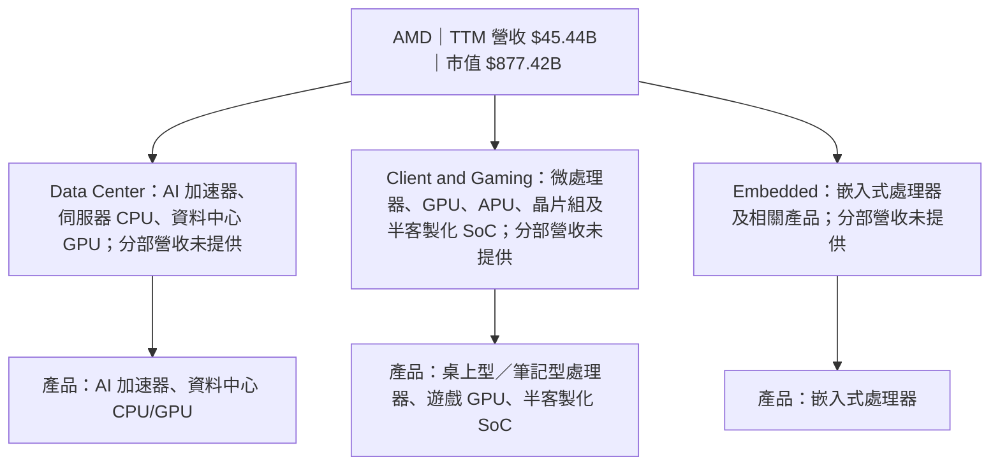
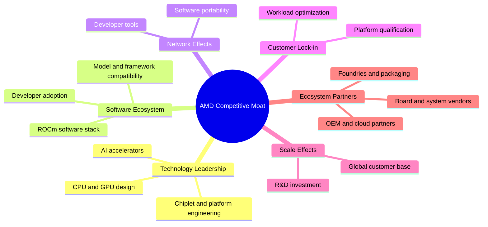
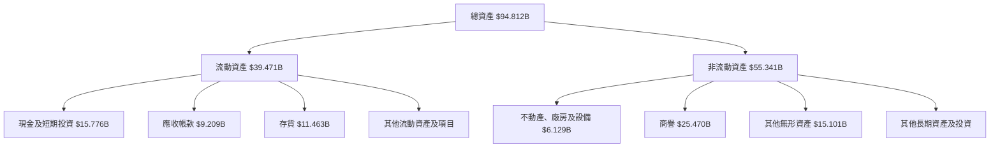
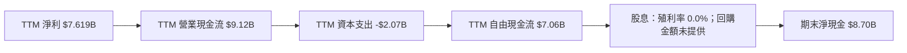
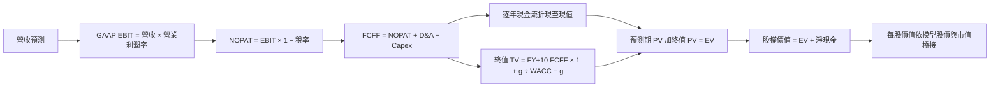
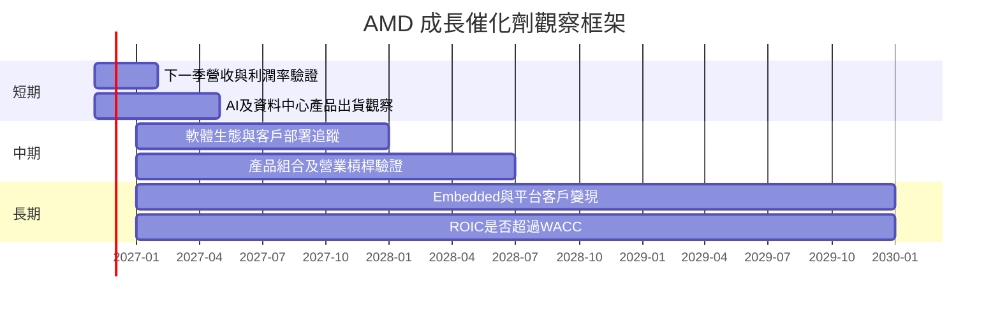
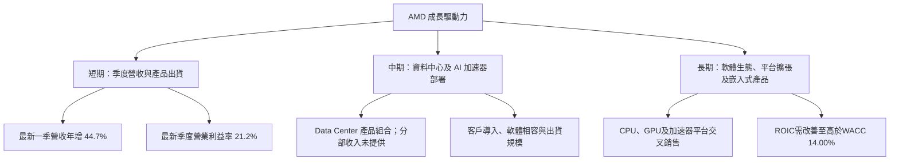
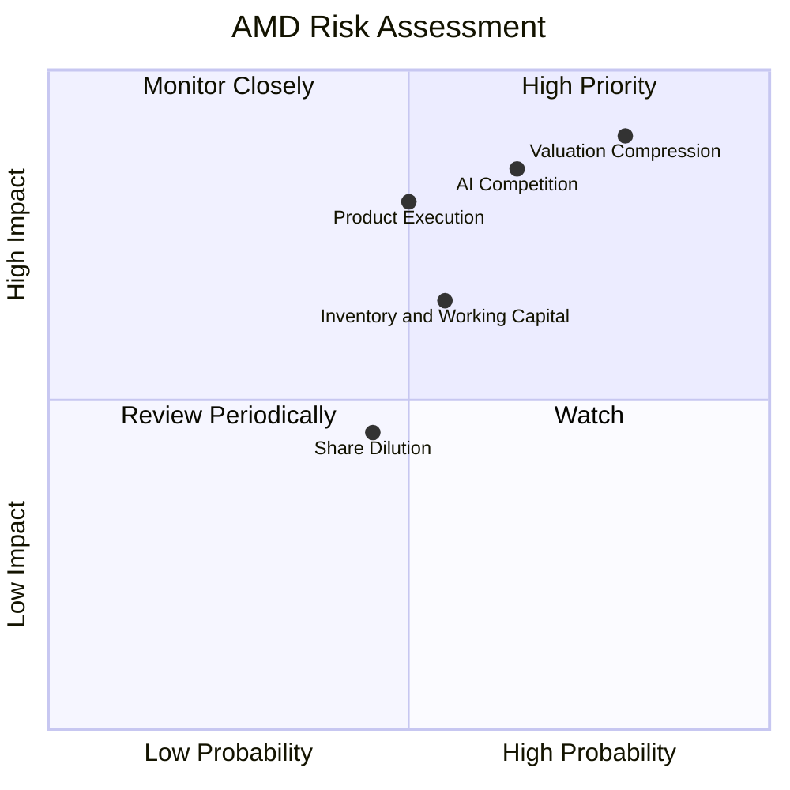
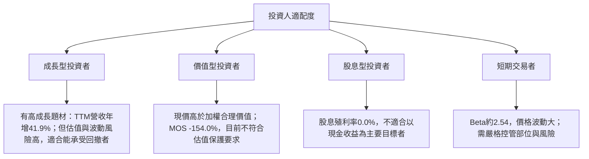

# AMD 基本面深度分析報告
> **報告日期**：2026-11-19 ｜ **語言**：繁體中文 ｜ **數據來源**：SEC 申報資料 (XBRL)、Yahoo Finance、Finviz、StockAnalysis、Roic.ai ｜ **分析師**：CFA 級機構研究

## 目錄

| # | 章節 | 核心結論 |
|---|------|----------|
| 1 | 執行摘要 | 賣出；加權合理價值 $208.73，MOS -154.0% |
| 2 | 公司概覽與商業模式 | 資料中心與處理器產品提供成長機會，但分部收入明細未提供 |
| 3 | 損益表深度分析 | TTM 營收 $45.44B、成長 41.9%；最新季度營收年增 44.7% |
| 4 | 資產負債表分析 | 淨現金 $8.70B，流動性充足；庫存天數上升 |
| 5 | 現金流量深度分析 | TTM FCF $7.06B，FCF Yield 0.80% |
| 6 | 獲利能力與資本效率 | ROIC 12.8% 低於 WACC 14.00%，目前未覆蓋資本成本 |
| 7 | 相對估值分析 | AMD 估值高於 NVDA、INTC；部分指標亦高於 AVGO |
| 8 | DCF 內在價值評估 | 基準 DCF 每股 $75.54；模型結果遠低於現價 |
| 9 | 成長催化劑 | AI 加速器、資料中心及產品組合是潛在驅動力，TAM 數據未提供 |
| 10 | 風險矩陣 | 估值、競爭／產品執行與高波動為主要風險 |
| 11 | 投資建議 | 依 MOS 為賣出；以估值與營運指標設置監控門檻 |

---

## 1. 執行摘要

### 1.0 一頁式投資儀表板（Portfolio Manager 30 秒速讀）

| 項目 | 內容 |
|------|------|
| **投資論點（3 句）** | ① TTM 營收 $45.44B、年增 41.9%，最新一季年增 44.7%，營運動能仍具韌性。② TTM FCF 為 $7.06B、ROIC 12.8%，但低於 14.00% 的 WACC，代表目前資本報酬尚未覆蓋資本成本。③ 2026-11-18 收盤價 $530.14，遠高於加權合理價值 $208.73；估值模型顯示價格風險高於營運成長所能抵銷的程度。 |
| **綜合評分** | **6.4/10**（引用 1.1 六項算術平均） |
| **財務健康** | 🟢 淨現金 $8.70B、Piotroski F-Score 7/9；但庫存天數為 199 天，較一年前增加 38 天。 |
| **ROIC vs WACC** | **12.8% vs 14.00%**：低於資本成本約 1.2 個百分點，現階段未創造超額經濟價值。 |
| **FCF 趨勢** | TTM FCF $7.06B；FCF Yield **0.80%**。現金流為正，但相對市值的現金收益率低。 |
| **估值** | Forward P/E **30.1x**（Yahoo Finance，市場估值區段）｜ EV/EBITDA **77.44x**｜ FCF Yield **0.80%** |
| **DCF 內在價值（基準）** | **$75.54** ｜現價相對 DCF 溢價 **601.8%**（(現價÷DCF價值)−1） |
| **安全邊際（MOS）** | **-154.0%**＝($208.73−$530.14)÷$208.73；基準為 8.8 節加權合理價值。🔴 |
| **預期報酬（基準情境 12M）** | DCF 基準情境相對現價 **-85.8%**；此為模型情境價值相對現價，不是保證的 12 個月報酬。 |
| **關鍵風險（前二）** | ①現價對盈利與現金流的要求極高；②AI 加速器競爭、供應及產品導入速度可能低於預期。 |
| **評級 + 信心度** | 🔴 **賣出** ｜信心：中。MOS 與 DCF 價值指向明顯高估，但長期 AI 需求及未來產品執行仍有不確定性。 |

### 1.1 綜合評分卡（全報告唯一）

| 維度 | 評分（1–10） | 主要依據（引用數字與其來源章節） |
|------|--------------|----------------------------------|
| 成長性 | 8.5 | TTM 營收年增 41.9%、最新一季年增 44.7%（第 3 章）；成長數據強，但持續性尚需驗證。 |
| 獲利能力 | 7.0 | TTM 營業利益率 17.7%、ROIC 12.8%、F-Score 7/9；ROIC 低於 WACC（第 6 章）。 |
| 財務健康 | 8.5 | 淨現金 $8.70B、流動比率 2.725、CCC 138 天（第 4 章）；庫存天數上升為扣分項。 |
| 估值 | 1.0 | MOS -154.0%、基準 DCF $75.54 對比現價 $530.14；自身 P/S 位於五年歷史第 90 百分位（第 7–8 章）。 |
| 護城河 | 7.0 | CPU/GPU/加速器產品與既有客戶及軟體生態具競爭基礎，但市場份額及分部數據未提供（第 2 章）。 |
| 管理層與資本配置 | 6.0 | 2025 年 SBC $1.64B，約佔營收 4.7%；Piotroski 稀釋股數測試未通過，回購及分部資本回報資料不足（第 3、5 章）。 |
| **綜合評分** | **6.3** | 六項算術平均：(8.5+7.0+8.5+1.0+7.0+6.0)÷6 = **6.3**。 |

### 1.2 五大投資論點 + 三大核心風險

| 類型 | 項目 | 具體依據 | 信心度 |
|------|------|----------|--------|
| 🟢 **投資論點①** | 營收動能仍高 | TTM 營收 $45.44B，年增 41.9%；最新季度營收年增 44.7%。若高增長延續，可支持研發與產品投資。 | 🟢 高 |
| 🟢 **投資論點②** | 最新季度營業槓桿改善 | 最新季度營業利益率 21.2%，高於 TTM 17.7%；若非一次性因素且產品組合延續，對獲利有正面作用。 | 🟡 中 |
| 🟢 **投資論點③** | 現金流有實質支撐 | TTM OCF $9.12B、Capex $2.07B、FCF $7.06B；FCF/淨利約 92.7%。 | 🟢 高 |
| 🟢 **投資論點④** | 資產負債表保有彈性 | 現金及短期投資 $15.78B，總債務 $7.08B，淨現金 $8.70B；可支應研發及資本配置。 | 🟢 高 |
| 🟢 **投資論點⑤** | 多產品平台具交叉銷售可能 | 公司涵蓋資料中心、Client and Gaming、Embedded；但各分部營收及毛利未提供，跨產品變現仍須追蹤。 | 🟡 中 |
| 🟡 **風險①** | 估值與基本面落差 | 加權合理價值 $208.73，現價 $530.14；MOS -154.0%，反映極高估值回撤風險。 | 🔴 高 |
| 🔴 **風險②** | AI 加速器競爭與執行 | 同業 NVDA 最新季度營收年增 105.9%，高於 AMD 44.7%；產品、軟體生態與供應執行會影響市占與毛利。 | 🔴 高 |
| 🟡 **風險③** | 營運資金與稀釋 | DIO 由 161 天升至 199 天；稀釋股數測試未通過，SBC 佔 TTM OCF 約 21.9%。 | 🟡 中 |

### 1.3 快速統計卡片

| 指標 | 公司實際值（期間） | 同業中位數 | 狀態 |
|------|--------------------|------------|------|
| 營收成長（TTM） | **41.9%** | — | 🟢 |
| 營收成長（最新一季年增） | **44.7%** | **85.5%**（NVDA、INTC、AVGO 中位數） | 🟡 |
| 毛利率（TTM） | **56.0%** | **74.7%** | 🟡 |
| 營業利益率（TTM） | **17.7%** | — | 🟢 |
| ROIC（TTM） | **12.8%** | — | 🟡 |
| Forward P/E | **30.1x** | **18.2x** | 🔴 |
| FCF Yield（TTM） | **0.80%** | — | 🔴 |
| Piotroski F-Score | **7 / 9** | — | 🟢 |

### 1.4 投資結論

```text
╔══════════════════════════════════════════════════════════════════╗
║                    📊 投資結論摘要                               ║
╠══════════════════════════════════════════════════════════════════╣
║  評級：🔴 賣出（依 MOS 規則，未作質化上調或下調）                 ║
║  價格（2026-11-18 收盤）：$530.14                                ║
║  DCF 內在價值（基準）：$75.54（現價相對 DCF 溢價 601.8%）        ║
║  安全邊際 MOS：-154.0%                                           ║
║  加權合理價值（8.8）：$208.73                                     ║
║  DCF 情境價值：                                                   ║
║    悲觀情境：$40.03（-92.4%）                                     ║
║    基準情境：$75.54（-85.8%）                                     ║
║    樂觀情境：$141.10（-73.4%）                                    ║
║  綜合評分：6.3/10（引用 1.1）                                    ║
║  適合投資人：能承受高波動、長期追蹤產品執行的成長型投資人；     ║
║  不適合以現金收益率或估值保護為主要要求的投資人。               ║
╚══════════════════════════════════════════════════════════════════╝
```

---

## 2. 公司概覽與商業模式

### 2.1 業務結構與收入來源

公司資料列出 Data Center、Client and Gaming、Embedded 三個業務板塊，並銷售 CPU、GPU、AI 加速器、APU、晶片組、專業 GPU、嵌入式處理器與半客製化 SoC。各分部營收、占比及軟體／服務收入數據未提供，因此不能以推估比例繪製收入分布圖。



**業務含義：**分部營收明細缺失，無法量化各產品對 41.9% TTM 成長的貢獻，也無法確認成長是否高度集中於單一市場。投資追蹤需以季度分部收入、毛利率及管理層財測補足。

### 2.2 市場份額

市場份額數據未提供，亦沒有可引用的市場份額統計與年份，因此不繪製份額圖。AMD TTM 營收為 $45.44B、成長 41.9%；對照同業最新季度營收年增，NVDA 為 105.9%、AVGO 為 85.5%、INTC 為 20.9%。這些數字顯示 AMD 處於成長型競爭群體，但不等同市場份額或競爭力的直接衡量。

### 2.3 競爭護城河分析



### 2.4 護城河強度

| 護城河項目 | 強度（強／中／弱） | 證據（引用數字或事實） | 會削弱它的情況 |
|------------|--------------------|------------------------|----------------|
| 技術與產品設計 | 中 | 公司同時供應 CPU、GPU、AI 加速器與嵌入式產品；TTM 營收成長 41.9%。 | 產品效能、能耗或上市節奏落後競爭者。 |
| 軟體生態系統 | 中 | GPU/AI 加速器的效用依賴軟體、工具與模型支援；目前沒有可量化開發者或採用數據。 | 軟體移植成本高、開發者偏好競品平台。 |
| 網路效應 | 弱至中 | 更多使用者可能帶動工具與相容性改善，但沒有使用者、模型或開發者規模數字可驗證。 | 生態擴張慢於對手，開發者集中於單一競品。 |
| 客戶鎖定 | 中 | 伺服器與企業產品導入涉及驗證、工作負載遷移及平台相容。客戶留存率未提供。 | 客戶轉向競品、採購週期拉長或集中採購下降。 |
| 規模效應 | 中 | FY2025 研發費用 $8.09B（依年度損益資料），規模支援多產品研發；但部分來源對年度數字有差異，詳第 3 章。 | 研發投入未轉化成收入及毛利，或競爭者研發投入更有效率。 |
| 生態夥伴 | 中 | 業務仰賴代工、封裝、OEM、雲端與系統夥伴；夥伴集中度未提供。 | 先進製程供應受限或重要客戶自行設計晶片。 |

本報告 1.1 的「護城河」評分為 **7.0/10**，理由是產品組合、研發規模及平台整合具競爭基礎，但市占、客戶留存與軟體採用數據不足，尚不能將護城河視為已量化驗證。

---

## 3. 損益表深度分析

### 3.1 年度收入成長趨勢（近 4 年）

```text
╔══════════════════════════════════════════════════════════════════╗
║              AMD 年度收入趨勢（FY2022–FY2025）                   ║
╠══════════════════════════════════════════════════════════════════╣
║  FY2022  $23.60B  ████████████████░░░░░░░░  YoY：N/A（基期）    ║
║  FY2023  $22.68B  ███████████████░░░░░░░░░  YoY：-3.9% 🟡       ║
║  FY2024  $25.79B  █████████████████░░░░░░░  YoY：+13.7% 🟢     ║
║  FY2025  $34.64B  ███████████████████████░  YoY：+34.3% 🟢     ║
║                                                                  ║
║  FY2022–FY2025 營收 CAGR：((34.64÷23.60)^(1÷3))-1 = 約 13.6%   ║
╚══════════════════════════════════════════════════════════════════╝
```

FY2023 營收由 $23.60B 降至 $22.68B（-3.9%），其後 FY2024 增至 $25.79B，FY2025 加速至 $34.64B（+34.3%）。FY2025 的增長與最近 TTM $45.44B、年增 41.9% 一致，顯示成長正在加速；但因缺乏分部明細，不能將加速全部歸因於 AI 或單一產品線。

### 3.2 季度收入趨勢分析

QoQ 採當季營收相對上一季計算；YoY 依同季去年數據或來源已提供的單季年增率。

| 季度 | 營收（$B） | QoQ | YoY | 備註 |
|------|-----------:|----:|----:|------|
| 2025 Q4 | 10.270 | 約 +11.1% | +34.11% | QoQ 比較 2025 Q3 $9.246B。 |
| 2026 Q1 | 10.253 | -0.17% | +37.85% | 營收近乎持平於前季，但年增仍高。 |
| 2026 Q2 | 11.536 | +12.52% | +50.11% | 季度營收擴張，年增加速。 |
| 2026 Q3 | 13.377 | +15.98% | +44.68%（核定值 44.7%） | 營收創最近四季高點；YoY 低於 Q2，但仍逾 40%。 |

最新季度營收由 $11.536B 增至 $13.377B，QoQ 約 16.0%；這表示近期需求及產品出貨仍有擴張，但單季數據不宜直接外推為全年增長率。

### 3.3 利潤率演變分析

| 利潤率指標 | FY2022 | FY2023 | FY2024 | FY2025 | 趨勢 | 評估 |
|------------|--------|--------|--------|--------|------|------|
| **毛利率** | 44.9% | 46.1% | 49.3% | 49.5% | 逐年改善 | 🟢 |
| **營業利益率** | 5.3% | 1.8% | 8.1% | 10.7% | FY2023 下滑後回升 | 🟢 |
| **淨利率** | 5.6% | 3.8% | 6.4% | 12.5% | FY2025 明顯擴張 | 🟢 |

上述年度比率依年度損益表列示的營收、毛利、營業利益及淨利計算；該來源毛利數值與 StockAnalysis 年度毛利資料存在差異。TTM 毛利率 56.0%、營業利益率 17.7% 為核定 TTM 指標，應優先用於當前比較，不應把年度欄位的資料口徑差異解讀為精確連續趨勢。

**利潤率演變深度解析：**年度營業利益率從 FY2023 的 1.8% 回升至 FY2025 的 10.7%，而 TTM 為 17.7%，顯示近期營收擴張伴隨較高營業槓桿。可能的經濟機制包括高附加價值產品占比提升、固定研發成本由更大營收基礎吸收，以及產品組合變化；但分部毛利與費用明細不足，這些原因是營運解釋而非已被分部數據證明的歸因。最新季度營業利益率核定為 21.2%，高於 TTM 17.7%，若可持續將有利於估值；若主要由季度組合或一次性因素造成，則不宜視為新常態。

### 3.4 費用結構分析

年度費用項目不完整，且年度營業利益、研發費用等來源之間存在口徑差異，因此不以不完整項目繪製費用占比圓餅圖。可確認的研發費用為 FY2025 $8.09B、FY2024 $6.46B、FY2023 $5.87B、FY2022 $5.00B；研發投入上升有助於產品與平台競爭，但必須由營收、毛利與現金流轉化予以驗證。

### 3.5 季度 EPS 趨勢與盈餘品質（Quality of Earnings）

| 季度 | EPS（StockAnalysis） | EPS 年增 | 超預期／不及預期 |
|------|---------------------:|---------:|--------------------|
| 2025 Q4 | $0.92 | +217.14% | N/A（EPS 預估值及實際值欄為 nan） |
| 2026 Q1 | $0.84 | +91.17% | N/A（EPS 預估值及實際值欄為 nan） |
| 2026 Q2 | $1.39 | +159.49% | N/A（EPS 預估值及實際值欄為 nan） |
| 2026 Q3 | $1.48 | +93.82% | N/A（EPS 預估值及實際值欄為 nan） |

季度 EPS 數值與 Yahoo Finance EPS 歷史的呈現口徑可能不同；可確認的方向是近期季度 EPS 年增為正，但「超預期／不及預期」無法核實，不能把缺失的預估值當作 beat 或 miss。

| 盈餘品質項目 | 數值／佔比 | 評估 |
|--------------|-----------|------|
| 股權薪酬 SBC / 營收 | 約 **4.4%**（估計：最近四季 SBC 合計 $1.999B ÷ TTM 營收 $45.44B） | 🟡 SBC 是實質股東成本，造成潛在稀釋；Piotroski 稀釋股數測試未通過。 |
| SBC / 營業現金流 | 約 **21.9%**（$1.999B ÷ $9.12B） | 🟡 SBC 相當於近五分之一 OCF，不能只因其為非現金費用而忽略。 |
| FCF / 淨利（現金轉換率） | 約 **92.7%**（$7.06B ÷ $7.619B） | 🟢 現金轉換接近淨利；使用 StockAnalysis TTM 淨利 $7.619B 計算。 |
| 一次性／非經常性損益 | N/A（缺少可核對的 TTM 一次性損益明細） | 無法判定是否有一次性項目抬高或壓低盈餘。 |
| 有效稅率異常 | N/A（未提供實際 TTM 有效稅率明細） | DCF 採用 21.0% 為模型稅率，不應冒充實際稅率。 |
| 資本化支出 vs 費用化 | TTM Capex $2.07B；資本化政策明細未提供 | 無法判斷費用資本化是否造成當期獲利高估。 |

**盈餘品質結論：**TTM FCF 為正且約為淨利的 92.7%，支持盈餘具有現金流支撐；不過 SBC 約佔 TTM 營收 4.4%、OCF 21.9%，且稀釋股數測試未通過，股東報酬應考慮稀釋成本。因一次性損益及實際稅率資料缺失，不能認定 GAAP 淨利被高估或低估；對估值的含義是，不應只用 EPS 成長推導價值，需同步觀察每股 FCF 及股數變化。

---

## 4. 資產負債表分析

### 4.1 資產結構分解



非流動資產 $55.341B 為總資產 $94.812B 減流動資產 $39.471B。商譽與無形資產合計 $40.571B，佔總資產約 42.8%；此結構提高了收購相關資產減損的敏感度。其他細項不完整，故圖中不作金額分配。

### 4.2 流動性與營運資金分析

| 指標 | 最新 TTM | 一年前 TTM | 變化 | 解讀 |
|------|----------|------------|------|------|
| 流動比率 | 2.725 | N/A | N/A | 流動資產對短期負債有緩衝；比較歷史值未提供。 |
| 速動比率 | 1.725 | N/A | N/A | 扣除存貨後流動性仍有支持。 |
| DSO 應收帳款天數 | 74 天 | 71 天 | +3 天 | 收款天數略升，需檢查帳款增長是否快於收入。 |
| DIO 存貨天數 | 199 天 | 161 天 | +38 天 | 庫存週轉放慢；可能是備貨、產品組合或需求變化，若出貨不及預期可能帶來存貨風險。 |
| DPO 應付帳款天數 | 135 天 | 77 天 | +58 天 | 付款天數提高，短期有助現金流，但需確認供應商條款變化與可持續性。 |
| CCC 現金轉換週期 | 138 天 | 155 天 | -17 天 | 儘管 DIO 上升，DPO 增幅更大，CCC 淨縮短；改善不代表庫存風險消失。 |

營運資金天數依程式計算的 TTM 指標照列，不重新推算。DSO、DIO、DPO 和 CCC 的變化方向各不相同；特別是 DPO 上升 58 天，對 CCC 改善有較大貢獻，未必代表營運效率全面改善。

### 4.3 債務結構分析

```text
╔══════════════════════════════════════════════════════════════════╗
║                   AMD 債務健康診斷                               ║
╠══════════════════════════════════════════════════════════════════╣
║  總債務（核定口徑）：      $7.08B                                ║
║  現金及短期投資：         $15.78B                                ║
║  淨現金：                  $8.70B  🟢                            ║
║  流動比率：                 2.725  🟢                            ║
║  速動比率：                 1.725  🟢                            ║
║  Debt/EBITDA：             N/A（計算口徑與核定資料未提供）      ║
║  利息保障倍數：            N/A（利息費用明細未提供）            ║
║                                                                  ║
║  注：其他市場資料列示總債務 $9.21B、淨現金 $6.57B；本報告       ║
║  估值及核定財務指標依 SEC 10-Q 對應口徑 $7.08B、$8.70B。       ║
╚══════════════════════════════════════════════════════════════════╝
```

公司淨現金提供資本配置及產業下行時的緩衝；債務口徑在不同資料來源間有差異，涉及估值的現金及債務橋接一律沿用核定口徑。利息保障倍數無法計算，不以估計值填補。

### 4.4 股東權益趨勢

| 年度 | 股東權益（$B） | 年變化 |
|------|---------------:|-------:|
| 2022 | 54.75 | — |
| 2023 | 55.89 | +2.1% |
| 2024 | 57.57 | +3.0% |
| 2025 | 63.00 | +9.4% |

```text
╔══════════════════════════════════════════════════════════════════╗
║                 AMD 股東權益趨勢（年度）                          ║
╠══════════════════════════════════════════════════════════════════╣
║  2022  $54.75B  ██████████████████████░░░░░░                    ║
║  2023  $55.89B  ██████████████████████░░░░░░                    ║
║  2024  $57.57B  ███████████████████████░░░░░                    ║
║  2025  $63.00B  █████████████████████████░░░                    ║
╚══════════════════════════════════════════════════════════════════╝
```

FY2025 股東權益增加至 $63.00B。權益增長通常受留存盈餘、股權薪酬及股本變化共同影響，但完整權益變動表未提供，因此不將年度變化單獨歸因於某一項。

---

## 5. 現金流量深度分析

### 5.1 現金流量瀑布圖

公司股息殖利率及派息率均為 0.0%；回購支出與年度淨現金變化沒有完整資料，故不填入金額。



### 5.2 FCF 轉換率趨勢

| 年度 | FCF（$B） | 淨利（$B） | FCF / 淨利 | 評估 |
|------|----------:|-----------:|-----------:|------|
| 2022 | 3.12 | 1.32 | 236.4% | 🟢 現金流高於淨利，但單年可能受營運資金變動影響。 |
| 2023 | 1.12 | 0.854 | 131.1% | 🟢 正轉換，FCF 絕對額下降。 |
| 2024 | 2.40 | 1.64 | 146.3% | 🟢 現金流高於淨利。 |
| 2025 | 6.74 | 4.33 | 155.7% | 🟢 FCF 擴張，與盈利提升一致。 |
| TTM | 7.06 | 7.619 | 92.7% | 🟡 轉換率較 FY2025 低，仍接近 1 倍。 |

年度淨利及現金流取年度損益表與現金流量表。TTM FCF 及 TTM OCF 依核定數據引用；各期間不是完全一致的季度累計口徑，宜看方向，不把小幅差異視為精確會計調節。

### 5.3 自由現金流趨勢

```text
╔══════════════════════════════════════════════════════════════════╗
║                 AMD 自由現金流趨勢                               ║
╠══════════════════════════════════════════════════════════════════╣
║  FY2022  $3.12B  █████████░░░░░░░░░░░░░░  FCF Yield：N/A       ║
║  FY2023  $1.12B  ███░░░░░░░░░░░░░░░░░░░░  FCF Yield：N/A       ║
║  FY2024  $2.40B  ███████░░░░░░░░░░░░░░░░  FCF Yield：N/A       ║
║  FY2025  $6.74B  ███████████████████░░░░░  FCF Yield：N/A       ║
║  TTM     $7.06B  ████████████████████░░░░  FCF Yield：0.80%    ║
╚══════════════════════════════════════════════════════════════════╝
```

FY2022–FY2025 FCF 由 $3.12B 先降至 $1.12B、再增至 $6.74B；TTM 為 $7.06B。只有 TTM FCF Yield 有核定值，歷年 Yield 因歷年市值未提供而不自行估算。TTM FCF 絕對額上升有利於投資，但 0.80% Yield 仍顯示現價要求未來現金流大幅增長。

### 5.4 資本配置評估

股息殖利率為 0.0%，TTM Capex 為 $2.07B，年度研發費用 FY2025 為 $8.09B。回購、併購、其他投資及留存現金的完整金額未提供，因此不以未經確認的比例繪製資本配置圓餅圖。

| 資本用途 | 可確認資料 | 評估 |
|----------|------------|------|
| 研發 | FY2025 $8.09B（年度損益來源） | 研發強度高，支持產品開發；需檢視未來收入和回報。 |
| 資本支出 | TTM $2.07B | 相對 TTM 營收為 4.6%（$2.07B÷$45.44B）；以核定 Capex 為準。 |
| 股息 | 殖利率 0.0%、派息率 0.0% | 無現金股息回饋。 |
| 回購 | N/A（回購金額未提供） | 無法評估回購是否抵銷 SBC 稀釋。 |
| 現金留存 | 現金及短期投資 $15.78B | 資產負債表保留較高流動性。 |

---

## 6. 獲利能力與資本效率

### 6.1 ROE / ROA / ROIC 趨勢

| 指標 | FY2022 | FY2023 | FY2024 | FY2025／TTM | 評估 |
|------|--------|--------|--------|-------------|------|
| ROE | N/A | N/A | N/A | TTM 11.1%（核定品質指標） | 🟡 有獲利能力，但未提供同口徑歷史序列。 |
| ROA | N/A | N/A | N/A | TTM 5.9%（市場資料區段） | 🟡 資產回報為正。 |
| ROIC | N/A | N/A | N/A | TTM 12.8% | 🟡 低於 WACC 14.00%。 |

行業均值及可比公司 ROIC/ROE 資料未提供，不列行業均值欄。ROIC 低於資本成本的含義是：若此差距長期持續，營收擴張未必等於股東價值創造，需靠利潤率、資本週轉或更低資本成本改善。

### 6.2 ROIC vs WACC 分析（核心價值創造判斷）

```text
╔══════════════════════════════════════════════════════════════════╗
║                ROIC vs WACC 深度分析                            ║
╠══════════════════════════════════════════════════════════════════╣
║  資本成本輸入（依核定資本成本資料）：                            ║
║  ├── 無風險利率 Rf：               5.07%                        ║
║  ├── 市場風險溢酬 ERP：            5.00%                        ║
║  ├── 原始 Beta：                   2.54                         ║
║  ├── 採用調整後 Beta：             2.00                         ║
║  ├── 股權成本 Ke：                15.07%                       ║
║  ├── 稅前債務成本：                 1.85%                       ║
║  ├── 股權／債務權重：             99.2%／0.8%                   ║
║  ├── 計算 WACC：                  14.96%                       ║
║  └── 區間限制後採用 WACC：         14.00%                       ║
║                                                                  ║
║  ROIC（TTM）：                     12.8%                        ║
║  EVA 利差 = ROIC − WACC：          12.8% − 14.00% = -1.20pp    ║
║                                                                  ║
║  ROIC 12.8%  ▓▓▓▓▓▓▓▓▓▓▓▓▓▓▓░░░░░░░░░░  低於 WACC             ║
║  WACC 14.0%  ▓▓▓▓▓▓▓▓▓▓▓▓▓▓▓▓░░░░░░░░  資本成本              ║
║                                                                  ║
║  結論：ROIC 約為 WACC 的 0.91 倍；目前未覆蓋資本成本。         ║
╚══════════════════════════════════════════════════════════════════╝
```

Beta 原始值 2.54，按調整公式 ⅔×2.54+⅓ 得 2.03，並依 0.6–2.0 上限採用調整後 Beta 2.00。股權成本依核定資料為 15.07%；稅前債務成本 1.85%，有效稅率 21.0%。權重 99.2%／0.8% 及 WACC 計算值 14.96% 均照核定數據引用，並採用區間上限 14.00%。ROIC 12.8% 低於 WACC 14.00%，價值創造判斷為目前偏負面；未來若營業利潤率與資本效率改善，結論可能改變。

### 6.3 杜邦三因素分解

| 因素 | 數值（TTM） | 解讀 |
|------|-------------|------|
| 淨利率 | 16.8% | 每一美元營收約形成 $0.168 淨利。 |
| 資產週轉率 | 0.48 | 每美元資產產生約 $0.48 TTM 營收。 |
| 權益乘數 | 1.39 | 槓桿相對有限，ROE 並非主要由高財務槓桿撐起。 |
| **ROE** | **11.1%** | 16.8% × 0.48 × 1.39 = 11.1%（照抄品質指標）。 |

ROE 主要由淨利率和資產週轉率共同決定，權益乘數 1.39 不高，顯示不是以高槓桿推升 ROE。

### 6.4 財務體質：Piotroski F-Score

Piotroski F-Score：**7 / 9**。若某測試缺少必要輸入，程式規則可能使分母低於 9；本次數據列示九項測試。

| 測試 | 結果 | 解讀 |
|------|------|------|
| ROA > 0 | ✅ 通過 | TTM 獲利為正。 |
| 營業現金流 > 0 | ✅ 通過 | TTM OCF $9.12B。 |
| ROA 高於一年前 | ✅ 通過 | 資產獲利能力改善。 |
| 營業現金流 > 淨利（應計品質） | ✅ 通過 | 現金流支持盈餘。 |
| 長期負債 ÷ 總資產低於一年前 | ❌ 未通過 | 負債比率改善測試未通過，需追蹤資產與負債變化。 |
| 流動比率高於一年前 | ✅ 通過 | 短期流動性改善。 |
| 稀釋股數未增加 | ❌ 未通過 | 股數增加可能削弱每股盈餘與每股價值增長。 |
| 毛利率高於一年前 | ✅ 通過 | 毛利率測試改善。 |
| 資產週轉率高於一年前 | ✅ 通過 | 資產使用效率改善。 |

7/9 支持財務品質整體良好，但負債率與稀釋股數兩項未通過，尤其稀釋會使公司層級盈利增長無法一對一轉化成每股報酬。

---

## 7. 相對估值分析

### 7.1 同業估值比較表格

本表的同業倍數取自 Yahoo Finance Peer multiples；公司 Forward P/E、P/S 等估值取市場估值資料。AMD 的 Trailing P/E 另有核定歷史估值資料 115.2x；市場資料區段另列 113.27779x，故此處以估值歷史區塊的 115.2x 作比較並註明口徑差異。

| 估值指標 | **AMD** | **NVDA** | **INTC** | **AVGO** | AMD 評估 |
|----------|--------:|--------:|--------:|--------:|-----------|
| **Trailing P/E** | 115.2x | 19.1x | N/A | 45.2x | 🔴 明顯高於可比公司；盈餘增長需要長期延續。 |
| **Forward P/E** | 30.1x | 9.1x | 30.5x | 18.2x | 🔴 高於同業中位數 18.2x。 |
| **P/S Ratio** | 19.3x | 12.0x | 4.9x | 19.0x | 🟡 接近 AVGO、高於 NVDA；AMD 歷史百分位亦高。 |
| **EV/EBITDA** | 108.3x | 18.5x | 15.9x | 33.0x | 🔴 顯著高於同業，盈利與 EBITDA 口徑敏感。 |
| **最新季度營收年增** | 44.7% | 105.9% | 20.9% | 85.5% | 🟡 AMD 成長良好，但低於 NVDA、AVGO。 |
| **TTM 毛利率** | 56.0% | 74.7% | 40.2% | 75.5% | 🟡 高於 INTC，低於 NVDA、AVGO。 |

Peer multiples 的 AMD P/E、EV/EBITDA 與其他市場資料來源數值存在口徑差異；同業比較採規定的 Peer multiples，AMD 本身同時呈現指定歷史估值資料與市場估值資料。即使考慮 AMD 44.7% 最新季度營收年增，其 Forward P/E 30.1x 高於 peer median 18.2x，估值需要更高或更持久的成長來合理化。

### 7.2 歷史估值區間分析

```text
╔══════════════════════════════════════════════════════════════════╗
║                AMD 五年歷史估值位置（TTM）                        ║
╠══════════════════════════════════════════════════════════════════╣
║  P/E：       36.7x ├──────── 82.6x 中位數 ────────●115.2x       ║
║              當前歷史百分位：53%                                 ║
║  P/S：        4.3x ├────── 8.9x 中位數 ───────────●19.4x        ║
║              當前歷史百分位：90%                                 ║
║  EV/EBITDA： 38.2x ├──────102.2x 中位數 ─────────●108.3x        ║
║              當前歷史百分位：61%                                 ║
║  區間上緣：P/E 934.7x｜P/S 23.1x｜EV/EBITDA 919.2x               ║
╚══════════════════════════════════════════════════════════════════╝
```

P/S 位於自身五年歷史第 90 百分位，為三項指標中最偏高者；P/E 第 53 百分位、EV/EBITDA 第 61 百分位。歷史區間曾出現極端倍數，故百分位比單看中位數更有參考價值，但不代表估值必然回歸均值。

### 7.3 情境價值（Bear / Base / Bull，照抄 DCF MODEL 的 Scenarios）

| 情境 | 第 1 年營收成長 | 期末營業利潤率 | WACC | 每股價值 | 相對現價 | 機率 | 會發生的條件 |
|------|----------------:|----------------:|-----:|---------:|---------:|-----:|--------------|
| 🔴 悲觀 | 15.0% | 6.3% | 15.00% | $40.03 | -92.4% | 25% | AI/伺服器產品增長放慢、競爭壓低利潤率，且資本成本保持高位。 |
| 🟡 基準 | 30.0% | 7.4% | 14.00% | $75.54 | -85.8% | 50% | 第一年營收增長承接高基期後逐年減速，長期營業利潤率回歸模型假設。 |
| 🟢 樂觀 | 45.0% | 8.1% | 13.00% | $141.10 | -73.4% | 25% | 產品導入及需求高於基準，利潤率較基準改善，資本成本下降。 |

上述數字為 DCF 模型情境結果，並非 12 個月分析師目標價。即使樂觀情境價值 $141.10，仍低於現價，反映現價在該模型框架下需要情境以外的更高現金流假設。

### 7.4 相對估值隱含價格區間

```text
╔══════════════════════════════════════════════════════════════════╗
║                 相對估值每股價值及現價位置                       ║
╠══════════════════════════════════════════════════════════════════╣
║  $75.54       $129.27           $321.67        $530.14  $657.74  ║
║  DCF 基準      同業 EV/EBITDA     同業 Forward P/E   現價   共識價 ║
╚══════════════════════════════════════════════════════════════════╝
```

- **DCF 基準 $75.54**：10 年 FCFF、WACC 14.00%、永續成長率 3.0%。
- **同業 Forward P/E $321.67**：NVDA、INTC、AVGO 的 Forward P/E 中位數 18.2x × AMD Forward EPS $17.64。
- **同業 EV/EBITDA $129.27**：同業 EV/EBITDA 中位數 18.5x × AMD TTM EBITDA，加回淨現金；價值照核定估值方法引用。
- **分析師共識 $657.74**：49 位分析師平均目標價，不是相對估值倍數推導值。

---

## 8. DCF 內在價值評估（Discounted Cash Flow）

> 本章依程式計算的 DCF 模型照列，不重新建立或改動模型輸出。模型以美元十億為金額單位，表格數字保留至小數點後兩位；折現因子保留三位，比例保留一位。由於部分輸入與中間值以已四捨五入數字呈現，重算時可能出現小幅尾差；模型原始精度結果以核定輸出為準。

### 8.0 估值推理鏈（Thinking Logic）

**Step 1 — 價值由哪些變數決定？**

AMD 的價值可拆為既有 CPU/GPU/嵌入式產品現金流、資料中心與 AI 加速器的增量成長，以及軟體與平台採用帶來的長期選擇權。由於公司未提供各分部營收占比，三者無法用現有數據分別量化；模型以總營收 TTM $45.44B 作為起點。對本模型而言，主導價值的是 **營收成長與營業利潤率路徑**，因它們決定逐年 FCFF；終值成長率與 WACC 則決定長期折現價值。

**Step 2 — 模型選擇**

| 決策點 | 本報告採用 | 理由（含數字） | 曾考慮但否決 | 否決理由 |
|--------|-----------|----------------|--------------|----------|
| 現金流定義 | FCFF | 公司 TTM OCF $9.12B、Capex $2.07B，且模型以 WACC 折現後先求 EV。 | FCFE | FCFE 需更明確的債務融資及利息預測，現有資料不足。 |
| 預測期 N | 10 年 | DCF 模型固定 10 年，讓營收成長從 30.0% 線性降至 3.0%。 | 5 年 | 5 年不足以反映模型設置的成長衰減路徑；不得擅自替換程式模型年數。 |
| 終值方法 | Gordon Growth | 模型提供終值 $152.04B、現值 $41.01B。 | 單獨採退出倍數 | DCF 模型未提供退出倍數輸入，無法自行增加第二終值法。 |
| EBIT 基礎 | GAAP EBIT | 模型明確使用 GAAP EBIT。 | 非 GAAP EBIT | 不採用加回 SBC 的 EBIT，避免稀釋或 SBC 重複調整。 |

**Step 3 — 關鍵假設的推導鏈**

- **預測期營收成長**：錨點＝TTM 營收年增 41.9%；調整＝避免將單一高增長率永久外推，模型將 FY+1 成長設為 30.0%，線性下降至 FY+10 的 3.0%；**採用逐年 30.0% 至 3.0%**；否決固定 41.9% 十年成長，因為那會忽略基期擴大、競爭及產品週期。
- **營業利潤率**：錨點＝TTM 17.7%；調整＝逐年淡化至近五個財年的中位數 7.4%；**FY+1 17.7%、FY+10 7.4%**；否決永久維持 17.7%，因模型採用成熟期回歸，且目前沒有證據證明高利潤率可維持十年。
- **永續成長率 g**：錨點＝長期成熟企業需低於折現率；**採用 3.0%**，低於 WACC 14.00%；未採更高的終值成長，因高 g 會顯著推升終值且需要更強長期競爭力假設。
- **預測期 N**：錨點＝模型明定 10 年；**採用 10 年**；不改用其他年數，因估值輸出已由程式依此計算。
- **Capex／營收**：錨點＝TTM 4.5%；模型由 FY+1 至 FY+10 均為 4.5%；**採用 4.5%**；未下調至更低成熟期比率，模型規則已使其不低於 D&A 的 1.1 倍。
- **D&A／營收**：錨點＝TTM 6.7%；**採用 6.7% 並維持不變**。此為低敏感度假設的簡化說明。
- **ΔWC／營收增額**：模型明確標示營運資金未建模；**採用模型的零額外扣除設定**，而不是推估 CCC 對現金流的影響。這可能偏樂觀，因營收擴張通常會佔用應收及存貨。
- **EBIT 基礎與 SBC**：錨點＝模型使用 GAAP EBIT；**採用 GAAP EBIT，SBC 已作費用，不另從 FCFF 扣除**；不改用非 GAAP EBIT，避免漏計或重複計算 SBC。
- **年稀釋率**：模型採股數不再稀釋；**採用 0% 額外稀釋**，與 GAAP EBIT 已含 SBC 的模型組合一致；若採正稀釋率，需同步改用非 GAAP EBIT 才符合模型防重複規則。
- **終值方法**：採用 Gordon Growth，錨點＝模型輸出終值 $152.04B；未另加退出倍數，因模型未提供該假設，亦不得自建。
- **WACC**：錨點＝核定計算 WACC 14.96%；依設定的 7%–14% 區間限制，**採用 14.00%**；不採未限制的 14.96%，因程式輸出已按上限處理。

**Step 4 — 最脆弱一環**

最脆弱的是營收增長、利潤率及營運資金三者的組合：模型假設前期仍高成長，但不納入營運資金占用，且長期利潤率回落至 7.4%；若實際增長伴隨更大庫存及應收占用，模型 FCFF 會高估。模型情境價值由悲觀 $40.03 至樂觀 $141.10，均遠低於現價，顯示即使樂觀假設也不足以支持現價。

**Step 5 — 計算路徑圖**



### 8.1 模型假設總表（Model Inputs）

| 假設項目 | 採用值 | 依據／來源 | 敏感度 |
|----------|--------|-------------|--------|
| 預測期長度 N | 10 年 | DCF 模型固定；營收成長由 30.0% 淡化至 3.0%。 | 🟡 中 |
| 營收成長 | FY+1 30.0% 至 FY+10 3.0% | TTM 成長 41.9%；模型依 0%–30% 限制，逐年線性下降。 | 🔴 高 |
| 營業利潤率 | FY+1 17.7% 至 FY+10 7.4% | TTM 營業利益率 17.7%；期末採近五個財年中位數。 | 🔴 高 |
| 有效稅率 | 21.0% | 模型預設值；非公司實際 TTM 有效稅率。 | 🟢 低 |
| Capex／營收 | 4.5% | TTM Capex／營收約 4.5%；模型全期維持。 | 🟡 中 |
| D&A／營收 | 6.7% | TTM D&A／營收；模型全期維持。 | 🟢 低 |
| 營運資金變動 | 不建模 | DCF 模型明確未納入營運資金變動。 | 🔴 高 |
| EBIT 基礎 | GAAP EBIT | DCF 模型輸入。 | 🟡 中 |
| SBC 處理 | GAAP EBIT 已含 SBC，不再扣除 | 模型組合 A；股數不再稀釋。 | 🟡 中 |
| 年稀釋率 | 0% 額外稀釋 | 模型固定股數，與 GAAP EBIT/SBC 設定相容。 | 🟡 中 |
| 永續成長率 g | 3.0% | DCF 模型假設，低於 14.00% WACC。 | 🔴 高 |
| 終值方法 | Gordon Growth | DCF 模型提供；未提供退出倍數交叉估值。 | 🔴 高 |
| WACC | 14.00% | 核定值；計算值 14.96% 受 7%–14% 上限限制。 | 🔴 高 |

**FCFF 定義：**本模型使用 FCFF = NOPAT + D&A − Capex，不含營運資金變動列。  
**SBC 防重複聲明：**本模型採用 **(A) GAAP EBIT + 固定股數**；SBC 影響已透過 GAAP 費用計入一次，不再扣除 SBC，也不另外增加稀釋股數。

### 8.2 折現率推導（WACC）

```text
╔══════════════════════════════════════════════════════════════════╗
║                    WACC 推導（折現率）                           ║
╠══════════════════════════════════════════════════════════════════╣
║  股權成本 Ke（CAPM，核定輸入）：                                 ║
║  ├── 無風險利率 Rf：                 5.07%                       ║
║  ├── 市場風險溢酬 ERP：              5.00%（假設值）             ║
║  ├── 原始 Beta：                     2.54                        ║
║  ├── 調整後 Beta：                   2.00                        ║
║  ├── 規模／國別溢酬：                0.00%（未另加）             ║
║  └── Ke = 5.07% + 2.00 × 5.00% = 15.07%                        ║
║                                                                  ║
║  債務成本：                                                      ║
║  ├── 稅前 Kd：                       1.85%                       ║
║  ├── 稅率：                          21.0%                       ║
║  └── 稅後 Kd = 1.85% × (1−21.0%) = 1.46%                        ║
║                                                                  ║
║  資本結構權重（核定市值基礎）：                                   ║
║  ├── 股權權重 E：                    99.2%                       ║
║  ├── 債務權重 D：                     0.8%                       ║
║  ├── 計算值：                        14.96%                      ║
║  └── 區間限制後採用 WACC：           14.00%                      ║
╚══════════════════════════════════════════════════════════════════╝
```

**輸入來源與限制：**Rf 5.07% 取核定 10 年期美債輸入；其觀測日期在資本成本資料中未另列，故不補寫日期。ERP 5.00% 是核定的假設值，非直接觀測值。原始 Beta 2.54 來自 Yahoo Finance，按 ⅔×2.54+⅓ 得 2.03，再受 2.00 上限限制，採調整後 Beta 2.00。未另計規模或國別溢酬。債務成本直接引用核定稅前 1.85%，利息費用及平均計息負債明細未提供，因此不以缺失項目重建。

**逐步演算（WACC，依核定輸入）：**

1. **Ke（CAPM）**＝5.07% + 2.00×5.00% + 0.00%＝**15.07%**。
2. **稅前 Kd**＝核定稅前債務成本 **1.85%**；平均計息負債及利息費用明細未提供，無法另行拆算。
3. **稅後 Kd**＝1.85%×(1−21.0%)＝**1.46%**（四捨五入）。
4. **權重**＝核定股權權重 **99.2%**；債務權重 **0.8%**；合計 99.2%+0.8%=**100.0%**。核定股權市值權重依市值與債務口徑計算；本報告不使用帳面股東權益取代市值。
5. **未限制加權成本**＝99.2%×15.07% + 0.8%×1.46%＝14.94944%+0.01168%=14.96112%≈**14.96%**；模型採用值受 7%–14% 區間上限限制，故為 **14.00%**。

第 6.2 節與本節一致採用 WACC **14.00%**。

### 8.3 逐年自由現金流預測（基準情境）

| 年度 | FY+1 | FY+2 | FY+3 | FY+4 | FY+5 | FY+6 | FY+7 | FY+8 | FY+9 | FY+10 |
|------|-----:|-----:|-----:|-----:|-----:|-----:|-----:|-----:|-----:|------:|
| 營收（$B） | 59.07 | 75.01 | 93.02 | 112.55 | 132.81 | 152.73 | 171.06 | 186.46 | 197.64 | 203.57 |
| 營收 YoY | 30.0% | 27.0% | 24.0% | 21.0% | 18.0% | 15.0% | 12.0% | 9.0% | 6.0% | 3.0% |
| 營業利潤率 | 17.7% | 16.6% | 15.4% | 14.3% | 13.1% | 12.0% | 10.8% | 9.7% | 8.5% | 7.4% |
| EBIT（GAAP，$B） | 10.46 | 12.43 | 14.34 | 16.06 | 17.42 | 18.28 | 18.51 | 18.03 | 16.84 | 15.00 |
| − 稅（21.0%，$B） | (2.20) | (2.61) | (3.01) | (3.37) | (3.66) | (3.84) | (3.89) | (3.79) | (3.54) | (3.15) |
| NOPAT（$B） | 8.27 | 9.82 | 11.33 | 12.69 | 13.76 | 14.44 | 14.62 | 14.24 | 13.30 | 11.85 |
| + D&A（$B） | 3.96 | 5.03 | 6.24 | 7.55 | 8.90 | 10.24 | 11.47 | 12.50 | 13.25 | 13.65 |
| − Capex（$B） | (2.69) | (3.41) | (4.23) | (5.12) | (6.04) | (6.95) | (7.78) | (8.48) | (8.99) | (9.26) |
| − ΔWC | 未建模 | 未建模 | 未建模 | 未建模 | 未建模 | 未建模 | 未建模 | 未建模 | 未建模 | 未建模 |
| **FCFF（$B）** | **9.54** | **11.43** | **13.33** | **15.11** | **16.63** | **17.73** | **18.31** | **18.26** | **17.56** | **16.24** |
| 折現因子 @14.00% | 0.877 | 0.769 | 0.675 | 0.592 | 0.519 | 0.456 | 0.400 | 0.351 | 0.308 | 0.270 |
| **FCFF 現值 PV（$B）** | **8.37** | **8.80** | **9.00** | **8.95** | **8.63** | **8.08** | **7.32** | **6.40** | **5.40** | **4.38** |

預測期 FCF 現值加總：

**$8.37 + $8.80 + $9.00 + $8.95 + $8.63 + $8.08 + $7.32 + $6.40 + $5.40 + $4.38 = $75.33B**。

DCF 模型提供的未四捨五入加總為 **$75.32B**；以表格呈現至 $0.01B 後逐項相加為 $75.33B，$0.01B 差異源自各年度取位，低於 1% 尾差，後續估值沿用模型原值 $75.32B。

**逐步演算（FY+1，按模型列示精度）：**

1. **營收**＝$45.44B×(1+30.0%)＝$59.072B≈**$59.07B**。
2. **EBIT**＝$59.07B×17.7%＝$10.45539B≈**$10.46B**。
3. **稅**＝$10.46B×21.0%＝$2.1966B≈**$2.20B**。
4. **NOPAT**＝$10.46B−$2.20B＝$8.26B；模型未四捨五入中間值列為 **$8.27B**。
5. **D&A**＝$59.07B×6.7%＝$3.95769B≈**$3.96B**。
6. **Capex**＝$59.07B×4.5%＝$2.65815B；模型列值 **$2.69B**，差異表示模型使用未顯示的精確營收／比例計算，原模型列值優先。
7. **ΔWC**＝模型未建模，未列入 FCFF 計算。
8. **FCFF**＝模型 NOPAT $8.27B + D&A $3.96B − Capex $2.69B＝**$9.54B**。
9. **折現因子**＝1÷(1+14.00%)¹＝0.87719≈0.877；**PV**＝$9.54B×0.877≈$8.37B。

> 模型輸出的個別列值採內部未顯示精度運算；FY+1 的已四捨五入營收乘比率並不會完全重現模型 Capex 列值。為遵守核定模型數字不變的要求，表中保留原模型值，不以自行重算值替代。

**合理性自檢：**

- 預測 FCF CAGR：FY+1 $9.54B 至 FY+10 $16.24B，九年間 CAGR＝(16.24÷9.54)^(1÷9)−1≈**6.1%**；FY2022 至 FY2025 FCF 由 $3.12B 升至 $6.74B，三年 CAGR 約 **29.3%**，預測顯著低於近期歷史增幅，反映模型假設增長成熟化。
- FY+10 FCF 利潤率＝$16.24B÷$203.57B＝**8.0%**；目前 TTM FCF 利潤率＝$7.06B÷$45.44B＝**15.5%**。同業最佳 FCF 利潤率未提供，不能比較。
- 模型各年 FCFF 均為正，沒有負現金流年度；但未建模營運資金可能高估現金流。

```text
╔══════════════════════════════════════════════════════════════════╗
║            自由現金流：歷史實際 vs 模型預測                      ║
╠══════════════════════════════════════════════════════════════════╣
║  FY2023(實)  $1.12B  ███░░░░░░░░░░░░░░░░░░░░                   ║
║  FY2024(實)  $2.40B  ███████░░░░░░░░░░░░░░░░                   ║
║  FY2025(實)  $6.74B  █████████████████░░░░░░                   ║
║  FY+1 (預)   $9.54B  ████████████████████████                   ║
║  FY+10(預)  $16.24B  ██████████████████████████████             ║
╠══════════════════════════════════════════════════════════════════╣
║  FY+1 至 FY+10 FCF CAGR 約 6.1%；FY2022–FY2025 約 29.3%。       ║
║  預測增幅較近期歷史低，但模型未扣營運資金，可能偏樂觀。         ║
╚══════════════════════════════════════════════════════════════════╝
```

### 8.4 終值計算（Terminal Value）

**適用性檢查：**WACC **14.00%** vs g **3.0%** → WACC > g？✅

| 方法 | 計算式 | 終值 TV | TV 現值 | 佔總 EV 比重 |
|------|--------|---------|---------|--------------|
| Gordon Growth | FY+10 FCFF × (1+g) ÷ (WACC−g) | $152.04B | $41.01B | 35.3% |
| 退出倍數法 | N/A（DCF 模型未提供退出 EBITDA 倍數與退出倍數估值） | N/A | N/A | N/A |

**逐步演算：**

1. **FY+N FCFF**＝FY+10 FCFF **$16.24B**。
2. **分子**＝FCFF×(1+g)；以模型未四捨五入 FCFF 計算，表列輸出為模型提供的終值。
3. **分母**＝WACC−g＝14.00%−3.0%＝**11.00%**；模型終值 **$152.04B**。以已四捨五入的 $16.24B 直接計算會得約 $152.06B，與模型 $152.04B 的差異來自中間值未顯示精度，故不以取位值改寫模型。
4. **PV(TV)**＝模型終值 $152.04B × 模型折現因子（內部精度；表列 0.270）＝**$41.01B**。表列取位值相乘會有小額尾差，核定模型原值優先。
5. **終值佔比**＝$41.01B÷$116.33B＝**35.3%**。

退出倍數估值未提供，故不建立替代數字。終值現值約佔企業價值 35.3%，低於 75% 警戒線，但估值仍對長期假設敏感。

### 8.5 企業價值 → 每股內在價值（Bridge）

```text
╔══════════════════════════════════════════════════════════════════╗
║              企業價值 → 每股內在價值 橋接表                      ║
╠══════════════════════════════════════════════════════════════════╣
║  預測期 FCF 現值合計            +$75.32B                         ║
║  終值現值 PV(TV)                +$41.01B                         ║
║  ─────────────────────────────────────────────                  ║
║  = 企業價值 EV                    $116.33B                       ║
║  + 淨現金                         +$8.70B                         ║
║  ─────────────────────────────────────────────                  ║
║  = 股權價值                       $125.03B                       ║
║  每股價值依模型橋接                $75.54                         ║
║  現價（2026-11-18 收盤）          $530.14                        ║
║  現價相對 DCF 溢價                 601.8%                        ║
╚══════════════════════════════════════════════════════════════════╝
```

**逐步演算：**

1. **EV**＝預測期 PV $75.32B + PV(TV) $41.01B＝**$116.33B**。
2. **股權價值**＝EV $116.33B + 淨現金 $8.70B＝**$125.03B**。
3. **每股內在價值**＝依核定模型公式「股權價值 × 價格 ÷ 市值」＝$125.03B×$530.14÷$877.42B＝**$75.54**。該公式等效反映模型的股數換算；不以另取的股數資料改寫模型。
4. **折溢價**＝現價÷DCF 內在價值−1＝$530.14÷$75.54−1＝**+601.8% 溢價**。模型另列的 -85.8% 是 DCF 價值相對現價的下行幅度，兩者分母不同。
5. **本節不計算 MOS**；MOS 只在 8.8 以加權合理價值為分母計算。

股權橋接使用核定淨現金 $8.70B（對應現金及短期投資 $15.78B、總債務 $7.08B）。DCF 模型不另列稀釋股數，以其指定的股權價值×價格÷市值公式計算每股價值；這與 8.1 的固定股數假設一致。

### 8.6 敏感性分析（WACC × 永續成長率）

表中數字照抄 DCF 模型敏感度矩陣；括號內上行空間按「每股價值÷現價−1」計算，現價 $530.14。基準格為 WACC 14.00%、g 3.0%。

| g（列）／WACC（欄） | 12.00% | 13.00% | **14.00%（基準）** | 15.00% | 16.00% |
|-----------|------:|------:|-------------------:|------:|------:|
| 2.0% | $87.24（-83.5%） | $79.62（-85.0%） | $73.26（-86.2%） | $67.87（-87.2%） | $63.24（-88.1%） |
| 2.5% | $89.10（-83.2%） | $81.03（-84.7%） | $74.35（-86.0%） | $68.72（-87.0%） | $63.92（-87.9%） |
| **3.0%（基準）** | $91.17（-82.8%） | $82.59（-84.4%） | **$75.54（-85.8%）** | $69.65（-86.9%） | $64.65（-87.8%） |
| 3.5% | $93.48（-82.4%） | $84.31（-84.1%） | $76.85（-85.5%） | $70.66（-86.7%） | $65.45（-87.7%） |
| 4.0% | $96.08（-81.9%） | $86.22（-83.7%） | $78.29（-85.2%） | $71.77（-86.5%） | $66.31（-87.5%） |

**逐步演算限制：**敏感性矩陣由核定 DCF 模型直接計算，依規定不得另建或替換模型數字。以 WACC 13.00%、g 3.0% 為例，模型矩陣給出每股 $82.59；其逐年折現現金流和終值重算所需的未取位中間數未提供，因此不偽造可複算的中間橋接。矩陣結果本身依模型輸出照列。

**三情境 DCF：**

| 情境 | 第 1 年營收成長 | 期末營業利潤率 | 永續成長 g | WACC | 每股內在價值 | 相對現價 | 主觀機率 |
|------|----------------:|----------------:|------------:|-----:|--------------:|---------:|----------:|
| 🔴 悲觀 | 15.0% | 6.3% | 模型基準 g；未另列 | 15.00% | $40.03 | -92.4% | 25% |
| 🟡 基準 | 30.0% | 7.4% | 3.0% | 14.00% | $75.54 | -85.8% | 50% |
| 🟢 樂觀 | 45.0% | 8.1% | 模型基準 g；未另列 | 13.00% | $141.10 | -73.4% | 25% |
| **機率加權** | — | — | — | — | **$83.06** | **-84.3%** | **100%** |

模型情境的機率加權值為 $83.06（只作背景參考，8.8 使用基準 DCF $75.54）。三情境完整逐年營收、FCFF、終值中間表未提供，且規定不得另建模型，因此不能生成新的「FY+N 營收→FCFF→終值」數字鏈；以上每股情境值及假設直接引用程式輸出。

**敏感度結論：**以矩陣基準值衡量，g 由 2.0% 升至 3.0%，每股價值由 $73.26 升至 $75.54，增加 $2.28，約 +3.1%；g 由 3.0% 升至 4.0%，價值由 $75.54 升至 $78.29，增加 $2.75，約 +3.6%。WACC 由 13.0% 升至 14.0%，價值由 $82.59 降至 $75.54，減少 $7.05，約 -8.5%；由 14.0% 升至 15.0%，下降 $5.89，約 -7.8%。營業利潤率每 +1pp 的單變數敏感度未提供，不能自行計算。矩陣顯示 WACC 影響在已提供區間內高於 g 的影響；8.0 Step 1 指出的營收／利潤率仍是現金流基礎，但此矩陣只測 WACC 與 g，不能據此宣稱利潤率敏感度較小。

### 8.7 反推 DCF（Reverse DCF）

市場價格反推結果照模型輸出：逐次只改一個變數，其餘維持基準。固定輸入包括 WACC 14.00%、稅率 21.0%、Capex／營收基準路徑、營運資金不建模、預測期 10 年及固定股數。

| 求解的變數（一次一個） | 其餘變數設定 | 市場隱含值（令 DCF = 現價） | 公司歷史實際 | 判斷 |
|------------------------|--------------|------------------------------:|--------------|------|
| 第 1 年營收成長率 | 利潤率及其他假設固定為基準 | 97.2% | TTM 成長 41.9%；基準模型上限 30.0% | 🔴 顯著高於近期增長與基準值 |
| 固定營業利潤率 | 營收與其他假設固定為基準 | 93.6% | TTM 17.7% | 🔴 遠高於目前營業利潤率 |
| 永續成長率 g | 其餘為基準 | 未提供 | — | N/A（模型未提供該變數反推解） |
| 預測期 N | 其餘為基準 | 未提供 | — | N/A（模型未提供該變數反推解） |

模型提供的反推結果只包括前兩項，求解軌跡與逐點試算明細未提供。為遵守不自行重建 DCF 的限制，不補造迭代表格或誤差數字。

**反推結論：**在其餘基準假設不變時，現價需要第 1 年營收成長 97.2%，或固定營業利潤率 93.6%，遠高於 TTM 營收增長 41.9%及營業利益率 17.7%。這代表以目前基準 DCF 結構，市場價格隱含的成長／盈利要求非常高；是否可由 AI 業務及其他未量化選擇權解釋，需觀察後續分部營收和利潤率。

### 8.8 估值三角驗證與安全邊際

| 估值方法 | 隱含每股價值 | 上行空間（÷現價） | 權重 | 說明 |
|----------|--------------:|-------------------:|------:|------|
| DCF（基準） | $75.54 | -85.8% | 40% | 10 年 FCFF、WACC 14.00%、g 3.0%。 |
| 同業 Forward P/E | $321.67 | -39.3% | 25% | 同業中位數 18.2x × AMD Forward EPS $17.64。 |
| 同業 EV/EBITDA | $129.27 | -75.6% | 25% | 同業中位數 18.5x × TTM EBITDA，加回淨現金。 |
| 分析師共識目標價 | $657.74 | +24.1% | 10% | 49 位分析師平均目標價，參考性質。 |
| **加權合理價值** | **$208.73** | **-60.6%** | **100%** | — |

**逐步演算（權重外顯）：**

$75.54×40% + $321.67×25% + $129.27×25% + $657.74×10%  
= $30.216 + $80.4175 + $32.3175 + $65.774  
= $208.725 ≈ **$208.73**。

各權重合計 40%+25%+25%+10%=100%。公司類型為 profitable；以上四種估值方法均已計算，無方法剔除。

- **MOS**＝(加權合理價值−現價)÷加權合理價值  
  ＝($208.73−$530.14)÷$208.73  
  ＝-$321.41÷$208.73  
  ＝**-154.0%**。
- **上行空間**＝(加權合理價值−現價)÷現價  
  ＝($208.73−$530.14)÷$530.14  
  ＝**-60.6%**。
- **評級：🔴 賣出**，直接採用核定 MOS 評級，未作一級質化調整。

```text
╔══════════════════════════════════════════════════════════════════╗
║                  估值區間與安全邊際                              ║
╠══════════════════════════════════════════════════════════════════╣
║  $40.03 ───── $208.73 ───── $530.14 ───── $657.74               ║
║  悲觀DCF       加權合理值      現價           分析師共識價         ║
║                                                                  ║
║  MOS = (加權合理價值 − 現價) ÷ 加權合理價值 = -154.0%           ║
║  MOS 評估：🔴 <10% 無；目前為負值                                 ║
║  上行空間 = (合理價值 − 現價) ÷ 現價 = -60.6%                    ║
║                                                                  ║
║  估值參考區間：以 MOS ≥10% 的價格上限約 $187.86 為估值門檻；      ║
║  此為計算區間，不代表目前評級為買入。                            ║
╚══════════════════════════════════════════════════════════════════╝
```

MOS ≥10% 的價格上限解法為現價上限 = $208.73×(1−10%)＝**$187.86**。因目前評級為賣出，不將該價位稱為當前買入建議。

> 🔎 **程式複算（Python，依本節各項自動重算）**
>
> 加權合理價值 = $75.54 × 40% + $321.67 × 25% + $129.27 × 25% + $657.74 × 10% = **$208.73**（權重合計 100%）
>
> 以價格 $530.14 計：MOS = **-154.0%**，上行空間 = **-60.6%**
>
> ✅ 與本節所寫數值一致。

### 8.9 DCF 模型的局限與失效條件

- **終值依賴度：**PV(TV) 佔 EV **35.3%**，估值仍有相當部分由 FY+10 之後的成長假設決定，但未達 75% 高度依賴警戒。
- **最脆弱假設：**營運資金未建模，可能高估高增長時的現金流；長期利潤率逐步降至 7.4%，若實際競爭導致低於該值，DCF 會下降。反之，若 AI 等產品帶來較高且可持續的利潤率，模型可能低估。
- **估值結果敏感度：**DCF 基準 $75.54，樂觀情境 $141.10，仍低於現價 $530.14。模型對現價的解釋能力不足，可能因市場價格反映未納入的成長選擇權。
- **適用性限制：**AMD TTM FCF 為正 $7.06B，故 DCF 並非因 FCF 為負而失效；但業務處於高成長與產品周期變化期，採單一十年路徑可能無法捕捉分部差異。應以 DCF、同業倍數、分部收入與每股現金流共同檢視。
- **與第 10 章風險連結：**AI 產品導入延誤會衝擊營收成長假設；競爭與價格壓力會衝擊營業利潤率；庫存、應收上升會增加實際營運資金需求；利率上升會使 WACC 上行並壓低現值。

### 8.10 複算檢核表（Audit Trail）

| # | 檢核項目 | 檢查方式 | 結果 |
|---|----------|----------|------|
| 1 | 所有 🔴 高／🟡 中敏感度輸入都有推導 | 對照 8.0、8.1；未提供的 ΔWC／退出倍數已標示限制 | ⚠️ 有說明限制；未提供資料無法補算 |
| 2 | 每個假設都有來歷 | 檢查 8.1 依據欄 | ✅ |
| 3 | WACC 五步算式與權重 | 99.2%+0.8%=100%；未限制計算約 14.96%，採用 14.00% | ✅ |
| 4 | Kd 與 D 範圍一致 | 核定 Kd 及債務權重沿用資本成本區塊；利息及平均計息負債明細未提供，不能獨立驗證範圍 | ⚠️ |
| 5 | WACC 與第 6.2 節一致 | 兩節均採 14.00% | ✅ |
| 6 | 年度數等於 N、無省略 | FY+1 至 FY+10 共 10 年 | ✅ |
| 7 | FY+1 代表年度算式 | 模型已取位的 NOPAT／Capex 無法完全由表格取位值重現，差額已揭露 | ⚠️ |
| 8 | 預測期 PV 加總 | 表格取位逐項合計 $75.33B；模型原值 $75.32B，差 $0.01B | ✅（尾差低於 1%） |
| 9 | WACC > g | 14.00% > 3.0% | ✅ |
| 10 | 終值使用 FY+N、折現 N 期 | 取 FY+10 FCFF，模型折現因子為 10 期 | ✅ |
| 11 | EV → 股權價值 → 每股價值 | $75.32B+$41.01B=$116.33B；+$8.70B=$125.03B；模型每股 $75.54 | ✅（每股依核定橋接公式） |
| 12 | SBC 三要素相容 | GAAP EBIT、無 SBC 再扣除、0% 額外稀釋 | ✅ |
| 13 | 矩陣基準格等於 DCF 基準 | 14.00%、3.0% 為 $75.54 | ✅ |
| 14 | 矩陣示範格與 WACC≤g | 矩陣有效格均有 WACC>g；未另建重算格 | ✅ |
| 15 | 三情境機率合計 | 25%+50%+25%=100% | ✅ |
| 16 | 反推每列只放開一變數 | 模型提供營收成長與固定利潤率兩個解；迭代軌跡未提供，未捏造 | ⚠️ |
| 17 | MOS、折溢價基準一致 | MOS 用 $208.73；DCF 溢價用 $75.54 | ✅ |
| 18 | 完整至第 11 章 | 本報告列出 1–11 章 | ✅ |
| 19 | 加權合理價值加總 | 各方法加權值合計 $208.725，四捨五入 $208.73 | ✅ |
| 20 | 評級符合 MOS 門檻 | MOS -154.0%，賣出；未調整 | ✅ |

模型原始中間精度未提供，故表格取位後少數算式不能逐位完全還原；本報告保留程式計算的核定輸出，並明確披露可見尾差，未以自行重建數字替換。

---

## 9. 成長催化劑

### 9.1 催化劑時間軸

公司未提供產品上市日期、管理層營收指引或可量化催化劑日程，故以下僅列觀察框架，不把假定日期寫成公司已承諾時間表。



### 9.2 TAM 市場規模分析

**N/A（TAM 數據未提供）**。AMD TTM 營收 $45.44B、TTM 成長 41.9%，顯示可服務業務規模正在擴張，但沒有可引用的 AI 加速器、CPU、GPU 或嵌入式市場 TAM 金額及年份，不能計算滲透率。應以後續分部營收及管理層市場資料補充。

### 9.3 成長驅動力結構圖



---

## 10. 風險矩陣

### 10.1 風險評分矩陣

以下座標為分析師主觀風險定位，不是公司財務數據；機率／衝擊分數用於風險排序，不代表已知事件發生率。



### 10.2 風險清單詳細分析

| # | 風險項目 | 發生機率 | 財務衝擊 | 風險評分 | 緩解措施 |
|---|----------|----------|----------|----------|----------|
| 1 | 🔴 **估值壓縮** | 高（主觀 70%） | 高：加權合理價值 $208.73，低於現價約 60.6% | 🔴 9.0/10 | 分批配置、設定估值門檻；以 Forward P/E、FCF Yield 與每股 FCF 追蹤，不以單季 EPS 成長追價。 |
| 2 | 🔴 **AI／資料中心競爭** | 中高（主觀 60%） | 高：AMD 最新季度營收年增 44.7%，低於 NVDA 105.9%、AVGO 85.5% | 🔴 8.0/10 | 追蹤分部收入、客戶部署、毛利及軟體採用；若連續兩季低於門檻則重估。 |
| 3 | 🟠 **產品執行及利潤率回落** | 中（主觀 50%） | 高：最新季度營業利益率 21.2%，TTM 17.7%；下滑會直接降低 DCF 現金流 | 🟠 7.5/10 | 追蹤 GAAP 營業利益率、產品上市時程及產品組合。 |
| 4 | 🟡 **庫存及營運資金** | 中（主觀 50%） | 中高：DIO 199 天，較一年前增加 38 天；應收天數增加 3 天 | 🟡 6.5/10 | 監控 DIO、存貨減記、出貨與營收差異；庫存增長若持續快於營收應降低估值假設。 |
| 5 | 🟡 **SBC 與股數稀釋** | 中（主觀 45%） | 中：近四季 SBC 約 $1.999B，約佔 TTM OCF 21.9%；F-Score 稀釋測試未通過 | 🟡 5.5/10 | 追蹤稀釋股數、SBC／營收及回購是否抵銷稀釋。 |

---

## 11. 投資建議

### 11.1 最終評級與評分

依 8.8 加權合理價值 $208.73 與現價 $530.14 計算，MOS 為 -154.0%，按規則 20 評級為 **🔴 賣出**，未作一級調整。公司綜合評分為 **6.3/10**；六項分數依序為成長性 8.5、獲利能力 7.0、財務健康 8.5、估值 1.0、護城河 7.0、管理層與資本配置 6.0。

### 11.2 合理價值與隱含報酬率

| 估值參考 | 每股價值 | 相對現價 $530.14 | 機率／權重 | 解讀 |
|----------|---------:|-----------------:|-----------:|------|
| 加權合理價值 | $208.73 | -60.6% | 估值權重合計 100% | 綜合 DCF、同業倍數與分析師共識。 |
| DCF 悲觀情境 | $40.03 | -92.4% | 25% | 成長較慢、利潤率較低、WACC 較高。 |
| DCF 基準情境 | $75.54 | -85.8% | 50% | 模型基準營收成長及利潤率淡化路徑。 |
| DCF 樂觀情境 | $141.10 | -73.4% | 25% | 高成長與較佳利潤率，但仍低於現價。 |
| DCF 機率加權參考值 | $83.06 | -84.3% | 100% 情境機率 | 僅作情境參考；8.8 加權估值採 DCF 基準 $75.54。 |
| 分析師共識目標價 | $657.74 | +24.1% | 49 位分析師平均 | 市場參考值，不等同本報告內在價值。 |

### 11.3 買入時機與觸發因素

```text
╔══════════════════════════════════════════════════════════════════╗
║                  ✅ 投資觸發因素 Checklist                        ║
╠══════════════════════════════════════════════════════════════════╣
║  重新評估為可買入的條件（應多數符合）：                          ║
║  ☐ 股價回到加權合理價值所對應的 MOS ≥10%區域，約 $187.86 以下   ║
║  ☐ TTM FCF 持續增長，FCF Yield 不再停留於 0.80% 的低位          ║
║  ☐ ROIC 升至高於 WACC 14.00%，並有連續期間支持                  ║
║  ☐ 存貨天數停止上升，且營收增長能轉換成每股 FCF                ║
║                                                                  ║
║  加碼觸發條件（需同時考量估值）：                                ║
║  ☐ 最新一季營收年增維持 40% 以上，且營業利益率不低於 TTM 17.7%  ║
║  ☐ DIO 回落、稀釋股數增幅收斂，SBC／營收下降                   ║
║                                                                  ║
║  減碼／退出觸發條件：                                            ║
║  ☐ 連續兩季營收年增低於 30%                                     ║
║  ☐ 營業利益率低於 17.7% 且持續收縮                              ║
║  ☐ TTM FCF 轉負或 ROIC 進一步低於 WACC                          ║
║  ☐ 庫存增長持續快於收入，或出現明顯存貨減記                     ║
╚══════════════════════════════════════════════════════════════════╝
```

$187.86 是依加權合理價值計算的 MOS ≥10% 價格門檻，不是預測股價或保證的買入價格。由於目前評級為賣出，策略重點是先觀察估值回落與基本面驗證，而非在現價追買。

### 11.4 投資人適配度分析



### 11.5 每季財報監控清單（Quarterly Watch List）

| 監控指標 | 目前基準 | 觸發加碼／改善門檻 | 觸發減碼／警戒門檻 |
|----------|----------|--------------------|--------------------|
| 營收成長 | TTM 41.9%；最新一季年增 44.7% | 最新一季年增維持 ≥40%，並由後續分部數據確認廣泛成長 | 連續兩季低於 30% |
| 營業利益率 | TTM 17.7%；最新季度 21.2% | TTM 穩定或改善，且季度高利潤率不是短期偶發 | 低於 TTM 基準 17.7% 並連續收縮 |
| 毛利率 | TTM 56.0% | 維持或提升，並確認不是產品組合短期波動 | 較 TTM 基準下滑超過 3 個百分點 |
| FCF | TTM $7.06B；FCF Yield 0.80% | FCF 繼續增長、轉換率至少維持接近 90% | FCF 轉負或 FCF／淨利低於 70% |
| Capex | TTM $2.07B | 投資增加伴隨收入、FCF 及 ROIC 提升 | Capex 增長而收入、FCF 不跟進 |
| 存貨 | DIO 199 天；一年前 161 天 | DIO 下降或穩定，且庫存增長不高於營收趨勢 | DIO 再升 20 天以上或出現重大存貨減記 |
| DSO／CCC | DSO 74 天、CCC 138 天 | CCC 不惡化且 DSO 穩定 | DSO 持續上升、CCC 回升至一年前 155 天以上 |
| SBC／股數 | 近四季 SBC 約 $1.999B；F-Score 稀釋測試未通過 | SBC／營收下降、稀釋股數增幅收斂 | SBC／營收上升或稀釋明顯加速 |
| ROIC 與 WACC | ROIC 12.8%；WACC 14.00% | ROIC 持續升至 14.00% 以上 | ROIC 進一步下滑或差距擴大 |
| 財測／產品執行 | 管理層財測細節未提供 | 財測達成、產品按期導入並帶動收入 | 財測下修、產品延遲或客戶導入不如預期 |

### 11.6 反面論證：什麼會證明論點錯誤（What Would Change My Mind）

```text
╔══════════════════════════════════════════════════════════════════╗
║              ⚠️ 論點失效條件（Disconfirming Evidence）           ║
╠══════════════════════════════════════════════════════════════════╣
║  以下情況出現時，應重新檢視估值、投資論點或退出：                ║
║  ☐ 最新一季營收年增連續兩季低於 30%                             ║
║  ☐ TTM 營業利益率由 17.7% 下滑超過 3 個百分點                    ║
║  ☐ TTM FCF 轉負，或 FCF／淨利低於 70%                            ║
║  ☐ ROIC 持續低於 WACC 14.00%，且差距擴大                         ║
║  ☐ DIO 較 199 天再增加 20 天以上，或出現重大存貨減記             ║
║  ☐ SBC／營收高於目前約 4.4%，且稀釋股數繼續增加                 ║
║  ☐ 資料中心／AI 相關成長無法由分部營收與利潤率驗證               ║
╚══════════════════════════════════════════════════════════════════╝
```

> **免責聲明**：本報告為 AI 自動生成，僅供研究參考，不構成投資建議。投資有風險，入市需謹慎。

---

## 資料與來源

| 項目 | 內容 |
|------|------|
| 價格 | 530.14 USD，2026-11-18 收盤（Yahoo Finance 即時報價（該交易日已收盤）） |
| 財務報表 | SEC 10-Q filed 2026-11-04，最新季度 2026-09-26（FY2026 Q3） |
| 有回應的資料來源 | SEC 申報資料 (XBRL)、Yahoo Finance、Finviz、StockAnalysis、Roic.ai |
| 由程式計算 | TTM 數字、WACC、DCF 模型、估值方法與權重、加權合理價值、MOS、評級門檻、F-Score、杜邦分解、營運資金天數、綜合評分 |
| 撰寫模型 | openai / gpt-6-luna |

> 本區塊由產生報告的程式依實際取得的資料填寫，非模型撰寫。「由程式計算」的數字不是模型的估計；其餘判斷（評分、情境、策略）是模型的分析。
