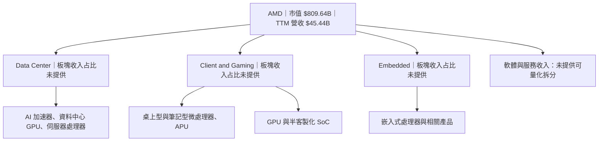
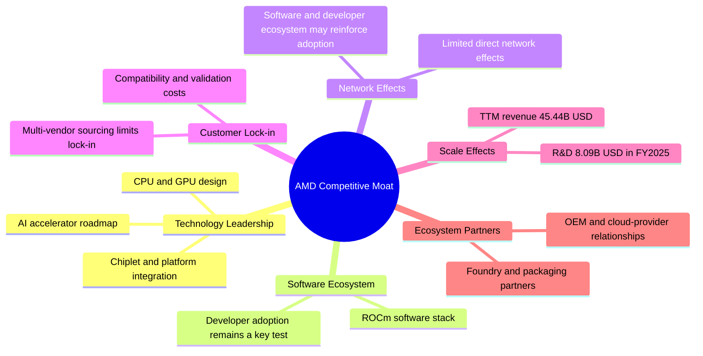
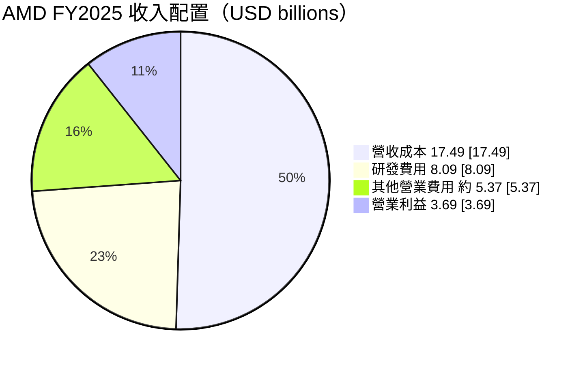
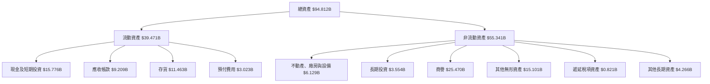
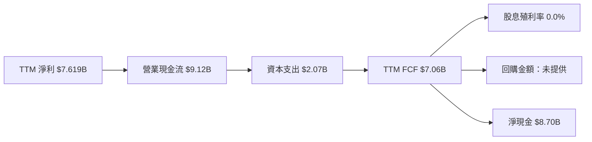
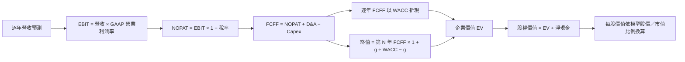
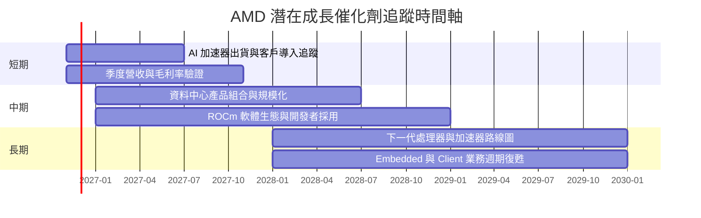
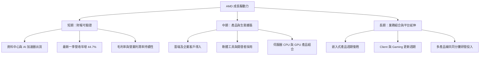
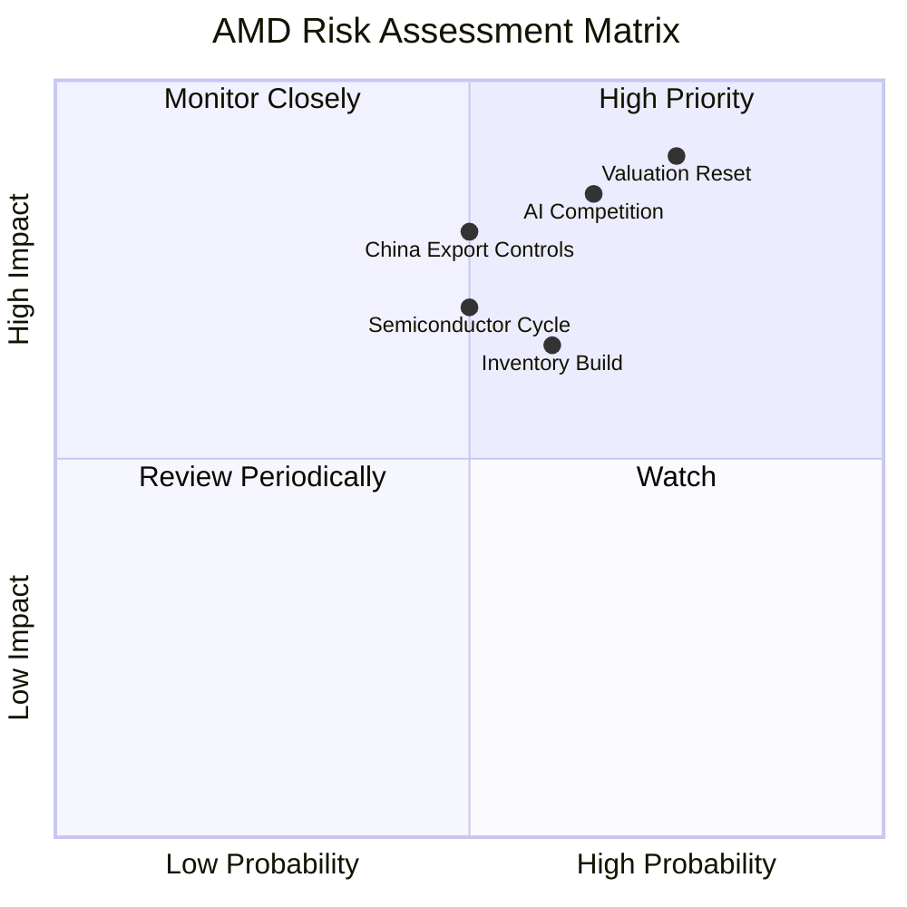
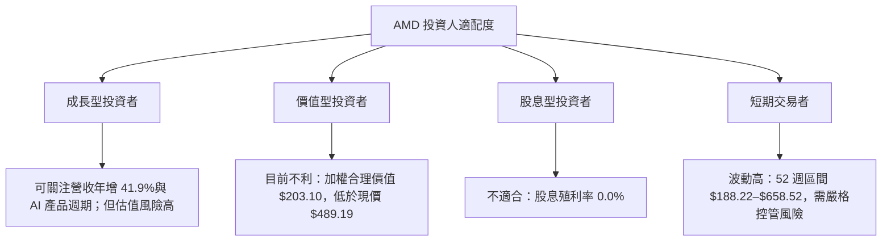

# AMD 基本面深度分析報告
> **報告日期**：2026-11-20 ｜ **語言**：繁體中文 ｜ **數據來源**：SEC 申報資料 (XBRL)、Yahoo Finance、Finviz、StockAnalysis、Roic.ai ｜ **分析師**：CFA 級機構研究

## 目錄

| # | 章節 | 核心結論 |
|---|------|----------|
| 1 | 執行摘要 | 賣出；加權合理價值 $203.10，MOS −140.9% |
| 2 | 公司概覽與商業模式 | 多業務組合與產品能力提供護城河，但各板塊收入占比未提供 |
| 3 | 損益表深度分析 | TTM 營收 $45.44B，年增 41.9%；單季營業利潤率較 TTM 高 |
| 4 | 資產負債表分析 | 淨現金 $8.70B；現金充裕，但存貨與應收帳款均上升 |
| 5 | 現金流量深度分析 | TTM FCF $7.06B、FCF Yield 0.87%；現金流轉換尚可 |
| 6 | 獲利能力與資本效率 | ROIC 12.8% 低於 WACC 14.0%，目前未覆蓋資本成本 |
| 7 | 相對估值分析 | 相對同業及自身歷史均屬高估值區 |
| 8 | DCF 內在價值評估 | DCF 基準每股 $75.54；終值現值占 EV 35.3% |
| 9 | 成長催化劑 | AI 加速器、資料中心及客戶／遊戲產品週期是主要潛在驅動 |
| 10 | 風險矩陣 | 估值、AI 競爭與中國／出口管制為主要風險 |
| 11 | 投資建議 | 依 MOS 評級為賣出；需等待估值與營運指標改善 |

## 1. 執行摘要

### 1.0 一頁式投資儀表板（Portfolio Manager 30 秒速讀）

| 項目 | 內容 |
|------|------|
| **投資論點（3 句）** | ① TTM 營收 $45.44B、年增 41.9%，最新一季營收年增 44.7%，成長動能明確。② TTM FCF $7.06B、淨現金 $8.70B，資產負債表具韌性。③ ROIC 12.8% 低於採用 WACC 14.0%，且加權合理價值 $203.10 遠低於 2026-11-19 收盤價 $489.19。 |
| **綜合評分** | **6.3/10**（引用 1.1 評分卡；六項算術平均） |
| **財務健康** | 🟢 現金及短期投資 $15.78B，總債務 $7.08B，淨現金 $8.70B；但 DIO 為 199 天。 |
| **ROIC vs WACC** | 12.8% vs 14.0%；低 1.2 個百分點，現階段未覆蓋資本成本。 |
| **FCF 趨勢** | TTM FCF $7.06B；FCF Yield 0.87%。年度 FCF 由 2024 年 $2.40B 增至 2025 年 $6.74B。 |
| **估值** | Forward P/E 27.7x ｜ EV/EBITDA（自身歷史區塊）99.9x ｜ FCF Yield 0.87%。 |
| **DCF 內在價值（基準）** | $75.54 ｜ 現價相對 DCF 溢價 **547.7%**（以 DCF 基準價值計算）。 |
| **安全邊際（MOS）** | **−140.9%**＝（加權合理價值 $203.10 − 現價 $489.19）÷ 加權合理價值 $203.10；🔴 無安全邊際。 |
| **預期報酬（基準情境 12M）** | DCF 基準情境 $75.54，相對現價 **−84.6%**；此為模型情境值，不是分析師共識。 |
| **關鍵風險（前二）** | 高估值與成長預期落差；AI 晶片競爭、出口政策與中國曝險。 |
| **評級 + 信心度** | 🔴 **賣出** ｜ 信心：中（估值差距大，但半導體週期與 AI 成長使遠期現金流不確定）。 |

### 1.1 綜合評分卡（全報告唯一）

| 維度 | 評分（1–10） | 主要依據（引用數字與其來源章節） |
|------|--------------|----------------------------------|
| 成長性 | 8.0 | TTM 營收年增 41.9%、最新一季年增 44.7%（第 3 章）；但預測持續性仍有週期風險。 |
| 獲利能力 | 7.0 | TTM 營業利益率 17.7%、ROIC 12.8%、F-Score 7/9（第 3、6 章）；ROIC 低於 WACC。 |
| 財務健康 | 8.0 | 淨現金 $8.70B、現金及短期投資 $15.78B；CCC 138 天（第 4 章）。 |
| 估值 | 1.0 | 加權合理價值 $203.10，MOS −140.9%；P/S 自身歷史百分位 90%（第 7、8 章）。 |
| 護城河 | 8.0 | CPU、GPU、加速器與半客製晶片能力，TTM 營收 $45.44B 且最新一季年增 44.7%；但市占率數字未提供（第 2 章）。 |
| 管理層與資本配置 | 6.0 | 2025 年 SBC $1.64B；稀釋股數測試未通過；未提供完整回購與併購回報資料（第 3、5、6 章）。 |
| **綜合評分** | **6.3** | 六項算術平均： (8.0 + 7.0 + 8.0 + 1.0 + 8.0 + 6.0) ÷ 6 = 6.3。 |

### 1.2 五大投資論點 + 三大核心風險

| 類型 | 項目 | 具體依據 | 信心度 |
|------|------|----------|--------|
| 🟢 **投資論點①** | 營收增長仍快 | TTM 營收 $45.44B，年增 41.9%；最新一季年增 44.7%，顯示需求仍在擴張。 | 🟢 高 |
| 🟢 **投資論點②** | 近期單季獲利改善 | 最新一季營業利益率 21.2%，高於 TTM 17.7%；規模與產品組合可能形成營業槓桿。 | 🟢 中 |
| 🟢 **投資論點③** | 現金流改善 | 2025 年 FCF $6.74B，TTM FCF $7.06B；現金流有能力支持研發與產能／產品投資。 | 🟢 中 |
| 🟢 **投資論點④** | 資產負債表具緩衝 | 現金及短期投資 $15.78B、總債務 $7.08B、淨現金 $8.70B。 | 🟢 高 |
| 🟢 **投資論點⑤** | 多產品線可分散單一週期 | 公司涵蓋資料中心、Client and Gaming、Embedded；但分部營收拆分未提供，無法量化各板塊貢獻。 | 🟡 中 |
| 🟡 **風險①** | 估值與內在價值差距大 | 收盤價 $489.19；加權合理價值 $203.10；DCF 基準 $75.54。 | 🔴 高衝擊 |
| 🔴 **風險②** | ROIC 未達資本成本 | ROIC 12.8% 對比 WACC 14.0%，差距 −1.2 個百分點；若持續，增長未必創造股東價值。 | 🟡 中 |
| 🔴 **風險③** | AI 與出口管制不確定 | 新聞摘要提及中國銷售核准及中國營收曝險爭議；缺乏可核實收入比例，需追蹤實際披露。 | 🔴 高衝擊 |

### 1.3 快速統計卡片

| 指標 | 公司實際值（期間） | 同業中位數 | 狀態 |
|------|--------------------|------------|------|
| 營收成長（TTM） | **41.9%** | — | 🟢 |
| 營收成長（最新一季年增） | **44.7%** | 85.5% | 🟡 |
| 毛利率（TTM） | **56.0%** | 74.9% | 🟡 |
| 營業利益率（TTM） | **17.7%** | — | 🟡 |
| ROIC（TTM） | **12.8%** | — | 🟡 |
| Forward P/E | **27.7x** | 17.9x | 🔴 |
| FCF Yield（TTM） | **0.87%** | — | 🔴 |
| Piotroski F-Score | **7 / 9** | — | 🟢 |

同業中位數按 Peer multiples 區塊中 NVDA、INTC、AVGO 三家公司計算；最新一季營收成長中位數為 85.5%，毛利率中位數為 74.9%，Forward P/E 中位數為 17.9x。

### 1.4 投資結論

> 加權合理價值與 MOS 計算見第 8.8 節；評級依規則 20，沒有作質化調整。

```text
╔══════════════════════════════════════════════════════════════════╗
║                    📊 投資結論摘要                               ║
╠══════════════════════════════════════════════════════════════════╣
║  評級：🔴 賣出（依 MOS 規則，未調整一級）                       ║
║  價格（2026-11-19 收盤）：$489.19                                ║
║  DCF 內在價值（基準）：$75.54（現價溢價 547.7%）                ║
║  安全邊際 MOS：−140.9%（以加權合理價值為分母）                  ║
║  加權合理價值（8.8）：$203.10                                    ║
║  DCF 情境價值：                                                   ║
║    悲觀情境：$40.03（相對現價 −91.8%）                          ║
║    基準情境：$75.54（相對現價 −84.6%）                          ║
║    樂觀情境：$141.10（相對現價 −71.2%）                         ║
║  綜合評分：6.3/10（引用 1.1）                                    ║
║  適合投資人：能承受高波動、長期追蹤半導體週期的成長型投資人；  ║
║              不適合追求股息或低估值的投資人。                    ║
╚══════════════════════════════════════════════════════════════════╝
```

## 2. 公司概覽與商業模式

### 2.1 業務結構與收入來源

公司概覽列出 Data Center、Client and Gaming、Embedded 三個業務板塊，提供 AI 加速器、微處理器、GPU、嵌入式處理器及半客製化 SoC。各板塊最新收入與占比沒有提供，因此不以估計比例繪製。



### 2.2 市場份額

市場份額的可引用數字與年份未提供，因此不製作份額圖表。AMD TTM 營收為 $45.44B、年增 41.9%；同業資料顯示 NVDA 最新一季營收年增 103.2%、AVGO 年增 85.5%，AMD 的增速低於兩者，但仍處高成長區間。

### 2.3 競爭護城河分析



### 2.4 護城河強度

| 護城河項目 | 強度（強／中／弱） | 證據（引用數字或事實） | 會削弱它的情況 |
|------------|--------------------|------------------------|----------------|
| 技術與產品組合 | 強 | 覆蓋 CPU、GPU、AI 加速器與嵌入式處理器；FY2025 研發支出 $8.09B。 | 產品迭代延誤、效能／功耗落後或先進製程供給受限。 |
| 軟體生態系統 | 中 | AI 加速器競爭不只看晶片，也取決於軟體工具與開發者採用；採用規模未提供可比數字。 | 開發者持續偏好競品軟體平台，轉換成本不足。 |
| 客戶鎖定 | 中 | 處理器與加速器須經客戶系統驗證；但大型客戶具多供應商採購能力。 | 客戶採取多源供應或自研晶片。 |
| 規模效應 | 中至強 | TTM 營收 $45.44B、TTM 營業利益率 17.7%。 | 高研發與產品投入未能轉化為持續利潤率。 |
| 生態夥伴 | 中 | 公司依賴晶圓代工、封裝及 OEM／雲端客戶合作；供應鏈議價資料未提供。 | 先進封裝、晶圓供給或主要合作方策略改變。 |
| 網路效應 | 弱至中 | 晶片本身不是典型雙邊網路；軟體與開發者採用可帶來間接正回饋。 | 生態系使用量未達可自我強化的規模。 |

1.1「護城河」評分為 8.0/10，依據是廣泛產品組合、FY2025 $8.09B 研發投入及 TTM $45.44B 營收；分數仍受軟體採用與市占率資料缺漏限制。

## 3. 損益表深度分析

### 3.1 年度收入成長趨勢（近 4 年）

年度營收採年度損益表列值；成長率為依同一來源年度營收計算。2022 至 2025 三年營收 CAGR 約 13.6%，而 TTM 年增 41.9% 反映近期成長高於較長期基準。

```text
╔══════════════════════════════════════════════════════════════════╗
║              AMD 年度收入趨勢（FY2022-FY2025）                  ║
╠══════════════════════════════════════════════════════════════════╣
║  FY2022  $23.60B  ██████████████░░░░░░░░░░░  基準年            ║
║  FY2023  $22.68B  █████████████░░░░░░░░░░░░  YoY: −3.9% 🔴    ║
║  FY2024  $25.79B  ███████████████░░░░░░░░░░  YoY: +13.7% 🟢   ║
║  FY2025  $34.64B  ████████████████████░░░░░  YoY: +34.3% 🟢   ║
╠══════════════════════════════════════════════════════════════════╣
║  FY2022–FY2025 營收 CAGR：約 +13.6%                              ║
║  TTM 營收 $45.44B，TTM 對前一 TTM 成長 +41.9%                   ║
╚══════════════════════════════════════════════════════════════════╝
```

FY2023 營收回落後，FY2024、FY2025 逐年加速；TTM 增長更快，意味近期產品需求與出貨組合改善，但不能直接假設高增長永久延續。

### 3.2 季度收入趨勢分析

| 季度 | 營收 | QoQ 成長 | YoY 成長 | 備註 |
|------|------:|---------:|---------:|------|
| 2025 Q4 | $10.27B | +11.1% | +34.1% | 對比 2025 Q3 $9.246B；季度營收續增。 |
| 2026 Q1 | $10.25B | −0.2% | +37.9% | 季度營收近乎持平，但年增仍高。 |
| 2026 Q2 | $11.54B | +12.5% | +50.1% | 季增加快，年增亦擴大。 |
| 2026 Q3 | $13.38B | +16.0% | +44.7% | 單季創表內新高；年增略低於上一季。 |

QoQ 以相鄰季度營收計算；YoY 以 StockAnalysis 季度資料列示。2026 Q3 年增 44.7% 較 Q2 的 50.1% 放緩，仍須觀察後續基期與產品組合。

### 3.3 利潤率演變分析

| 利潤率指標 | FY2022 | FY2023 | FY2024 | FY2025 | 趨勢 | 評估 |
|------------|--------:|--------:|--------:|--------:|------|------|
| **毛利率** | 44.9% | 46.1% | 49.3% | 49.5% | FY2022–FY2025 上升；年度毛利數據與 TTM 口徑不同。 | 🟡 |
| **營業利益率** | 5.3% | 1.8% | 8.1% | 10.7% | FY2023 下滑後回升；TTM 為 17.7%。 | 🟢 |
| **淨利率** | 5.6% | 3.8% | 6.4% | 12.5% | FY2025 改善；TTM 品質指標為 16.8%。 | 🟢 |

年度毛利率按年度損益表毛利與營收計算。另有 StockAnalysis 年度毛利數列與上述年度表不完全一致；此處依年度損益表列值計算，分析 TTM 時則採用指定的 56.0%。

**利潤率演變深度解析**：FY2023 營業利益降至 $0.401B、營收降至 $22.68B，營業利益率約 1.8%；FY2024、FY2025 營業利益分別回升至 $2.09B、$3.69B。TTM 營業利益率 17.7% 高於 FY2025 年度比例，反映最近四季獲利改善。可能驅動因素包括營收規模擴大、產品組合轉佳及費用槓桿；但分部利潤率與價格／產品成本資料未提供，不能把改善全歸因於單一板塊。

### 3.4 費用結構分析

以下採 FY2025 年度損益表列值；「其他營業費用」為以營收扣除營收成本、研發費用與營業利益所得的殘差，作為分類近似值。



```text
╔══════════════════════════════════════════════════════════════════╗
║                  FY2025 費用與營業利益結構                       ║
╠══════════════════════════════════════════════════════════════════╣
║  營收成本        $17.49B  █████████████████████                  ║
║  研發費用         $8.09B  ██████████                             ║
║  其他營業費用約   $5.37B  ███████                                ║
║  營業利益         $3.69B  █████                                  ║
╚══════════════════════════════════════════════════════════════════╝
```

### 3.5 季度 EPS 趨勢與盈餘品質（Quality of Earnings）

| 季度 | EPS 實際值 | YoY 成長 | EPS 預期／驚喜 |
|------|-----------:|---------:|---------------|
| 2025 Q4 | $0.92 | +217.1% | 預估值 N/A；無法判定是否超預期。 |
| 2026 Q1 | $0.84 | +91.2% | 預估值 N/A；無法判定是否超預期。 |
| 2026 Q2 | $1.39 | +159.5% | 預估值 N/A；無法判定是否超預期。 |
| 2026 Q3 | $1.48 | +93.8% | 預估值 N/A；無法判定是否超預期。 |

最近四季 EPS 實際值呈現 2026 Q1 回落、Q2 和 Q3 回升。EPS Est／EPS Act 欄位為 nan，故不能據此聲稱任何一季「超預期」或「不及預期」；成長率可能受到比較基期影響。

| 盈餘品質項目 | 數值／佔比 | 評估 |
|--------------|-----------|------|
| 股權薪酬 SBC / 營收 | 約 4.4%（四個季度 SBC 合計約 $2.00B ÷ TTM 營收 $45.44B） | 🟡 SBC 是實質股東成本；比重不低，會稀釋每股經濟利益。 |
| SBC / 營業現金流 | 約 21.9%（約 $2.00B ÷ $9.12B） | 🟡 相當於 TTM OCF 約五分之一，稀釋成本需持續監測。 |
| FCF / 淨利（現金轉換率） | 約 92.7%（$7.06B ÷ TTM 淨利 $7.619B） | 🟢 現金流接近淨利，獲利有現金支持；分母採 StockAnalysis TTM 淨利。 |
| 一次性／非經常性損益 | N/A（缺乏可比的 TTM 一次性項目明細） | 🟡 不能量化一次性收益對獲利的影響。 |
| 有效稅率異常 | N/A（未提供 TTM 實際有效稅率） | 🟡 DCF 採用 21.0% 稅率，並非對實際稅率的判定。 |
| 資本化支出 vs 費用化 | TTM Capex $2.07B；研發費用 FY2025 $8.09B | 🟡 研發以費用列示；資本化支出的完整會計細節未提供。 |

**盈餘品質結論**：TTM FCF／淨利約 92.7%，顯示獲利有現金流支持；但 SBC 約占 TTM OCF 21.9%，股東成本不可忽略。由於非經常性項目及實際有效稅率明細缺漏，不能判定 GAAP 淨利存在顯著高估或低估；估值時應避免把 SBC 當作免費的非現金項目。

## 4. 資產負債表分析

### 4.1 資產結構分解

採 2026 年 9 月最新資產負債表：總資產 $94.812B，流動資產 $39.471B，非流動資產為兩者差額 $55.341B。



流動資產細項加總為 $39.471B；非流動資產細項加總為 $55.341B。商譽與無形資產約占總資產較大比例，未來若收購資產產生減損，會影響會計盈餘，但不會直接等同當期現金流出。

### 4.2 流動性與營運資金分析

| 指標 | 最新 TTM | 一年前 TTM | 變化 | 解讀 |
|------|----------|------------|------|------|
| DSO 應收帳款天數 | 74 天 | 71 天 | +3 天 | 收款週期略拉長，可能與營收規模、客戶組合或付款條件相關；需檢查應收帳款是否快於營收增長。 |
| DIO 存貨天數 | 199 天 | 161 天 | +38 天 | 庫存天數上升，可能反映備貨、產品轉換或需求預判；若出貨不如預期，存在存貨減值與現金占用風險。 |
| DPO 應付帳款天數 | 135 天 | 77 天 | +58 天 | 延長付款天數釋放營運資金，但需確認是否來自正常供應商條款，而非付款壓力。 |
| CCC 現金轉換週期 | 138 天 | 155 天 | −17 天 | CCC 改善，主要與 DPO 大幅增加有關；不代表存貨周轉已改善。 |

流動比率 2.725、速動比率 1.725，反映短期流動性充足；但存貨由 FY2025 年底 $7.920B 增至 2026 年 9 月 $11.463B，應與收入增速、產品上市節奏同步監控。

### 4.3 債務結構分析

本節採用指定 TTM 財務數據：總債務 $7.08B、現金及短期投資 $15.78B、淨現金 $8.70B。其他彙整資料出現總債務 $9.21B 與淨現金 $6.57B 的不同口徑；為保持一致，以下均依指定的最新 SEC 10-Q 口徑。

```text
╔══════════════════════════════════════════════════════════════════╗
║                   AMD 債務健康診斷                               ║
╠══════════════════════════════════════════════════════════════════╣
║  總債務：        $7.08B   ███████░░░░░░░░░░░░░  可控            ║
║  現金+短期投資： $15.78B  ████████████████░░░░  充裕            ║
║  淨現金：        $8.70B   █████████░░░░░░░░░░░  🟢              ║
║                                                                  ║
║  Debt/EBITDA：   約 0.64x（依 TTM EBITDA margin 24.5% 推算）     ║
║  利息保障倍數：  N/A（利息費用／EBIT 明細未提供）                ║
║  流動比率：      2.725x                                            ║
║  速動比率：      1.725x                                            ║
╚══════════════════════════════════════════════════════════════════╝
```

Debt/EBITDA 約 0.64x 的 EBITDA 以 TTM 營收 $45.44B × EBITDA margin 24.5% 推算，約 $11.13B；因口徑來源不同，此比率視為近似值，不替代公司正式披露。

### 4.4 股東權益趨勢

| 年度 | 股東權益 | YoY 變化 | 解讀 |
|------|---------:|---------:|------|
| 2022 | $54.75B | — | 歷史基準。 |
| 2023 | $55.89B | +2.1% | 小幅增加。 |
| 2024 | $57.57B | +3.0% | 盈餘與股東權益累積。 |
| 2025 | $63.00B | +9.4% | 增幅加快；仍須考慮 SBC 對每股權益的稀釋。 |

```text
╔══════════════════════════════════════════════════════════════════╗
║                  AMD 股東權益趨勢（USD billions）                ║
╠══════════════════════════════════════════════════════════════════╣
║  2022  $54.75B  █████████████████                                ║
║  2023  $55.89B  ██████████████████                               ║
║  2024  $57.57B  ███████████████████                              ║
║  2025  $63.00B  ████████████████████                             ║
╚══════════════════════════════════════════════════════════════════╝
```

## 5. 現金流量深度分析

### 5.1 現金流量瀑布圖

TTM 淨利使用 StockAnalysis TTM $7.619B；營業現金流 $9.12B、Capex $2.07B、FCF $7.06B 採指定口徑。表中現金流各數字經四捨五入後可能有 $0.01B 差異。



### 5.2 FCF 轉換率趨勢

| 年度 | FCF | 淨利 | FCF / 淨利 | 評估 |
|------|----:|-----:|-----------:|------|
| 2022 | $3.12B | $1.32B | 236.4% | 🟢 現金流高於淨利，但單年比率可能受營運資金變動影響。 |
| 2023 | $1.12B | $0.854B | 131.1% | 🟢 仍高於 100%，但絕對 FCF 下滑。 |
| 2024 | $2.40B | $1.64B | 146.3% | 🟢 轉換率保持正向。 |
| 2025 | $6.74B | $4.33B | 155.7% | 🟢 淨利與現金流同步提升。 |
| TTM | $7.06B | $7.619B | 92.7% | 🟡 轉換率略低於 100%，但現金流規模仍大。 |

### 5.3 自由現金流趨勢

| 期間 | FCF | FCF Yield | 解讀 |
|------|----:|----------:|------|
| FY2022 | $3.12B | N/A | 市值期間資料未提供，避免反推。 |
| FY2023 | $1.12B | N/A | 獲利與現金流較低。 |
| FY2024 | $2.40B | N/A | 現金流回升。 |
| FY2025 | $6.74B | N/A | 年度 FCF 明顯擴大。 |
| TTM | $7.06B | 0.87% | 對照 $809.64B 市值，現金流收益率偏低。 |

```text
╔══════════════════════════════════════════════════════════════════╗
║             AMD 自由現金流：歷史實際（USD billions）             ║
╠══════════════════════════════════════════════════════════════════╣
║  FY2023  $1.12B  ███                                               ║
║  FY2024  $2.40B  ██████                                            ║
║  FY2025  $6.74B  █████████████████                                 ║
║  TTM     $7.06B  ██████████████████  FCF Yield 0.87%               ║
╚══════════════════════════════════════════════════════════════════╝
```

### 5.4 資本配置評估

回購金額與投資支出分類未提供，故不以未披露比例繪製資本配置圓餅圖。

| 資本配置項目 | 可觀察數據 | 評估 |
|--------------|------------|------|
| 研發投資 | FY2025 $8.09B | 研發支出為產品競爭力核心投入；需追蹤能否形成營收與毛利。 |
| Capex | TTM $2.07B | 相對 TTM 營收約 4.6%；資產負債表固定資產投資需與供應鏈／封裝需求配合。 |
| 股息 | 殖利率 0.0% | 公司未以現金股息作為主要股東回報方式。 |
| 回購 | 金額與股數變化明細未完整提供 | Piotroski 稀釋股數測試未通過，需追蹤 SBC 與回購的淨效果。 |
| 留存現金 | 現金及短期投資 $15.78B | 提供投資與周期緩衝；資本配置回報率仍是關鍵。 |

## 6. 獲利能力與資本效率

### 6.1 ROE / ROA / ROIC 趨勢

| 指標 | 歷史年度 | 最新 TTM | 評估 |
|------|----------|---------:|------|
| ROE | 年度可比序列未提供 | 11.1% | 依品質指標 DuPont 口徑；另一彙整來源列示 12.0%，此處採指定品質指標值。 |
| ROA | 年度可比序列未提供 | 5.9% | 正值且 Piotroski 測試通過；但資產使用效率應與無形資產／商譽規模一起觀察。 |
| ROIC | 年度可比序列未提供 | 12.8% | 低於 WACC 14.0%，當前資本回報尚未覆蓋資本成本。 |

未提供可信的行業均值，故不列行業均值欄。ROIC 的計算口徑為稅後營業利益除以股東權益加債務減現金。

### 6.2 ROIC vs WACC 分析（核心價值創造判斷）

```text
╔══════════════════════════════════════════════════════════════════╗
║                ROIC vs WACC 深度分析                            ║
╠══════════════════════════════════════════════════════════════════╣
║  WACC（採用值）：14.00%                                         ║
║  ├── 無風險利率（10Y 美債）：5.05%                              ║
║  ├── 市場風險溢酬 ERP：5.00%                                    ║
║  ├── Beta 原始值：2.54；調整後採用值：2.00                      ║
║  ├── 股權成本：5.05% + 2.00 × 5.00% = 15.05%                   ║
║  ├── 稅前債務成本：1.85%；稅後約 1.46%                          ║
║  ├── 股權／債務權重：99.1%／0.9%                                ║
║  └── WACC 計算值 14.93%，受 14% 上限限制，採用 14.00%           ║
║                                                                  ║
║  ROIC：12.8%                                                     ║
║  ├── EVA Spread = ROIC − WACC                                    ║
║  └── 12.8% − 14.0% = −1.2 個百分點                               ║
║                                                                  ║
║  ROIC  12.8%  ▓▓▓▓▓▓▓▓▓▓▓▓▓░░░░░░░░░░░░░░░░░░  🔴              ║
║  WACC  14.0%  ▓▓▓▓▓▓▓▓▓▓▓▓▓▓░░░░░░░░░░░░░░░░░░  ──              ║
║                                                                  ║
║  結論：以目前 TTM 回報率衡量，ROIC 低於 WACC 1.2pp，             ║
║        尚未創造超出資本成本的經濟價值。                           ║
╚══════════════════════════════════════════════════════════════════╝
```

Beta 採調整後 2.00；原始 Beta 2.54 經 \(⅔×2.54+⅓=2.03\) 調整後受 0.6–2.0 區間上限限制。此處 WACC 依指定計算值 14.93% 受 7%–14% 範圍限制，採用 14.00%；第 8.2 節沿用同一折現率。

### 6.3 杜邦三因素分解

| 因素 | 數值（TTM） | 解讀 |
|------|-------------|------|
| 淨利率 | 16.8% | 獲利能力是 ROE 的主要正向來源。 |
| 資產週轉率 | 0.48 | 每單位資產創造的營收有限，與半導體高研發、無形資產及併購資產結構相關。 |
| 權益乘數 | 1.39 | 槓桿程度不高；ROE 不是主要靠財務槓桿撐起。 |
| **ROE** | **11.1%** | 16.8% × 0.48 × 1.39 = 約 11.1%（按公布數值四捨五入）。 |

### 6.4 財務體質：Piotroski F-Score

Piotroski F-Score 為 **7/9**；一項輸入缺失時測試分母可能低於九項，本期九項均有列示。

| 測試 | 結果 | 解讀 |
|------|------|------|
| ROA > 0 | ✅ 通過 | TTM ROA 為正。 |
| 營業現金流 > 0 | ✅ 通過 | TTM OCF $9.12B。 |
| ROA 高於一年前 | ✅ 通過 | 資產獲利能力改善。 |
| 營業現金流 > 淨利（應計品質） | ✅ 通過 | 現金流高於同期淨利口徑。 |
| 長期負債 ÷ 總資產低於一年前 | ❌ 未通過 | 負債比率未改善，應留意資產負債表趨勢。 |
| 流動比率高於一年前 | ✅ 通過 | 最新流動性相對改善。 |
| 稀釋股數未增加 | ❌ 未通過 | SBC 或股權發行可能造成股東稀釋。 |
| 毛利率高於一年前 | ✅ 通過 | 毛利率同比改善。 |
| 資產週轉率高於一年前 | ✅ 通過 | 資產使用效率改善。 |

## 7. 相對估值分析

### 7.1 同業估值比較表格

公司 TTM P/E 與 EV/EBITDA 採自身歷史估值區塊所列數據；同業倍數依 Yahoo Finance Peer multiples。由於不同資料源倍數口徑可能不同，不將同業倍數直接視為精確可比的價值結論。

| 估值指標 | **AMD** | **NVDA** | **INTC** | **AVGO** | AMD 評估 |
|----------|--------:|---------:|---------:|---------:|-----------|
| **Trailing P/E** | 106.3x | 15.7x | N/A | 44.3x | 🔴 明顯高於有數值的兩家同業。 |
| **Forward P/E** | 27.7x | 8.8x | 31.1x | 17.9x | 🔴 高於同業中位數 17.9x。 |
| **P/S Ratio** | 17.9x | 9.7x | 4.9x | 18.6x | 🔴 高於中位數 9.7x，僅低於 AVGO。 |
| **EV/EBITDA** | 99.9x | 14.2x | 16.1x | 32.3x | 🔴 自身歷史區塊數值遠高於同業。 |
| **最新一季營收年增** | 44.7% | 103.2% | 20.9% | 85.5% | 🟡 AMD 成長為正，但低於 NVDA、AVGO。 |
| **毛利率（TTM）** | 56.0% | 74.9% | 40.2% | 75.5% | 🟡 高於 INTC，低於 NVDA、AVGO。 |

同業 Forward P/E 中位數為 17.9x；AMD Forward P/E 27.7x，表示市場已為未來盈利成長支付較高倍數。Peer multiples 區塊 NVDA P/E 數據與部分市場彙整口徑不一致，表內遵循指定 Peer multiples 數值。

### 7.2 歷史估值區間分析

```text
╔══════════════════════════════════════════════════════════════════╗
║                AMD 近五年 TTM P/E 估值位置                      ║
╠══════════════════════════════════════════════════════════════════╣
║  歷史低位：36.7x  ───────────────────────────────────────────   ║
║  歷史中位數：82.6x ──────────────────────────●──────────────   ║
║  當前：106.3x（百分位 53%）                                     ║
║  歷史高位：934.7x ───────────────────────────────────────────  ║
║                                                                  ║
║  P/S：當前 17.9x｜中位數 8.9x｜百分位 90%                       ║
║  EV/EBITDA：當前 99.9x｜中位數 102.2x｜百分位 50%               ║
╚══════════════════════════════════════════════════════════════════╝
```

P/E 當前高於中位數，但百分位 53% 表示仍接近自身五年區間中段，原因是歷史極端高值拉寬區間；P/S 百分位 90% 則較明確位於自身歷史高估值區。

### 7.3 情境價值（Bear / Base / Bull，照抄 DCF MODEL 的 Scenarios）

| 情境 | 第 1 年營收成長 | 期末營業利潤率 | WACC | 每股價值 | 相對現價 | 機率 | 會發生的條件 |
|------|----------------|----------------|------|----------:|----------:|-----:|--------------|
| 🔴 悲觀 | 15.0% | 6.3% | 15.00% | $40.03 | −91.8% | 25% | AI 加速器增長不及預期、競爭壓低毛利，且折現率維持高位。 |
| 🟡 基準 | 30.0% | 7.4% | 14.00% | $75.54 | −84.6% | 50% | 近期高成長逐步回落，營業利潤率向歷史中位數收斂。 |
| 🟢 樂觀 | 45.0% | 8.1% | 13.00% | $141.10 | −71.2% | 25% | 新產品需求擴大、研發轉化有效，且資本成本下降。 |

### 7.4 相對估值隱含價格區間

```text
╔══════════════════════════════════════════════════════════════════╗
║             相對估值與方法估值（每股，美元）                     ║
╠══════════════════════════════════════════════════════════════════╣
║  DCF 基準           $75.54                                        ║
║  同業 EV/EBITDA    $113.49                                        ║
║  同業 Forward P/E  $314.94                                        ║
║  現價               $489.19                                       ║
║  分析師共識         $657.74                                       ║
╚══════════════════════════════════════════════════════════════════╝
```

- **同業 Forward P/E：$314.94**＝同業中位數 17.9x × AMD Forward EPS $17.64。
- **同業 EV/EBITDA：$113.49**＝同業中位數 16.1x × TTM EBITDA，再加回淨現金。
- 分析師共識平均目標價 $657.74，來自 49 位分析師；該值是市場預期參考，不等同內在價值。

## 8. DCF 內在價值評估（Discounted Cash Flow）

### 8.0 估值推理鏈（Thinking Logic）

**Step 1 — 價值由哪些變數決定？**

AMD 的價值主要取決於既有處理器與嵌入式業務現金流、資料中心與 AI 加速器增長，以及長期營業利潤率能否維持。各板塊營收占比未提供，不能把其中任一項假定為已知比例。模型中最主導估值的變數是 WACC 與長期現金流／利潤率；指定敏感度矩陣顯示基準 WACC 14%、g 3% 時每股 $75.54，WACC 升至 16%、g 仍為 3% 時降至 $64.65。

**Step 2 — 模型選擇**

| 決策點 | 本報告採用 | 理由（含數字） | 曾考慮但否決 | 否決理由 |
|--------|-----------|----------------|--------------|----------|
| 現金流定義 | FCFF | 與 WACC 折現並先求 EV；公司淨現金 $8.70B。 | FCFE | 需另處理融資現金流及股權成本，與既有模型不一致。 |
| 預測期 N | 10 年 | DCF 模型固定列示 FY+1 至 FY+10。 | 5 年 | 不符合既有模型週期設定；不自行改動模型。 |
| 終值方法 | Gordon Growth | 模型已提供終值 $152.04B、現值 $41.01B。 | 退出倍數 | DCF 模型未提供退出倍數終值，不另建模型。 |
| EBIT 基礎 | GAAP EBIT | 模型明示 GAAP EBIT；與指定 DCF 模型一致。 | 非 GAAP EBIT | 會改動模型假設與 SBC 處理。 |

**Step 3 — 關鍵假設推導鏈**

- **營收增長**：錨點＝TTM 成長率 41.9%；調整＝基期已快速增長且 10 年模型需逐步成熟；**採用第一年 30.0%，線性下降至第十年 3.0%**；曾考慮維持 41.9%，但否決，因高成長不宜無限期延續。
- **期末營業利潤率**：錨點＝TTM 17.7%；調整＝模型依近五個財年中位數逐年收斂；**第十年採 7.4%**；曾考慮持續維持 17.7%，但否決，因模型採成熟期利潤率而非當前單一高點。
- **永續成長率 g**：錨點＝長期經濟成長假設；可用資料未提供精確長期名目 GDP 數字；**採用模型指定 3.0%**；曾考慮高於 3.0%，但否決，以避免過度抬高終值，且 3.0% 低於 WACC 14.0%。
- **預測期 N**：錨點＝模型預設 10 年；調整＝不更改程式模型設定；**採用 10 年**；曾考慮縮短，但否決，因無可直接替代的模型輸出。
- **Capex／營收**：錨點＝TTM 約 4.5%（模型值）；**採用 4.5%**，模型未逐年改動；曾考慮更低比率，但缺乏可引用依據。
- **WACC**：錨點＝CAPM 與資本結構計算 14.93%；調整＝依指定 7%–14% 上限採用 **14.00%**；曾考慮不設上限的 14.93%，但依模型指定限制不採用。
- **EBIT 與 SBC**：錨點＝GAAP EBIT 已將 SBC 列為費用；**採用組合 (A)：GAAP EBIT、FCFF 不再扣 SBC、固定股數不再稀釋**；曾考慮另扣 SBC 或放大股數，但否決，避免重複計算同一成本。
- **D&A／營收**：錨點＝TTM 6.7%；採用 6.7% 固定。
- **稅率**：錨點＝模型預設 21.0%；採用 21.0%，不是實際 TTM 稅率判定。
- **營運資金**：模型未建模 Working Capital；不自行加入 ΔWC。
- **終值方法**：錨點＝程式模型採 Gordon Growth；採用該終值；退出倍數交叉驗證數值未提供，故不自建替代值。

**Step 4 — 最脆弱假設**

最脆弱之處是 10 年營收成長與利潤率路徑；如果實際增長顯著低於模型起始值或競爭令利潤率更快收縮，估值將低於 $75.54 基準值。反之，即使樂觀情境模型值也僅 $141.10，仍低於現價 $489.19。

**Step 5 — 計算路徑**



### 8.1 模型假設總表（Model Inputs）

| 假設項目 | 採用值 | 依據／來源 | 敏感度 |
|----------|--------|-------------|--------|
| 預測期長度 N | 10 年 | DCF 模型預測 FY+1 至 FY+10。 | 🟡 中 |
| 營收成長 | 第 1 年 30.0%，第 10 年 3.0%，逐年線性遞減 | TTM 成長 41.9%；模型限制首年最高 30.0%，再逐步成熟。 | 🔴 高 |
| 營業利潤率 | 17.7% 降至 7.4% | TTM 營業利益率 17.7%；第十年採近五財年中位數。 | 🔴 高 |
| 有效稅率 | 21.0% | DCF 模型預設；實際 TTM 稅率未提供。 | 🟢 低 |
| Capex / 營收 | 第 1 年至第 10 年均為 4.5% | 模型採 TTM 比率並固定。 | 🟡 中 |
| D&A / 營收 | 6.7% | 模型採 TTM 比率並固定。 | 🟢 低 |
| 營運資金變動 | 未建模 | DCF 模型明示 Working Capital is not modelled。 | 🟢 低 |
| EBIT 基礎 | GAAP | DCF 模型指定 GAAP EBIT。 | 🟡 中 |
| SBC 處理 | 組合 (A)：GAAP EBIT 已含 SBC，不再扣 SBC | 模型指定 SBC already an expense。 | 🟡 中 |
| 年稀釋率 | 0%；固定股數口徑 | 配合組合 (A)，避免將 SBC 再以股數稀釋扣一次。 | 🟡 中 |
| 永續成長率 g | 3.0% | DCF 模型指定；低於 WACC。 | 🔴 高 |
| 終值方法 | Gordon Growth | DCF 模型提供 Gordon Growth 終值。 | 🔴 高 |
| WACC | 14.00% | 計算值 14.93%，受 7%–14% 上限限制。 | 🔴 高 |

**FCFF 定義**：採用模型定義 `FCFF = NOPAT + D&A − Capex`；模型不含營運資金變動列。本模型採用 **(A)**，故 SBC 影響已透過 GAAP EBIT 計入一次，不再扣除 SBC，也不再另加年稀釋率。

### 8.2 折現率推導（WACC）

Rf 數據提供值為 5.05%，日期未明確標示；ERP 5.00% 為假設值。Beta 原始值 2.54 來自 Yahoo Finance，調整後採用值 2.00。未加計規模或國別溢酬，因模型未提供該項假設。

```text
╔══════════════════════════════════════════════════════════════════╗
║                    WACC 推導（折現率）                           ║
╠══════════════════════════════════════════════════════════════════╣
║  股權成本 Ke（CAPM）：                                           ║
║  ├── 無風險利率 Rf：5.05%                                       ║
║  ├── ERP：5.00%（假設值，依 Cost of capital 指定）               ║
║  ├── 原始 Beta：2.54；調整後 Beta：2.00                         ║
║  ├── 規模／國別溢酬：0.00%（模型未提供，未另加）                 ║
║  └── Ke = 5.05% + 2.00 × 5.00% = 15.05%                         ║
║                                                                  ║
║  債務成本 Kd：                                                    ║
║  ├── 稅前 Kd：1.85%（指定數值；利息／債務口徑）                  ║
║  ├── 稅率：21.0%                                                 ║
║  └── 稅後 Kd = 1.85% × (1 − 21.0%) = 1.46%                     ║
║                                                                  ║
║  資本結構：                                                       ║
║  ├── 股權權重：99.1%                                             ║
║  ├── 債務權重：0.9%                                              ║
║  ├── 計算值 = 99.1% × 15.05% + 0.9% × 1.46% = 14.93%           ║
║  └── 範圍限制：14.93% 高於 14% 上限，故採用 WACC = 14.00%       ║
╚══════════════════════════════════════════════════════════════════╝
```

逐步演算：

1. **Ke（CAPM）** = 5.05% + 2.00 × 5.00% + 0.00% = **15.05%**。調整後 Beta 的算式為 \(⅔×2.54+⅓=2.03\)，依指定 0.6–2.0 區間採用 2.00。
2. **稅前 Kd** = 指定債務成本 **1.85%**。利息費用及平均計息負債明細未提供，故不自行反推或重建其分子、分母。
3. **稅後 Kd** = 1.85% × (1 − 21.0%) = **1.46%**。
4. **權重** = 股權 99.1%，債務 0.9%；兩者合計 **100.0%**。權重採用指定 Cost of capital 數值，並非使用帳面股東權益替代市值。
5. **WACC 計算值** = 99.1% × 15.05% + 0.9% × 1.46% = 14.91455% + 0.01314% = **14.92769%**；按模型上限限制，採用 **14.00%**。

### 8.3 逐年自由現金流預測（基準情境）

金額為 USD billions；折現因子三位小數。原模型未建模 ΔWC，表格依模型不列該項。括號表示減項。各格來自程式計算，表內四捨五入至兩位小數。

| 年度 | FY+1 | FY+2 | FY+3 | FY+4 | FY+5 | FY+6 | FY+7 | FY+8 | FY+9 | FY+10 |
|------|-----:|-----:|-----:|-----:|-----:|-----:|-----:|-----:|-----:|------:|
| 營收 | 59.07 | 75.01 | 93.02 | 112.55 | 132.81 | 152.73 | 171.06 | 186.46 | 197.64 | 203.57 |
| 營收 YoY | 30.0% | 27.0% | 24.0% | 21.0% | 18.0% | 15.0% | 12.0% | 9.0% | 6.0% | 3.0% |
| 營業利潤率 | 17.7% | 16.6% | 15.4% | 14.3% | 13.1% | 12.0% | 10.8% | 9.7% | 8.5% | 7.4% |
| GAAP EBIT | 10.46 | 12.43 | 14.34 | 16.06 | 17.42 | 18.28 | 18.51 | 18.03 | 16.84 | 15.00 |
| − 稅（21.0%） | (2.20) | (2.61) | (3.01) | (3.37) | (3.66) | (3.84) | (3.89) | (3.79) | (3.54) | (3.15) |
| = NOPAT | 8.27 | 9.82 | 11.33 | 12.69 | 13.76 | 14.44 | 14.62 | 14.24 | 13.30 | 11.85 |
| + D&A | 3.96 | 5.03 | 6.24 | 7.55 | 8.90 | 10.24 | 11.47 | 12.50 | 13.25 | 13.65 |
| − Capex | (2.69) | (3.41) | (4.23) | (5.12) | (6.04) | (6.95) | (7.78) | (8.48) | (8.99) | (9.26) |
| **= FCFF** | **9.54** | **11.43** | **13.33** | **15.11** | **16.63** | **17.73** | **18.31** | **18.26** | **17.56** | **16.24** |
| 折現因子 @14.0% | 0.877 | 0.769 | 0.675 | 0.592 | 0.519 | 0.456 | 0.400 | 0.351 | 0.308 | 0.270 |
| **FCFF 現值 PV** | **8.37** | **8.80** | **9.00** | **8.95** | **8.63** | **8.08** | **7.32** | **6.40** | **5.40** | **4.38** |

預測期 PV 按顯示精度逐項加總：  
`$8.37 + $8.80 + $9.00 + $8.95 + $8.63 + $8.08 + $7.32 + $6.40 + $5.40 + $4.38 = $75.33B`。  
模型使用未四捨五入數值的總和為 **$75.32B**；兩者差 $0.01B，屬顯示精度尾差。

**逐步演算（FY+1）**：

1. **營收** = TTM 營收 $45.44B × (1 + 30.0%) = $59.072B，四捨五入 **$59.07B**。
2. **EBIT** = $59.07B × 17.7% = $10.45539B，模型未四捨五入值四捨五入為 **$10.46B**。
3. **稅** = EBIT × 21.0%；以未四捨五入 EBIT 計算約 $2.1956B，列示 **$2.20B**。
4. **NOPAT** = EBIT − 稅；模型列示 **$8.27B**。逐項以表中已四捨五入數相減可能出現 $0.01B 尾差。
5. **D&A** = 營收 × 6.7%；模型列示 **$3.96B**。
6. **Capex** = 營收 × 4.5%；模型列示 **$2.69B**。
7. **ΔWC** = **不建模**，因此不填入或估算該項。
8. **FCFF** = NOPAT + D&A − Capex = 模型未四捨五入計算後列示 **$9.54B**。
9. **折現因子** = 1 ÷ (1 + 14.00%)¹ = **0.877**；PV = $9.54B × 0.877（未四捨五入折現因子）= **$8.37B**。

**合理性自檢**

- 預測 FCFF 由 FY+1 $9.54B 增至 FY+10 $16.24B，九年間 CAGR 約 6.1%；年度歷史 FCF 2023–2025 由 $1.12B 增至 $6.74B，約兩年 CAGR 145.4%，但低基期令歷史 CAGR 不宜直接外推。
- FY+10 FCFF 利潤率 = $16.24B ÷ $203.57B = 約 8.0%；目前 TTM FCF margin = $7.06B ÷ $45.44B = 約 15.5%。模型預期成熟期現金流率低於目前 TTM。
- 模型十年 FCFF 均為正；未建模營運資金，因而對營運資金占用風險可能偏樂觀。

```text
╔══════════════════════════════════════════════════════════════════╗
║            自由現金流：歷史實際 vs 模型預測                      ║
╠══════════════════════════════════════════════════════════════════╣
║  FY2023(實)  $1.12B  ██░░░░░░░░░░░░░░░░░░                       ║
║  FY2024(實)  $2.40B  █████░░░░░░░░░░░░░░                       ║
║  FY2025(實)  $6.74B  ██████████████░░░░░                       ║
║  FY+1 (預)   $9.54B  ████████████████████                       ║
║  FY+10(預)  $16.24B  ██████████████████████████████              ║
╠══════════════════════════════════════════════════════════════════╣
║  模型成熟期現金流率低於目前 TTM；但未建模營運資金，為一項限制。 ║
╚══════════════════════════════════════════════════════════════════╝
```

### 8.4 終值計算（Terminal Value）

**適用性檢查**：`WACC 14.0% vs g 3.0% → WACC > g？✅`

| 方法 | 計算式 | 終值 TV | TV 現值 | 佔總 EV 比重 |
|------|--------|---------:|--------:|-------------:|
| Gordon Growth | FCFF(FY+10) × (1+g) ÷ (WACC−g) | $152.04B | $41.01B | 35.3% |
| 退出倍數法 | N/A（DCF 模型未提供該方法數值） | N/A | N/A | N/A |

逐步演算：

1. **FY+N FCFF** = FY+10 FCFF **$16.24B**。
2. **分子** = $16.24B × (1 + 3.0%)；模型依未四捨五入輸入計算，列示終值為 **$152.04B**。
3. **分母** = 14.00% − 3.00% = **11.00%**；終值依模型未四捨五入輸入計算為 **$152.04B**。
4. **PV(TV)** = $152.04B × FY+10 折現因子 0.270 = **$41.01B**（使用未四捨五入折現因子）。
5. **終值佔比** = $41.01B ÷ $116.33B = **35.3%**。

終值現值占 EV 35.3%，低於 75% 警示門檻；終值仍對長期假設敏感，但企業價值不完全由終值主導。退出倍數值未提供，不能自行新增。

### 8.5 企業價值 → 每股內在價值（Bridge）

```text
╔══════════════════════════════════════════════════════════════════╗
║              企業價值 → 每股內在價值 橋接表                      ║
╠══════════════════════════════════════════════════════════════════╣
║  預測期 FCF 現值合計            +$75.32B                         ║
║  終值現值 PV(TV)                +$41.01B                         ║
║  ─────────────────────────────────────────────                  ║
║  = 企業價值 EV                   $116.33B                        ║
║  + 淨現金                        +$8.70B                          ║
║  = 股權價值                      $125.03B                         ║
║  ─────────────────────────────────────────────                  ║
║  ★ 每股內在價值                  $75.54                          ║
║    2026-11-19 收盤價             $489.19                         ║
║    折溢價（現價÷DCF價值−1）       +547.7%（溢價）                ║
╚══════════════════════════════════════════════════════════════════╝
```

逐步演算：

1. **EV** = 預測期 PV $75.32B + PV(TV) $41.01B = **$116.33B**。
2. **股權價值** = EV $116.33B + 淨現金 $8.70B = **$125.03B**。
3. **每股內在價值** = 模型指定換算：`股權價值 × 價格 ÷ 市值` = $125.03B × $489.19 ÷ $809.64B = **$75.54**（依模型未四捨五入數值）。
4. **折溢價** = $489.19 ÷ $75.54 − 1 = **+547.7%**，代表現價相對 DCF 基準價值的溢價。
5. **本節不計算 MOS**；MOS 僅在 8.8 以加權合理價值為分母計算。

股數按 DCF 模型指定的價格／市值比例換算，沒有另行把市值直接除以一個未四捨五入股數。現金與債務淨額採指定 TTM 淨現金 $8.70B；SBC 按組合 (A) 已含於 GAAP EBIT，不再做年稀釋調整。

### 8.6 敏感性分析（WACC × 永續成長率）

以下為模型提供的每股價值矩陣；括號為相對 $489.19 現價的上行空間，按「價值÷現價−1」列示並四捨五入至一位小數。

| g（列）／WACC（欄） | 12.00% | 13.00% | **14.00%（基準）** | 15.00% | 16.00% |
|-----------|-------:|-------:|------------------:|-------:|-------:|
| 2.0% | $87.24（−82.2%） | $79.62（−83.7%） | $73.26（−85.0%） | $67.87（−86.1%） | $63.24（−87.1%） |
| 2.5% | $89.10（−81.8%） | $81.03（−83.4%） | $74.35（−84.8%） | $68.72（−86.0%） | $63.92（−86.9%） |
| 3.0% | $91.17（−81.4%） | $82.59（−83.1%） | **$75.54（−84.6%）** | $69.65（−85.8%） | $64.65（−86.8%） |
| 3.5% | $93.48（−80.9%） | $84.31（−82.8%） | $76.85（−84.3%） | $70.66（−85.6%） | $65.45（−86.6%） |
| 4.0% | $96.08（−80.4%） | $86.22（−82.4%） | $78.29（−84.0%） | $71.77（−85.3%） | $66.31（−86.4%） |

基準格為 g 3.0%、WACC 14.0%，與 DCF 基準價值 $75.54 一致。矩陣本身是指定模型輸出；由於未提供各敏感度格下未四捨五入的逐年 PV，不能獨立重建各格的完整中間計算，故不將估算中間值冒充模型數字。

**三情境 DCF（模型輸出）**

| 情境 | 年 1 成長 | 第 10 年營業利潤率 | WACC | 每股價值 | 相對現價 | 機率 |
|------|----------:|--------------------:|-----:|----------:|----------:|-----:|
| 🔴 悲觀 | 15.0% | 6.3% | 15.00% | $40.03 | −91.8% | 25% |
| 🟡 基準 | 30.0% | 7.4% | 14.00% | $75.54 | −84.6% | 50% |
| 🟢 樂觀 | 45.0% | 8.1% | 13.00% | $141.10 | −71.2% | 25% |
| **機率加權** | — | — | — | **$83.06** | **−83.0%** | **100%** |

模型已提供三個情境價值，但未提供各情境逐年營收、FCFF、TV 的完整表格；依指定規則，不另建情境模型，也不虛構逐步營運數字。機率加權核對：`$40.03 × 25% + $75.54 × 50% + $141.10 × 25% = $83.0525 ≈ $83.06`。

**敏感度結論**：在 g 3.0% 下，WACC 由 13% 升至 14%，模型價值由 $82.59 降至 $75.54，變動 −$7.05，約 −8.5%；WACC 由 14% 升至 15%，由 $75.54 降至 $69.65，變動 −$5.89，約 −7.8%。g 由 2.0% 升至 3.0%（WACC 14%）價值由 $73.26 升至 $75.54，增加 $2.28，約 3.1%。這顯示在提供的矩陣區間內，WACC 影響大於 g；與 8.0 指出折現率與長期現金流共同主導估值的判斷一致。期末利潤率每 +1pp 的獨立彈性未提供，不能另行估算。

### 8.7 反推 DCF（Reverse DCF：市場在預期什麼）

固定其餘基準輸入：WACC 14.00%、稅率 21.0%、Capex／營收 4.5%、營運資金未建模、預測期 10 年、股數依模型固定。模型僅提供兩個反推結果；其他未提供的變數不另行求解。

| 求解的變數（一次一個） | 其餘變數設定 | 市場隱含值（令 DCF = 現價） | 公司歷史實際 | 判斷 |
|------------------------|--------------|------------------------------|--------------|------|
| 第 1 年營收成長率 | 其他採基準值 | 94.3% | TTM 成長 41.9%；基準模型第 1 年 30.0% | 🔴 市場價格隱含很高成長要求。 |
| 固定營業利潤率 | 其他採基準值 | 86.1% | TTM 營業利益率 17.7% | 🔴 遠高於現有營業利潤率。 |
| 永續成長率 g | 未計算 | 未計算 | — | DCF 模型未提供解。 |
| 高成長持續年數 N | 未計算 | 未計算 | — | DCF 模型未提供解。 |

營收反推的迭代軌跡未由模型輸出提供，故不編造試算行。反推結果指出，若其他基準假設不變，要以 DCF 解釋現價，需極高首年成長或遠高於現有水準的固定利潤率；此解讀顯示價格包含顯著樂觀預期，而非保守預期。

### 8.8 估值三角驗證與安全邊際

| 估值方法 | 隱含每股價值 | 上行空間（÷現價） | 權重 | 說明 |
|----------|--------------:|-------------------:|------:|------|
| DCF（基準） | $75.54 | −84.6% | 40% | 10 年 FCFF、WACC 14.00%、g 3.0%。 |
| 同業 Forward P/E | $314.94 | −35.6% | 25% | 同業中位數 17.9x × AMD Forward EPS $17.64。 |
| 同業 EV/EBITDA | $113.49 | −76.8% | 25% | 同業中位數 16.1x × TTM EBITDA，加回淨現金。 |
| 分析師共識目標價 | $657.74 | +34.5% | 10% | 49 位分析師平均目標價，作參考而非主要估值錨。 |
| **加權合理價值** | **$203.10** | **−58.5%** | **100%** | 依 profitable 公司類型固定權重。 |

逐步演算：  
`$75.54 × 40% + $314.94 × 25% + $113.49 × 25% + $657.74 × 10%`  
`= $30.216 + $78.735 + $28.3725 + $65.774`  
`= $203.0975 ≈ $203.10`。

權重對應盈利公司類型，沒有可計算方法被剔除。金額以分位數四捨五入後顯示，加權總和按程式模型值列為 $203.10。

```text
╔══════════════════════════════════════════════════════════════════╗
║                  估值區間與安全邊際                              ║
╠══════════════════════════════════════════════════════════════════╣
║  $40.03 ─── $75.54 ─── [$203.10] ─── $489.19 ─── $657.74       ║
║  悲觀DCF      基準DCF      加權合理值       現價       共識目標    ║
║                                                                  ║
║  MOS = ($203.10 − $489.19) ÷ $203.10 = −140.9%                  ║
║  MOS 評估：🔴 無安全邊際                                         ║
║  上行空間 = ($203.10 − $489.19) ÷ $489.19 = −58.5%              ║
║                                                                  ║
║  MOS ≥ 10% 對應價格上限：$203.10 × 90% = $182.79                 ║
║  建議買入區間：低於 $182.79（須重新核對基本面與模型假設）        ║
║  合理持有區間（MOS −10% 至 +10%）：約 $182.79–$223.41            ║
║  減碼考慮區間：高於加權合理價值 $203.10；現價已遠高於該值        ║
╚══════════════════════════════════════════════════════════════════╝
```

> 🔎 **程式複算（Python，依本節各項自動重算）**
>
> 加權合理價值 = $75.54 × 40% + $314.94 × 25% + $113.49 × 25% + $657.74 × 10% = **$203.10**（權重合計 100%）
>
> 以價格 $489.19 計：MOS = **-140.9%**，上行空間 = **-58.5%**
>
> ✅ 與本節所寫數值一致。

### 8.9 DCF 模型的局限與失效條件

- **終值依賴度**：終值現值占 EV 35.3%；估值仍依賴 FY+10 後的 3.0% 永續增長假設。
- **最脆弱假設**：營收成長路徑與利潤率收斂。基準 DCF 為 $75.54，悲觀情境為 $40.03；若增長低於模型或利潤率壓縮，估值可能向悲觀情境靠近。
- **營運資金缺口**：模型未納入 ΔWC；最新 DIO 199 天，若存貨繼續增加，模型可能高估可分配現金流。
- **SBC 與股數**：模型採 GAAP EBIT、固定股數，避免重複扣 SBC；實際稀釋股數測試未通過，若未來股數增加，模型每股價值可能偏高。
- **適用性**：公司目前 FCF 為正，DCF 可作參考；但半導體週期、AI 產品迭代與高研發投入使長期預測不確定。可同步觀察 P/S、同業相對估值與產品線分部獲利。
- **第 10 章連結**：出口限制與中國需求會影響營收增長；AI 競爭會影響營業利潤率；利率上升會推高折現率；庫存滯銷會透過現金流與減值影響估值。

### 8.10 複算檢核表（Audit Trail）

| # | 檢核項目 | 檢查方式 | 結果 |
|---|----------|----------|------|
| 1 | 高／中敏感度輸入均有推導說明 | 對照 8.0 與 8.1；指定模型輸入均列明錨點及限制。 | ✅ |
| 2 | 每個假設都有來歷 | 8.1 依據欄列示模型或財務數據來源；缺值明示。 | ✅ |
| 3 | WACC 五步算式與權重 | 權重合計 100%；計算值 14.93%，受上限限制採 14.00%。 | ✅ |
| 4 | Kd 分母與債務權重同範圍 | 指定資料未提供利息與平均計息負債細項，未自行重建；採用指定成本與權重。 | ⚠️ 原始分母細節缺漏，已明示。 |
| 5 | WACC 與第 6.2 節相同 | 兩處均採 14.00%。 | ✅ |
| 6 | 年度數等於 N，無省略 | FY+1 至 FY+10 共十年。 | ✅ |
| 7 | FY+1 九步算式可複算 | 列出營收、EBIT、稅、NOPAT、D&A、Capex、FCFF、折現與 PV；四捨五入尾差已說明。 | ✅ |
| 8 | PV 逐項加總 | 表格顯示值合計 $75.33B；模型未四捨五入合計 $75.32B，差 $0.01B。 | ✅ |
| 9 | WACC > g | 14.00% > 3.0%。 | ✅ |
| 10 | 終值以 FY+N 為基礎並折現 N 期 | FY+10 FCFF $16.24B，折現因子 0.270。 | ✅ |
| 11 | EV 至每股橋接 | $75.32B + $41.01B = $116.33B；加淨現金為 $125.03B；每股 $75.54。 | ✅ |
| 12 | SBC 三要素相容 | 組合 (A)：GAAP EBIT、不另扣 SBC、固定股數。 | ✅ |
| 13 | 敏感度基準格一致 | 矩陣基準格 $75.54，等於 DCF 基準值。 | ✅ |
| 14 | 敏感度矩陣有效性 | 全部 WACC 12%–16% 均高於 g 2%–4%。 | ✅ |
| 15 | 情境機率加總 | 25% + 50% + 25% = 100%；加權值 $83.06。 | ✅ |
| 16 | 反推每列只放開一個變數 | 僅列模型提供的 94.3% 成長及 86.1% 固定利潤率；其餘未計算。 | ✅ |
| 17 | MOS 與折溢價定義 | MOS 以 $203.10 加權合理價值為分母；折溢價以 $75.54 DCF 為基準。 | ✅ |
| 18 | 完整輸出至第 11 章 | 章節 1–11 全數列示。 | ✅ |
| 19 | 加權價值無事後調整 | 四項方法按指定權重加權至 $203.10。 | ✅ |
| 20 | 評級符合 MOS 門檻 | MOS −140.9%，符合賣出門檻 MOS < −25%。 | ✅ |

## 9. 成長催化劑

### 9.1 催化劑時間軸

以下時間窗為研究追蹤分類，並非管理層財測或已確認上市時程。



### 9.2 TAM 市場規模分析

N/A（TAM 數據未提供，且近期新聞摘要沒有可引用的市場規模數字及年份）。AMD TTM 營收 $45.44B、年增 41.9%，為追蹤市場機會提供了實際營收基礎；但未披露可核實的 TAM 與滲透率，不能據此推算市場份額或市場容量。

### 9.3 成長驅動力結構圖



## 10. 風險矩陣

### 10.1 風險評分矩陣

以下座標為分析師對發生機率與衝擊的**質化估計**，不是公司揭露的統計機率。



### 10.2 風險清單詳細分析

| # | 風險項目 | 發生機率 | 財務衝擊 | 風險評分 | 緩解措施 |
|---|----------|----------|----------|----------|----------|
| 1 | 🔴 **估值重設** | 高（分析師估計 70%） | 高；加權合理價值 $203.10 相對現價 $489.19，差距顯著 | 🔴 9.0/10 | 分批投資、以現金流與估值區間限制倉位；不要只依分析師共識目標價。 |
| 2 | 🔴 **AI 晶片競爭／客戶導入不及預期** | 中高（估計 60%） | 高；將影響營收增長、毛利率與 DCF 營業利潤率假設 | 🔴 8.5/10 | 逐季追蹤資料中心收入、毛利率、產品交付與客戶擴張；相關分部數據未提供時應要求補充。 |
| 3 | 🔴 **中國／出口管制及地緣政治** | 中（估計 50%） | 高；可能限制市場准入與產品規格，收入暴露比例未提供 | 🔴 8.0/10 | 追蹤 SEC 披露的地區收入、政策更新與出貨限制，避免把新聞摘要視為已驗證收入數字。 |
| 4 | 🟡 **存貨與營運資金上升** | 中高（估計 60%） | 中高；DIO 199 天、較一年前增加 38 天 | 🟡 7.0/10 | 檢查存貨增速是否持續高於營收、存貨跌價與 CCC 變化。 |
| 5 | 🟡 **半導體週期反轉** | 中（估計 50%） | 高；可能使營收與產能利用率回落，壓低利潤率 | 🟡 7.5/10 | 追蹤連續季度營收、客戶庫存、訂單能見度與毛利率。 |

## 11. 投資建議

### 11.1 最終評級與評分

依 8.8 加權合理價值 $203.10、現價 $489.19 計算，MOS 為 −140.9%，落在 MOS < −25% 的賣出門檻；未作一級質化調整。公司綜合評分為 **6.3/10**，六項分數依序為成長性 8.0、獲利能力 7.0、財務健康 8.0、估值 1.0、護城河 8.0、管理層與資本配置 6.0。

### 11.2 合理價值與隱含報酬率

| 方法／情境 | 每股價值 | 相對 2026-11-19 收盤 $489.19 | 機率／權重 |
|------------|---------:|----------------------------:|-----------:|
| 加權合理價值 | $203.10 | −58.5% | 方法權重合計 100% |
| DCF 悲觀情境 | $40.03 | −91.8% | 25% |
| DCF 基準情境 | $75.54 | −84.6% | 50% |
| DCF 樂觀情境 | $141.10 | −71.2% | 25% |
| DCF 機率加權（參考） | $83.06 | −83.0% | 100% |

加權合理價值由估值方法固定權重計算；DCF 情境則是營收成長、期末利潤率與 WACC 同時變動的模型結果。兩者用途不同，MOS 一律採加權合理價值，而非單一 DCF 情境。

### 11.3 買入時機與觸發因素

```text
╔══════════════════════════════════════════════════════════════════╗
║                  ✅ 買入觸發因素 Checklist                      ║
╠══════════════════════════════════════════════════════════════════╣
║  立即建立／加碼前需確認：                                        ║
║  ☐ 股價回落至 MOS 至少 10% 對應區間，即約 $182.79 以下           ║
║  ☐ 營收成長與資料中心出貨保持正向，且利潤率未明顯反轉            ║
║  ☐ 存貨增速放緩，DIO 不再持續上升                                 ║
║                                                                  ║
║  加碼觸發條件：                                                   ║
║  ☐ TTM FCF 持續為正，且 FCF Yield 相對現價提升                   ║
║  ☐ ROIC 回升並高於 WACC 14.0%                                    ║
║  ☐ SBC 占 OCF 比重下降，股數稀釋得到回購或獲利成長抵銷            ║
║                                                                  ║
║  減碼／退出觸發條件：                                             ║
║  ☐ AI 或資料中心相關營收連續兩季低於公司整體成長                  ║
║  ☐ TTM 營業利益率較 17.7%明顯收縮，且現金流同步惡化               ║
║  ☐ DIO 進一步上升並伴隨存貨減值或 FCF 轉負                        ║
║  ☐ 出口政策或客戶流失使長期營收假設下修                           ║
╚══════════════════════════════════════════════════════════════════╝
```

買入區間依 MOS 至少 10% 對應加權合理價值 $203.10 × 90% = $182.79；該區間上限低於現價，與目前賣出評級一致。價格觸及區間不代表自動買入，仍須重估營收、現金流與資本回報假設。

### 11.4 投資人適配度分析



### 11.5 每季財報監控清單（Quarterly Watch List）

| 監控指標 | 最新參考值 | 加碼觸發 | 減碼／重新評估觸發 |
|----------|-----------:|----------|---------------------|
| 營收增長 | TTM +41.9%；最新一季 YoY +44.7% | 單季年增維持正成長，且主要產品需求能被財報驗證。 | 連續兩季單季年增低於 20%，或公司下修展望。 |
| 營業利益率 | TTM 17.7%；最新一季口徑 21.2% | 利潤率維持或改善，且非單季一次性因素。 | TTM 低於 15%，或最新一季明顯低於 TTM 且延續。 |
| 毛利率 | TTM 56.0% | 毛利率穩定並伴隨營收成長。 | 連續兩季下滑且公司指出價格／產品組合壓力。 |
| FCF | TTM $7.06B | FCF 持續為正並提高 FCF Yield。 | FCF 轉負，或 FCF／淨利長期低於 70%。 |
| Capex | TTM $2.07B | 投資增長伴隨可觀察的營收／FCF回報。 | Capex 上升但營收與營業現金流沒有相應改善。 |
| 存貨／DIO | DIO 199 天；一年前 161 天 | DIO 持平或下降，庫存增長低於營收增長。 | DIO 高於 220 天且連續上升，或出現存貨減值。 |
| SBC | FY2025 $1.64B；最近四季約 $2.00B | SBC／營收下降或稀釋股數增速放緩。 | SBC 持續增長且稀釋股數同步上升。 |
| ROIC vs WACC | 12.8% vs 14.0% | ROIC 升至高於 14.0%。 | ROIC 持續低於 WACC，且差距擴大。 |
| 公司展望／財測 | 最新管理層數字未提供 | 財測提高且後續實績確認。 | 財測下修或實績連續低於公司展望。 |

### 11.6 反面論證：什麼會證明論點錯誤（What Would Change My Mind）

```text
╔══════════════════════════════════════════════════════════════════╗
║              ⚠️ 論點失效條件（Disconfirming Evidence）           ║
╠══════════════════════════════════════════════════════════════════╣
║  多頭成長論點若出現以下情況，應重新檢視或退出：                  ║
║  ☐ 最新一季營收年增連續兩季低於 20%                              ║
║  ☐ TTM 營業利益率由 17.7%降至 15%以下且沒有短期恢復跡象          ║
║  ☐ TTM FCF 轉負，或 FCF／淨利轉換率連續兩期低於 70%             ║
║  ☐ ROIC 低於 WACC 14.0%，且差距進一步擴大                        ║
║  ☐ DIO 高於 220 天並伴隨存貨減值、取消訂單或毛利率下降            ║
║  ☐ 股權薪酬與稀釋股數增長持續快於營收及每股盈餘增長              ║
║  ☐ AI／資料中心產品需求無法在營收、毛利率或現金流中得到驗證       ║
╚══════════════════════════════════════════════════════════════════╝
```

> **免責聲明**：本報告為 AI 自動生成，僅供研究參考，不構成投資建議。投資有風險，入市需謹慎。

---

## 資料與來源

| 項目 | 內容 |
|------|------|
| 價格 | 489.19 USD，2026-11-19 收盤（Yahoo Finance 即時報價（該交易日已收盤）） |
| 財務報表 | SEC 10-Q filed 2026-11-04，最新季度 2026-09-26（FY2026 Q3） |
| 有回應的資料來源 | SEC 申報資料 (XBRL)、Yahoo Finance、Finviz、StockAnalysis、Roic.ai |
| 由程式計算 | TTM 數字、WACC、DCF 模型、估值方法與權重、加權合理價值、MOS、評級門檻、F-Score、杜邦分解、營運資金天數、綜合評分 |
| 撰寫模型 | openai / gpt-6-luna |

> 本區塊由產生報告的程式依實際取得的資料填寫，非模型撰寫。「由程式計算」的數字不是模型的估計；其餘判斷（評分、情境、策略）是模型的分析。
