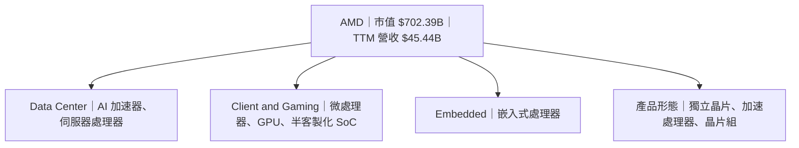
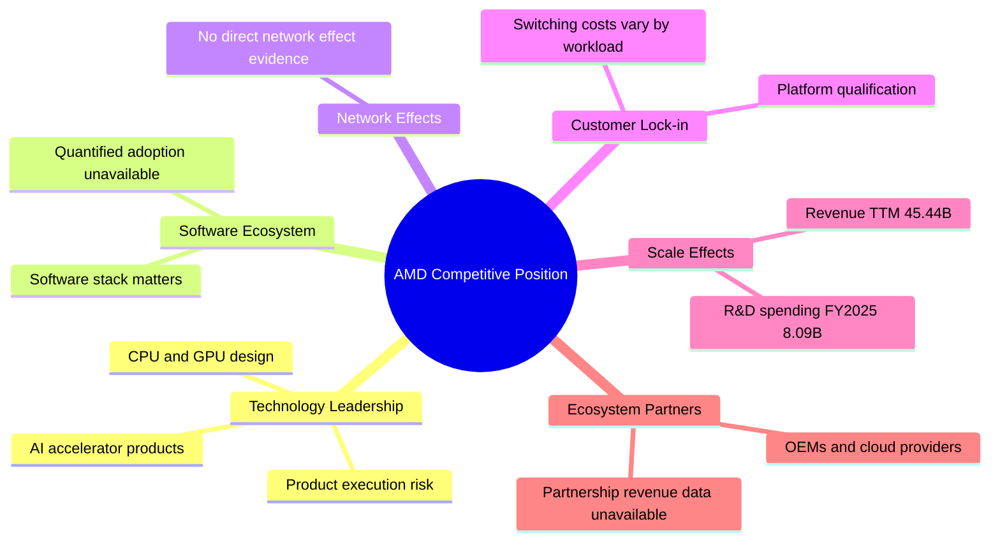
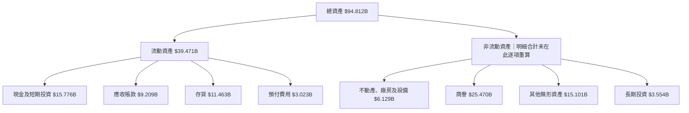
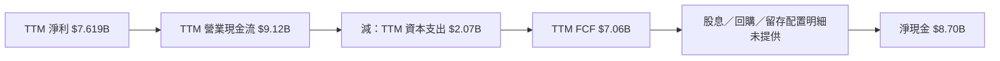
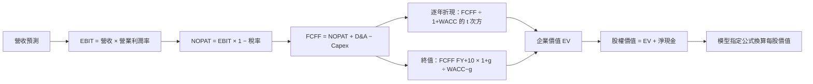
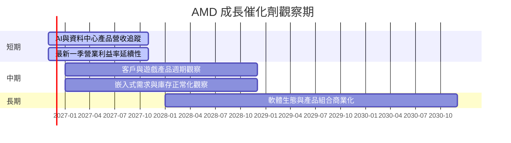
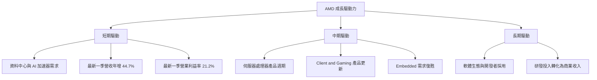
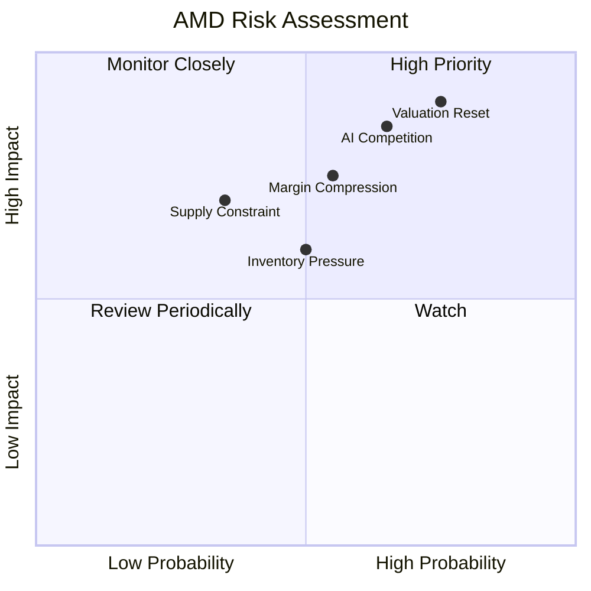
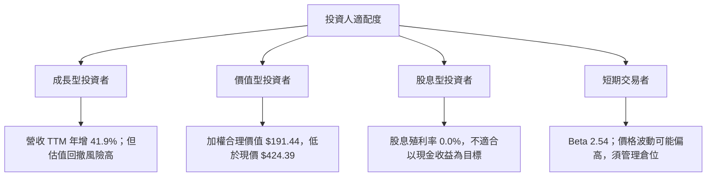

# AMD 基本面深度分析報告
> **報告日期**：2026-11-21 ｜ **語言**：繁體中文 ｜ **數據來源**：SEC 申報資料 (XBRL)、Yahoo Finance、Finviz、StockAnalysis、Roic.ai ｜ **分析師**：CFA 級機構研究

## 目錄

| # | 章節 | 核心結論 |
|---|------|----------|
| 1 | 執行摘要 | 賣出；加權合理價值 $191.44，MOS −121.7% |
| 2 | 公司概覽與商業模式 | 多條產品線支撐成長，但各業務收入占比未提供 |
| 3 | 損益表深度分析 | TTM 營收 $45.44B、年增 41.9%；最新一季營業利益率 21.2% |
| 4 | 資產負債表分析 | 淨現金 $8.70B；現金與短期投資 $15.78B |
| 5 | 現金流量深度分析 | TTM FCF $7.06B，FCF Yield 1.00% |
| 6 | 獲利能力與資本效率 | ROIC 12.8% 低於 WACC 14.0%，目前未覆蓋資本成本 |
| 7 | 相對估值分析 | 自身 P/S 位於五年歷史第 90 百分位；同業倍數差異大 |
| 8 | DCF 內在價值評估 | DCF 基準價值 $75.54；加權合理價值 $191.44 |
| 9 | 成長催化劑 | 資料中心、AI 加速器與客戶產品需求是主要觀察方向 |
| 10 | 風險矩陣 | 估值回落、AI 競爭與產品組合／執行風險居前 |
| 11 | 投資建議 | 依 MOS 為賣出；建議以估值、利潤率與現金流作季度監控 |

---

## 1. 執行摘要

截至 **2026-11-20 收盤價 $424.39**，AMD TTM 營收為 **$45.44B**、TTM 年增 **41.9%**，最新一季營收年增 **44.7%**，營業利益率由 TTM 的 **17.7%**升至最新一季 **21.2%**；TTM FCF 為 **$7.06B**、ROIC 為 **12.8%**，低於採用的 **14.0% WACC**。估值方面，DCF 基準每股價值為 **$75.54**，估值方法加權後合理價值為 **$191.44**，相對現價的安全邊際 MOS 為 **−121.7%**。依規則 20 的 MOS 門檻，評級為 **🔴賣出**；此處不作質化上調或下調。

### 1.0 一頁式投資儀表板（Portfolio Manager 30 秒速讀）

| 項目 | 內容 |
|------|------|
| **投資論點（3 句）** | ① TTM 營收 $45.44B、年增 41.9%，最新一季年增 44.7%，顯示營收動能仍高。② 最新一季營業利益率 21.2%，高於 TTM 17.7%，但需確認是否可持續。③ TTM FCF $7.06B、FCF Yield 1.00%，而現價 $424.39 相對加權合理價值 $191.44 有大幅估值落差。 |
| **綜合評分** | **6.2/10**（引用 1.1 評分卡） |
| **財務健康** | 🟢 淨現金 $8.70B、現金及短期投資 $15.78B；但營運資金占用仍需監控。 |
| **ROIC vs WACC** | **12.8% vs 14.0%**；差距 −1.2 個百分點，按當前口徑未覆蓋資本成本。 |
| **FCF 趨勢** | TTM FCF $7.06B；FCF Yield **1.00%**。年度 FCF 由 FY2023 $1.12B 增至 FY2025 $6.74B。 |
| **估值** | Forward P/E **24.06x** ｜ EV/EBITDA **61.88x** ｜ FCF Yield **1.00%** |
| **DCF 內在價值（基準）** | **$75.54** ｜相對 DCF 基準折溢價：**+461.7% 溢價**（現價 ÷ DCF 基準價值 − 1） |
| **安全邊際（MOS）** | **−121.7%**＝($191.44 − $424.39) ÷ $191.44；🟡／🔴 **無安全邊際**（MOS 為負） |
| **預期報酬（基準情境 12M）** | DCF 基準相對現價 **−82.2%**；此數值為模型估值差，不是時間保證的 12 個月報酬預測。 |
| **關鍵風險（前二）** | 現價估值遠高於模型與加權價值；AI 晶片競爭與產品放量能否轉化為可持續利潤率。 |
| **評級 + 信心度** | 🔴 **賣出** ｜信心：中（估值差距明確，但 DCF 的輸入與每股換算有模型限制） |

### 1.1 綜合評分卡（全報告唯一）

| 維度 | 評分（1–10） | 主要依據（引用數字與其來源章節） |
|------|--------------|----------------------------------|
| 成長性 | 8.0 | TTM 營收年增 41.9%、最新一季年增 44.7%（第 3 章）。 |
| 獲利能力 | 7.0 | TTM 營業利益率 17.7%、ROIC 12.8%、Piotroski F-Score 7/9；但 ROIC 低於 WACC（第 3、6 章）。 |
| 財務健康 | 8.0 | 淨現金 $8.70B、流動比率 2.725；CCC 138 天（第 4 章）。 |
| 估值 | 1.0 | MOS −121.7%；P/S 五年歷史百分位 90%，現價 $424.39（第 7、8 章）。 |
| 護城河 | 7.0 | 多產品線與半導體設計能力支持競爭，但市場份額、業務別營收和軟體生態量化數據未提供（第 2 章）。 |
| 管理層與資本配置 | 6.0 | FY2025 SBC $1.64B；F-Score 的稀釋股數測試未通過。未提供回購與各類投資的完整資本配置拆分（第 3、5 章）。 |
| **綜合評分** | **6.2** | 六項算術平均＝(8.0 + 7.0 + 8.0 + 1.0 + 7.0 + 6.0) ÷ 6＝6.17，四捨五入至一位小數。 |

### 1.2 五大投資論點 + 三大核心風險

| 類型 | 項目 | 具體依據 | 信心度 |
|------|------|----------|--------|
| 🟢 **投資論點①** | 營收動能仍高 | TTM 營收 $45.44B、年增 41.9%；最新一季年增 44.7%。若增長延續，可能維持產品放量與營業槓桿。 | 🟢 高 |
| 🟢 **投資論點②** | 利潤率近期改善 | TTM 營業利益率 17.7%，最新一季 21.2%；季度營業利益 $2.83B。需觀察改善是否來自可持續產品組合與成本控制。 | 🟡 中 |
| 🟢 **投資論點③** | 現金流轉正且增加 | TTM OCF $9.12B、Capex $2.07B、FCF $7.06B；FY2025 FCF $6.74B。 | 🟢 高 |
| 🟢 **投資論點④** | 資產負債表有緩衝 | 現金及短期投資 $15.78B，總債務 $7.08B，淨現金 $8.70B。 | 🟢 高 |
| 🟢 **投資論點⑤** | 高研發投入支撐產品競爭 | FY2025 研發費用 $8.09B，高於 FY2024 $6.46B；若產品商業化有效，研發投入可支持未來營收。 | 🟡 中 |
| 🟡 **風險①** | 估值與現金流收益率不匹配 | FCF Yield 1.00%，加權合理價值 $191.44，較現價低 54.9%。估值需要持續高增長與執行成功支撐。 | 🔴 高衝擊 |
| 🔴 **風險②** | ROIC 低於資本成本 | ROIC 12.8% 對 WACC 14.0%，差距 −1.2pp；若長期延續，成長未必帶來經濟價值增加。 | 🟡 中高 |
| 🟡 **風險③** | 營運資金與稀釋 | CCC 138 天；F-Score 的長期負債比率與稀釋股數測試未通過。營收成長若加大庫存與應收帳款，現金轉換可能承壓。 | 🟡 中 |

### 1.3 快速統計卡片

| 指標 | 公司實際值（期間） | 同業中位數 | 狀態 |
|------|--------------------|------------|------|
| 營收成長（TTM） | **41.9%** | — | 🟢 |
| 營收成長（最新一季年增） | **44.7%** | **85.5%** | 🟡 |
| 毛利率（TTM） | **56.0%** | **74.9%** | 🟡 |
| 營業利益率（TTM） | **17.7%** | — | 🟢 |
| ROIC（TTM） | **12.8%** | — | 🟡 |
| Forward P/E | **24.06x** | **15.7x** | 🔴 |
| FCF Yield（TTM） | **1.00%** | — | 🔴 |
| Piotroski F-Score | **7 / 9** | — | 🟢 |

### 1.4 投資結論

```text
╔══════════════════════════════════════════════════════════════════╗
║                    📊 投資結論摘要                               ║
╠══════════════════════════════════════════════════════════════════╣
║  評級：🔴 賣出（依 MOS 規則；未作質化調整）                      ║
║  價格（2026-11-20 收盤）：$424.39                                ║
║  DCF 內在價值（基準）：$75.54（現價相對 DCF 溢價 +461.7%）       ║
║  安全邊際 MOS：−121.7%（以加權合理價值為分母）                  ║
║  加權合理價值（8.8）：$191.44                                    ║
║  DCF 情境價值：                                                   ║
║    悲觀情境：$40.03（相對現價 −90.6%）                           ║
║    基準情境：$75.54（相對現價 −82.2%）                           ║
║    樂觀情境：$141.10（相對現價 −66.8%）                          ║
║  綜合評分：6.2/10（引用 1.1）                                    ║
║  適合投資人：能承受高波動、重視長期半導體成長且可承受估值回撤者  ║
╚══════════════════════════════════════════════════════════════════╝
```

---

## 2. 公司概覽與商業模式

### 2.1 業務結構與收入來源

AMD 提供 AI 加速器、微處理器、GPU、嵌入式處理器及半客製化 SoC。財務資料列出 Data Center、Client and Gaming、Embedded 三個分部，但未提供各分部營收及軟體／服務收入拆分，因此不繪製占比圖，也不推算分部占比。



分部營收占比、各分部利潤率及軟體／服務收入均未提供；因此圖中不呈現虛構比例或金額。

### 2.2 市場份額

市場份額數據未提供。可確認的相對規模是 AMD TTM 營收 $45.44B、TTM 年增 41.9%；同業最新一季營收年增率為 NVIDIA 103.2%、Intel 20.9%、Broadcom 85.5%。這些數字反映增長速度差異，不能直接替代市場份額。

### 2.3 競爭護城河分析



### 2.4 護城河強度

| 護城河項目 | 強度（強／中／弱） | 證據（引用數字或事實） | 會削弱它的情況 |
|------------|--------------------|------------------------|----------------|
| 技術與產品設計 | 中 | 多產品線涵蓋處理器、GPU、AI 加速器；FY2025 研發費用 $8.09B。 | 產品效能、供應或上市時程落後競爭者。 |
| 軟體生態系統 | 中偏弱 | 軟體堆疊對加速器部署有影響，但採用率、開發者數據未提供。 | 軟體工具成熟速度落後，增加客戶遷移成本。 |
| 客戶鎖定 | 中 | 資料中心與客戶平台導入需完成驗證；客戶集中度與合約資料未提供。 | 客戶採用多供應商策略、價格競爭加劇。 |
| 規模效應 | 中 | TTM 營收 $45.44B；FY2025 研發 $8.09B。 | 研發投入未能轉化為產品收入或利潤。 |
| 生態夥伴 | 中 | 公司產品涵蓋伺服器、PC、遊戲及嵌入式市場；夥伴帶來的收入未提供。 | 供應、製程、封裝或整機夥伴合作受限。 |
| 網路效應 | 弱／未證實 | 沒有可量化的用戶網路效應數據。 | 若客戶與開發者生態未擴大，平台效應較難形成。 |

**護城河分數理由：**第 1.1 節護城河評分為 **7.0/10**，主要依據多產品線、TTM $45.44B 營收及 FY2025 $8.09B 研發投入；由於市占率、分部利潤與軟體生態採用數據缺漏，評分未再上調。

---

## 3. 損益表深度分析

### 3.1 年度收入成長趨勢（近 4 年）

年度收入取年度損益表，YoY 為依所列年度收入計算。

```text
╔══════════════════════════════════════════════════════════════════╗
║                AMD 年度收入趨勢（FY2022–FY2025）                ║
╠══════════════════════════════════════════════════════════════════╣
║  FY2022  $23.60B  ██████████████░░░░░░░░░░░░░  YoY：基期       ║
║  FY2023  $22.68B  █████████████░░░░░░░░░░░░░░  YoY：−3.9% 🟡  ║
║  FY2024  $25.79B  ███████████████░░░░░░░░░░░░░  YoY：+13.7% 🟢 ║
║  FY2025  $34.64B  ████████████████████░░░░░░░  YoY：+34.3% 🟢 ║
╠══════════════════════════════════════════════════════════════════╣
║  FY2022–FY2025 CAGR = (34.64 ÷ 23.60)^(1/3) − 1 = 約 13.6%     ║
╚══════════════════════════════════════════════════════════════════╝
```

FY2023 收入回落 3.9%，之後 FY2024、FY2025 連續恢復成長，FY2025 年增 34.3%。TTM $45.44B 年增 41.9%，高於 FY2025 年增，顯示近期成長再加速；但歷史週期顯示半導體營收仍會受產品週期與終端需求影響。

### 3.2 季度收入趨勢分析

| 季度 | 營收（$B） | QoQ 成長 | YoY 成長 | 備註 |
|------|-----------:|---------:|---------:|------|
| 2025 Q4 | 10.270 | +11.1% | +34.11% | QoQ 對 2025 Q3 $9.246B 計算。 |
| 2026 Q1 | 10.253 | −0.2% | +37.85% | 季度收入近乎持平，但仍高於去年同期。 |
| 2026 Q2 | 11.536 | +12.5% | +50.11% | 年增加速。 |
| 2026 Q3 | 13.377 | +16.0% | +44.68% | 最新一季收入創所列季度序列新高；年增較 Q2 放緩。 |

QoQ 公式為「本季營收 ÷ 前季營收 − 1」。最新一季 YoY 44.7% 為單季年增率，不是 TTM 成長率。營收走高對利潤率的正面效果，仍取決於產品組合、定價與研發／營運費用增速。

### 3.3 利潤率演變分析

以下年度比率以年度損益表所列毛利、營業利益除以收入計算；TTM 及最新一季採 SEC 申報資料計算值。

| 利潤率指標 | FY2022 | FY2023 | FY2024 | FY2025 | 趨勢 | 評估 |
|------------|--------:|--------:|--------:|--------:|------|------|
| **毛利率** | 44.9% | 46.1% | 49.3% | 49.5% | 年度逐步提高；TTM 為 56.0%。 | 🟢 |
| **營業利益率** | 5.3% | 1.8% | 8.1% | 10.7% | FY2023 下探後回升；TTM 17.7%，最新一季 21.2%。 | 🟢 |
| **淨利率** | 5.6% | 3.8% | 6.4% | 12.5% | FY2025 改善；TTM 16.8%。 | 🟢 |

**利潤率演變深度解析：**年度營業利益率由 FY2023 約 1.8% 回升至 FY2025 約 10.7%，TTM 為 17.7%，最新一季 21.2%。這與近年收入成長、產品組合改善及營運規模擴大方向一致；但所給資料未分解各項業務毛利與費用，不能把改善全部歸因於單一產品。若競爭降價或研發費用增速超過收入，最新一季利潤率不一定可持續。

### 3.4 費用結構分析

FY2025 研發費用為 **$8.09B**，相當於 FY2025 營收 $34.64B 的約 **23.4%**；FY2024 研發費用 $6.46B、營收 $25.79B，研發費用約占收入 **25.0%**。這表示研發費用金額增加，但其占收入比率略降。其他營業費用細項與完整費用結構未提供，故不繪製費用占比圓餅圖，也不以剩餘項目反推費用。

### 3.5 季度 EPS 趨勢與盈餘品質（Quality of Earnings）

季度 EPS 實際值取 StockAnalysis；EPS 預估值及驚喜幅度在所列 EPS 歷史資料中為 nan，故無法判斷是否超預期或不及預期。

| 季度 | EPS 實際 | QoQ 變化 | YoY 成長 | 超預期／不及預期 |
|------|---------:|---------:|---------:|------------------|
| 2025 Q4 | $0.92 | +109.1% | +217.14% | N/A（EPS 預估值缺漏） |
| 2026 Q1 | $0.85 | −7.6% | +91.17% | N/A（EPS 預估值缺漏） |
| 2026 Q2 | $1.41 | +65.9% | +159.49% | N/A（EPS 預估值缺漏） |
| 2026 Q3 | $1.48 | +5.0% | +93.82% | N/A（EPS 預估值缺漏） |

| 盈餘品質項目 | 數值／佔比 | 評估 |
|--------------|------------|------|
| 股權薪酬 SBC / 營收 | 近四季 SBC 合計約 $2.00B；約為 TTM 營收 **4.4%** | 🟡 SBC 是真實股東成本；稀釋股數測試未通過，可能稀釋每股收益。 |
| SBC / 營業現金流 | 約 **21.9%**（$2.00B ÷ $9.12B） | 🟡 佔 OCF 比重不低；應與 GAAP 利潤及股數變化一併看。 |
| FCF / 淨利（現金轉換率） | 約 **92.7%**（$7.06B ÷ $7.619B） | 🟢 現金轉換接近淨利；差異可能來自營運資金及非現金項目。 |
| 一次性／非經常性損益 | N/A（缺少明細） | 無法判斷一次性收益是否影響報表淨利。 |
| 有效稅率異常 | N/A（缺少 TTM 稅前所得與所得稅明細） | DCF 採用 21.0% 為模型稅率，不等同已驗證的實際有效稅率。 |
| 資本化支出 vs 費用化 | TTM Capex $2.07B；資本化政策細節 N/A | 無法判定是否有費用資本化延後認列。 |

**盈餘品質結論：**TTM FCF $7.06B 接近 TTM 淨利 $7.619B，營業現金流為正；但 SBC 約占營收 4.4%、占 OCF 約 21.9%，且 F-Score 的稀釋股數測試未通過，股東應把股權薪酬視為經濟成本。由於一次性損益及有效稅率明細缺漏，對 GAAP 盈餘可持續性的判斷仍需保留。

---

## 4. 資產負債表分析

### 4.1 資產結構分解

TTM 資產明細列示總資產 $94.812B、流動資產 $39.471B。細項金額取 StockAnalysis 的最新資產負債表；分類金額不以差額自行補齊。



### 4.2 流動性與營運資金分析

流動性比率採財務數據摘要；營運資金天數照錄品質指標。

| 指標 | 最新值 | 歷史／一年前 | 評估 |
|------|-------:|-------------:|------|
| 流動比率 | 2.725 | 年度流動資產 FY2025 $26.95B、流動負債 $9.46B | 🟢 短期資產對流動負債有緩衝。 |
| 速動比率 | 1.725 | N/A | 🟢 高於 1；仍須留意應收帳款與存貨的品質。 |
| 現金及短期投資 | $15.78B | FY2025 $10.55B | 🟢 現金資源增加。 |
| DSO 應收帳款天數 | 74 天 | 71 天 | +3 天；收款週期略延長，需追蹤客戶回款。 |
| DIO 存貨天數 | 199 天 | 161 天 | +38 天；存貨占用增加，若終端需求或產品切換不及預期，可能造成減值或現金流壓力。 |
| DPO 應付帳款天數 | 135 天 | 77 天 | +58 天；供應商融資增加，但需確認並非付款期限壓力。 |
| CCC 現金轉換週期 | 138 天 | 155 天 | −17 天；DPO 延長抵銷 DSO、DIO 上升，整體週期縮短。 |

### 4.3 債務結構分析

```text
╔══════════════════════════════════════════════════════════════════╗
║                   AMD 債務健康診斷                               ║
╠══════════════════════════════════════════════════════════════════╣
║  總債務：          $7.08B   ███████░░░░░░░░░░░░░  🟢            ║
║  現金+短期投資：  $15.78B   ████████████████░░░░  🟢            ║
║  淨現金：          $8.70B   █████████░░░░░░░░░░░  🟢            ║
║                                                                  ║
║  流動比率：         2.725   🟢                                   ║
║  速動比率：         1.725   🟢                                   ║
║  Debt/EBITDA：      N/A（未提供可直接對應的 TTM EBITDA 絕對值）  ║
║  利息保障倍數：     N/A（利息費用明細未提供）                    ║
╚══════════════════════════════════════════════════════════════════╝
```

### 4.4 股東權益趨勢

年度股東權益來自年度資產負債表；TTM 股東權益未提供，不以其他表格反推。

```text
╔══════════════════════════════════════════════════════════════════╗
║                   AMD 歷年股東權益                               ║
╠══════════════════════════════════════════════════════════════════╣
║  FY2022  $54.75B  █████████████████░░░░░░░░░                   ║
║  FY2023  $55.89B  █████████████████░░░░░░░░░                   ║
║  FY2024  $57.57B  ██████████████████░░░░░░░░                   ║
║  FY2025  $63.00B  ████████████████████░░░░░░                   ║
╚══════════════════════════════════════════════════════════════════╝
```

FY2022 至 FY2025 股東權益由 $54.75B 增至 $63.00B。資產與權益增加能支撐投資，但不直接代表每股價值同步增加；稀釋股數測試未通過，仍需核對股東權益增長是否伴隨每股指標改善。

---

## 5. 現金流量深度分析

### 5.1 現金流量瀑布圖



註：依逐項展示的四捨五入值，$9.12B − $2.07B = $7.05B；財務資料列示 FCF 為 **$7.06B**。本報告引用 FCF 時採用已列示的 TTM FCF，不以四捨五入數字覆寫。

### 5.2 FCF 轉換率趨勢

| 財年 | FCF（$B） | 淨利（$B） | FCF / 淨利 |
|------|----------:|----------:|-----------:|
| FY2022 | 3.12 | 1.32 | 236.4% |
| FY2023 | 1.12 | 0.854 | 131.1% |
| FY2024 | 2.40 | 1.64 | 146.3% |
| FY2025 | 6.74 | 4.33 | 155.7% |
| TTM | 7.06 | 7.619 | 92.7% |

年度轉換率均高於 100%，但 TTM 降至約 92.7%。單一期間的營運資金變動、收款與存貨變化會影響現金轉換；最新 CCC 138 天，較前一年縮短 17 天，仍須配合應收及庫存天數追蹤。

### 5.3 自由現金流趨勢

```text
╔══════════════════════════════════════════════════════════════════╗
║                     AMD 自由現金流趨勢                           ║
╠══════════════════════════════════════════════════════════════════╣
║  FY2022  $3.12B  █████████░░░░░░░░░░░  FCF Yield：N/A          ║
║  FY2023  $1.12B  ███░░░░░░░░░░░░░░░░░  FCF Yield：N/A          ║
║  FY2024  $2.40B  ███████░░░░░░░░░░░░░  FCF Yield：N/A          ║
║  FY2025  $6.74B  ████████████████████  FCF Yield：N/A          ║
║  TTM     $7.06B  █████████████████████ FCF Yield：1.00%        ║
╚══════════════════════════════════════════════════════════════════╝
```

歷史年度市值未提供，故不推算 FY2022–FY2025 的 FCF Yield。TTM FCF 增至 $7.06B 是現金創造能力改善的正面訊號；但 FCF Yield 只有 1.00%，代表現價對現金流的要求偏高。

### 5.4 資本配置評估

回購、研發投資、資本支出、股息及留存現金的完整年度資本配置金額未提供，故不製作資本配置圓餅圖。已知 FY2025 研發費用 $8.09B、TTM Capex $2.07B、股息殖利率 0.0%；FY2025 SBC 為 $1.64B。AMD 未提供股息回報，股東報酬主要倚賴每股盈餘與估值變化。

---

## 6. 獲利能力與資本效率

### 6.1 ROE / ROA / ROIC 趨勢

| 指標 | 最新值 | 歷史數據 | 評估 |
|------|-------:|----------|------|
| ROE（TTM） | 11.1% | 品質指標口徑；另一市場摘要列 12.0%，口徑不一致 | 🟡 以一致性較高的 QUALITY FIGURES 11.1% 為主。 |
| ROA（TTM） | 5.9% | Piotroski 測試顯示 ROA 高於一年前；歷史百分比未提供 | 🟡 正向，但資產周轉與獲利率仍影響回報。 |
| ROIC（TTM） | 12.8% | 歷史可比序列未提供 | 🟡 低於 14.0% WACC。 |

未提供可直接引用的半導體產業均值，故不列行業均值對比。ROIC 與 WACC 差距為 **12.8% − 14.0% = −1.2 個百分點**，目前按此口徑尚未證明新增投入資本能創造超額經濟價值。

### 6.2 ROIC vs WACC 分析（核心價值創造判斷）

```text
╔══════════════════════════════════════════════════════════════════╗
║                ROIC vs WACC 深度分析                            ║
╠══════════════════════════════════════════════════════════════════╣
║  資本成本輸入（採用 VERIFIED FIGURES）：                        ║
║  ├── 無風險利率（10Y 美債）：                 4.91%              ║
║  ├── 市場風險溢酬：                           5.00%              ║
║  ├── Beta（調整後）：                         2.00               ║
║  ├── 股權成本：                    4.91%+2.00×5.00%=14.91%    ║
║  ├── 稅前債務成本：                           1.85%              ║
║  ├── 資本權重：股權 99.0%，債務 1.0%                             ║
║  ├── 計算 WACC：                              14.78%             ║
║  └── 採用 WACC：                              14.00%             ║
║      （計算值受 7%–14% 區間限制，採用上限 14.00%）               ║
║                                                                  ║
║  ROIC（TTM）：                                  12.8%             ║
║  EVA 利差 = ROIC − WACC = 12.8% − 14.0% =     −1.2pp             ║
║                                                                  ║
║  ROIC 12.8%  ▓▓▓▓▓▓▓▓▓▓▓▓▓░░░░░░░░░░░░░░                        ║
║  WACC 14.0%  ▓▓▓▓▓▓▓▓▓▓▓▓▓▓░░░░░░░░░░░░                          ║
║                                                                  ║
║  結論：ROIC 約為 WACC 的 0.91 倍；目前未覆蓋資本成本。           ║
╚══════════════════════════════════════════════════════════════════╝
```

ROIC 約為 WACC 的比例：`12.8% ÷ 14.0% = 0.914`，即約 **0.91 倍**。資本成本來源及推導細節見第 8.2 節；第 6.2 與第 8 章均採用同一個 14.00% WACC。

### 6.3 杜邦三因素分解

| 因素 | 數值（TTM） | 解讀 |
|------|-------------|------|
| 淨利率 | 16.8% | 獲利能力是 ROE 的主要來源。 |
| 資產週轉率 | 0.48 | 每單位資產帶來約 0.48 單位收入。 |
| 權益乘數 | 1.39 | 槓桿程度有限，ROE 並非主要依靠高槓桿。 |
| **ROE** | **11.1%** | **16.8% × 0.48 × 1.39 ≈ 11.1%**（品質指標照錄）。 |

### 6.4 財務體質：Piotroski F-Score

**Piotroski F-Score：7 / 9**。一項缺漏輸入會略過計分，故分母依品質指標列示為 9。

| 測試 | 結果 | 解讀 |
|------|------|------|
| ROA > 0 | ✅ 通過 | TTM 資產報酬為正。 |
| 營業現金流 > 0 | ✅ 通過 | TTM OCF $9.12B。 |
| ROA 高於一年前 | ✅ 通過 | 資產獲利較前期改善。 |
| 營業現金流 > 淨利 | ✅ 通過 | 現金流高於淨利，有利於應計品質。 |
| 長期負債 ÷ 總資產低於一年前 | ❌ 未通過 | 負債相對資產的變化未達測試條件，需追蹤債務累積。 |
| 流動比率高於一年前 | ✅ 通過 | 短期流動性改善。 |
| 稀釋股數未增加 | ❌ 未通過 | 股數增加代表每股權益可能受稀釋。 |
| 毛利率高於一年前 | ✅ 通過 | 毛利率改善。 |
| 資產週轉率高於一年前 | ✅ 通過 | 資產運用效率改善。 |

---

## 7. 相對估值分析

### 7.1 同業估值比較表格

公司自身的估值採市場資料摘要；同業估值倍數依 Yahoo Finance Peer multiples。

| 估值指標 | **AMD** | **NVIDIA** | **Intel** | **Broadcom** | 本公司評估 |
|----------|--------:|-----------:|----------:|-------------:|-----------|
| **Trailing P/E** | 90.68x | 13.5x | N/A | 38.9x | 🔴 AMD 明顯高於可計算同業；各公司盈餘與市場估值口徑可能不同。 |
| **Forward P/E** | 24.06x | 7.6x | 28.6x | 15.7x | 🟡 低於 Intel，但高於 NVIDIA、Broadcom；Peer 中位數 15.7x。 |
| **P/S Ratio** | 15.46x | 8.4x | 4.6x | 16.3x | 🟡 接近 Broadcom，高於 NVIDIA 與 Intel。 |
| **EV/EBITDA** | 61.88x | 12.2x | 14.9x | 28.5x | 🔴 AMD 顯著高於三家同業。 |
| **最新一季營收 YoY** | 44.7% | 103.2% | 20.9% | 85.5% | 🟡 AMD 增速高於 Intel、低於 NVIDIA 與 Broadcom。 |
| **TTM 毛利率** | 56.0% | 74.9% | 40.2% | 75.5% | 🟡 高於 Intel，低於 NVIDIA 與 Broadcom。 |

同業估值差異較大，不能只看單一倍數。Peer 中位數的 Forward P/E 為 15.7x、EV/EBITDA 為 14.9x；AMD 的倍數反映市場對其成長與未來獲利的預期，但目前價格與模型價值之間仍有顯著落差。

### 7.2 歷史估值區間分析

```text
╔══════════════════════════════════════════════════════════════════╗
║                 AMD 五年歷史估值位置                            ║
╠══════════════════════════════════════════════════════════════════╣
║  P/E：        36.7x ───── 中位數 82.6x ───── 現值 92.3x         ║
║                                                百分位：53% 🟡  ║
║  P/S：         4.3x ───── 中位數  8.9x ───── 現值 15.5x         ║
║                                                百分位：90% 🔴  ║
║  EV/EBITDA：  38.2x ───── 中位數 102.2x ──── 現值 86.5x        ║
║                                                百分位：39% 🟡  ║
╚══════════════════════════════════════════════════════════════════╝
```

上述估值歷史倍數與第 7.1 節市場摘要倍數可能因資料來源、計算口徑及時間點不同而不一致；歷史區間以程式計算的五年資料為準，不把兩套數字混成同一口徑。

### 7.3 情境價值（Bear / Base / Bull，照抄 DCF MODEL）

| 情境 | 第 1 年營收成長 | 期末營業利潤率 | WACC | 每股價值 | 相對現價 | 機率 | 會發生的條件 |
|------|----------------:|----------------:|-----:|---------:|---------:|-----:|--------------|
| 🔴 悲觀 | 15.0% | 6.3% | 15.00% | $40.03 | −90.6% | 25% | AI 加速器放量低於預期、競爭壓價，或成熟業務成長疲弱，使收入與利潤率同步承壓。 |
| 🟡 基準 | 30.0% | 7.4% | 14.00% | $75.54 | −82.2% | 50% | 收入第一年延續較高成長，之後逐步降速；成熟期營業利潤率回落至模型假設。 |
| 🟢 樂觀 | 45.0% | 8.1% | 13.00% | $141.10 | −66.8% | 25% | 新產品需求及產品組合優於基準，收入初期成長更高、長期利潤率略高，且資本成本下行。 |

以上情境值均低於 2026-11-20 收盤價 $424.39。模型列示的機率加權情境價值為 **$83.06**（相對現價 −80.4%）；第 8.8 節的加權合理價值則依估值方法固定權重計算，並非使用此機率加權情境值。

### 7.4 相對估值隱含價格區間

```text
╔══════════════════════════════════════════════════════════════════╗
║            估值方法隱含每股價值（美元）                         ║
╠══════════════════════════════════════════════════════════════════╣
║  DCF 基準          $75.54                                        ║
║  同業 EV/EBITDA   $105.22                                        ║
║  同業 Forward P/E $276.57                                        ║
║  現價             $424.39                                        ║
║  分析師共識        $657.74                                        ║
╚══════════════════════════════════════════════════════════════════╝
```

- **同業 Forward P/E：$276.57**；依據為 NVDA、INTC、AVGO 同業中位數 15.7x × AMD Forward EPS $17.64。
- **同業 EV/EBITDA：$105.22**；依據為同業中位數 14.9x × TTM EBITDA，再加回淨現金。
- 同業相對估值輸入採程式列示結果；本報告不以 AMD 自身目前倍數取代同業中位數。

---

## 8. DCF 內在價值評估（Discounted Cash Flow）

### 8.0 估值推理鏈（Thinking Logic）

#### Step 1 — 價值由哪些變數決定？

AMD 的價值主要取決於既有處理器與 GPU 業務的現金流底盤、資料中心與 AI 加速器的新增成長，以及成熟期營業利潤率；資料未提供各分部收入占比，因此不能將各項拆成可量化收入權重。模型敏感度顯示，折現率與永續成長率都會改變終值，初期成長假設則決定未來營收基礎。

#### Step 2 — 模型選擇

| 決策點 | 本報告採用 | 理由（含數字） | 曾考慮但否決 | 否決理由 |
|--------|-----------|----------------|--------------|----------|
| 現金流定義 | FCFF | 模型以 GAAP EBIT、NOPAT、D&A、Capex 推導 FCFF，再以 WACC 折現。 | FCFE | FCFE 需另行處理利息與融資變化，既有模型沒有該套輸入。 |
| 預測期 N | 10 年 | 模型明列 FY+1 至 FY+10，收入由 $45.44B 起算。 | 5 年 | 不符合既定模型預測期，且不可自行改變模型。 |
| 終值方法 | Gordon Growth | 模型已列 WACC 14.00%、g 3.0% 及終值。 | 退出倍數作主終值 | DCF 輸出未提供退出倍數終值，不能另建模型。 |
| EBIT 基礎 | GAAP | 模型明列 GAAP EBIT。 | 非 GAAP EBIT | 會改變 SBC 處理與現金流口徑。 |

#### Step 3 — 主要假設推導鏈

- **營收成長：**錨點＝TTM 成長 41.9% → 調整＝高基期與競爭風險使成長逐年遞減 → **FY+1 採 30.0%，FY+10 採 3.0%** → 曾考慮延續 41.9%，但若把近期 TTM 成長外推十年會過度樂觀，故不採用。模型將成長由 30.0% 線性降至 3.0%。
- **營業利潤率：**錨點＝TTM GAAP 營業利益率 17.7% → 調整＝模型假設成熟期回落至近五年中位數 7.4% → **FY+1 17.7%、FY+10 7.4%** → 曾考慮維持 17.7%，但模型以歷史成熟期中位數作終點，未採持續高位假設。
- **永續成長率 g：**錨點＝模型採 3.0% → 調整＝終值假設須低於 WACC，並避免用短期高增長代表永續增長 → **採用 3.0%** → 未採更高永續成長率，因終值會放大估值且須保持低於 14.0% WACC。
- **預測期 N：**錨點＝模型指定 10 年 → 調整＝不自行更換期間，保持輸出可比與可複算 → **採用 10 年** → 不採 5 年或 15 年，因程式模型沒有提供相應價值結果。
- **Capex／營收：**錨點＝TTM Capex／TTM 營收約為 2.07 ÷ 45.44，模型採 FY+1 至 FY+10 均為 4.5% → 調整＝模型以此固定比例預測再投資 → **採用 4.5%** → 未採用單純延續較低的 TTM 比率，以免忽略成長期投資需求；這是模型假設，非管理層財測。
- **EBIT 基礎與 SBC：**錨點＝GAAP EBIT 已含 SBC 費用 → **採組合 (A)：GAAP EBIT、FCFF 不再減 SBC、年稀釋率 0%** → 否決「再扣 SBC 或再加股數稀釋」，避免重複計入同一成本。
- **年稀釋率：**由組合 (A) 固定為 **0%**；未採用正稀釋率，因模型設定 SBC 已經透過 GAAP EBIT 費用化。
- **終值方法：**採 Gordon Growth，錨點為模型明列的 FCFF FY+10、g 3.0%、WACC 14.0% → 不另用退出倍數作替代主估值，因模型沒有輸出該方法結果。
- **WACC：**錨點＝程式列示 WACC 計算值 14.78%，受 7%–14% 區間限制後採用 **14.00%** → 未採 14.78%，因資本成本區間規則限制；第 8.2 節列出組成。

#### Step 4 — 最脆弱環節

最脆弱的一環是長期營業利潤率與折現率共同作用於終值。模型的終值現值占企業價值 35.3%；若資本成本更高或收入、利潤率低於基準，DCF 價值會進一步下降，敏感度見 8.6。

#### Step 5 — 計算路徑圖



### 8.1 模型假設總表（Model Inputs）

| 假設項目 | 採用值 | 依據／來源 | 敏感度 |
|----------|--------|-------------|--------|
| 預測期長度 **N** | 10 年 | DCF 模型指定十年期間。 | 🟡 中 |
| 營收成長 | FY+1 30.0% 線性遞減至 FY+10 3.0% | TTM 成長 41.9%；模型將增速限制並逐步淡化。 | 🔴 高 |
| 營業利潤率 | FY+1 17.7% → FY+10 7.4% | 起點為 TTM 17.7%；終點為模型所用近五年中位數。 | 🔴 高 |
| 有效稅率 | 21.0% | DCF 模型假設；並非已核實的實際有效稅率。 | 🟢 低 |
| Capex / 營收 | 4.5% | 模型假設；TTM Capex $2.07B、營收 $45.44B 為參考錨點。 | 🟡 中 |
| D&A / 營收 | 6.7% | DCF 模型列示，以 TTM 比率固定。 | 🟢 低 |
| 營運資金變動 | 未建模 | DCF 模型明示 Working capital is not modelled。 | 🟢 低 |
| EBIT 基礎 | GAAP | DCF 模型明示 GAAP EBIT。 | 🟡 中 |
| SBC 處理 | 不另扣 SBC | GAAP EBIT 已含 SBC 費用，採組合 (A)。 | 🟡 中 |
| 年稀釋率 | 0% | 與組合 (A) 一致；股數不再稀釋。 | 🟡 中 |
| 永續成長率 g | 3.0% | DCF 模型指定；低於 WACC 14.0%。 | 🔴 高 |
| 終值方法 | Gordon Growth | 模型提供終值；未提供退出倍數終值。 | 🔴 高 |
| WACC | 14.00% | 程式計算 14.78%，受 7%–14% 區間限制採上限 14.00%。 | 🔴 高 |

**SBC 防重複計算：**本模型採用 **(A) GAAP EBIT + 固定股數**；EBIT 已含 SBC 費用，FCFF 不另減 SBC，股數亦不逐年稀釋，因此 SBC 影響只計入一次。  
**FCFF 定義：**本模型使用 `FCFF = NOPAT + D&A − Capex`；營運資金變動未建模。

### 8.2 折現率推導（WACC）

```text
╔══════════════════════════════════════════════════════════════════╗
║                    WACC 推導（折現率）                           ║
╠══════════════════════════════════════════════════════════════════╣
║  股權成本 Ke（CAPM）：                                           ║
║  ├── 無風險利率 Rf：                       4.91%                 ║
║  ├── 市場風險溢酬 ERP：                    5.00%                 ║
║  ├── 原始 Beta（Yahoo）：                   2.54                  ║
║  ├── 調整後 Beta：                          2.00                  ║
║  │   調整方式：⅔×2.54 + ⅓×1 = 2.03，受 0.6–2.0 範圍限制為 2.00 ║
║  ├── 規模／國別溢酬：                       0.00%（未另加）       ║
║  └── Ke = 4.91% + 2.00×5.00% =             14.91%                 ║
║                                                                  ║
║  債務成本 Kd：                                                   ║
║  ├── 稅前 Kd：                              1.85%                 ║
║  ├── 稅率：                                 21.0%                 ║
║  └── 稅後 Kd = 1.85%×(1−21.0%) =            1.4615%              ║
║                                                                  ║
║  資本結構權重：股權 99.0%；債務 1.0%（程式列示）                 ║
║  計算 WACC：                                 14.78%                ║
║  採用 WACC：                                 14.00%                ║
║  （計算值受 7%–14% 限制，採用上限）                              ║
╚══════════════════════════════════════════════════════════════════╝
```

Rf、ERP、Beta、債務成本及權重均按資本成本資料列示；Rf 的具體觀測日未提供，因此不另填日期。原始 Beta 2.54 高於 1.5，故採用資料列示的調整後 Beta 2.00。未另加規模或國別溢酬，因資料未列示相應溢酬。

**逐步演算（WACC）：**

1. **Ke（CAPM）**  
   `Ke = Rf + β × ERP = 4.91% + 2.00 × 5.00% = 14.91%`

2. **稅前 Kd**  
   `稅前 Kd = 1.85%`（資本成本資料直接列示；利息費用與平均計息負債細項未提供，不能另行重算。）

3. **稅後 Kd**  
   `1.85% × (1 − 21.0%) = 1.85% × 0.79 = 1.4615%`

4. **權重**  
   `股權權重 = 99.0%；債務權重 = 1.0%；99.0% + 1.0% = 100.0%`  
   權重採程式列示的市值／債務權重；市值使用 2026-11-20 收盤價 $424.39 所對應的市場資料。財務數據另列總債務 $7.08B，但未提供計息負債平均餘額及完整權重中間值，故不以總負債代替 Kd 分母。

5. **未封頂 WACC 與採用值**  
   `計算 WACC = 99.0% × 14.91% + 1.0% × 1.4615%`  
   `= 14.7609% + 0.014615% = 14.775515% ≈ 14.78%`  
   因 WACC 限定於 7%–14%，**採用值 = 14.00%**。

### 8.3 逐年自由現金流預測（基準情境）

金額單位為 USD billions。表格數字照 DCF 模型列示；折現因子保留三位小數。ΔWC 未建模，不另列該行。

| 年度 | FY+1 | FY+2 | FY+3 | FY+4 | FY+5 | FY+6 | FY+7 | FY+8 | FY+9 | FY+10 |
|------|-----:|-----:|-----:|-----:|-----:|-----:|-----:|-----:|-----:|------:|
| 營收 | 59.07 | 75.01 | 93.02 | 112.55 | 132.81 | 152.73 | 171.06 | 186.46 | 197.64 | 203.57 |
| 營收 YoY | 30.0% | 27.0% | 24.0% | 21.0% | 18.0% | 15.0% | 12.0% | 9.0% | 6.0% | 3.0% |
| 營業利潤率 | 17.7% | 16.6% | 15.4% | 14.3% | 13.1% | 12.0% | 10.8% | 9.7% | 8.5% | 7.4% |
| EBIT（GAAP） | 10.46 | 12.43 | 14.34 | 16.06 | 17.42 | 18.28 | 18.51 | 18.03 | 16.84 | 15.00 |
| − 稅 | (2.20) | (2.61) | (3.01) | (3.37) | (3.66) | (3.84) | (3.89) | (3.79) | (3.54) | (3.15) |
| NOPAT | 8.27 | 9.82 | 11.33 | 12.69 | 13.76 | 14.44 | 14.62 | 14.24 | 13.30 | 11.85 |
| + D&A | 3.96 | 5.03 | 6.24 | 7.55 | 8.90 | 10.24 | 11.47 | 12.50 | 13.25 | 13.65 |
| − Capex | (2.69) | (3.41) | (4.23) | (5.12) | (6.04) | (6.95) | (7.78) | (8.48) | (8.99) | (9.26) |
| **= FCFF** | **9.54** | **11.43** | **13.33** | **15.11** | **16.63** | **17.73** | **18.31** | **18.26** | **17.56** | **16.24** |
| 折現因子 @14.00% | 0.877 | 0.769 | 0.675 | 0.592 | 0.519 | 0.456 | 0.400 | 0.351 | 0.308 | 0.270 |
| **FCFF 現值 PV** | **8.37** | **8.80** | **9.00** | **8.95** | **8.63** | **8.08** | **7.32** | **6.40** | **5.40** | **4.38** |

預測期 PV 合計依模型列示為 **$75.32B**；逐項以表格顯示的四捨五入值相加為  
`$8.37 + $8.80 + $9.00 + $8.95 + $8.63 + $8.08 + $7.32 + $6.40 + $5.40 + $4.38 = $75.33B`。  
$0.01B 尾差來自逐年數字四捨五入；報告保留模型合計 $75.32B。

**逐步演算（FY+1）：**

1. **營收**：`$45.44B × (1 + 30.0%) = $59.072B ≈ $59.07B`
2. **EBIT**：`$59.07B × 17.7% = $10.45539B ≈ $10.46B`
3. **稅**：`$10.46B × 21.0% = $2.1966B ≈ $2.20B`
4. **NOPAT**：`$10.46B − $2.20B = $8.26B`；模型未四捨五入前列示 NOPAT $8.27B，因展示數字已各自四捨五入。
5. **D&A**：`$59.07B × 6.7% = $3.95769B ≈ $3.96B`
6. **Capex**：`$59.07B × 4.5% = $2.65815B`；模型列示 $2.69B，差異顯示其內部輸入／未四捨五入基礎與表面比例數字不完全一致，依規則保留模型值。
7. **ΔWC**：未建模。
8. **FCFF**：依模型列示 `$8.27B + $3.96B − $2.69B = $9.54B`。
9. **折現與 PV**：`1 ÷ (1 + 14.00%)^1 = 0.877`；`$9.54B × 0.877 = $8.37B`。

**合理性自檢：**

- FY+1 至 FY+10 營收 CAGR：`(203.57 ÷ 45.44)^(1/10) − 1 ≈ 16.2%`；與 FY2022–FY2025 實際營收 CAGR 約 13.6% 相比，高約 2.6pp。前期增長較快、後期降至 3.0%，反映模型仍要求十年期收入增長高於近三年歷史複合增長。
- FY+10 FCFF 利潤率：`16.24 ÷ 203.57 ≈ 8.0%`。現有 TTM FCF 利潤率：`7.06 ÷ 45.44 ≈ 15.5%`。同業最佳 FCF 利潤率未提供，不能判斷是否超越同業最佳。
- 模型中 FY+1 至 FY+10 FCFF 均為正；但營運資金變動未建模，若營收擴張實際需要更多庫存與應收帳款，預測現金流可能偏高。

```text
╔══════════════════════════════════════════════════════════════════╗
║            自由現金流：歷史實際 vs 模型預測                      ║
╠══════════════════════════════════════════════════════════════════╣
║  FY2023（實） $1.12B  ███░░░░░░░░░░░░░░░░░░                    ║
║  FY2024（實） $2.40B  ███████░░░░░░░░░░░░░                    ║
║  FY2025（實） $6.74B  ████████████████░░░░                    ║
║  FY+1（預）   $9.54B  ████████████████████                    ║
║  FY+10（預） $16.24B  ██████████████████████████████          ║
╠══════════════════════════════════════════════════════════════════╣
║  歷史年度 FCF 波動較大；模型期間含營運資金未建模的限制。        ║
╚══════════════════════════════════════════════════════════════════╝
```

### 8.4 終值計算（Terminal Value）

**適用性檢查：**`WACC 14.00% vs g 3.00% → WACC > g？✅`

| 方法 | 計算式 | 終值 TV | TV 現值 | 佔總 EV 比重 |
|------|--------|---------|---------|--------------|
| Gordon Growth | FCFF(FY+10) × (1+g) ÷ (WACC−g) | $152.04B | $41.01B | 35.3% |
| 退出倍數法 | N/A（DCF 模型未提供退出倍數終值） | N/A | N/A | N/A |

**逐步演算（Gordon Growth）：**

1. **FY+10 FCFF**：`$16.24B`（取自 8.3 模型列示）。
2. **分子**：`$16.24B × (1 + 3.0%) = $16.7272B ≈ $16.73B`。
3. **分母與 TV**：`14.00% − 3.00% = 11.00%`；以表面四捨五入輸入計算，`$16.7272B ÷ 11.00% = $152.065B ≈ $152.07B`。模型列示 **$152.04B**；差異約 0.02%，本報告保留程式模型值，不替換模型輸出。
4. **PV(TV)**：模型列示 `$152.04B × 0.270 = $41.01B`；以展示精度直接相乘為 `$41.0508B`，約 $0.04B 差異，屬模型未四捨五入輸入與展示精度差異。
5. **終值占比**：`$41.01B ÷ $116.33B = 35.3%`。

終值現值占企業價值 35.3%，未高於 75% 終值依賴警戒值；但終值仍對 g 與 WACC 敏感。退出倍數法不在模型輸出內，故不自行計算。

### 8.5 企業價值 → 每股內在價值（Bridge）

```text
╔══════════════════════════════════════════════════════════════════╗
║              企業價值 → 每股內在價值 橋接表                      ║
╠══════════════════════════════════════════════════════════════════╣
║  預測期 FCF 現值合計            +$75.32B                         ║
║  終值現值 PV(TV)                +$41.01B                         ║
║  ─────────────────────────────────────────────                  ║
║  = 企業價值 EV                   $116.33B                        ║
║  + 淨現金                        +$8.70B                          ║
║  = 股權價值                      $125.03B                         ║
║  ─────────────────────────────────────────────                  ║
║  模型指定每股換算：股權價值×股價÷市值                           ║
║  = DCF 基準每股價值              $75.54                           ║
║  當前股價（2026-11-20 收盤）     $424.39                          ║
║  折溢價（現價÷DCF價值−1）        +461.7% 溢價                    ║
╚══════════════════════════════════════════════════════════════════╝
```

**逐步演算（橋接）：**

1. **EV**：`$75.32B + $41.01B = $116.33B`。
2. **股權價值**：`$116.33B + $8.70B = $125.03B`。模型採淨現金口徑；現金與短期投資 $15.78B、總債務 $7.08B 的原始列示四捨五入後相減為 $8.70B。
3. **每股內在價值**：模型指定公式為 `股權價值 × 股價 ÷ 市值`，即 `$125.03B × $424.39 ÷ $702.39B = $75.54`。
4. **折溢價**：`$424.39 ÷ $75.54 − 1 = +461.7%`。此處為現價相對 DCF 基準價值的溢價，不是 MOS。
5. **本節不計算 MOS**：MOS 一律以 8.8 加權合理價值為分母，避免混用估值基準。

市價資料列示流通股數 **1.66B 股**；若直接以 `$125.03B ÷ 1.66B` 計算，會得到與模型指定結果略有差異的每股值。由於程式 DCF 明確指定以「股權價值 × 價格 ÷ 市值」換算，本報告照錄 **$75.54**，並將每股換算口徑列為模型限制，不另行替代。

### 8.6 敏感性分析（WACC × 永續成長率）

下表每格為每股價值；括號為相對現價 $424.39 的上行空間。數值照 DCF 模型列示。

| g（列）／WACC（欄） | 12.00% | 13.00% | **14.00%（基準）** | 15.00% | 16.00% |
|-----------|------:|------:|------------------:|------:|------:|
| **2.0%** | $87.24（−79.4%） | $79.62（−81.2%） | $73.26（−82.7%） | $67.87（−84.0%） | $63.24（−85.1%） |
| **2.5%** | $89.10（−79.0%） | $81.03（−80.9%） | $74.35（−82.5%） | $68.72（−83.8%） | $63.92（−84.9%） |
| **3.0%** | $91.17（−78.5%） | $82.59（−80.5%） | **$75.54（−82.2%）** | $69.65（−83.6%） | $64.65（−84.8%） |
| **3.5%** | $93.48（−78.0%） | $84.31（−80.1%） | $76.85（−81.9%） | $70.66（−83.3%） | $65.45（−84.6%） |
| **4.0%** | $96.08（−77.4%） | $86.22（−79.7%） | $78.29（−81.6%） | $71.77（−83.1%） | $66.31（−84.4%） |

**逐步演算（選取非基準格：WACC 13.00%、g 3.0%）：**  
`所選格 WACC 13.00% > g 3.0% ✅`  
模型敏感度表列示此格每股價值 **$82.59**。逐年 FCFF 不變，但模型未提供此格的逐年折現因子與 PV 明細，因此無法從披露的兩位小數逐項重算至同一個精確值；依規則直接引用模型敏感度結果，不自行重建模型。

**敏感度可量化結果：**

- **g +1pp（3.0% → 4.0%，WACC 14.0%）**：`$75.54 → $78.29`，增加 `$78.29 − $75.54 = $2.75`，約 **+3.6%**。
- **WACC +1pp（14.0% → 15.0%，g 3.0%）**：`$75.54 → $69.65`，減少 `$69.65 − $75.54 = −$5.89`，約 **−7.8%**。
- **期末營業利潤率每 +1pp**：模型未提供相應敏感度，**N/A**，不另行生成估值。
- 在已提供的兩項敏感度中，WACC 變動的價值影響大於 g 變動；這與 8.0 提到折現率、永續成長率共同影響終值一致，但完整主導變數排序仍受營業利潤率敏感度缺漏限制。

**三情境 DCF：**模型只提供三個情境的最終每股價值與少量假設，未提供各情境 FY+10 營收、FCFF、終值逐項表；因此不能在不重建模型的前提下完成每個情境的完整中間算式。以下保留模型原值，不填造未提供的中間數。

| 情境 | 營收假設 | 期末營業利潤率 | g | WACC | 每股內在價值 | 相對現價 | 機率 |
|------|----------|----------------:|---:|-----:|--------------:|---------:|-----:|
| 🔴 悲觀 | 第 1 年成長 15.0% | 6.3% | 3.0%（未另列情境值，依基準模型） | 15.00% | $40.03 | −90.6% | 25% |
| 🟡 基準 | 第 1 年成長 30.0% | 7.4% | 3.0% | 14.00% | $75.54 | −82.2% | 50% |
| 🟢 樂觀 | 第 1 年成長 45.0% | 8.1% | 3.0%（未另列情境值，依基準模型） | 13.00% | $141.10 | −66.8% | 25% |
| **機率加權** | — | — | — | — | **$83.06** | **−80.4%** | **100%** |

模型列示機率加權值 **$83.06**。由於三個情境的每年成長路徑與逐年 FCFF 未完整列出，不另以所列數字反推情境營收、FCFF 或終值。

### 8.7 反推 DCF（Reverse DCF：市場在預期什麼）

反推結果照模型列示；其他輸入固定在基準值的完整清單及數值疊代軌跡未提供，不能自行建立試算表或新增反推解。

| 求解的變數（一次一個） | 其餘變數設定 | 市場隱含值（令 DCF = 現價） | 可比參考 | 判斷 |
|------------------------|--------------|------------------------------:|----------|------|
| 第 1 年營收成長率 | 其餘基準輸入固定 | 89.1% | 基準為 30.0%；TTM 成長 41.9% | 🔴 高於基準與 TTM 成長，要求非常高的短期增長。 |
| 固定營業利潤率 | 其餘基準輸入固定 | 74.2% | TTM 營業利益率 17.7% | 🔴 遠高於現有營業利潤率。 |
| 永續成長率 g | 未提供解 | 未計算 | — | N/A（模型未列示）。 |
| 高成長持續年數 N | 未提供解 | 未計算 | 基準模型 10 年 | N/A（模型未列示）。 |

模型未附 89.1% 與 74.2% 的迭代路徑、固定變數明細及收斂誤差，故不捏造試算軌跡。反推結論是：若以該 DCF 模型其他條件不變，要讓現價可由成長單一變數解釋，第 1 年收入成長需要達 89.1%；若由固定利潤率單一變數解釋，則需達 74.2%。兩者均遠高於 TTM 營業利潤率與基準假設，顯示現價對未來業績要求很高。

### 8.8 估值三角驗證與安全邊際

| 估值方法 | 隱含每股價值 | 上行空間（÷現價） | 權重 | 說明 |
|----------|--------------:|-------------------:|-----:|------|
| DCF（基準） | $75.54 | −82.2% | 40% | 十年 FCFF、WACC 14.00%、g 3.0%。 |
| 同業 Forward P/E | $276.57 | −34.8% | 25% | 同業中位數 15.7x × AMD Forward EPS $17.64。 |
| 同業 EV/EBITDA | $105.22 | −75.2% | 25% | 同業中位數 14.9x × TTM EBITDA，再加淨現金。 |
| 分析師共識目標價 | $657.74 | +55.0% | 10% | 49 位分析師平均目標價，參考用途。 |
| **加權合理價值** | **$191.44** | **−54.9%** | **100%** | 公司類型為 profitable；按固定方法權重加總。 |

**逐步演算（加權合理價值）：**

`$75.54 × 40% + $276.57 × 25% + $105.22 × 25% + $657.74 × 10%`  
`= $30.216 + $69.1425 + $26.305 + $65.774`  
`= $191.4375 ≈ $191.44`

權重合計：`40% + 25% + 25% + 10% = 100%`。公司類型為獲利企業；上述四種方法均依固定權重納入，沒有另加方法或剔除項目。

**安全邊際與上行空間：**

- **MOS**＝`($191.44 − $424.39) ÷ $191.44`  
  `= −$232.95 ÷ $191.44 = −121.7%`
- **上行空間**＝`($191.44 − $424.39) ÷ $424.39`  
  `= −$232.95 ÷ $424.39 = −54.9%`

```text
╔══════════════════════════════════════════════════════════════════╗
║                  估值區間與安全邊際                              ║
╠══════════════════════════════════════════════════════════════════╣
║  $40.03 ── $191.44 ── $424.39 ── $657.74                       ║
║  悲觀DCF      加權合理值      現價       分析師共識              ║
║                                                                  ║
║  安全邊際 MOS = (191.44−424.39)÷191.44 = −121.7%                ║
║  上行空間 = (191.44−424.39)÷424.39 = −54.9%                     ║
║                                                                  ║
║  依 MOS ≥10% 對應價格上限：191.44×(1−10%) = $172.30              ║
║  建議觀察買入區間：不高於 $172.30；現價遠高於此區間。            ║
║  合理持有區間、減碼區間：N/A（未提供額外估值界線，不另設定）。   ║
╚══════════════════════════════════════════════════════════════════╝
```

建議觀察買入上限 $172.30 以「MOS 至少 10%」換算，公式為 `$191.44 × 90% = $172.296 ≈ $172.30`；此區間不是另行估算的目標價，也不改變目前賣出評級。

> 🔎 **程式複算（Python，依本節各項自動重算）**
>
> 加權合理價值 = $75.54 × 40% + $276.57 × 25% + $105.22 × 25% + $657.74 × 10% = **$191.44**（權重合計 100%）
>
> 以價格 $424.39 計：MOS = **-121.7%**，上行空間 = **-54.9%**
>
> ✅ 與本節所寫數值一致。

### 8.9 DCF 模型的局限與失效條件

- **終值依賴度：**終值現值占企業價值 **35.3%**，仍有逾三分之一企業價值取決於 FY+10 以後的假設。
- **最脆弱假設：**營收成長由 FY+1 30.0% 逐步降至 FY+10 3.0%、營業利益率由 17.7% 降至 7.4%。若產品放量不及預期或競爭壓價，估值可能低於 $75.54 基準；已有悲觀情境 $40.03 可作模型情境參考。
- **折現率風險：**WACC 由 14% 升至 15%、g 維持 3% 時，模型值由 $75.54 降至 $69.65；若資本成本高於基準，DCF 下行風險上升。
- **模型適用性：**TTM FCF 為正且為 $7.06B，因此 DCF 並非建立在負 FCF 上；但公司仍在成長與投入期，Capex／營收假設、營運資金未建模、分部現金流缺漏均降低模型精度。可輔以 EV/Sales、同業倍數及分部估值，但資料不足以建立可稽核的 SOTP。
- **每股換算限制：**模型指定以股權價值 × 股價 ÷ 市值換算每股價值，與直接除以列示 1.66B 股的結果可能有差異；本報告保留程式輸出的 $75.54，並視為重要模型限制。
- **第 10 章風險連結：**AI 需求或市占失速會直接影響營收成長；價格競爭影響營業利潤率；供應鏈與資本成本變化影響 Capex、WACC 與終值。

### 8.10 複算檢核表（Audit Trail）

| # | 檢核項目 | 檢查方式 | 結果 |
|---|----------|----------|------|
| 1 | 所有 🔴高／🟡中敏感度輸入均有推導 | 對照 8.0 Step 3 與 8.1；已說明主要輸入來源與否決項。 | ⚠️ 部分完成；模型未提供部分反推軌跡。 |
| 2 | 每個假設都有來歷 | 8.1 逐項列依據；缺漏明示假設或 N/A。 | ✅ |
| 3 | WACC 五步算式與加權 | Ke、稅後 Kd、權重及未封頂 WACC 已列式。 | ✅ |
| 4 | Kd 與 D 範圍一致 | 稅前 Kd 直接引用；平均計息負債明細未提供，未以無息負債代替。 | ⚠️ 輸入細項缺漏，無法獨立驗證。 |
| 5 | WACC 與第 6.2 節同值 | 兩處採用 14.00%。 | ✅ |
| 6 | 逐年表格年度數符合 N | FY+1 至 FY+10 共 10 年，無省略。 | ✅ |
| 7 | FY+1 算式可複算 | 依模型已列示數值示範；Capex 顯示值與 4.5% 比例存在小幅不一致。 | ⚠️ 保留模型原值，不自行改寫。 |
| 8 | 預測期 PV 合計 | 表格四捨五入逐項加總 $75.33B，模型列示 $75.32B。 | ⚠️ 尾差 $0.01B，低於 1%。 |
| 9 | WACC > g | 14.00% > 3.0%。 | ✅ |
| 10 | 終值基期及折現期 | 採 FY+10 FCFF，模型折現因子 0.270。 | ✅ |
| 11 | 橋接與每股價值 | EV $116.33B、股權價值 $125.03B；模型指定每股公式保留 $75.54。 | ⚠️ 與直接除以列示股數的口徑有差異，已揭露。 |
| 12 | SBC 組合相容 | GAAP EBIT、不另減 SBC、股數不稀釋，採組合 (A)。 | ✅ |
| 13 | 矩陣基準格 = DCF 基準值 | WACC 14%、g 3% 格為 $75.54。 | ✅ |
| 14 | 矩陣有效性 | 所列矩陣均 WACC 高於 g。 | ✅ |
| 15 | 三情境機率 | 25% + 50% + 25% = 100%。 | ✅ |
| 16 | 反推每列只解一個變數且有軌跡 | 模型列出 89.1%、74.2% 解，但沒有逐步迭代軌跡。 | ⚠️ 未提供軌跡，故不捏造。 |
| 17 | MOS 與折溢價定義 | MOS 以 $191.44 為分母；DCF 折溢價以 $75.54 為分母。 | ✅ |
| 18 | 完整輸出至第 11 章 | 報告包含第 1 至第 11 章。 | ✅ |
| 19 | 加權合理價值加總 | 四項方法加權合計 $191.4375，四捨五入 $191.44。 | ✅ |
| 20 | 評級符合 MOS 門檻 | MOS −121.7%，符合 MOS < −25% 的賣出門檻。 | ✅ |

已明示的限制包括資料呈現精度尾差、DCF 每股換算口徑、計息負債細項與反推迭代軌跡缺漏；未以自行生成的數字填補。

---

## 9. 成長催化劑

### 9.1 催化劑時間軸

資料未提供具體產品上市日、訂單量或各項營收指引，因此以下時間軸只呈現可觀察的業務方向，不假定日期或量化收入。



### 9.2 TAM 市場規模分析

**N/A（TAM 數據未提供）**。公司 TTM 營收 $45.44B、年增 41.9%，最新一季營收年增 44.7%，可作為業務擴張的觀察基礎；但沒有可引用的市場總額、年份及滲透率資料，故不估算 TAM 或市場滲透率。

### 9.3 成長驅動力結構圖



短期數字表明收入與利潤率均有改善；中長期是否成為持續催化劑，仍需看到分部營收、訂單、產品出貨及客戶採用數據。

---

## 10. 風險矩陣

### 10.1 風險評分矩陣

機率與衝擊座標為分析師的質化排序，並非 SEC 財務數字；圖中數字僅代表相對位置。



### 10.2 風險清單詳細分析

| # | 風險項目 | 發生機率 | 財務衝擊 | 風險評估 | 緩解措施 |
|---|----------|----------|----------|----------|----------|
| 1 | 🔴 **估值重估** | 高（無法量化機率） | 高；DCF 基準 $75.54、加權合理價值 $191.44，均低於現價 $424.39 | 🔴 重大 | 分批控制部位；追蹤 Forward P/E、FCF Yield 與業績增長是否同步。 |
| 2 | 🔴 **AI 晶片競爭與需求預期落差** | 中高（無法量化機率） | 高；若收入成長低於模型 FY+1 的 30.0%，營收與終值都可能下修 | 🔴 重大 | 每季檢查資料中心業務增長、產品供應與客戶採用；分部數據缺漏需要求補足。 |
| 3 | 🟠 **營業利益率回落** | 中（無法量化機率） | 中高；TTM 營業利益率 17.7%，最新一季 21.2%，模型成熟期降至 7.4% | 🟠 高 | 觀察毛利率、營業費用與產品組合；若連續兩季收縮，重估獲利預期。 |
| 4 | 🟡 **庫存與營運資金占用** | 中（無法量化機率） | 中；DIO 199 天，較前一年增加 38 天 | 🟡 中 | 監控存貨、應收帳款及 CCC；與營收成長、產品出貨和減值風險交叉驗證。 |
| 5 | 🟡 **資本效率不足** | 中 | 中高；ROIC 12.8% 低於 WACC 14.0% | 🟡 中高 | 檢查新投資的回報、ROIC 與資本成本差距；若差距擴大，降低對成長的估值溢價。 |

---

## 11. 投資建議

### 11.1 最終評級與評分

依加權合理價值 $191.44 與 2026-11-20 收盤價 $424.39 計算，MOS 為 **−121.7%**，符合規則 20 的 **🔴賣出**門檻；未作質化調整。第 1.1 節綜合評分為 **6.2/10**，六項分數為成長性 8.0、獲利能力 7.0、財務健康 8.0、估值 1.0、護城河 7.0、管理層與資本配置 6.0。

### 11.2 合理價值與隱含報酬率

| 估值項目 | 每股價值 | 相對現價 | 權重／機率 |
|----------|---------:|---------:|-----------:|
| 加權合理價值 | $191.44 | −54.9% | — |
| 悲觀 DCF 情境 | $40.03 | −90.6% | 25% |
| 基準 DCF 情境 | $75.54 | −82.2% | 50% |
| 樂觀 DCF 情境 | $141.10 | −66.8% | 25% |
| 機率加權 DCF 情境 | $83.06 | −80.4% | 100% |

### 11.3 買入時機與觸發因素

```text
╔══════════════════════════════════════════════════════════════════╗
║                  ✅ 買入觸發因素 Checklist                      ║
╠══════════════════════════════════════════════════════════════════╣
║  目前觀察結論：現價 $424.39 高於加權合理價值 $191.44。           ║
║                                                                  ║
║  重新評估買入條件（建議多數符合）：                              ║
║  ☐ 股價回落至 $172.30 或以下，對應加權合理價值至少 10% MOS。     ║
║  ☐ 營收保持成長，且資料中心／AI 業務的分部收入有可核對披露。     ║
║  ☐ 最新一季營業利益率改善延續，沒有連續兩季明顯收縮。           ║
║  ☐ TTM FCF 維持正值，且 FCF Yield 隨估值回落而改善。            ║
║                                                                  ║
║  加碼觸發條件：                                                  ║
║  ☐ ROIC 回升並持續高於 14.0% WACC。                             ║
║  ☐ DIO 由 199 天下降，且收入成長未同步轉弱。                    ║
║                                                                  ║
║  減碼／退出觸發條件：                                            ║
║  ☐ 營收增長連續兩季低於 30%，且公司指引同步下修。               ║
║  ☐ 最新一季營業利益率由 21.2% 明顯回落，連續兩季惡化。          ║
║  ☐ TTM FCF 轉負，或 ROIC 長期低於 WACC。                         ║
╚══════════════════════════════════════════════════════════════════╝
```

$172.30 為依加權合理價值與 10% MOS 推導的觀察上限，非短期技術支撐位或保證買入價。

### 11.4 投資人適配度分析



### 11.5 每季財報監控清單（Quarterly Watch List）

| 追蹤指標 | 最新基準 | 觸發加碼／改善訊號 | 觸發減碼／警戒訊號 |
|----------|---------|--------------------|--------------------|
| 營收年增率 | 最新一季 44.7%；TTM 41.9% | 高於 30% 且分部數據顯示增長來源擴大。 | 連續兩季低於 30%，或財測下修。 |
| 營業利益率 | TTM 17.7%；最新一季 21.2% | 利潤率維持或改善，且非一次性因素帶動。 | 連續兩季下降，或回落至 TTM 以下並持續。 |
| 毛利率 | TTM 56.0% | 維持趨勢，並由產品組合支持。 | 連續下降，顯示價格或成本壓力加大。 |
| 營業現金流與 FCF | TTM OCF $9.12B、FCF $7.06B | FCF 維持正值，並與淨利同步增長。 | FCF 轉負，或現金轉換率顯著低於 TTM 92.7%。 |
| Capex | TTM $2.07B | 投資增幅與收入、產品供應相稱。 | Capex 增長但收入、產能利用及現金流沒有同步改善。 |
| 庫存與 CCC | DIO 199 天、CCC 138 天 | DIO 回落且 CCC 不再惡化。 | DIO 繼續上升並伴隨收入減速。 |
| ROIC vs WACC | ROIC 12.8%；WACC 14.0% | ROIC 持續升至 14.0% 以上。 | ROIC 進一步下滑或資本成本上升。 |
| SBC／稀釋股數 | 近四季 SBC 約 $2.00B；F-Score 稀釋測試未通過 | SBC 占營收下降、稀釋股數增速收斂。 | 股數持續上升而每股獲利增長落後。 |
| EPS 與財測 | 最新季度 EPS $1.48；預估值缺漏 | 實際 EPS、營收與後續財測均維持成長。 | 連續財報下修，且無法由產品組合改善抵銷。 |

### 11.6 反面論證：什麼會證明論點錯誤（What Would Change My Mind）

```text
╔══════════════════════════════════════════════════════════════════╗
║              ⚠️ 論點失效條件（Disconfirming Evidence）           ║
╠══════════════════════════════════════════════════════════════════╣
║  本報告的估值與投資論點在下列情況成立時應重新檢視：              ║
║  ☐ 營收年增率連續兩季低於 30%，或 TTM 成長率降至 30% 以下。     ║
║  ☐ 最新一季營業利益率由 21.2% 回落，連續兩季惡化。              ║
║  ☐ TTM FCF 轉負，或 FCF／淨利低於 75%。                         ║
║  ☐ ROIC 低於 14.0% WACC 並持續擴大差距。                        ║
║  ☐ DIO 高於 199 天且繼續上升，同時營收成長減速。                ║
║  ☐ 稀釋股數持續增加，且 EPS 增長未能抵銷稀釋。                  ║
║  ☐ AI 或資料中心相關產品未能支撐營收增長，模型 FY+1 的 30.0%    ║
║     成長假設因實際業績與指引而失去可行性。                      ║
╚══════════════════════════════════════════════════════════════════╝
```

---

> **免責聲明**：本報告為 AI 自動生成，僅供研究參考，不構成投資建議。投資有風險，入市需謹慎。

---

## 資料與來源

| 項目 | 內容 |
|------|------|
| 價格 | 424.39 USD，2026-11-20 收盤（Yahoo Finance 日線） |
| 財務報表 | SEC 10-Q filed 2026-11-04，最新季度 2026-09-26（FY2026 Q3） |
| 有回應的資料來源 | SEC 申報資料 (XBRL)、Yahoo Finance、Finviz、StockAnalysis、Roic.ai |
| 由程式計算 | TTM 數字、WACC、DCF 模型、估值方法與權重、加權合理價值、MOS、評級門檻、F-Score、杜邦分解、營運資金天數、綜合評分 |
| 撰寫模型 | openai / gpt-6-luna |

> 本區塊由產生報告的程式依實際取得的資料填寫，非模型撰寫。「由程式計算」的數字不是模型的估計；其餘判斷（評分、情境、策略）是模型的分析。
