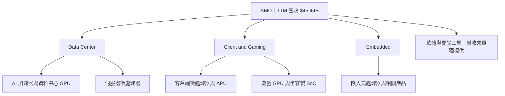
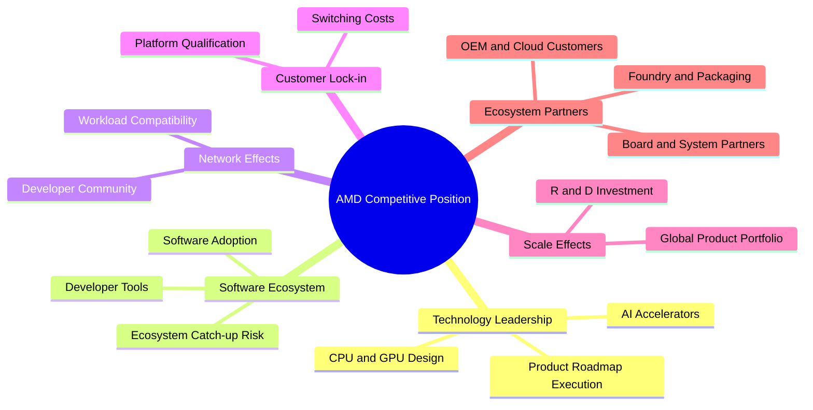
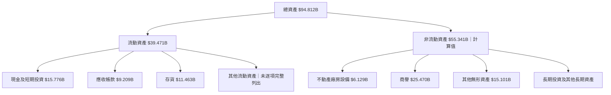
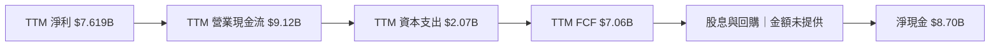
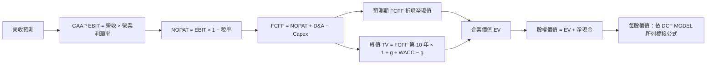
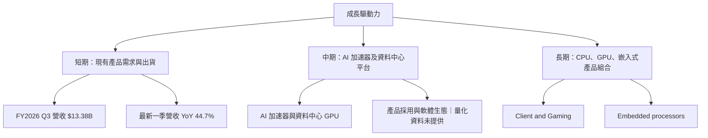
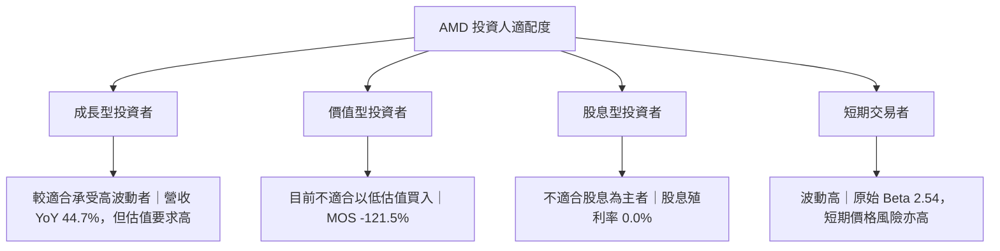

# AMD 基本面深度分析報告
> **報告日期**：2026-11-21 ｜ **語言**：繁體中文 ｜ **數據來源**：SEC 申報資料 (XBRL)、Yahoo Finance、Finviz、StockAnalysis、Roic.ai ｜ **分析師**：CFA 級機構研究

## 目錄

| # | 章節 | 核心結論 |
|---|------|----------|
| 1 | 執行摘要 | 賣出；加權合理價值 $191.58；MOS -121.5% |
| 2 | 公司概覽與商業模式 | 具產品與平台優勢，但市場份額及分部營收數據未提供 |
| 3 | 損益表深度分析 | TTM 營收 $45.44B、年增 41.9%；最新一季營業利益率改善 |
| 4 | 資產負債表分析 | 淨現金 $8.70B，流動性充足；庫存天數增加 |
| 5 | 現金流量深度分析 | TTM FCF $7.06B，FCF Yield 1.00% |
| 6 | 獲利能力與資本效率 | ROIC 12.8% 低於 WACC 14.0%，目前略為摧毀股東價值 |
| 7 | 相對估值分析 | 公司估值高於多數可比同業；P/S 位於自身五年區間第 90 百分位 |
| 8 | DCF 內在價值評估 | 基準 DCF 每股 $75.54；相對現價溢價 461.8% |
| 9 | 成長催化劑 | AI 加速器、資料中心與客戶產品線是主要方向；具體 TAM 與時程未提供 |
| 10 | 風險矩陣 | 估值、競爭及產品執行是主要風險 |
| 11 | 投資建議 | 依 MOS 評級為賣出；等待估值或基本面改善後再評估 |

## 1. 執行摘要

### 1.0 一頁式投資儀表板（Portfolio Manager 30 秒速讀）

| 項目 | 內容 |
|------|------|
| **投資論點（3 句）** | ① TTM 營收 $45.44B、年增 41.9%，最新一季營收年增 44.7%，反映需求仍在擴大。② TTM FCF 為 $7.06B、FCF Yield 僅 1.00%，現金流雖為正，但相對市值的現金回報有限。③ 加權合理價值 $191.58，低於 2026-11-20 收盤價 $424.39；MOS 為 -121.5%，估值折讓要求不足。 |
| **綜合評分** | **6.3/10**（引用 1.1 評分卡） |
| **財務健康** | 🟢 現金及短期投資 $15.78B，總債務 $7.08B，淨現金 $8.70B；營運資金中 DIO 升至 199 天，需監察庫存。 |
| **ROIC vs WACC** | 12.8% vs 14.0%；🟡 ROIC 低 1.2 個百分點，按本報告資本成本假設尚未覆蓋資本成本。 |
| **FCF 趨勢** | FY2022–FY2025 年度 FCF 由 $3.12B、$1.12B、$2.40B 升至 $6.74B；最新 TTM FCF $7.06B，FCF Yield 1.00%。 |
| **估值** | Forward P/E 24.06x（Yahoo Finance 市場資料）｜EV/EBITDA 61.86x（Yahoo Finance 市場資料）｜FCF Yield 1.00%。不同來源／口徑的倍數可能不一致；同業比較依 7.1 指定的 Peer multiples。 |
| **DCF 內在價值（基準）** | $75.54；現價相對 DCF 溢價 **461.8%**（第 8.5 節）。 |
| **安全邊際（MOS）** | **-121.5%**＝（加權合理價值 $191.58 − 現價 $424.39）÷ 加權合理價值 $191.58（第 8.8 節）。🔴 <10%：無安全邊際。 |
| **預期報酬（基準情境 12M）** | 以加權合理價值相對現價衡量的上行空間為 **-54.9%**；這是估值參照，不是保證的 12 個月報酬預測。 |
| **關鍵風險（前二）** | 高估值使市場對未來成長與獲利落差的容忍度低；AI 加速器及資料中心競爭可能壓低成長或利潤率。 |
| **評級 + 信心度** | 🔴 **賣出** ｜ 信心：中。評級直接依 8.8 MOS 門檻；DCF、同業倍數及分析師共識差距大，降低估值結論信心。 |

### 1.1 綜合評分卡（全報告唯一）

| 維度 | 評分（1–10） | 主要依據（引用數字與其來源章節） |
|------|--------------|----------------------------------|
| 成長性 | 8.0 | TTM 營收年增 41.9%、最新一季年增 44.7%（第 3 章），但未來成長持續性仍受競爭影響。 |
| 獲利能力 | 7.0 | TTM 營業利益率 17.7%、ROIC 12.8%、Piotroski F-Score 7/9（第 3、6 章）；ROIC 低於 14.0% WACC。 |
| 財務健康 | 8.0 | 淨現金 $8.70B、流動比率 2.725（市場資料），但 DIO 由 161 天增至 199 天（第 4 章）。 |
| 估值 | 2.0 | MOS -121.5%；P/S 五年百分位第 90 百分位（第 7、8 章）。 |
| 護城河 | 8.0 | CPU、GPU、AI 加速器及嵌入式產品組合，TTM 營收 $45.44B；但未提供可引用的市場份額及客戶留存數據（第 2 章）。 |
| 管理層與資本配置 | 5.0 | FY2025 SBC $1.64B，稀釋股數測試未通過；資本配置、回購與收購回報的完整資料未提供（第 3、5 章）。 |
| **綜合評分** | **6.3** | 六項算術平均：\((8.0+7.0+8.0+2.0+8.0+5.0)÷6=6.333…\)，四捨五入至一位小數為 **6.3**。 |

### 1.2 五大投資論點 + 三大核心風險

| 類型 | 項目 | 具體依據 | 信心度 |
|------|------|----------|--------|
| 🟢 **投資論點①** | 營收動能仍高 | TTM 營收 $45.44B、年增 41.9%；最新一季年增 44.7%。若主要產品需求延續，收入規模可支撐研發與平台投入。 | 🟢 高 |
| 🟢 **投資論點②** | 最新季度營業槓桿改善 | FY2026 Q3 營收 $13.38B、營業利益 $2.83B；季度營業利益率 21.2%（VERIFIED FIGURES）。營收增加可能提高固定研發成本的吸收效率。 | 🟢 中高 |
| 🟢 **投資論點③** | 現金流與資產負債表提供韌性 | TTM 營業現金流 $9.12B、FCF $7.06B，淨現金 $8.70B，可支持研發與產品週期投資。 | 🟢 高 |
| 🟢 **投資論點④** | 多產品線分散單一產品週期 | 公司涵蓋 Data Center、Client and Gaming、Embedded；分部營收未提供，無法量化各板塊對整體增長的貢獻。 | 🟡 中 |
| 🟢 **投資論點⑤** | 資產品質指標偏正面 | Piotroski F-Score 7/9，營業現金流高於淨利、毛利率較一年前高（第 6.4 節）。 | 🟡 中 |
| 🟡 **風險①** | 估值與基本面落差 | 加權合理價值 $191.58，低於現價 $424.39；基準 DCF $75.54。市場價格需要遠高於基準模型的現金流預測才能支撐。 | 🔴 高衝擊 |
| 🔴 **風險②** | AI／資料中心競爭與產品執行 | NVDA 最新一季營收年增 103.2%，高於 AMD 的 44.7%（Peer multiples）。競爭、軟體生態及供應落差可能使 AMD 的預期成長或利潤率無法達標。 | 🔴 高 |
| 🟡 **風險③** | 庫存與稀釋 | DIO 升至 199 天，一年前為 161 天；Piotroski 稀釋股數測試未通過。若庫存轉化或股東稀釋惡化，現金回報會低於會計盈餘所示。 | 🟡 中高 |

### 1.3 快速統計卡片

| 指標 | 公司實際值（期間） | 同業中位數 | 狀態 |
|------|--------------------|------------|------|
| 營收成長（TTM） | **41.9%** | — | 🟢 |
| 營收成長（最新一季年增） | **44.7%** | **85.5%**（NVDA、INTC、AVGO 中位數） | 🟡 |
| 毛利率（TTM） | **56.0%** | **74.9%**（同業中位數） | 🟡 |
| 營業利益率（TTM） | **17.7%** | — | 🟡 |
| ROIC（TTM） | **12.8%** | — | 🟡 |
| Forward P/E | **24.06x**（Yahoo Finance 市場資料） | **15.7x**（Peer multiples） | 🔴 |
| FCF Yield（TTM） | **1.00%** | — | 🔴 |
| Piotroski F-Score | **7 / 9** | — | 🟢 |

### 1.4 投資結論

```text
╔══════════════════════════════════════════════════════════════════╗
║                    📊 投資結論摘要                               ║
╠══════════════════════════════════════════════════════════════════╣
║  評級：🔴 賣出（依 8.8 MOS 門檻，未作質化調整）                  ║
║  價格（2026-11-20 收盤）：$424.39                               ║
║  DCF 內在價值（基準）：$75.54（現價溢價 461.8%）                ║
║  安全邊際 MOS：-121.5%（以加權合理價值 $191.58 為分母）         ║
║  加權合理價值（8.8）：$191.58                                    ║
║  DCF 情境價值：                                                   ║
║    悲觀情境：$40.03（-90.6%）                                    ║
║    基準情境：$75.54（-82.2%）                                    ║
║    樂觀情境：$141.10（-66.8%）                                   ║
║  綜合評分：6.3/10（引用 1.1）                                    ║
║  適合投資人：可承受高波動、以長期成長為優先且接受高估值風險者；  ║
║              不適合以現金殖利率或低估值為主要篩選條件者。       ║
╚══════════════════════════════════════════════════════════════════╝
```

## 2. 公司概覽與商業模式

### 2.1 業務結構與收入來源

AMD 是美國半導體公司，員工數 31,000 人，提供 CPU、GPU、AI 加速器、資料中心與專業 GPU、嵌入式處理器及半客製 SoC。TTM 營收為 $45.44B，分部營收與占比未提供，因此不對各板塊編造金額或百分比。



資料來源：公司業務描述與 SEC 10-Q；各分部收入金額、軟體／服務收入及分部占比未提供。

### 2.2 市場份額

市場份額資料未提供，故不繪製份額圖或填列比例。AMD TTM 營收 $45.44B、TTM 年增 41.9%，最新一季年增 44.7%；Peer multiples 顯示 AMD 最新一季成長低於 NVDA 的 103.2% 及 AVGO 的 85.5%，但高於 INTC 的 20.9%。這些收入成長數據可作相對動能比較，不能替代市場份額。

### 2.3 競爭護城河分析



### 2.4 護城河強度

| 護城河項目 | 強度（強／中／弱） | 證據（引用數字或事實） | 會削弱它的情況 |
|------------|--------------------|------------------------|----------------|
| 技術與產品設計 | 中至強 | 同時提供 CPU、GPU、AI 加速器、APU 與嵌入式產品；TTM 營收 $45.44B。 | 新產品性能、供應、功耗或上市時間落後競品。 |
| 軟體生態 | 中 | 公司業務包含 AI 加速器與 GPU；軟體收入、開發者數及使用量未提供，難以量化生態成熟度。 | 開發者工具與主流工作負載支援不足，造成客戶切換成本偏低。 |
| 網路效應 | 弱至中 | 有跨產品平台與開發工具方向，但沒有可引用的網路效應或使用者數據。 | 客戶在多供應商間切換，產品間協同無法提升採用。 |
| 客戶鎖定 | 中 | 伺服器、PC、遊戲及嵌入式晶片通常需要客戶驗證與系統整合；客戶集中度及續約資料未提供。 | 客戶自研晶片、重新設計平台或改採競爭產品。 |
| 規模效應 | 中至強 | TTM 營收 $45.44B、研發費用 FY2025 $8.09B（年度損益表資料）。 | 研發投入未轉化成產品收入，或高固定成本無法由銷售規模吸收。 |
| 生態夥伴 | 中 | 產品需透過晶圓製造、封裝、OEM 與系統整合伙伴完成商業化；供應商與客戶明細未提供。 | 先進製程、封裝產能或系統合作不及競品。 |

1.1「護城河」評分 **8.0/10**，依據是產品涵蓋多個運算市場且 TTM 營收達 $45.44B；未提供市占、客戶鎖定與軟體使用數據，故不能僅以規模推論護城河必然持久。

## 3. 損益表深度分析

### 3.1 年度收入成長趨勢（近4年）

依年度收入表計算的 YoY 成長率：FY2023 為 -3.9%、FY2024 為 13.7%、FY2025 為 34.3%。FY2022 相對 FY2021 為 43.6%。FY2022 至 FY2025 營收 CAGR 約 13.6%（\((34.64÷23.60)^{1/3}-1\)）。

```text
╔══════════════════════════════════════════════════════════════════╗
║              AMD 年度收入趨勢（FY2022-FY2025）                  ║
╠══════════════════════════════════════════════════════════════════╣
║  FY2022  $23.60B  ██████████████░░░░░░░░░░░░  YoY: +43.6% 🟢   ║
║  FY2023  $22.68B  █████████████░░░░░░░░░░░░░  YoY:  -3.9% 🔴   ║
║  FY2024  $25.79B  ███████████████░░░░░░░░░░░  YoY: +13.7% 🟡   ║
║  FY2025  $34.64B  ████████████████████░░░░░░  YoY: +34.3% 🟢   ║
╠══════════════════════════════════════════════════════════════════╣
║  FY2022-FY2025 營收 CAGR：約 +13.6%                              ║
╚══════════════════════════════════════════════════════════════════╝
```

FY2023 的回落後，FY2024、FY2025 恢復成長；TTM 營收年增 41.9% 高於 FY2025 的年度增幅，顯示近期成長速度加快。分部營收未提供，無法判定增長有多少來自資料中心、客戶端或遊戲產品。

### 3.2 季度收入趨勢分析

最近四季營收依序為 FY2025 Q4 $10.27B、FY2026 Q1 $10.25B、Q2 $11.54B、Q3 $13.38B。QoQ 以相鄰季度計算；YoY 採 StockAnalysis 季度資料／VERIFIED FIGURES 的最新季度數字。

| 季度 | 營收（$B） | QoQ 成長 | YoY 成長 | 備註 |
|------|------------|----------|----------|------|
| FY2025 Q4 | 10.27 | N/A（本表未提供 FY2025 Q3 同口徑比較欄） | 34.1% | 高於 FY2025 Q3 的 $9.25B。 |
| FY2026 Q1 | 10.25 | -0.2% | 37.9% | QoQ 略降，但 YoY 仍成長。 |
| FY2026 Q2 | 11.54 | 12.5% | 50.1% | QoQ 與 YoY 同步加速。 |
| FY2026 Q3 | 13.38 | 16.0% | 44.7% | 連續季度擴張；YoY 低於 Q2 的 50.1%，但仍高於 TTM 年增率以外的年度歷史表現。 |

最新一季 QoQ 由 Q1 的 -0.2% 回升至 Q3 的 16.0%，支持需求動能改善；然而 Q3 YoY 44.7% 低於 Q2 YoY 50.1%，表示成長率未呈現單向加速。

### 3.3 利潤率演變分析

年度毛利率、營業利益率及淨利率按同一年度損益表數據計算。由於年度資料與另一來源 StockAnalysis 的部分 FY2025 項目不一致，本表採年度損益表所列數值計算，TTM 則採 VERIFIED FIGURES。

| 利潤率指標 | FY2022 | FY2023 | FY2024 | FY2025 | 趨勢 | 評估 |
|------------|--------|--------|--------|--------|------|------|
| **毛利率** | 44.9% | 46.1% | 49.3% | 49.5% | 整體上升；產品組合及規模可能改善，具體分部貢獻未提供。 | 🟢 |
| **營業利益率** | 5.3% | 1.8% | 8.1% | 10.7% | FY2023 低谷後回升；固定費用吸收與營收組合可能改善。 | 🟢 |
| **淨利率** | 5.6% | 3.8% | 6.4% | 12.5% | FY2025 高於營業利益率改善幅度，稅項及非營業項目明細未足以拆解原因。 | 🟡 |

TTM 毛利率為 56.0%、營業利益率為 17.7%、淨利率為 16.8%，均高於採用年度表計算的 FY2025 利潤率。FY2026 Q3 的 TTM／季度口徑更需區分：VERIFIED FIGURES 的最新季度營業利益率為 21.2%，另一市場資料列 17.8%，兩者口徑不一致；本報告以 VERIFIED FIGURES 的 21.2% 作最新季度參照，不把單季數字標作 TTM。產品組合、定價、製造成本和研發費用對利潤率變動的精確分解未提供，不能將利潤率改善全部歸因於單一因素。

### 3.4 費用結構分析

營收成本、研發、銷售管理費用與一次性項目之完整費用明細未能在同一期間提供，故不繪製會造成比例誤解的費用圓餅圖。可確認 FY2025 研發費用為 $8.09B（年度損益表資料）；另一來源 StockAnalysis 列 FY2025 研發費用 $6.46B，來源間差異顯著，應在對照 SEC 申報資料後再作精確費用結構歸因。研發支出反映 AMD 需要持續投入產品與軟體，但收入轉化效率需觀察後續季度。

### 3.5 季度 EPS 趨勢與盈餘品質（Quality of Earnings）

EPS 預估值在 Earnings History 欄位為缺漏，因此過去四季「超預期／不及預期」無法可靠判斷，不能把缺值當成 beat 或 miss。可觀察實際 EPS 及年增：FY2026 Q3 $1.48、YoY +93.8%；Q2 $1.41、YoY +159.5%；Q1 $0.85、YoY +91.2%；FY2025 Q4 $0.93、YoY +217.1%（StockAnalysis）。獲利成長高於營收成長的季度，可能與營業槓桿及基期影響相關，但單季 EPS 不宜直接外推。

| 盈餘品質項目 | 數值／佔比 | 評估 |
|--------------|-----------|------|
| 股權薪酬 SBC / 營收 | 約 **4.4%**：最近四季 SBC 合計 $2.00B ÷ TTM 營收 $45.44B | 🟡 股權薪酬並非極小項目；發行股數增加會稀釋每股經濟利益。 |
| SBC / 營業現金流 | 約 **21.9%**：$2.00B ÷ TTM OCF $9.12B | 🟡 SBC 是非現金會計費用，但股東承擔稀釋成本，不能只因現金流量表加回而視為沒有成本。 |
| FCF / 淨利（現金轉換率） | 約 **92.7%**：TTM FCF $7.06B ÷ TTM 淨利 $7.619B | 🟢 現金轉換接近淨利；短期營運資金變化仍可能造成波動。 |
| 一次性／非經常性損益 | N/A（未提供可比的 TTM 明細） | 無法判斷一次性收益是否抬高當期盈餘。 |
| 有效稅率異常 | N/A（未提供 TTM 實際有效稅率） | DCF 採用 21.0% 預設稅率，不應誤當成已披露的實際 TTM 稅率。 |
| 資本化支出 vs 費用化 | TTM Capex $2.07B；資本化政策與資本化研發明細未提供 | 無足夠資料判斷是否有成本遞延或資本化造成當期利潤偏高。 |

**盈餘品質結論：** TTM FCF 對淨利轉換率約 92.7%，支持盈餘具現金流支撐；但 SBC 約占營收 4.4%、占營業現金流 21.9%，且稀釋股數測試未通過，股東的每股報酬可能低於未考慮稀釋的企業獲利增長。由於一次性損益、有效稅率及資本化細節缺漏，盈餘品質評估仍需保留。

## 4. 資產負債表分析

### 4.1 資產結構分解

以下為 StockAnalysis FY2026 Q3 資產負債表資料。總資產 $94.812B；流動資產 $39.471B；非流動資產 $55.341B 為總資產減流動資產的計算值。不同來源的總債務口徑不一致，本節只展示資產端，不混入債務數字。



### 4.2 流動性與營運資金分析

流動比率 2.725、速動比率 1.725 來自 Yahoo Finance／市場資料。現金及短期投資 $15.78B，顯示短期流動性有緩衝；但存貨增加及收款週期略拉長，營運資金占用仍值得追蹤。

| 指標 | 最新 TTM | 一年前 TTM | 變化 | 解讀 |
|------|----------|------------|------|------|
| DSO 應收帳款天數 | 74 天 | 71 天 | +3 天 | 收款週期略延長；可能與客戶、產品及季度出貨組合相關，來源未提供更細拆解。 |
| DIO 存貨天數 | 199 天 | 161 天 | +38 天 | 存貨周轉放慢或備貨提高；若需求低於預期，可能增加折價與現金占用風險。 |
| DPO 應付帳款天數 | 135 天 | 77 天 | +58 天 | 付款期延長可支持營運資金，但亦需關注是否來自供應商條款改變或付款節奏。 |
| CCC 現金轉換週期 | 138 天 | 155 天 | -17 天 | 雖 DIO 上升，但 DPO 增幅更大，令 CCC 縮短；不代表庫存風險已消失。 |

### 4.3 債務結構分析

債務與現金使用 VERIFIED FIGURES 的 TTM 口徑：總債務 $7.08B、現金及短期投資 $15.78B、淨現金 $8.70B。其他資料來源列出的債務數值不同，不與此處混用。Debt/EBITDA 與利息保障倍數因缺少同一口徑的 EBITDA／利息費用資料，不自行反推。

```text
╔══════════════════════════════════════════════════════════════════╗
║                   AMD 債務健康診斷                              ║
╠══════════════════════════════════════════════════════════════════╣
║  總債務：        $7.08B     ███████░░░░░░░░░░░░░  🟡             ║
║  現金+短期投資： $15.78B    ████████████████░░░░  🟢             ║
║  淨現金：        $8.70B     █████████░░░░░░░░░░░  🟢             ║
║  Debt/EBITDA：   N/A（同口徑 EBITDA 未提供）                     ║
║  Interest Coverage：N/A（利息費用未提供）                        ║
║  流動比率：      2.725x（Yahoo Finance 市場資料）                 ║
╚══════════════════════════════════════════════════════════════════╝
```

### 4.4 股東權益趨勢

年度股東權益逐年增加，FY2025 為 $63.00B。公司資產負債表包含大量商譽與無形資產，故帳面權益擴張不等同於有形資產報酬改善。

```text
╔══════════════════════════════════════════════════════════════════╗
║                   AMD 股東權益趨勢                              ║
╠══════════════════════════════════════════════════════════════════╣
║  FY2022  $54.75B  █████████████████░░░░░░░░░░                   ║
║  FY2023  $55.89B  ██████████████████░░░░░░░░                   ║
║  FY2024  $57.57B  ███████████████████░░░░░░░                   ║
║  FY2025  $63.00B  ████████████████████░░░░░░                   ║
╚══════════════════════════════════════════════════════════════════╝
```

## 5. 現金流量深度分析

### 5.1 現金流量瀑布圖

下圖使用最新 TTM 數值；股息與回購金額未提供，故不填入金額。



### 5.2 FCF 轉換率趨勢

| 財年 | FCF（$B） | 淨利（$B） | FCF／淨利 |
|------|----------|------------|-----------|
| FY2022 | 3.12 | 1.32 | 236.4% |
| FY2023 | 1.12 | 0.854 | 131.1% |
| FY2024 | 2.40 | 1.64 | 146.3% |
| FY2025 | 6.74 | 4.33 | 155.7% |
| TTM 至 2026-09-26 | 7.06 | 7.619 | 92.7% |

年度 FCF 高於淨利的比例，可能受非現金費用及營運資金變動影響；TTM 轉換率降至 92.7%，仍接近 100%，但需要以後續營運資金和庫存變化驗證。年度與 TTM 存在期間差異，不宜將它們當作完全同口徑趨勢。

### 5.3 自由現金流趨勢

| 期間 | FCF | 變化 | FCF Yield |
|------|-----:|------|-----------|
| FY2022 | $3.12B | — | N/A |
| FY2023 | $1.12B | YoY -64.1% | N/A |
| FY2024 | $2.40B | YoY +114.3% | N/A |
| FY2025 | $6.74B | YoY +180.8% | N/A |
| TTM 至 2026-09-26 | $7.06B | 與 FY2025 期間不可直接視為同期間 YoY | 1.00% |

```text
╔══════════════════════════════════════════════════════════════════╗
║                 AMD 自由現金流趨勢                              ║
╠══════════════════════════════════════════════════════════════════╣
║  FY2022  $3.12B  █████████░░░░░░░░░░░                            ║
║  FY2023  $1.12B  ███░░░░░░░░░░░░░░░░░                            ║
║  FY2024  $2.40B  ███████░░░░░░░░░░░░                             ║
║  FY2025  $6.74B  ████████████████████                            ║
║  TTM     $7.06B  █████████████████████｜FCF Yield 1.00%          ║
╚══════════════════════════════════════════════════════════════════╝
```

### 5.4 資本配置評估

目前資料能確認 FY2025 資本支出 $0.974B、FY2025 SBC $1.64B，以及 TTM 資本支出 $2.07B；股息、回購、收購及債務償還的完整現金配置金額未提供，因此不繪製比例型 pie chart。

| 資本配置項目 | 已知資料 | 評估 |
|--------------|----------|------|
| 資本支出 | TTM $2.07B | 支持產品與營運能力；未提供分項投資回報。 |
| 研發 | FY2025 $8.09B（年度損益表來源；StockAnalysis 同期數據不同） | 對半導體產品週期重要，須追蹤研發轉化為收入與毛利的效率。 |
| 股息 | 殖利率 0.0% | 未以股息作主要股東回報。 |
| 回購 | 金額未提供 | 無法量化是否抵銷 SBC 稀釋。 |
| SBC | FY2025 $1.64B | 代表人才與薪酬安排，但會稀釋持股。 |
| 留存現金 | 現金及短期投資 $15.78B | 可作研發、營運與策略投資緩衝。 |

## 6. 獲利能力與資本效率

### 6.1 ROE / ROA / ROIC 趨勢

| 指標 | 歷史可用數值 | 評估 |
|------|--------------|------|
| ROE | TTM 11.1%（QUALITY FIGURES）；另有市場資料列 12.0%，口徑有差異 | 本報告杜邦分析採指定品質指標的 11.1%。 |
| ROA | TTM 5.9%（市場資料） | 正值，資產轉化成淨利能力仍受龐大商譽與無形資產影響。 |
| ROIC | TTM 12.8% | 低於 14.0% WACC；現階段未完全覆蓋資本成本。 |
| 行業均值比較 | N/A（未提供一致來源與同口徑行業 ROE／ROA／ROIC） | 不以估算值填補。 |

### 6.2 ROIC vs WACC 分析（核心價值創造判斷）

WACC 直接採用 Cost of capital 區塊的 **14.00%**。資料列示 CAPM 股權成本 14.91%，計算 WACC 為 14.78%，但因設定上限而採用 14.00%。ROIC 12.8% 因此低於 WACC 1.2 個百分點。

```text
╔══════════════════════════════════════════════════════════════════╗
║                ROIC vs WACC 深度分析                            ║
╠══════════════════════════════════════════════════════════════════╣
║  WACC 輸入（依 Cost of capital）：                               ║
║  ├── 無風險利率 Rf（10Y 美債）：4.91%                            ║
║  ├── 市場風險溢酬 ERP：5.00%                                     ║
║  ├── 原始 Beta：2.54；採用調整後 Beta：2.00                     ║
║  ├── 股權成本 Ke：4.91% + 2.00 × 5.00% = 14.91%                ║
║  ├── 稅前債務成本：1.85%；稅後約 1.46%                          ║
║  ├── 股權／債務權重：99.0%／1.0%                                ║
║  ├── 計算 WACC：14.78%；依 7%–14% 區間限制後採用 14.00%         ║
║                                                                  ║
║  ROIC（TTM）：12.8%                                               ║
║  WACC：14.0%                                                      ║
║  EVA spread：12.8% − 14.0% = -1.2 個百分點                      ║
║                                                                  ║
║  ROIC  12.8%  ▓▓▓▓▓▓▓▓▓▓▓▓▓░░░░░░░░░                           ║
║  WACC  14.0%  ▓▓▓▓▓▓▓▓▓▓▓▓▓▓░░░░░░░░                           ║
║  EVA   -1.2pp 🔴 尚未覆蓋資本成本                                ║
╚══════════════════════════════════════════════════════════════════╝
```

**結論：** ROIC/WACC = 12.8% ÷ 14.0% = 0.91 倍。按此 TTM 指標，AMD 尚未達到正的經濟利潤；若 ROIC 隨產品組合與營業利潤率提高至高於 WACC，則可轉為創造股東價值。WACC 為受上限約束的資本成本，若未來風險溢酬或 Beta 改變，價值差距亦會變動。

### 6.3 杜邦三因素分解

| 因素 | 數值（TTM） | 解讀 |
|------|-------------|------|
| 淨利率 | 16.8% | 淨利率為 ROE 的主要正向來源。 |
| 資產週轉率 | 0.48 | 每單位資產帶來的營收有限；商譽及無形資產規模影響資產效率。 |
| 權益乘數 | 1.39 | 槓桿程度不高，ROE 並非主要靠財務槓桿推升。 |
| **ROE** | **11.1%** | 16.8% × 0.48 × 1.39 = **11.1%**（依 QUALITY FIGURES 原值）。 |

### 6.4 財務體質：Piotroski F-Score

Piotroski F-Score 為 **7/9**。資料註明缺少輸入的測試會排除；本次列示九項測試且分母為 9。

| 測試 | 結果 | 解讀 |
|------|------|------|
| ROA > 0 | ✅ 通過 | 盈利能力為正。 |
| 營業現金流 > 0 | ✅ 通過 | 營運活動產生正現金流。 |
| ROA 高於一年前 | ✅ 通過 | 資產獲利能力改善。 |
| 營業現金流 > 淨利（應計品質） | ✅ 通過 | 現金流對盈餘提供支持。 |
| 長期負債 ÷ 總資產低於一年前 | ❌ 未通過 | 相對槓桿指標未改善，需監察負債與資產增長。 |
| 流動比率高於一年前 | ✅ 通過 | 短期流動性相對改善。 |
| 稀釋股數未增加 | ❌ 未通過 | 股數稀釋可能壓低每股收益增長。 |
| 毛利率高於一年前 | ✅ 通過 | 產品組合或成本效率較一年前改善。 |
| 資產週轉率高於一年前 | ✅ 通過 | 資產利用效率較一年前改善。 |

## 7. 相對估值分析

### 7.1 同業估值比較表格

同業數據依 Peer multiples；AMD 的倍數使用市場資料。AMD TTM P/E 的市場資料與五年歷史區塊口徑略有差異：本表使用市場資料的 90.68x，歷史比較見 7.2。

| 估值指標 | **AMD** | **NVDA** | **INTC** | **AVGO** | AMD 評估 |
|----------|--------:|--------:|--------:|--------:|-----------|
| **Trailing P/E** | 90.68x | 13.5x | N/A | 38.9x | 🔴 高於有值的同業；INTC 缺值不補。 |
| **Forward P/E** | 24.06x | 7.6x | 28.6x | 15.7x | 🟡 高於同業中位數 15.7x；高預期成長可能部分解釋溢價。 |
| **P/S Ratio** | 15.46x | 8.4x | 4.6x | 16.3x | 🟡 接近 AVGO、高於 NVDA 與 INTC；對毛利及成長執行要求高。 |
| **EV/EBITDA** | 61.86x | 12.2x | 14.9x | 28.5x | 🔴 明顯高於三家可比公司的倍數。 |
| **最新一季營收 YoY** | 44.7% | 103.2% | 20.9% | 85.5% | 🟡 成長高於 INTC，但低於 NVDA、AVGO。 |
| **毛利率（TTM）** | 56.0% | 74.9% | 40.2% | 75.5% | 🟡 高於 INTC，低於 NVDA、AVGO。 |

同業倍數及成長率來源：Yahoo Finance Peer multiples。市場環境與會計結構差異會降低倍數直接可比性；但 AMD EV/EBITDA 61.86x 高於 peer 區塊各同業 12.2x、14.9x、28.5x，顯示價格已計入較高的未來獲利預期。

### 7.2 歷史估值區間分析

| 倍數 | 現值 | 五年中位數 | 五年區間 | 現值百分位 |
|------|-----:|-----------:|----------|-----------:|
| P/E | 92.3x | 82.6x | 36.7x–934.7x | 53% |
| P/S | 15.5x | 8.9x | 4.3x–23.1x | 90% |
| EV/EBITDA | 86.5x | 102.2x | 38.2x–919.2x | 39% |

```text
╔══════════════════════════════════════════════════════════════════╗
║              AMD 歷史估值位置（五年區間）                        ║
╠══════════════════════════════════════════════════════════════════╣
║  P/E        36.7x ├────────────●──────────────┤ 934.7x  現值 53%║
║  P/S         4.3x ├──────────────────────●───┤  23.1x  現值 90%║
║  EV/EBITDA  38.2x ├──────────●────────────────┤ 919.2x  現值 39%║
║  ●＝現值百分位；極端歷史高值會拉寬區間，應同時參考中位數。       ║
╚══════════════════════════════════════════════════════════════════╝
```

P/S 15.5x 明顯高於五年中位數 8.9x，處於第 90 百分位，是估值風險最直接的歷史訊號。P/E 與 EV/EBITDA 的歷史區間受到極端值影響，百分位低於 P/S，但不代表相對便宜。

### 7.3 情境價值（Bear / Base / Bull，照抄 DCF MODEL 的 Scenarios）

| 情境 | 第 1 年營收成長 | 期末營業利潤率 | WACC | 每股價值 | 相對現價 | 機率 | 會發生的條件 |
|------|----------------|----------------|------|----------|----------|------|--------------|
| 🔴 悲觀 | 15.0% | 6.3% | 15.00% | $40.03 | -90.6% | 25% | AI／資料中心需求轉弱、產品競爭壓縮毛利，且風險溢酬上升。 |
| 🟡 基準 | 30.0% | 7.4% | 14.00% | $75.54 | -82.2% | 50% | 初年延續較高成長但長期趨勢收斂，營業利潤率逐步回到近五年中位數。 |
| 🟢 樂觀 | 45.0% | 8.1% | 13.00% | $141.10 | -66.8% | 25% | AI 加速器與資料中心產品放量，營收成長高於基準且折現率下降。 |

三情境的預測值均低於現價；即使模型樂觀情境 $141.10，仍較現價低 66.8%。情境機率加權值為 $83.06，但 8.8 的估值加權方法使用基準 DCF $75.54，不以機率加權情境值替代。

### 7.4 相對估值隱含價格區間

```text
╔══════════════════════════════════════════════════════════════════╗
║                  相對估值隱含每股價值                            ║
╠══════════════════════════════════════════════════════════════════╣
║  $75.54 ── $105.38 ── $276.97 ───────── $424.39 ───────── $657.74║
║  基準DCF   同業EV/EBITDA  同業Forward P/E      現價       共識目標║
╚══════════════════════════════════════════════════════════════════╝
```

| 方法 | 隱含每股價值 | 相對現價 | 推導依據 |
|------|--------------:|---------:|----------|
| 同業 Forward P/E | $276.97 | -34.7% | 同業中位數 15.7x × AMD Forward EPS $17.64。 |
| 同業 EV/EBITDA | $105.38 | -75.2% | Peer 中位數 14.9x × TTM EBITDA，再加回淨現金；方法數值照估值方法區塊引用。 |
| 分析師共識目標價 | $657.74 | +55.0% | 49 位分析師平均目標價；與內在價值模型差距很大，僅作市場預期參考。 |

## 8. DCF 內在價值評估（Discounted Cash Flow）

### 8.0 估值推理鏈（Thinking Logic：在算之前先想清楚）

**Step 1 — 價值由哪些變數決定？**

AMD 的 DCF 主要由既有 CPU、GPU、嵌入式及資料中心產品帶來的收入與現金流，以及 AI 加速器等成長方向對未來營收與營業利潤率的影響決定；各分部營收占比未提供，故無法把它們拆成各自的現金流估值。模型以 TTM 營收 $45.44B 為基礎，不將未提供的分部份額轉成估值假設。模型對價值最敏感的變數是 WACC、營收路徑及終值成長率；敏感性表顯示在其他條件固定時，WACC 與 g 的改變會顯著影響每股價值。

**Step 2 — 模型選擇**

| 決策點 | 本報告採用 | 理由（含數字） | 曾考慮但否決 | 否決理由 |
|--------|-----------|----------------|--------------|----------|
| 現金流定義 | FCFF | 對應 WACC 折現並先得企業價值；TTM OCF $9.12B、Capex $2.07B、FCF $7.06B。 | FCFE | 估值方法指定使用 FCFF，且資本結構可變。 |
| 預測期 N | 10 年 | 模型程式設定為 10 年，並逐年將營收成長由 30.0% 收斂至 3.0%。 | 5 年 | 會更早依賴終值，與模型設定不符。 |
| 終值方法 | Gordon Growth | WACC 14.0% 大於 g 3.0%，公式適用；基準模型 TV 現值占 EV 35.3%。 | 只用退出倍數 | DCF MODEL 未提供退出倍數法終值，不能自建替代模型。 |
| EBIT 基礎 | GAAP EBIT | 模型明確採 GAAP 營業利益率，17.7% 起始並逐年下降至 7.4%。 | 非 GAAP EBIT | 非 GAAP 會改變 SBC 處理，且模型未提供相應序列。 |

**Step 3 — 關鍵假設推導鏈**

- **營收路徑**：錨點＝TTM 營收年增 41.9%、最新一季年增 44.7%；調整＝基期提高、競爭與週期使增速逐年收斂；**模型採用第 1 年 30.0%，線性降至第 10 年 3.0%**；曾考慮延續 41.9% 或 44.7%，但否決為十年基準，因為單一 TTM／季度成長率不宜直接外推整個預測期。
- **期末營業利潤率**：錨點＝TTM 營業利益率 17.7%；調整＝模型採取由 17.7% 逐步回落，反映成熟化與競爭；**第 10 年採 7.4%**；曾考慮把 17.7% 維持十年，否決原因是模型採用近五年中位數作成熟期錨點，而非假設高利潤率永久維持。
- **永續成長率 g**：錨點＝長期成熟公司成長需低於折現率；**採用 3.0%**，低於 WACC 14.0%；曾考慮更高長期成長率，未採用，因公司尚未提供可支持高於 3.0% 長期永續增長的數據，且提高 g 會顯著抬高終值。
- **預測期 N**：錨點＝模型預設 10 年，收入成長由 30.0% 線性收斂至 3.0%；**採用 10 年**；曾考慮 5 年，否決原因是已計算 DCF MODEL 明確採 10 年，不能另建模型替換。
- **Capex／營收**：錨點＝TTM Capex $2.07B ÷ TTM 營收 $45.44B 約 4.6%，模型採用逐年 4.5%；**採用值 4.5%**；曾考慮照 TTM 比率取約 4.6%，但 DCF MODEL 已指定 4.5%，本報告不改動。
- **EBIT 基礎、SBC 與股數**：錨點＝DCF MODEL 明列 GAAP EBIT，TTM SBC 約 $2.00B；**採用組合 (A)：GAAP EBIT + 固定股數 + 年稀釋率 0%**。GAAP EBIT 已把 SBC 作費用，本模型不再減 SBC，也不另加年稀釋率。曾考慮非 GAAP 加回 SBC，但模型未提供相應 EBIT 或 SBC 預測，故否決。
- **D&A／營收與稅率**：錨點＝模型列示 TTM D&A／營收 6.7%、稅率 21.0%；**採用 6.7% 及 21.0%**。有效稅率歷史細項未提供，這是模型設定，不宣稱為實際 TTM 稅率。
- **營運資金變動**：錨點＝FY2026 Q3 CCC 138 天；模型註明未建模營運資金；**採用不另列 ΔWC**。曾考慮以 CCC 推算變動，但缺少模型所需的 ΔWC 金額與逐年假設，故不自行估計。
- **終值方法**：錨點＝模型提供 10 年 FCFF 與 g 3.0%；**採用 Gordon Growth**。曾考慮以退出倍數交叉驗證，但 DCF MODEL 未提供終值退出倍數，不另造數字。
- **WACC**：錨點＝Cost of capital 區塊計算 WACC 14.78%，受 7%–14% 上限約束；**採用 14.00%**。曾考慮直接用 14.78%，但程式已說明將 WACC 限制在 14.00%，按規則照抄。
- **年稀釋率**：錨點＝模型組合 (A)；**採用 0%**，股數固定；曾考慮另加稀釋，否決原因是 GAAP EBIT 已含 SBC，額外稀釋會重複計入模型成本。

**Step 4 — 最脆弱環節**

最脆弱的是長期營業利潤率與收入成長能否沿模型路徑實現；若 AI 與資料中心產品沒有支撐高於基準的收入或利潤，價值向下，悲觀情境為 $40.03；即使樂觀情境，估值亦只有 $141.10，仍顯著低於現價。

**Step 5 — 計算路徑圖**



### 8.1 模型假設總表（Model Inputs）

| 假設項目 | 採用值 | 依據／來源 | 敏感度 |
|----------|--------|-------------|--------|
| 預測期長度 **N** | 10 年 | DCF MODEL 指定 10 年；營收增長自 30.0% 線性降至 3.0%。 | 🟡 中 |
| 營收成長路徑 | 第 1 年 30.0% → 第 10 年 3.0% | TTM 年增 41.9%；模型將其限制於最高 30.0%，逐年線性下降。 | 🔴 高 |
| 營業利潤率 | 第 1 年 17.7% → 第 10 年 7.4% | TTM 營業利益率 17.7%；模型向近五年中位數收斂。 | 🔴 高 |
| 有效稅率 | 21.0% | DCF MODEL default tax rate；實際 TTM 有效稅率未提供。 | 🟢 低 |
| Capex／營收 | 4.5% | 模型列示 TTM 約 4.5%，且逐年採 4.5%。 | 🟡 中 |
| D&A／營收 | 6.7% | DCF MODEL 列示 TTM 比率並固定。 | 🟢 低 |
| 營運資金變動／營收增額 | 未建模 | DCF MODEL 明確註明 Working capital is not modelled；不反推缺漏數值。 | 🟢 低 |
| EBIT 基礎 | GAAP EBIT | DCF MODEL 指定 GAAP 營業利益率。 | 🟡 中 |
| 股權薪酬 SBC 處理 | 不在 FCFF 再扣 SBC | GAAP EBIT 已包含 SBC 費用；採組合 (A)。 | 🟡 中 |
| 年稀釋率（股數） | 0% | 組合 (A) 固定股數，避免 SBC 成本重複計算。 | 🟡 中 |
| 永續成長率 g | 3.0% | DCF MODEL 指定，低於 WACC 14.0%。 | 🔴 高 |
| 終值方法 | Gordon Growth | DCF MODEL 提供終值；未提供可獨立引用的退出倍數。 | 🔴 高 |
| WACC | 14.00% | Cost of capital 程式計算 14.78%，受 7%–14% 區間上限限制。 | 🔴 高 |

**FCFF 定義：** 本章採 FCFF，對應 WACC 折現並推導企業價值；模型公式為 **FCFF = NOPAT + D&A − Capex**。模型沒有營運資金變動列，故不另補 ΔWC。

**SBC 防呆說明：** 本模型採用 **(A) GAAP EBIT + 固定股數、年稀釋率 0%**；SBC 已包含於 GAAP 費用中，因此不再從 FCFF 扣除 SBC，也不額外放大股數。

### 8.2 折現率推導（WACC）

以下照 Cost of capital inputs。10Y Treasury 的觀察日期未在來源資料明列，故不自行指定日期；Beta 原值 2.54，調整後使用 2.00，依資料所示 \(⅔×2.54+⅓=2.03\)，再受 0.6–2.0 區間限制。

```text
╔══════════════════════════════════════════════════════════════════╗
║                    WACC 推導（折現率）                           ║
╠══════════════════════════════════════════════════════════════════╣
║  股權成本 Ke（CAPM）：                                           ║
║  ├── 無風險利率 Rf（10Y 美債）：4.91%                            ║
║  ├── 市場風險溢酬 ERP：5.00%                                     ║
║  ├── 原始 Beta：2.54；調整後採用 Beta：2.00                     ║
║  ├── 規模／國別溢酬：0.00%（未另提供額外溢酬）                   ║
║  └── Ke = 4.91% + 2.00 × 5.00% = 14.91%                         ║
║                                                                  ║
║  債務成本 Kd：                                                   ║
║  ├── 稅前 Kd：1.85%（Cost of capital inputs）                    ║
║  ├── 稅率：21.0%                                                 ║
║  └── 稅後 Kd = 1.85% × (1 − 21.0%) = 1.46%                      ║
║                                                                  ║
║  資本結構權重：                                                 ║
║  ├── 股權 E 權重：99.0%（市值權重）                             ║
║  ├── 債務 D 權重：1.0%                                          ║
║  ├── 原始加權計算 WACC：14.78%                                  ║
║  └── ✅ 受 7%–14% 上限限制後採用 WACC：14.00%                   ║
╚══════════════════════════════════════════════════════════════════╝
```

逐步演算與資料限制：

1. **Ke（CAPM）**  
   \(4.91\% + 2.00×5.00\% + 0.00\%=14.91\%\)。

2. **稅前 Kd**  
   採用 Cost of capital 區塊提供的稅前 Kd **1.85%**。利息費用金額與平均計息負債的詳細構成未提供，故不能可靠重建「利息費用 ÷ 平均計息負債」算式；不以應付帳款等無息負債替代。

3. **稅後 Kd**  
   \(1.85\%×(1-21.0\%)=1.4615\%\)，四捨五入為 **1.46%**。

4. **權重**  
   採用資料區塊提供的股權／債務權重 **99.0%／1.0%**，相加為 100.0%。最新收盤價為 2026-11-20 的 $424.39；但資本成本區塊未列計算權重使用的精確市值與債務明細，故直接採用其權重，不自行以來源不一致的市值重建。

5. **WACC**  
   由程式提供的未限制計算值為 14.78%，採用值依 7%–14% 上限為 **14.00%**。  
   \(99.0\%×14.91\%+1.0\%×1.46\%\) 約為 **14.78%**；受上限限制後採用 **14.00%**。

WACC 與第 6.2 節一致，均為 **14.00%**。因債務成本及權重的完整底層明細未提供，本節以指定 Cost of capital 輸入為準，而非另算一套 WACC。

### 8.3 逐年自由現金流預測（基準情境）

金額單位：$B；折現因子依 DCF MODEL 原值照錄。模型使用 GAAP EBIT、21.0% 稅率、D&A／營收 6.7%、Capex／營收 4.5%，不建模營運資金，且不另扣 SBC。

| 年度 | FY+1 | FY+2 | FY+3 | FY+4 | FY+5 | FY+6 | FY+7 | FY+8 | FY+9 | FY+10 |
|------|------:|------:|------:|------:|------:|------:|------:|------:|------:|-------:|
| 營收 | 59.07 | 75.01 | 93.02 | 112.55 | 132.81 | 152.73 | 171.06 | 186.46 | 197.64 | 203.57 |
| 營收 YoY | 30.0% | 27.0% | 24.0% | 21.0% | 18.0% | 15.0% | 12.0% | 9.0% | 6.0% | 3.0% |
| 營業利潤率 | 17.7% | 16.6% | 15.4% | 14.3% | 13.1% | 12.0% | 10.8% | 9.7% | 8.5% | 7.4% |
| 營業利益 EBIT（GAAP） | 10.46 | 12.43 | 14.34 | 16.06 | 17.42 | 18.28 | 18.51 | 18.03 | 16.84 | 15.00 |
| − 稅 | (2.20) | (2.61) | (3.01) | (3.37) | (3.66) | (3.84) | (3.89) | (3.79) | (3.54) | (3.15) |
| = NOPAT | 8.27 | 9.82 | 11.33 | 12.69 | 13.76 | 14.44 | 14.62 | 14.24 | 13.30 | 11.85 |
| + D&A | 3.96 | 5.03 | 6.24 | 7.55 | 8.90 | 10.24 | 11.47 | 12.50 | 13.25 | 13.65 |
| − Capex | (2.69) | (3.41) | (4.23) | (5.12) | (6.04) | (6.95) | (7.78) | (8.48) | (8.99) | (9.26) |
| **= FCFF** | **9.54** | **11.43** | **13.33** | **15.11** | **16.63** | **17.73** | **18.31** | **18.26** | **17.56** | **16.24** |
| 折現因子 @WACC 14.0% | 0.877 | 0.769 | 0.675 | 0.592 | 0.519 | 0.456 | 0.400 | 0.351 | 0.308 | 0.270 |
| **FCFF 現值 PV** | **8.37** | **8.80** | **9.00** | **8.95** | **8.63** | **8.08** | **7.32** | **6.40** | **5.40** | **4.38** |

DCF MODEL 給定預測期現值合計 **$75.32B**。以表中已四捨五入的十個 PV 相加為 $75.33B；$0.01B 差異來自表格逐年數字四捨五入，模型總計採用未四捨五入底層值。

**FY+1 逐步演算示例：**

1. 營收：\(45.44×(1+30.0\%)=59.072\)，列示 **$59.07B**。
2. EBIT：\(59.07×17.7\%=10.45539\)，列示 **$10.46B**。
3. 稅：\(10.46×21.0\%=2.1966\)，列示 **$2.20B**。
4. NOPAT：以未四捨五入數計算 \(10.45539×(1-21.0\%)=8.259758\)，列示 **$8.27B**（模型值）。
5. D&A：\(59.07×6.7\%=3.95769\)，列示 **$3.96B**。
6. Capex：\(59.07×4.5\%=2.65815\)，模型列示 **$2.69B**；該差異反映模型未四捨五入收入與底層輸入值，按 DCF MODEL 原值照錄。
7. ΔWC：模型未建模，**不列數字、不反推**。
8. FCFF：DCF MODEL 列示 **$9.54B**，依其未四捨五入底層值計算；GAAP EBIT 已含 SBC，不另扣。
9. 折現因子與 PV：\(1÷(1+14.00\%)^1=0.877\)；\(9.54×0.877\) 約為 **$8.37B**（按模型未四捨五入 FCFF 計算）。

**預測期 FCF 現值合計：**  
\(8.37+8.80+9.00+8.95+8.63+8.08+7.32+6.40+5.40+4.38=\$75.33B\)（顯示值相加）；模型按未四捨五入現金流加總為 **$75.32B**，差異小於 1%。

**合理性自檢：**

- 預測 FCFF 由 FY+1 $9.54B 增至 FY+10 $16.24B；九年間 CAGR 約 6.1%（\((16.24÷9.54)^{1/9}-1\)）。歷史年度 FCF FY2022–FY2025 波動大，由 $3.12B、$1.12B、$2.40B 至 $6.74B，不宜以單一歷史 CAGR 直接外推。
- FY+10 FCFF 利潤率 \(16.24÷203.57=8.0\%\)；目前 TTM FCF 利潤率 \(7.06÷45.44=15.5\%\)。FY+10 模型利潤率較目前低，未假設長期維持當前高現金轉換。
- 逐年 FCFF 均為正；營運資金未建模，故真實營運資金投資若增加，實際 FCFF 會低於本模型。

```text
╔══════════════════════════════════════════════════════════════════╗
║            自由現金流：歷史實際 vs 模型預測                      ║
╠══════════════════════════════════════════════════════════════════╣
║  FY2023(實)  $1.12B  ███░░░░░░░░░░░░░░░░░░░  YoY: -64.1%       ║
║  FY2024(實)  $2.40B  ███████░░░░░░░░░░░░░░░  YoY: +114.3%      ║
║  FY2025(實)  $6.74B  ███████████████░░░░░░░  YoY: +180.8%      ║
║  FY+1 (預)   $9.54B  █████████████████░░░░░  模型值             ║
║  FY+10(預)  $16.24B  █████████████████████  FCFF CAGR 約 6.1%   ║
╠══════════════════════════════════════════════════════════════════╣
║  模型採用十年成長收斂與利潤率下行；未建模營運資金，須審慎解讀。  ║
╚══════════════════════════════════════════════════════════════════╝
```

### 8.4 終值計算（Terminal Value）

**適用性檢查：** \(WACC 14.0\% > g 3.0\%\) → ✅ Gordon Growth 公式適用。

| 方法 | 計算式 | 終值 TV | TV 現值 | 佔總 EV 比重 |
|------|--------|---------|---------|--------------|
| Gordon Growth | FCFF(FY+10) × (1+g) ÷ (WACC−g) | $152.04B | $41.01B | 35.3% |
| 退出倍數法 | N/A（DCF MODEL 未提供退出倍數假設） | N/A | N/A | N/A |

**逐步演算：**

1. FY+10 FCFF：**$16.24B**（採模型列示值）。
2. 分子：模型列示 \(16.24×(1+3.0\%)\)，因中間值未四捨五入，列示 TV 為 **$152.04B**。
3. 分母：\(14.00\%-3.0\%=11.00\%\)。模型 TV 按未四捨五入 FCFF 得 **$152.04B**；直接以顯示值 16.24 計算會產生輕微四捨五入差異。
4. PV(TV)：\(152.04×0.270\) 按模型未四捨五入折現因子得 **$41.01B**。
5. 終值佔比：\(41.01÷116.33=35.3\%\)。

TV 現值占 EV 35.3%，低於 75% 警戒門檻，但仍占企業價值超過三分之一，g 與 WACC 的假設不可忽略。

### 8.5 企業價值 → 每股內在價值（Bridge）

```text
╔══════════════════════════════════════════════════════════════════╗
║              企業價值 → 每股內在價值 橋接表                      ║
╠══════════════════════════════════════════════════════════════════╣
║  預測期 FCF 現值合計            +$75.32B                         ║
║  終值現值 PV(TV)                +$41.01B                         ║
║  ─────────────────────────────────────────────                  ║
║  = 企業價值 EV                   $116.33B                       ║
║  + 淨現金                       +$8.70B                          ║
║  = 股權價值                      $125.03B                       ║
║  每股價值：依模型股權價值×價格÷市值公式                          ║
║  ★ 每股內在價值                  $75.54                          ║
║    當前股價（2026-11-20）         $424.39                         ║
║    折溢價（現價÷DCF價值−1）       +461.8%（溢價）                ║
╚══════════════════════════════════════════════════════════════════╝
```

1. **EV**：\(75.32+41.01=\mathbf{116.33B}\)。
2. **股權價值**：\(116.33+8.70=\mathbf{125.03B}\)。模型使用淨現金，等同現金減債務；驗證值為現金及短期投資 $15.78B − 總債務 $7.08B = $8.70B。
3. **每股內在價值**：DCF MODEL 指定公式為「股權價值 × 價格 ÷ 市值」，即 \(125.03×424.39÷702.39\)，按模型底層未四捨五入資料列示 **$75.54**。因模型採此市值比例橋接，不能把結果改成用不同股數直接重算。
4. **折溢價**：\((424.39÷75.54)-1=\mathbf{+461.8\%}\)，正值代表現價高於 DCF 基準內在價值。
5. **本節不計算 MOS**：MOS 統一採 8.8 加權合理價值為分母。

股數來源方面，DCF MODEL 使用股權價值乘價格除市值的指定公式，並採固定股數／年稀釋率 0% 的組合 (A)。最新股數 1.66B 可作市場資料參考，但以 \(125.03÷1.66\) 直接計算會與模型指定每股值不同，因此此處遵循模型提供的每股價值，不另替換公式。

### 8.6 敏感性分析（WACC × 永續成長率）

下表數值照 DCF MODEL 敏感度矩陣。括號為相對 2026-11-20 收盤價 $424.39 的上行空間，計算方式為「每股價值 ÷ 現價 − 1」。

| g（列）／WACC（欄） | 12.00% | 13.00% | **14.00%（基準）** | 15.00% | 16.00% |
|-----------|------:|------:|-------------------:|------:|------:|
| **2.0%** | $87.24（-79.4%） | $79.62（-81.2%） | $73.26（-82.7%） | $67.87（-84.0%） | $63.24（-85.1%） |
| **2.5%** | $89.10（-79.0%） | $81.03（-80.9%） | $74.35（-82.5%） | $68.72（-83.8%） | $63.92（-84.9%） |
| **3.0%** | $91.17（-78.5%） | $82.59（-80.5%） | **$75.54（-82.2%）** | $69.65（-83.6%） | $64.65（-84.8%） |
| **3.5%** | $93.48（-78.0%） | $84.31（-80.1%） | $76.85（-81.9%） | $70.66（-83.3%） | $65.45（-84.6%） |
| **4.0%** | $96.08（-77.4%） | $86.22（-79.7%） | $78.29（-81.5%） | $71.77（-83.1%） | $66.31（-84.4%） |

基準格為 $75.54，與第 8.5 節一致。矩陣照模型引用，不另行重建。矩陣示範格若需以隱藏的未四捨五入年度 FCFF 重算，底層輸入未完整公開；因此不另造新數字，避免與程式計算矩陣不一致。

**三情境 DCF（依 DCF MODEL，營運假設與 WACC 均變動）**

| 情境 | 第 1 年營收成長 | 期末營業利潤率 | g | WACC | 每股內在價值 | 相對現價 | 主觀機率 |
|------|----------------|----------------|----|------|--------------|----------|----------|
| 🔴 悲觀 | 15.0% | 6.3% | 3.0%（模型基準） | 15.00% | $40.03 | -90.6% | 25% |
| 🟡 基準 | 30.0% | 7.4% | 3.0% | 14.00% | $75.54 | -82.2% | 50% |
| 🟢 樂觀 | 45.0% | 8.1% | 3.0%（模型基準） | 13.00% | $141.10 | -66.8% | 25% |
| **機率加權** | — | — | — | — | **$83.06** | **-80.4%** | **100%** |

情境的逐年營收、FCFF 與終值明細未在 DCF MODEL 的 Scenarios 區塊提供；依規則不另建模型或杜撰情境中間數字。模型列示機率加權值可複算為：\(40.03×25\%+75.54×50\%+141.10×25\%=83.0525\)，以模型未四捨五入底層值列示 **$83.06**。

**敏感度結論：**  
- g 由 2.0% 升至 3.0%，基準 WACC 14.0% 下價值由 $73.26 升至 $75.54，增加 **$2.28**，約 **3.1%**。  
- WACC 由 13.0% 升至 14.0%，g 3.0% 下價值由 $82.59 降至 $75.54，減少 **$7.05**，約 **8.5%**。  
- 期末營業利潤率每 +1pp 對價值的獨立彈性未在矩陣提供；不另造估值數字。  
- 在該 5×5 矩陣中，WACC 變動的每股影響大於 g 由 2% 至 3% 的影響；這與 8.0 指出 WACC 是主要估值變數一致，但營收與利潤率仍是估值核心營運驅動。

### 8.7 反推 DCF（Reverse DCF：市場在預期什麼）

反推 DCF 只照錄 DCF MODEL 已計算的變數。模型固定其他輸入為基準值，提供了年 1 營收成長與固定營業利潤率兩項單變數解；未提供 g 或預測期 N 的解，故不補造。

**固定輸入：** WACC 14.00%、稅率 21.0%、Capex／營收 4.5%、預測期 10 年、g 3.0%、GAAP EBIT，營運資金未建模，股數按模型固定。

| 求解的變數（一次一個） | 其餘變數設定 | 市場隱含值（令 DCF = 現價） | 公司歷史實際 | 判斷 |
|------------------------|--------------|------------------------------|--------------|------|
| 年 1 營收成長 | 其餘維持基準值 | 89.1% | TTM 成長 41.9%；最新一季 YoY 44.7% | 🔴 明顯高於當前增長基準 |
| 固定營業利潤率 | 其餘維持基準值 | 74.2% | TTM 17.7%；模型期末 7.4% | 🔴 遠高於現有利潤率 |
| 永續成長率 g | 未計算 | 未計算 | — | N/A（模型未提供解） |
| 預測期 N | 未計算 | 未計算 | — | N/A（模型未提供解） |

原始 DCF MODEL 的反推結果為：市場價格要求年 1 營收成長 89.1%（基準 30.0%），或固定營業利潤率 74.2%（基準由 17.7% 逐步降至 7.4%）。**求解迭代軌跡未提供**，故不能誠實列出不同試算級距與每一格估值；此處不偽造收斂表。

**反推結論：** 若以模型其他基準假設不變，現價要求遠高於目前可見的營收成長或營業利潤率。這不表示市場一定預期公司達到單一反推數字；市場也可能採用更高、持續更久的成長與利潤、不同折現率，或對 AI 成長選擇權給予額外價值。

### 8.8 估值三角驗證與安全邊際

| 估值方法 | 隱含每股價值 | 上行空間（÷現價） | 權重 | 說明 |
|----------|--------------:|-------------------:|------|------|
| DCF（基準） | $75.54 | -82.2% | 40% | 10 年 FCFF、WACC 14.00%、終值成長 3.0%。 |
| 同業 Forward P/E | $276.97 | -34.7% | 25% | 同業中位數 15.7x × AMD Forward EPS $17.64。 |
| 同業 EV/EBITDA | $105.38 | -75.2% | 25% | 同業中位數 14.9x × TTM EBITDA，再加回淨現金。 |
| 分析師共識目標價 | $657.74 | +55.0% | 10% | 49 位分析師平均目標價；僅作參考。 |
| **加權合理價值** | **$191.58** | **-54.9%** | **100%** | 公司類型為獲利企業；方法與權重依固定規則採用。 |

**逐步演算：**

\[
75.54×40\%+276.97×25\%+105.38×25\%+657.74×10\%
\]
\[
=30.216+69.2425+26.345+65.774=191.5775\approx \mathbf{\$191.58}
\]

權重合計 \(40\%+25\%+25\%+10\%=100\%\)。分析師共識不是被剔除的方法，而是固定占 10%；本組合中沒有方法因無法計算而剔除。

```text
╔══════════════════════════════════════════════════════════════════╗
║                  估值區間與安全邊際                              ║
╠══════════════════════════════════════════════════════════════════╣
║  $40.03 ─── $75.54 ─── $191.58 ─── $424.39 ─── $657.74          ║
║  悲觀DCF    基準DCF    加權合理值      現價       共識目標價       ║
║                                                                  ║
║  安全邊際 MOS = (191.58 − 424.39) ÷ 191.58 = -121.5%            ║
║  MOS 評估：🔴 <10%：無安全邊際                                  ║
║  上行空間 = (191.58 − 424.39) ÷ 424.39 = -54.9%                 ║
║                                                                  ║
║  建議買入區間：N/A（按賣出評級，不設定與評級矛盾的買入區間）    ║
║  合理持有參考：不設定價格區間；以估值與基本面條件重新評估。      ║
║  減碼考慮區間：現價 $424.39 已高於加權合理價值與樂觀 DCF。       ║
╚══════════════════════════════════════════════════════════════════╝
```

> 🔎 **程式複算（Python，依本節各項自動重算）**
>
> 加權合理價值 = $75.54 × 40% + $276.97 × 25% + $105.38 × 25% + $657.74 × 10% = **$191.58**（權重合計 100%）
>
> 以價格 $424.39 計：MOS = **-121.5%**，上行空間 = **-54.9%**
>
> ✅ 與本節所寫數值一致。

### 8.9 DCF 模型的局限與失效條件

- **終值依賴度：** 終值現值占 EV 35.3%；估值仍受第 10 年後 FCFF、WACC 與 g 假設影響，但不是主要價值來源的唯一依據。
- **最脆弱假設：** 營收成長路徑及 GAAP 營業利潤率；模型基準 DCF 為 $75.54，悲觀情境 $40.03、樂觀情境 $141.10，均低於現價。
- **營運資金限制：** 模型未納入 ΔWC；DIO 已由 161 天升至 199 天，若庫存持續增長，模型可能高估 FCFF。
- **SBC／股數限制：** 模型採 GAAP EBIT + 固定股數；該處理在模型內避免重複計算，但公司實際稀釋股數未必固定，Piotroski 稀釋股數測試亦未通過。
- **適用性：** TTM FCF 為正，且年度 FCF 改善，DCF 可作參考；但半導體產品週期、AI 投資與市場風險溢酬可能令預測路徑大幅變動。宜同時參考同業倍數、EV/Sales 與產品組合分析，而不是只採用單一 DCF。
- **第 10 章風險連結：** 競爭加劇會壓低營收成長及利潤率；庫存轉化不佳會削弱 FCFF；市場風險上升會推高 WACC，三者均使 DCF 下修。

### 8.10 複算檢核表（Audit Trail）

| # | 檢核項目 | 檢查方式 | 結果 |
|---|----------|----------|------|
| 1 | 所有 🔴高／🟡中敏感度輸入都有推導 | 對照 8.0 Step 3 與 8.1 | ✅ 已說明；模型未提供部分歷史中位數底層明細，照錄採用值並揭露限制。 |
| 2 | 每個假設都有來歷 | 檢查 8.1 依據欄 | ✅ 均列出模型輸入或可用財務錨點。 |
| 3 | WACC 五步算式齊全且正確 | CAPM、Kd、稅後 Kd、權重、上限 | 🟡 給定輸入可覆核；利息費用及權重的底層金額未提供，未自行重建。 |
| 4 | Kd 分母與權重 D 範圍一致 | 核對利息與計息負債細項 | 🟡 資料未提供完整計息負債分項；採用指定 Kd 與 99%／1% 權重，不混入無息負債重算。 |
| 5 | WACC 與第 6.2 節同值 | 比對 | ✅ 兩處均採用 14.00%。 |
| 6 | 逐年表格年度數等於 N，無省略 | 核對年度欄 | ✅ FY+1 至 FY+10 共 10 年。 |
| 7 | FY+1 算式可複算 | 檢查收入、EBIT、稅、FCFF、PV | 🟡 模型底層未四捨五入值未提供；已揭露顯示值差異，不以顯示值假裝完全相等。 |
| 8 | 預測期 PV 加總誤差 ≤1% | 顯示值加總與模型總值比較 | ✅ 顯示值 $75.33B、模型未四捨五入總計 $75.32B，差異約 0.01B。 |
| 9 | WACC > g | 14.00% 對 3.0% | ✅ |
| 10 | 終值用 FY+N FCFF，折現 N 期 | 核對 FY+10 與 10 年折現因子 | ✅ |
| 11 | EV 至每股橋接 | 核對 $75.32B + $41.01B、淨現金與模型每股公式 | ✅ EV 與股權價值可加總；每股依模型指定比例公式。 |
| 12 | SBC 組合經濟一致 | GAAP EBIT、無 SBC 扣除、固定股數 | ✅ 採合法組合 (A)。 |
| 13 | 敏感性矩陣基準格 = 8.5 | 對照 $75.54 | ✅ |
| 14 | 敏感性矩陣有效性 | 提供矩陣各格皆 WACC > g | ✅ |
| 15 | 情境機率合計與加權值 | 25%+50%+25% | ✅ 合計 100%；模型加權值 $83.06。 |
| 16 | 反推每列只放開一個變數且有軌跡 | 核對模型輸出 | 🟡 已照錄兩項單變數結果；試算軌跡未提供，未編造。 |
| 17 | MOS 與折溢價定義一致 | MOS 以 8.8 加權值；折溢價以 8.5 DCF | ✅ MOS -121.5%；DCF 折溢價 +461.8%。 |
| 18 | 完整輸出至第 11 章 | 核對章節 | ✅ |
| 19 | 加權合理價值等於加權總和 | 重算估值方法 | ✅ 未四捨五入總和 $191.5775，列示 $191.58。 |
| 20 | 評級符合 MOS 門檻 | MOS -121.5% | ✅ MOS < -25%，評級賣出，未作質化調整。 |

**修正與限制：** DCF MODEL 的年度表、敏感度及反推模型沒有提供完整未四捨五入輸入、退出倍數與反推迭代軌跡；本報告已明示資料限制，保留程式列示數值，不補造計算輸入。

## 9. 成長催化劑

### 9.1 催化劑時間軸

可用資料沒有提供未來產品發布日程、客戶導入時點或管理層分部財測，故不製作含假定日期的 Mermaid Gantt 時間軸。近期及中期需追蹤 AI 加速器、資料中心 CPU、Client and Gaming、Embedded 的營收貢獻，但公司分部數字未提供。

### 9.2 TAM 市場規模分析

**N/A（TAM 數據未提供）**。AMD TTM 營收 $45.44B、TTM 年增 41.9%，最新一季年增 44.7%，顯示公司已處於具規模且仍成長的營運階段；但缺乏可引用的 AI 加速器、資料中心 CPU、PC、遊戲及嵌入式市場 TAM 數字，不能計算滲透率。

### 9.3 成長驅動力結構圖



短期數據支持需求增長，但各產品線的營收占比、AI 加速器出貨與客戶訂單未提供；中長期催化劑是否形成營收和利潤，需透過季度分部揭露驗證。

## 10. 風險矩陣

### 10.1 風險評分矩陣

目前財務資料未提供一致的風險發生機率與損失金額，為避免把主觀估計偽裝成量化數據，不繪製帶有數值座標的 quadrantChart。以下以可觀察數據呈現風險，不虛構機率百分比。

### 10.2 風險清單詳細分析

| # | 風險項目 | 發生機率 | 財務衝擊 | 風險評估 | 緩解措施 |
|---|----------|----------|----------|----------|----------|
| 1 | 🔴 高估值與預期落差 | 未提供可靠機率；估值風險已由 MOS -121.5% 反映 | 基準 DCF $75.54，低於現價 $424.39；估值倍數收縮可能帶來顯著股價波動 | 🔴 高衝擊 | 分批配置、設定估值上限；追蹤收入、營業利益率與現金流是否同步兌現預期。 |
| 2 | 🔴 AI／資料中心競爭 | 未提供可靠機率；NVDA 最新一季營收 YoY 103.2%，AMD 44.7% | 若產品採用低於預期，營收成長與預期利潤率同時下修 | 🔴 高衝擊 | 觀察資料中心產品收入、產品上市節奏、毛利與客戶導入；目前細分數據未提供。 |
| 3 | 🟡 存貨與營運資金 | DIO 已由 161 天增至 199 天 | 庫存消化慢可能轉為現金流壓力、折價或存貨減值 | 🟡 中高 | 追蹤 DIO、CCC、庫存增幅與營收增幅是否背離。 |
| 4 | 🟡 SBC 與股數稀釋 | F-Score 稀釋股數測試未通過；TTM SBC 約 $2.00B | 稀釋可能使 EPS 增長低於淨利增長 | 🟡 中 | 每季監控稀釋股數、SBC／營收及回購是否抵銷稀釋。 |
| 5 | 🟡 高 Beta 與市場波動 | 原始 Beta 2.54；調整後採用 2.00 | 市場折現率提高可能壓低高估值成長股的現值 | 🟡 中高 | 將倉位與投資期限納入風險預算；避免以單一情境作決策。 |
| 6 | 🟡 供應鏈與製造依賴 | 供應商與產能集中細節未提供 | 先進製程、封裝或供應延誤可能影響上市與交付 | 🟡 中高 | 追蹤供應與交期訊息，檢視庫存、應收與產品交付變化。 |

## 11. 投資建議

### 11.1 最終評級與評分

依 8.8 加權合理價值 $191.58 與現價 $424.39 計算，MOS 為 -121.5%，低於 -25% 門檻，故評級為 **🔴賣出**，沒有作一級質化調整。1.1 綜合評分為 **6.3/10**，六項分數依序為成長性 8.0、獲利能力 7.0、財務健康 8.0、估值 2.0、護城河 8.0、管理層與資本配置 5.0。

### 11.2 合理價值與隱含報酬率

| 估值項目 | 每股價值 | 相對 2026-11-20 收盤價 $424.39 | 機率／權重 |
|----------|---------:|------------------------------:|-----------|
| 加權合理價值（8.8） | $191.58 | -54.9% 上行空間 | 方法加權 100% |
| 悲觀 DCF 情境 | $40.03 | -90.6% | 25% |
| 基準 DCF 情境 | $75.54 | -82.2% | 50% |
| 樂觀 DCF 情境 | $141.10 | -66.8% | 25% |
| DCF 機率加權值（情境參考） | $83.06 | -80.4% | 100% |

加權合理價值與機率加權 DCF 是不同估值口徑：前者依固定估值方法權重計算，是 MOS 唯一基準；後者僅作 DCF 情境參考。

### 11.3 買入時機與觸發因素

```text
╔══════════════════════════════════════════════════════════════════╗
║                  ✅ 投資觸發條件 Checklist                       ║
╠══════════════════════════════════════════════════════════════════╣
║  重新考慮建倉前需觀察：                                          ║
║  ☐ 股價相對加權合理價值顯著回落，MOS 不再為深度負值             ║
║  ☐ 營收持續成長，且最新季度年增不出現連續明顯下滑               ║
║  ☐ 營業利益率與毛利率維持改善，能支持較高長期現金流              ║
║  ☐ 庫存天數回落，或收入增速足以支持庫存增加                      ║
║                                                                  ║
║  加碼觸發條件（須同時考量估值）：                                ║
║  ☐ TTM FCF 持續增長，FCF Yield 高於目前 1.00%                    ║
║  ☐ ROIC 回升至高於 14.0% WACC                                    ║
║  ☐ 稀釋股數增速下降，SBC／營收低於目前約 4.4%                    ║
║                                                                  ║
║  減碼／退出觸發條件：                                            ║
║  ☐ 核心產品成長連續放緩，且營業利益率同步收縮                    ║
║  ☐ DIO 持續高於 199 天並伴隨 FCF 下滑                            ║
║  ☐ FCF 轉負或 ROIC 持續低於 WACC                                 ║
║  ☐ 市場估值仍高於合理價值，而公司未能提高現金流預期              ║
╚══════════════════════════════════════════════════════════════════╝
```

### 11.4 投資人適配度分析



### 11.5 每季財報監控清單（Quarterly Watch List）

| 監控指標 | 目前參照值 | 觸發加碼／改善訊號 | 觸發減碼／警戒訊號 |
|----------|-----------:|-------------------|-------------------|
| 營收成長 | TTM YoY 41.9%；最新一季 YoY 44.7% | 成長維持且分部披露顯示多條產品線貢獻 | 連續兩季明顯低於最新一季 44.7%，並低於市場預期 |
| 營業利益率 | TTM 17.7%；模型基準第 1 年 17.7% | 毛利與營業槓桿改善，並有實際產品收入支撐 | 營業利益率持續收縮，且營收增長無法彌補 |
| 毛利率 | TTM 56.0% | 產品組合提升且毛利率維持 | 因價格競爭或產品組合轉差而下降 |
| 營業現金流 | TTM $9.12B | OCF 維持正值並與淨利同步 | OCF 明顯低於淨利或轉負 |
| FCF／FCF Yield | TTM $7.06B；Yield 1.00% | FCF 持續增長、資本回報率提升 | FCF 轉負或持續低於淨利 |
| 存貨與 DIO | DIO 199 天；一年前 161 天 | DIO 回落，且收入同步成長 | DIO 進一步上升並伴隨收入放緩 |
| 應收與 DSO | 74 天；一年前 71 天 | DSO 穩定或下降 | DSO 持續上升、應收增速高於營收 |
| SBC／股數 | 最近四季 SBC 約 $2.00B；稀釋股數測試未通過 | SBC／營收下降或股數增長放緩 | SBC 占比增加且稀釋加快 |
| 資本效率 | ROIC 12.8%；WACC 14.0% | ROIC 超過 14.0% | ROIC 持續低於 WACC |
| 管理層財測 | 未提供可引用數字 | 財測上修且後續營收／利潤兌現 | 財測下修或產品時程延誤 |

### 11.6 反面論證：什麼會證明論點錯誤（What Would Change My Mind）

```text
╔══════════════════════════════════════════════════════════════════╗
║              ⚠️ 論點失效條件（Disconfirming Evidence）           ║
╠══════════════════════════════════════════════════════════════════╣
║  下列條件出現時，須重估成長論點與估值：                          ║
║  ☐ 最新季度營收 YoY 連續兩季低於 44.7%，且低於公司財測            ║
║  ☐ TTM 營業利益率較目前 17.7% 持續收縮，且無產品組合改善證據      ║
║  ☐ TTM FCF 由 $7.06B 轉負，或 FCF／淨利低於 50%                  ║
║  ☐ ROIC 持續低於 14.0% WACC，表示資本投入未創造經濟價值          ║
║  ☐ DIO 高於 199 天後仍持續攀升，且營收未同步加速                  ║
║  ☐ SBC／營收高於目前約 4.4%，同時稀釋股數持續增加                ║
║  ☐ AI 或資料中心產品未能推動可驗證的營收與利潤，需下修估值假設    ║
╚══════════════════════════════════════════════════════════════════╝
```

> **免責聲明**：本報告為 AI 自動生成，僅供研究參考，不構成投資建議。投資有風險，入市需謹慎。

---

## 資料與來源

| 項目 | 內容 |
|------|------|
| 價格 | 424.39 USD，2026-11-20 收盤（Yahoo Finance 日線） |
| 財務報表 | SEC 10-Q filed 2026-11-04，最新季度 2026-09-26（FY2026 Q3） |
| 有回應的資料來源 | SEC 申報資料 (XBRL)、Yahoo Finance、Finviz、StockAnalysis、Roic.ai |
| 由程式計算 | TTM 數字、WACC、DCF 模型、估值方法與權重、加權合理價值、MOS、評級門檻、F-Score、杜邦分解、營運資金天數、綜合評分 |
| 撰寫模型 | openai / gpt-6-luna |

> 本區塊由產生報告的程式依實際取得的資料填寫，非模型撰寫。「由程式計算」的數字不是模型的估計；其餘判斷（評分、情境、策略）是模型的分析。
