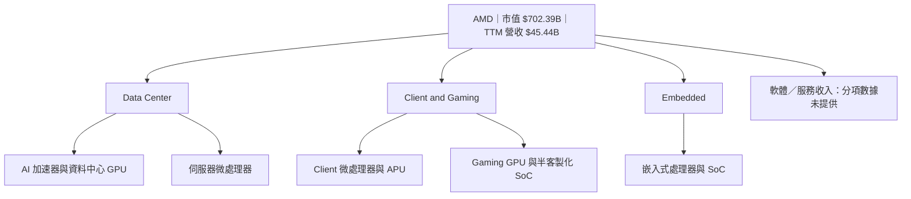
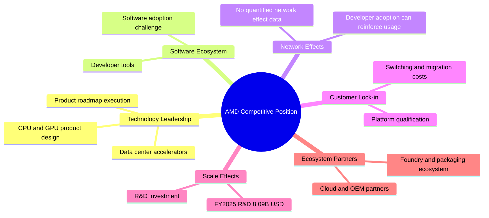
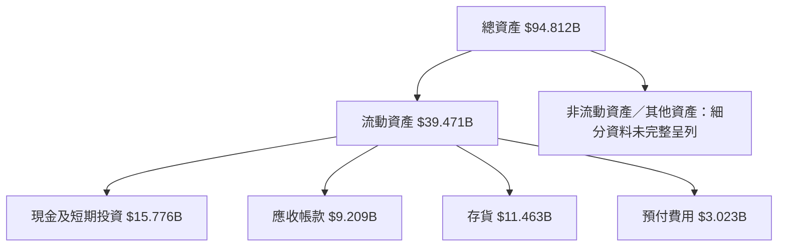
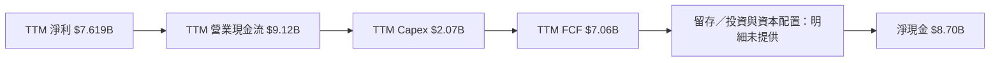
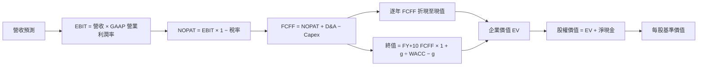
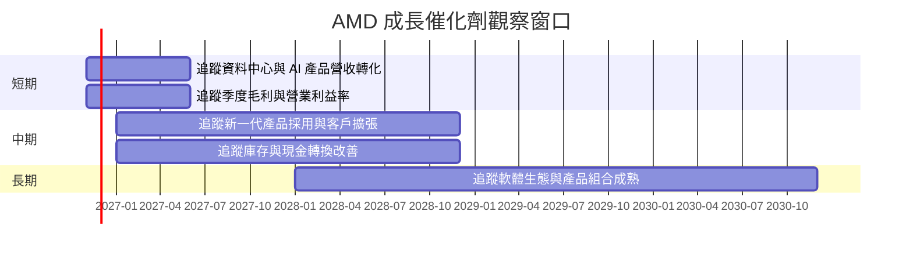
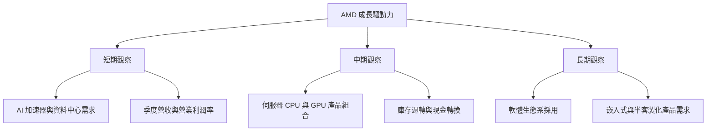
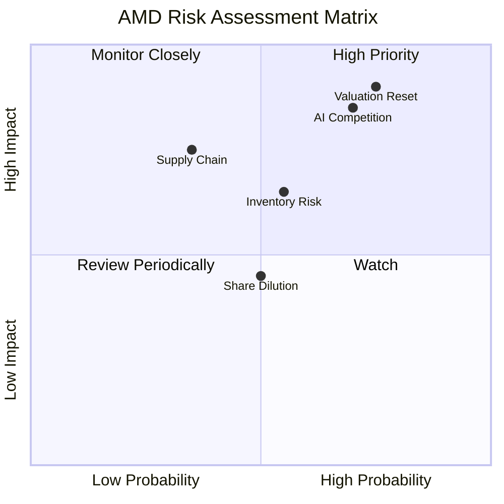
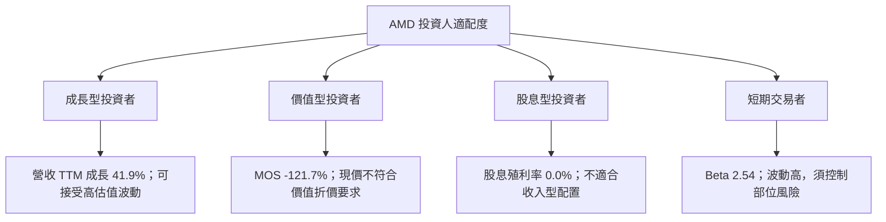

# AMD 基本面深度分析報告
> **報告日期**：2026-11-23 ｜ **語言**：繁體中文 ｜ **數據來源**：SEC 申報資料 (XBRL)、Yahoo Finance、Finviz、StockAnalysis、Roic.ai ｜ **分析師**：CFA 級機構研究

## 目錄

| # | 章節 | 核心結論 |
|---|------|----------|
| 1 | 執行摘要 | 賣出；加權合理價值 $191.44；MOS -121.7% |
| 2 | 公司概覽與商業模式 | 具產品與生態優勢，但分部營收占比未提供 |
| 3 | 損益表深度分析 | TTM 營收 $45.44B、年增 41.9%；最新季度營業利益率 21.2% |
| 4 | 資產負債表分析 | 淨現金 $8.70B；流動性充足，但庫存天數上升 |
| 5 | 現金流量深度分析 | TTM FCF $7.06B；FCF Yield 1.00% |
| 6 | 獲利能力與資本效率 | ROIC 12.8% 低於 WACC 14.0%，目前未覆蓋資本成本 |
| 7 | 相對估值分析 | AMD 估值高於同業中位數 P/S 與 Forward P/E |
| 8 | DCF 內在價值評估 | 基準 DCF $75.54；相對現價溢價 461.8% |
| 9 | 成長催化劑 | AI 加速器、資料中心與產品組合是主要觀察方向 |
| 10 | 風險矩陣 | 估值、AI 競爭與需求／供應鏈執行為主要風險 |
| 11 | 投資建議 | 依 MOS 評級為賣出；需等待估值或基本面改善 |

---

## 1. 執行摘要

AMD 的 TTM 營收為 **$45.44B**，較前一 TTM 成長 **41.9%**；最新季度營收年增 **44.7%**，TTM FCF 為 **$7.06B**，但 FCF Yield 僅 **1.00%**。ROIC 為 **12.8%**，低於採用的 **14.00% WACC**，代表目前資本報酬尚未覆蓋資本成本。加權合理價值為 **$191.44**，相對 2026-11-20 收盤價 **$424.39** 的 MOS 為 **-121.7%**；依 MOS 門檻，評級為 **賣出**。此結論反映的是估值與資本回報風險，不否定公司營收成長與產品競爭力。

### 1.0 一頁式投資儀表板

| 項目 | 內容 |
|------|------|
| **投資論點（3 句）** | ① TTM 營收年增 41.9%，最新季度年增 44.7%，反映需求仍在擴張。② TTM FCF $7.06B、淨現金 $8.70B，提供研發與產品投資彈性。③ 加權合理價值 $191.44，較現價低 54.9%，且 ROIC 12.8% 低於 WACC 14.0%，估值要求高於當前資本回報。 |
| **綜合評分** | **5.9/10**（引用 1.1 六項算術平均） |
| **財務健康** | 🟢 淨現金 $8.70B、流動比率 2.725；但存貨天數 199 天，營運資金需監控。 |
| **ROIC vs WACC** | 12.8% vs 14.00%；🔴 低於資本成本，現階段未創造正經濟利潤。 |
| **FCF 趨勢** | 近年改善；TTM FCF $7.06B，FCF Yield 1.00%。 |
| **估值** | Forward P/E 24.06x（市場資料）；EV/EBITDA 61.875x；FCF Yield 1.00%。 |
| **DCF 內在價值（基準）** | $75.54；相對 DCF 折溢價 **+461.8%**（現價÷DCF價值−1）。 |
| **安全邊際（MOS）** | **-121.7%**＝($191.44−$424.39)÷$191.44；🔴 <10%，無安全邊際。 |
| **預期報酬（基準情境 12M）** | DCF 基準情境相對現價 **-82.2%**；這是情境估值差，不是對 12 個月報酬的保證。 |
| **關鍵風險（前二）** | 現價高於加權合理價值；AI 加速器市場競爭與產品放量執行不及預期。 |
| **評級 + 信心度** | 🔴 **賣出**｜信心：中（估值訊號清楚，但 DCF 對長期假設高度敏感） |

### 1.1 綜合評分卡（全報告唯一）

| 維度 | 評分（1–10） | 主要依據（引用數字與其來源章節） |
|------|--------------|----------------------------------|
| 成長性 | 8.5 | TTM 營收成長 41.9%，最新季度營收年增 44.7%（第 3 章） |
| 獲利能力 | 6.5 | TTM 營業利益率 17.7%、ROIC 12.8% 低於 WACC 14.0%、F-Score 7/9（第 3、6 章） |
| 財務健康 | 8.0 | 淨現金 $8.70B、流動比率 2.725，但 DIO 199 天（第 4 章） |
| 估值 | 1.5 | MOS -121.7%；P/S 歷史百分位 90%（第 7、8 章） |
| 護城河 | 6.5 | CPU/GPU 與資料中心產品線、研發投入 FY2025 $8.09B；軟體生態相對競爭者仍需證明（第 2 章） |
| 管理層與資本配置 | 4.5 | FY2025 SBC $1.64B；Piotroski 稀釋股數測試未通過；股利殖利率 0%（第 3、5、6 章） |
| **綜合評分** | **5.9** | 六項算術平均：(8.5+6.5+8.0+1.5+6.5+4.5)÷6 = 5.9167，四捨五入 5.9 |

### 1.2 五大投資論點 + 三大核心風險

| 類型 | 項目 | 具體依據 | 信心度 |
|------|------|----------|--------|
| 🟢 **投資論點①** | 營收動能仍高 | TTM 營收 $45.44B，年增 41.9%；最新季度年增 44.7%。若成長延續，營業槓桿有機會支撐獲利成長。 | 🟢 高 |
| 🟢 **投資論點②** | 現金流已具規模 | TTM OCF $9.12B、Capex $2.07B、FCF $7.06B；現金流可支應研發與供應鏈需求。 | 🟢 高 |
| 🟢 **投資論點③** | 資產負債表具彈性 | 淨現金 $8.70B，流動比率 2.725，短期融資壓力相對有限。 | 🟢 高 |
| 🟢 **投資論點④** | 季度獲利改善 | FY2026 Q3 營收 $13.38B、營業利益 $2.83B、淨利 $2.43B；營業利益率約 21.2%。 | 🟡 中 |
| 🟢 **投資論點⑤** | 研發投入高 | FY2025 研發費用 $8.09B，為產品迭代與資料中心競爭提供投入基礎。 | 🟡 中 |
| 🟡 **風險①** | 估值與內在價值落差大 | 現價 $424.39；加權合理價值 $191.44，MOS -121.7%。 | 🔴 高 |
| 🔴 **風險②** | 競爭與產品執行 | NVIDIA 最新季度營收成長 103.2%，高於 AMD 44.7%；AMD 必須持續推出具競爭力產品並取得客戶採用。 | 🔴 高 |
| 🟡 **風險③** | 庫存與營運資金 | DIO 從 161 天升至 199 天，存貨累積可能增加減值或去庫存風險。 | 🟡 中 |

### 1.3 快速統計卡片

| 指標 | 公司實際值（期間） | 同業中位數 | 狀態 |
|------|--------------------|------------|------|
| 營收成長（TTM） | **41.9%** | — | 🟢 |
| 營收成長（最新一季年增） | **44.7%** | 85.5% | 🟡 |
| 毛利率（TTM） | **56.0%** | 74.9% | 🟡 |
| 營業利益率（TTM） | **17.7%** | — | 🟢 |
| ROIC（TTM） | **12.8%** | — | 🟡 |
| Forward P/E | **24.060778x** | 15.7x | 🔴 |
| FCF Yield（TTM） | **1.00%** | — | 🔴 |
| Piotroski F-Score | **7 / 9** | — | 🟢 |

### 1.4 投資結論

╔══════════════════════════════════════════════════════════════════╗  
║                    📊 投資結論摘要                               ║  
╠══════════════════════════════════════════════════════════════════╣  
║  評級：🔴 賣出（依 MOS 門檻；未作質化調整）                     ║  
║  價格（2026-11-20 收盤）：$424.39                               ║  
║  DCF 內在價值（基準）：$75.54（現價相對 DCF 溢價 +461.8%）       ║  
║  安全邊際 MOS：-121.7%（以加權合理價值 $191.44 為基準）         ║  
║  加權合理價值（8.8）：$191.44                                   ║  
║  DCF 情境價值：悲觀 $40.03；基準 $75.54；樂觀 $141.10           ║  
║  綜合評分：5.9/10（引用 1.1）                                   ║  
║  適合投資人：可承受高波動、且願意追蹤產品採用的成長型投資人；   ║  
║              不適合以估值折價或股息收入為主要目標者。           ║  
╚══════════════════════════════════════════════════════════════════╝

---

## 2. 公司概覽與商業模式

### 2.1 業務結構與收入來源

公司資料顯示 AMD 業務涵蓋 Data Center、Client and Gaming、Embedded；但本次資料未提供各分部營收、分部獲利與占比，因此不推算或填入分部比例。公司 TTM 營收為 $45.44B。

### 2.2 市場份額

市場份額的可引用數字未提供，因此不畫市占圖、不填推估比例。以營收規模和成長作相對觀察：AMD TTM 營收 $45.44B、年增 41.9%，但 NVIDIA 最新季度營收年增 103.2%，顯示 AI 市場競爭者的成長速度並不相同。

### 2.3 競爭護城河分析

### 2.4 護城河強度

| 護城河項目 | 強度（強／中／弱） | 證據（引用數字或事實） | 會削弱它的情況 |
|------------|--------------------|------------------------|----------------|
| 技術與產品設計 | 中 | 涵蓋 CPU、GPU、AI 加速器與嵌入式處理器；FY2025 研發費用 $8.09B | 產品效能／能效落後、產品上市延遲 |
| 軟體生態系統 | 中偏弱 | 資料未提供軟體營收、開發者數或採用率 | 開發工具不足、客戶轉向競爭平台 |
| 客戶鎖定 | 中 | 企業平台需經過產品驗證與系統整合；具體留存率未提供 | 多來源供應、替換成本下降 |
| 規模效應 | 中 | TTM 營收 $45.44B；研發投入 FY2025 $8.09B | 競爭者研發與資本投入更大、規模差距擴大 |
| 生態夥伴 | 中 | 依賴晶圓代工、封裝及 OEM／雲端合作；具體合作收入未提供 | 供應瓶頸或客戶自行設計晶片 |

1.1 的「護城河」分數為 **6.5/10**，依據是多產品線和較高研發投入，但軟體採用、客戶黏著度及分部獲利等量化證據仍不足。

---

## 3. 損益表深度分析

### 3.1 年度收入成長趨勢（近4年）

╔══════════════════════════════════════════════════════════════════╗  
║              AMD 年度收入趨勢（FY2022-FY2025）                 ║  
╠══════════════════════════════════════════════════════════════════╣  
║ FY2022  $23.60B  ██████████████░░░░░░░░░  YoY：基期            ║  
║ FY2023  $22.68B  █████████████░░░░░░░░░░  YoY：-3.9% 🔴        ║  
║ FY2024  $25.79B  ███████████████░░░░░░░░  YoY：+13.7% 🟢       ║  
║ FY2025  $34.64B  ████████████████████░░░  YoY：+34.3% 🟢       ║  
╠══════════════════════════════════════════════════════════════════╣  
║ FY2022 至 FY2025 營收 CAGR：約 +13.6%                            ║  
╚══════════════════════════════════════════════════════════════════╝

CAGR 算式：\((34.64÷23.60)^{1/3}-1\approx13.6\%\)。FY2023 營收回落，FY2024、FY2025 恢復成長，近期 TTM 成長 41.9% 明顯高於這段歷史 CAGR；若將高成長直接外推，可能高估長期可持續速度。

### 3.2 季度收入趨勢分析

| 季度 | 營收（$B） | QoQ | YoY | 備註 |
|------|------------|-----|-----|------|
| FY2025 Q4 | 10.27 | — | 34.1% | 季度營收由 2025 Q3 的 $9.25B 增至 $10.27B |
| FY2026 Q1 | 10.25 | -0.2% | 37.9% | QoQ 以 Q4 2025 為比較基期 |
| FY2026 Q2 | 11.54 | +12.5% | 50.1% | 年增加速 |
| FY2026 Q3 | 13.38 | +16.0% | 44.7% | 單季年增率，不是 TTM 成長率 |

QoQ 為相鄰季度營收計算，四捨五入至一位小數；資料未提供季節性調整。最新季度營收年增 44.7%，但較前一季公布的 50.1% 放緩，後續需檢視基期與產品組合。

### 3.3 利潤率演變分析

| 利潤率指標 | FY2022 | FY2023 | FY2024 | FY2025 | 趨勢 | 評估 |
|------------|--------|--------|--------|--------|------|------|
| **毛利率** | 44.9% | 46.1% | 49.3% | 49.5% | 緩步提高 | 🟢 |
| **營業利益率** | 5.3% | 1.8% | 8.1% | 10.7% | FY2023 低點後回升 | 🟡 |
| **淨利率** | 5.6% | 3.8% | 6.4% | 12.5% | FY2025 改善 | 🟢 |

上述年度比率由年度營收與損益表金額計算，四捨五入至一位小數。FY2025 營收成長 34.3%、營業利益 $3.69B，較 FY2024 的 $2.09B 增加；收入擴大與產品組合可能支持毛利及營業利益改善，但資料未提供分部利潤，無法拆解各產品線貢獻。最新季度營業利益率為 21.2%，高於 TTM 17.7%，但單季水準不宜直接視為可持續長期利潤率。

### 3.4 費用結構分析

未提供可完整拆分 TTM 銷貨成本、研發、銷售管理費用及其他營業費用的同口徑數據，故不畫費用結構圓餅圖。可確認 FY2025 研發費用為 $8.09B；研發投入支持產品開發，但對短期營業利潤率形成費用負擔。

### 3.5 季度 EPS 趨勢與盈餘品質（Quality of Earnings）

| 季度 | EPS（美元） | QoQ | 超預期／不及預期 |
|------|-------------|-----|------------------|
| 2025 Q4 | 0.92 | — | N/A：EPS 預估值未提供 |
| 2026 Q1 | 0.84 | -8.7% | N/A：EPS 預估值未提供 |
| 2026 Q2 | 1.39 | +65.5% | N/A：EPS 預估值未提供 |
| 2026 Q3 | 1.46 | +5.0% | N/A：EPS 預估值未提供 |

最新季度 EPS 年增 93.8%；但 EPS 預估欄為缺值，不能判定過去四季是超預期或不及預期，也不能以缺值的 surprise 百分比作結論。

| 盈餘品質項目 | 數值／佔比 | 評估 |
|--------------|-----------|------|
| SBC / 營收 | 約 4.4%（近四季 SBC $1.999B ÷ TTM 營收 $45.44B） | 🟡 SBC 是實際股東成本；占營收比例需持續監控 |
| SBC / 營業現金流 | 約 21.9%（$1.999B ÷ $9.12B） | 🟡 SBC 金額相對 OCF 不低；未來股份稀釋可能削弱每股價值 |
| FCF / 淨利 | 約 92.7%（TTM FCF $7.06B ÷ TTM 淨利 $7.619B） | 🟢 現金轉換接近淨利，品質尚可 |
| 一次性／非經常性損益 | N/A（未提供可分辨明細） | 無法確認是否有一次性項目推升盈餘 |
| 有效稅率異常 | N/A（實際 TTM 有效稅率未提供） | DCF 採 21.0% 為模型稅率，不能當成實際有效稅率 |
| 資本化支出 vs 費用化 | TTM Capex $2.07B；資本化／費用化拆分資料不足 | 無法量化是否存在成本遞延或資本化影響 |

近四季 SBC 由季度資料相加而得：$0.523B+$0.503B+$0.487B+$0.486B=$1.999B。盈餘品質整體偏中性：現金轉換率尚可，但 SBC 具實質稀釋成本，一次性損益和實際有效稅率缺乏資料，不能假設 GAAP 淨利完全等同於可分配股東盈餘。

---

## 4. 資產負債表分析

### 4.1 資產結構分解

最新季度資產細項資料顯示流動資產 $39.471B、總資產 $94.812B；其中現金及短期投資 $15.776B、應收帳款 $9.209B、存貨 $11.463B。以下列示已披露數字，不將未列細項反推為其他資產。

### 4.2 流動性與營運資金分析

流動比率為 2.725，速動比率為 1.725；現金與短期投資 $15.78B，顯示短期支付能力充足。營運資金天數如下，依 QUALITY FIGURES 原值引用：

| 指標 | 最新 TTM | 一年前 TTM | 變化 | 解讀 |
|------|----------|------------|------|------|
| DSO 應收帳款天數 | 74 天 | 71 天 | +3 天 | 收款週期略延長，須追蹤應收帳款增幅是否低於營收增幅 |
| DIO 存貨天數 | 199 天 | 161 天 | +38 天 | 存貨週轉變慢；若供需不符可能增加折價或存貨減值風險 |
| DPO 應付帳款天數 | 135 天 | 77 天 | +58 天 | 付款週期延長，可能支撐現金流，但需留意供應商付款條件 |
| CCC 現金轉換週期 | 138 天 | 155 天 | -17 天 | CCC 改善，主要由 DPO 增加抵銷 DIO 上升 |

### 4.3 債務結構分析

╔══════════════════════════════════════════════════════════════════╗  
║                    AMD 債務健康診斷                              ║  
╠══════════════════════════════════════════════════════════════════╣  
║  總債務（核實數值）：$7.08B                                      ║  
║  現金＋短期投資：$15.78B                                         ║  
║  淨現金：$8.70B　🟢                                              ║  
║  流動比率：2.725　🟢                                             ║  
║  速動比率：1.725　🟢                                             ║  
║  利息保障倍數：N/A（利息費用及可比 EBITDA 分母未提供）           ║  
╚══════════════════════════════════════════════════════════════════╝

其他市場資料亦列有總債務 $9.21B、淨現金 $6.57B，與 SEC 口徑核實數值不一致；本報告對要求原值引用的淨現金、總債務採用 SEC 計算區塊的 **$7.08B** 與 **$8.70B**，不混用兩組口徑。

### 4.4 股東權益趨勢

| 年度 | 股東權益（$B） | YoY |
|------|----------------|-----|
| FY2022 | 54.75 | — |
| FY2023 | 55.89 | +2.1% |
| FY2024 | 57.57 | +3.0% |
| FY2025 | 63.00 | +9.4% |

╔══════════════════════════════════════════════════════════════════╗  
║                AMD 股東權益（年度，$B）                          ║  
╠══════════════════════════════════════════════════════════════════╣  
║ FY2022  $54.75B  █████████████████░░░                            ║  
║ FY2023  $55.89B  █████████████████░░░                            ║  
║ FY2024  $57.57B  ██████████████████░░                            ║  
║ FY2025  $63.00B  ████████████████████                            ║  
╚══════════════════════════════════════════════════════════════════╝

---

## 5. 現金流量深度分析

### 5.1 現金流量瀑布圖

TTM OCF 為 $9.12B，Capex $2.07B，FCF 為 $7.06B；其中兩個列示數字相減因原始數值四捨五入會有約 $0.01B 尾差。股息殖利率為 0%，未提供可核對的回購金額與股息支出，故不在現金流圖中虛構資本回饋金額。

### 5.2 FCF 轉換率趨勢

| 年度 | FCF（$B） | 淨利（$B） | FCF／淨利 |
|------|-----------|------------|-----------|
| FY2022 | 3.12 | 1.32 | 236.4% |
| FY2023 | 1.12 | 0.854 | 131.1% |
| FY2024 | 2.40 | 1.64 | 146.3% |
| FY2025 | 6.74 | 4.33 | 155.7% |
| TTM | 7.06 | 7.619 | 92.7% |

年度比率由年度 FCF、淨利計算；TTM 比率則引用 TTM FCF 與淨利。TTM 轉換率低於過往年度，但仍接近 100%；應追蹤營運資金和 SBC 對現金轉換的影響。

### 5.3 自由現金流趨勢

| 期間 | FCF（$B） | FCF Yield |
|------|-----------|-----------|
| FY2022 | 3.12 | N/A |
| FY2023 | 1.12 | N/A |
| FY2024 | 2.40 | N/A |
| FY2025 | 6.74 | N/A |
| TTM | 7.06 | 1.00% |

年度 FCF Yield 未提供同一期間市值，故不自行回推。TTM FCF 回升至 $7.06B，但 1.00% FCF Yield 顯示目前市值已大幅領先現金流規模。

### 5.4 資本配置評估

股息殖利率為 0.0%，股息派付率為 0.0%；資料未提供可一致量化的回購與現金投資分配金額，因此不繪製資本配置圓餅圖。FY2025 Capex $0.974B、研發費用 $8.09B，且近四季 SBC 約 $1.999B；投資人應同時評估研發投入回報與股權薪酬造成的每股稀釋。

---

## 6. 獲利能力與資本效率

### 6.1 ROE / ROA / ROIC 趨勢

| 指標 | 最新 TTM | 歷史年度序列 | 評估 |
|------|----------|----------------|------|
| ROE | 11.1%（QUALITY FIGURES） | 歷史一致口徑未提供 | 🟡 |
| ROA | 5.9%（市場資料） | 歷史一致口徑未提供 | 🟡 |
| ROIC | 12.8% | 歷史一致口徑未提供 | 🟡 |
| 行業均值對比 | N/A | 未提供一致口徑行業數據 | — |

### 6.2 ROIC vs WACC 分析（核心價值創造判斷）

╔══════════════════════════════════════════════════════════════════╗  
║                ROIC vs WACC 深度分析                              ║  
╠══════════════════════════════════════════════════════════════════╣  
║ WACC 輸入（成本資本資料）：                                      ║  
║ ├── 無風險利率：4.91%（10Y 美債；資料未提供觀測日期）           ║  
║ ├── 市場風險溢酬 ERP：5.00%（假設值，成本資本輸入）             ║  
║ ├── 原始 Beta：2.54；採用調整後 Beta：2.00                      ║  
║ ├── 股權成本 Ke：4.91% + 2.00×5.00% = 14.91%                   ║  
║ ├── 稅前債務成本：1.85%；稅後約 1.46%（稅率 21.0%）             ║  
║ ├── 股權／債務權重：99.0%／1.0%                                 ║  
║ └── WACC 計算值 14.78%，上限採用值：14.00%                      ║  
║                                                                  ║  
║ ROIC：12.8%　｜　WACC：14.00%　｜　差額：-1.20 個百分點         ║  
║ ROIC < WACC → 目前 TTM 資本報酬未覆蓋資本成本                   ║  
╚══════════════════════════════════════════════════════════════════╝

WACC 之 CAPM 使用調整後 Beta 2.00：原始 Beta 2.54 按 \(⅔×2.54+⅓=2.0267\)，在資料設定的 0.6–2.0 範圍內封頂為 2.00。按資料提供的權重與成本：\(14.91\%×99.0\%+1.46\%×1.0\%=14.7755\%\)，模型原計算為 14.78%，再受 7%–14% 區間上限約束，故採 **14.00%**。ROIC 低於 WACC 1.20 個百分點，表示當前 TTM 回報未達資本成本；若營業利潤率與資本效率改善，結論可能改變。

### 6.3 杜邦三因素分解

| 因素 | 數值（TTM） | 解讀 |
|------|-------------|------|
| 淨利率 | 16.8% | 利潤率對 ROE 有正向貢獻 |
| 資產週轉率 | 0.48 | 每單位資產產生的營收有限，資產效率仍重要 |
| 權益乘數 | 1.39 | 槓桿程度不高，ROE 並非主要由財務槓桿撐起 |
| **ROE** | **11.1%** | 16.8% × 0.48 × 1.39 = 11.2%，與核實 ROE 11.1% 有四捨五入差異 |

### 6.4 財務體質：Piotroski F-Score

Piotroski F-Score：**7/9**。九項測試原始結果如下：

| 測試 | 結果 | 解讀 |
|------|------|------|
| ROA > 0 | ✅ 通過 | TTM 獲利為正 |
| 營業現金流 > 0 | ✅ 通過 | TTM OCF 為正 |
| ROA 高於一年前 | ✅ 通過 | 資產獲利能力改善 |
| 營業現金流 > 淨利（應計品質） | ✅ 通過 | 現金流對盈餘有支持 |
| 長期負債 ÷ 總資產低於一年前 | ❌ 未通過 | 槓桿相對資產未改善 |
| 流動比率高於一年前 | ✅ 通過 | 短期流動性改善 |
| 稀釋股數未增加 | ❌ 未通過 | 股數稀釋可能壓低每股價值 |
| 毛利率高於一年前 | ✅ 通過 | 毛利率改善 |
| 資產週轉率高於一年前 | ✅ 通過 | 資產利用效率改善 |

---

## 7. 相對估值分析

### 7.1 同業估值比較

AMD 本身估值採市場資料；同業倍數照 Yahoo Finance Peer multiples 原值。資料口徑與計算方式可能不同，尤其 TTM P/E 的 AMD 數值應以估值資料表原值呈現。

| 估值指標 | **AMD** | **NVDA** | **INTC** | **AVGO** | AMD 評估 |
|----------|---------|---------|---------|---------|----------|
| **Trailing P/E** | 90.68163x | 13.5x | N/A | 38.9x | 🔴 顯著高於有數值的同業 |
| **Forward P/E** | 24.060778x | 7.6x | 28.6x | 15.7x | 🟡 高於同業中位數 15.7x |
| **P/S TTM** | 15.458961x | 8.4x | 4.6x | 16.3x | 🟡 高於同業中位數 8.4x |
| **EV/EBITDA TTM** | 61.875x | 12.2x | 14.9x | 28.5x | 🔴 高於同業中位數 14.9x |
| **最新季度營收年增** | 44.7% | 103.2% | 20.9% | 85.5% | 🟡 成長高於 INTC、低於 NVDA/AVGO |
| **毛利率 TTM** | 56.0% | 74.9% | 40.2% | 75.5% | 🟡 低於 NVDA、AVGO |

AMD Forward P/E 約為同業中位數的 1.53 倍；這代表市場已為成長預期付出溢價。若未來盈餘成長無法兌現，高估值可能以倍數收縮方式修正。

### 7.2 歷史估值區間分析

╔══════════════════════════════════════════════════════════════════╗  
║              AMD 自身五年 TTM 估值區間                          ║  
╠══════════════════════════════════════════════════════════════════╣  
║ P/E：現在 92.3x｜中位數 82.6x｜區間 36.7x–934.7x｜百分位 53%   ║  
║ P/S：現在 15.5x｜中位數 8.9x｜區間 4.3x–23.1x｜百分位 90%     ║  
║ EV/EBITDA：現在 86.5x｜中位數 102.2x｜區間 38.2x–919.2x        ║  
║            百分位 39%                                            ║  
╚══════════════════════════════════════════════════════════════════╝

估值範圍受歷史獲利低基期影響，P/E 與 EV/EBITDA 區間極寬，單看百分位可能失真。P/S 位於自身五年區間第 90 百分位，是較直觀的估值偏高訊號。

### 7.3 情境價值（照抄 DCF MODEL Scenarios）

| 情境 | 第 1 年營收成長 | 期末營業利潤率 | WACC | 每股價值 | 相對現價 | 機率 | 會發生的條件 |
|------|----------------|----------------|------|----------|----------|------|--------------|
| 🔴 悲觀 | 15.0% | 6.3% | 15.00% | $40.03 | -90.6% | 25% | AI／資料中心需求放緩、競爭壓低利潤率，資本成本維持偏高 |
| 🟡 基準 | 30.0% | 7.4% | 14.00% | $75.54 | -82.2% | 50% | 初期高成長逐步下降，長期利潤率回歸模型假設 |
| 🟢 樂觀 | 45.0% | 8.1% | 13.00% | $141.10 | -66.8% | 25% | 產品採用快於基準、長期利潤率較高且資本成本回落 |

以上情境為模型輸出；其終值與折現假設仍有高度不確定性，不能視為精準價格預測。

### 7.4 相對估值隱含價格區間

╔══════════════════════════════════════════════════════════════════╗  
║                 估值方法隱含每股價值（美元）                    ║  
╠══════════════════════════════════════════════════════════════════╣  
║ 同業 EV/EBITDA       $105.22                                     ║  
║ 同業 Forward P/E     $276.57                                     ║  
║ 分析師共識目標價     $657.74                                     ║  
║ 現價（2026-11-20）   $424.39                                     ║  
╚══════════════════════════════════════════════════════════════════╝

| 方法 | 每股價值 | 依據 |
|------|----------|------|
| 同業 Forward P/E | $276.57 | NVDA、INTC、AVGO 中位數 15.7x × Forward EPS $17.64 |
| 同業 EV/EBITDA | $105.22 | 同業中位數 14.9x × TTM EBITDA，再加淨現金 |
| 分析師共識目標價 | $657.74 | 49 位分析師平均目標價；作參考，不等同內在價值 |

---

## 8. DCF 內在價值評估（Discounted Cash Flow）

### 8.0 估值推理鏈（Thinking Logic）

**Step 1 — 價值由哪些變數決定？**  
模型價值主要取決於營收成長、GAAP 營業利潤率，以及 WACC 與永續成長率的差距。資料未提供分部營收占比，故不能把 Data Center、Client and Gaming、Embedded 各自占比填入模型；目前可直接確認的營收基礎只有 TTM $45.44B。模型假設 FY+1 成長 30.0%，之後線性降至 FY+10 的 3.0%，因此營收增長路徑是重要估值變數；敏感性表亦顯示 WACC 變化會顯著影響價值。

**Step 2 — 模型選擇**

| 決策點 | 本報告採用 | 理由（含數字） | 曾考慮但否決 | 否決理由 |
|--------|-----------|----------------|--------------|----------|
| 現金流定義 | FCFF | 對應 WACC 折現並先得 EV；模型明定 FCFF = NOPAT + D&A − Capex | FCFE | 模型以企業現金流與 WACC 計價 |
| 預測期 N | 10 年 | DCF 模型固定使用 10 年並逐年淡化營收成長 | 5 年 | 與既定 DCF 模型輸出不符 |
| 終值方法 | Gordon Growth 為主 | 模型採永續成長率 3.0% | 退出倍數交叉檢查 | DCF 模型未提供退出倍數值，不能自行補算 |
| EBIT 基礎 | GAAP EBIT | 已含 SBC 費用 | 非 GAAP EBIT | 避免將 SBC 加回後漏算成本 |

**Step 3 — 關鍵假設推導鏈**

- **第 1 年營收成長**：錨點＝TTM 成長 41.9% → 調整＝資料模型把成長上限限制在 30%，反映高基期與逐年放緩 → **採用 30.0%** → 否決 41.9% 延續至第一年，因模型明示上限為 30%，且單一 TTM 增速不應直接外推。
- **第 10 年營收成長**：錨點＝成熟期長期經濟成長代理假設 3.0%（模型輸入；非公司財測）→ 採用 **3.0%** → 否決長期維持高於 3%的成長，因永續階段需反映成熟化。
- **期末營業利潤率**：錨點＝TTM GAAP 營業利潤率 17.7% → 調整＝模型逐年衰減至最近五個財年中位數 7.4% → **採用 7.4%** → 否決長期維持 17.7%，因模型採歷史中位數，而非單季高點外推。
- **預測期 N**：錨點＝模型固定十年逐年預測 → **採用 10 年** → 否決縮短至五年，因不得更改程式模型的預測期。
- **Capex／營收**：錨點＝TTM Capex／營收約 4.5%（模型輸入）→ 模型維持 4.5% → **採用 4.5%** → 否決自行降低 Capex，因資料未提供可支持更低資本投入的營運計畫。
- **D&A／營收**：錨點＝TTM 6.7% → **採用 6.7% 並固定**；資料未提供未來折舊明細，故不自行更改。
- **永續成長率 g**：錨點＝模型 3.0% → **採用 3.0%**，低於 WACC 14.0% → 否決較高的永續成長，避免把成熟期成長假設抬高。
- **WACC**：錨點＝資本成本模組計算 14.78%，但受上限 14% 限制 → **採用 14.00%** → 否決直接用未封頂 14.78%，因模型指示使用封頂後數值。
- **SBC 與股數**：錨點＝模型採 GAAP EBIT 並固定股數 → **採組合 A**，不再扣 SBC、不額外稀釋；否決在 GAAP EBIT 外另扣 SBC，避免重複計入成本。
- **營運資金變動**：DCF 模型未納入 ΔWC → **模型未建模**；不得以空缺資料補造數值。
- **終值方法**：採 Gordon Growth，模型已提供終值；退出倍數交叉驗證值未提供，故不能另造一個倍數。

**Step 4 — 最脆弱一環**  
模型把長期營業利益率由 TTM 17.7% 降至 FY+10 的 7.4%，同時以 14.0% WACC 折現；若實際利潤率或折現率偏離，估值可能大幅變化，敏感性表可見基準每股價值在 WACC 13% 與 15% 間由 $82.59 變至 $69.65。

**Step 5 — 計算路徑**

### 8.1 模型假設總表（Model Inputs）

金額以美元十億計；金額取兩位小數、百分比取一位小數，折現因子取三位小數。以下模型數值照 DCF MODEL 輸出引用。

| 假設項目 | 採用值 | 依據／來源 | 敏感度 |
|----------|--------|-------------|--------|
| 預測期長度 N | 10 年 | DCF MODEL 固定預測 FY+1 至 FY+10 | 🟡 中 |
| 營收成長 | FY+1 30.0%，FY+10 3.0%，逐年線性下降 | TTM 成長 41.9%；模型把 FY+1 限制於 30.0% | 🔴 高 |
| 營業利潤率 | FY+1 17.7% → FY+10 7.4% | FY+1 取 TTM，末期取模型最近五年中位數 | 🔴 高 |
| 有效稅率 | 21.0% | DCF MODEL 預設；實際有效稅率未提供 | 🟢 低 |
| Capex／營收 | 4.5% | DCF MODEL；TTM 基礎並固定至末期 | 🟡 中 |
| D&A／營收 | 6.7% | DCF MODEL 的 TTM 比率 | 🟢 低 |
| 營運資金變動 | 未建模 | DCF MODEL 明示 working capital is not modelled | 🟢 低 |
| EBIT 基礎 | GAAP EBIT | DCF MODEL 使用 GAAP EBIT | 🟡 中 |
| SBC 處理 | 不另扣 SBC，固定股數 | GAAP EBIT 已含 SBC 費用，採組合 A | 🟡 中 |
| 年稀釋率 | 0%（固定股數） | 組合 A；DCF MODEL 明定股數不再稀釋 | 🟡 中 |
| 永續成長率 g | 3.0% | DCF MODEL 假設 | 🔴 高 |
| 終值方法 | Gordon Growth | DCF MODEL 已計算；退出倍數值未提供 | 🔴 高 |
| WACC | 14.00% | 成本資本模組計算 14.78%，上限封頂至 14.00% | 🔴 高 |

### 8.2 折現率推導（WACC）

╔══════════════════════════════════════════════════════════════════╗  
║                    WACC 推導（折現率）                           ║  
╠══════════════════════════════════════════════════════════════════╣  
║ 股權成本 Ke（CAPM）：                                            ║  
║ ├── 無風險利率 Rf：4.91%（10Y 美債；觀測日期未提供）            ║  
║ ├── ERP：5.00%（成本資本輸入之假設值）                           ║  
║ ├── 原始 Beta：2.54；調整後 Beta：2.00                           ║  
║ ├── 調整方式：⅔×2.54 + ⅓×1 = 2.0267；受 2.0 上限限制為 2.00      ║  
║ └── Ke = 4.91% + 2.00×5.00% = 14.91%                           ║  
║                                                                  ║  
║ 債務成本 Kd：                                                    ║  
║ ├── 稅前 Kd：1.85%（資本成本資料原值）                           ║  
║ ├── 稅率：21.0%                                                  ║  
║ └── 稅後 Kd = 1.85%×(1−21.0%) = 1.4615% ≈ 1.46%                 ║  
║                                                                  ║  
║ 資本結構權重：股權 E 99.0%，債務 D 1.0%                         ║  
║ 原計算 WACC = 14.91%×99.0% + 1.46%×1.0% = 14.7755% ≈ 14.78%    ║  
║ 上限規則：14.78% 超過 14.00% 上限，故採用 WACC = 14.00%         ║  
╚══════════════════════════════════════════════════════════════════╝

五步演算與可複核性：  
1. **Ke** = 4.91% + 2.00×5.00% = **14.91%**。  
2. **稅前 Kd** = **1.85%**（資料提供的是利息／債務計算後數值；利息金額及平均計息負債明細未提供，無法獨立重建分子與分母）。  
3. **稅後 Kd** = 1.85%×(1−21.0%) = **1.4615%**。  
4. **資本權重** = 股權 99.0%；債務 1.0%；合計 100.0%（原始模組權重，市值與債務的逐項分母未提供）。  
5. **WACC 計算值** = 99.0%×14.91% + 1.0%×1.4615% = 14.775515% ≈ **14.78%**；受 14% 上限限制後，DCF 採用 **14.00%**。

因此第 6.2 與 DCF 的 WACC 均使用 14.00%。因缺少利息金額、平均計息負債明細與權重底層市值計算，不能聲稱完整重建原始 WACC 輸入。

### 8.3 逐年自由現金流預測（基準情境）

模型定義：**FCFF = NOPAT + D&A − Capex**；不含營運資金變動。採組合 **(A) GAAP EBIT + 固定股數**，EBIT 已含 SBC 費用，因此不另扣 SBC，也不逐年稀釋股數。下表照模型逐年列出，美元十億。

| 年度 | FY+1 | FY+2 | FY+3 | FY+4 | FY+5 | FY+6 | FY+7 | FY+8 | FY+9 | FY+10 |
|------|------|------|------|------|------|------|------|------|------|-------|
| 營收 | 59.07 | 75.01 | 93.02 | 112.55 | 132.81 | 152.73 | 171.06 | 186.46 | 197.64 | 203.57 |
| 營收 YoY | 30.0% | 27.0% | 24.0% | 21.0% | 18.0% | 15.0% | 12.0% | 9.0% | 6.0% | 3.0% |
| 營業利潤率 | 17.7% | 16.6% | 15.4% | 14.3% | 13.1% | 12.0% | 10.8% | 9.7% | 8.5% | 7.4% |
| GAAP EBIT | 10.46 | 12.43 | 14.34 | 16.06 | 17.42 | 18.28 | 18.51 | 18.03 | 16.84 | 15.00 |
| − 稅 | (2.20) | (2.61) | (3.01) | (3.37) | (3.66) | (3.84) | (3.89) | (3.79) | (3.54) | (3.15) |
| = NOPAT | 8.27 | 9.82 | 11.33 | 12.69 | 13.76 | 14.44 | 14.62 | 14.24 | 13.30 | 11.85 |
| + D&A | 3.96 | 5.03 | 6.24 | 7.55 | 8.90 | 10.24 | 11.47 | 12.50 | 13.25 | 13.65 |
| − Capex | (2.69) | (3.41) | (4.23) | (5.12) | (6.04) | (6.95) | (7.78) | (8.48) | (8.99) | (9.26) |
| **= FCFF** | **9.54** | **11.43** | **13.33** | **15.11** | **16.63** | **17.73** | **18.31** | **18.26** | **17.56** | **16.24** |
| 折現因子 @14.00% | 0.877 | 0.769 | 0.675 | 0.592 | 0.519 | 0.456 | 0.400 | 0.351 | 0.308 | 0.270 |
| **FCFF 現值 PV** | **8.37** | **8.80** | **9.00** | **8.95** | **8.63** | **8.08** | **7.32** | **6.40** | **5.40** | **4.38** |

預測期 FCF 現值合計：  
\(8.37+8.80+9.00+8.95+8.63+8.08+7.32+6.40+5.40+4.38=\mathbf{75.33}\)B。  
DCF MODEL 列示合計為 **$75.32B**，差額 $0.01B 為逐年現值四捨五入尾差，後續橋接採用模型原值 $75.32B。

**FY+1 逐步演算：**

1. 營收 = $45.44B×(1+30.0%) = $59.072B，模型列示 **$59.07B**。  
2. EBIT = $59.07B×17.7% = $10.45539B，模型列示 **$10.46B**。  
3. 稅 = $10.46B×21.0% = $2.1966B，模型列示 **$2.20B**。  
4. NOPAT = $10.46B−$2.20B = $8.26B；模型未四捨五入前列示 **$8.27B**。  
5. D&A = $59.07B×6.7% = $3.95769B，模型列示 **$3.96B**。  
6. Capex = $59.07B×4.5% = $2.65815B；模型列示 **$2.69B**（模型計算使用未四捨五入營收／輸入，數字以模型原值為準）。  
7. ΔWC = 未建模。  
8. FCFF = $8.27B+$3.96B−$2.69B = **$9.54B**。  
9. 折現因子 = \(1÷(1+14.00\%)^1=0.8772\approx0.877\)；PV = $9.54B×0.877 = **$8.37B**。

FY+1 的顯示值受模型內部未四捨五入輸入影響，若只用已四捨五入中間數反算，個別步驟會有小幅尾差；本報告不改動模型原始輸出。

**合理性自檢：**

- 預測期 FCF：FY+1 $9.54B 至 FY+10 $16.24B；資料未提供可比口徑的 10 年歷史 FCF CAGR，故歷史 CAGR 比較為 N/A。  
- FY+10 FCFF 利潤率 = $16.24B÷$203.57B = **8.0%**；目前 TTM FCF 利潤率約 $7.06B÷$45.44B = **15.5%**；同業最佳 FCF 利潤率未提供，不能比較。  
- 模型預測年度 FCFF 均為正值；是否可達成取決於收入成長、利潤率淡化路徑與再投資假設。

╔══════════════════════════════════════════════════════════════════╗  
║            自由現金流：歷史實際 vs 模型預測                      ║  
╠══════════════════════════════════════════════════════════════════╣  
║ FY2023（實） $1.12B  ██░░░░░░░░░░░░░░░░░░░░                      ║  
║ FY2024（實） $2.40B  █████░░░░░░░░░░░░░░░░                      ║  
║ FY2025（實） $6.74B  ██████████████░░░░░░                      ║  
║ TTM（實）    $7.06B  ███████████████░░░░░                      ║  
║ FY+1（預）   $9.54B  ████████████████████                      ║  
║ FY+10（預） $16.24B  ██████████████████████████████              ║  
╠══════════════════════════════════════════════════════════════════╣  
║ 模型預測收入快速擴張，但營業利潤率逐步回落至 7.4%。             ║  
╚══════════════════════════════════════════════════════════════════╝

### 8.4 終值計算（Terminal Value）

適用性檢查：**WACC 14.00% vs g 3.00% → WACC > g？✅**

| 方法 | 計算式 | 終值 TV | TV 現值 | 佔總 EV 比重 |
|------|--------|---------|---------|--------------|
| Gordon Growth | $16.24B×(1+3.0%)÷(14.0%−3.0%) | $152.04B | $41.01B | 35.3% |
| 退出倍數法 | N/A（DCF MODEL 未提供退出倍數輸入） | N/A | N/A | N/A |

逐步演算：

1. FY+N FCFF = FY+10 FCFF **$16.24B**。  
2. 分子 = $16.24B×(1+3.0%) = **$16.7272B**。  
3. 分母 = 14.00%−3.00% = **11.00%**；$16.7272B÷11.00% = **$152.04B**。  
4. PV(TV) = $152.04B×0.270 = **$41.01B**。  
5. 終值現值占 EV = $41.01B÷$116.33B = **35.3%**。

退出倍數交叉驗證值及依據未提供；依模型優先規則不自行設倍數。終值占比 35.3%，低於 75% 警示門檻，但仍占 EV 約三分之一。

### 8.5 企業價值 → 每股內在價值（Bridge）

╔══════════════════════════════════════════════════════════════════╗  
║              企業價值 → 每股內在價值 橋接表                      ║  
╠══════════════════════════════════════════════════════════════════╣  
║ 預測期 FCF 現值合計             +$75.32B                         ║  
║ 終值現值 PV(TV)                 +$41.01B                         ║  
║ = 企業價值 EV                    $116.33B                         ║  
║ + 淨現金                         +$8.70B                          ║  
║ = 股權價值                       $125.03B                         ║  
║ 每股 DCF 基準價值                $75.54                           ║  
║ 當前股價                         $424.39                          ║  
║ 現價相對 DCF 折溢價              +461.8%                          ║  
╚══════════════════════════════════════════════════════════════════╝

逐步演算：

1. EV = $75.32B+$41.01B = **$116.33B**。  
2. 股權價值 = $116.33B+$8.70B = **$125.03B**。  
3. 模型每股價值公式照原輸出：股權價值×現價÷市值 = $125.03B×$424.39÷$702.39B = **$75.54**。  
4. 折溢價 = $424.39÷$75.54−1 = **+461.8%**。  
5. 本節不計算 MOS；MOS 僅使用 8.8 加權合理價值作分母。

模型按「股權價值×價格÷市值」推導每股數值，並非直接以期末稀釋股數除股權價值；所用最新稀釋股數為 1.64B（Roic.ai），但模型每股值須照 DCF MODEL 原值引用。現金與債務依核實淨現金 $8.70B 橋接；此處未另拆現金與債務，因 DCF MODEL 已提供淨現金輸入。

### 8.6 敏感性分析（WACC × 永續成長率）

以下矩陣照 DCF MODEL 原值；括號內為相對 $424.39 現價的上行空間，按「每股價值÷現價−1」計算並四捨五入至一位小數。

| g／WACC | 12.00% | 13.00% | **14.00%（基準）** | 15.00% | 16.00% |
|-----------|--------|--------|--------------------|--------|--------|
| 2.0% | $87.24 (-79.4%) | $79.62 (-81.2%) | $73.26 (-82.7%) | $67.87 (-84.0%) | $63.24 (-85.1%) |
| 2.5% | $89.10 (-79.0%) | $81.03 (-80.9%) | $74.35 (-82.5%) | $68.72 (-83.8%) | $63.92 (-84.9%) |
| **3.0%（基準）** | $91.17 (-78.5%) | $82.59 (-80.5%) | **$75.54 (-82.2%)** | $69.65 (-83.6%) | $64.65 (-84.8%) |
| 3.5% | $93.48 (-78.0%) | $84.31 (-80.1%) | $76.85 (-81.9%) | $70.66 (-83.3%) | $65.45 (-84.6%) |
| 4.0% | $96.08 (-77.4%) | $86.22 (-79.7%) | $78.29 (-81.6%) | $71.77 (-83.1%) | $66.31 (-84.4%) |

示範非基準格：**所選格 WACC 13.00% > g 3.0% ✅**。模型原矩陣對應價值為 $82.59；矩陣未提供該格預測期 PV 合計及重算 TV 的中間數，且依規則不得另建模型，因此不虛構分項數值。

- g 由 2.0% 升至 3.0%，WACC 14%：$73.26 → $75.54，增加 **$2.28／3.1%**。  
- WACC 由 14% 升至 15%，g 3%：$75.54 → $69.65，減少 **$5.89／7.8%**。  
- 期末營業利潤率每 +1pp 的估值彈性：**N/A（模型未提供該敏感度，不能自行重算）**。  
- 在已提供的矩陣中，WACC 變動的估值影響大於 g 由 2% 至 3% 的影響；與 8.0 所述折現率是主導敏感變數一致。

三情境 DCF 原值如下；模型沒有提供各情境逐年營收、FCFF、終值分項，故下表不另造推導中間數。

| 情境 | 第 1 年營收成長 | 期末營業利潤率 | 永續 g | WACC | 每股價值 | 相對現價 | 主觀機率 |
|------|----------------|----------------|--------|------|----------|----------|----------|
| 🔴 悲觀 | 15.0% | 6.3% | 模型未另列 | 15.00% | $40.03 | -90.6% | 25% |
| 🟡 基準 | 30.0% | 7.4% | 3.0% | 14.00% | $75.54 | -82.2% | 50% |
| 🟢 樂觀 | 45.0% | 8.1% | 模型未另列 | 13.00% | $141.10 | -66.8% | 25% |
| **機率加權** | — | — | — | — | **$83.06** | **-80.4%** | 100% |

機率加權算式：$40.03×25%+$75.54×50%+$141.10×25%=$10.0075+$37.77+$35.275=$83.0525，模型列示 **$83.06**；尾差來自模型未四捨五入的內部數值。按規則 8.8，估值權重採基準 DCF $75.54，不用機率加權數值。

### 8.7 反推 DCF（Reverse DCF）

DCF MODEL 已提供兩個單變數反推結果；其餘固定條件為基準模型設定。詳細逐次迭代軌跡未提供，不能偽造試算行。

| 求解的變數 | 其餘變數設定 | 市場隱含值（令 DCF = 現價） | 歷史／基準對照 | 判斷 |
|------------|--------------|------------------------------|-----------------|------|
| 年 1 營收成長 | 其餘採基準模型 | 89.1% | 基準值 30.0%；TTM 成長 41.9% | 🔴 極高要求 |
| 固定營業利潤率 | 其餘採基準模型 | 74.2% | 基準路徑 17.7%→7.4% | 🔴 不具合理性 |
| 永續成長率 g | 未提供反推解 | N/A | — | N/A |
| 預測期 N | 未提供反推解 | N/A | 基準 10 年 | N/A |

反推結論：在模型其他條件不變時，現價需要遠高於基準的年 1 成長或長期利潤率假設才能由該 DCF 支撐。年 1 成長 89.1% 高於 TTM 41.9%，而固定營業利潤率 74.2% 遠高於目前 TTM 17.7%；兩者都代表現價包含非常樂觀的預期。

### 8.8 估值三角驗證與安全邊際

| 估值方法 | 隱含每股價值 | 上行空間（÷現價） | 權重 | 說明 |
|----------|--------------|-------------------|------|------|
| DCF（基準） | $75.54 | -82.2% | 40% | 10 年 FCFF、WACC 14.00%、g 3.0% |
| 同業 Forward P/E | $276.57 | -34.8% | 25% | 同業中位數 15.7x × Forward EPS $17.64 |
| 同業 EV/EBITDA | $105.22 | -75.2% | 25% | 同業中位數 14.9x × TTM EBITDA，加淨現金 |
| 分析師共識目標價 | $657.74 | +55.0% | 10% | 49 位分析師平均目標價 |
| **加權合理價值** | **$191.44** | **-54.9%** | **100%** | Profitable company 固定權重 |

逐步演算：  
加權合理價值  
= $75.54×40%+$276.57×25%+$105.22×25%+$657.74×10%  
= $30.216+$69.1425+$26.305+$65.774  
= **$191.4375 ≈ $191.44**。  
MOS = ($191.44−$424.39)÷$191.44 = −$232.95÷$191.44 = **-121.7%**。  
上行空間 = ($191.44−$424.39)÷$424.39 = −$232.95÷$424.39 = **-54.9%**。

╔══════════════════════════════════════════════════════════════════╗  
║                  估值區間與安全邊際                              ║  
╠══════════════════════════════════════════════════════════════════╣  
║ $40.03 ─ $75.54 ─ $141.10 ─ [$191.44] ───────── $424.39         ║  
║ 悲觀DCF   基準DCF   樂觀DCF   加權合理值       現價              ║  
║                                                                  ║  
║ MOS = (加權合理價值−現價)÷加權合理價值 = -121.7%                 ║  
║ MOS 評估：🔴 <10%，無安全邊際                                   ║  
║ 上行空間 = (合理價值−現價)÷現價 = -54.9%                        ║  
║                                                                  ║  
║ 以 MOS ≥10% 對應價格上限：$191.44×(1−10%) = $172.30              ║  
║ 目前評級為賣出；此價格僅為估值門檻，不是自動買入建議。           ║  
╚══════════════════════════════════════════════════════════════════╝

> 🔎 **程式複算（Python，依本節各項自動重算）**
>
> 加權合理價值 = $75.54 × 40% + $276.57 × 25% + $105.22 × 25% + $657.74 × 10% = **$191.44**（權重合計 100%）
>
> 以價格 $424.39 計：MOS = **-121.7%**，上行空間 = **-54.9%**
>
> ✅ 與本節所寫數值一致。

### 8.9 DCF 模型的局限與失效條件

- **終值依賴度**：終值現值占 EV **35.3%**，估值仍有逾三分之一取決於 FY+10 後現金流。
- **最脆弱假設**：營收成長與 WACC。基準值 $75.54；WACC 15%、g 3% 時降至 $69.65，WACC 13%、g 3% 時升至 $82.59。
- **模型限制**：ΔWC 未建模，年稀釋率設為 0%，且退出倍數交叉驗證未提供。若庫存與應收帳款持續擴張，未建模營運資金可能高估 FCFF；若股數持續上升，固定股數可能高估每股價值。
- **適用性**：TTM FCF 為正且達 $7.06B，DCF 有參考性；但半導體產品週期、快速競爭變化及高成長期投入，會降低單一 DCF 的可靠度。應與 EV/Sales、同業估值與分部估值交叉驗證。
- **與第 10 章連結**：AI 產品採用放緩會壓低營收成長；競爭性降價會壓低營業利潤率；資本市場風險溢酬上升會推高 WACC。

### 8.10 複算檢核表（Audit Trail）

| # | 檢核項目 | 檢查方式 | 結果 |
|---|----------|----------|------|
| 1 | 🔴／🟡敏感度輸入均有推導 | 對照 8.0／8.1；模型設定已逐項說明，部分歷史錨點缺資料 | ⚠️ 有限度完成 |
| 2 | 每個假設有來歷 | 8.1 逐項列依據，缺失項標示未提供或模型設定 | ✅ |
| 3 | WACC 五步算式與加總 | 14.91%×99%+1.4615%×1%=14.7755%，封頂 14.00% | ✅ |
| 4 | Kd 與債務權重口徑一致 | 利息金額、平均計息負債與權重底層明細缺失，不能獨立核對 | ⚠️ |
| 5 | WACC 與第 6.2 同值 | 均採用 14.00% | ✅ |
| 6 | 預測期年度數等於 N | FY+1 至 FY+10 共 10 年 | ✅ |
| 7 | FY+1 算式可複算 | 模型內部未四捨五入值未全部提供，呈列數字有小幅尾差 | ⚠️ |
| 8 | 預測期 PV 合計 | 顯示值合計 $75.33B；模型原值 $75.32B，$0.01B 尾差 | ✅（四捨五入） |
| 9 | WACC > g | 14.00% > 3.00% | ✅ |
| 10 | 終值基於 FY+N、折現 N 期 | 以 FY+10 FCFF，折現因子 0.270 | ✅ |
| 11 | EV 至每股橋接 | EV $116.33B、股權價值 $125.03B、模型每股 $75.54 | ✅（採模型原公式） |
| 12 | SBC 組合一致 | GAAP EBIT、無 SBC 再扣、固定股數，組合 A | ✅ |
| 13 | 敏感性基準格 = DCF 基準值 | 矩陣 14%／3% = $75.54 | ✅ |
| 14 | 矩陣有效性 | 所有矩陣組合均 WACC > g | ✅ |
| 15 | 情境機率加總 | 25%+50%+25%=100% | ✅ |
| 16 | 反推每列只放開一個變數 | 只列模型已解出的年 1 成長及固定利潤率 | ✅；未提供迭代軌跡 |
| 17 | MOS／折溢價基準一致 | MOS 用 $191.44；折溢價用 DCF $75.54 | ✅ |
| 18 | 報告完整到第 11 章 | 11 章均列出 | ✅ |
| 19 | 加權合理價值相加 | 四項加權總和 $191.4375 ≈ $191.44 | ✅ |
| 20 | 評級符合 MOS 門檻 | MOS -121.7% 對應賣出 | ✅ |

限制說明：因利息與計息負債明細、模型未四捨五入底層數據及反推迭代軌跡未提供，相關項目不宣稱可完全獨立重建；估值信心度因此維持中等。

---

## 9. 成長催化劑

### 9.1 催化劑時間軸

財務數據未提供未來產品發表日期或管理層正式時程，以下時間軸為觀察窗口，不代表公司指引。

### 9.2 TAM 市場規模分析

N/A（TAM 數據未提供）。可引用的公司數據為 TTM 營收 $45.44B、TTM 成長 41.9%；成長潛力需以資料中心、AI、Client、Gaming 與 Embedded 分部實際營收與管理層市場規模估計後續核驗，不能自行填入 TAM 或滲透率。

### 9.3 成長驅動力結構圖

---

## 10. 風險矩陣

### 10.1 風險評分矩陣

機率與衝擊座標為分析師質化風險排序，不是財務數據或精算機率。

### 10.2 風險清單詳細分析

| # | 風險項目 | 發生機率 | 財務衝擊 | 風險評分 | 緩解措施 |
|---|----------|----------|----------|----------|----------|
| 1 | 🔴 **估值修正** | 高（質化判斷） | 高；加權合理價值 $191.44，現價 $424.39 | 🔴 9.5/10 | 分批控管部位，不以短期目標價替代內在價值；每季更新盈餘與估值 |
| 2 | 🔴 **AI／資料中心競爭** | 高（質化判斷） | 高；NVIDIA 最新季度營收年增 103.2%，AMD 44.7% | 🔴 8.5/10 | 監測相關業務成長、客戶採用與毛利；資料未提供 AMD 分部成長率，先不設定虛假的分部門檻 |
| 3 | 🟡 **庫存與去庫存風險** | 中高 | 中高；DIO 199 天，較一年前增加 38 天 | 🟠 7.5/10 | 追蹤 DIO、存貨增幅與營收增幅；若存貨連續增加而營收轉弱，調降預期 |
| 4 | 🟡 **供應鏈／產能依賴** | 中 | 高；晶圓代工與封裝供應受限可能延遲交貨，具體財務影響 N/A | 🟠 6.5/10 | 追蹤交期、供應商集中度及公司對供應能力的揭露 |
| 5 | 🟡 **SBC 與股數稀釋** | 中 | 中；近四季 SBC 約 $1.999B，Piotroski 稀釋股數測試未通過 | 🟡 5.5/10 | 持續追蹤稀釋股數、SBC／營收與每股 FCF |

---

## 11. 投資建議

### 11.1 最終評級與評分

依加權合理價值 $191.44、現價 $424.39 算得 MOS **-121.7%**，依規則 20 評級為 **賣出**，未作一級質化調整。1.1 綜合評分為 **5.9/10**；其中成長性 8.5、獲利能力 6.5、財務健康 8.0、估值 1.5、護城河 6.5、管理層與資本配置 4.5。

### 11.2 合理價值與隱含報酬率

| 指標／情境 | 每股價值 | 相對現價 | 機率 |
|------------|----------|----------|------|
| 加權合理價值 | $191.44 | -54.9% | — |
| 悲觀 DCF | $40.03 | -90.6% | 25% |
| 基準 DCF | $75.54 | -82.2% | 50% |
| 樂觀 DCF | $141.10 | -66.8% | 25% |
| 分析師共識目標價 | $657.74 | +55.0% | 49 位分析師平均 |

### 11.3 買入時機與觸發因素

╔══════════════════════════════════════════════════════════════════╗  
║                  ✅ 觀察與交易觸發 Checklist                     ║  
╠══════════════════════════════════════════════════════════════════╣  
║  重新評估買入前（建議多數符合）：                                ║  
║  ☐ 股價回落至 $172.30 以下，對 $191.44 加權價值提供至少 10% MOS  ║  
║  ☐ 營收成長仍正向，且營業利益率未因降價或產品組合顯著收縮        ║  
║  ☐ DIO 停止上升，存貨增幅不再持續快於營收                        ║  
║                                                                  ║  
║  加碼觸發條件（須配合估值重新檢查）：                            ║  
║  ☐ ROIC 高於 14.00% WACC，並有可持續證據                         ║  
║  ☐ TTM FCF 持續增長且 FCF Yield 相對現價改善                     ║  
║                                                                  ║  
║  減碼／退出觸發條件：                                            ║  
║  ☐ 最新季度營收年增連續兩季低於 20%                              ║  
║  ☐ TTM 營業利益率由 17.7% 收縮超過 5 個百分點                    ║  
║  ☐ FCF 轉負，或 DIO 持續上升並伴隨營收放緩                        ║  
║  ☐ ROIC 持續低於 WACC 且無利潤率改善跡象                         ║  
╚══════════════════════════════════════════════════════════════════╝

上述門檻是投資監控條件，不是公司財測。$172.30 是以加權合理價值乘以 90% 得出的 MOS 10% 估值門檻；在基本面未確認前，不應把單一價格點當作必然買入訊號。

### 11.4 投資人適配度分析

### 11.5 每季財報監控清單（Quarterly Watch List）

| 追蹤指標 | 最新基準 | 觸發加碼／重新評估 | 觸發減碼／重新檢視 |
|----------|----------|-------------------|-------------------|
| 營收成長 | TTM +41.9%；最新季度 YoY +44.7% | 年增維持正成長，且連續兩季加速 | 連續兩季年增低於 20% |
| 營業利益率 | TTM 17.7%；最新季度 21.2% | TTM 維持或改善，且非單季一次性因素 | TTM 較 17.7% 下降超過 5pp |
| 毛利率 | TTM 56.0% | 持平以上並有產品組合支持 | 連續兩季下滑且伴隨營收放慢 |
| Capex | TTM $2.07B | Capex 帶動營收／現金流擴張 | Capex 增加但 FCF 持續下降 |
| FCF | TTM $7.06B | TTM FCF 持續增加、現金轉換改善 | FCF 轉負或 FCF Yield 進一步惡化 |
| 存貨／DIO | DIO 199 天；一年前 161 天 | DIO 回落、存貨增速不高於營收 | DIO 持續升高且需求放緩 |
| SBC／稀釋股數 | 近四季 SBC 約 $1.999B；稀釋股數測試未通過 | SBC／營收下降、稀釋股數趨穩 | 稀釋股數持續上升且回購抵銷不足 |
| ROIC | 12.8% | 超過 WACC 14.0% 並持續 | 持續低於 WACC 且營業利潤率惡化 |
| 管理層財測 | 本次未提供可引用指引 | 實際結果達成或超越正式財測 | 下修財測或連續未達指引 |

### 11.6 反面論證：什麼會證明論點錯誤（What Would Change My Mind）

╔══════════════════════════════════════════════════════════════════╗  
║              ⚠️ 論點失效條件（Disconfirming Evidence）           ║  
╠══════════════════════════════════════════════════════════════════╣  
║ 本報告需在下列情況重新檢視：                                    ║  
║ ☐ 營收年增連續兩季低於 20%，顯示成長趨勢已實質減速              ║  
║ ☐ TTM 營業利益率低於 12.7%（較目前 17.7% 收縮超過 5pp）        ║  
║ ☐ TTM FCF 轉負，或 FCF／淨利持續低於 50%                         ║  
║ ☐ ROIC 長期低於 WACC 14.00%，且無改善方向                       ║  
║ ☐ DIO 高於 199 天且營收成長同步低於 20%                          ║  
║ ☐ 股數持續稀釋、SBC／營收明顯高於目前約 4.4%                     ║  
║ ☐ AI 或資料中心產品未能轉化為可持續營收與毛利                    ║  
╚══════════════════════════════════════════════════════════════════╝

> **免責聲明**：本報告為 AI 自動生成，僅供研究參考，不構成投資建議。投資有風險，入市需謹慎。

---

## 資料與來源

| 項目 | 內容 |
|------|------|
| 價格 | 424.39 USD，2026-11-20 收盤（Yahoo Finance 日線） |
| 財務報表 | SEC 10-Q filed 2026-11-04，最新季度 2026-09-26（FY2026 Q3） |
| 有回應的資料來源 | SEC 申報資料 (XBRL)、Yahoo Finance、Finviz、StockAnalysis、Roic.ai |
| 由程式計算 | TTM 數字、WACC、DCF 模型、估值方法與權重、加權合理價值、MOS、評級門檻、F-Score、杜邦分解、營運資金天數、綜合評分 |
| 撰寫模型 | openai / gpt-6-luna |

> 本區塊由產生報告的程式依實際取得的資料填寫，非模型撰寫。「由程式計算」的數字不是模型的估計；其餘判斷（評分、情境、策略）是模型的分析。
