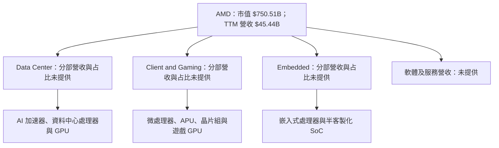
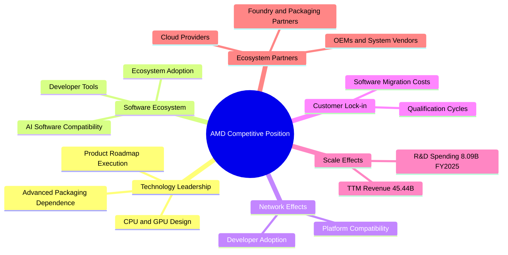
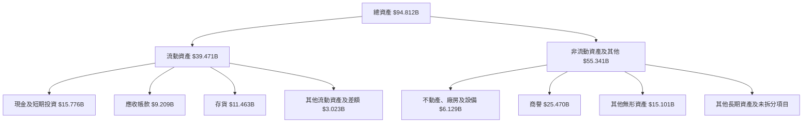
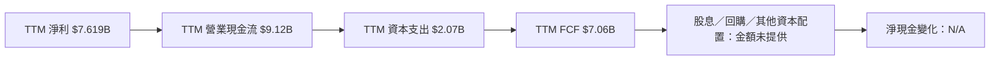
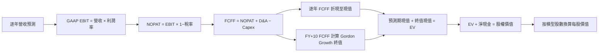
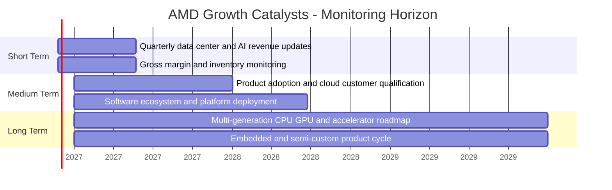
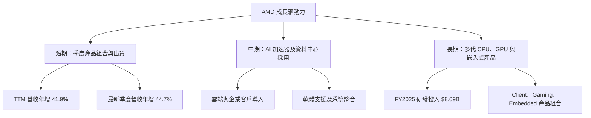
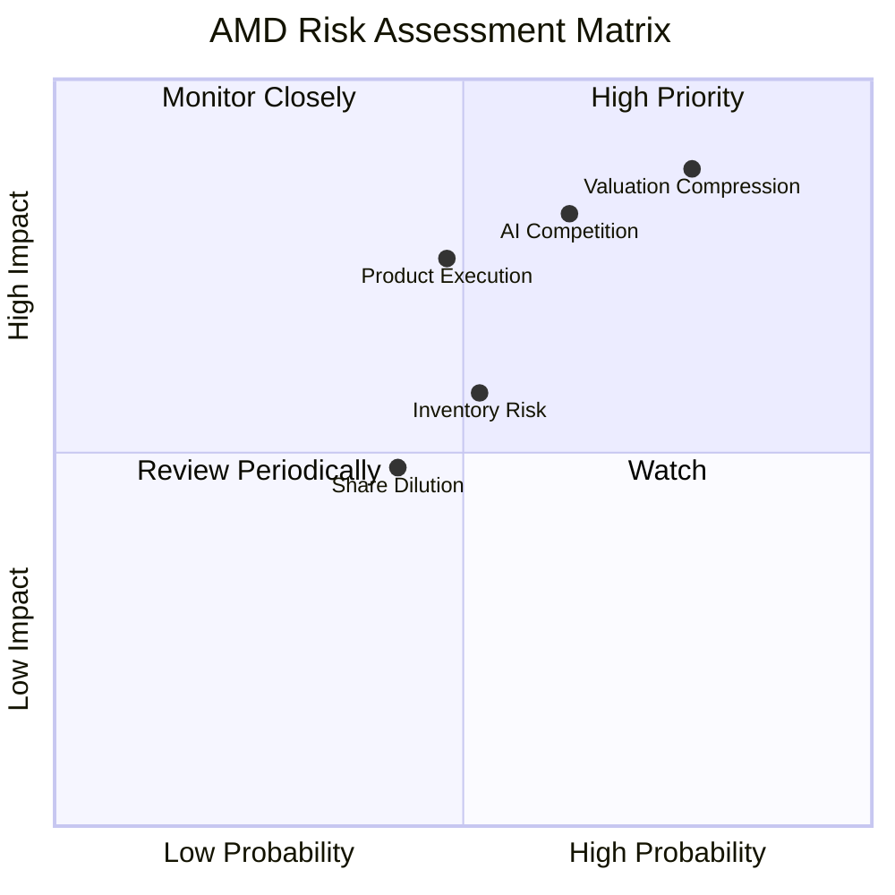
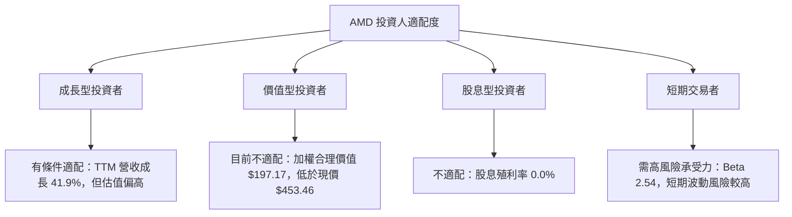

# AMD 基本面深度分析報告
> **報告日期**：2026-11-24 ｜ **語言**：繁體中文 ｜ **數據來源**：SEC 申報資料 (XBRL)、Yahoo Finance、Finviz、StockAnalysis、Roic.ai ｜ **分析師**：CFA 級機構研究

## 目錄

| # | 章節 | 核心結論 |
|---|------|----------|
| 1 | 執行摘要 | 賣出；加權合理價值 $197.17，MOS -130.0% |
| 2 | 公司概覽與商業模式 | 多產品線與晶片設計能力提供競爭基礎，分部營收占比未提供 |
| 3 | 損益表深度分析 | TTM 營收 $45.44B，年增 41.9%；最新季度營業利益率 21.2% |
| 4 | 資產負債表分析 | 淨現金 $8.70B；現金轉換週期 138 天 |
| 5 | 現金流量深度分析 | TTM FCF $7.06B，FCF Yield 0.94% |
| 6 | 獲利能力與資本效率 | ROIC 12.8% 低於 WACC 14.0%，當前未達價值創造門檻 |
| 7 | 相對估值分析 | AMD 估值高於同業中位數與自身歷史 P/S 中位數 |
| 8 | DCF 內在價值評估 | 基準每股價值 $75.54；DCF 對現價溢價約 500.3% |
| 9 | 成長催化劑 | AI 加速器、資料中心與產品組合是主要質化催化劑；TAM 數據未提供 |
| 10 | 風險矩陣 | 估值壓縮、AI 競爭與執行風險為主要風險 |
| 11 | 投資建議 | 依規則 20 評級為賣出；需等待估值大幅回落或現金流預期改善 |

---

## 1. 執行摘要

AMD 的 TTM 營收為 **$45.44B、年增 41.9%**，最新季度營收年增 **44.7%**、營業利益率 **21.2%**，反映需求與營業槓桿改善；但 TTM FCF 為 **$7.06B**、FCF Yield 僅 **0.94%**，而基準 DCF 每股價值為 **$75.54**，遠低於 **2026-11-23 收盤價 $453.46**。相對估值方法及分析師共識納入後的加權合理價值為 **$197.17**，安全邊際 MOS 為 **-130.0%**；此外，ROIC **12.8%** 低於 WACC **14.00%**。依 MOS 門檻評級為 **賣出**，未作質化調整。

### 1.0 一頁式投資儀表板（Portfolio Manager 30 秒速讀）

| 項目 | 內容 |
|------|------|
| **投資論點（3 句）** | ① TTM 營收年增 **41.9%**，成長動能具體。② 最新季度營業利益率 **21.2%**，高於 TTM **17.7%**，顯示近期獲利率改善。③ 加權合理價值 **$197.17**，較現價 **$453.46** 低 **56.5%**，估值風險明顯。 |
| **綜合評分** | **6.7/10**（引用 1.1 評分卡；品質分數不取代估值評級） |
| **財務健康** | 🟢 淨現金 **$8.70B**，流動比率 **2.725**；須留意營運資金占用 |
| **ROIC vs WACC** | **12.8% vs 14.00%**，差 **-1.20 個百分點**，目前未覆蓋資本成本 |
| **FCF 趨勢** | 年度 FCF 由 FY2023 **$1.12B** 增至 FY2025 **$6.74B**；TTM FCF Yield **0.94%** |
| **估值** | Forward P/E **25.7x**（Yahoo Finance 倍數）；EV/EBITDA **66.2x**；FCF Yield **0.94%** |
| **DCF 內在價值（基準）** | **$75.54**；按現價÷DCF價值−1，現價溢價 **+500.3%** |
| **安全邊際（MOS）** | **-130.0%＝($197.17 − $453.46) ÷ $197.17**（加權合理價值作分母）｜🔴 無 |
| **預期報酬（基準情境 12M）** | **-83.3%**，以 DCF 基準情境 $75.54 相對現價計算；非加權合理價值報酬 |
| **關鍵風險（前二）** | AI 加速器競爭與產品放量未達預期；估值倍數收縮 |
| **評級 + 信心度** | 🔴 **賣出** ｜ 信心：中（估值數據方向清楚；DCF 假設仍具不確定性） |

### 1.1 綜合評分卡（全報告唯一）

| 維度 | 評分（1–10） | 主要依據（引用數字與其來源章節） |
|------|--------------|----------------------------------|
| 成長性 | 9.0 | TTM 營收年增 **41.9%**、最新季度年增 **44.7%**（第 3 章） |
| 獲利能力 | 7.5 | TTM 營業利益率 **17.7%**、ROIC **12.8%**，但 ROIC 低於 WACC **14.00%**；F-Score **7/9**（第 6 章） |
| 財務健康 | 8.5 | 淨現金 **$8.70B**、流動比率 **2.725**；CCC **138 天**（第 4 章） |
| 估值 | 1.0 | MOS **-130.0%**；P/S **16.6x**，高於自身五年中位數 **8.9x**（第 7、8 章） |
| 護城河 | 7.5 | 多產品線及高研發投入提供設計與產品迭代基礎；市場份額、客戶集中度與分部收入占比未提供（第 2 章） |
| 管理層與資本配置 | 6.5 | FY2025 SBC **$1.64B**，Piotroski 稀釋股數測試未通過；回購與各項資本配置明細不足（第 3、5 章） |
| **綜合評分** | **6.7** | 六項算術平均：**(9.0 + 7.5 + 8.5 + 1.0 + 7.5 + 6.5) ÷ 6 = 6.7** |

### 1.2 五大投資論點 + 三大核心風險

| 類型 | 項目 | 具體依據 | 信心度 |
|------|------|----------|--------|
| 🟢 **投資論點①** | 營收加速 | TTM 營收 **$45.44B**、年增 **41.9%**；最新季度年增 **44.7%**，成長尚未只停留在歷史年度數據 | 🟢 高 |
| 🟢 **投資論點②** | 近期營業槓桿改善 | 最新季度營業利益 **$2.83B**、營業利益率 **21.2%**；季度營收較前季增 **16.0%** | 🟢 高 |
| 🟢 **投資論點③** | 現金流轉正且擴張 | TTM 營業現金流 **$9.12B**、資本支出 **$2.07B**、FCF **$7.06B** | 🟢 高 |
| 🟢 **投資論點④** | 資產負債表具韌性 | 現金及短期投資 **$15.78B**、總債務 **$7.08B**、淨現金 **$8.70B** | 🟢 高 |
| 🟢 **投資論點⑤** | 研發投入支持產品更新 | FY2025 研發費用 **$8.09B**，約為當年營收 **$34.64B** 的 **23.4%**；投入有利產品迭代，但也提高費用負擔 | 🟡 中 |
| 🟡 **風險①** | 估值回落 | 加權合理價值 **$197.17**，低於現價 **$453.46**；DCF 基準值僅 **$75.54** | 🔴 高衝擊 |
| 🔴 **風險②** | 競爭與產品執行 | NVDA 最新季度營收年增 **103.2%**，高於 AMD **44.7%**；AMD 的 AI 產品需求、軟體支援與供應執行會影響成長假設 | 🟡 中至高 |
| 🟡 **風險③** | 現金轉換與稀釋 | F-Score 的稀釋股數測試未通過；TTM DIO **199 天**，高於一年前 **161 天** | 🟡 中 |

### 1.3 快速統計卡片

同業中位數以 NVDA、INTC、AVGO 三家 Peer multiples 數據計算；只有確有提供同業資料的項目列出中位數。

| 指標 | 公司實際值（期間） | 同業中位數 | 狀態 |
|------|--------------------|------------|------|
| 營收成長（TTM） | **41.9%** | — | 🟢 |
| 營收成長（最新一季年增） | **44.7%** | **85.5%** | 🟡 |
| 毛利率（TTM） | **56.0%** | **74.9%** | 🟡 |
| 營業利益率（TTM） | **17.7%** | — | 🟢 |
| ROIC（TTM） | **12.8%** | — | 🟡 |
| Forward P/E | **25.7x** | **16.2x** | 🔴 |
| FCF Yield（TTM） | **0.94%** | — | 🔴 |
| Piotroski F-Score | **7 / 9** | — | 🟢 |

### 1.4 投資結論

╔══════════════════════════════════════════════════════════════════╗  
║                    📊 投資結論摘要                               ║  
╠══════════════════════════════════════════════════════════════════╣  
║  評級：🔴 賣出（MOS -130.0%，低於 -25% 門檻；未作質化調整）       ║  
║  價格（2026-11-23 收盤）：$453.46                                ║  
║  DCF 內在價值（基準）：$75.54（現價溢價 +500.3%）                 ║  
║  安全邊際 MOS：-130.0%＝($197.17−$453.46)÷$197.17                ║  
║  加權合理價值（8.8）：$197.17                                    ║  
║  DCF 情境價值：                                                   ║  
║    悲觀情境：$40.03（相對現價 -91.2%）                            ║  
║    基準情境：$75.54（相對現價 -83.3%）                            ║  
║    樂觀情境：$141.10（相對現價 -68.9%）                           ║  
║  綜合評分：6.7/10（引用 1.1）                                     ║  
║  適合投資人：可承受高波動、關注半導體長期成長且願意等待估值回落者 ║  
╚══════════════════════════════════════════════════════════════════╝

---

## 2. 公司概覽與商業模式

### 2.1 業務結構與收入來源

公司資料列示 Data Center、Client and Gaming、Embedded 三個業務板塊；未提供各板塊營收、佔比或軟體／服務收入，因此不推算分部比例。市值及 TTM 營收為已列示數據。

### 2.2 市場份額

市場份額資料未提供，因此不繪製比例圖，也不估算 AMD 在 CPU、GPU 或 AI 加速器市場的份額。可觀察到 AMD TTM 營收年增 **41.9%**，低於 NVDA 最新季度 **103.2%** 的營收年增，但高於 INTC 的 **20.9%**；這些成長率反映營收動能，不能直接替代市場份額。

### 2.3 競爭護城河分析

### 2.4 護城河強度

| 護城河項目 | 強度（強／中／弱） | 證據（引用數字或事實） | 會削弱它的情況 |
|------------|--------------------|------------------------|----------------|
| 技術與產品設計 | 中至強 | FY2025 研發費用 **$8.09B**；涵蓋 CPU、GPU、加速器及嵌入式處理器 | 新產品效能、供應或上市時程落後 |
| 軟體生態系統 | 中 | 公司提供 GPU 與 AI 加速器產品，但財務資料沒有量化軟體收入或開發者採用 | 開發者工具、模型支援及相容性不足 |
| 網路效應 | 弱至中 | 資料中沒有平台用戶或開發者規模數據 | 軟體與使用者生態無法擴張 |
| 客戶鎖定 | 中 | 大型客戶通常須完成產品驗證與系統整合；具體客戶留存率未提供 | 客戶轉向競品或自研晶片 |
| 規模效應 | 中 | TTM 營收 **$45.44B**、研發支出 FY2025 **$8.09B** | 競品研發規模及產品組合優勢擴大 |
| 生態夥伴 | 中 | 產品涉及代工、封裝、OEM 與雲端供應鏈；合作收入占比未提供 | 供應瓶頸、合作夥伴轉向競品 |

1.1 評分卡的護城河評分 **7.5/10**，依據是高研發投入與多產品線；但市場份額、客戶集中度及軟體收入資料不足，限制了更高信心。

---

## 3. 損益表深度分析

### 3.1 年度收入成長趨勢（近4年）

年度營收採年度損益表列示值。FY2022 至 FY2025 的累計 CAGR 約 **13.6%**，公式為 \((34.64÷23.60)^{1/3}-1\)；期間經歷 FY2023 下滑，後續 FY2024、FY2025 回升。

╔══════════════════════════════════════════════════════════════════╗  
║              AMD 年度收入趨勢（FY2022-FY2025）                   ║  
╠══════════════════════════════════════════════════════════════════╣  
║ FY2022  $23.60B  ██████████████░░░░░░░░░░  YoY：基期             ║  
║ FY2023  $22.68B  █████████████░░░░░░░░░░░  YoY：-3.9% 🔴         ║  
║ FY2024  $25.79B  ███████████████░░░░░░░░░  YoY：+13.7% 🟢        ║  
║ FY2025  $34.64B  ████████████████████░░░░  YoY：+34.3% 🟢        ║  
║ 2022–2025 三年累計 CAGR：約 +13.6%                               ║  
╚══════════════════════════════════════════════════════════════════╝

### 3.2 季度收入趨勢分析

| 季度 | 營收 | QoQ | YoY | 備註 |
|------|------:|----:|----:|------|
| 2025 Q4 | $10.27B | +11.1% | +34.1% | 相較 2025 Q3 $9.246B 成長 |
| 2026 Q1 | $10.25B | -0.2% | +37.9% | QoQ 大致持平，但同比仍成長 |
| 2026 Q2 | $11.54B | +12.5% | +50.1% | 同比增速加快 |
| 2026 Q3 | $13.38B | +16.0% | +44.7% | 最新季度營收續增；同比低於前季公布的 50.1% |

QoQ 按相鄰列示季度營收計算；YoY 採 StockAnalysis 季度同比數據。FY2026 Q3 的營收成長與季度毛利額增加相伴，表示收入擴張帶動獲利規模；是否可延續，仍取決於產品組合及競爭情況。

### 3.3 利潤率演變分析

下表 FY2022–FY2025 毛利率、營業利益率及淨利率以年度損益表數字計算；TTM 最新數據另外列示。不同資料供應商的 FY2025 毛利額略有差異，年度趨勢採年度損益表列示值，TTM 毛利率則引用 **56.0%**。

| 利潤率指標 | FY2022 | FY2023 | FY2024 | FY2025 | 趨勢 | 評估 |
|------------|-------:|-------:|-------:|-------:|------|------|
| **毛利率** | 44.9% | 46.1% | 49.3% | 49.5% | 逐年上升；TTM 為 56.0% | 🟢 |
| **營業利益率** | 5.3% | 1.8% | 8.1% | 10.7% | FY2023 低谷後回升；TTM 17.7% | 🟢 |
| **淨利率** | 5.6% | 3.8% | 6.4% | 12.5% | FY2025 明顯改善；TTM 16.8% | 🟢 |

**利潤率演變深度解析**：FY2023 營業利益降至 **$0.401B**，營業利益率約 **1.8%**；FY2024 營業利益回升至 **$2.09B**，FY2025 增至 **$3.69B**。TTM 營業利益為 **$8.097B**，營業利益率 **17.7%**，較 FY2025 年度水平高，反映近四季規模與產品組合改善。惟不能單憑彙總數據分離價格、產品組合及成本控制各自的貢獻。

### 3.4 費用結構分析

可確認的 FY2025 研發費用為 **$8.09B**，相當於年度營收 **$34.64B** 的 **23.4%**。完整營業費用拆分、銷售管理費用及各成本項目金額未提供，因此不畫會暗示完整組成比例的圓餅圖。

╔══════════════════════════════════════════════════════════════════╗  
║ AMD FY2025 研發投入                                               ║  
╠══════════════════════════════════════════════════════════════════╣  
║ 研發費用：$8.09B ｜年度營收：$34.64B                              ║  
║ 研發費用／營收：$8.09B ÷ $34.64B = 23.4%                         ║  
║ 其他營業費用細項：未提供，故不作比例分拆                         ║  
╚══════════════════════════════════════════════════════════════════╝

### 3.5 季度 EPS 趨勢與盈餘品質（Quality of Earnings）

EPS beats/misses 資料中的四季預估值及實際值均為缺值，故不能判定「超預期」或「不及預期」。以下為列示季度的實際 EPS 與同比變化，並非盈餘驚喜比較。

| 季度 | EPS | EPS YoY | 超預期／不及預期 |
|------|----:|--------:|------------------|
| 2025 Q4 | $0.92 | +217.1% | N/A；預估 EPS 缺漏 |
| 2026 Q1 | $0.84 | +91.2% | N/A；預估 EPS 缺漏 |
| 2026 Q2 | $1.39 | +159.5% | N/A；預估 EPS 缺漏 |
| 2026 Q3 | $1.46 | +93.8% | N/A；預估 EPS 缺漏 |

SBC TTM 以最近四個季度列示值合計：$0.523B + $0.503B + $0.487B + $0.486B = **$1.999B**。淨利採 StockAnalysis TTM **$7.619B**；資料來源口徑有別，比例應視為近似分析。

| 盈餘品質項目 | 數值／佔比 | 評估 |
|--------------|------------|------|
| 股權薪酬 SBC / 營收 | $1.999B ÷ $45.44B = **4.4%** | 🟡 SBC 是實質稀釋成本；Piotroski 稀釋股數測試未通過 |
| SBC / 營業現金流 | $1.999B ÷ $9.12B = **21.9%** | 🟡 占 OCF 比重不低，現金流仍須搭配稀釋觀察 |
| FCF / 淨利（現金轉換率） | $7.06B ÷ $7.619B = **92.7%** | 🟢 現金轉換接近淨利，但兩項採用資料源口徑不同 |
| 一次性／非經常性損益 | N/A；未提供足以拆分的資料 | 無法判定是否有一次性損益美化盈餘 |
| 有效稅率異常 | N/A；未提供 TTM 有效稅率 | 無法量化稅率是否推升淨利 |
| 資本化支出 vs 費用化 | TTM Capex **$2.07B**；資本化政策細節未提供 | 不能判斷成本資本化是否造成當期利潤高估 |

**盈餘品質結論**：FCF 約為 TTM 淨利的 **92.7%**，支持盈餘具有現金流對應；但 SBC 約為 TTM 營收 **4.4%**、營業現金流 **21.9%**，且稀釋股數測試未通過，意味股東每股經濟利益可能低於未考慮稀釋的帳面獲利。現有資料不足以確認一次性項目與有效稅率的影響。

---

## 4. 資產負債表分析

### 4.1 資產結構分解

以下採 2026-09-26 最新季度資產負債表數據。流動資產細項及非流動資產中可辨識項目有列示；未列細項不反推。

### 4.2 流動性與營運資金分析

| 指標 | 最新 TTM | 一年前 TTM | 變化 | 解讀 |
|------|----------|------------|------|------|
| DSO 應收帳款天數 | 74 天 | 71 天 | +3 天 | 收款週期略拉長；須持續關注應收帳款增幅是否快於營收 |
| DIO 存貨天數 | 199 天 | 161 天 | +38 天 | 庫存天數明顯增加，可能代表備貨或需求預測風險，需核對產品去化 |
| DPO 應付帳款天數 | 135 天 | 77 天 | +58 天 | 付款週期延長，短期支持現金轉換，但不能只解讀為議價能力提升 |
| CCC 現金轉換週期 | 138 天 | 155 天 | -17 天 | CCC 整體縮短，主因 DPO 增幅抵銷 DIO、DSO 上升 |

流動性指標方面，流動比率 **2.725**、速動比率 **1.725**，顯示短期償債緩衝充足。另有資料源列示 TTM 現金及短期投資 **$15.78B**，能為庫存及應收帳款占用提供資金緩衝。

### 4.3 債務結構分析

核心資本結構採 VERIFIED FIGURES 的總債務 **$7.08B**、現金及短期投資 **$15.78B**、淨現金 **$8.70B**。其他市場數據來源列示總債務 **$9.21B**、淨現金 **$6.57B**，存在口徑差異；本報告不將兩套數字混用。

╔══════════════════════════════════════════════════════════════════╗  
║                   AMD 債務健康診斷                               ║  
╠══════════════════════════════════════════════════════════════════╣  
║  總債務：        $7.08B  ████████░░░░░░░░░░░░                  ║  
║  現金及短期投資：$15.78B ████████████████████                 ║  
║  淨現金：        $8.70B  ███████████░░░░░░░░░  🟢              ║  
║  流動比率：      2.725   🟢                                      ║  
║  速動比率：      1.725   🟢                                      ║  
║  Debt/EBITDA：   N/A（未提供與本債務口徑一致的 EBITDA 計算）      ║  
║  利息保障倍數：  N/A（利息費用明細未提供）                       ║  
╚══════════════════════════════════════════════════════════════════╝

### 4.4 股東權益趨勢

年度資產負債表列示股東權益由 FY2022 **$54.75B** 增至 FY2025 **$63.00B**。權益增加提供資本緩衝，但股權稀釋的每股影響仍應與總權益成長區分。

╔══════════════════════════════════════════════════════════════════╗  
║ AMD 股東權益趨勢                                                  ║  
╠══════════════════════════════════════════════════════════════════╣  
║ FY2022  $54.75B  █████████████████░░░                            ║  
║ FY2023  $55.89B  █████████████████░░░                            ║  
║ FY2024  $57.57B  ██████████████████░░                            ║  
║ FY2025  $63.00B  ████████████████████                            ║  
╚══════════════════════════════════════════════════════════════════╝

---

## 5. 現金流量深度分析

### 5.1 現金流量瀑布圖

FY2025 淨利為 **$4.33B**，TTM 淨利資料源列示 **$7.619B**。以下以 TTM 作現金流路徑；已列示數字有四捨五入差異，因此 OCF 減 Capex 與 FCF 的末位不完全一致。

### 5.2 FCF 轉換率趨勢

| 年度 | FCF | 淨利 | FCF / 淨利 | 趨勢 |
|------|----:|----:|-----------:|------|
| FY2022 | $3.12B | $1.32B | 236.4% | FCF 高於淨利 |
| FY2023 | $1.12B | $0.854B | 131.1% | 現金轉換仍為正，惟金額下降 |
| FY2024 | $2.40B | $1.64B | 146.3% | 現金轉換回升 |
| FY2025 | $6.74B | $4.33B | 155.7% | FCF 擴張快於淨利 |

年度 FCF 和淨利口徑採年度現金流量表及損益表數據。FY2025 FCF 明顯擴張，TTM FCF **$7.06B**；是否可持續，要觀察庫存和應付帳款變化，避免把營運資金時點效應誤認為長期現金流能力。

### 5.3 自由現金流趨勢

| 年度 | FCF | YoY | FCF Yield |
|------|----:|----:|----------:|
| FY2022 | $3.12B | — | N/A |
| FY2023 | $1.12B | -64.1% | N/A |
| FY2024 | $2.40B | +114.3% | N/A |
| FY2025 | $6.74B | +180.8% | N/A |
| TTM | $7.06B | N/A | **0.94%** |

╔══════════════════════════════════════════════════════════════════╗  
║ AMD 自由現金流：年度歷史與 TTM                                   ║  
╠══════════════════════════════════════════════════════════════════╣  
║ FY2022  $3.12B  █████████░░░░░░░░░░░                             ║  
║ FY2023  $1.12B  ███░░░░░░░░░░░░░░░░░                             ║  
║ FY2024  $2.40B  ███████░░░░░░░░░░░░░                             ║  
║ FY2025  $6.74B  ███████████████████                              ║  
║ TTM     $7.06B  ████████████████████   FCF Yield：0.94%           ║  
╚══════════════════════════════════════════════════════════════════╝

### 5.4 資本配置評估

股息收益率與派息比率均列示為 **0.0%**；回購、併購、研發及其他投資的完整資金配置數據未提供，故不繪製資本配置圓餅圖。已知 FY2025 SBC 為 **$1.64B**，且 FY2025 Capex 約 **$0.974B**；兩者分別代表非現金股權薪酬及資本投資，不能視為完整資本配置。

---

## 6. 獲利能力與資本效率

### 6.1 ROE / ROA / ROIC 趨勢

| 指標 | 最新 TTM | 歷史趨勢資料 | 評估 |
|------|---------:|----------------|------|
| ROE | **11.1%** | 年度歷史序列未以同一口徑提供 | 杜邦分解顯示淨利率與資產週轉共同支撐 |
| ROA | N/A（品質資料未提供可照抄的數值序列） | Piotroski 測試顯示 ROA 高於一年前 | 正向，但不補造數值 |
| ROIC | **12.8%** | 可靠的同口徑歷史序列未提供 | 低於 WACC **14.00%** |

行業平均值未提供，故不列行業比較欄。市場資料另列 ROE **12.0%**、ROA **5.9%**；與品質資料 TTM ROE **11.1%** 口徑不同，本節採 VERIFIED FIGURES 品質指標中的 **11.1%**。

### 6.2 ROIC vs WACC 分析（核心價值創造判斷）

WACC 採程式計算資料所列 **14.00%**；其計算值 **14.79%** 被限制在 **7%–14%** 區間，採用上限 **14.00%**。ROIC **12.8%** 低於採用 WACC **1.20 個百分點**，代表最新 TTM 衡量下資本報酬未覆蓋資本成本。

╔══════════════════════════════════════════════════════════════════╗  
║                ROIC vs WACC 深度分析                              ║  
╠══════════════════════════════════════════════════════════════════╣  
║ WACC 輸入（同第 8.2 節）：                                        ║  
║ ├── 無風險利率（10Y 美債）：4.92%                                 ║  
║ ├── 市場風險溢酬 ERP：5.00%                                       ║  
║ ├── Beta used (adjusted)：2.00                                    ║  
║ ├── 股權成本 Ke：14.92%                                           ║  
║ ├── 稅前債務成本：1.85%；稅率：21.0%                              ║  
║ ├── 權重 E / D：99.1% / 0.9%                                      ║  
║ └── WACC 計算值 14.79%；區間上限採用 WACC：14.00%                 ║  
║                                                                  ║  
║ ROIC（TTM）：12.8%                                                 ║  
║ 價值差距：12.8% − 14.00% = -1.20 個百分點                         ║  
║ 結論：目前 ROIC 未達 WACC，按此口徑略為摧毀股東價值              ║  
║                                                                  ║  
║ ROIC 12.8%  ▓▓▓▓▓▓▓▓▓▓▓▓▓░░░░░░░  低於 WACC                     ║  
║ WACC 14.0%  ▓▓▓▓▓▓▓▓▓▓▓▓▓▓░░░░░░░                               ║  
╚══════════════════════════════════════════════════════════════════╝

### 6.3 杜邦三因素分解

| 因素 | 數值（TTM） | 解讀 |
|------|-------------|------|
| 淨利率 | **16.8%** | 淨利轉換率提供 ROE 的主要來源 |
| 資產週轉率 | **0.48** | 每單位資產產生的營收；反映資產密集程度 |
| 權益乘數 | **1.39** | 槓桿程度不高，ROE 並非主要靠財務槓桿推升 |
| **ROE** | **11.1%** | 16.8% × 0.48 × 1.39 = 約 11.2%，品質指標列示 **11.1%**；差異來自四捨五入 |

### 6.4 財務體質：Piotroski F-Score

Piotroski F-Score **7 / 9**；資料來源說明，缺少必要輸入的測試會排除於分母，但此處列示結果為 7/9。

| 測試 | 結果 | 解讀 |
|------|------|------|
| ROA > 0 | ✅ 通過 | 資產報酬為正 |
| 營業現金流 > 0 | ✅ 通過 | TTM OCF 為正 |
| ROA 高於一年前 | ✅ 通過 | 資產獲利趨勢改善 |
| 營業現金流 > 淨利（應計品質） | ✅ 通過 | 現金流超過淨利，有利盈餘品質 |
| 長期負債 ÷ 總資產低於一年前 | ❌ 未通過 | 槓桿指標未改善 |
| 流動比率高於一年前 | ✅ 通過 | 短期流動性改善 |
| 稀釋股數未增加 | ❌ 未通過 | 股數稀釋可能侵蝕每股報酬 |
| 毛利率高於一年前 | ✅ 通過 | 毛利率趨勢改善 |
| 資產週轉率高於一年前 | ✅ 通過 | 資產使用效率提高 |

---

## 7. 相對估值分析

### 7.1 同業估值比較表格

AMD 市場倍數欄採 Yahoo Finance 市場數據；比較公司倍數採 Peer multiples。來源口徑存在差異，尤其 AMD P/E 在不同資料表中分別約 **96.9x** 與 **98.6x**；下表的 Trailing P/E 採 VERIFIED peer 比較口徑的 **98.6x**。

| 估值指標 | **AMD** | **NVDA** | **INTC** | **AVGO** | AMD 評估 |
|----------|--------:|--------:|--------:|--------:|-----------|
| **Trailing P/E** | **98.6x** | 13.5x | N/A | 40.0x | 🔴 高於兩家可比較公司 |
| **Forward P/E** | **25.7x** | 9.9x | 33.3x | 16.2x | 🔴 高於同業中位數 **16.2x** |
| **P/S Ratio** | **16.5x** | 11.0x | 5.3x | 16.8x | 🟡 接近 AVGO，明顯高於 NVDA、INTC |
| **EV/EBITDA** | **66.2x** | 16.1x | 17.2x | 29.3x | 🔴 顯著高於三家同業 |
| 最新季度營收 YoY | **44.7%** | 103.2% | 20.9% | 85.5% | 🟡 成長高於 INTC，低於 NVDA、AVGO |
| 毛利率（TTM） | **56.0%** | 74.9% | 40.2% | 75.5% | 🟡 位於三家公司之間 |

Peer EV/EBITDA 中位數為 **17.2x**；Peer Forward P/E 中位數為 **16.2x**。AMD 的快速成長支持估值溢價的一部分，但目前盈利倍數仍大幅高於可比公司。

### 7.2 歷史估值區間分析

╔══════════════════════════════════════════════════════════════════╗  
║ AMD 五年估值歷史位置（TTM）                                       ║  
╠══════════════════════════════════════════════════════════════════╣  
║ P/E：     36.7x ├────────中位數 82.6x──────● 98.6x────────┤934.7x║  
║ 當前百分位：53%                                                   ║  
║ P/S：      4.3x ├────中位數 8.9x──────────────●16.6x──────┤23.1x║  
║ 當前百分位：90%                                                   ║  
║ EV/EBITDA：38.2x ├──────────●92.5x──中位數102.2x──────────┤919.2x║  
║ 當前百分位：44%                                                   ║  
╚══════════════════════════════════════════════════════════════════╝

估值位置顯示，P/S 處於自身五年 **90 百分位**，高於中位數 **8.9x**；P/E 百分位 **53%**，而 EV/EBITDA 百分位 **44%**。極端歷史上限受分母波動影響，不能直接視為合理估值錨點。

### 7.3 情境價值（Bear / Base / Bull，照抄 DCF MODEL 的 Scenarios）

| 情境 | 第 1 年營收成長 | 期末營業利潤率 | WACC | 每股價值 | 相對現價 | 機率 | 會發生的條件 |
|------|----------------:|----------------:|-----:|---------:|---------:|-----:|--------------|
| 🔴 悲觀 | 15.0% | 6.3% | 15.00% | $40.03 | -91.2% | 25% | AI／資料中心產品放量弱於基準、競爭壓低利潤率，資本成本維持高檔 |
| 🟡 基準 | 30.0% | 7.4% | 14.00% | $75.54 | -83.3% | 50% | 營收高增後逐步減速，長期營業利潤率回歸模型假設 |
| 🟢 樂觀 | 45.0% | 8.1% | 13.00% | $141.10 | -68.9% | 25% | 新產品放量更快、期末利潤率較高，市場折現率下降 |

這些每股價值及情境假設為模型列示值，情境的中間年度財務數字未提供，故不另行補造。

### 7.4 相對估值隱含價格區間

╔══════════════════════════════════════════════════════════════════╗  
║ AMD 相對估值方法隱含每股價值                                      ║  
╠══════════════════════════════════════════════════════════════════╣  
║ $75.54 DCF ── $120.83 EV/EBITDA ── $284.51 Forward P/E ──        ║  
║                                              現價 $453.46         ║  
║ 分析師共識目標價：$656.21                                         ║  
╚══════════════════════════════════════════════════════════════════╝

- **同業 Forward P/E：$284.51**，以 NVDA、INTC、AVGO 的 peer 中位數 **16.2x** 乘 AMD Forward EPS **$17.62**。
- **同業 EV/EBITDA：$120.83**，以 peer 中位數 **17.2x** 乘 AMD TTM EBITDA，並加回淨現金；模型列示值照錄。
- **DCF 基準：$75.54**，以 10 年 FCFF、WACC **14.00%**、永續成長率 **3.0%** 計算。
- **分析師共識：$656.21**，為 49 位分析師平均目標價，不代表基本面估值下限。

---

## 8. DCF 內在價值評估（Discounted Cash Flow）

> 本章只採程式計算的 DCF MODEL 數字，不自行建立第二套模型。金額均為 USD billions，除每股價值外；表中數字為四捨五入後的模型值。

### 8.0 估值推理鏈（Thinking Logic）

**Step 1 — 價值由哪些變數決定？**  
AMD 的估值主要由既有 CPU／GPU 與資料中心產品現金流、AI 加速器等成長機會，以及長期營業利潤率決定。財務資料沒有分部營收，因此各來源的現有營收占比 **N/A**，不能量化拆分。模型最敏感的假設是 **WACC、永續成長率 g 與長期現金流**；敏感度矩陣顯示 WACC 變動造成的估值幅度大於附近範圍的 g 變動。

**Step 2 — 模型選擇**

| 決策點 | 本報告採用 | 理由（含數字） | 曾考慮但否決 | 否決理由 |
|--------|-----------|----------------|--------------|----------|
| 現金流定義 | FCFF | 與 WACC 折現相配；TTM OCF **$9.12B**、Capex **$2.07B** | FCFE | 模型已固定採企業自由現金流 |
| 預測期 N | 10 年 | DCF MODEL 指定 10 年；收入由 **$45.44B** 預測至 FY+10 **$203.57B** | 5 年 | 不符合已計算模型，不自行改期 |
| 終值方法 | Gordon Growth | 模型給定 g **3.0%**、WACC **14.00%** | 單獨退出倍數 | 模型未提供可複核的退出倍數橋接值 |
| EBIT 基礎 | GAAP | 模型明確採 GAAP EBIT | 非 GAAP | 避免加回 SBC 後未扣除股東成本 |

**Step 3 — 高／中敏感度假設推導鏈**

- **營收成長**：錨點＝TTM 年增 **41.9%**；最新季度年增 **44.7%** → 調整＝考慮基期墊高與成長逐年放緩，採首年模型上限 **30.0%**，線性降至第十年 **3.0%** → **採用 FY+1 30.0%，FY+10 3.0%** → 曾考慮首年直接延續 **41.9%**，因模型把高成長逐步正常化而未採用。
- **營業利潤率**：錨點＝TTM GAAP 營業利益率 **17.7%** → 調整＝模型以近五個財年的中位數作長期收斂值 → **FY+1 17.7%，FY+10 7.4%** → 曾考慮維持 17.7%，但那會假設十年後仍保有當前 TTM 利潤率，與模型的成熟化設定不同。
- **預測期 N**：錨點＝模型固定 **10 年** → 調整＝沒有可用管理層長期財測供獨立校準 → **採用 10 年** → 曾考慮縮短至 5 年，因模型已固定 10 年，且無法在不另建模型下改動。
- **Capex／營收**：錨點＝TTM Capex **$2.07B**、營收 **$45.44B**；模型列示 Capex／營收 **4.5%** → 調整＝模型將比率維持在 **4.5%** → **採用 4.5%** → 不採較低投資率，因沒有證據支持未來再投資需求下降。
- **股權薪酬與年稀釋率**：錨點＝TTM SBC 約 **$1.999B**，Piotroski 稀釋股數測試未通過 → 調整＝模型已指定 GAAP EBIT，並採固定股數，避免再扣一次 SBC → **組合 (A)：GAAP EBIT、無額外 SBC 扣除、年稀釋率 0%** → 不採用再加稀釋的組合，避免同一成本重複反映。
- **永續成長率 g**：錨點＝長期名目成長常用範圍約 **3%–4%**，此為假設基準而非公司財測 → 調整＝考慮成熟半導體公司長期成長須低於折現率 → **採用 3.0%** → 不採 4.0%，避免提高終值依賴；且必須小於 WACC。
- **終值方法**：錨點＝模型終值採 Gordon Growth，基準 **WACC 14.00%**、g **3.0%** → 調整＝因 WACC 明顯高於 g，公式有效 → **採用 Gordon Growth** → 不另設退出倍數，因模型未提供其完整橋接結果。
- **WACC**：錨點＝程式計算值 **14.79%** → 調整＝按指定 **7%–14%** 範圍封頂 → **採用 14.00%** → 不用未封頂數值，以保持與程式輸出的模型一致。

有效稅率 **21.0%**、D&A／營收 **6.7%** 均沿用模型輸入；營運資金變動沒有建模，故不設比率。

**Step 4 — 最脆弱的一環**  
最脆弱的是高折現率下的長期營收與利潤率路徑；若 AI 產品成長或利潤率不及假設，價值會進一步下修，而若市場要求報酬率下降，敏感度矩陣顯示估值會明顯回升。

**Step 5 — 計算路徑圖**

### 8.1 模型假設總表（Model Inputs）

| 假設項目 | 採用值 | 依據／來源 | 敏感度 |
|----------|--------|-------------|--------|
| 預測期長度 **N** | 10 年 | DCF MODEL 指定 | 🟡 中 |
| 營收成長 | FY+1 **30.0%**，FY+10 **3.0%**，線性下降 | TTM 成長 **41.9%**；模型限制 FY+1 上限 30% | 🔴 高 |
| 營業利潤率 | FY+1 **17.7%** 至 FY+10 **7.4%** | 起點為 TTM；期末為模型採用近五年中位數 | 🔴 高 |
| 有效稅率 | **21.0%** | DCF MODEL 預設 | 🟢 低 |
| Capex／營收 | **4.5%** | TTM 模型輸入；保持常數 | 🟡 中 |
| D&A／營收 | **6.7%** | TTM 模型輸入；保持常數 | 🟢 低 |
| 營運資金變動 | 未建模 | DCF MODEL 明示 Working capital is not modelled | 🟢 低／未建模 |
| EBIT 基礎 | GAAP | 模型指定；SBC 已列為費用 | 🟡 中 |
| SBC 處理 | 組合 **(A)**；不另扣 SBC | GAAP EBIT 已含 SBC；模型固定股數、不再加稀釋 | 🟡 中 |
| 年稀釋率 | **0%**（固定股數假設） | DCF MODEL prompt combination A | 🟡 中 |
| 永續成長率 g | **3.0%** | 模型基準；低於 WACC | 🔴 高 |
| 終值方法 | Gordon Growth | 模型終值公式 | 🔴 高 |
| WACC | **14.00%** | 計算值 14.79%，受 14% 上限限制 | 🔴 高 |

**FCFF 定義**：採 FCFF，公式為 `FCFF = NOPAT + D&A − Capex`。此模型不含 ΔWC 列，因營運資金變動未建模。

**SBC 防重複計算**：本模型採用 **(A)**，GAAP EBIT 已含 SBC 費用，因此 FCFF 不再減 SBC，且股數不額外稀釋。

### 8.2 折現率推導（WACC）

╔══════════════════════════════════════════════════════════════════╗  
║                    WACC 推導（折現率）                           ║  
╠══════════════════════════════════════════════════════════════════╣  
║ 股權成本 Ke（CAPM）：                                             ║  
║ ├── 無風險利率 Rf（10Y 美債）：4.92%                              ║  
║ ├── 市場風險溢酬 ERP：5.00%（假設值，程式輸入）                   ║  
║ ├── 原始 Beta：2.54；調整後 Beta：2.00                            ║  
║ ├── Beta 調整：⅔ × 2.54 + ⅓ = 2.03，依 0.6–2.0 區間封頂為 2.00  ║  
║ ├── 規模／國別額外溢酬：未另加；公司為美國上市公司               ║  
║ └── Ke = 4.92% + 2.00 × 5.00% = 14.92%                           ║  
║                                                                  ║  
║ 債務成本：                                                        ║  
║ ├── 稅前 Kd（程式計算輸入）：1.85%                                ║  
║ ├── 稅率：21.0%                                                   ║  
║ └── 稅後 Kd = 1.85% × (1 − 21.0%) = 1.4615%                      ║  
║                                                                  ║  
║ 資本結構（程式列示權重）：                                        ║  
║ ├── 股權權重 E：99.1%                                            ║  
║ ├── 債務權重 D：0.9%                                             ║  
║ ├── 未封頂 WACC 計算值：14.79%                                   ║  
║ └── ✅ 採用 WACC：14.00%（受 7%–14% 範圍限制）                   ║  
╚══════════════════════════════════════════════════════════════════╝

逐步演算及資料界限：

1. **Ke** = Rf + β × ERP = **4.92% + 2.00 × 5.00% = 14.92%**。
2. **稅前 Kd** = 程式提供 **1.85%**。利息費用金額與平均計息負債明細未提供，故不能獨立重算分子、分母。
3. **稅後 Kd** = 1.85% × (1 − 21.0%) = **1.4615%**。
4. **權重** = 股權 **99.1%**，債務 **0.9%**；合計 **100.0%**。逐筆市值與同範圍計息負債餘額未提供，採程式提供的權重，不自行重建。
5. **WACC** = 程式計算值 **14.79%**；依 7%–14% 限制，**採用 14.00%**。按四捨五入後權重與成本直接重算可能出現小幅差異，故以程式列示的計算值及採用值為準。

本節採用 WACC 與第 6.2 節相同。10Y 美債報價日期未單獨列示，故不補寫日期；ERP 為程式設定假設值。

### 8.3 逐年自由現金流預測（基準情境）

金額單位：**$B**；折現因子保留三位小數。表中各數字照錄 DCF MODEL。ΔWC 未建模，故不另列該行。

| 年度 | FY+1 | FY+2 | FY+3 | FY+4 | FY+5 | FY+6 | FY+7 | FY+8 | FY+9 | FY+10 |
|------|-----:|-----:|-----:|-----:|-----:|-----:|-----:|-----:|-----:|------:|
| 營收 | 59.07 | 75.01 | 93.02 | 112.55 | 132.81 | 152.73 | 171.06 | 186.46 | 197.64 | 203.57 |
| 營收 YoY | 30.0% | 27.0% | 24.0% | 21.0% | 18.0% | 15.0% | 12.0% | 9.0% | 6.0% | 3.0% |
| 營業利潤率 | 17.7% | 16.6% | 15.4% | 14.3% | 13.1% | 12.0% | 10.8% | 9.7% | 8.5% | 7.4% |
| EBIT（GAAP） | 10.46 | 12.43 | 14.34 | 16.06 | 17.42 | 18.28 | 18.51 | 18.03 | 16.84 | 15.00 |
| − 稅（21.0%） | (2.20) | (2.61) | (3.01) | (3.37) | (3.66) | (3.84) | (3.89) | (3.79) | (3.54) | (3.15) |
| = NOPAT | 8.27 | 9.82 | 11.33 | 12.69 | 13.76 | 14.44 | 14.62 | 14.24 | 13.30 | 11.85 |
| + D&A | 3.96 | 5.03 | 6.24 | 7.55 | 8.90 | 10.24 | 11.47 | 12.50 | 13.25 | 13.65 |
| − Capex | (2.69) | (3.41) | (4.23) | (5.12) | (6.04) | (6.95) | (7.78) | (8.48) | (8.99) | (9.26) |
| **= FCFF** | **9.54** | **11.43** | **13.33** | **15.11** | **16.63** | **17.73** | **18.31** | **18.26** | **17.56** | **16.24** |
| 折現因子 @14.00% | 0.877 | 0.769 | 0.675 | 0.592 | 0.519 | 0.456 | 0.400 | 0.351 | 0.308 | 0.270 |
| **FCFF 現值 PV** | **8.37** | **8.80** | **9.00** | **8.95** | **8.63** | **8.08** | **7.32** | **6.40** | **5.40** | **4.38** |

預測期現值逐項加總（按模型未四捨五入精度）為 **$75.32B**；表格列示值相加因逐年四捨五入可能差 **$0.01B**。

**FY+1 逐步演算：**

1. **營收** = $45.44B × (1 + 30.0%) = **$59.07B**。
2. **EBIT** = $59.07B × 17.7% = **$10.46B**。
3. **稅** = $10.46B × 21.0% = **$2.20B**。
4. **NOPAT** = $10.46B − $2.20B = **$8.27B**（模型內部保留未四捨五入值）。
5. **D&A** = $59.07B × 6.7% = **$3.96B**。
6. **Capex** = $59.07B × 4.5% = **$2.69B**。
7. **ΔWC** = 未建模，不列入 FCFF。
8. **FCFF** = $8.27B + $3.96B − $2.69B = **$9.54B**（使用未四捨五入底層數據）。
9. **折現因子** = 1 ÷ (1 + 14.00%)^1 = **0.877**；PV = $9.54B × 0.877 = **$8.37B**。

**合理性自檢：**
- FY+1 至 FY+10 FCFF CAGR：\((16.24÷9.54)^{1/9}-1\) 約 **6.1%**；FY2022–FY2025 實際 FCF CAGR：\((6.74÷3.12)^{1/3}-1\) 約 **29.2%**，預測放緩約 **23.1 個百分點**，反映模型假設增長成熟化。
- FY+10 FCFF 利潤率 = **16.24÷203.57 = 8.0%**；目前 TTM FCF／營收 = **7.06÷45.44 = 15.5%**。同業最佳 FCFF 利潤率未提供，不能作數值比較；模型假設長期現金流率低於目前 TTM。
- 模型各年度 FCFF 均為正；未出現負年度 FCFF。

╔══════════════════════════════════════════════════════════════════╗  
║            自由現金流：歷史實際 vs 模型預測                      ║  
╠══════════════════════════════════════════════════════════════════╣  
║ FY2023（實） $1.12B  ███░░░░░░░░░░░░░░░░░  YoY：-64.1%          ║  
║ FY2024（實） $2.40B  ███████░░░░░░░░░░░░░  YoY：+114.3%         ║  
║ FY2025（實） $6.74B  ████████████████░░░░  YoY：+180.8%         ║  
║ FY+1（預）   $9.54B  ███████████████████░  模型值               ║  
║ FY+10（預） $16.24B  ████████████████████  預測期 FCF CAGR 6.1%  ║  
╠══════════════════════════════════════════════════════════════════╣  
║ 預測 CAGR 6.1% vs FY2022–FY2025 歷史 CAGR 約 29.2%；差距反映    ║  
║ 高成長逐步成熟化，而非維持歷史加速速度。                         ║  
╚══════════════════════════════════════════════════════════════════╝

### 8.4 終值計算（Terminal Value）

適用性檢查：**WACC 14.00% vs g 3.0% → WACC > g？✅**

| 方法 | 計算式 | 終值 TV | TV 現值 | 佔總 EV 比重 |
|------|--------|---------:|--------:|-------------:|
| Gordon Growth | $16.24 × (1 + 3.0%) ÷ (14.00% − 3.0%) | $152.04B | $41.01B | 35.3% |
| 退出倍數法 | N/A；DCF MODEL 未提供該方法數值 | N/A | N/A | N/A |

逐步演算：

1. **FY+10 FCFF** = **$16.24B**。
2. **分子** = $16.24B × (1 + 3.0%) = **$16.7272B**，模型列示約 **$16.73B**。
3. **分母** = 14.00% − 3.0% = **11.00%**；TV = $16.24B × 1.03 ÷ 0.11 = **$152.04B**。
4. **PV(TV)** = $152.04B × 0.270 = **$41.01B**。
5. **終值佔比** = $41.01B ÷ $116.33B = **35.3%**。

終值現值佔企業價值 **35.3%**，低於 75% 警示門檻，但仍對長期假設敏感。退出倍數交叉驗證所需倍數與 FY+10 EBITDA 未在 DCF MODEL 提供，故不自行建立該估值。

### 8.5 企業價值 → 每股內在價值（Bridge）

╔══════════════════════════════════════════════════════════════════╗  
║              企業價值 → 每股內在價值 橋接表                      ║  
╠══════════════════════════════════════════════════════════════════╣  
║ 預測期 FCF 現值合計             +$75.32B                          ║  
║ 終值現值 PV(TV)                 +$41.01B                          ║  
║ = 企業價值 EV                    $116.33B                         ║  
║ + 淨現金                        +$8.70B                           ║  
║ = 股權價值                       $125.03B                         ║  
║ 每股內在價值（模型列示）         $75.54                           ║  
║ 2026-11-23 收盤價                $453.46                          ║  
║ 折溢價（現價÷DCF價值−1）         +500.3%（溢價）                  ║  
╚══════════════════════════════════════════════════════════════════╝

逐步演算：

1. **EV** = $75.32B + $41.01B = **$116.33B**。
2. **股權價值** = $116.33B + $8.70B = **$125.03B**。
3. **每股內在價值** = DCF MODEL 指定公式：股權價值 × 價格 ÷ 市值 = $125.03B × $453.46 ÷ $750.51B = **$75.54**（照錄模型值）。
4. **折溢價** = $453.46 ÷ $75.54 − 1 = **+500.3%**。模型另列的 **-83.3%** 是內在價值相對現價的上行空間，分母不同。
5. **本節不計算 MOS**：安全邊際只依第 8.8 節加權合理價值計算。

股數處理採 DCF MODEL 指定的每股換算公式；模型使用固定股數假設，沒有另加年稀釋。資產負債表橋接採模型列示淨現金 **$8.70B**，不另拆換用不同期間的現金與債務。

### 8.6 敏感性分析（WACC × 永續成長率）

下表每股價值為 DCF MODEL 原值，不改動格內數字。因模型未提供各敏感度格的底層橋接，表內只列內在價值，不新增逐格上行百分比。

| g（列）／WACC（欄） | 12.00% | 13.00% | **14.00%（基準）** | 15.00% | 16.00% |
|-----------|-------:|-------:|------------------:|-------:|-------:|
| **2.0%** | $87.24 | $79.62 | $73.26 | $67.87 | $63.24 |
| **2.5%** | $89.10 | $81.03 | $74.35 | $68.72 | $63.92 |
| **3.0%（基準）** | $91.17 | $82.59 | **$75.54** | $69.65 | $64.65 |
| **3.5%** | $93.48 | $84.31 | $76.85 | $70.66 | $65.45 |
| **4.0%** | $96.08 | $86.22 | $78.29 | $71.77 | $66.31 |

矩陣中的有效格皆滿足 WACC > g。代表性資料檢查選取 **WACC 13.00% > g 3.0% ✅**；對應矩陣值為 **$82.59**。敏感度矩陣的中間年度折現現值未提供，依規則不重建另一套模型，因此不虛構該格的完整 EV 橋接算式。

**三情境 DCF（模型列示值）**

| 情境 | 第 1 年營收成長 | 期末營業利潤率 | 永續成長率 g | WACC | 每股內在價值 | 相對現價 | 主觀機率 |
|------|----------------:|----------------:|------------:|-----:|--------------:|---------:|---------:|
| 🔴 悲觀 | 15.0% | 6.3% | 模型基準 3.0% | 15.00% | $40.03 | -91.2% | 25% |
| 🟡 基準 | 30.0% | 7.4% | 3.0% | 14.00% | $75.54 | -83.3% | 50% |
| 🟢 樂觀 | 45.0% | 8.1% | 模型基準 3.0% | 13.00% | $141.10 | -68.9% | 25% |
| **機率加權** | — | — | — | — | **$83.06** | **-81.7%** | **100%** |

模型未提供悲觀與樂觀情境的 FY+10 營收、FCFF 及終值明細，依「DCF MODEL 數值不得重建」要求，不補造該情境完整演算鏈。機率加權照錄模型：**$40.03 × 25% + $75.54 × 50% + $141.10 × 25% = $83.06**（未四捨五入底層值）。

**敏感度結論：**
- g 由 **2.5%** 升至 **3.5%**、WACC 固定 **14.00%**：$74.35 升至 $76.85，增加 **$2.50／約 3.4%**。
- WACC 由 **13.00%** 升至 **15.00%**、g 固定 **3.0%**：$82.59 降至 $69.65，減少 **$12.94／約 15.7%**。
- 期末營業利潤率每增加 1 個百分點的單獨敏感度：**N/A（模型未提供）**。
- 就現有矩陣範圍看，WACC 變化造成的估值變動幅度較大；與 8.0 指出的折現率及長期現金流風險一致。

### 8.7 反推 DCF（Reverse DCF：市場在預期什麼）

反推結果只列 DCF MODEL 已解出的變數；其餘輸入固定為模型基準值。模型沒有提供分段試算軌跡，故不杜撰每次迭代結果。

| 求解的變數（一次一個） | 其餘變數設定 | 市場隱含值（令 DCF = 現價） | 公司歷史實際 | 判斷 |
|------------------------|--------------|------------------------------:|--------------|------|
| FY+1 營收成長 | 其他假設固定為基準 | **91.5%** | TTM 成長 **41.9%** | 🔴 顯著高於當前 TTM 成長 |
| 固定營業利潤率 | 其他假設固定為基準 | **79.6%** | TTM 營業利益率 **17.7%** | 🔴 遠高於目前水準 |
| 永續成長率 g | 未由模型解出 | 未計算 | — | 未計算 |
| 預測期 N | 未由模型解出 | 未計算 | — | 未計算 |

Reverse DCF 已給出的結果為：要以基準模型其他輸入支撐現價，FY+1 營收成長需達 **91.5%**，或固定營業利潤率需達 **79.6%**。由於兩者是「一次只改一個變數」的獨立反推，並非同時需要達成；但相較目前 TTM 成長 **41.9%**、營業利益率 **17.7%**，現價包含很高的預期。

### 8.8 估值三角驗證與安全邊際

| 估值方法 | 隱含每股價值 | 上行空間（÷現價） | 權重 | 說明 |
|----------|--------------:|------------------:|-----:|------|
| DCF（基準） | $75.54 | -83.3% | 40% | 10 年 FCFF、WACC 14.00%、g 3.0% |
| 同業 Forward P/E | $284.51 | -37.3% | 25% | peer 中位數 16.2x × Forward EPS $17.62 |
| 同業 EV/EBITDA | $120.83 | -73.4% | 25% | peer 中位數 17.2x × TTM EBITDA，加回淨現金 |
| 分析師共識目標價 | $656.21 | +44.7% | 10% | 49 位分析師平均目標價 |
| **加權合理價值** | **$197.17** | **-56.5%** | **100%** | — |

**逐步演算（權重外顯）**：  
加權合理價值 = **$75.54 × 40% + $284.51 × 25% + $120.83 × 25% + $656.21 × 10%**  
= **$30.216 + $71.1275 + $30.2075 + $65.621 = $197.172 ≈ $197.17**。  
公司類型為 profitable，權重依程式固定。四種方法均可計算，沒有方法被剔除。

MOS 與上行空間：

- **MOS** = ($197.17 − $453.46) ÷ $197.17 = **-130.0%**。
- **上行空間** = ($197.17 − $453.46) ÷ $453.46 = **-56.5%**。

╔══════════════════════════════════════════════════════════════════╗  
║                  估值區間與安全邊際                              ║  
╠══════════════════════════════════════════════════════════════════╣  
║ $40.03 ───── $75.54 ───── [$197.17] ───── $453.46 ───── $656.21 ║  
║ 悲觀 DCF      基準 DCF       加權合理值       現價       共識目標價║  
║                                                                  ║  
║ 安全邊際 MOS = ($197.17 − $453.46) ÷ $197.17 = -130.0%           ║  
║ MOS 評估：🔴 無安全邊際                                          ║  
║ 上行空間 = ($197.17 − $453.46) ÷ $453.46 = -56.5%                ║  
║                                                                  ║  
║ 參考買入價：不高於 $177.45，可對 $197.17 加權價值提供至少 10% MOS║  
║ 合理持有區間：N/A；現價遠高於模型與同業相對估值                 ║  
║ 減碼考慮：現價 $453.46 已高於加權合理價值與所有 DCF 情境價值     ║  
╚══════════════════════════════════════════════════════════════════╝

買入參考價 **$177.45** 為 $197.17 × (1 − 10%) 的計算結果，不是另一個估值方法；評級仍依 MOS 規則為賣出。

> 🔎 **程式複算（Python，依本節各項自動重算）**
>
> 加權合理價值 = $75.54 × 40% + $284.51 × 25% + $120.83 × 25% + $656.21 × 10% = **$197.17**（權重合計 100%）
>
> 以價格 $453.46 計：MOS = **-130.0%**，上行空間 = **-56.5%**
>
> ✅ 與本節所寫數值一致。

### 8.9 DCF 模型的局限與失效條件

- **終值依賴度**：PV(TV) 占 EV **35.3%**，約三分之一企業價值來自 FY+10 後的現金流。
- **最脆弱假設**：WACC **14.00%** 與長期營收、利潤率路徑。若 WACC 由 13% 升至 15%、g 固定 3%，矩陣每股價值由 **$82.59** 降至 **$69.65**；若營收成長未達假設，價值方向亦向下。
- **模型限制**：營運資金變化未建模，且 DCF 使用 GAAP EBIT、固定股數；SBC 已列費用但未讓股數隨未來稀釋增加。這會降低模型對未來股東稀釋的敏感性。
- **適用性**：TTM FCF 為正 **$7.06B**，DCF 可作參考；但公司仍處產品與資本投入變化期，宜與同業倍數及營收情境並看，不宜把單一 DCF 當精確目標價。
- **與第 10 章連結**：AI 產品競爭或出貨不及預期，影響營收成長；價格競爭影響營業利潤率；利率或風險溢酬上升會推高 WACC。

### 8.10 複算檢核表（Audit Trail）

| # | 檢核項目 | 檢查方式 | 結果 |
|---|----------|----------|------|
| 1 | 所有 🔴高／🟡中敏感度輸入都有推導 | 對照 8.0 Step 3 與 8.1 | ✅ |
| 2 | 每個假設都有來歷 | 8.1 依據欄逐項列示；缺少資料標明未建模 | ✅ |
| 3 | WACC 算式及採用值 | 引用計算值 **14.79%**，封頂採用 **14.00%**；組成採程式值 | ✅（以提供值為準） |
| 4 | Kd 分母與債務權重 D 同範圍 | 利息費用、平均及期末計息負債明細未提供，無法獨立重算 | ⚠️ 來源明細不足，採用程式計算結果 |
| 5 | WACC 與第 6.2 節相同 | 兩處均採 **14.00%** | ✅ |
| 6 | 逐年表格年度數等於 N | FY+1 至 FY+10，共 10 年，無省略 | ✅ |
| 7 | FY+1 FCFF 與 PV 可複算 | $8.27 + $3.96 − $2.69 = $9.54；$9.54 × 0.877 = $8.37 | ✅（按模型未四捨五入值） |
| 8 | 預測期 PV 加總 | 模型合計 **$75.32B**；列示數字逐項四捨五入有約 $0.01B 尾差 | ✅ |
| 9 | WACC > g | 14.00% > 3.0% | ✅ |
| 10 | 終值基期與折現期 | 採 FY+10 FCFF，折現因子 **0.270** | ✅ |
| 11 | EV 至每股價值橋接 | $75.32 + $41.01 = $116.33；加淨現金得 $125.03；每股值照錄 $75.54 | ✅ |
| 12 | SBC 三要素組合相容 | GAAP EBIT、無額外 SBC 扣除、股數不再稀釋，組合 (A) | ✅ |
| 13 | 敏感度矩陣基準格 | g 3.0%、WACC 14.0% = **$75.54**，等於基準 DCF | ✅ |
| 14 | 矩陣有效性 | 所列最小 WACC 12% 仍大於最大 g 4% | ✅ |
| 15 | 三情境機率加總 | 25% + 50% + 25% = 100%；加權值照錄 **$83.06** | ✅ |
| 16 | Reverse DCF 一次放開一個變數 | 模型只提供營收成長與固定利潤率兩項解；沒有迭代軌跡 | ⚠️ 不補造試算數據 |
| 17 | MOS 與折溢價基準 | MOS 使用 $197.17；折溢價使用 DCF $75.54 | ✅ |
| 18 | 報告完整至第 11 章 | 本報告列出 11 章 | ✅ |
| 19 | 加權合理價值等於方法加權總和 | 算式結果 $197.172，四捨五入為 $197.17 | ✅ |
| 20 | 評級符合規則 20 | MOS -130.0% < -25%，評級賣出 | ✅ |

---

## 9. 成長催化劑

### 9.1 催化劑時間軸

財務資料及近期新聞沒有足以確認具體產品上市月份或季度的公司時程；以下時間軸只按一般業務觀察期間分類，不代表已確認的公司指引。

### 9.2 TAM 市場規模分析

**N/A（TAM 數據未提供）**。AMD TTM 營收 **$45.44B**、年增 **41.9%**，表示營收規模正在擴張，但財務資料未給可引用的市場規模與滲透率，因此不估算 TAM。

### 9.3 成長驅動力結構圖

---

## 10. 風險矩陣

### 10.1 風險評分矩陣

下圖位置為研究判斷的相對機率與衝擊排序，不是已發生概率統計，也不代表精確的財務損失預測。

### 10.2 風險清單詳細分析

下表機率與影響為研究情境判斷，並非財務數據包或公司指引所提供的統計預測；資料不足時不捏造營收損失百分比。

| # | 風險項目 | 發生機率 | 財務衝擊 | 風險評分 | 緩解措施 |
|---|----------|----------|----------|----------|----------|
| 1 | 🔴 **估值倍數收縮** | 中高；定性判斷 | 高；DCF 基準 $75.54、加權值 $197.17 均低於現價 $453.46 | 🔴 高 | 以分批與估值區間控管部位；追蹤 FCF、Forward EPS 及估值倍數 |
| 2 | 🔴 **AI／資料中心競爭** | 中高；定性判斷 | 高；AMD 最新季度營收年增 **44.7%**，低於 NVDA **103.2%** | 🔴 高 | 追蹤相關業務成長、產品供應、客戶導入及毛利率 |
| 3 | 🟠 **產品執行與利潤率風險** | 中；定性判斷 | 高；最新季度營業利益率 **21.2%**，若回落會壓低 DCF 現金流 | 🟠 中高 | 檢視季度營業利潤率與指引，確認成長有否帶來利潤 |
| 4 | 🟡 **庫存與營運資金占用** | 中；定性判斷 | 中；DIO **199 天**，較一年前增加 **38 天** | 🟡 中 | 追蹤 DIO、CCC、存貨跌價及應收帳款增速 |
| 5 | 🟡 **SBC 與股數稀釋** | 中；定性判斷 | 中；SBC 約為 TTM 營收 **4.4%**，稀釋股數測試未通過 | 🟡 中 | 比較 SBC／營收、稀釋股數及每股 FCF 變化 |

---

## 11. 投資建議

### 11.1 最終評級與評分

按加權合理價值 **$197.17** 與現價 **$453.46** 計算，MOS 為 **-130.0%**，依規則 20 評級為 **賣出**，沒有質化調整。1.1 綜合評分為 **6.7/10**，六項分數分別為成長性 **9.0**、獲利能力 **7.5**、財務健康 **8.5**、估值 **1.0**、護城河 **7.5**、管理層與資本配置 **6.5**；公司成長品質與當前股價吸引力並非同一件事。

### 11.2 合理價值與隱含報酬率

| 估值參考 | 每股價值 | 相對現價 | 機率／權重 |
|----------|---------:|---------:|-----------:|
| 加權合理價值 | **$197.17** | **-56.5%** | 方法權重合計 100% |
| DCF 悲觀情境 | $40.03 | -91.2% | 25% |
| DCF 基準情境 | $75.54 | -83.3% | 50% |
| DCF 樂觀情境 | $141.10 | -68.9% | 25% |
| 分析師共識目標價 | $656.21 | +44.7% | 49 位分析師平均 |

DCF 三情境均低於現價；分析師共識顯著高於加權合理價值，兩者分歧顯示市場對未來成長與估值倍數的看法差距很大。

### 11.3 買入時機與觸發因素

╔══════════════════════════════════════════════════════════════════╗  
║                  ✅ 買入觸發因素 Checklist                       ║  
╠══════════════════════════════════════════════════════════════════╣  
║  重新考慮建立部位的條件：                                         ║  
║  ☐ 股價回落至約 $177.45 或以下，對 $197.17 合理價值至少有 10% MOS║  
║  ☐ 營收成長持續，且最新季度營業利益率不因降價而明顯回落         ║  
║  ☐ FCF 維持正值，且 DIO 不再持續上升                              ║  
║                                                                  ║  
║  加碼觸發條件：                                                   ║  
║  ☐ 估值回到加權合理價值以下，並有連續季度營收及 FCF 支持         ║  
║  ☐ ROIC 回升至高於採用 WACC 14.00%                               ║  
║                                                                  ║  
║  減碼／停損觸發條件：                                             ║  
║  ☐ 最新季度營收年增連續兩季低於 20%                               ║  
║  ☐ TTM FCF 轉負，或營業利益率較最新季度 21.2% 明顯收縮            ║  
║  ☐ 庫存天數進一步上升，且應收帳款增幅高於營收                    ║  
║  ☐ ROIC 持續低於 WACC，且估值未同步回落                           ║  
╚══════════════════════════════════════════════════════════════════╝

以上門檻是投資監控條件，不是公司財測。若股價仍遠高於加權合理價值，單一季度營收超預期不足以消除估值風險。

### 11.4 投資人適配度分析

### 11.5 每季財報監控清單（Quarterly Watch List）

| 指標 | 最新基準 | 觸發加碼觀察 | 觸發減碼觀察 |
|------|---------:|-------------|-------------|
| 營收 YoY | 最新季度 **44.7%** | 維持 30% 以上且未依賴單季波動 | 連續兩季低於 20% |
| 營業利益率 | TTM **17.7%**；最新季度驗證值 **21.2%** | 營收成長伴隨利潤率穩定 | 連續兩季低於 17.7% |
| 毛利率 | TTM **56.0%** | 維持或改善 | 明顯下滑且無產品組合解釋 |
| 營業現金流 | TTM **$9.12B** | 持續為正且與淨利同步 | 連續季度快速下滑 |
| FCF | TTM **$7.06B**；FCF Yield **0.94%** | 持續為正並提升每股 FCF | TTM FCF 轉負 |
| 資本支出 | TTM **$2.07B** | Capex 增長伴隨未來收入回報 | Capex 增長而 FCF、毛利率走弱 |
| 存貨天數 DIO | **199 天** | 回落或穩定 | 繼續上升並伴隨營收放緩 |
| DSO／CCC | **74 天／138 天** | CCC 持續改善 | DSO 與 CCC 同時上升 |
| 股權薪酬 SBC | 最近四季合計約 **$1.999B** | SBC／營收下降、稀釋放緩 | 稀釋股數持續增加、每股 FCF 落後總 FCF |
| AI／資料中心及財測 | 分部數字未提供 | 公司披露的產品成長與供應指引持續上修 | 相關需求、出貨或指引下修 |

### 11.6 反面論證：什麼會證明論點錯誤（What Would Change My Mind）

╔══════════════════════════════════════════════════════════════════╗  
║              ⚠️ 論點失效條件（Disconfirming Evidence）            ║  
╠══════════════════════════════════════════════════════════════════╣  
║ 本報告的負面估值判斷若出現下列情況，應重新檢視：                 ║  
║ ☐ 營收年增連續兩季高於 50%，且不是單一產品或一次性出貨造成       ║  
║ ☐ TTM 營業利益率持續高於目前 17.7%，且非短期費用遞延             ║  
║ ☐ TTM FCF 持續增長，FCF Yield 明顯高於目前 0.94%                 ║  
║ ☐ ROIC 升至高於 WACC 14.00%，並維持至少兩個報告期                ║  
║ ☐ DIO 從目前 199 天回落，同時營收與毛利率維持成長                 ║  
║ ☐ 股價回落至加權合理價值 $197.17 以下，估值折價改善               ║  
╚══════════════════════════════════════════════════════════════════╝

**免責聲明**：本報告為 AI 自動生成，僅供研究參考，不構成投資建議。投資有風險，入市需謹慎。

---

## 資料與來源

| 項目 | 內容 |
|------|------|
| 價格 | 453.46 USD，2026-11-23 收盤（Yahoo Finance 日線） |
| 財務報表 | SEC 10-Q filed 2026-11-04，最新季度 2026-09-26（FY2026 Q3） |
| 有回應的資料來源 | SEC 申報資料 (XBRL)、Yahoo Finance、Finviz、StockAnalysis、Roic.ai |
| 由程式計算 | TTM 數字、WACC、DCF 模型、估值方法與權重、加權合理價值、MOS、評級門檻、F-Score、杜邦分解、營運資金天數、綜合評分 |
| 撰寫模型 | openai / gpt-6-luna |

> 本區塊由產生報告的程式依實際取得的資料填寫，非模型撰寫。「由程式計算」的數字不是模型的估計；其餘判斷（評分、情境、策略）是模型的分析。
