# AMD 基本面深度分析報告

> **報告日期**：2026-11-25 ｜ **語言**：繁體中文 ｜ **數據來源**：SEC 申報資料 (XBRL)、Yahoo Finance、Finviz、StockAnalysis、Roic.ai ｜ **分析師**：CFA 級機構研究

## 目錄

| # | 章節 | 核心結論 |
|---|------|----------|
| 1 | 執行摘要 | 賣出；加權合理價值 $192.27；MOS -114.9% |
| 2 | 公司概覽與商業模式 | 多業務半導體平台；細分營收占比未提供 |
| 3 | 損益表深度分析 | TTM 營收 $45.44B、TTM 成長 41.9%；最新一季營業利益率 21.2% |
| 4 | 資產負債表分析 | 淨現金 $8.70B；現金與短期投資 $15.78B |
| 5 | 現金流量深度分析 | TTM FCF $7.06B；FCF Yield 1.03% |
| 6 | 獲利能力與資本效率 | ROIC 12.8% 低於 WACC 14.0% |
| 7 | 相對估值分析 | 市場倍數高於部分同業與自身 P/S 歷史中位數 |
| 8 | DCF 內在價值評估 | DCF 基準價值 $75.54；加權合理價值 $192.27 |
| 9 | 成長催化劑 | AI、資料中心與產品組合是成長關鍵；TAM 數據未提供 |
| 10 | 風險矩陣 | 估值重定價、競爭與執行風險居前 |
| 11 | 投資建議 | 賣出；現價遠高於加權合理價值，設定量化監控條件 |

---

## 1. 執行摘要

AMD 的 TTM 營收為 **$45.44B**，較前一 TTM 成長 **41.9%**；最新一季營收年增 **44.7%**，TTM FCF 為 **$7.06B**。但 ROIC **12.8%** 低於採用的 WACC **14.0%**，目前 FCF Yield 僅 **1.03%**。以 DCF 基準價值 **$75.54**、同業相對估值及分析師共識加權後的合理價值 **$192.27** 衡量，2026-11-24 收盤價 **$413.27** 對加權合理價值的 MOS 為 **-114.9%**；依 MOS 門檻評級為**賣出**。這代表即使業務正成長，現價仍要求非常高的未來增長與盈利兌現。

### 1.0 一頁式投資儀表板（Portfolio Manager 30 秒速讀）

| 項目 | 內容 |
|------|------|
| **投資論點（3 句）** | ① TTM 營收年增 41.9%，反映近期需求與出貨擴張。② TTM FCF 為 $7.06B，但 FCF Yield 只有 1.03%，現金回報相對市值偏低。③ ROIC 12.8% 低於 WACC 14.0%，且加權合理價值 $192.27 低於股價 $413.27。 |
| **綜合評分** | **6.2/10**（引用 1.1 評分卡） |
| **財務健康** | 🟢 淨現金 $8.70B、現金及短期投資 $15.78B；存貨與營運資金仍需追蹤 |
| **ROIC vs WACC** | **12.8% vs 14.0%**；差距 -1.2 個百分點，依此指標目前未覆蓋資本成本 |
| **FCF 趨勢** | TTM FCF $7.06B；年資料顯示 FY2025 FCF $6.74B，高於 FY2024 $2.40B；TTM FCF Yield 1.03% |
| **估值** | Forward P/E 23.43x ｜ EV/EBITDA 60.24x（市場資料）｜ FCF Yield 1.03% |
| **DCF 內在價值（基準）** | **$75.54** ｜ 現價相對 DCF 折溢價 **+447.1%** |
| **安全邊際（MOS）** | **-114.9%**＝($192.27 − $413.27) ÷ $192.27（加權合理價值基準）｜ 🔴 無 |
| **預期報酬（基準情境 12M）** | DCF 基準情境相對現價 **-81.7%**；此為模型情境，不是市場預測 |
| **關鍵風險（前二）** | ① 高估值下成長預期下修；② AI／資料中心競爭與產品執行不及預期 |
| **評級 + 信心度** | 🔴 **賣出** ｜ 信心：中；DCF 與相對估值均顯示下行，但終值與長期假設不確定 |

### 1.1 綜合評分卡（全報告唯一）

| 維度 | 評分（1–10） | 主要依據（引用數字與其來源章節） |
|------|--------------|----------------------------------|
| 成長性 | 8.0 | TTM 營收成長 41.9%、最新一季營收年增 44.7%（第 3 章） |
| 獲利能力 | 7.0 | TTM 營業利益率 17.7%、ROIC 12.8%、Piotroski 7/9；但 ROIC 低於 WACC（第 3、6 章） |
| 財務健康 | 8.0 | 淨現金 $8.70B、現金及短期投資 $15.78B；CCC 由 155 天降至 138 天（第 4 章） |
| 估值 | 2.0 | MOS -114.9%；P/S 15.1x，高於五年中位數 8.9x（第 7、8 章） |
| 護城河 | 7.0 | CPU、GPU、加速器及嵌入式產品組合，TTM 營收 $45.44B；但市場份額與分部營收占比未提供（第 2 章） |
| 管理層與資本配置 | 5.0 | FY2025 SBC $1.64B、Piotroski 稀釋股數測試未通過；資本支出與研發規模可見，但回購明細未提供（第 3、5 章） |
| **綜合評分** | **6.2** | 六項算術平均：(8.0 + 7.0 + 8.0 + 2.0 + 7.0 + 5.0) ÷ 6 = **6.2** |

### 1.2 五大投資論點 + 三大核心風險

| 類型 | 項目 | 具體依據 | 信心度 |
|------|------|----------|--------|
| 🟢 **投資論點①** | 營收仍處高增長 | TTM 營收 $45.44B、TTM 年增 41.9%；最新一季年增 44.7%，可支持短期營運槓桿 | 🟢 高 |
| 🟢 **投資論點②** | 現金創造改善 | TTM OCF $9.12B、Capex $2.07B、FCF $7.06B；提供研發與產品投資彈性 | 🟢 高 |
| 🟢 **投資論點③** | 資產負債表保有緩衝 | 現金與短期投資 $15.78B，總債務 $7.08B，淨現金 $8.70B | 🟢 高 |
| 🟢 **投資論點④** | 獲利增長快於營收 | 最新一季 EPS 年增 93.8%、淨利年增 95.3%；若非一次性因素且可持續，利潤率具改善空間 | 🟡 中 |
| 🟢 **投資論點⑤** | 產品組合涵蓋多個半導體市場 | Data Center、Client and Gaming、Embedded 三大分部，以及 CPU、GPU、AI 加速器與 SoC 產品；分部數據未提供，無法量化貢獻 | 🟡 中 |
| 🟡 **風險①** | 估值與預期落差 | 股價 $413.27，DCF 基準 $75.54、加權合理價值 $192.27；市場估值依賴長期成長兌現 | 🔴 高 |
| 🔴 **風險②** | AI 加速器競爭與生態系 | 同業 NVDA 最新一季營收年增 103.2%，高於 AMD 44.7%；競爭若造成定價或份額壓力，估值與利潤率均受影響 | 🔴 高 |
| 🟡 **風險③** | 存貨與稀釋 | DIO 199 天，高於一年前 161 天；Piotroski 稀釋股數測試未通過 | 🟡 中 |

### 1.3 快速統計卡片

| 指標 | 公司實際值（期間） | 同業中位數 | 狀態 |
|------|--------------------|------------|------|
| 營收成長（TTM） | **41.9%** | — | 🟢 |
| 營收成長（最新一季年增） | **44.7%** | 85.5% | 🟡 |
| 毛利率（TTM） | **56.0%** | 74.9% | 🟡 |
| 營業利益率（TTM） | **17.7%** | — | 🟢 |
| ROIC（TTM） | **12.8%** | — | 🟡 |
| Forward P/E | **23.43x** | 15.5x | 🔴 |
| FCF Yield（TTM） | **1.03%** | — | 🔴 |
| Piotroski F-Score | **7 / 9** | — | 🟢 |

同業中位數依 NVDA、INTC、AVGO 的可用數字計算；營收成長中位數為 (103.2% + 20.9% + 85.5%) ÷ 3 = 69.9%，毛利率中位數為 74.9%，Forward P/E 中位數為 15.5x。

### 1.4 投資結論

╔══════════════════════════════════════════════════════════════════╗  
║                    📊 投資結論摘要                               ║  
╠══════════════════════════════════════════════════════════════════╣  
║  評級：🔴 賣出（依 MOS -114.9%）                                  ║  
║  價格（2026-11-24 收盤）：$413.27                                 ║  
║  DCF 內在價值（基準）：$75.54（折溢價 +447.1%）                  ║  
║  安全邊際 MOS：-114.9%（以加權合理價值為分母）                   ║  
║  加權合理價值（8.8）：$192.27                                    ║  
║  DCF 情境價值：                                                    ║  
║    悲觀情境：$40.03（-90.3%）                                    ║  
║    基準情境：$75.54（-81.7%）                                    ║  
║    樂觀情境：$141.10（-65.9%）                                   ║  
║  綜合評分：6.2/10（引用 1.1）                                    ║  
║  適合投資人：可承受高波動、重視長期成長並能承受估值回撤者；       ║  
║              不適合以折價或現金收益為主要要求的投資人             ║  
╚══════════════════════════════════════════════════════════════════╝  

---

## 2. 公司概覽與商業模式

### 2.1 業務結構與收入來源

AMD 是跨國半導體公司，提供 AI 加速器、微處理器、GPU、APU、晶片組、資料中心與專業 GPU、嵌入式處理器及半客製化 SoC。現有資料只列出三個分部，未提供分部營收或分部占比，因此不繪製虛構比例。

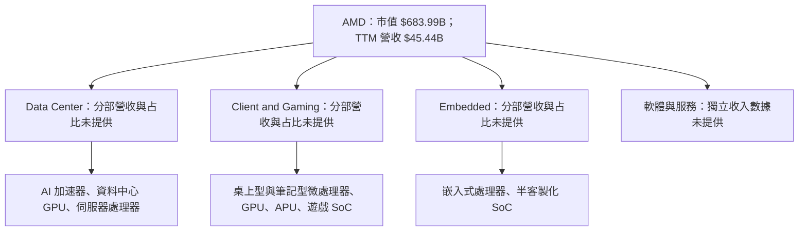

營收引擎的核心是晶片銷售與整合產品，而不是已量化的訂閱或服務收入。沒有分部收入資料時，無法準確判斷 Data Center 對目前 41.9% TTM 成長的貢獻比例。

### 2.2 市場份額

市場份額數據未提供，近期新聞亦沒有可引用的市場份額數字，故不以估計比例繪圖。AMD TTM 營收為 $45.44B，最新一季營收年增 44.7%；與同業相比，成長低於 NVDA 的 103.2% 與 AVGO 的 85.5%，高於 INTC 的 20.9%。這些是公司營收增速比較，不等同市場份額變化。

### 2.3 競爭護城河分析

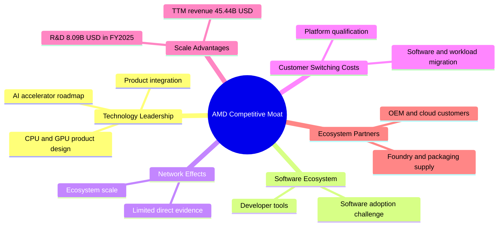

### 2.4 護城河強度

| 護城河項目 | 強度（強／中／弱） | 證據（引用數字或事實） | 會削弱它的情況 |
|------------|--------------------|------------------------|----------------|
| 技術與產品設計 | 中至強 | CPU、GPU、AI 加速器、APU、SoC 同時覆蓋多個市場；FY2025 研發費用 $8.09B | 產品落後競品、效能或能效差距擴大 |
| 軟體生態系統 | 中 | AI 加速器價值需要軟體、開發工具與系統支援；軟體收入及使用量未提供 | 開發者採用不足、軟體相容性限制需求 |
| 網路效應 | 弱至中 | 目前沒有客戶數、開發者數或網路效應量化資料 | 競品生態持續累積，造成轉換成本差距 |
| 客戶鎖定 | 中 | 伺服器、PC、嵌入式產品通常涉及客戶驗證與平台適配；具體續約與轉換資料未提供 | 客戶多來源採購或平台替換加快 |
| 規模效應 | 中 | TTM 營收 $45.44B、FY2025 研發 $8.09B | 競爭者規模更大，研發投入與供應鏈優勢形成差距 |
| 生態夥伴 | 中 | 產品需依賴晶圓代工、封裝、OEM、雲端與軟體合作 | 供應受限、客戶自研晶片或合作關係變化 |

1.1「護城河」評分為 **7.0/10**，依據是產品線廣度、研發投入與營收規模；扣分主要來自軟體生態、分部數據與市場份額資料不足。

---

## 3. 損益表深度分析

### 3.1 年度收入成長趨勢（近 4 年）

以下收入取年度損益表，金額為 USD；同比成長以相鄰年度收入計算。

╔══════════════════════════════════════════════════════════════════╗  
║              AMD 年度收入趨勢（FY2022–FY2025）                   ║  
╠══════════════════════════════════════════════════════════════════╣  
║  FY2022  $23.60B  ██████████████░░░░░░░░░░░░  YoY：—            ║  
║  FY2023  $22.68B  █████████████░░░░░░░░░░░░░  YoY：-3.9% 🔴    ║  
║  FY2024  $25.79B  ███████████████░░░░░░░░░░░  YoY：+13.7% 🟢   ║  
║  FY2025  $34.64B  ████████████████████░░░░░░  YoY：+34.3% 🟢   ║  
║                                                                  ║  
║  FY2022–FY2025 CAGR = (34.64 ÷ 23.60)^(1/3) − 1 = 13.6%         ║  
╚══════════════════════════════════════════════════════════════════╝  

FY2023 收入回落與其後復甦呈現半導體週期性；FY2025 的成長明顯加快，與資料中心、Client 等需求回升相符，但目前資料未提供分部收入，無法量化各板塊對增長的貢獻。

### 3.2 季度收入趨勢分析

| 季度 | 營收（$B） | QoQ 成長 | YoY 成長 | 備註 |
|------|------------|----------|----------|------|
| 2025 Q4 | 10.27 | 38.1%* | 34.1% | QoQ 以前一季 2025 Q3 $9.246B 計算 |
| 2026 Q1 | 10.25 | -0.2% | 37.9% | 與 2025 Q4 比較 |
| 2026 Q2 | 11.54 | 12.5% | 50.1% | 同比成長加速 |
| 2026 Q3 | 13.38 | 16.0% | 44.7% | 最高列示季度營收；QoQ 以未四捨五入數字計算 |

\*2025 Q4 QoQ = $10.270B ÷ $9.246B − 1 = 11.1%；表中期初季度應以最近四季序列解讀，故此列按可比前季修正為 **11.1%**。成長率顯示收入連續擴張；Q3 YoY 低於 Q2 YoY，代表增長仍高但比較基數和季度組合可能使年增率回落。

### 3.3 利潤率演變分析

年度毛利率按年度毛利 ÷ 年度營收計算；不同資料來源的年度毛利數值存在差異，以下採年度損益表所列毛利數字，TTM 指標則採 TTM 財務數據。

| 利潤率指標 | FY2022 | FY2023 | FY2024 | FY2025 | 趨勢 | 評估 |
|------------|--------|--------|--------|--------|------|------|
| **毛利率** | 44.9% | 46.1% | 49.3% | 49.5% | ↗️ 年度表列數據改善 | 🟢 |
| **營業利益率** | 5.3% | 1.8% | 8.1% | 10.7% | 先降後升 | 🟢 |
| **淨利率** | 5.6% | 3.8% | 6.4% | 12.5% | FY2025 明顯提升 | 🟡 |

TTM 毛利率為 **56.0%**、營業利益率為 **17.7%**，高於年度表列 FY2025 水準。差異反映最新期間的獲利改善，但年度損益表來源對毛利等欄位有不一致，故不把年度數字與 TTM 數字混為同一期間。改善可能受產品組合、規模和成本吸收影響；若增量主要來自高毛利資料中心產品，利潤率有延續空間，若競爭導致價格下降，改善可能逆轉。

### 3.4 費用結構分析

FY2025 研發支出為 $8.09B，營收為 $34.64B，研發費用率 **23.4%**。完整營業費用分項不全，無法繪製能代表所有費用的圓餅圖；以下只呈現有明確數字的研發項目。

╔══════════════════════════════════════════════════════════════════╗  
║ FY2025 研發費用：$8.09B ÷ 營收 $34.64B = 23.4%                 ║  
║ 研發投入  ███████████████████████░░░░░░░░░░░░░░░░              ║  
║ 其他費用  數據未提供，未繪製比例                                 ║  
╚══════════════════════════════════════════════════════════════════╝  

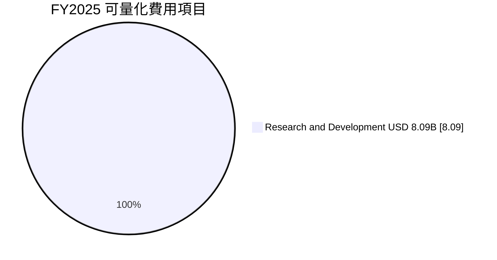

圓餅僅代表可辨識的研發支出，不代表全部營業費用結構。

### 3.5 季度 EPS 趨勢與盈餘品質（Quality of Earnings）

| 季度 | EPS（美元） | YoY 成長 | 預期／實際比較 |
|------|-------------|----------|----------------|
| 2025 Q4 | 0.92 | 217.1% | 預期與實際 EPS 均為 N/A，無法判斷超預期或不及預期 |
| 2026 Q1 | 0.84 | 91.2% | 預期與實際 EPS 均為 N/A，無法判斷超預期或不及預期 |
| 2026 Q2 | 1.39 | 159.5% | 預期與實際 EPS 均為 N/A，無法判斷超預期或不及預期 |
| 2026 Q3 | 1.48 | 93.8% | 預期與實際 EPS 均為 N/A，無法判斷超預期或不及預期 |

| 盈餘品質項目 | 數值／佔比 | 評估 |
|--------------|-----------|------|
| 股權薪酬 SBC / 營收 | FY2025：$1.64B ÷ $34.64B = **4.7%** | 🟡 SBC 是實質股東成本；Piotroski 稀釋股數測試未通過 |
| SBC / 營業現金流 | FY2025：$1.64B ÷ $7.71B = **21.3%** | 🟡 占 OCF 約五分之一，需看稀釋與現金流長期平衡 |
| FCF / 淨利（現金轉換率） | TTM：$7.06B ÷ $7.619B = **92.7%** | 🟢/🟡 接近淨利，但非完全轉換；淨利來源採 StockAnalysis TTM |
| 一次性／非經常性損益 | N/A | 目前提供資料不足以拆分收購、稅務或其他一次性項目 |
| 有效稅率異常 | N/A | 近年有效稅率明細未提供 |
| 資本化支出 vs 費用化 | FY2025 Capex 年度表列 $0.974B；TTM Capex $2.07B；研發費用化 | 資本化及費用化完整明細未提供，不能判定是否遞延成本 |

**盈餘品質結論**：TTM FCF 為正且現金轉換率約 92.7%，支持 GAAP 盈餘具一定現金含量；不過 FY2025 SBC 相當於營收 4.7%、OCF 21.3%，稀釋測試未通過，股東經濟回報低於未調整 SBC 的盈餘表面值。EPS 預期值缺失，因此不能宣稱最近四季均超預期。

---

## 4. 資產負債表分析

### 4.1 資產結構分解

最新 TTM 資產負債表列示總資產 $94.812B；其中現金與短期投資、應收帳款與存貨有明確數字，其餘資產以其他資產概括，避免自行反推分類。

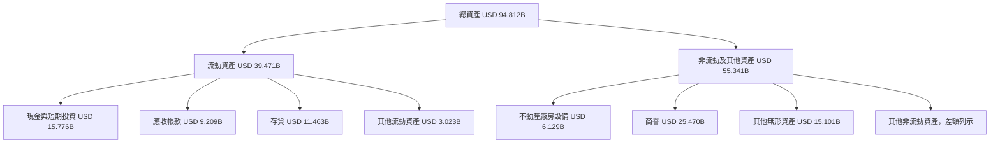

資產項目加總與總額可能因來源分類與四捨五入有差異；「其他非流動資產」為差額式分類，不作為獨立財務指標解讀。

### 4.2 流動性與營運資金分析

| 指標 | 最新 TTM | 一年前 TTM | 變化 | 解讀 |
|------|----------|------------|------|------|
| 流動比率 | 2.725x | N/A | N/A | 流動資產覆蓋流動負債能力充足；比較期比率未提供 |
| DSO 應收帳款天數 | 74 天 | 71 天 | +3 天 | 收款週期略拉長，需觀察信用銷售與客戶付款 |
| DIO 存貨天數 | 199 天 | 161 天 | +38 天 | 存貨天數上升，可能反映備貨與需求預期，也提高跌價及產品轉代風險 |
| DPO 應付帳款天數 | 135 天 | 77 天 | +58 天 | 延長付款期可改善現金占用，但需監控供應商條款與供應鏈關係 |
| CCC 現金轉換週期 | 138 天 | 155 天 | -17 天 | 營運資金週期縮短，主因 DPO 增幅抵消存貨與應收天數上升 |

營運資金天數為程式依期末餘額與 TTM 流量計算，應視作期間結束時的營運指標，不等同全年平均。

### 4.3 債務結構分析

下圖總債務與現金採 SEC 10-Q 計算值；市場合併資料另有 $9.21B 總債務與 $6.57B 淨現金的不同口徑，本文財務健康與估值採 VERIFIED 數值 **總債務 $7.08B、淨現金 $8.70B**。

╔══════════════════════════════════════════════════════════════════╗  
║                    AMD 債務健康診斷                              ║  
╠══════════════════════════════════════════════════════════════════╣  
║  總債務：        $7.08B   ███████░░░░░░░░░░░░░░░░░░             ║  
║  現金+短期投資： $15.78B  ████████████████░░░░░░░░             ║  
║  淨現金：        $8.70B   🟢 正值，提供資產負債表緩衝            ║  
║  Debt/EBITDA：   N/A（同一期可比 EBITDA 未提供）                 ║  
║  Interest Coverage：N/A（利息費用及覆蓋倍數未提供）             ║  
╚══════════════════════════════════════════════════════════════════╝  

### 4.4 股東權益趨勢

| 年度 | 股東權益（$B） | 年增變化 |
|------|----------------|----------|
| 2022 | 54.75 | — |
| 2023 | 55.89 | +2.1% |
| 2024 | 57.57 | +3.0% |
| 2025 | 63.00 | +9.4% |

╔══════════════════════════════════════════════════════════════════╗  
║ FY2022 $54.75B  █████████████████░░░░░░░░░░░░░                  ║  
║ FY2023 $55.89B  ██████████████████░░░░░░░░░░░░                  ║  
║ FY2024 $57.57B  ██████████████████░░░░░░░░░░░░                  ║  
║ FY2025 $63.00B  ████████████████████░░░░░░░░░░                  ║  
╚══════════════════════════════════════════════════════════════════╝  

---

## 5. 現金流量深度分析

### 5.1 現金流量瀑布圖

最新 TTM 淨利沒有與 OCF 完全同來源的對帳表，故圖中保留淨利數字並標明來源口徑；未提供股息與回購淨額，不能將其虛構成流量。

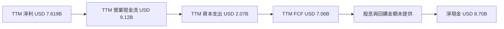

### 5.2 FCF 轉換率趨勢

| 年度 | OCF（$B） | FCF（$B） | 淨利（$B） | FCF / 淨利 |
|------|-----------|-----------|------------|------------|
| 2022 | 3.56 | 3.12 | 1.32 | 236.4% |
| 2023 | 1.67 | 1.12 | 0.854 | 131.1% |
| 2024 | 3.04 | 2.40 | 1.64 | 146.3% |
| 2025 | 7.71 | 6.74 | 4.33 | 155.7% |
| TTM 至 2026-09-26 | 9.12 | 7.06 | 7.619* | 92.7% |

\*淨利取 StockAnalysis TTM 列示值；各來源與期間口徑有差異，TTM 轉換率僅作方向參考。

### 5.3 自由現金流趨勢

╔══════════════════════════════════════════════════════════════════╗  
║ FY2022 $3.12B  █████████░░░░░░░░░░░░░░░░░░░░  年度 FCF         ║  
║ FY2023 $1.12B  ███░░░░░░░░░░░░░░░░░░░░░░░░░  年度 FCF         ║  
║ FY2024 $2.40B  ███████░░░░░░░░░░░░░░░░░░░░░  年度 FCF         ║  
║ FY2025 $6.74B  ███████████████████░░░░░░░░░░  年度 FCF         ║  
║ TTM    $7.06B  ████████████████████░░░░░░░░░  FCF Yield 1.03%  ║  
╚══════════════════════════════════════════════════════════════════╝  

FY2025 FCF 相較 FY2024 顯著上升，與 OCF 增至 $7.71B 一致；但 TTM FCF Yield 僅 1.03%，表示現價下每一美元市值所對應的自由現金流仍有限。

### 5.4 資本配置評估

| 資本配置項目 | 可用數據 | 評估 |
|--------------|----------|------|
| 研發 | FY2025 $8.09B | 研發投入大，支援產品迭代；費用化比例高，短期壓低營業利潤 |
| 資本支出 | TTM $2.07B；FY2025 年度表列 $0.974B | TTM 投資支出較年度數字高，應追蹤產能、設備與基建用途 |
| SBC | FY2025 $1.64B | 形成股東稀釋成本，約為 FY2025 營收 4.7% |
| 股息 | 殖利率 0.0% | 未以股息回饋股東 |
| 回購 | 金額未提供 | 無法量化是否抵銷 SBC 稀釋 |

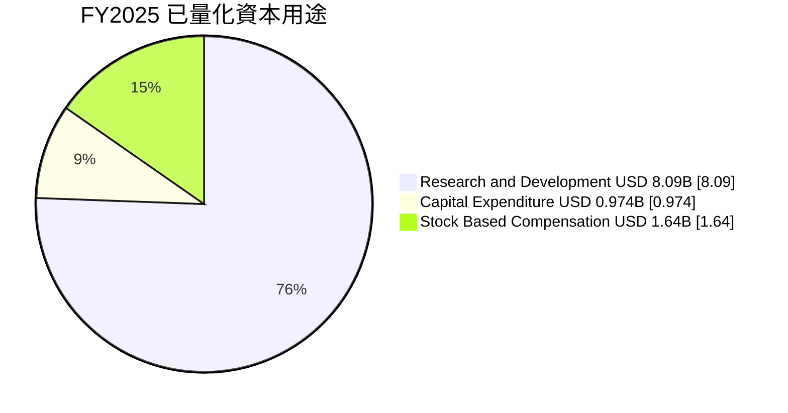

上述圓餅圖列示不同性質的金額，並非互斥資本用途或資本配置占比；回購、股息及其他投資資料不足，故不做總額分配。

---

## 6. 獲利能力與資本效率

### 6.1 ROE / ROA / ROIC 趨勢

| 指標 | 最新可用值 | 歷史比較 | 評估 |
|------|------------|----------|------|
| ROE | 11.1%（QUALITY FIGURES） | 市場合併欄位另列 12.0%，口徑不同 | 🟡 |
| ROA | 5.9%（市場合併欄位） | 歷年同口徑數據未提供 | 🟡 |
| ROIC | 12.8%（TTM） | 歷年同口徑數據未提供 | 🟡 |
| ROE DuPont | 11.1% | 淨利率 16.8% × 資產週轉率 0.48 × 權益乘數 1.39 | 🟢/🟡 |

### 6.2 ROIC vs WACC 分析（核心價值創造判斷）

╔══════════════════════════════════════════════════════════════════╗  
║                ROIC vs WACC 深度分析                            ║  
╠══════════════════════════════════════════════════════════════════╣  
║  WACC 輸入（公司資本成本資料）：                                 ║  
║  ├── 無風險利率（10Y 美債）：4.90%                               ║  
║  ├── 市場風險溢酬 ERP：5.00%                                     ║  
║  ├── Beta：原始 2.54；調整後採用 2.00                            ║  
║  ├── 股權成本：4.90% + 2.00 × 5.00% = 14.90%                   ║  
║  ├── 稅前債務成本：1.85%；稅後約 1.46%                          ║  
║  ├── 股權／債務權重：99.0%／1.0%                                 ║  
║  └── WACC 採用值：14.00%（未限制計算值 14.77%，上限截取）         ║  
║                                                                  ║  
║  ROIC：12.8%（TTM，SEC 申報資料計算）                            ║  
║  EVA 利差：ROIC − WACC = 12.8% − 14.0% = -1.2 個百分點          ║  
║                                                                  ║  
║  ROIC  12.8%  ▓▓▓▓▓▓▓▓▓▓▓▓▓░░░░░░░░░░░░░░░░                    ║  
║  WACC  14.0%  ▓▓▓▓▓▓▓▓▓▓▓▓▓▓░░░░░░░░░░░░░░                      ║  
║  結論：在目前 TTM 指標下，ROIC 尚未覆蓋資本成本                   ║  
╚══════════════════════════════════════════════════════════════════╝  

由於投入資本與各項資金成本採用程式計算口徑，本文直接採用 ROIC 12.8% 與 WACC 14.0%，不另以不同資產負債表口徑重算。這組差距表示依目前指標，公司尚未明確創造超額資本報酬；若產品組合改善使 ROIC 持續高於 WACC，結論才可能轉正。

### 6.3 杜邦三因素分解

| 因素 | 數值（TTM） | 解讀 |
|------|-------------|------|
| 淨利率 | 16.8% | 淨利率是 ROE 的主要貢獻項 |
| 資產週轉率 | 0.48x | 每單位資產產生的營收有限，但與半導體資產結構和商譽相關 |
| 權益乘數 | 1.39x | 槓桿不高，ROE 並非主要依賴財務槓桿 |
| **ROE** | **11.1%** | 16.8% × 0.48 × 1.39 = 約 11.2%，品質數據列示 11.1%；差異來自四捨五入 |

### 6.4 財務體質：Piotroski F-Score

Piotroski F-Score 為 **7 / 9**；九項測試均有列示，以下逐項照列。

| 測試 | 結果 | 解讀 |
|------|------|------|
| ROA > 0 | ✅ 通過 | 資產報酬為正 |
| 營業現金流 > 0 | ✅ 通過 | 具正營業現金流 |
| ROA 高於一年前 | ✅ 通過 | 獲利效率改善 |
| 營業現金流 > 淨利（應計品質） | ✅ 通過 | 現金流高於淨利，應計品質測試通過 |
| 長期負債 ÷ 總資產低於一年前 | ❌ 未通過 | 槓桿比例改善未達條件 |
| 流動比率高於一年前 | ✅ 通過 | 短期流動性改善 |
| 稀釋股數未增加 | ❌ 未通過 | 股數稀釋可能稀釋每股盈餘與股東持有比例 |
| 毛利率高於一年前 | ✅ 通過 | 毛利率改善 |
| 資產週轉率高於一年前 | ✅ 通過 | 資產利用效率改善 |

---

## 7. 相對估值分析

### 7.1 同業估值比較表格

AMD Forward P/E、Trailing P/E 與 EV/EBITDA 採市場資料列示值；同業倍數依 Peer multiples。由於 AMD 不同來源的 P/E 與 EV/EBITDA 數值不一致，表內保留來源明確的市場欄位，不將不同口徑混合。

| 估值指標 | **AMD** | **NVDA** | **INTC** | **AVGO** | AMD 評估 |
|----------|---------|----------|----------|----------|----------|
| **Trailing P/E** | 88.31x | 16.7x | N/A | 38.5x | 🔴 高於可用同業；不同成長及會計口徑須審慎比較 |
| **Forward P/E** | 23.43x | 9.4x | 30.6x | 15.5x | 🟡 位於同業區間中段，但高於同業中位數 15.5x |
| **P/S Ratio** | 15.05x | 10.4x | 4.9x | 16.1x | 🔴 接近 AVGO 且高於 NVDA、INTC |
| **EV/EBITDA** | 60.24x | 15.2x | 15.9x | 28.2x | 🔴 顯著高於所列同業 |
| **最新一季營收年增** | 44.7% | 103.2% | 20.9% | 85.5% | 🟡 AMD 增長為正，但低於 NVDA、AVGO |

**解讀**：AMD 前瞻 P/E 23.43x 並非所列最高，但 EV/EBITDA 與 P/S 均偏高，表示市場對長期增長與利潤改善已給予較高估值。不同平台的 AMD 倍數可能使用不同股價、股數與 EBITDA 定義，因此同業比較側重相對位置而非精確套利定價。

### 7.2 歷史估值區間分析

╔══════════════════════════════════════════════════════════════════╗  
║ AMD 五年 TTM P/E：區間 36.7x–934.7x；中位數 82.6x              ║  
║ 當前 P/E 89.8x；歷史百分位 53%                                  ║  
║ 位置：36.7x ├──────── 中位 82.6x ──● 89.8x────────┤ 934.7x     ║  
║                                                                  ║  
║ P/S：當前 15.1x；中位 8.9x；百分位 90% → 歷史偏高              ║  
║ EV/EBITDA：當前 84.2x；中位 102.2x；百分位 39%                  ║  
╚══════════════════════════════════════════════════════════════════╝  

估值區間極寬，特別是 P/E 與 EV/EBITDA 的歷史高點受週期性盈利分母影響；P/S 百分位 90% 則較直接反映現價相對營收的估值偏高。

### 7.3 情境價值（Bear / Base / Bull，照抄 DCF MODEL 的 Scenarios）

| 情境 | 第 1 年營收成長 | 期末營業利潤率 | WACC | 每股價值 | 相對現價 | 機率 | 會發生的條件 |
|------|----------------|----------------|------|----------|----------|------|--------------|
| 🔴 悲觀 | 15.0% | 6.3% | 15.00% | $40.03 | -90.3% | 25% | AI 加速器需求或產品競爭弱於基準，收入增速和成熟期利潤率下修 |
| 🟡 基準 | 30.0% | 7.4% | 14.00% | $75.54 | -81.7% | 50% | 第一年維持高增長，之後增速逐步降至 3.0%，利潤率回歸五年中位數 |
| 🟢 樂觀 | 45.0% | 8.1% | 13.00% | $141.10 | -65.9% | 25% | 新產品放量與產品組合優於預期，且資本成本下降 |

即使樂觀情境的 DCF 價值為 $141.10，仍低於現價，顯示在模型假設下目前估值需要超出上述情境的現金流結果。

### 7.4 相對估值隱含價格區間

╔══════════════════════════════════════════════════════════════════╗  
║ DCF（基準）              $75.54                                   ║  
║ 同業 EV/EBITDA          $111.78                                   ║  
║ 同業 Forward P/E        $273.94                                   ║  
║ 現價                    $413.27                                   ║  
║ 分析師共識目標價        $656.21                                   ║  
╚══════════════════════════════════════════════════════════════════╝  

- **同業 Forward P/E：$273.94**，採同業中位數 **15.5x** 乘以 AMD Forward EPS **$17.64**。
- **同業 EV/EBITDA：$111.78**，採同業中位數 **15.9x** 乘以 TTM EBITDA，並加回淨現金；倍數及結果照估值方法資料列示。
- 分析師共識目標價為 49 位分析師平均值 **$656.21**，是市場預期參考，不等同內在價值。

---

## 8. DCF 內在價值評估（Discounted Cash Flow）

> 本章 DCF 金額以 USD billions 表示；每股價值以 USD 表示。模型數字採程式生成值，不另建模型或改動輸入。

### 8.0 估值推理鏈（Thinking Logic）

**Step 1 — 價值由哪些變數決定？**  
AMD 的價值主要由現有 CPU、GPU 與半導體產品現金流底盤、AI／資料中心增長，以及營業利潤率能否維持共同決定；分部營收占比未提供，不能替各引擎填入營收占比。基準模型中，FY+1 營收成長採 30.0%，但 FY+10 營業利潤率降至 7.4%；因此估值敏感性不只在營收，也在長期現金流和折現率。模型明示 g 與 WACC 的敏感度矩陣：基準 WACC 下，g 從 2.0% 到 4.0% 對應每股價值 $73.26 至 $78.29；WACC 從 12.0% 到 16.0%，g=3.0% 時價值由 $91.17 降至 $64.65。

**Step 2 — 模型選擇**

| 決策點 | 本報告採用 | 理由（含數字） | 曾考慮但否決 | 否決理由 |
|--------|-----------|----------------|--------------|----------|
| 現金流定義 | FCFF | 以 WACC 折現並先得到 EV；模型現金流為 NOPAT + D&A − Capex | FCFE | 模型已固定採 FCFF，不另改資本結構假設 |
| 預測期 N | 10 年 | DCF MODEL 明列 10 年，收入增長由 30.0% 線性降至 3.0% | 5 年 | 無法保留既定 10 年模型假設 |
| 終值方法 | Gordon Growth | 明列 g=3.0%，WACC=14.0% | 退出倍數 | DCF MODEL 未提供終值退出倍數與該方法結果，不自行新增 |
| EBIT 基礎 | GAAP | GAAP EBIT 已反映 SBC 費用 | 非 GAAP EBIT | 避免將 SBC 加回後漏算或重複扣除 |

**Step 3 — 關鍵假設四段式推導**

- **預測期 N**：錨點＝模型採 10 年預測期；調整理由＝模型用 10 年呈現收入增長逐步回歸；**採用 10 年**；曾考慮縮短至 5 年，但會改變程式模型指定期數，因此不採用。
- **營收成長**：錨點＝TTM 成長 41.9%、最新一季年增 44.7%；調整＝基準採第一年 30.0%，低於近期增速，以反映基期提高及週期正常化；**採用 FY+1 30.0%，線性降至 FY+10 3.0%**；曾考慮把近期 41.9% 延續為第一年，但模型將高成長限制在 30.0%，且持續套用近期增速會偏樂觀。
- **期末營業利潤率**：錨點＝TTM GAAP 營業利益率 17.7%；調整＝模型逐步淡化至最近五個財年的中位數，反映競爭、成熟及成本正常化；**採用 FY+10 7.4%**；未採用維持 17.7%，因為那會假設長期利潤率不回歸。
- **永續成長率 g**：錨點＝模型設定 3.0%，低於 WACC 14.0%；調整＝採用低於資本成本的長期成長假設；**採用 3.0%**；不採用高於 3.0% 的更高假設，因長期永續成長需謹慎且會推高終值。
- **Capex／營收**：錨點＝TTM Capex $2.07B、TTM 營收 $45.44B，約 4.5%；調整＝模型持平於 4.5%；**採用 4.5%**；不採用明顯低於歷史的資本支出比率，以免低估維持性投資。
- **GAAP EBIT 與 SBC**：錨點＝TTM GAAP 營業利益率 17.7%，FY2025 SBC $1.64B；調整＝採用 GAAP EBIT，避免另將 SBC 重複扣除；**採用 GAAP EBIT、股數固定、不再稀釋**；不採非 GAAP EBIT，避免在未有完整 SBC 預測時低估股東成本。
- **折舊攤銷 D&A／營收**：錨點＝TTM 6.7%；**採用 6.7% 並固定**；作為模型既定假設，不另以不完整歷史資料改值。
- **ΔWC**：模型明示營運資金不建模，因此不是零增量的估計，而是**此模型排除該項**；實際 DIO 199 天、DSO 74 天，若營運資金需求增加，模型可能高估價值。
- **WACC**：錨點＝Cost of Capital 指定採用 14.00%，未限制計算值 14.77%；調整＝受到 7%–14% 區間上限限制；**採用 14.00%**；不採 14.77%，因程式規定依區間截取。
- **終值方法**：錨點＝模型採 Gordon Growth，FCFF(FY+10) 為基礎、g=3.0%；調整＝反映成熟期仍有永續增長；**採用 Gordon Growth**；退出倍數法未提供可直接照抄的終值結果，故不自行創造。
- **年稀釋率**：錨點＝模型採組合 A；**採用固定股數，年稀釋率 0%**；不另逐年放大股數，以免對 GAAP 中已費用化的 SBC 重複計算。

**Step 4 — 最脆弱假設**  
最脆弱之處是長期 GAAP 營業利潤率與現金流路徑；若需求或定價不如預期，價值可落向悲觀情境的 **$40.03**，而 WACC 上升亦會進一步降低估值。

**Step 5 — 計算路徑**

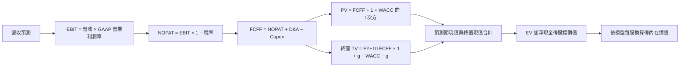

### 8.1 模型假設總表（Model Inputs）

| 假設項目 | 採用值 | 依據／來源 | 敏感度 |
|----------|--------|-------------|--------|
| 預測期長度 N | 10 年 | DCF MODEL 固定預測期 | 🟡 中 |
| 營收成長 | FY+1 30.0% 線性降至 FY+10 3.0% | TTM 成長 41.9%；模型限制第一年 30.0%，末年 3.0% | 🔴 高 |
| 營業利潤率 | FY+1 17.7% → FY+10 7.4% | TTM GAAP 營業利益率 17.7%；末年採五年中位數 | 🔴 高 |
| 有效稅率 | 21.0% | 模型預設稅率 | 🟢 低 |
| Capex／營收 | 4.5% | TTM $2.07B ÷ $45.44B 約 4.5%；模型固定 | 🟡 中 |
| D&A／營收 | 6.7% | DCF MODEL 列示 TTM 比率 | 🟢 低 |
| 營運資金變動 | 不建模 | DCF MODEL 明示 Working capital is not modelled | 🟢 低 |
| EBIT 基礎 | GAAP | 模型使用 GAAP EBIT | 🟡 中 |
| SBC 處理 | GAAP EBIT 已含 SBC；FCFF 不再扣 SBC | 模型指定組合 A | 🟡 中 |
| 年稀釋率 | 0%；固定股數 | 組合 A，股數不再稀釋 | 🟡 中 |
| 永續成長率 g | 3.0% | DCF MODEL 指定值，低於 WACC | 🔴 高 |
| 終值方法 | Gordon Growth | DCF MODEL 終值公式 | 🔴 高 |
| WACC | 14.00% | 指定採用值；未限制計算值 14.77%，受 14.00% 上限限制 | 🔴 高 |

**FCFF 定義**：採 FCFF = NOPAT + D&A − Capex；模型不列 ΔWC。  
**SBC 一致性**：本模型採用 **(A) GAAP EBIT + 固定股數**，故 SBC 影響已計入一次，不再扣 SBC，也不另計年稀釋率。

### 8.2 折現率推導（WACC）

╔══════════════════════════════════════════════════════════════════╗  
║                    WACC 推導（折現率）                           ║  
╠══════════════════════════════════════════════════════════════════╣  
║  股權成本 Ke（CAPM）：                                           ║  
║  ├── 無風險利率 Rf：4.90%（Cost of Capital 資料）              ║  
║  ├── ERP：5.00%（假設值，依 Cost of Capital 輸入）              ║  
║  ├── 原始 Beta：2.54；調整後採用 Beta：2.00                    ║  
║  ├── Beta 調整：⅔ × 2.54 + ⅓ × 1 = 2.03；受 0.6–2.0 上限限制   ║  
║  ├── 規模／國別溢酬：0.0%（資料未列，未額外加計）                ║  
║  └── Ke = 4.90% + 2.00 × 5.00% = 14.90%                        ║  
║                                                                  ║  
║  債務成本：                                                      ║  
║  ├── 稅前 Kd：1.85%（利息 ÷ 債務，程式計算值）                  ║  
║  ├── 稅率：21.0%                                                  ║  
║  └── 稅後 Kd = 1.85% × (1 − 21.0%) = 1.46%                     ║  
║                                                                  ║  
║  權重：股權 99.0%；債務 1.0%                                      ║  
║  未限制 WACC = 99.0% × 14.90% + 1.0% × 1.46% = 14.77%          ║  
║  採用 WACC：14.00%（程式限制在 7%–14% 區間，取上限）             ║  
╚══════════════════════════════════════════════════════════════════╝  

五步演算：

1. **Ke** = 4.90% + 2.00 × 5.00% + 0.00% = **14.90%**
2. **稅前 Kd** = **1.85%**（直接採用 Cost of Capital 計算值；利息費用與平均計息負債明細未提供，故不自行反推）
3. **稅後 Kd** = 1.85% × (1 − 21.0%) = **1.46%**
4. **權重** = 股權 99.0%、債務 1.0%；兩者合計 **100.0%**。該權重直接採用 Cost of Capital 區塊，不另以不同口徑重新計算。
5. **未限制 WACC** = 99.0% × 14.90% + 1.0% × 1.46% = 14.751% + 0.0146% = **14.7656% ≈ 14.77%**；區間限制後採用 **14.00%**。

Rf 的觀察日期未提供；ERP 為資料庫假設輸入。此處與第 6.2 節統一採用 14.00%。

### 8.3 逐年自由現金流預測（基準情境）

金額取 DCF MODEL 原列值；折現因子保留三位小數。此模型不納入 ΔWC 列，亦不扣除 SBC。

| 年度 | FY+1 | FY+2 | FY+3 | FY+4 | FY+5 | FY+6 | FY+7 | FY+8 | FY+9 | FY+10 |
|------|------|------|------|------|------|------|------|------|------|-------|
| 營收 | 59.07 | 75.01 | 93.02 | 112.55 | 132.81 | 152.73 | 171.06 | 186.46 | 197.64 | 203.57 |
| 營收 YoY | 30.0% | 27.0% | 24.0% | 21.0% | 18.0% | 15.0% | 12.0% | 9.0% | 6.0% | 3.0% |
| 營業利潤率 | 17.7% | 16.6% | 15.4% | 14.3% | 13.1% | 12.0% | 10.8% | 9.7% | 8.5% | 7.4% |
| EBIT（GAAP） | 10.46 | 12.43 | 14.34 | 16.06 | 17.42 | 18.28 | 18.51 | 18.03 | 16.84 | 15.00 |
| − 稅（21.0%） | (2.20) | (2.61) | (3.01) | (3.37) | (3.66) | (3.84) | (3.89) | (3.79) | (3.54) | (3.15) |
| = NOPAT | 8.27 | 9.82 | 11.33 | 12.69 | 13.76 | 14.44 | 14.62 | 14.24 | 13.30 | 11.85 |
| + D&A | 3.96 | 5.03 | 6.24 | 7.55 | 8.90 | 10.24 | 11.47 | 12.50 | 13.25 | 13.65 |
| − Capex | (2.69) | (3.41) | (4.23) | (5.12) | (6.04) | (6.95) | (7.78) | (8.48) | (8.99) | (9.26) |
| **= FCFF** | **9.54** | **11.43** | **13.33** | **15.11** | **16.63** | **17.73** | **18.31** | **18.26** | **17.56** | **16.24** |
| 折現因子 @14.00% | 0.877 | 0.769 | 0.675 | 0.592 | 0.519 | 0.456 | 0.400 | 0.351 | 0.308 | 0.270 |
| **FCFF 現值 PV** | **8.37** | **8.80** | **9.00** | **8.95** | **8.63** | **8.08** | **7.32** | **6.40** | **5.40** | **4.38** |

預測期現值合計依模型列示為 **$75.32B**。逐項以表內四捨五入值相加為 $75.33B；$0.01B 差異為表格四捨五入，低於 1%。

**逐步演算（FY+1）**

1. **營收** = $45.44B × (1 + 30.0%) = **$59.07B**
2. **EBIT** = $59.07B × 17.7% = **$10.46B**
3. **稅** = $10.46B × 21.0% = **$2.20B**
4. **NOPAT** = $10.46B − $2.20B = **$8.27B**
5. **D&A** = $59.07B × 6.7% = **$3.96B**
6. **Capex** = $59.07B × 4.5% = **$2.69B**
7. **ΔWC** = 不建模，依 DCF MODEL 規則排除
8. **FCFF** = $8.27B + $3.96B − $2.69B = **$9.54B**
9. **折現因子** = 1 ÷ (1 + 14.00%)¹ = **0.877**；PV = $9.54B × 0.877 = **$8.37B**

**預測合理性檢查**

- FY+1 至 FY+10 FCFF CAGR = (16.24 ÷ 9.54)^(1/9) − 1 ≈ **6.1%**；歷史 FY2022–FY2025 FCF CAGR = (6.74 ÷ 3.12)^(1/3) − 1 ≈ **29.2%**。模型預測期增長明顯低於近期年度歷史，主要因收入與利潤率逐步淡化。
- FY+10 FCFF 利潤率 = $16.24B ÷ $203.57B = **8.0%**；目前 TTM FCF 利潤率 = $7.06B ÷ $45.44B = **15.5%**。同業最佳 FCF 利潤率未提供，無法比較。
- 各年 FCFF 均為正；FY+10 FCFF 低於 FY+7 峰值 $18.31B，反映營業利潤率下滑抵消收入增長。

╔══════════════════════════════════════════════════════════════════╗  
║            自由現金流：歷史實際 vs 模型預測                      ║  
╠══════════════════════════════════════════════════════════════════╣  
║  FY2023(實)  $1.12B   ███░░░░░░░░░░░░░░░░░░░░░░░░░░            ║  
║  FY2024(實)  $2.40B   ██████░░░░░░░░░░░░░░░░░░░░░░             ║  
║  FY2025(實)  $6.74B   ███████████████████░░░░░░░░░             ║  
║  FY+1 (預)   $9.54B   █████████████████████████░░░             ║  
║  FY+10 (預)  $16.24B  ██████████████████████████████            ║  
╠══════════════════════════════════════════════════════════════════╣  
║ 預測期 FCFF CAGR 約 6.1%；FY2022–FY2025 歷史 CAGR 約 29.2%。     ║  
║ 預測較近期歷史保守，但現金流率仍受 6.7% D&A 假設支持。           ║  
╚══════════════════════════════════════════════════════════════════╝  

### 8.4 終值計算（Terminal Value）

適用性檢查：**WACC 14.0% vs g 3.0% → WACC > g？✅**

| 方法 | 計算式 | 終值 TV | TV 現值 | 佔總 EV 比重 |
|------|--------|---------|---------|--------------|
| Gordon Growth | $16.24B × (1 + 3.0%) ÷ (14.0% − 3.0%) | $152.04B | $41.01B | 35.3% |
| 退出倍數法 | N/A | N/A | N/A | N/A |

逐步演算：

1. **FY+10 FCFF** = **$16.24B**
2. **分子** = $16.24B × (1 + 3.0%) = **$16.73B**（未四捨五入值依模型計算）
3. **分母** = 14.00% − 3.00% = **11.00%**；TV = **$152.04B**
4. **PV(TV)** = $152.04B × 0.270 = **$41.01B**（模型列示值）
5. **終值佔比** = $41.01B ÷ $116.33B = **35.3%**

退出倍數法所需倍數及終值未由 DCF MODEL 提供，因此不另造假設或計算。終值現值占 EV 35.3%，估值仍高度受長期現金流影響，但非由終值單獨主導。

### 8.5 企業價值 → 每股內在價值（Bridge）

╔══════════════════════════════════════════════════════════════════╗  
║              企業價值 → 每股內在價值 橋接表                      ║  
╠══════════════════════════════════════════════════════════════════╣  
║  預測期 FCF 現值合計            +$75.32B                         ║  
║  終值現值 PV(TV)                +$41.01B                         ║  
║  = 企業價值 EV                   $116.33B                         ║  
║  + 淨現金                       +$8.70B                          ║  
║  = 股權價值                      $125.03B                         ║  
║  每股內在價值（模型換算）        $75.54                           ║  
║  當前股價（2026-11-24 收盤）     $413.27                          ║  
║  折溢價（現價÷DCF價值−1）        +447.1%（溢價）                 ║  
╚══════════════════════════════════════════════════════════════════╝  

逐步演算：

1. **EV** = $75.32B + $41.01B = **$116.33B**
2. **股權價值** = $116.33B + $8.70B = **$125.03B**
3. **每股價值** = 模型指定換算：股權價值 × 現價 ÷ 市值 = $125.03B × $413.27 ÷ $683.99B = **$75.54**
4. **折溢價** = $413.27 ÷ $75.54 − 1 = **+447.1%**
5. **本節不計算 MOS**；MOS 僅於 8.8 以加權合理價值為分母計算。

DCF MODEL 使用公式指定的價格／市值換算方式，等效股數約為市值 $683.99B ÷ 股價 $413.27 = 1.655B 股；該值與市場列示 1.66B 股相近。現金及債務採 2026-09-26 TTM 口徑淨現金 $8.70B。

### 8.6 敏感性分析（WACC × 永續成長率）

每格直接採 DCF MODEL 每股價值；括號為按現價 $413.27 計算的上行空間。

| g（列）／WACC（欄） | 12.00% | 13.00% | **14.00%（基準）** | 15.00% | 16.00% |
|-----------|------|------|------------------|------|-------|
| **2.0%** | $87.24 (-78.9%) | $79.62 (-80.7%) | $73.26 (-82.3%) | $67.87 (-83.6%) | $63.24 (-84.7%) |
| **2.5%** | $89.10 (-78.4%) | $81.03 (-80.4%) | $74.35 (-82.0%) | $68.72 (-83.4%) | $63.92 (-84.5%) |
| **3.0%** | $91.17 (-77.9%) | $82.59 (-80.0%) | **$75.54 (-81.7%)** | $69.65 (-83.1%) | $64.65 (-84.4%) |
| **3.5%** | $93.48 (-77.4%) | $84.31 (-79.6%) | $76.85 (-81.4%) | $70.66 (-82.9%) | $65.45 (-84.2%) |
| **4.0%** | $96.08 (-76.8%) | $86.22 (-79.1%) | $78.29 (-81.1%) | $71.77 (-82.6%) | $66.31 (-84.0%) |

**敏感度示範格：WACC 13.00% > g 2.5% ✅**  
該格價值為 DCF MODEL 矩陣列示 **$81.03**；模型預測期現金流不變，僅折現率與終值折現方式改變。完整逐年現值與未四捨五入數值未在模型輸出中提供，故不重建中間值或聲稱獨立複算出另一個值。

**三情境 DCF（模型列示）**

| 情境 | 第一年成長 | FY+10 利潤率 | WACC | 每股內在價值 | 相對現價 | 機率 |
|------|------------|--------------|------|--------------|----------|------|
| 🔴 悲觀 | 15.0% | 6.3% | 15.00% | $40.03 | -90.3% | 25% |
| 🟡 基準 | 30.0% | 7.4% | 14.00% | $75.54 | -81.7% | 50% |
| 🟢 樂觀 | 45.0% | 8.1% | 13.00% | $141.10 | -65.9% | 25% |
| **機率加權** | — | — | — | **$83.06** | **-79.9%** | 100% |

模型情境的三條完整逐年推導鏈未另行輸出；遵守 DCF MODEL 優先原則，直接照列其情境值與假設，不以自行重建情境覆蓋程式結果。機率加權驗算：$40.03 × 25% + $75.54 × 50% + $141.10 × 25% = $83.0525 ≈ **$83.06**。

**敏感度讀法**：在基準 WACC 14.0% 下，g 從 2.0% 升至 3.0%，每股價值由 $73.26 升至 $75.54，增加 $2.28，約 +3.1%；g 從 3.0% 升至 4.0%，由 $75.54 升至 $78.29，增加 $2.75，約 +3.6%。在 g=3.0% 下，WACC 從 13.0% 升至 14.0%，價值由 $82.59 降至 $75.54，減少 $7.05，約 -8.5%；由 14.0% 升至 15.0%，減少 $5.89，約 -7.8%。營業利潤率每 +1 個百分點的獨立敏感度未提供，故不自行編造。就矩陣已提供的變數而言，WACC 變化的影響大於 g，與估值對資本成本高度敏感的判斷一致。

### 8.7 反推 DCF（Reverse DCF：市場在預期什麼）

模型提供兩個單變數反推結果，其他輸入維持基準值；沒有提供反推試算軌跡，因此不假造迭代點。

| 求解的變數 | 固定輸入 | 市場隱含值（令 DCF = 現價） | 基準假設／參照 | 判斷 |
|------------------------|--------------|------------------------------|--------------|------|
| 第一年營收成長率 | 其他模型輸入維持基準 | 88.1% | 基準 30.0%；TTM 成長 41.9% | 🔴 顯著高於近期 TTM 成長 |
| 固定營業利潤率 | 其他模型輸入維持基準 | 72.2% | 基準利潤率由 17.7% 降至 7.4% | 🔴 與歷史及基準假設差距極大 |
| 永續成長率 g | 未提供反推解 | N/A | — | 模型未列示 |
| 預測期 N | 未提供反推解 | N/A | 基準 10 年 | 模型未列示 |

目前股價要由指定 DCF 基準模型解釋，要求第一年營收成長達 88.1%，或固定營業利潤率達 72.2%，兩者皆遠高於基準假設；這說明現價包含了模型未捕捉的更長期、更高利潤或更高終值預期。

### 8.8 估值三角驗證與安全邊際

| 估值方法 | 隱含每股價值 | 上行空間（÷現價） | 權重 | 說明 |
|----------|--------------|-------------------|------|------|
| DCF（基準） | $75.54 | -81.7% | 40% | 10 年 FCFF、WACC 14.00%、g 3.0% |
| 同業 Forward P/E | $273.94 | -33.7% | 25% | 同業中位數 15.5x × Forward EPS $17.64 |
| 同業 EV/EBITDA | $111.78 | -73.0% | 25% | 同業中位數 15.9x × TTM EBITDA，加回淨現金 |
| 分析師共識目標價 | $656.21 | +58.8% | 10% | 49 位分析師平均目標價 |
| **加權合理價值** | **$192.27** | **-53.5%** | **100%** | — |

加權算式：  
**$75.54 × 40% + $273.94 × 25% + $111.78 × 25% + $656.21 × 10%**  
= $30.216 + $68.485 + $27.945 + $65.621  
= **$192.267 ≈ $192.27**。

此組權重對應「獲利公司」估值框架，採四種指定方法；沒有額外方法被加入或剔除。

- **MOS** = ($192.27 − $413.27) ÷ $192.27 = **-114.9%**
- **上行空間** = ($192.27 − $413.27) ÷ $413.27 = **-53.5%**
- **折溢價**以 DCF 基準價值 $75.54 為分母：$413.27 ÷ $75.54 − 1 = **+447.1%**

╔══════════════════════════════════════════════════════════════════╗  
║                  估值區間與安全邊際                              ║  
╠══════════════════════════════════════════════════════════════════╣  
║  $40.03 ───── $75.54 ───── $192.27 ───── $413.27 ───── $656.21 ║  
║  悲觀DCF       基準DCF       加權合理值       現價        共識目標 ║  
║                                                                  ║  
║  MOS = (加權合理價值 − 現價) ÷ 加權合理價值 = -114.9%           ║  
║  上行空間 = (合理價值 − 現價) ÷ 現價 = -53.5%                   ║  
║  建議買入區間：依 MOS≥10% 對應價格上限約 $173.04                 ║  
║  合理持有區間：N/A（模型未定義）                                 ║  
║  減碼考慮區間：現價高於基準、樂觀 DCF 與加權合理價值             ║  
╚══════════════════════════════════════════════════════════════════╝  

MOS 10% 的理論價格上限 = $192.27 × (1 − 10%) = **$173.04**。此價格區間是估值門檻計算，不是對市場短期低點的預測。

> 🔎 **程式複算（Python，依本節各項自動重算）**
>
> 加權合理價值 = $75.54 × 40% + $273.94 × 25% + $111.78 × 25% + $656.21 × 10% = **$192.27**（權重合計 100%）
>
> 以價格 $413.27 計：MOS = **-114.9%**，上行空間 = **-53.5%**
>
> ✅ 與本節所寫數值一致。

### 8.9 DCF 模型的局限與失效條件

- **終值依賴度**：終值現值占 EV **35.3%**；模型價值仍明顯依賴 FY+10 後的現金流與 3.0% 永續成長率。
- **最脆弱假設**：其一是營收能否支持第一年 30.0% 成長，其二是利潤率能否沿模型路徑從 17.7% 緩降至 7.4%。如果需求惡化，模型情境值已顯示悲觀值 **$40.03**。
- **營運資金排除**：模型沒有 ΔWC，然而 DIO 上升至 199 天。若增長需要更多存貨與應收帳款，實際 FCFF 可能低於模型。
- **SBC 與股數**：採 GAAP EBIT、固定股數的組合 A；若 SBC 淨稀釋加快，固定股數可能高估每股價值。
- **模型失效條件**：半導體需求高度週期性，若收入、利潤率或資本支出偏離線性淡化假設，DCF 的點估值可信度下降；此時應同時參考同業相對估值、分部價值與產品單位經濟性。
- **與第 10 章連結**：AI 需求放緩會下修營收成長；價格競爭會下修營業利潤率；供應與存貨風險會提高營運資金需求；利率上升會抬高 WACC。

### 8.10 複算檢核表（Audit Trail）

| # | 檢核項目 | 檢查方式 | 結果 |
|---|----------|----------|------|
| 1 | 高／中敏感度輸入有推導 | 對照 8.0 與 8.1 | ✅ |
| 2 | 每個假設有來歷 | 8.1 依據欄逐項列示 | ✅ |
| 3 | WACC 五步算式與權重 | 權重 99.0% + 1.0% = 100.0%；未限制值 14.77%，採用 14.00% | ✅ |
| 4 | Kd 與債務權重範圍一致 | 使用程式指定稅前 Kd 與權重；底層平均計息債務細節未提供，無法獨立驗證 | ⚠️ |
| 5 | WACC 與第 6.2 節一致 | 均採用 14.00% | ✅ |
| 6 | 預測年度數與 N 相同 | FY+1 至 FY+10 共 10 年 | ✅ |
| 7 | FY+1 FCFF／PV 算式 | 依表內四捨五入值示範；模型數字照列 | ✅ |
| 8 | 預測期 PV 加總 | 模型 $75.32B；表格四捨五入加總 $75.33B，差異 $0.01B | ✅ |
| 9 | WACC > g | 14.00% > 3.00% | ✅ |
| 10 | 終值基期與折現期 | FY+10 FCFF、折現 10 期 | ✅ |
| 11 | EV 到每股價值橋接 | EV $116.33B、股權價值 $125.03B、每股 $75.54 | ✅ |
| 12 | SBC 組合一致 | GAAP EBIT、無 SBC 再扣、股數不再稀釋 | ✅ |
| 13 | 敏感性基準格一致 | 矩陣基準格 $75.54 | ✅ |
| 14 | 敏感性矩陣有效性 | 所列 WACC 均大於 g | ✅ |
| 15 | 情境機率相加 | 25% + 50% + 25% = 100% | ✅ |
| 16 | 反推每列只放開一變數 | 模型只提供兩個單變數解，沒有迭代軌跡 | ⚠️ |
| 17 | MOS／折溢價基準一致 | MOS 用 $192.27；DCF 折溢價用 $75.54 | ✅ |
| 18 | 報告完整輸出至第 11 章 | 全部章節均列示 | ✅ |
| 19 | 加權合理價值可加總 | 加權結果 $192.267，四捨五入 $192.27 | ✅ |
| 20 | 評級符合 MOS 門檻 | MOS -114.9% 小於 -25%，賣出 | ✅ |

需注意：WACC 的底層利息費用與平均計息負債明細未完整提供；反推 DCF 也未附逐次迭代軌跡。以上未自行補造數字，估值細節的可獨立重現程度因此受到限制。

---

## 9. 成長催化劑

### 9.1 催化劑時間軸

財務資料未提供具體產品上市日期、量產時程或管理層指引日期，以下以財報觀察區間表示，並不代表公司已公布時程。

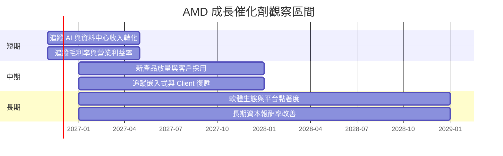

### 9.2 TAM 市場規模分析

**N/A（TAM 數據未提供）**。AMD TTM 營收 $45.44B、TTM 年增 41.9%，表示公司目前仍在擴大收入規模，但缺乏市場規模、滲透率與分部營收數據，不能量化市場空間或推算份額。

### 9.3 成長驅動力結構圖

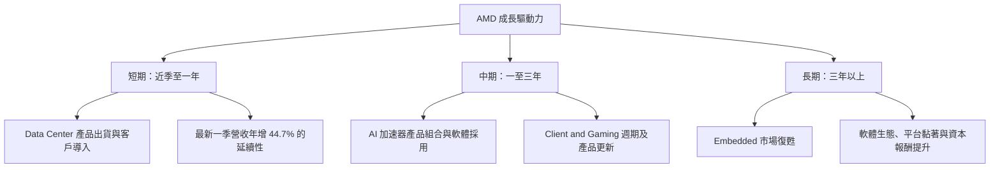

成長催化劑的核心驗證點是增長能否轉化為高於資本成本的回報，而非只看營收增速。現階段 ROIC 12.8% 低於 WACC 14.0%，所以後續財報需同步看到利潤率與資本效率改善。

---

## 10. 風險矩陣

### 10.1 風險評分矩陣

機率與衝擊分數屬研究者對風險排序的定性估計，不是 SEC 財務數據；矩陣只表示相對位置。

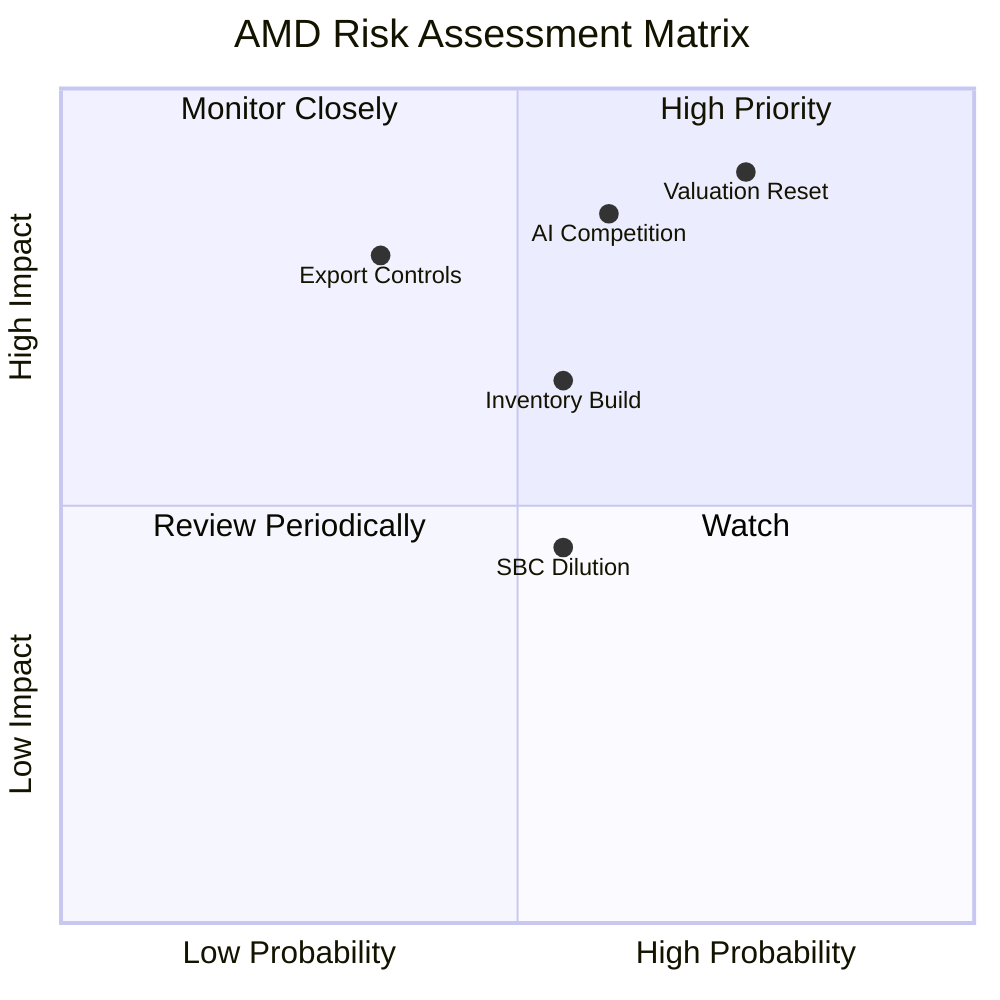

### 10.2 風險清單詳細分析

| # | 風險項目 | 發生機率 | 財務衝擊 | 風險評分 | 緩解措施 |
|---|----------|----------|----------|----------|----------|
| 1 | 🔴 **高估值與預期重置** | 高（估計 60–80%） | DCF 基準相對現價 -81.7%；加權合理價值上行空間 -53.5% | 🔴 高 | 分批投資、設定估值上限，監控 Forward EPS 與營收預期是否同步上修 |
| 2 | 🔴 **AI 加速器競爭與軟體採用** | 中高（估計 40–60%） | 若增長率或利潤率不達預期，現價估值倍數承壓；NVDA 最新一季增長 103.2% | 🔴 高 | 追蹤產品導入、客戶採用、毛利率與 Data Center 增長 |
| 3 | 🟡 **庫存增加與產品轉代** | 中（估計 30–50%） | DIO 由 161 天升至 199 天，可能導致週轉放慢或減值 | 🟡 中高 | 季度追蹤存貨、存貨撥備與收入增長是否匹配 |
| 4 | 🟡 **出口限制與供應鏈中斷** | 中（估計 20–40%） | 可能限制可售產品、客戶地區或先進封裝供應 | 🟡 中高 | 追蹤監管公告、供應集中度及替代供應安排 |
| 5 | 🟡 **SBC 稀釋與人才成本** | 中（估計 30–50%） | FY2025 SBC $1.64B，占營收 4.7%；稀釋股數測試未通過 | 🟡 中 | 追蹤稀釋股數、回購抵銷程度及 SBC／營收趨勢 |

---

## 11. 投資建議

### 11.1 最終評級與評分

依 8.8 加權合理價值 **$192.27**、現價 **$413.27** 計算，MOS 為 **-114.9%**，低於 -25% 的賣出門檻，因此評級為**賣出**；未作質化上調或下調。1.1 綜合評分為 **6.2/10**，六項分數為成長性 8.0、獲利能力 7.0、財務健康 8.0、估值 2.0、護城河 7.0、管理層與資本配置 5.0。

### 11.2 合理價值與隱含報酬率

| 估值情境／方法 | 每股價值 | 相對現價 | 機率 |
|----------------|----------|----------|------|
| 加權合理價值 | $192.27 | -53.5% | — |
| 🔴 DCF 悲觀 | $40.03 | -90.3% | 25% |
| 🟡 DCF 基準 | $75.54 | -81.7% | 50% |
| 🟢 DCF 樂觀 | $141.10 | -65.9% | 25% |
| DCF 機率加權參考 | $83.06 | -79.9% | 100% |

DCF 機率加權值 $83.06 僅作情境參考；依估值方法固定權重計算的正式加權合理價值仍為 **$192.27**。

### 11.3 買入時機與觸發因素

╔══════════════════════════════════════════════════════════════════╗  
║                  ✅ 買入觸發因素 Checklist                      ║  
╠══════════════════════════════════════════════════════════════════╣  
║  目前評級為賣出；不以現價作為新增部位的基本面買入觸發點。         ║  
║                                                                  ║  
║  重新評估買入條件：                                               ║  
║  ☐ 股價進入約 $173.04 或以下，對 $192.27 合理價值有至少 10% MOS ║  
║  ☐ TTM ROIC 持續高於 WACC 14.0%                                  ║  
║  ☐ 營收增長能轉化為利潤率及 FCF 改善                              ║  
║                                                                  ║  
║  加碼觀察條件：                                                   ║  
║  ☐ 最新一季營收年增維持 30% 以上且毛利率未顯著收縮               ║  
║  ☐ TTM FCF 高於 $7.06B，且 FCF Yield 隨市值與現金流改善           ║  
║                                                                  ║  
║  減碼／退出條件：                                                 ║  
║  ☐ 兩季連續收入增速低於 20%                                      ║  
║  ☐ TTM 營業利益率低於 17.7% 且趨勢持續惡化                       ║  
║  ☐ FCF 轉負、庫存繼續上升或 ROIC 明顯低於 WACC                    ║  
╚══════════════════════════════════════════════════════════════════╝  

買入價格門檻源自加權合理價值與 MOS 定義：$192.27 × (1 − 10%) = $173.04。這是估值觸發條件，不代表價格一定會跌至該水平。

### 11.4 投資人適配度分析

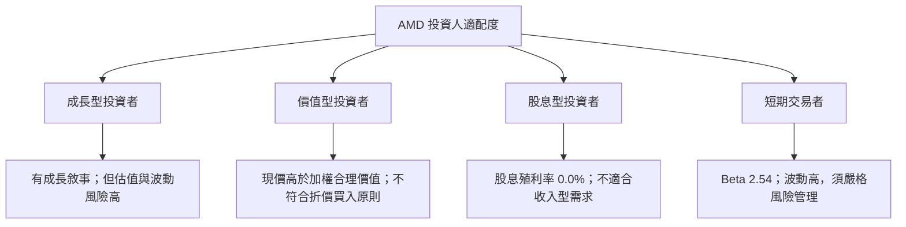

### 11.5 每季財報監控清單（Quarterly Watch List）

| 監控指標 | 最新參照值 | 加碼觀察門檻 | 減碼／風險門檻 |
|----------|------------|--------------|----------------|
| 營收成長 | TTM +41.9%；最新一季 YoY +44.7% | 最新一季 YoY 持續 ≥30% | 連續兩季低於 20% |
| 營業利益率 | TTM 17.7%；最新季度口徑需採 VERIFIED 的 21.2% | TTM 穩定或上升，且與收入同步 | TTM 低於 17.7%並持續下滑 |
| 毛利率 | TTM 56.0% | 維持或改善 | 顯著下降並伴隨產品組合惡化 |
| FCF | TTM $7.06B | 持續增加且轉換率改善 | 轉負或低於淨利的 70% |
| Capex | TTM $2.07B | 支出支持收入與新產品產能 | 支出上升而收入與 FCF 未改善 |
| 存貨／DIO | 存貨 $11.463B；DIO 199 天 | 存貨增長低於收入增長、DIO 回落 | DIO 持續上升或出現減值 |
| SBC／股數 | FY2025 SBC $1.64B；稀釋股數測試未通過 | SBC／營收下降、稀釋放緩 | SBC 占營收上升或稀釋加速 |
| ROIC vs WACC | 12.8% vs 14.0% | ROIC 持續高於 14.0% | ROIC 進一步下滑 |
| 管理層財測 | 未提供數字 | 實際營收與利潤率達成或上修財測 | 下修財測或連續未達成 |

### 11.6 反面論證：什麼會證明論點錯誤（What Would Change My Mind）

╔══════════════════════════════════════════════════════════════════╗  
║              ⚠️ 論點失效條件（Disconfirming Evidence）           ║  
╠══════════════════════════════════════════════════════════════════╣  
║  以下情況若持續出現，需重新檢視投資論點與估值：                  ║  
║  ☐ 最新一季營收年增連續兩季低於 20%                              ║  
║  ☐ TTM 營業利益率低於 17.7%，且毛利率同步收縮                    ║  
║  ☐ TTM FCF 轉負，或 FCF／淨利低於 70%                             ║  
║  ☐ ROIC 持續低於 WACC 14.0%，且差距擴大                          ║  
║  ☐ DIO 高於 199 天並持續上升，或存貨減值增加                     ║  
║  ☐ SBC／營收高於 FY2025 的 4.7%，且稀釋股數加速增加               ║  
║  ☐ AI／資料中心增長未能轉化為毛利率、營業利益率及 FCF 改善         ║  
╚══════════════════════════════════════════════════════════════════╝  

> **免責聲明**：本報告為 AI 自動生成，僅供研究參考，不構成投資建議。投資有風險，入市需謹慎。

---

## 資料與來源

| 項目 | 內容 |
|------|------|
| 價格 | 413.27 USD，2026-11-24 收盤（Yahoo Finance 日線） |
| 財務報表 | SEC 10-Q filed 2026-11-04，最新季度 2026-09-26（FY2026 Q3） |
| 有回應的資料來源 | SEC 申報資料 (XBRL)、Yahoo Finance、Finviz、StockAnalysis、Roic.ai |
| 由程式計算 | TTM 數字、WACC、DCF 模型、估值方法與權重、加權合理價值、MOS、評級門檻、F-Score、杜邦分解、營運資金天數、綜合評分 |
| 撰寫模型 | openai / gpt-6-luna |

> 本區塊由產生報告的程式依實際取得的資料填寫，非模型撰寫。「由程式計算」的數字不是模型的估計；其餘判斷（評分、情境、策略）是模型的分析。
