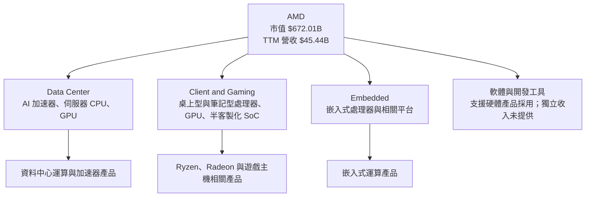
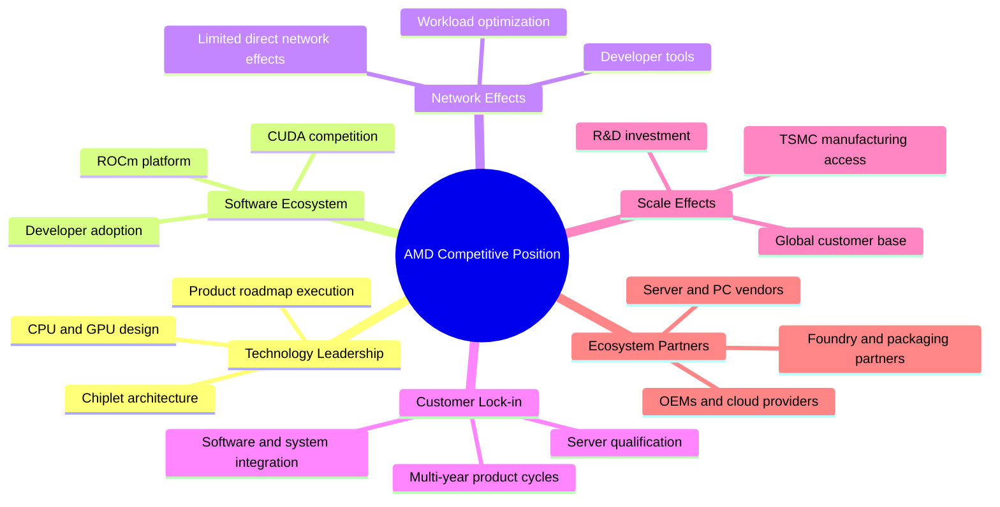
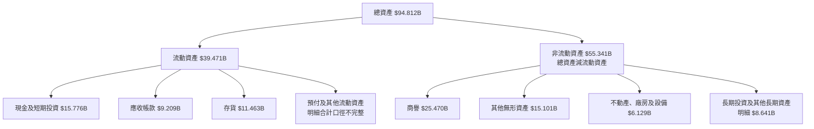
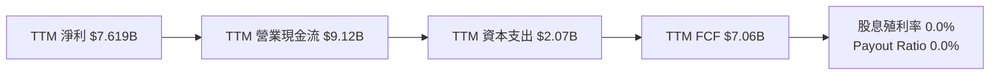
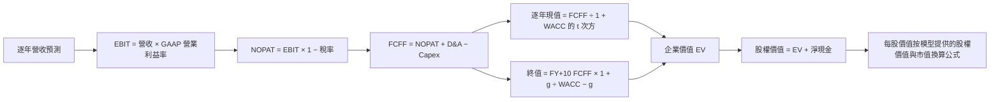
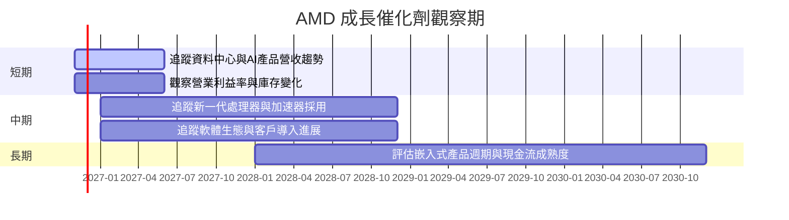
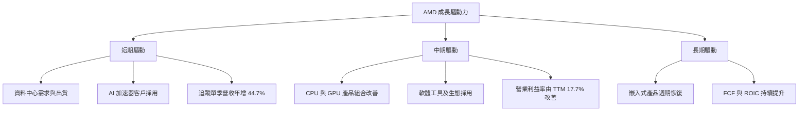
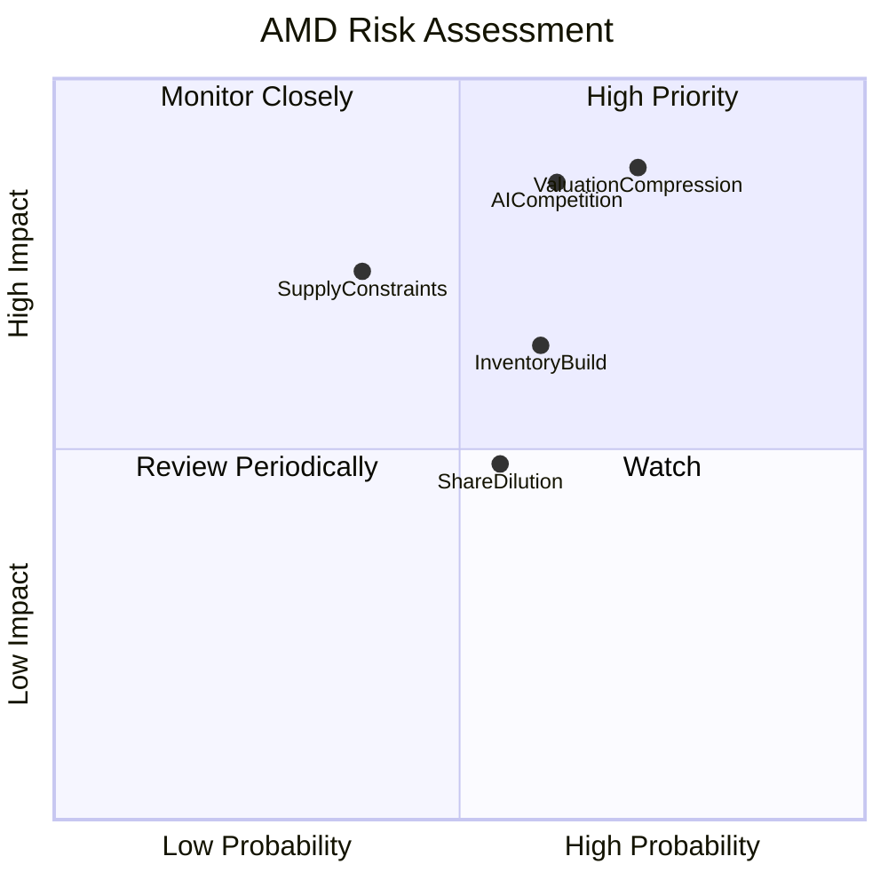
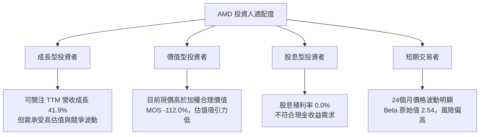

# AMD 基本面深度分析報告
> **報告日期**：2026-11-26 ｜ **語言**：繁體中文 ｜ **數據來源**：SEC 申報資料 (XBRL)、Yahoo Finance、Finviz、StockAnalysis、Roic.ai ｜ **分析師**：CFA 級機構研究

## 目錄

| # | 章節 | 核心結論 |
|---|------|----------|
| 1 | 執行摘要 | 賣出；加權合理價值 $191.53，MOS -112.0% |
| 2 | 公司概覽與商業模式 | 多產品平台與自有 CPU/GPU 設計構成差異化，但分部收入數據未提供 |
| 3 | 損益表深度分析 | TTM 營收 $45.44B，TTM 成長 41.9%；最近一季年增 44.7% |
| 4 | 資產負債表分析 | 淨現金 $8.70B、F-Score 7/9；庫存天數較一年前上升 |
| 5 | 現金流量深度分析 | TTM FCF $7.06B，但 FCF Yield 僅 1.05% |
| 6 | 獲利能力與資本效率 | ROIC 12.8% 低於 WACC 14.0%，目前未覆蓋資本成本 |
| 7 | 相對估值分析 | AMD 估值高於同業中位數；自身 P/S 位於五年區間第 90 百分位 |
| 8 | DCF 內在價值評估 | 基準 DCF $75.54；加權合理價值 $191.53，均遠低於現價 |
| 9 | 成長催化劑 | 資料中心、AI 加速器與新產品週期是主要觀察方向；TAM 數字未提供 |
| 10 | 風險矩陣 | 估值回落、AI 競爭與庫存／產品週期為主要風險 |
| 11 | 投資建議 | 賣出；以估值與營運指標設定監控及論點失效條件 |

---

## 1. 執行摘要

AMD 最近一季營收年增 **44.7%**、TTM 營收年增 **41.9%**，TTM 自由現金流（FCF）達 **$7.06B**；但股價為 **2026-11-25 收盤 $406.03**，高於 DCF 基準價值 **$75.54**，也高於估值方法加權後的合理價值 **$191.53**。以加權合理價值計算，MOS 為 **-112.0%**；此外 ROIC **12.8%** 低於 WACC **14.0%**。因此，依 MOS 門檻為**賣出**，並未作質化升降級。

### 1.0 一頁式投資儀表板（Portfolio Manager 30 秒速讀）

| 項目 | 內容 |
|------|------|
| **投資論點（3 句）** | ① TTM 營收 **$45.44B**、年增 **41.9%**，表示近期需求成長仍快。② TTM FCF **$7.06B**、淨現金 **$8.70B**，為研發與擴產提供財務緩衝。③ 股價 **$406.03** 對比加權合理價值 **$191.53**，MOS **-112.0%**，估值對未來成長要求很高。 |
| **綜合評分** | **6.3/10**（引用 1.1 六項算術平均） |
| **財務健康** | 🟢 淨現金 **$8.70B**、Piotroski **7/9**；但庫存天數 **199 天**，須注意資金占用 |
| **ROIC vs WACC** | **12.8% vs 14.0%**；差 **-1.2 個百分點**，目前低於資本成本 |
| **FCF 趨勢** | TTM FCF **$7.06B**；FCF Yield **1.05%**。現金流為正，但相對市值的現金收益率偏低 |
| **估值** | Forward P/E **23.05x** ｜ EV/EBITDA（同業比較口徑）AMD 自身 **82.7x** ｜ FCF Yield **1.05%** |
| **DCF 內在價值（基準）** | **$75.54** ｜ 現價相對 DCF 折溢價 **+437.4%**（現價／DCF 價值 − 1） |
| **安全邊際（MOS）** | **-112.0%**＝($191.53 − $406.03) ÷ $191.53；🔴 低於 10%，無下檔保護 |
| **預期報酬（基準情境 12M）** | **N/A**：DCF 基準情境是模型情境價值，不是 12 個月分析師預測 |
| **關鍵風險（前二）** | AI 加速器競爭與產品採用；高估值下成長或利潤率不及預期 |
| **評級 + 信心度** | 🔴 **賣出** ｜ 信心：中（估值訊號明確，模型假設仍具不確定性） |

### 1.1 綜合評分卡（全報告唯一）

| 維度 | 評分（1–10） | 主要依據（引用數字與其來源章節） |
|------|--------------|----------------------------------|
| 成長性 | 8.5 | TTM 營收年增 **41.9%**、最新一季年增 **44.7%**（第 3 章） |
| 獲利能力 | 7.0 | TTM 營業利益率 **17.7%**、ROIC **12.8%**，但低於 WACC **14.0%**；F-Score **7/9**（第 3、6 章） |
| 財務健康 | 8.0 | 淨現金 **$8.70B**、Piotroski **7/9**；CCC **138 天**，較一年前縮短 17 天（第 4、6 章） |
| 估值 | 1.0 | MOS **-112.0%**，P/S 五年百分位 **90%**（第 7、8 章） |
| 護城河 | 7.0 | CPU、GPU、加速器與嵌入式產品組合；但同業收入成長較快且軟體生態競爭仍是關鍵（第 2 章） |
| 管理層與資本配置 | 6.5 | 年度 SBC 由 2022 年 **$1.08B** 增至 2025 年 **$1.64B**；稀釋股數測試未通過，未提供完整回購成效拆分（第 3、5、6 章） |
| **綜合評分** | **6.3** | 六項算術平均：(8.5 + 7.0 + 8.0 + 1.0 + 7.0 + 6.5) ÷ 6 = **6.3** |

### 1.2 五大投資論點 + 三大核心風險

| 類型 | 項目 | 具體依據 | 信心度 |
|------|------|----------|--------|
| 🟢 **投資論點①** | 營收成長加速 | TTM 營收 **$45.44B**、年增 **41.9%**；最新一季年增 **44.7%** | 🟢 高 |
| 🟢 **投資論點②** | FCF 已具規模 | TTM OCF **$9.12B**、Capex **$2.07B**、FCF **$7.06B**，代表公司可用內部現金支持研發與產品投資 | 🟢 高 |
| 🟢 **投資論點③** | 資產負債表有緩衝 | 現金與短期投資 **$15.78B**，總債務 **$7.08B**，淨現金 **$8.70B** | 🟢 高 |
| 🟢 **投資論點④** | 毛利與營業槓桿有改善跡象 | TTM 毛利率 **56.0%**；最近一季營業利益率依 SEC 口徑 **21.2%**，高於 TTM **17.7%** | 🟡 中 |
| 🟢 **投資論點⑤** | 產品組合橫跨多個市場 | 公司經營 Data Center、Client and Gaming、Embedded 三個分部；分部營收占比未提供，不對收入來源作量化拆分 | 🟡 中 |
| 🟡 **風險①** | 高估值與預期落差 | 加權合理價值 **$191.53** 對比現價 **$406.03**；估值需由後續成長持續支撐 | 🟢 高 |
| 🔴 **風險②** | AI 加速器競爭 | NVDA 最新一季營收年增 **103.2%**，高於 AMD **44.7%**；競爭可能影響 AMD 產品採用與毛利 | 🟡 中 |
| 🟡 **風險③** | 庫存占用與稀釋 | DIO **199 天**，較一年前 **161 天**增加 38 天；F-Score 的稀釋股數測試未通過 | 🟡 中 |

### 1.3 快速統計卡片

同業中位數以 NVDA、INTC、AVGO 的 Peer multiples 資料計算；成長率與毛利率中位數均由其三家公司數值取中位數。

| 指標 | 公司實際值（期間） | 同業中位數 | 狀態 |
|------|--------------------|------------|------|
| 營收成長（TTM） | **41.9%** | — | 🟢 |
| 營收成長（最新一季年增） | **44.7%** | **85.5%** | 🟡 |
| 毛利率（TTM） | **56.0%** | **74.9%** | 🟡 |
| 營業利益率（TTM） | **17.7%** | — | 🟢 |
| ROIC（TTM） | **12.8%** | — | 🟡 |
| Forward P/E | **23.05x** | **15.6x** | 🔴 |
| FCF Yield（TTM） | **1.05%** | — | 🟡 |
| Piotroski F-Score | **7 / 9** | — | 🟢 |

### 1.4 投資結論

```text
╔══════════════════════════════════════════════════════════════════╗
║                    📊 投資結論摘要                               ║
╠══════════════════════════════════════════════════════════════════╣
║  評級：🔴 賣出（依規則 20，未作質化升降級）                     ║
║  價格（2026-11-25 收盤）：$406.03                               ║
║  DCF 內在價值（基準）：$75.54（現價溢價 +437.4%）              ║
║  安全邊際 MOS：-112.0%（以加權合理價值為分母）                 ║
║  加權合理價值（8.8）：$191.53                                   ║
║  DCF 情境價值：                                                  ║
║    悲觀情境：$40.03（-90.1%）                                   ║
║    基準情境：$75.54（-81.4%）                                   ║
║    樂觀情境：$141.10（-65.2%）                                  ║
║  綜合評分：6.3/10（引用 1.1）                                   ║
║  適合投資人：能承受高波動、重視長期半導體成長的投資人；           ║
║              不適合以現金殖利率或低估值為主要要求者              ║
╚══════════════════════════════════════════════════════════════════╝
```

---

## 2. 公司概覽與商業模式

### 2.1 業務結構與收入來源

公司資料顯示 AMD 有 Data Center、Client and Gaming、Embedded 三個分部，並提供 CPU、GPU、AI 加速器與半客製化 SoC 等產品。分部營收金額及占比未提供，因此不以未核實比例繪製收入拆分圖。



### 2.2 市場份額

市場份額數據未提供，無法可靠計算 AMD 在 CPU、GPU 或 AI 加速器市場的占比。公司 TTM 營收年增 **41.9%**、最新一季年增 **44.7%**，但 NVDA 最新一季年增 **103.2%**，顯示 AMD 雖在成長，競爭者的增速亦可能更快。分部營收未提供，不能僅憑整體營收判斷各產品線份額。

### 2.3 競爭護城河分析



### 2.4 護城河強度

| 護城河項目 | 強度（強／中／弱） | 證據（引用數字或事實） | 會削弱它的情況 |
|------------|--------------------|------------------------|----------------|
| 技術與產品設計 | 中至強 | 公司有 CPU、GPU、AI 加速器與嵌入式處理器產品組合；TTM 營收 **$45.44B** | 產品效能、功耗或供貨落後競爭者 |
| 軟體生態 | 中 | GPU 與 AI 加速器價值不只由晶片決定，也取決於工具鏈、程式庫與開發者採用；獨立軟體收入未提供 | 開發者更偏好競爭者工具鏈，遷移成本降低 |
| 客戶鎖定 | 中 | 資料中心與 PC 平台導入需經過相容性與系統驗證；但客戶可採多供應商策略 | 大型客戶提高自研晶片比重或轉換供應商 |
| 規模效應 | 中 | 2025 年 R&D 費用資料為 **$8.09B**；較大研發規模支持多產品線 | 研發投資未轉化成產品市占或回報 |
| 生態夥伴 | 中 | 產品依賴晶圓代工、封裝、伺服器與 OEM 生態協作 | 先進製程、封裝或供應鏈產能受限 |
| 網路效應 | 弱至中 | 軟體與開發者使用可提高平台黏著度，但網路效應強度無法由現有財務數據量化 | 軟體工具差距擴大、平台轉換更容易 |

護城河評分引用 1.1 的 **7.0/10**：產品研發與多市場布局具一定防禦性，但軟體生態與 AI 加速器競爭使護城河仍需以後續採用與利潤率驗證。

---

## 3. 損益表深度分析

### 3.1 年度收入成長趨勢（近 4 年）

```text
╔══════════════════════════════════════════════════════════════════╗
║              AMD 年度收入趨勢（FY2022-FY2025）                  ║
╠══════════════════════════════════════════════════════════════════╣
║  FY2022  $23.60B  ██████████████░░░░░░░░░░░  YoY: N/A           ║
║  FY2023  $22.68B  █████████████░░░░░░░░░░░░  YoY: -3.9%  🔴    ║
║  FY2024  $25.79B  ███████████████░░░░░░░░░░░  YoY:+13.7%  🟡    ║
║  FY2025  $34.64B  ████████████████████░░░░░  YoY:+34.3%  🟢    ║
║                                                                  ║
║  FY2022-FY2025 營收 CAGR：+13.6%                                 ║
╚══════════════════════════════════════════════════════════════════╝
```

FY2023 營收下降 **3.9%**，反映前一輪產品週期與終端需求疲弱；FY2024 回升 **13.7%**，FY2025 成長加速至 **34.3%**。FY2022 至 FY2025 CAGR 約 **13.6%**，低於 TTM 最新增長 **41.9%**，說明近期成長速度明顯高於三年歷史平均，但也意味基期和產品需求延續性將是估值關鍵。

### 3.2 季度收入趨勢分析

| 季度 | 營收 | QoQ 成長 | YoY 成長 | 備註 |
|------|------:|---------:|---------:|------|
| 2025 Q4 | $10.27B | — | 34.1% | 作為下列季度 QoQ 比較基準 |
| 2026 Q1 | $10.25B | -0.2% | 37.9% | 年增高於前一季，但季對季近乎持平 |
| 2026 Q2 | $11.54B | 12.5% | 50.1% | 季增回升，反映當季出貨增加 |
| 2026 Q3 | $13.38B | 16.0% | 44.7% | 最近一季營收再創表列四季高點；YoY 低於 Q2 |

QoQ 以相鄰季度營收計算，例如 Q3 2026：($13.377B ÷ $11.536B) − 1 = **16.0%**。最新一季年增 **44.7%** 是單季年增率，不是 TTM 增長率；後者為 **41.9%**。

### 3.3 利潤率演變分析

年度損益資料源在毛利額與 TTM 財報摘要之間存在口徑／數值差異，以下年度比率按同一年度表所列毛利與營收計算，TTM 指標則照錄 SEC 摘要的已計算值，不混為同一期間。

| 利潤率指標 | FY2022 | FY2023 | FY2024 | FY2025 | TTM／最新季 | 趨勢與評估 |
|------------|--------|--------|--------|--------|-------------|------------|
| **毛利率** | 44.9% | 46.1% | 49.3% | 49.5% | TTM **56.0%** | 年度資料顯示逐步改善；TTM 進一步提升，可能受產品組合及高價產品比重影響；年度來源口徑差異需留意 |
| **營業利益率** | 5.3% | 1.8% | 8.1% | 10.7% | TTM **17.7%**；最新季 SEC 口徑 **21.2%** | 2023 低谷後回升；TTM 與季度表現顯示營收擴張可能提高營業槓桿 |
| **淨利率** | 5.6% | 3.8% | 6.4% | 12.5% | TTM **16.8%** | 2025 及 TTM 改善，但需配合稅率、收購無形資產攤銷與股權薪酬評估 |

**利潤率演變深度解析**：近年營收由 FY2023 的 **$22.68B** 增至 FY2025 的 **$34.64B**，同期年度營業利益由 **$0.40B** 增至 **$3.69B**，表明收入回升伴隨營業槓桿改善。TTM 營業利益率達 **17.7%**，而最新季度 SEC 數據為 **21.2%**；但另一市場摘要列示最新季 **17.8%**，本報告對「最新季度」優先採用 SEC 計算區塊的 **21.2%**，不將來源口徑差異解讀成已確認的季內趨勢。產品組合、定價與成本控制的各自貢獻未提供分部資料，不能精確拆解。

### 3.4 費用結構分析

完整 TTM 研發、銷管費、利息、稅項與其他營業費用明細未提供，因此不繪製會造成比例誤讀的費用圓餅圖。可引用的 FY2025 研發費用為 **$8.09B**；但該數據與年度損益摘要的其他費用口徑未完整對帳，故不據此推算 TTM 費用占比。

### 3.5 季度 EPS 趨勢與盈餘品質（Quality of Earnings）

最近四季 EPS 預估值資料為 nan，故超預期／不及預期無法判定；實際 EPS 可由季度 EPS 數據列示。

| 季度 | EPS 實際值 | EPS 預估／意外幅度 | 季度淨利 | 盈餘趨勢 |
|------|-----------:|--------------------|---------:|----------|
| 2025 Q4 | $0.92 | N/A（預估值缺漏） | $1.51B | EPS 年增資料為 **217.1%** |
| 2026 Q1 | $0.84 | N/A（預估值缺漏） | $1.38B | EPS 年增 **91.2%** |
| 2026 Q2 | $1.39 | N/A（預估值缺漏） | $2.30B | EPS 年增 **159.5%** |
| 2026 Q3 | $1.48 | N/A（預估值缺漏） | $2.43B | EPS 年增 **93.8%** |

| 盈餘品質項目 | 數值／佔比 | 評估 |
|--------------|-----------|------|
| 股權薪酬 SBC / 營收 | FY2025 SBC **$1.64B** ÷ FY2025 營收 **$34.64B** = **4.7%** | 🟡 SBC 是持續性股東成本，會稀釋每股價值；TTM SBC 未提供，FY2025 僅作歷史參考 |
| SBC / 營業現金流 | FY2025 **$1.64B ÷ $7.71B = 21.3%** | 🟡 現金流表中 SBC 為非現金加回，但經濟成本以股權稀釋體現 |
| FCF / 淨利（現金轉換率） | TTM FCF **$7.06B**；TTM 淨利 **$7.619B**，比率約 **92.7%** | 🟢 近一美元淨利對應約 $0.93 FCF；淨利與 FCF 口徑期間一致性需注意 |
| 一次性／非經常性損益 | N/A（未提供可完整量化拆解） | 無法判斷特定一次性項目對本期盈餘的影響 |
| 有效稅率異常 | DCF 使用稅率 **21.0%**；實際 TTM 有效稅率未提供 | N/A，不能確認近期淨利增長是否受異常稅率推動 |
| 資本化支出 vs 費用化 | TTM Capex **$2.07B**；其他資本化支出明細未提供 | Capex 低於 OCF，但不足以單獨判斷是否有成本遞延或資本化政策改變 |

**盈餘品質結論**：TTM FCF 為正且達 **$7.06B**，支持 GAAP 盈餘具有實質現金流支撐；但 SBC 是股東成本，FY2025 占營收約 **4.7%**、占 OCF 約 **21.3%**。由於最近四季 EPS 預估值、TTM SBC 與有效稅率明細缺漏，無法對「超預期」或一次性項目做可靠判斷。估值時不宜將 SBC 視為免費的非現金項目。

---

## 4. 資產負債表分析

### 4.1 資產結構分解

依 StockAnalysis.com TTM 資產負債表，總資產為 **$94.812B**；所列流動資產 **$39.471B**，非流動資產為總資產扣除流動資產後的計算值 **$55.341B**。此拆分只展示已提供項目，不代表所有子項完整。



### 4.2 流動性與營運資金分析

| 流動性指標 | 數值 | 評估 |
|-----------|------:|------|
| Current Ratio | **2.725x** | 🟢 短期資產大於短期負債 |
| Quick Ratio | **1.725x** | 🟢 排除存貨後仍有流動性緩衝 |
| 現金與短期投資 | **$15.78B** | 🟢 可支應營運及投資需求 |
| 淨現金 | **$8.70B** | 🟢 資本結構有緩衝 |

**營運資金天數**（照抄 QUALITY FIGURES）：

| 指標 | 最新 TTM | 一年前 TTM | 變化 | 解讀 |
|------|----------|------------|------|------|
| DSO 應收帳款天數 | **74 天** | **71 天** | **+3 天** | 收款周期略長；可能反映客戶組合或付款條件變化，需觀察應收帳款成長是否超過營收 |
| DIO 存貨天數 | **199 天** | **161 天** | **+38 天** | 存貨占用增加；可能是供應與新品備貨，也可能增加滯銷及減值風險 |
| DPO 應付帳款天數 | **135 天** | **77 天** | **+58 天** | 付款天數增加，短期有助營運資金，但應確認不伴隨供應商條款惡化 |
| CCC 現金轉換週期 | **138 天** | **155 天** | **-17 天** | 由於 DPO 增幅抵銷 DIO、DSO 上升，整體現金轉換周期改善 |

### 4.3 債務結構分析

SEC 計算區塊與其他市場資料對總債務有差異：核心財務指標給出總債務 **$7.08B**、淨現金 **$8.70B**；其他市場摘要列示總債務 **$9.21B**、淨現金 **$6.57B**。本報告依 VERIFIED FIGURES 口徑採用 **$7.08B** 與 **$8.70B**，不混用不同來源。

```text
╔══════════════════════════════════════════════════════════════════╗
║                   AMD 債務健康診斷                               ║
╠══════════════════════════════════════════════════════════════════╣
║  總債務：        $7.08B    ███████░░░░░░░░░░░░░░░░                ║
║  現金+短期投資： $15.78B   ████████████████░░░░░░░                ║
║  淨現金：        $8.70B    █████████░░░░░░░░░░░░░ 🟢             ║
║                                                                  ║
║  Current Ratio：2.725x  🟢                                       ║
║  Quick Ratio：  1.725x  🟢                                       ║
║  Debt/EBITDA：  N/A（與驗證債務口徑一致的 EBITDA 未提供）         ║
║  利息保障倍數： N/A（利息費用與同口徑 EBIT 未完整提供）           ║
╚══════════════════════════════════════════════════════════════════╝
```

### 4.4 股東權益趨勢

```text
╔══════════════════════════════════════════════════════════════════╗
║                   AMD 股東權益趨勢（年度）                       ║
╠══════════════════════════════════════════════════════════════════╣
║  FY2022  $54.75B  █████████████████░░░░░░░░░░                    ║
║  FY2023  $55.89B  █████████████████░░░░░░░░░░                    ║
║  FY2024  $57.57B  ██████████████████░░░░░░░░░                    ║
║  FY2025  $63.00B  ████████████████████░░░░░░░░                    ║
║                                                                  ║
║  FY2022–FY2025 股東權益增加：$63.00B − $54.75B = $8.25B           ║
╚══════════════════════════════════════════════════════════════════╝
```

股東權益四年持續增加，FY2025 達 **$63.00B**。但權益成長可能包含收購會計、留存盈餘及股權發行等多項因素，完整股東權益變動表未提供，不能把增加額直接視為營運創造的股東回報。

---

## 5. 現金流量深度分析

### 5.1 現金流量瀑布圖

淨利 TTM **$7.619B**、OCF **$9.12B**、Capex **$2.07B**、FCF **$7.06B**均依提供數據列示；股息殖利率與 payout ratio 為 **0.0%**。回購與其他現金變動未提供，故不畫金額不明的現金流節點。



### 5.2 FCF 轉換率趨勢

| 年度 | FCF | 淨利 | FCF／淨利 | 解讀 |
|------|----:|----:|---------:|------|
| 2022 | $3.12B | $1.32B | 236.4% | 現金流高於淨利，可能受營運資金與非現金項目影響 |
| 2023 | $1.12B | $0.854B | 131.1% | 仍高於 100%，但絕對 FCF 回落 |
| 2024 | $2.40B | $1.64B | 146.3% | 現金轉換保持正向 |
| 2025 | $6.74B | $4.33B | 155.7% | FCF 隨營收與獲利增加 |
| TTM | $7.06B | $7.619B | 約 92.7% | TTM FCF 低於 TTM 淨利，仍接近一比一 |

年度 FCF 與淨利來自年度財務表；TTM 依驗證數據引用，期間定義不同，不能直接用年度趨勢替代 TTM 指標。

### 5.3 自由現金流趨勢

```text
╔══════════════════════════════════════════════════════════════════╗
║                  AMD 自由現金流：歷史實際                        ║
╠══════════════════════════════════════════════════════════════════╣
║  FY2022  $3.12B  █████████░░░░░░░░░░░░░  FCF Yield：N/A          ║
║  FY2023  $1.12B  ███░░░░░░░░░░░░░░░░░░░  FCF Yield：N/A          ║
║  FY2024  $2.40B  ███████░░░░░░░░░░░░░░  FCF Yield：N/A          ║
║  FY2025  $6.74B  ████████████████████░  FCF Yield：N/A          ║
║  TTM     $7.06B  █████████████████████  FCF Yield：1.05%         ║
║                                                                  ║
║  註：歷史年度 FCF Yield 未提供；TTM FCF Yield 依驗證值引用。      ║
╚══════════════════════════════════════════════════════════════════╝
```

FY2025 年度 FCF **$6.74B**，TTM 為 **$7.06B**；現金流增長支持營運擴張，但 FCF Yield 僅 **1.05%**，代表現價對自由現金流的要求相當高。

### 5.4 資本配置評估

資本配置完整用途金額（研發、收購、回購、留存與各類投資）未提供，故不繪製比例圓餅圖。可確認的資本配置資料如下：

| 項目 | 已知數據 | 評估 |
|------|---------|------|
| 資本支出 | TTM **$2.07B** | 約為 TTM 營收 **4.6%**；支持設備及營運投資 |
| 股息 | 殖利率 **0.0%**、payout ratio **0.0%** | 公司未以現金股息作主要回饋方式 |
| SBC | FY2025 **$1.64B** | 需視為股東稀釋成本 |
| 回購 | N/A（完整回購金額未提供） | 無法評估回購是否抵銷 SBC 稀釋 |
| 研發 | FY2025 **$8.09B** | 研發投入大；應以產品放量及 ROIC 是否超過 WACC 檢驗回報 |

---

## 6. 獲利能力與資本效率

### 6.1 ROE / ROA / ROIC 趨勢

| 指標 | FY2022 | FY2023 | FY2024 | FY2025／TTM | 評估 |
|------|-------:|-------:|-------:|-------------:|------|
| ROE | N/A | N/A | N/A | TTM 驗證值 **11.1%** | 公司資料另有市場摘要 **12.0%**，採驗證值作主口徑 |
| ROA | N/A | N/A | N/A | TTM **5.9%** | 正值，表示資產有產生盈餘，但資產週轉率仍約 0.48 |
| ROIC | N/A | N/A | N/A | TTM **12.8%** | 低於 WACC **14.0%**，當期資本回報不足以覆蓋資本成本 |
| 同業均值 | N/A | N/A | N/A | N/A | 未提供可一致比較的同業 ROIC/ROE/ROA，因此不列同業均值 |

### 6.2 ROIC vs WACC 分析（核心價值創造判斷）

```text
╔══════════════════════════════════════════════════════════════════╗
║                ROIC vs WACC 深度分析                            ║
╠══════════════════════════════════════════════════════════════════╣
║  WACC（成本資本區塊採用值）：14.00%                              ║
║  ├── 無風險利率（10Y 美債）：      4.85%                         ║
║  ├── 市場風險溢酬（ERP）：         5.00%                         ║
║  ├── Beta（原始／調整後）：        2.54／2.00                    ║
║  ├── 股權成本：                    14.85%                        ║
║  ├── 稅前債務成本：                1.85%                         ║
║  ├── 資本結構：股權 99.0%，債務 1.0%                            ║
║  └── WACC 計算 14.71%，因採用區間上限而限制為 14.00%             ║
║                                                                  ║
║  ROIC（TTM）：                  12.8%                            ║
║  EVA 利差：12.8% − 14.0% =     -1.2 個百分點                    ║
║                                                                  ║
║  ROIC 12.8%  ▓▓▓▓▓▓▓▓▓▓▓▓▓▓▓▓▓▓▓░░░░░░░░ 🔴                    ║
║  WACC 14.0%  ▓▓▓▓▓▓▓▓▓▓▓▓▓▓▓▓▓▓▓▓▓░░░░░ 🔴                    ║
║                                                                  ║
║  結論：ROIC 尚未覆蓋 WACC；若此差距持續，新增資本回報低於         ║
║        投資人要求報酬，股東價值創造尚未由當期回報證明。           ║
╚══════════════════════════════════════════════════════════════════╝
```

ROIC、WACC 採相同口徑分別為 **12.8%** 與 **14.0%**，利差為 **-1.2 個百分點**。這表示以該 TTM 期間衡量，AMD 尚未創造超過資本成本的經濟利潤；若後續營業利益率提高並使 ROIC 超過 WACC，結論才會轉向價值創造。

### 6.3 杜邦三因素分解

| 因素 | 數值（TTM） | 解讀 |
|------|-------------|------|
| 淨利率 | **16.8%** | 獲利能力是 ROE 的主要來源之一 |
| 資產週轉率 | **0.48** | 每單位資產產生的收入相對有限，與大量商譽、無形資產及存貨相關 |
| 權益乘數 | **1.39** | 槓桿程度有限，ROE 並非主要由高財務槓桿撐起 |
| **ROE** | **11.1%** | 16.8% × 0.48 × 1.39 = 約 **11.1%**（照抄 QUALITY FIGURES） |

### 6.4 財務體質：Piotroski F-Score

**Piotroski F-Score：7 / 9**。九項測試結果如下：

| 測試 | 結果 | 解讀 |
|------|------|------|
| ROA > 0 | ✅ 通過 | TTM 資產回報為正 |
| 營業現金流 > 0 | ✅ 通過 | TTM OCF 為 **$9.12B** |
| ROA 高於一年前 | ✅ 通過 | 資產獲利能力較去年改善 |
| 營業現金流 > 淨利（應計品質） | ✅ 通過 | 現金流高於淨利，支持盈餘現金轉換 |
| 長期負債 ÷ 總資產低於一年前 | ❌ 未通過 | 相對槓桿指標未改善，應留意負債與資產增長 |
| 流動比率高於一年前 | ✅ 通過 | 短期流動性相對改善 |
| 稀釋股數未增加 | ❌ 未通過 | SBC 或其他股權發行可能稀釋每股權益 |
| 毛利率高於一年前 | ✅ 通過 | 毛利率指標改善 |
| 資產週轉率高於一年前 | ✅ 通過 | 資產使用效率較去年提升 |

---

## 7. 相對估值分析

### 7.1 同業估值比較表格

估值倍數採 Peer multiples 區塊數據；AMD 估值採同一區塊歷史估值表或市場摘要。區塊提供的同業 Forward P/E 中位數為 **15.6x**，EV/EBITDA 中位數為 **15.8x**。

| 估值指標 | **AMD** | **NVDA** | **INTC** | **AVGO** | AMD 評估 |
|----------|--------:|--------:|--------:|--------:|----------|
| **Trailing P/E** | 88.3x | 16.0x | N/A | 38.4x | 🔴 明顯高於已提供同業倍數；不同公司盈餘與資料口徑需審慎比較 |
| **Forward P/E** | 23.05x | 9.0x | 30.4x | 15.6x | 🔴 高於同業中位數 **15.6x** |
| **P/S Ratio（TTM）** | 14.8x | 10.0x | 4.8x | 16.1x | 🟡 高於 INTC、NVDA，低於 AVGO |
| **EV/EBITDA（TTM）** | 82.7x | 14.5x | 15.8x | 28.1x | 🔴 高於所有表列同業；需注意不同資料源倍數差異 |
| **最新一季營收年增** | 44.7% | 103.2% | 20.9% | 85.5% | 🟡 成長快於 INTC，但低於 NVDA、AVGO |
| **毛利率（TTM）** | 56.0% | 74.9% | 40.2% | 75.5% | 🟡 高於 INTC，低於 NVDA、AVGO |

AMD 的 Forward P/E **23.05x** 高於同業中位數 **15.6x**，但成長也優於部分同業；因此估值溢價需要較高成長持續性支撐。AMD EV/EBITDA 在自身歷史表為 **82.7x**，市場摘要另列 **59.183x**，來源計算口徑不一致；歷史區間比較依規定採驗證的 **82.7x**。

### 7.2 歷史估值區間分析

```text
╔══════════════════════════════════════════════════════════════════╗
║             AMD 五年歷史估值區間（TTM 倍數）                     ║
╠══════════════════════════════════════════════════════════════════╣
║  P/E       36.7x ─────── 中位數 82.6x ─── 現值 88.3x ───── 934.7x║
║                                      百分位：53%                ║
║  P/S        4.3x ─── 中位數 8.9x ─────────── 現值 14.8x ── 23.1x║
║                                      百分位：90%                ║
║  EV/EBITDA 38.2x ───────── 現值 82.7x ─ 中位數 102.2x ─── 919.2x║
║                                      百分位：39%                ║
╚══════════════════════════════════════════════════════════════════╝
```

P/S **14.8x** 位於自身五年區間第 **90 百分位**，是相對最明顯的歷史偏高指標；P/E 第 **53 百分位**，EV/EBITDA 第 **39 百分位**。歷史倍數區間極寬（例如 P/E 上界 **934.7x**），顯示早期低盈餘可能扭曲倍數比較，不能只以中位數判定便宜或昂貴。

### 7.3 情境價值（Bear / Base / Bull，照抄 DCF MODEL）

| 情境 | 第 1 年營收成長 | 期末營業利潤率 | WACC | 每股價值 | 相對現價 | 機率 | 會發生的條件 |
|------|----------------|----------------|------|----------|----------|------|--------------|
| 🔴 悲觀 | 15.0% | 6.3% | 15.00% | **$40.03** | **-90.1%** | 25% | 資料中心需求降速、競爭壓低毛利，資本成本維持高位 |
| 🟡 基準 | 30.0% | 7.4% | 14.00% | **$75.54** | **-81.4%** | 50% | 成長由 30% 線性降至 3%，利潤率逐步回落至五年中位數 |
| 🟢 樂觀 | 45.0% | 8.1% | 13.00% | **$141.10** | **-65.2%** | 25% | AI／資料中心產品採用高於基準，且折現率下降 |
| **機率加權** | — | — | — | **$83.06** | **-79.5%** | **100%** | DCF MODEL 提供的情境參考值；第 8.8 節依規定採基準 DCF |

三種情境價值皆低於現價，說明在模型設定下，即使樂觀營運條件成立，股價仍需大幅回落或模型假設需顯著上修，才能與現價接近。

### 7.4 相對估值隱含價格區間

```text
╔══════════════════════════════════════════════════════════════════╗
║                相對估值及方法回推每股價值                       ║
╠══════════════════════════════════════════════════════════════════╣
║  $75.54       $111.16       $191.53        $274.14       $406.03 ║
║  基準 DCF     EV/EBITDA     加權合理值     Forward P/E   現價    ║
╚══════════════════════════════════════════════════════════════════╝
```

- **同業 Forward P/E：$274.14**＝同業中位數 **15.6x** × AMD Forward EPS **$17.62**。
- **同業 EV/EBITDA：$111.16**＝同業中位數 **15.8x** × AMD TTM EBITDA，再加淨現金；每股結果照錄估值計算區塊。
- 相對估值顯示區間跨度大，兩項同業倍數法均低於現價 **$406.03**。

---

## 8. DCF 內在價值評估（Discounted Cash Flow）

> 金額單位為美元十億（$B），每股金額為美元。DCF 預測與估值數字依程式模型原值引用。顯示金額取兩位小數、比率取一位小數、折現因子取三位小數；原表格四捨五入可能造成小額尾差。

### 8.0 估值推理鏈（Thinking Logic）

**Step 1 — 價值由哪些變數決定？**  
本模型的價值由整體營收擴張、GAAP 營業利益率，以及折現率與終值假設共同決定。公司有 Data Center、Client and Gaming、Embedded 三個分部，但分部營收占比未提供，不能將某一分部指定為當前營收的特定比例。模型最敏感的變數是 **WACC 與永續成長率 g**；敏感度矩陣顯示在基準 WACC 14.0% 下，g 由 2.0% 升至 4.0%，每股價值由 **$73.26** 升至 **$78.29**，方向一致但絕對變化有限；營收與利潤率情境則使估值在 **$40.03–$141.10** 之間變動。

**Step 2 — 模型選擇**

| 決策點 | 本報告採用 | 理由（含數字） | 曾考慮但否決 | 否決理由 |
|--------|-----------|----------------|--------------|----------|
| 現金流定義 | FCFF | 以 WACC 折現，先算企業價值；模型以 TTM 營收 **$45.44B** 為起點 | FCFE | 債務結構與股權現金流預測未提供 |
| 預測期 N | 10 年 | DCF MODEL 固定為 10 年，並逐年讓營收成長率由 30.0% 降至 3.0% | 5 年 | 未遵循已提供模型，亦較難呈現十年遞減路徑 |
| 終值方法 | Gordon Growth | WACC **14.0%** 高於 g **3.0%**，公式適用 | 只用退出倍數 | 模型已指定 Gordon Growth，且未提供退出倍數終值輸入 |
| EBIT 基礎 | GAAP EBIT | 模型標示 GAAP EBIT，SBC 已在費用中 | 非 GAAP EBIT | 避免把 SBC 加回而忽略股東成本 |

**Step 3 — 關鍵假設推導鏈**

- **營收成長路徑**：錨點＝TTM 成長 **41.9%**、最新一季 YoY **44.7%** → 調整＝避免將高成長率無限延伸，並受模型年初成長上限 **30.0%** 約束 → **採用 FY+1 30.0%、FY+10 3.0%，線性遞減** → 曾考慮直接採用 TTM **41.9%** 作為首年值，但模型上限及基期風險不支持永久延續。
- **期末營業利潤率**：錨點＝TTM GAAP 營業利益率 **17.7%** → 調整＝模型假設利潤率隨成長成熟逐步收斂 → **採用 FY+1 17.7% 至 FY+10 7.4%** → 曾考慮維持 17.7% 至第十年，但否決，因模型採用過去五年中位數作成熟期錨點。
- **預測期 N**：錨點＝模型規定 **10 年**，營收成長每年下降 3 個百分點，從 30.0% 至 3.0% → 調整＝不額外延長高成長階段 → **採用 10 年** → 曾考慮較短預測期，但該作法會偏離已提供的逐年模型。
- **Capex／營收**：錨點＝TTM Capex **$2.07B** ÷ TTM 營收 **$45.44B** 約 **4.5%** → 調整＝模型設定由 4.5% 向 1.1 倍 D&A 收斂，但因其仍高於目標而維持 → **FY+1 至 FY+10 均為 4.5%** → 曾考慮用更低成熟期 Capex，但模型依據未支持低於現行設定。
- **永續成長率 g**：錨點＝模型採用長期成長 **3.0%** → 調整＝維持低於 WACC **14.0%**，避免終值公式失效 → **採用 3.0%** → 曾考慮高於 3.0%，但長期永續增長需受成熟企業與經濟增長約束。
- **有效稅率**：錨點＝模型預設 **21.0%** → **採用 21.0%**；實際 TTM 有效稅率未提供，故不以不完整資料另行替代。
- **D&A／營收**：錨點＝TTM **6.7%** → **採用 6.7% 並固定**，照模型輸入。
- **營運資金變動**：模型未納入營運資金變動，故不填零值以外的估算，也不另做 ΔWC 預測；此為模型簡化。
- **EBIT 與 SBC**：錨點＝模型明示 GAAP EBIT，SBC 已列入費用 → **採組合 (A)**：GAAP EBIT、不額外扣 SBC、股數固定 → 曾考慮非 GAAP 加回 SBC，但模型無法在本方法中再扣回並保持原值。
- **WACC**：錨點＝成本資本資料計算值 **14.71%**，因預設區間限制採用上限 **14.00%** → **採用 14.00%** → 曾考慮使用未限制的 14.71%，但指定成本資本輸入明確要求採用區間上限值。

**Step 4 — 最脆弱的一環**  
最脆弱之處是十年收入與利潤率路徑及高折現率如何共同反映競爭與成熟化；若收入或毛利無法支持模型路徑，價值會下降，而若 WACC 被市場要求進一步提高，價值也會下降。

**Step 5 — 計算路徑圖**

模型不計算 ΔWC，因此圖中明確省略該項。



### 8.1 模型假設總表（Model Inputs）

| 假設項目 | 採用值 | 依據／來源 | 敏感度 |
|----------|--------|-------------|--------|
| 預測期長度 **N** | **10 年** | DCF MODEL 明列十年預測；營收成長由 30.0% 逐年下降至 3.0% | 🟡 中 |
| 營收成長路徑 | FY+1 **30.0%** 至 FY+10 **3.0%** | TTM 成長 **41.9%**，模型將年初成長限制在 30.0%並線性衰減 | 🔴 高 |
| 營業利益率 | FY+1 **17.7%** 至 FY+10 **7.4%** | TTM GAAP 營業利益率 **17.7%**，模型以近五年中位數作成熟期錨點 | 🔴 高 |
| 有效稅率 | **21.0%** | 成本資本區塊的預設稅率 | 🟢 低 |
| Capex／營收 | **4.5%** | TTM Capex／營收約 4.5%；模型由 4.5% 向 1.1 倍 D&A 收斂但高於該值 | 🟡 中 |
| D&A／營收 | **6.7%** | DCF MODEL 採 TTM 比率並固定 | 🟢 低 |
| 營運資金變動 | **未建模** | DCF MODEL 明示 Working capital is not modelled；不補估值 | 🟢 低 |
| EBIT 基礎 | **GAAP EBIT** | DCF MODEL 指明 GAAP EBIT | 🟡 中 |
| 股權薪酬 SBC 處理 | **已包含於 GAAP 費用；不再扣一次** | 採組合 (A)，避免重複扣除 | 🟡 中 |
| 年稀釋率 | **0%（固定股數）** | 組合 (A) 的模型設定；每股換算按原 DCF 模型公式 | 🟡 中 |
| 永續成長率 g | **3.0%** | DCF MODEL 指定；低於 WACC **14.0%** | 🔴 高 |
| 終值方法 | **Gordon Growth** | DCF MODEL 指定，且 WACC > g | 🔴 高 |
| WACC | **14.00%** | 成本資本計算值 14.71%，依規則上限採 14.00% | 🔴 高 |

FCFF 定義依模型為 **FCFF = NOPAT + D&A − Capex**；模型不扣 ΔWC。**本模型採用 (A)，故 SBC 影響已計入一次**：採 GAAP EBIT，不另扣 SBC，股數不再逐年放大。

### 8.2 折現率推導（WACC）

```text
╔══════════════════════════════════════════════════════════════════╗
║                    WACC 推導（折現率）                           ║
╠══════════════════════════════════════════════════════════════════╣
║  股權成本 Ke（CAPM）：                                           ║
║  ├── 無風險利率 Rf（10Y 美債）：      4.85%                     ║
║  ├── 市場風險溢酬 ERP：               5.00%                     ║
║  ├── 原始 Beta（Yahoo Finance）：      2.54                      ║
║  ├── 調整後 Beta：                    2.00                      ║
║  ├── 調整方式：⅔×2.54 + ⅓×1 = 2.03，再限制於 0.6–2.0 上限       ║
║  ├── 規模／國別溢酬：                  0.00%（未另加）           ║
║  └── Ke = 4.85% + 2.00 × 5.00% = 14.85%                        ║
║                                                                  ║
║  債務成本 Kd：                                                   ║
║  ├── 稅前 Kd（成本資本資料）：         1.85%                     ║
║  ├── 稅率：                            21.0%                     ║
║  └── 稅後 Kd = 1.85% × (1 − 21.0%) = 1.46%                     ║
║                                                                  ║
║  資本結構（成本資本資料）：                                      ║
║  ├── 股權權重 E：                      99.0%                     ║
║  ├── 債務權重 D：                       1.0%                     ║
║  ├── 權重計算 WACC：99.0%×14.85% + 1.0%×1.46% = 14.72%          ║
║  └── 計算值 14.71%，限制於 7%–14% 區間後採用 WACC = 14.00%       ║
╚══════════════════════════════════════════════════════════════════╝
```

**逐步演算（WACC，依成本資本資料）**

1. **Ke（CAPM）** = Rf + β × ERP = **4.85% + 2.00 × 5.00% = 14.85%**。
2. **稅前 Kd**：成本資本輸入給定 **1.85%**。利息費用與計息負債平均餘額明細未完整提供，不能另行重建該比例；因此照錄輸入，不以應付帳款推算。
3. **稅後 Kd** = **1.85% × (1 − 21.0%) = 1.4615%**，四捨五入為 **1.46%**。
4. **權重**：成本資本輸入給定股權 **99.0%**、債務 **1.0%**，合計 **100.0%**。市場市值及債務數據在不同來源口徑有差異，因此遵照指定權重，不另重算。
5. **未限制 WACC** = **99.0% × 14.85% + 1.0% × 1.4615% = 14.716115%**；成本資本資料列示 **14.71%**，再依 7%–14% 區間限制，**採用 14.00%**。第 6.2 節與本章採同一 WACC。

> 成本資本資料未給無風險利率的具體觀測日，故只引用其 10Y Treasury 數值 **4.85%**。ERP **5.00%** 為模型假設。Beta 原始值 **2.54**，高於 1.5，故採用區塊提供的調整後 Beta **2.00**。

### 8.3 逐年自由現金流預測（基準情境）

| 年度 | FY+1 | FY+2 | FY+3 | FY+4 | FY+5 | FY+6 | FY+7 | FY+8 | FY+9 | FY+10 |
|------|------:|------:|------:|------:|------:|------:|------:|------:|------:|-------:|
| 營收 | 59.07 | 75.01 | 93.02 | 112.55 | 132.81 | 152.73 | 171.06 | 186.46 | 197.64 | 203.57 |
| 營收 YoY | 30.0% | 27.0% | 24.0% | 21.0% | 18.0% | 15.0% | 12.0% | 9.0% | 6.0% | 3.0% |
| 營業利潤率 | 17.7% | 16.6% | 15.4% | 14.3% | 13.1% | 12.0% | 10.8% | 9.7% | 8.5% | 7.4% |
| EBIT（GAAP） | 10.46 | 12.43 | 14.34 | 16.06 | 17.42 | 18.28 | 18.51 | 18.03 | 16.84 | 15.00 |
| − 稅（21.0%） | (2.20) | (2.61) | (3.01) | (3.37) | (3.66) | (3.84) | (3.89) | (3.79) | (3.54) | (3.15) |
| NOPAT | 8.27 | 9.82 | 11.33 | 12.69 | 13.76 | 14.44 | 14.62 | 14.24 | 13.30 | 11.85 |
| + D&A | 3.96 | 5.03 | 6.24 | 7.55 | 8.90 | 10.24 | 11.47 | 12.50 | 13.25 | 13.65 |
| − Capex | (2.69) | (3.41) | (4.23) | (5.12) | (6.04) | (6.95) | (7.78) | (8.48) | (8.99) | (9.26) |
| **= FCFF** | **9.54** | **11.43** | **13.33** | **15.11** | **16.63** | **17.73** | **18.31** | **18.26** | **17.56** | **16.24** |
| 折現因子 @14.00% | 0.877 | 0.769 | 0.675 | 0.592 | 0.519 | 0.456 | 0.400 | 0.351 | 0.308 | 0.270 |
| **FCFF 現值 PV** | **8.37** | **8.80** | **9.00** | **8.95** | **8.63** | **8.08** | **7.32** | **6.40** | **5.40** | **4.38** |

**預測期 PV 合計（逐年相加）**：  
**$8.37 + $8.80 + $9.00 + $8.95 + $8.63 + $8.08 + $7.32 + $6.40 + $5.40 + $4.38 = $75.33B**。  
模型列示 **$75.32B**；$0.01B 差異來自各年現值先行四捨五入，總和以模型原值 **$75.32B** 為準。

**逐步演算（FY+1；按模型展示值）**

1. **營收** = $45.44B × (1 + 30.0%) = $59.072B ≈ **$59.07B**。
2. **EBIT** = $59.07B × 17.7% = $10.45539B ≈ **$10.46B**。
3. **稅** = $10.46B × 21.0% = $2.1966B ≈ **$2.20B**。
4. **NOPAT**：模型列示 **$8.27B**；因表內各欄已四捨五入，直接以模型列示值引用。
5. **D&A** = $59.07B × 6.7% = $3.95769B ≈ **$3.96B**。
6. **Capex** = $59.07B × 4.5% = $2.65815B，模型列示 **$2.69B**；模型原值照錄，差異反映底層未四捨五入輸入。
7. **ΔWC**：**未建模**，模型明示不納入營運資金變動，故不另加數值。
8. **FCFF** = NOPAT + D&A − Capex；模型列示 **$9.54B**。
9. **折現因子** = 1 ÷ (1 + 14.00%)¹ = 0.87719 ≈ **0.877**；PV = 模型 FCFF 與未四捨五入折現因子計算，列示 **$8.37B**。

> FY+1 展示值的 NOPAT、Capex 與 FCFF 存在以兩位小數呈現造成的算術尾差；依嚴格引用規則保留 DCF MODEL 原值，不重建或替換任何一格。

**合理性自檢**

- 歷史年度 FCF：FY2022 **$3.12B**、FY2025 **$6.74B**；FY2022–FY2025 CAGR 約 **29.2%**。模型 FCFF FY+1 **$9.54B** 至 FY+10 **$16.24B**，CAGR 約 **6.1%**，低於歷史三年 FCF CAGR，原因是模型把營收成長與營業利潤率逐步下調。
- FY+10 FCFF 利潤率 = **$16.24B ÷ $203.57B = 8.0%**；目前 TTM FCF 利潤率 = **$7.06B ÷ $45.44B = 15.5%**。同業最佳 FCF 利潤率未提供，不能判斷是否超越同業。
- 模型各年 FCFF 均為正；營運資金未建模，這會使高成長階段所需的額外資金占用未充分反映。

```text
╔══════════════════════════════════════════════════════════════════╗
║            自由現金流：歷史實際 vs 模型預測                      ║
╠══════════════════════════════════════════════════════════════════╣
║  FY2023(實)  $1.12B  ███░░░░░░░░░░░░░░░░░░░░                    ║
║  FY2024(實)  $2.40B  █████░░░░░░░░░░░░░░░░░░░                   ║
║  FY2025(實)  $6.74B  ██████████████░░░░░░░░░                   ║
║  FY+1 (預)   $9.54B  ████████████████████░░░                   ║
║  FY+10(預)  $16.24B  ██████████████████████████████░░           ║
╠══════════════════════════════════════════════════════════════════╣
║  FY+1 至 FY+10 FCFF CAGR 約 6.1%；歷史 FY2022-FY2025 FCF CAGR    ║
║  約 29.2%。模型預測較歷史成長低，主要因成長率與利潤率逐步回落。 ║
╚══════════════════════════════════════════════════════════════════╝
```

### 8.4 終值計算（Terminal Value）

**適用性檢查**：WACC **14.00%** vs g **3.00%** → **WACC > g ✅**

| 方法 | 計算式 | 終值 TV | TV 現值 | 佔總 EV 比重 |
|------|--------|---------|---------|--------------|
| Gordon Growth | FY+10 FCFF × (1 + g) ÷ (WACC − g) | **$152.04B** | **$41.01B** | **35.3%** |
| 退出倍數法 | N/A（DCF MODEL 未提供退出倍數終值） | N/A | N/A | N/A |

**逐步演算（模型原值）**

1. FY+N 的 FCFF = FY+10 **$16.24B**。
2. 分子 = **$16.24B × (1 + 3.0%) = 模型列示 $16.24B × 1.03**。
3. 分母 = **14.00% − 3.00% = 11.00%**；TV = 模型計算 **$152.04B**。
4. PV(TV) = 模型終值折現後 **$41.01B**。
5. 終值佔比 = **$41.01B ÷ $116.33B = 35.3%**。

模型列示的 TV **$152.04B**、PV(TV) **$41.01B** 均照錄。以表內已四捨五入值直接重算會有小額差異；底層模型使用未四捨五入數值，不能用顯示值反向替換原模型結果。終值現值占 EV **35.3%**，低於 75% 警戒線，但仍是重要估值組成。

### 8.5 企業價值 → 每股內在價值（Bridge）

```text
╔══════════════════════════════════════════════════════════════════╗
║              企業價值 → 每股內在價值 橋接表                      ║
╠══════════════════════════════════════════════════════════════════╣
║  預測期 FCF 現值合計            +$75.32B                         ║
║  終值現值 PV(TV)                +$41.01B                         ║
║  ─────────────────────────────────────────────                  ║
║  = 企業價值 EV                  $116.33B                         ║
║  + 淨現金                       +$8.70B                          ║
║  = 股權價值                     $125.03B                         ║
║  每股換算：依模型 equity × price ÷ market cap                    ║
║  ★ 每股內在價值                 $75.54                           ║
║  當前股價（2026-11-25）         $406.03                          ║
║  折溢價（現價÷DCF價值−1）       +437.4%（溢價）                 ║
║  本節不計算 MOS；MOS 僅依 8.8 加權合理價值計算。                 ║
╚══════════════════════════════════════════════════════════════════╝
```

**逐步演算（橋接）**

1. **EV** = **$75.32B + $41.01B = $116.33B**。
2. **股權價值** = **$116.33B + $8.70B = $125.03B**。
3. **每股內在價值** = 模型採用的股權價值與市場價格／市值比例換算，原式照錄：**股權價值 × 價格 ÷ 市值 = $75.54**。市場價格為 **2026-11-25 收盤 $406.03**。
4. **折溢價** = **$406.03 ÷ $75.54 − 1 = +437.4%**。
5. **本節不計算 MOS**：安全邊際只以第 8.8 節加權合理價值為分母。

**股數與資產負債表來歷**：DCF 模型採組合 (A)，使用模型當期股數處理方式，不做年稀釋；股權價值橋接採用模型所列淨現金 **$8.70B**。財務資料分別列現金與短期投資 **$15.78B**、總債務 **$7.08B**，兩者差額按驗證數據為淨現金 **$8.70B**。模型沒有提供一個可獨立核對的稀釋股數橋接值，因此保留其 per-share 換算公式與結果，不自行替換。

### 8.6 敏感性分析（WACC × 永續成長率）

括號為相對 **2026-11-25 現價 $406.03** 的上行空間。

| g（列）／WACC（欄） | 12.00% | 13.00% | **14.00%（基準）** | 15.00% | 16.00% |
|-----------|------:|------:|-------------------:|------:|------:|
| **2.0%** | $87.24 (-78.5%) | $79.62 (-80.4%) | $73.26 (-82.0%) | $67.87 (-83.3%) | $63.24 (-84.4%) |
| **2.5%** | $89.10 (-78.1%) | $81.03 (-80.0%) | $74.35 (-81.7%) | $68.72 (-83.1%) | $63.92 (-84.3%) |
| **3.0%（基準）** | $91.17 (-77.5%) | $82.59 (-79.7%) | **$75.54 (-81.4%)** | $69.65 (-82.8%) | $64.65 (-84.1%) |
| **3.5%** | $93.48 (-77.0%) | $84.31 (-79.2%) | $76.85 (-81.1%) | $70.66 (-82.6%) | $65.45 (-83.9%) |
| **4.0%** | $96.08 (-76.3%) | $86.22 (-78.8%) | $78.29 (-80.7%) | $71.77 (-82.3%) | $66.31 (-83.7%) |

**逐步演算說明**：所選格 **WACC 14.00% > g 2.50% ✅**。該格模型輸出每股價值 **$74.35**。由於敏感度矩陣只提供已計算的每股結果，沒有各折現因子重估後的年度 PV 明細；而本報告依規則不得另建 DCF，因此不自行反推該格 PV、EV 及股權價值。該格與基準格均採用模型原矩陣輸出。

**三情境 DCF（營運假設與折現率同時改變）**

| 情境 | 第 1 年營收成長 | 期末營業利潤率 | WACC | 每股內在價值 | 相對現價 | 機率 | 成立前提 |
|------|----------------|----------------|------|--------------|----------|------|----------|
| 🔴 悲觀 | 15.0% | 6.3% | 15.00% | **$40.03** | **-90.1%** | 25% | 成長下滑至低於基準，利潤率收斂幅度更大，資金成本上升 |
| 🟡 基準 | 30.0% | 7.4% | 14.00% | **$75.54** | **-81.4%** | 50% | 基準營收路徑與成熟期利潤率成立 |
| 🟢 樂觀 | 45.0% | 8.1% | 13.00% | **$141.10** | **-65.2%** | 25% | 高成長延續、期末利潤率優於基準，WACC 下調 |
| **機率加權** | — | — | — | **$83.06** | **-79.5%** | **100%** | 模型附加參考，8.8 仍使用基準 DCF |

模型提供的情境價值與關鍵輸入如上，並未提供每一情境的 FY+10 營收、FCFF 及 TV 分項表；為遵守不另建模型規則，不自行補造逐項情境推導。機率加權按模型原值 **$83.06** 引用。

**敏感度結論（照錄矩陣數值）**

- **g 每 +1pp**：在 WACC 14.0% 下，g 2.0% 至 3.0%，每股價值由 **$73.26** 升至 **$75.54**，增加 **$2.28**，約 **3.1%**。
- **WACC 每 +1pp**：在 g 3.0% 下，WACC 14.0% 至 15.0%，每股價值由 **$75.54** 降至 **$69.65**，減少 **$5.89**，約 **7.8%**。
- **期末營業利潤率每 +1pp**：單變數敏感度未提供，**N/A**；不能以不同情境同時改變多個變數來替代單變數分析。
- 在可直接量化的矩陣測試中，WACC 變動影響高於 g 變動；這與 8.0 指出折現率是主要估值敏感項目一致。

### 8.7 反推 DCF（Reverse DCF：市場在預期什麼）

反推 DCF 依模型已提供的單變數解，其他輸入維持基準；模型未提供逐步迭代軌跡及各試算中間值，因此不自行編造收斂過程。

| 求解的變數（一次一個） | 其餘變數設定 | 市場隱含值（令 DCF = 現價） | 歷史／基準比較 | 判斷 |
|------------------------|--------------|------------------------------|----------------|------|
| 年 1 營收成長率 | 其他採基準假設 | **87.4%** | 基準年 1 **30.0%**；TTM 成長 **41.9%** | 🔴 顯著高於基準與 TTM |
| 固定營業利潤率 | 其他採基準假設 | **70.9%** | 基準路徑 **17.7% 至 7.4%** | 🔴 遠高於現有利潤率路徑 |
| 永續成長率 g | N/A（模型未解出） | **未計算** | 基準 **3.0%** | N/A |
| 高成長持續年數 N | N/A（模型未解出） | **未計算** | 基準預測期 **10 年** | N/A |

**反推結論**：在模型其他條件不變時，要以 DCF 支持現價，市場隱含年 1 營收成長 **87.4%** 或固定營業利潤率 **70.9%**；兩者均大幅高於 TTM 成長 **41.9%** 與 TTM 營業利益率 **17.7%**。這凸顯現價高度依賴模型外的更高成長、利潤率或其他未納入的期權價值。

### 8.8 估值三角驗證與安全邊際

| 估值方法 | 隱含每股價值 | 上行空間（÷現價） | 權重 | 說明 |
|----------|--------------|-------------------|------|------|
| DCF（基準） | **$75.54** | **-81.4%** | **40%** | 十年 FCFF、WACC 14.00%、終值成長 3.0% |
| 同業 Forward P/E | **$274.14** | **-32.5%** | **25%** | 同業中位數 **15.6x** × AMD Forward EPS **$17.62** |
| 同業 EV/EBITDA | **$111.16** | **-72.6%** | **25%** | 同業中位數 **15.8x** × TTM EBITDA，再加淨現金 |
| 分析師共識目標價 | **$649.89** | **+60.1%** | **10%** | 49 位分析師平均目標價，僅作參考 |
| **加權合理價值** | **$191.53** | **-52.8%** | **100%** | 依盈利公司固定權重加權 |

**加權算式**：  
**$75.54 × 40% + $274.14 × 25% + $111.16 × 25% + $649.89 × 10%  
= $30.216 + $68.535 + $27.790 + $64.989 = $191.530 ≈ $191.53**。  
公司類型為 profitable，權重依指定估值方法固定；沒有可計算後被剔除的方法。

```text
╔══════════════════════════════════════════════════════════════════╗
║                  估值區間與安全邊際                              ║
╠══════════════════════════════════════════════════════════════════╣
║  $40.03 ── $75.54 ── [$191.53] ── $274.14 ── $406.03 ── $649.89║
║  悲觀DCF     基準DCF    加權合理值    同業P/E      現價    共識目標║
║                                                                  ║
║  MOS = ($191.53 − $406.03) ÷ $191.53 = -112.0%                  ║
║  MOS 評估：🔴 <10%，無下檔保護                                   ║
║  上行空間 = ($191.53 − $406.03) ÷ $406.03 = -52.8%              ║
║  折溢價（DCF基準）= $406.03 ÷ $75.54 − 1 = +437.4%              ║
║                                                                  ║
║  MOS ≥10% 的價格上限：$191.53 × 90% = $172.38                   ║
║  評級為賣出，該價位僅為估值觀察門檻，不等於買入建議。             ║
╚══════════════════════════════════════════════════════════════════╝
```

MOS = **($191.53 − $406.03) ÷ $191.53 = -112.0%**；上行空間 = **($191.53 − $406.03) ÷ $406.03 = -52.8%**。兩者分母不同。DCF 折溢價則以第 8.5 節 DCF 基準價值 **$75.54** 為分母。

> 🔎 **程式複算（Python，依本節各項自動重算）**
>
> 加權合理價值 = $75.54 × 40% + $274.14 × 25% + $111.16 × 25% + $649.89 × 10% = **$191.53**（權重合計 100%）
>
> 以價格 $406.03 計：MOS = **-112.0%**，上行空間 = **-52.8%**
>
> ✅ 與本節所寫數值一致。

### 8.9 DCF 模型的局限與失效條件

- **終值依賴度**：PV(TV) 占 EV **35.3%**，估值有超過三分之一取決於第十年後的現金流與永續假設。
- **最脆弱的假設**：營收與利潤率路徑未提供分部收入、產能、價格與管理層完整財測支撐；模型情境價值由悲觀 **$40.03** 至樂觀 **$141.10**，差距顯示營運假設重要。
- **營運資金未建模**：DIO 為 **199 天**，高於一年前 **161 天**；如果庫存增加持續占用現金，DCF 可能高估可分配現金流。
- **SBC 處理**：模型使用 GAAP EBIT，已將 SBC 作費用，但同時不再計股數稀釋，這是模型指定的組合 (A)。實際年度股數測試未通過，故固定股數假設可能高估每股價值。
- **適用性**：AMD TTM FCF 為正 **$7.06B**，因此 DCF 可作估值框架；但半導體產品週期、競爭與收購會計可能令盈利波動，宜同時參考同業倍數與產品線單位經濟性。
- **與第 10 章風險連結**：AI 加速器競爭會衝擊營收成長與營業利潤率；庫存累積影響營運資金；利率上升或風險溢酬擴大則提高 WACC，降低估值。

### 8.10 複算檢核表（Audit Trail）

| # | 檢核項目 | 檢查方式 | 結果 |
|---|----------|----------|------|
| 1 | 所有 🔴高／🟡中敏感度輸入有推導 | 對照 8.0 Step 3 與 8.1 | ✅ |
| 2 | 每個假設有來源或標示缺漏 | 檢查 8.1 依據欄 | ✅ |
| 3 | WACC 輸入與成本資本數據相符 | 99.0%×14.85% + 1.0%×1.4615% = 14.7161%；限制後採 14.00% | ✅ |
| 4 | Kd 分母與債務權重範圍一致 | Kd **1.85%** 與權重直接引用指定成本資本資料；負債明細不可獨立重建，已揭露 | ⚠️ |
| 5 | WACC 與第 6.2 節同值 | 均採 **14.00%** | ✅ |
| 6 | 逐年數目等於 N，無省略 | FY+1 至 FY+10 共十年 | ✅ |
| 7 | FY+1 算式可依原模型核對 | 因輸入行已四捨五入，NOPAT／Capex 有小尾差；保留程式模型原值 | ⚠️ |
| 8 | 預測期 PV 逐項加總 | 顯示值相加 **$75.33B**；模型原值 **$75.32B**，差異 $0.01B 為列示四捨五入 | ✅ |
| 9 | WACC > g | 14.00% > 3.00% | ✅ |
| 10 | 終值以 FY+10 FCFF 並折現十期 | 模型引用 FY+10 FCFF **$16.24B**、折現因子 **0.270** | ✅ |
| 11 | 橋接至每股價值 | EV **$116.33B** + 淨現金 **$8.70B** = 股權價值 **$125.03B**；每股換算照模型公式 | ✅ |
| 12 | SBC 組合相容 | GAAP EBIT + 無 SBC 再扣列 + 固定股數（年稀釋率 0%） | ✅ |
| 13 | 敏感度矩陣基準格與 8.5 一致 | 基準格 **$75.54** | ✅ |
| 14 | 矩陣有效格符合 WACC > g | 所有矩陣格 WACC 均高於 g | ✅ |
| 15 | 三情境機率合計 | 25% + 50% + 25% = **100%** | ✅ |
| 16 | 反推 DCF 一列只解一個變數 | 已提供年 1 成長率及固定利潤率單變數解；迭代軌跡未提供，未杜撰 | ⚠️ |
| 17 | MOS 與折溢價分母正確 | MOS 用 8.8 加權價值；折溢價用 8.5 DCF 價值 | ✅ |
| 18 | 完整至第 11 章 | 全章節列示 | ✅ |
| 19 | 加權合理價值等於加權總和 | 四項乘權重得 **$191.530 ≈ $191.53** | ✅ |
| 20 | 評級符合 MOS 門檻 | MOS **-112.0%**，低於 -25%，評級賣出 | ✅ |

⚠️ 兩項保留說明：債務成本組成與反推迭代明細未提供，故引用已驗證模型結果並揭露限制；FY+1 個別顯示數值有四捨五入尾差，未另建模型修正。

---

## 9. 成長催化劑

### 9.1 催化劑時間軸

財務資料沒有提供管理層具體產品上市日程，因此時間軸以財報監控週期與產品商業化階段表示，不虛構精確發布日期。



### 9.2 TAM 市場規模分析

**N/A（TAM 數據未提供）**。AMD TTM 營收 **$45.44B**、年增 **41.9%**，說明現有業務仍在擴張；但沒有可引用的市場規模、滲透率或分部收入資料，不能以估計 TAM 金額推導滲透率。

### 9.3 成長驅動力結構圖



---

## 10. 風險矩陣

### 10.1 風險評分矩陣

以下機率與影響座標為研究判斷的定性風險定位，不是財務報表提供的發生機率；明確量化損失幅度未提供，因此不把座標轉成虛假的收入損失百分比。



### 10.2 風險清單詳細分析

| # | 風險項目 | 發生機率 | 財務衝擊 | 風險評分 | 緩解措施 |
|---|----------|----------|----------|----------|----------|
| 1 | 🔴 **估值回落** | 高（定性） | 高；DCF 基準 **$75.54**、加權合理價值 **$191.53** 均低於現價 **$406.03** | 🔴 高 | 分批控管曝險；以加權價值、Forward P/E 與現金流更新估值 |
| 2 | 🔴 **AI 加速器競爭與採用低於預期** | 中高（定性） | 高；NVDA 最新一季年增 **103.2%**，高於 AMD **44.7%** | 🔴 高 | 追蹤資料中心產品成長、毛利率與客戶導入；若連續減速，重估成長假設 |
| 3 | 🟡 **庫存持續累積** | 中高（定性） | 中高；DIO **199 天**，較一年前增加 **38 天** | 🟡 中高 | 觀察 DIO、存貨減值及 FCF；庫存增速高於營收時降低估值假設 |
| 4 | 🟡 **供應鏈／先進製程限制** | 中（定性） | 中高；供貨不足可能延遲產品交付與收入認列 | 🟡 中 | 追蹤產品交期、供應商集中及客戶出貨可見度 |
| 5 | 🟡 **股權稀釋** | 中（定性） | 中；FY2025 SBC **$1.64B**，Piotroski 稀釋股數測試未通過 | 🟡 中 | 追蹤稀釋股數、SBC／營收比及回購是否實際抵銷稀釋 |
| 6 | 🟡 **資本成本上升** | 中（定性） | 高估值敏感；WACC 每上升 1pp，基準矩陣價值約由 **$75.54** 降至 **$69.65** | 🟡 中高 | 更新 10Y 美債、ERP 與 Beta；使用敏感度矩陣控制估值風險 |

---

## 11. 投資建議

### 11.1 最終評級與評分

依加權合理價值 **$191.53**、現價 **$406.03** 計算，MOS 為 **-112.0%**，符合規則 20 的🔴**賣出**門檻；沒有作質化升降級。1.1 評分卡綜合分數為 **6.3/10**，六項分數依序為成長性 **8.5**、獲利能力 **7.0**、財務健康 **8.0**、估值 **1.0**、護城河 **7.0**、管理層與資本配置 **6.5**。

### 11.2 合理價值與隱含報酬率

| 方法／情境 | 每股價值 | 機率 | 相對現價 $406.03 |
|------------|---------:|-----:|------------------:|
| 加權合理價值 | **$191.53** | — | **-52.8%** |
| DCF 悲觀情境 | **$40.03** | 25% | **-90.1%** |
| DCF 基準情境 | **$75.54** | 50% | **-81.4%** |
| DCF 樂觀情境 | **$141.10** | 25% | **-65.2%** |
| DCF 機率加權參考值 | **$83.06** | 100% | **-79.5%** |
| 分析師共識目標價 | **$649.89** | 49 位分析師平均 | **+60.1%** |

分析師共識與現金流／同業倍數估值差距甚大：共識平均 **$649.89**，而估值方法加權值為 **$191.53**。共識可反映市場對未來成長的積極預期，但不替代本報告以現金流與可比較倍數推導的估值。

### 11.3 買入時機與觸發因素

依加權合理價值 **$191.53** 計算，達到 10% MOS 的價格上限為 **$172.38**。該價位是模型估值觀察門檻，不構成買入指令；現價 **$406.03** 遠高於此水準。

```text
╔══════════════════════════════════════════════════════════════════╗
║                  ✅ 買入觸發因素 Checklist                      ║
╠══════════════════════════════════════════════════════════════════╣
║  重新評估買入前需同時觀察：                                      ║
║  ☐ 股價進入加權合理價值 10% MOS 門檻：≤ $172.38                  ║
║  ☐ 最新一季營收年增維持在 30% 以上，且資料中心成長未失速          ║
║  ☐ TTM 營業利益率維持或高於 17.7%，且 ROIC 向上超越 WACC 14.0%    ║
║  ☐ TTM FCF 維持正值，FCF Yield 較目前 1.05% 改善                 ║
║                                                                  ║
║  加碼觸發條件（符合一項仍需重估）：                              ║
║  ☐ DIO 由 199 天連續下降，且營收成長未同步轉負                    ║
║  ☐ ROIC > WACC 14.0%，並由財報數據連續驗證                       ║
║  ☐ SBC／營收下降，稀釋股數趨勢停止惡化                            ║
║                                                                  ║
║  減碼／退出觸發條件：                                             ║
║  ☐ 連續兩季營收年增低於 30%                                      ║
║  ☐ TTM 營業利益率較 17.7% 明顯收縮                               ║
║  ☐ FCF 轉負、存貨減值上升或 DIO 持續擴大                          ║
║  ☐ AI 產品採用不足，且 ROIC 長期低於 WACC                         ║
╚══════════════════════════════════════════════════════════════════╝
```

### 11.4 投資人適配度分析



### 11.5 每季財報監控清單（Quarterly Watch List）

| 監控指標 | 最新基準 | 加碼／改善訊號 | 減碼／警戒訊號 |
|----------|----------|----------------|----------------|
| 最新一季營收年增 | **44.7%** | 維持 **≥30%**，且資料中心需求持續 | 連續兩季 **<30%** |
| TTM 營收成長 | **41.9%** | 維持正成長並由分部數據確認 | 連續下修，或轉為負成長 |
| TTM 營業利益率 | **17.7%** | 維持或提高，支持營業槓桿 | 低於目前水準且連續下滑 |
| ROIC／WACC | **12.8%／14.0%** | ROIC 穩定超過 **14.0%** | ROIC 持續低於 WACC |
| TTM OCF／FCF | **$9.12B／$7.06B** | FCF 維持正值且轉換率提高 | FCF 轉負或低於淨利轉換明顯惡化 |
| FCF Yield | **1.05%** | 因 FCF 成長或估值下降而提升 | 股價上升、FCF 不增，Yield 再降 |
| DIO 庫存天數 | **199 天** | 回落至較低水準且無出貨減速 | 繼續上升或伴隨減值 |
| DSO／DPO／CCC | **74／135／138 天** | CCC 維持改善且不依賴延後供應商付款 | DSO 上升、DPO 快速回落且 CCC 惡化 |
| SBC | FY2025 **$1.64B** | SBC／營收下降、股數稀釋停止 | SBC 占營收上升或稀釋加速 |
| Capex | TTM **$2.07B** | 投資帶動營收及 FCF 回報 | Capex 上升但收入／現金流沒有相應增長 |
| 管理層財測 | 本資料未提供數值 | 財測上調且後續財報兌現 | 財測下修或連續未達成 |
| AI／研發投資 | FY2025 R&D **$8.09B** | 研發投入帶動產品採用與利潤率 | 研發成本上升但商業化與回報不足 |

### 11.6 反面論證：什麼會證明論點錯誤（What Would Change My Mind）

```text
╔══════════════════════════════════════════════════════════════════╗
║              ⚠️ 論點失效條件（Disconfirming Evidence）           ║
╠══════════════════════════════════════════════════════════════════╣
║  本報告的成長論點若遇下列情況，應重新檢視：                      ║
║  ☐ 最新一季營收年增連續兩季低於 30%                              ║
║  ☐ TTM 營業利益率低於 17.7%，且連續兩季惡化                      ║
║  ☐ TTM FCF 轉負，或 OCF 對淨利的現金轉換明顯下降                ║
║  ☐ ROIC 低於 WACC 14.0% 並持續兩個以上報告期                    ║
║  ☐ DIO 高於 199 天且存貨增長持續快於營收                         ║
║  ☐ 資料中心／AI 產品需求無法支撐目前 41.9% TTM 營收成長假設      ║
║  ☐ 股權稀釋加速，且 SBC 占營收持續高於 FY2025 約 4.7%            ║
║  ☐ 同業競爭使毛利率由 TTM 56.0% 持續下滑                         ║
╚══════════════════════════════════════════════════════════════════╝
```

> **免責聲明**：本報告為 AI 自動生成，僅供研究參考，不構成投資建議。投資有風險，入市需謹慎。

---

## 資料與來源

| 項目 | 內容 |
|------|------|
| 價格 | 406.03 USD，2026-11-25 收盤（Yahoo Finance 日線） |
| 財務報表 | SEC 10-Q filed 2026-11-04，最新季度 2026-09-26（FY2026 Q3） |
| 有回應的資料來源 | SEC 申報資料 (XBRL)、Yahoo Finance、Finviz、StockAnalysis、Roic.ai |
| 由程式計算 | TTM 數字、WACC、DCF 模型、估值方法與權重、加權合理價值、MOS、評級門檻、F-Score、杜邦分解、營運資金天數、綜合評分 |
| 撰寫模型 | openai / gpt-6-luna |

> 本區塊由產生報告的程式依實際取得的資料填寫，非模型撰寫。「由程式計算」的數字不是模型的估計；其餘判斷（評分、情境、策略）是模型的分析。
