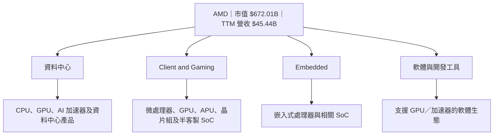
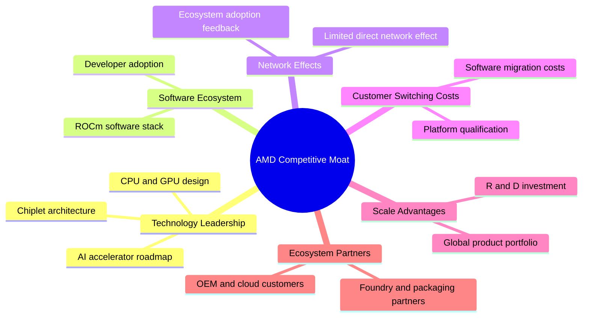
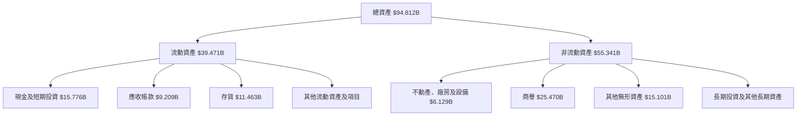
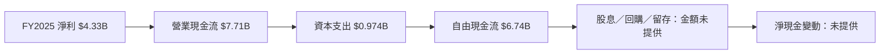
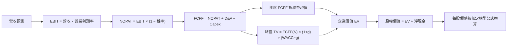
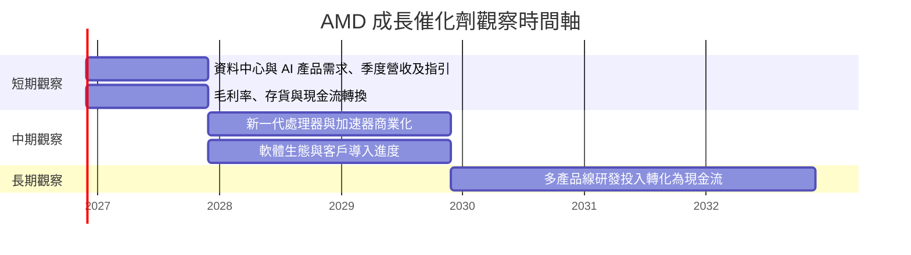
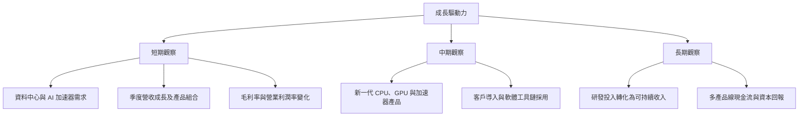
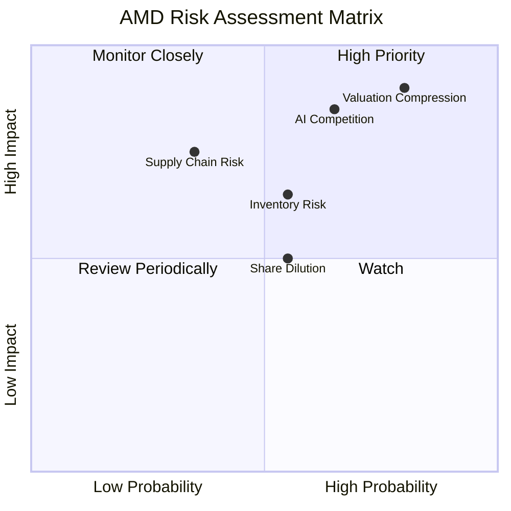
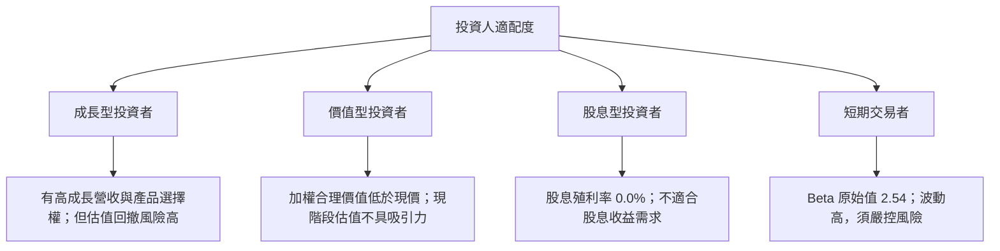

# AMD 基本面深度分析報告
> **報告日期**：2026-11-27 ｜ **語言**：繁體中文 ｜ **數據來源**：SEC 申報資料 (XBRL)、Yahoo Finance、Finviz、StockAnalysis、Roic.ai ｜ **分析師**：CFA 級機構研究

## 目錄

| # | 章節 | 核心結論 |
|---|------|----------|
| 1 | 執行摘要 | 賣出；加權合理價值 $191.43；MOS -112.1% |
| 2 | 公司概覽與商業模式 | 產品與客戶組合多元，市場份額數據未提供；護城河以技術與生態系為主 |
| 3 | 損益表深度分析 | TTM 營收 $45.44B、年增 41.9%；TTM 營業利益率 17.7% |
| 4 | 資產負債表分析 | 淨現金 $8.70B；流動性指標顯示短期償債能力充足 |
| 5 | 現金流量深度分析 | TTM FCF $7.06B，FCF Yield 1.05%；現金轉換表現良好 |
| 6 | 獲利能力與資本效率 | ROIC 12.8% 低於採用 WACC 14.00%，目前未覆蓋資本成本 |
| 7 | 相對估值分析 | AMD 估值高於同業 Forward P/E 中位數，且 P/S 位於自身歷史高分位 |
| 8 | DCF 內在價值評估 | 基準 DCF 每股 $75.54；現價相對 DCF 溢價 437.5% |
| 9 | 成長催化劑 | 資料中心、AI 加速器與新一代處理器是主要觀察方向 |
| 10 | 風險矩陣 | 估值收縮、競爭與產品執行是主要下行風險 |
| 11 | 投資建議 | 依 MOS 評級為賣出；監控營收成長、利潤率、FCF 與 ROIC |

## 1. 執行摘要

### 1.0 一頁式投資儀表板（Portfolio Manager 30 秒速讀）

| 項目 | 內容 |
|------|------|
| **投資論點（3 句）** | ① AMD TTM 營收 $45.44B、年增 41.9%，且最新一季年增 44.7%，成長動能仍在。② TTM FCF 為 $7.06B、FCF Yield 1.05%，但 ROIC 12.8% 低於 WACC 14.00%。③ 現價 $406.03 對應加權合理價值 $191.43，估值缺乏下檔保護。 |
| **綜合評分** | **6.2/10**（引用 1.1 評分卡） |
| **財務健康** | 🟢 淨現金 $8.70B；流動比率 2.725、速動比率 1.725。 |
| **ROIC vs WACC** | 12.8% vs 14.00%；目前低於資本成本，未能創造正經濟利差。 |
| **FCF 趨勢** | TTM FCF $7.06B；近年上升，最新 FCF Yield 1.05%。 |
| **估值** | Forward P/E 23.02x ｜ EV/EBITDA 59.173x（市場資料）｜ FCF Yield 1.05%。 |
| **DCF 內在價值（基準）** | $75.54 ｜現價相對 DCF 折溢價 **+437.5%**（第 8.5 節）。 |
| **安全邊際（MOS）** | **-112.1%**＝($191.43 − $406.03) ÷ $191.43；🔴 無下檔保護，基準為 8.8 加權合理價值。 |
| **預期報酬（基準情境 12M）** | DCF 基準情境價值 $75.54，相對現價 **-81.4%**；這是模型估值差距，不是保證報酬。 |
| **關鍵風險（前二）** | 高估值倍數回落；AI／資料中心產品競爭及市場需求不及預期。 |
| **評級 + 信心度** | 🔴 **賣出** ｜ 信心：中。MOS 與 DCF 均指向估值風險，但 DCF 對終值及長期利潤率高度敏感。 |

### 1.1 綜合評分卡（全報告唯一）

| 維度 | 評分（1–10） | 主要依據（引用數字與其來源章節） |
|------|--------------|----------------------------------|
| 成長性 | 8.0 | TTM 營收年增 41.9%、最新一季年增 44.7%（第 3 章）；成長仍快，但競爭與基期風險存在。 |
| 獲利能力 | 7.0 | TTM 營業利益率 17.7%、ROIC 12.8%、F-Score 7/9；ROIC 仍低於 WACC（第 6 章）。 |
| 財務健康 | 8.0 | 淨現金 $8.70B、流動比率 2.725、速動比率 1.725（第 4 章）。 |
| 估值 | 2.0 | MOS -112.1%；P/S 14.8x，為自身五年歷史第 90 百分位（第 7–8 章）。 |
| 護城河 | 7.0 | CPU、GPU、加速器產品與軟體生態具競爭基礎，但未提供市場份額數字；面對 NVIDIA、Intel、Broadcom 競爭（第 2 章）。 |
| 管理層與資本配置 | 5.0 | FY2025 SBC $1.64B，約佔營收 4.7%；Piotroski 股數稀釋測試未通過，近期並有 337M 股轉售註冊新聞（第 3、5 章）。 |
| **綜合評分** | **6.2** | 六項算術平均：(8.0 + 7.0 + 8.0 + 2.0 + 7.0 + 5.0) ÷ 6 = 6.17，四捨五入至一位小數。 |

### 1.2 五大投資論點 + 三大核心風險

| 類型 | 項目 | 具體依據 | 信心度 |
|------|------|----------|--------|
| 🟢 **投資論點①** | 營收仍快速擴張 | TTM 營收 $45.44B，TTM 年增 41.9%；最新一季年增 44.7%，收入增長有助於攤薄固定研發與營運成本。 | 🟢 高 |
| 🟢 **投資論點②** | 現金流轉正且擴大 | TTM 營業現金流 $9.12B、資本支出 $2.07B、FCF $7.06B；現金生成提供持續研發與資本配置彈性。 | 🟢 高 |
| 🟢 **投資論點③** | 資產負債表保守 | 現金及短期投資 $15.78B、總債務 $7.08B、淨現金 $8.70B，降低融資與利率風險。 | 🟢 高 |
| 🟢 **投資論點④** | 毛利與營業利益率具改善空間 | TTM 毛利率 56.0%、營業利益率 17.7%；最新一季營業利益率 21.2%，若產品組合延續可支持營業槓桿。 | 🟡 中 |
| 🟢 **投資論點⑤** | 產品覆蓋多個運算市場 | 公司經營資料中心、Client and Gaming、Embedded，提供 CPU、GPU、AI 加速器及嵌入式產品；降低單一產品類別依賴，但分部收入未提供。 | 🟡 中 |
| 🟡 **風險①** | 估值回落 | 加權合理價值 $191.43，低於現價 $406.03；DCF 基準 $75.54。即使盈利持續增長，倍數壓縮也可能主導股價下跌。 | 🔴 高衝擊 |
| 🔴 **風險②** | 競爭與市場預期過高 | NVIDIA 最新一季營收年增 103.2%，高於 AMD 最新一季 44.7%；AI 加速器需求、供應與軟體生態差距會影響 AMD 成長兌現。 | 🟡 中 |
| 🟡 **風險③** | 稀釋與營運資金占用 | Piotroski 股數未增加測試未通過；存貨天數由 161 天升至 199 天，可能增加庫存風險與現金占用。 | 🟡 中 |

### 1.3 快速統計卡片

同業中位數只按 NVDA、INTC、AVGO 三家公司之 Peer multiples 區塊計算；營收成長與毛利率採三家公司已提供數據的中位數。

| 指標 | 公司實際值（期間） | 同業中位數 | 狀態 |
|------|--------------------|------------|------|
| 營收成長（TTM） | **41.9%** | — | 🟢 |
| 營收成長（最新一季年增） | **44.7%** | 85.5% | 🟡 |
| 毛利率（TTM） | **56.0%** | 74.9% | 🟡 |
| 營業利益率（TTM） | **17.7%** | — | 🟢 |
| ROIC（TTM） | **12.8%** | — | 🟡 |
| Forward P/E | **23.02x** | 15.5x | 🔴 |
| FCF Yield（TTM） | **1.05%** | — | 🟡 |
| Piotroski F-Score | **7 / 9** | — | 🟢 |

### 1.4 投資結論

```text
╔══════════════════════════════════════════════════════════════════╗
║                    📊 投資結論摘要                               ║
╠══════════════════════════════════════════════════════════════════╣
║  評級：賣出（依規則 20；MOS = -112.1%）                          ║
║  價格（2026-11-25 收盤）：$406.03                                ║
║  DCF 內在價值（基準）：$75.54（折溢價 +437.5%）                 ║
║  安全邊際 MOS：-112.1%（＝(加權合理價值−現價)÷加權合理價值）   ║
║  加權合理價值（8.8）：$191.43                                   ║
║  DCF 情境價值：                                                  ║
║    悲觀情境：$40.03（-90.1%）                                    ║
║    基準情境：$75.54（-81.4%）                                    ║
║    樂觀情境：$141.10（-65.2%）                                   ║
║  綜合評分：6.2/10（引用 1.1）                                   ║
║  適合投資人：能承受半導體高波動的長線成長型投資人；不適合       ║
║              以低估值或股息收益為主要目標的投資人               ║
╚══════════════════════════════════════════════════════════════════╝
```

## 2. 公司概覽與商業模式

### 2.1 業務結構與收入來源

AMD 提供資料中心與個人運算產品、遊戲相關晶片及嵌入式處理器。公司總營收 TTM 為 $45.44B，但各分部營收金額與占比未提供，因此不將未披露的分部比例填入圖表。



### 2.2 市場份額

市場份額數據未提供，故不繪製市場份額圖，也不推估各產品線占比。以營收及成長比較，AMD TTM 營收 $45.44B、年增 41.9%；最新一季年增 44.7%，低於 NVIDIA 的 103.2%，但高於 Intel 的 20.9%。此比較只反映公司營收成長，不等同市場份額變化。

### 2.3 競爭護城河分析



### 2.4 護城河強度

| 護城河項目 | 強度（強／中／弱） | 證據（引用數字或事實） | 會削弱它的情況 |
|------------|--------------------|------------------------|----------------|
| 技術與產品設計 | 中至強 | 公司提供 CPU、GPU、AI 加速器、APU 及嵌入式處理器；TTM 營收 $45.44B。 | 新產品延遲、效能或能效落後、競爭者推出更具成本效益的產品。 |
| 軟體生態系統 | 中 | GPU／加速器產品需要軟體工具鏈與開發者採用；現有資料未提供開發者數量或軟體收入。 | 開發工具成熟度不足、客戶轉向競爭平台或遷移成本低於預期。 |
| 網路效應 | 弱至中 | 規模可能促進軟體與平台採用，但資料未提供可量化網路效應指標。 | 客戶集中採購、產品可互換性提升。 |
| 客戶鎖定 | 中 | 企業級晶片導入涉及驗證、系統相容與軟體部署；未提供續約率或客戶留存率。 | 客戶多來源採購、雲端客戶自研晶片擴大。 |
| 規模效應 | 中 | FY2025 研發費用 $8.09B；規模有利分攤研發成本，但投入仍需轉化為產品收入。 | 研發支出增加而商業化滯後、競爭者研發投入更高。 |
| 生態夥伴 | 中 | 公司依賴供應鏈與 OEM／雲端客戶協作；供應商集中度與合作份額未提供。 | 產能、封裝或供應鏈限制，或大型客戶改採競品。 |

護城河評分引用 1.1 的 **7.0/10**：產品與研發基礎提供競爭優勢，但市場份額、客戶留存與軟體生態量化資料不足，且競爭強度高。

## 3. 損益表深度分析

### 3.1 年度收入成長趨勢（近4年）

收入來源：年度損益表。柱形僅作相對視覺化，金額與成長率依表列數據。

```text
╔══════════════════════════════════════════════════════════════════╗
║              AMD 年度收入趨勢（FY2022-FY2025）                  ║
╠══════════════════════════════════════════════════════════════════╣
║  FY2022  $23.60B  ██████████████░░░░░░░░░░  YoY：基期          ║
║  FY2023  $22.68B  █████████████░░░░░░░░░░░  YoY：-3.9% 🟡      ║
║  FY2024  $25.79B  ███████████████░░░░░░░░░  YoY：+13.7% 🟢     ║
║  FY2025  $34.64B  ████████████████████░░░░  YoY：+34.3% 🟢     ║
║                                                                  ║
║  FY2022 至 FY2025 累計 CAGR：($34.64B ÷ $23.60B)^(1/3)-1       ║
║                                = 約 13.6%                        ║
╚══════════════════════════════════════════════════════════════════╝
```

年度收入由 FY2023 的 $22.68B 回升至 FY2025 的 $34.64B，FY2025 年增 34.3%。TTM 營收 $45.44B、年增 41.9%，高於 FY2025 增速，表示最近四季成長加速；後續應確認成長是否由高需求產品持續貢獻，而非單一季度或產品週期。

### 3.2 季度收入趨勢分析

| 季度 | 營收 | QoQ 成長 | YoY 成長 | 備註 |
|------|------:|---------:|---------:|------|
| 2025 Q4 | $10.27B | — | 34.1% | 對比 2024 Q4 的 $7.658B；財報來源存在季度口徑差異，YoY 採 StockAnalysis 季度成長率。 |
| 2026 Q1 | $10.25B | -0.2% | 37.9% | QoQ = ($10.253B ÷ $10.270B) − 1；營收大致持平，但年增仍高。 |
| 2026 Q2 | $11.54B | 12.5% | 50.1% | QoQ = ($11.536B ÷ $10.253B) − 1；營收加速。 |
| 2026 Q3 | $13.38B | 16.0% | 44.7% | QoQ = ($13.377B ÷ $11.536B) − 1；最新一季年增率為單季數字，不是 TTM。 |

最近三季營收依序上升，QoQ 由 -0.2% 回升至 16.0%。Q3 的 YoY 44.7% 低於 Q2 的 50.1%，可能反映比較基期或季度組合變化；未提供足以拆分產品與價格的資料，不將其歸因於特定產品線。

### 3.3 利潤率演變分析

下表年度比率由年度損益表的毛利、營業利益、淨利除以營收計算；TTM 指標則引用最新財務資料，兩者口徑可能存在四捨五入或資料來源差異。

| 利潤率指標 | FY2022 | FY2023 | FY2024 | FY2025 | 趨勢 | 評估 |
|------------|--------|--------|--------|--------|------|------|
| **毛利率** | 44.9% | 46.1% | 49.3% | 49.5% | 回升；TTM 為 56.0% | 🟢 |
| **營業利益率** | 5.3% | 1.8% | 8.1% | 10.7% | FY2023 低谷後改善；TTM 為 17.7% | 🟢 |
| **淨利率** | 5.6% | 3.8% | 6.4% | 12.5% | FY2025 擴張；TTM 為 16.8% | 🟢 |

**利潤率演變深度解析：** FY2023 營業利益降至 $0.401B，FY2024 回升至 $2.09B，FY2025 增至 $3.69B。TTM 營業利益為 $8.097B，約對應 17.7% 利潤率，明顯高於 FY2025。這代表近期收入增長帶來較大營業槓桿，也可能反映產品組合改善；但資料未提供分部毛利及定價拆解，不能將全部改善歸因於 AI 或資料中心產品。最新一季營業利益率 21.2%（TTM 最新季資料）顯示季度盈利能力強於 TTM 平均，需觀察是否可持續。

### 3.4 費用結構分析

完整費用項目與金額未提供，不能繪製完整損益費用圓餅圖。可核對的 FY2025 研發費用為 $8.09B，約占 FY2025 營收 $34.64B 的 23.4%；研發是半導體設計公司的核心投入，支出能否轉化為產品營收與毛利，是未來營業槓桿的關鍵。

```text
╔══════════════════════════════════════════════════════════════════╗
║                    FY2025 可核對費用項目                        ║
╠══════════════════════════════════════════════════════════════════╣
║  研發費用 $8.09B／營收 $34.64B = 23.4%                         ║
║  其他營業費用明細：未提供，故不繪製完整費用結構圖               ║
╚══════════════════════════════════════════════════════════════════╝
```

### 3.5 季度 EPS 趨勢與盈餘品質（Quality of Earnings）

| 季度 | EPS | YoY 成長 | QoQ 成長 | 超預期／不及預期 |
|------|----:|---------:|---------:|------------------|
| 2025 Q4 | $0.92 | 217.1% | — | EPS 預估值與實際值為 NaN，無法判定。 |
| 2026 Q1 | $0.84 | 91.2% | -8.7% | 預估值與實際值為 NaN，無法判定。 |
| 2026 Q2 | $1.39 | 159.5% | 65.5% | 預估值與實際值為 NaN，無法判定。 |
| 2026 Q3 | $1.46 | 93.8% | 5.0% | 預估值與實際值為 NaN，無法判定。 |

EPS 逐季由 Q1 的 $0.84 升至 Q3 的 $1.46，最新一季年增 93.8%。估計值缺失，因此不能聲稱超預期或不及預期；成長原因需以後續分部財報與管理層指引核實。

| 盈餘品質項目 | 數值／佔比 | 評估 |
|--------------|-----------|------|
| 股權薪酬 SBC／營收 | 近四個列示季度 SBC 合計 $1.999B ÷ TTM 營收 $45.44B = 約 4.4%；FY2025 SBC $1.64B | 🟡 SBC 是非現金費用，但透過股數稀釋形成股東成本；Piotroski 股數測試未通過。 |
| SBC／營業現金流 | $1.999B ÷ $9.12B = 約 21.9% | 🟡 SBC 相對現金流占比不低，評估股東回報不能只看未扣稀釋的現金流。 |
| FCF／淨利（現金轉換率） | $7.06B ÷ TTM 淨利 $7.619B = 約 92.7% | 🟢 現金轉換接近會計盈餘；分子與分母期間均為 TTM。 |
| 一次性／非經常性損益 | N/A（未提供可核實明細） | 無法判斷非經常項目是否美化本期盈餘。 |
| 有效稅率異常 | N/A（未提供 TTM 有效稅率） | DCF 採用的 21.0% 是模型預設稅率，不代表已核實的實際有效稅率。 |
| 資本化支出 vs 費用化 | TTM Capex $2.07B；資本化政策細節未提供 | 無法量化資本化政策是否顯著改變當期利潤。 |

**盈餘品質結論：** TTM FCF $7.06B 約為 TTM 淨利的 92.7%，營業現金流為正，顯示盈餘有現金支持；但 SBC 約為四季度營業現金流的 21.9%，稀釋不能忽略。整體不宜把 SBC 完全視為無成本，也無法在缺少稅務及一次性項目明細下做更強結論。

## 4. 資產負債表分析

### 4.1 資產結構分解

以下金額採 StockAnalysis 最新資產負債表列示值（2026-09-26），總資產 $94.812B。流動資產各項加總受資料四捨五入與分類差異影響。



### 4.2 流動性與營運資金分析

| 指標 | 最新值 | 歷史參照 | 評估 |
|------|-------:|----------|------|
| 流動比率 | 2.725 | N/A（未提供一致歷史序列） | 🟢 流動資產覆蓋流動負債能力充足。 |
| 速動比率 | 1.725 | N/A（未提供一致歷史序列） | 🟢 扣除存貨後仍高於 1。 |

**營運資金天數（照抄品質指標）：**

| 指標 | 最新 TTM | 一年前 TTM | 變化 | 解讀 |
|------|----------:|-----------:|-----:|------|
| DSO 應收帳款天數 | 74 天 | 71 天 | +3 天 | 收款週期略延長，需觀察客戶付款條件與應收帳款品質。 |
| DIO 存貨天數 | 199 天 | 161 天 | +38 天 | 存貨增加快於週轉，可能支持新品備貨，也提高過時與減值風險。 |
| DPO 應付帳款天數 | 135 天 | 77 天 | +58 天 | 付款天數延長，短期有助現金流，但需確認是否來自供應鏈條款或付款節奏。 |
| CCC 現金轉換週期 | 138 天 | 155 天 | -17 天 | 由 155 天縮短至 138 天；主要是 DPO 增幅抵銷 DIO 上升。 |

CCC 的變化並不代表庫存風險消失：DIO 上升 38 天，若需求低於預期，仍可能造成資金占用或庫存減值。

### 4.3 債務結構分析

依 VERIFIED FIGURES，採用總債務 $7.08B、現金及短期投資 $15.78B、淨現金 $8.70B。其他市場資料來源另列總債務 $9.21B、淨現金 $6.57B，與主要核定數字不一致；本報告以核定欄位為準，不混用兩組數字。

```text
╔══════════════════════════════════════════════════════════════════╗
║                   AMD 債務健康診斷                              ║
╠══════════════════════════════════════════════════════════════════╣
║  總債務：       $7.08B   ███████░░░░░░░░░░░░░  🟢              ║
║  現金+短期投資：$15.78B  ████████████████░░░░  🟢              ║
║  淨現金：       $8.70B   █████████░░░░░░░░░░░  🟢              ║
║                                                                  ║
║  Debt/EBITDA：N/A（採用口徑下未提供一致 EBITDA 配對值）          ║
║  Interest Coverage：N/A（利息費用及營業利益口徑未提供）         ║
╚══════════════════════════════════════════════════════════════════╝
```

### 4.4 股東權益趨勢

| 年度 | 股東權益 |
|------|---------:|
| FY2022 | $54.75B |
| FY2023 | $55.89B |
| FY2024 | $57.57B |
| FY2025 | $63.00B |

```text
╔══════════════════════════════════════════════════════════════════╗
║                    股東權益趨勢（年度）                          ║
╠══════════════════════════════════════════════════════════════════╣
║  FY2022  $54.75B  █████████████████░░░░░░░                     ║
║  FY2023  $55.89B  ██████████████████░░░░░░                     ║
║  FY2024  $57.57B  ███████████████████░░░░░                     ║
║  FY2025  $63.00B  █████████████████████░░░                     ║
╚══════════════════════════════════════════════════════════════════╝
```

股東權益由 FY2022 的 $54.75B 增至 FY2025 的 $63.00B。此變化反映資產負債表累積，但不能單獨等同每股價值提升；仍須同時觀察流通股數與資本回報率。

## 5. 現金流量深度分析

### 5.1 現金流量瀑布圖

以下為 FY2025 可核對數據；股息、回購及當期淨現金變動未提供一致數字，不繪製虛構金額。



### 5.2 FCF 轉換率趨勢

| 年度 | FCF | 淨利 | FCF／淨利 | 評估 |
|------|----:|----:|----------:|------|
| FY2022 | $3.12B | $1.32B | 236.4% | 🟢 現金流高於淨利，可能包含營運資金等期間影響。 |
| FY2023 | $1.12B | $0.854B | 131.1% | 🟢 仍高於 100%，但 FCF 絕對值偏低。 |
| FY2024 | $2.40B | $1.64B | 146.3% | 🟢 現金轉換維持正向。 |
| FY2025 | $6.74B | $4.33B | 155.7% | 🟢 盈利與現金流同步改善。 |
| TTM | $7.06B | $7.619B | 92.7% | 🟡 現金流仍接近淨利，但低於年度高點。 |

### 5.3 自由現金流趨勢

```text
╔══════════════════════════════════════════════════════════════════╗
║                    自由現金流趨勢                               ║
╠══════════════════════════════════════════════════════════════════╣
║  FY2022  $3.12B  █████████░░░░░░░░░░░░  FCF Yield：N/A         ║
║  FY2023  $1.12B  ███░░░░░░░░░░░░░░░░░░  FCF Yield：N/A         ║
║  FY2024  $2.40B  ███████░░░░░░░░░░░░░  FCF Yield：N/A         ║
║  FY2025  $6.74B  ███████████████████░  FCF Yield：N/A         ║
║  TTM     $7.06B  ████████████████████  FCF Yield：1.05%        ║
║                                                                  ║
║  歷年市值基礎 FCF Yield 未提供；僅列核定 TTM FCF Yield。         ║
╚══════════════════════════════════════════════════════════════════╝
```

TTM FCF 依核定定義為營業現金流減資本支出：$9.12B − $2.07B = $7.06B（因原始金額四捨五入，差額可能有 $0.01B 尾差）。FCF 上升支持研發與擴產，但 1.05% 的 FCF Yield 表示現價對現金流的定價仍高。

### 5.4 資本配置評估

完整回購金額、股息、併購及留存資金用途未提供，不能製作比例圓餅圖。FY2025 SBC 為 $1.64B，年度 Capex 為 $0.974B；FY2025 研發費用 $8.09B，顯示資本配置重點包括產品研發與營運能力投資。股息殖利率為 0.0%，現金回報主要不依賴股息。

## 6. 獲利能力與資本效率

### 6.1 ROE / ROA / ROIC 趨勢

| 指標 | 最新 TTM | 歷史資料 | 評估 |
|------|---------:|----------|------|
| ROE | 11.1% | 年度可比歷史序列未提供 | 🟡 盈利為正，但資產與權益使用效率仍需改善。 |
| ROA | N/A（核定品質指標未列 TTM 數值） | 其他財務摘要列 5.9%，口徑不一致 | 🟡 不以非核定口徑替代。 |
| ROIC | 12.8% | 連續年度可比序列未提供 | 🟡 低於 WACC 14.00%。 |

行業均值數據未提供，不列行業均值比較。ROIC 12.8% 對比 WACC 14.00% 的差距為 -1.20 個百分點，顯示當期資本回報未覆蓋資本成本。

### 6.2 ROIC vs WACC 分析（核心價值創造判斷）

```text
╔══════════════════════════════════════════════════════════════════╗
║                ROIC vs WACC 深度分析                            ║
╠══════════════════════════════════════════════════════════════════╣
║  WACC（折現率採核定值）：14.00%                                  ║
║  ├── 無風險利率（10Y 美債）：4.85%                               ║
║  ├── ERP：5.00%                                                   ║
║  ├── Beta used（調整後）：2.00                                   ║
║  ├── 股權成本：4.85% + 2.00 × 5.00% = 14.85%                    ║
║  ├── 稅前債務成本：1.85%；稅後：1.85% × (1−21%) = 1.46%         ║
║  ├── 資本權重：股權 99.0%、債務 1.0%                             ║
║  └── 計算 WACC 14.71%，受 7%–14% 區間限制後採用 14.00%          ║
║                                                                  ║
║  ROIC：12.8%（TTM，核定值）                                     ║
║  經濟利差：ROIC − WACC = 12.8% − 14.00% = -1.20 個百分點        ║
║                                                                  ║
║  ROIC  12.8%  ▓▓▓▓▓▓▓▓▓▓▓▓▓░░░░░░░░░░░░░░░░                    ║
║  WACC  14.0%  ▓▓▓▓▓▓▓▓▓▓▓▓▓▓░░░░░░░░░░░░░░                     ║
║                                                                  ║
║  結論：目前 ROIC 低於 WACC，未覆蓋資本成本；若 ROIC 無法提高，   ║
║        增長未必等於股東價值創造。                                ║
╚══════════════════════════════════════════════════════════════════╝
```

Beta 原始值為 2.54；調整公式為 ⅔ × 2.54 + ⅓ = 2.03，並受 0.6–2.0 範圍限制，故採用調整後 Beta 2.00。WACC 的計算值為 14.71%，按資料指定的 7%–14% 範圍上限採用 14.00%。本節與 DCF 使用相同的 14.00%。

> **ROIC 計算口徑：**本報告引用核定 ROIC 12.8%，不以其他財報欄位自行重建投入資本或 NOPAT，避免混用期間與負債口徑。

### 6.3 杜邦三因素分解

| 因素 | 數值（TTM） | 解讀 |
|------|-------------|------|
| 淨利率 | 16.8% | 盈利率提供 ROE 的主要正向來源。 |
| 資產週轉率 | 0.48 | 每單位資產創造的收入有限，資產效率可進一步提升。 |
| 權益乘數 | 1.39 | 財務槓桿不高，ROE 並非主要靠槓桿撐起。 |
| **ROE** | **11.1%** | 16.8% × 0.48 × 1.39 ≈ 11.1%；引用核定杜邦指標。 |

### 6.4 財務體質：Piotroski F-Score

Piotroski F-Score 為 **7 / 9**；依資料計算規則，缺少輸入的測試不納入分母。九項檢查均有列示如下：

| 測試 | 結果 | 解讀 |
|------|------|------|
| ROA > 0 | ✅ 通過 | 獲利能力為正。 |
| 營業現金流 > 0 | ✅ 通過 | 營運產生正現金流。 |
| ROA 高於一年前 | ✅ 通過 | 資產獲利表現改善。 |
| 營業現金流 > 淨利（應計品質） | ✅ 通過 | 現金流對盈餘提供支持。 |
| 長期負債 ÷ 總資產低於一年前 | ❌ 未通過 | 槓桿相對資產的改善未達測試條件。 |
| 流動比率高於一年前 | ✅ 通過 | 短期流動性較一年前改善。 |
| 稀釋股數未增加 | ❌ 未通過 | 股數增加會稀釋每股盈餘與每股價值。 |
| 毛利率高於一年前 | ✅ 通過 | 毛利率改善。 |
| 資產週轉率高於一年前 | ✅ 通過 | 資產使用效率改善。 |

## 7. 相對估值分析

### 7.1 同業估值比較表格

AMD 公司估值倍數取市場資料；同業倍數照 Peer multiples。AMD P/E、Forward P/E 與 EV/EBITDA 可能因資料源或計算口徑與 Peer multiples 不完全一致，故保留原始列示數字，不強行調和。

| 估值指標 | **AMD** | **NVIDIA** | **Intel** | **Broadcom** | AMD 評估 |
|----------|--------:|-----------:|----------:|-------------:|-----------|
| **Trailing P/E** | 86.76x | 16.0x | N/A | 38.4x | 🔴 顯著高於有數值同業；成長預期須持續兌現。 |
| **Forward P/E** | 23.02x | 9.0x | 30.4x | 15.5x | 🔴 同業中位數 15.5x；AMD 溢價約 48.5%。 |
| **P/S Ratio** | 14.79x | 10.0x | 4.8x | 16.1x | 🟡 位於同業區間上半部；仍需高營收成長支持。 |
| **EV/EBITDA** | 59.173x | 14.5x | 15.8x | 28.2x | 🔴 AMD 顯著較高；以 Peer multiples 中位數 15.8x 衡量仍偏貴。 |
| **最新一季營收年增** | 44.7% | 103.2% | 20.9% | 85.5% | 🟡 AMD 成長快於 Intel，但低於 NVIDIA 與 Broadcom。 |
| **TTM 毛利率** | 56.0% | 74.9% | 40.2% | 75.5% | 🟡 低於 NVIDIA、Broadcom，高於 Intel。 |

Peer multiples 的 Forward P/E 中位數為 15.5x；AMD 23.02x 相較同業中位數的溢價為 (23.019857 ÷ 15.5) − 1，約 48.5%。估值是否合理取決於未來成長、毛利與營業利潤率能否持續提高，而非單看成長率。

### 7.2 歷史估值區間分析

以下依核定的五年歷史估值統計。區間包含極端值，解讀時以中位數及百分位較具參考性。

```text
╔══════════════════════════════════════════════════════════════════╗
║                 AMD 五年歷史估值位置（TTM）                     ║
╠══════════════════════════════════════════════════════════════════╣
║  P/E：       36.7x ───── 中位數 82.6x ───── 現值 88.3x          ║
║              歷史區間 36.7x–934.7x；現值第 53 百分位             ║
║  P/S：        4.3x ───── 中位數  8.9x ───── 現值 14.8x          ║
║              歷史區間 4.3x–23.1x；現值第 90 百分位 🔴            ║
║  EV/EBITDA： 38.2x ───── 中位數 102.2x ──── 現值 82.7x          ║
║              歷史區間 38.2x–919.2x；現值第 39 百分位             ║
╚══════════════════════════════════════════════════════════════════╝
```

相對自身歷史，P/S 14.8x 位於第 90 百分位，估值偏高；P/E 位於第 53 百分位、EV/EBITDA 位於第 39 百分位。極端歷史倍數擴大區間，百分位不代表估值便宜與否，仍需結合現金流與資本回報判斷。

### 7.3 情境價值（Bear / Base / Bull，照抄 DCF MODEL）

| 情境 | 第 1 年營收成長 | 期末營業利潤率 | WACC | 每股價值 | 相對現價 | 機率 | 會發生的條件 |
|------|----------------:|----------------:|-----:|----------:|---------:|-----:|--------------|
| 🔴 悲觀 | 15.0% | 6.3% | 15.00% | $40.03 | -90.1% | 25% | AI 加速器與資料中心成長顯著放慢，競爭壓低長期利潤率，風險溢酬上升。 |
| 🟡 基準 | 30.0% | 7.4% | 14.00% | $75.54 | -81.4% | 50% | 近期成長逐步回落，長期營業利潤率向歷史中位水準收斂。 |
| 🟢 樂觀 | 45.0% | 8.1% | 13.00% | $141.10 | -65.2% | 25% | 產品需求與商業化優於基準，利潤率改善且資本成本下行。 |

三情境均低於現價；樂觀情境仍低於 $406.03，凸顯市場價格包含較高的成長與估值預期。

### 7.4 相對估值隱含價格區間

```text
╔══════════════════════════════════════════════════════════════════╗
║             估值方法隱含價值與現價位置                           ║
╠══════════════════════════════════════════════════════════════════╣
║ $75.54 ───── $111.16 ───── $191.43 ───── $273.74 ───── $406.03 ║
║  DCF基準       EV/EBITDA       加權合理值      Forward P/E       現價║
╚══════════════════════════════════════════════════════════════════╝
```

- 同業 Forward P/E：同業中位數 **15.5x** × AMD Forward EPS **$17.64**，每股價值 **$273.74**。
- 同業 EV/EBITDA：同業中位數 **15.8x** × AMD TTM EBITDA，再加淨現金，折算每股 **$111.16**。
- DCF 基準：10 年 FCFF、WACC 14.00%、永續成長率 3.0%，每股 **$75.54**。
- 分析師共識：49 位分析師平均目標價 **$649.89**，僅作參考，與現價及模型估值差異明顯。

## 8. DCF 內在價值評估（Discounted Cash Flow）

### 8.0 估值推理鏈（Thinking Logic）

**Step 1 — 價值由哪些變數決定？**  
AMD 價值主要由現有 CPU／GPU 與嵌入式產品現金流、資料中心及 AI 加速器成長，以及終值期營業利潤率與折現率決定。公司整體 TTM 營收為 $45.44B，但分部營收比重未提供，因此無法把資料中心或 AI 業務占比獨立量化。模型最敏感的變數是 WACC、永續成長率及長期利潤率；敏感度矩陣中 WACC 由 13% 升至 14%，在 g=3% 時價值由 $82.59 降至 $75.54。

**Step 2 — 模型選擇**

| 決策點 | 本報告採用 | 理由（含數字） | 曾考慮但否決 | 否決理由 |
|--------|-----------|----------------|--------------|----------|
| 現金流定義 | FCFF | 以 GAAP EBIT 推導 NOPAT，並按 WACC 折現為企業價值。 | FCFE | 模型提供的是 FCFF 及 EV 橋接。 |
| 預測期 N | 10 年 | 模型明確採 10 年，營收成長由 30.0% 線性降至 3.0%。 | 5 年 | 會改變模型期限與終值起算年，且非核定模型。 |
| 終值方法 | Gordon Growth | 模型提供永續成長率 3.0% 並使用 Gordon Growth。 | 退出倍數 | DCF 模型未提供退出倍數，不另行建模。 |
| EBIT 基礎 | GAAP EBIT | 模型明確以 GAAP EBIT 作預測。 | 非 GAAP EBIT | 會加回 SBC，與既定模型口徑不一致。 |

**Step 3 — 關鍵假設推導鏈**

- **營收成長**：錨點＝TTM 年增 41.9% → 調整＝為反映高基期及競爭，預測成長自 30.0% 線性下降至 3.0% → **採用 FY+1 30.0%、FY+10 3.0%** → 曾考慮延續 41.9%，但不採用，因為將四季增速直接外推十年會高估成長持續性。
- **期末營業利潤率**：錨點＝TTM GAAP 營業利益率 17.7% → 調整＝模型將利潤率逐步衰減至近五年財年中位水準 → **採用 FY+10 7.4%** → 曾考慮維持 17.7%，但模型以歷史中位數收斂，避免把目前利潤率永久化。
- **永續成長率 g**：錨點＝模型使用 3.0%，作成熟企業長期名目成長假設 → 調整＝不另調整，且 3.0% 低於 WACC 14.00% → **採用 3.0%** → 不採用高於 3.0% 的更高永久增長率，以免終值過度放大。
- **預測期 N**：錨點＝模型設定 10 年 → 調整＝不另調整，按模型逐年淡出成長率 → **採用 10 年** → 不自行改為較短期限，以免改動核定模型。
- **Capex／營收**：錨點＝TTM Capex／TTM 營收約 2.07÷45.44＝4.6%（原始模型假設由內部未四捨五入數值計算）→ 模型設定全期 4.5% → **採用 4.5%** → 不採用更低資本支出率，避免低估成長所需投資。
- **GAAP EBIT 與 SBC**：錨點＝GAAP EBIT 已將 SBC 列為費用 → 模型採 GAAP EBIT、FCFF 不再扣 SBC → **採組合 (A)** → 不採用非 GAAP EBIT 加回 SBC，避免 SBC 成本消失或重複扣除。
- **年稀釋率**：錨點＝組合 (A) 將股數固定，SBC 已反映在 GAAP 費用 → **採用年稀釋率 0%** → 不另加股數稀釋，避免重複計入；此處是模型定義，不代表實際股數沒有增加。
- **WACC**：錨點＝核定計算值 14.71% → 調整＝資料規定 WACC 限於 7%–14% → **採用 14.00%** → 不採用未限制的 14.71%，遵循模型所列區間。
- **ΔWC**：模型明確未建模營運資金變動；此項不另填數字，也不另行估算。這可能高估或低估未來 FCFF，方向取決於成長期應收與存貨的資金需求。

**Step 4 — 最脆弱的一環**  
模型以終值占 EV 35.3%，並把 GAAP 營業利益率由 17.7% 逐年降至 7.4%；若利潤率或 WACC 假設偏離，價值會明顯改變。敏感度矩陣顯示，在 g=3% 下 WACC 由 13% 升至 14%，每股價值減少 $7.05；若競爭令長期現金流低於模型，價值將更低。

**Step 5 — 計算路徑圖**



### 8.1 模型假設總表（Model Inputs）

| 假設項目 | 採用值 | 依據／來源 | 敏感度 |
|----------|--------|-------------|--------|
| 預測期長度 N | 10 年 | DCF 模型設定；營收成長與利潤率逐年淡出。 | 🟡 中 |
| 營收成長 | FY+1 30.0% → FY+10 3.0% | TTM 年增 41.9%；模型將第 1 年成長限制在 30.0%，再線性衰減。 | 🔴 高 |
| 營業利潤率 | FY+1 17.7% → FY+10 7.4% | TTM 17.7%，末年收斂至近五年財年中位數。 | 🔴 高 |
| 有效稅率 | 21.0% | 模型預設稅率；不是核定實際 TTM 稅率。 | 🟢 低 |
| Capex／營收 | 4.5% | 模型固定假設；TTM Capex $2.07B、營收 $45.44B，粗略比率約 4.6%。 | 🟡 中 |
| D&A／營收 | 6.7% | 模型採 TTM 比率並固定。 | 🟢 低 |
| 營運資金變動 | 未建模 | 模型明確未納入，沒有 ΔWC／營收增額假設值。 | 🟢 低 |
| EBIT 基礎 | GAAP EBIT | DCF 模型設定。 | 🟡 中 |
| SBC 處理 | GAAP EBIT 已費用化，不再扣 SBC | 模型明確採組合 (A)，股數不另稀釋。 | 🟡 中 |
| 年稀釋率 | 0%（模型固定股數） | 與組合 (A) 相容；SBC 已經反映於 GAAP EBIT。 | 🟡 中 |
| 永續成長率 g | 3.0% | DCF 模型設定，低於 WACC 14.00%。 | 🔴 高 |
| 終值方法 | Gordon Growth | DCF 模型提供終值公式；未提供退出倍數。 | 🔴 高 |
| WACC | 14.00% | 採核定成本資本值及指定上限，見 8.2。 | 🔴 高 |

本模型採用 **(A) GAAP EBIT + 固定股數**：GAAP EBIT 已包含 SBC 費用，因此 FCFF 不再減 SBC，股數也不再逐年稀釋；SBC 對模型的影響計入一次。

### 8.2 折現率推導（WACC）

```text
╔══════════════════════════════════════════════════════════════════╗
║                    WACC 推導（折現率）                           ║
╠══════════════════════════════════════════════════════════════════╣
║  股權成本 Ke（CAPM）：                                           ║
║  ├── 無風險利率 Rf（10Y 美債）：4.85%                            ║
║  ├── 市場風險溢酬 ERP：5.00%                                      ║
║  ├── Beta 原始值：2.54；調整後採用值：2.00                       ║
║  ├── 規模／國別溢酬：0.00%（核定輸入未列額外溢酬）               ║
║  └── Ke = 4.85% + 2.00 × 5.00% = 14.85%                        ║
║                                                                  ║
║  債務成本 Kd：                                                   ║
║  ├── 稅前 Kd：1.85%（核定成本資本輸入）                          ║
║  ├── 稅率：21.0%                                                 ║
║  └── 稅後 Kd = 1.85% × (1 − 21.0%) = 1.46%                     ║
║                                                                  ║
║  資本結構：                                                      ║
║  ├── 股權權重 E：99.0%                                           ║
║  ├── 債務權重 D：1.0%                                            ║
║  ├── 計算 WACC：99.0%×14.85% + 1.0%×1.46% = 14.72%（約 14.71%）║
║  └── 區間限制：計算值 14.71%，採用值 14.00%（上限 14%）         ║
╚══════════════════════════════════════════════════════════════════╝
```

逐步演算：

1. **Ke（CAPM）** = Rf + β × ERP = 4.85% + 2.00 × 5.00% = **14.85%**。
2. **稅前 Kd** = 核定成本資本輸入 **1.85%**；利息費用與平均計息負債明細未提供，故不另自行重算。
3. **稅後 Kd** = 1.85% × (1 − 21.0%) = **1.4615%**，四捨五入為 **1.46%**。
4. **權重** = 股權 99.0%、債務 1.0%；兩者合計 = **100.0%**。市值及負債期末明細與核定權重口徑不完全一致，遵照核定權重。
5. **WACC 計算值** = 99.0% × 14.85% + 1.0% × 1.4615% = 14.7015% + 0.0146% = **14.7161%**；核定值列為 **14.71%**，受 7%–14% 區間限制後採用 **14.00%**。

### 8.3 逐年自由現金流預測（基準情境）

單位：$B；逐年數字照 DCF 模型。營運資金變動未建模，因此沒有 ΔWC 列；SBC 已包含在 GAAP EBIT 中，故不重複扣除。

| 年度 | FY+1 | FY+2 | FY+3 | FY+4 | FY+5 | FY+6 | FY+7 | FY+8 | FY+9 | FY+10 |
|------|-----:|-----:|-----:|-----:|-----:|-----:|-----:|-----:|-----:|------:|
| 營收 | 59.07 | 75.01 | 93.02 | 112.55 | 132.81 | 152.73 | 171.06 | 186.46 | 197.64 | 203.57 |
| 營收 YoY | 30.0% | 27.0% | 24.0% | 21.0% | 18.0% | 15.0% | 12.0% | 9.0% | 6.0% | 3.0% |
| 營業利潤率 | 17.7% | 16.6% | 15.4% | 14.3% | 13.1% | 12.0% | 10.8% | 9.7% | 8.5% | 7.4% |
| EBIT（GAAP） | 10.46 | 12.43 | 14.34 | 16.06 | 17.42 | 18.28 | 18.51 | 18.03 | 16.84 | 15.00 |
| − 稅 | (2.20) | (2.61) | (3.01) | (3.37) | (3.66) | (3.84) | (3.89) | (3.79) | (3.54) | (3.15) |
| = NOPAT | 8.27 | 9.82 | 11.33 | 12.69 | 13.76 | 14.44 | 14.62 | 14.24 | 13.30 | 11.85 |
| + D&A | 3.96 | 5.03 | 6.24 | 7.55 | 8.90 | 10.24 | 11.47 | 12.50 | 13.25 | 13.65 |
| − Capex | (2.69) | (3.41) | (4.23) | (5.12) | (6.04) | (6.95) | (7.78) | (8.48) | (8.99) | (9.26) |
| = FCFF | **9.54** | **11.43** | **13.33** | **15.11** | **16.63** | **17.73** | **18.31** | **18.26** | **17.56** | **16.24** |
| 折現因子 @14.00% | 0.877 | 0.769 | 0.675 | 0.592 | 0.519 | 0.456 | 0.400 | 0.351 | 0.308 | 0.270 |
| FCFF 現值 PV | **8.37** | **8.80** | **9.00** | **8.95** | **8.63** | **8.08** | **7.32** | **6.40** | **5.40** | **4.38** |

預測期 FCFF 現值逐項加總（按表中兩位小數）：  
**$8.37 + $8.80 + $9.00 + $8.95 + $8.63 + $8.08 + $7.32 + $6.40 + $5.40 + $4.38 = $75.33B**。  
模型核定未四捨五入的總和為 **$75.32B**；兩者差 $0.01B，屬表格逐項取兩位小數造成的尾差。

**FY+1 逐步演算（模型表格以未四捨五入數計算）：**

1. 營收 = $45.44B × (1 + 30.0%) = **$59.07B**。
2. EBIT = $59.07B × 17.7% = **$10.46B**。
3. 稅 = $10.46B × 21.0% = **$2.20B**。
4. NOPAT = 模型未四捨五入 EBIT − 稅 = **$8.27B**。表格顯示數以兩位小數呈現；直接用已四捨五入的 10.46 − 2.20 得 8.26，與模型未四捨五入結果有 $0.01B 顯示差。
5. D&A = $59.07B × 6.7% = **$3.96B**。
6. Capex = $59.07B × 4.5% = **$2.69B**。
7. ΔWC = **未建模**，不加減營運資金。
8. FCFF = $8.27B + $3.96B − $2.69B = **$9.54B**。
9. 折現因子 = 1 ÷ (1 + 14.00%)¹ = **0.877**；PV = $9.54B × 0.877，模型採未四捨五入數計得 **$8.37B**。

**合理性自檢：**

- 預測 FCFF CAGR：($16.24 ÷ $9.54)^(1/9) − 1 ≈ **6.1%**。FY2022 至 FY2025 FCF CAGR 為 ($6.74 ÷ $3.12)^(1/3) − 1 ≈ **29.2%**；預測增速顯著放緩，主要因預測營收增速逐年降至 3.0%、營業利潤率也收斂。
- FY+10 FCFF 利潤率 = $16.24B ÷ $203.57B ≈ **8.0%**；目前 TTM FCF 利潤率 = $7.06B ÷ $45.44B ≈ **15.5%**。同業最佳 FCF 利潤率未提供，不作比較。
- 預測年度 FCFF 均為正；但長期營運資金未納入，可能使模型現金流偏高或偏低。

```text
╔══════════════════════════════════════════════════════════════════╗
║            自由現金流：歷史實際 vs 模型預測                      ║
╠══════════════════════════════════════════════════════════════════╣
║  FY2023（實）$1.12B  ███░░░░░░░░░░░░░░░░░░░                    ║
║  FY2024（實）$2.40B  ██████░░░░░░░░░░░░░░░                    ║
║  FY2025（實）$6.74B  █████████████░░░░░░░░                    ║
║  FY+1（預） $9.54B  ██████████████████░░  YoY：模型期起始     ║
║  FY+10（預）$16.24B ████████████████████  預測期 FCFF CAGR 6.1%║
╠══════════════════════════════════════════════════════════════════╣
║  預測 CAGR 低於 FY2022–FY2025 歷史 FCF CAGR；但歷史基期波動大。 ║
╚══════════════════════════════════════════════════════════════════╝
```

### 8.4 終值計算（Terminal Value）

適用性檢查：**WACC 14.00% vs g 3.0% → WACC > g？✅**

| 方法 | 計算式 | 終值 TV | TV 現值 | 佔總 EV 比重 |
|------|--------|---------:|--------:|-------------:|
| Gordon Growth | $16.24 × (1 + 3.0%) ÷ (14.00% − 3.0%) | $152.04B | $41.01B | 35.3% |
| 退出倍數法 | N/A（DCF 模型未提供退出倍數） | N/A | N/A | N/A |

逐步演算：

1. FY+N FCFF = FY+10 FCFF **$16.24B**。
2. 分子 = $16.24B × (1 + 3.0%) = **$16.7272B**，按模型輸出精度呈現。
3. 分母 = 14.00% − 3.0% = **11.00%**；TV = $16.7272B ÷ 11.00% = 約 **$152.04B**（採模型核定值）。
4. PV(TV) = $152.04B × FY+10 折現因子 0.270 = **$41.01B**（採模型核定值）。
5. 終值占比 = $41.01B ÷ $116.33B = **35.3%**。

終值現值占 EV 35.3%，低於 75% 警戒線，但仍代表約三分之一企業價值取決於終值假設。

### 8.5 企業價值 → 每股內在價值（Bridge）

```text
╔══════════════════════════════════════════════════════════════════╗
║              企業價值 → 每股內在價值 橋接表                      ║
╠══════════════════════════════════════════════════════════════════╣
║  預測期 FCF 現值合計              +$75.32B                       ║
║  終值現值 PV(TV)                  +$41.01B                       ║
║  ─────────────────────────────────────────────                  ║
║  = 企業價值 EV                     $116.33B                       ║
║  + 淨現金                           +$8.70B                       ║
║  = 股權價值                         $125.03B                       ║
║  ─────────────────────────────────────────────                  ║
║  每股價值（核定換算公式）           $75.54                         ║
║  當前股價（2026-11-25 收盤）        $406.03                        ║
║  折溢價（現價÷DCF價值−1）           +437.5%（溢價）                ║
╚══════════════════════════════════════════════════════════════════╝
```

逐步演算：

1. EV = $75.32B + $41.01B = **$116.33B**。
2. 股權價值 = $116.33B + $8.70B = **$125.03B**。
3. 每股內在價值依核定模型公式：**股權價值 × 股價 ÷ 市值 = $75.54**。核定公式使用市場價格與市值換算；未提供單獨的稀釋後股數橋接輸入，故不改寫為另一個股數口徑。
4. 折溢價 = $406.03 ÷ $75.54 − 1 = **+437.5%**。
5. **本節不計算 MOS**：MOS 僅在 8.8 以加權合理價值作分母計算。

現金與債務採核定 TTM 淨現金 $8.70B；模型未另列少數股東權益。模型使用 GAAP EBIT 與固定股數的組合 (A)，不另加年稀釋率。

### 8.6 敏感性分析（WACC × 永續成長率）

下表數值照 DCF 模型。括號內上行空間以現價 $406.03 計算；原始敏感度矩陣提供每股價值，括號數值依價值對現價計算。

| g／WACC | 12.00% | 13.00% | **14.00% 基準** | 15.00% | 16.00% |
|-----------|-------:|-------:|----------------:|-------:|-------:|
| 2.0% | $87.24 (-78.5%) | $79.62 (-80.4%) | $73.26 (-82.0%) | $67.87 (-83.3%) | $63.24 (-84.4%) |
| 2.5% | $89.10 (-78.1%) | $81.03 (-80.0%) | $74.35 (-81.7%) | $68.72 (-83.1%) | $63.92 (-84.3%) |
| 3.0% | $91.17 (-77.5%) | $82.59 (-79.7%) | **$75.54 (-81.4%)** | $69.65 (-82.8%) | $64.65 (-84.1%) |
| 3.5% | $93.48 (-77.0%) | $84.31 (-79.2%) | $76.85 (-81.1%) | $70.66 (-82.6%) | $65.45 (-83.9%) |
| 4.0% | $96.08 (-76.3%) | $86.22 (-78.8%) | $78.29 (-80.7%) | $71.77 (-82.3%) | $66.31 (-83.7%) |

**矩陣示範格：**所選格 WACC **13.00% > g 2.0% ✅**。完整中間現金流折現資料未隨敏感度矩陣提供，因此不重新建模該格；核定矩陣該格價值為 **$79.62**。為避免自建模型，以下不補造該格的 PV、TV 與 EV 中間值。

**三情境 DCF（改變營運假設與 WACC）：**

| 情境 | 營收成長假設 | 期末營業利潤率 | 永續成長 g | WACC | 每股價值 | 相對現價 | 主觀機率 |
|------|-------------|----------------:|------------:|-----:|---------:|---------:|---------:|
| 🔴 悲觀 | 第 1 年 15.0% | 6.3% | 3.0%（模型基準；情境未另列） | 15.00% | $40.03 | -90.1% | 25% |
| 🟡 基準 | 第 1 年 30.0% | 7.4% | 3.0% | 14.00% | $75.54 | -81.4% | 50% |
| 🟢 樂觀 | 第 1 年 45.0% | 8.1% | 3.0%（模型基準；情境未另列） | 13.00% | $141.10 | -65.2% | 25% |
| **機率加權** | — | — | — | — | **$83.06** | **-79.5%** | **100%** |

模型未提供三個情境的逐年營收、FY+10 FCFF 與終值中間值，因此不補造情境推導鏈；每股價值與機率照模型數值引用。機率加權算式為 $40.03 × 25% + $75.54 × 50% + $141.10 × 25% = **$83.06**（依模型未四捨五入數計算）。

**敏感度結論：**

- g 由 2.0% 升至 3.0%、WACC 固定 14.00%：$73.26 → $75.54，增加 **$2.28／約 3.1%**。
- WACC 由 13.00% 升至 14.00%、g 固定 3.0%：$82.59 → $75.54，下降 **$7.05／約 8.5%**。
- 期末營業利潤率每提高 1 個百分點的獨立敏感度：**N/A（模型未提供該項敏感度矩陣，不能另行計算）**。
- 在已提供的矩陣中，WACC 變化對價值的影響大於 g 由 2% 至 3% 的變化；這與 8.0 指出折現率為主要敏感變數一致。長期利潤率仍是重要但未量化的模型風險。

### 8.7 反推 DCF（Reverse DCF：市場在預期什麼）

反推結果只列模型已解出的變數；其餘變數未由資料提供，不自行求解。基準固定輸入包括 WACC 14.00%、稅率 21.0%、Capex／營收 4.5%、預測期 10 年、GAAP EBIT、固定股數；ΔWC 未建模。

| 求解的變數（一次一個） | 其餘變數設定 | 市場隱含值（令 DCF = 現價） | 公司歷史實際 | 判斷 |
|------------------------|--------------|------------------------------|--------------|------|
| 第 1 年營收成長率 | 其他輸入固定為基準值 | 87.4% | TTM 年增 41.9%；模型基準 30.0% | 🔴 現價隱含增速遠高於近期 TTM 成長。 |
| 固定營業利潤率 | 營收路徑及其他輸入固定於基準設定 | 70.9% | TTM 營業利益率 17.7% | 🔴 隱含利潤率遠高於目前，難以視為一般基準假設。 |
| 永續成長率 g | N/A（未由模型解出） | 未計算 | — | 無法判定。 |
| 高成長持續年數 N | N/A（未由模型解出） | 未計算 | — | 無法判定。 |

資料未提供逐級試算軌跡或求解演算法中間值，故不虛構收斂步驟。反推結果顯示，若其他基準假設不變，現價需要極高的第 1 年營收成長或固定營業利潤率；相較 TTM 營收成長 41.9% 和營業利益率 17.7%，市場定價要求遠高於目前已實現水平。

### 8.8 估值三角驗證與安全邊際

| 估值方法 | 隱含每股價值 | 上行空間（÷現價） | 權重 | 說明 |
|----------|--------------:|-------------------:|-----:|------|
| DCF（基準） | $75.54 | -81.4% | 40% | 10 年 FCFF、WACC 14.00%、永續成長 3.0%。 |
| 同業 Forward P/E | $273.74 | -32.6% | 25% | 同業中位數 15.5x × AMD Forward EPS $17.64。 |
| 同業 EV/EBITDA | $111.16 | -72.6% | 25% | 同業中位數 15.8x × TTM EBITDA，並加回淨現金。 |
| 分析師共識目標價 | $649.89 | +60.1% | 10% | 49 位分析師平均目標價；參考性較高，不代表基本面必然達成。 |
| **加權合理價值** | **$191.43** | **-52.9%** | **100%** | 盈利型公司固定權重；模型提供的四種方法均列入。 |

逐步演算：  
**$75.54 × 40% + $273.74 × 25% + $111.16 × 25% + $649.89 × 10%**  
= $30.216 + $68.435 + $27.790 + $64.989  
= **$191.430**，即 **$191.43**。權重合計 40% + 25% + 25% + 10% = **100%**。此為盈利型公司固定權重，不是另行主觀調整。

```text
╔══════════════════════════════════════════════════════════════════╗
║                  估值區間與安全邊際                              ║
╠══════════════════════════════════════════════════════════════════╣
║  $40.03 ───── $191.43 ───── $406.03 ───── $649.89               ║
║  悲觀DCF       加權合理值       現價           分析師共識          ║
║                                                                  ║
║  MOS = ($191.43 − $406.03) ÷ $191.43 = -112.1%                  ║
║  MOS 評估：🔴 無下檔保護                                         ║
║  上行空間 = ($191.43 − $406.03) ÷ $406.03 = -52.9%              ║
║                                                                  ║
║  價格達到 MOS 10% 的上限：$191.43 × (1 − 10%) = $172.29         ║
║  買入觀察區間：不高於 $172.29，且須重新確認基本面假設            ║
║  合理持有區間：$172.29–$191.43（非規則 20 買入評級）             ║
║  減碼考慮區間：高於 $191.43；現價 $406.03 已高於該值             ║
╚══════════════════════════════════════════════════════════════════╝
```

MOS 依規則 20 為 **賣出**；未作質化上調或下調。

> 🔎 **程式複算（Python，依本節各項自動重算）**
>
> 加權合理價值 = $75.54 × 40% + $273.74 × 25% + $111.16 × 25% + $649.89 × 10% = **$191.43**（權重合計 100%）
>
> 以價格 $406.03 計：MOS = **-112.1%**，上行空間 = **-52.9%**
>
> ✅ 與本節所寫數值一致。

### 8.9 DCF 模型的局限與失效條件

- **終值依賴度：**終值現值占 EV **35.3%**，約三分之一價值取決於 FY+10 以後的假設。
- **最脆弱的假設：**WACC 與長期利潤率。已提供敏感度中，g=3% 下 WACC 由 13% 升至 14%，價值由 $82.59 降至 $75.54；營業利潤率敏感度未提供，不能捏造相應價值。
- **營運資金缺漏：**模型未納入 ΔWC，但 DIO 為 199 天且較一年前增加 38 天。若高成長要求更多存貨與應收帳款，忽略資金占用可能高估 FCFF。
- **SBC／股數：**模型採 GAAP EBIT、固定股數，避免 SBC 重複扣除；但實際 Piotroski 股數測試未通過，模型固定股數假設可能低估未來稀釋。
- **與第 10 章風險連結：**AI 競爭加劇會壓低營收成長與利潤率；高存貨風險會影響營運資金；利率或風險溢酬上升會推高 WACC，三者均可能使估值低於基準 DCF。

### 8.10 複算檢核表（Audit Trail）

| # | 檢核項目 | 檢查方式 | 結果 |
|---|----------|----------|------|
| 1 | 高／中敏感度輸入有四段式推導 | 對照 8.0 假設推導 | ✅ |
| 2 | 假設均有來源或明確標示未提供 | 對照 8.1 表格 | ✅ |
| 3 | WACC 五步與限制處理 | CAPM、稅後 Kd、權重、計算值及採用值均列出 | ⚠️ |
| 4 | Kd 分母與債務權重同範圍 | 利息與計息負債明細未提供；引用核定成本及權重 | ⚠️ |
| 5 | WACC 與第 6.2 節同值 | 兩處均採 14.00% | ✅ |
| 6 | 逐年表格年度數等於 N | FY+1 至 FY+10 共 10 年 | ✅ |
| 7 | FY+1 算式可複算 | 逐步列出；模型未四捨五入數與顯示值有 $0.01B 尾差 | ⚠️ |
| 8 | 預測期 PV 加總 | 顯示值合計 $75.33B；模型核定未四捨五入合計 $75.32B | ⚠️ |
| 9 | WACC > g | 14.00% > 3.0% | ✅ |
| 10 | 終值以 FY+10 FCFF 折現 10 期 | 以 $16.24B 與 0.270 因子引用 | ✅ |
| 11 | EV 至每股價值橋接 | EV、淨現金、股權價值及核定每股換算均列示 | ⚠️ |
| 12 | SBC 三要素相容 | GAAP EBIT、無額外扣 SBC、固定股數 | ✅ |
| 13 | 敏感度基準格等於 DCF 每股價值 | 14%／3% 格為 $75.54 | ✅ |
| 14 | 敏感度矩陣有效性 | 矩陣格均滿足 WACC > g | ✅ |
| 15 | 三情境機率總和與加權 | 25% + 50% + 25% = 100%；模型加權 $83.06 | ✅ |
| 16 | 反推 DCF 逐列僅解一個變數 | 只列已提供的兩項解；未提供迭代軌跡 | ⚠️ |
| 17 | MOS 基準及 DCF 折溢價基準 | MOS 用 $191.43；折溢價用 $75.54 | ✅ |
| 18 | 報告完整至第 11 章 | 已列全部 11 章 | ✅ |
| 19 | 加權合理價值等於加權總和 | 算式合計 $191.43，未作事後調整 | ✅ |
| 20 | 評級符合規則 20 | MOS -112.1% 對應賣出 | ✅ |

**修正與限制說明：**DCF 模型表內已四捨五入的 FY+1 NOPAT 與逐年 PV 相加，分別出現約 $0.01B 尾差；遵照核定模型數值，保留原本 $75.32B 合計與 $75.54 每股價值，不自行改寫模型輸出。稀釋股數換算、利息負債明細及反推 DCF 疊代軌跡未提供，故標示限制，未用外部推算補造。

## 9. 成長催化劑

### 9.1 催化劑時間軸

以下時間範圍為監控框架，不代表公司已承諾的產品日期或財測。



### 9.2 TAM 市場規模分析

**N/A（TAM 數據未提供）**。目前可核實的規模指標為 TTM 營收 $45.44B、年增 41.9%，最新一季年增 44.7%。這顯示公司仍處於成長階段，但不能用未提供的市場規模推算滲透率或市場份額。

### 9.3 成長驅動力結構圖



## 10. 風險矩陣

### 10.1 風險評分矩陣

以下位置為分析師定性判斷，不是公司財務數據；座標代表相對機率與影響程度。



### 10.2 風險清單詳細分析

機率與風險評分為分析師定性評估，不是公司披露的統計機率；財務衝擊以可觀察的估值或營運指標呈現，未提供量化收入情境時不臆測收入跌幅。

| # | 風險項目 | 發生機率 | 財務衝擊 | 風險評分 | 緩解措施 |
|---|----------|----------|----------|----------|----------|
| 1 | 🔴 **估值倍數收縮** | 高（定性） | 加權價值 $191.43，較現價低 52.9%；DCF 基準低 81.4%。 | 🔴 高 | 控制部位；以每季 EPS、FCF、估值倍數及加權合理價值檢查預期差。 |
| 2 | 🔴 **AI／資料中心競爭與產品執行** | 中高（定性） | AMD 最新一季營收年增 44.7%，低於 NVIDIA 103.2%；若增長差距擴大，估值溢價可能受壓。 | 🔴 高 | 追蹤資料中心收入、產品交付、客戶採用及營業利益率。 |
| 3 | 🟡 **庫存與營運資金** | 中（定性） | DIO 199 天，較一年前增加 38 天；庫存減值或備貨超前會壓低現金流。 | 🟡 中高 | 追蹤存貨天數、存貨增速與營收增速差、減值與供應鏈承諾。 |
| 4 | 🟡 **股權薪酬與股數稀釋** | 中（定性） | FY2025 SBC $1.64B；股數未增加測試未通過。 | 🟡 中 | 追蹤稀釋股數、SBC／營收及每股 FCF 成長。 |
| 5 | 🟡 **供應鏈／產能風險** | 低至中（定性） | 供應鏈集中度與產能約束數據未提供；供應中斷可能延遲交付或限制收入。 | 🟡 中 | 追蹤交期、存貨結構、代工與封裝供應狀況及管理層指引。 |

## 11. 投資建議

### 11.1 最終評級與評分

AMD 的 MOS 為 -112.1%，按規則 20 對應 **賣出**，未作一級質化調整。公司品質綜合評分為 **6.2/10**，六項分數依序為成長性 8.0、獲利能力 7.0、財務健康 8.0、估值 2.0、護城河 7.0、管理層與資本配置 5.0；評分不取代 MOS 評級。

### 11.2 合理價值與隱含報酬率

| 方法／情境 | 每股價值 | 相對 2026-11-25 收盤價 $406.03 | 機率／權重 |
|------------|---------:|--------------------------------:|-----------:|
| 加權合理價值（8.8） | $191.43 | -52.9% | 權重 100% |
| DCF 悲觀情境 | $40.03 | -90.1% | 25% |
| DCF 基準情境 | $75.54 | -81.4% | 50% |
| DCF 樂觀情境 | $141.10 | -65.2% | 25% |
| DCF 機率加權參考值 | $83.06 | -79.5% | 100% 情境機率加權 |

DCF 機率加權值 $83.06 是情境參考值，不取代 8.8 的加權合理價值 $191.43；MOS 一律以後者為基準。

### 11.3 買入時機與觸發因素

```text
╔══════════════════════════════════════════════════════════════════╗
║                  ✅ 買入觸發因素 Checklist                      ║
╠══════════════════════════════════════════════════════════════════╣
║  目前判斷：現價 $406.03 高於加權合理價值 $191.43；不宜追價。     ║
║                                                                  ║
║  重新評估買入條件：                                              ║
║  ☐ 股價回到 $172.29 以下，對應加權合理價值至少 10% MOS           ║
║  ☐ 連續季度營收成長維持，且未以庫存大幅累積換取出貨              ║
║  ☐ TTM ROIC 高於 WACC 14.00%，且差距可持續                       ║
║  ☐ TTM FCF 維持正值，FCF／淨利轉換率回到 100% 以上               ║
║                                                                  ║
║  加碼觸發條件：                                                  ║
║  ☐ 資料中心／AI 相關成長可由分部數據確認，並伴隨利潤率改善       ║
║  ☐ DIO 由 199 天下降，且 CCC 改善不依賴持續延長 DPO              ║
║                                                                  ║
║  減碼／退出觸發條件：                                            ║
║  ☐ 核心收入成長連續兩季明顯放緩，且指引同步下修                  ║
║  ☐ TTM 營業利益率較 17.7% 明顯收縮或 FCF 轉負                   ║
║  ☐ 股數稀釋加快，SBC／營收或 SBC／營業現金流持續上升             ║
╚══════════════════════════════════════════════════════════════════╝
```

### 11.4 投資人適配度分析



### 11.5 每季財報監控清單（Quarterly Watch List）

| 監控指標 | 最新基準 | 加碼觀察門檻 | 減碼／重新評估門檻 |
|----------|---------|--------------|---------------------|
| TTM 營收成長 | 41.9% | 維持正成長，且最新季度年增不低於近期趨勢 | 連續兩季最新一季年增低於 30% 且財測下修 |
| 最新一季營收年增 | 44.7% | 成長同時營業利益率維持或改善 | 連續兩季低於 30% |
| TTM 營業利益率 | 17.7% | 進一步改善並使 ROIC 超過 14.00% | 低於 15% 且連續兩季收縮 |
| TTM FCF | $7.06B | 保持正值，FCF／淨利至少回到 100% | FCF 轉負或現金轉換率低於 80% |
| TTM FCF Yield | 1.05% | 股價回落或 FCF 增長使殖利率提升 | 股價維持高估而 FCF 停滯 |
| DIO／CCC | 199 天／138 天 | DIO 回落且 CCC 繼續縮短 | DIO 再上升或 CCC 轉為擴張 |
| SBC／營收 | 近四季約 4.4% | SBC 占比下降、每股 FCF 成長 | SBC 占比明顯上升或稀釋加速 |
| 資本支出 | TTM $2.07B | 投資帶動產品收入與 FCF 增長 | Capex 增加但收入、毛利或現金流未改善 |
| ROIC vs WACC | 12.8% vs 14.00% | ROIC 持續高於 14.00% | ROIC 進一步下滑或長期低於 WACC |
| 管理層財測 | 未提供完整數值 | 指引與實際營收、毛利率逐步兌現 | 連續下修或實際結果持續低於指引 |

### 11.6 反面論證：什麼會證明論點錯誤（What Would Change My Mind）

```text
╔══════════════════════════════════════════════════════════════════╗
║              ⚠️ 論點失效條件（Disconfirming Evidence）           ║
╠══════════════════════════════════════════════════════════════════╣
║  多頭成長論點在下列情況成立時應重新檢視：                        ║
║  ☐ 最新一季營收年增連續兩季低於 30%                              ║
║  ☐ TTM 營業利益率由 17.7% 降至 15% 以下並持續兩季                ║
║  ☐ TTM FCF 轉負，或 FCF／淨利低於 80%                            ║
║  ☐ ROIC 持續低於 WACC 14.00%，且沒有改善趨勢                    ║
║  ☐ DIO 高於 199 天並繼續上升，或庫存減值顯著增加                ║
║  ☐ SBC／營收高於目前約 4.4% 且稀釋股數持續增加                  ║
║  ☐ AI／資料中心需求未能支持營收成長與毛利率，估值假設下修        ║
╚══════════════════════════════════════════════════════════════════╝
```

> **免責聲明**：本報告為 AI 自動生成，僅供研究參考，不構成投資建議。投資有風險，入市需謹慎。

---

## 資料與來源

| 項目 | 內容 |
|------|------|
| 價格 | 406.03 USD，2026-11-25 收盤（Yahoo Finance 日線） |
| 財務報表 | SEC 10-Q filed 2026-11-04，最新季度 2026-09-26（FY2026 Q3） |
| 有回應的資料來源 | SEC 申報資料 (XBRL)、Yahoo Finance、Finviz、StockAnalysis、Roic.ai |
| 由程式計算 | TTM 數字、WACC、DCF 模型、估值方法與權重、加權合理價值、MOS、評級門檻、F-Score、杜邦分解、營運資金天數、綜合評分 |
| 撰寫模型 | openai / gpt-6-luna |

> 本區塊由產生報告的程式依實際取得的資料填寫，非模型撰寫。「由程式計算」的數字不是模型的估計；其餘判斷（評分、情境、策略）是模型的分析。
