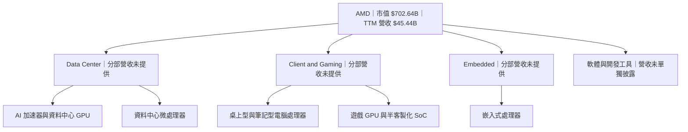
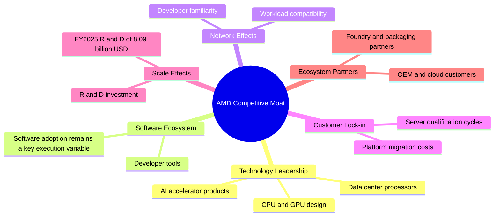
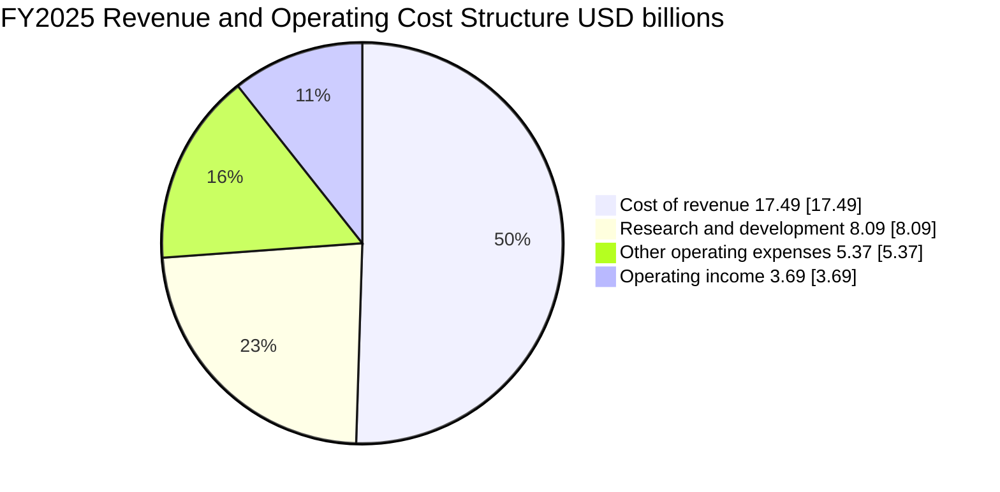
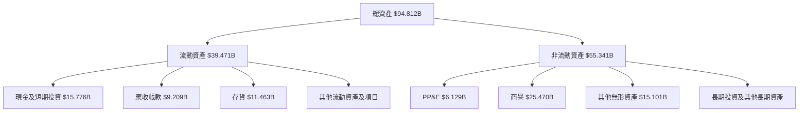
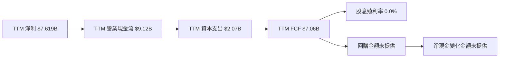
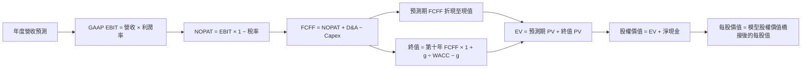
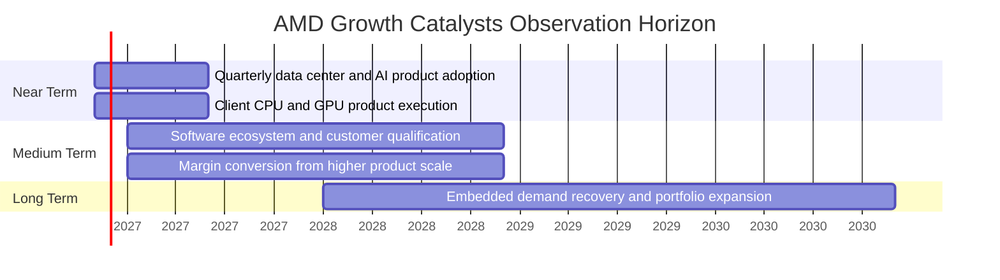
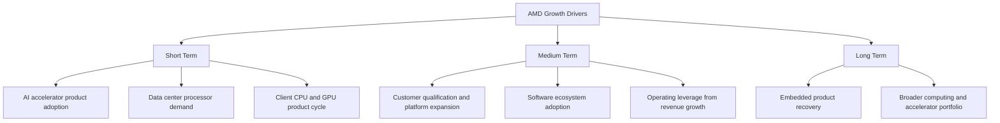
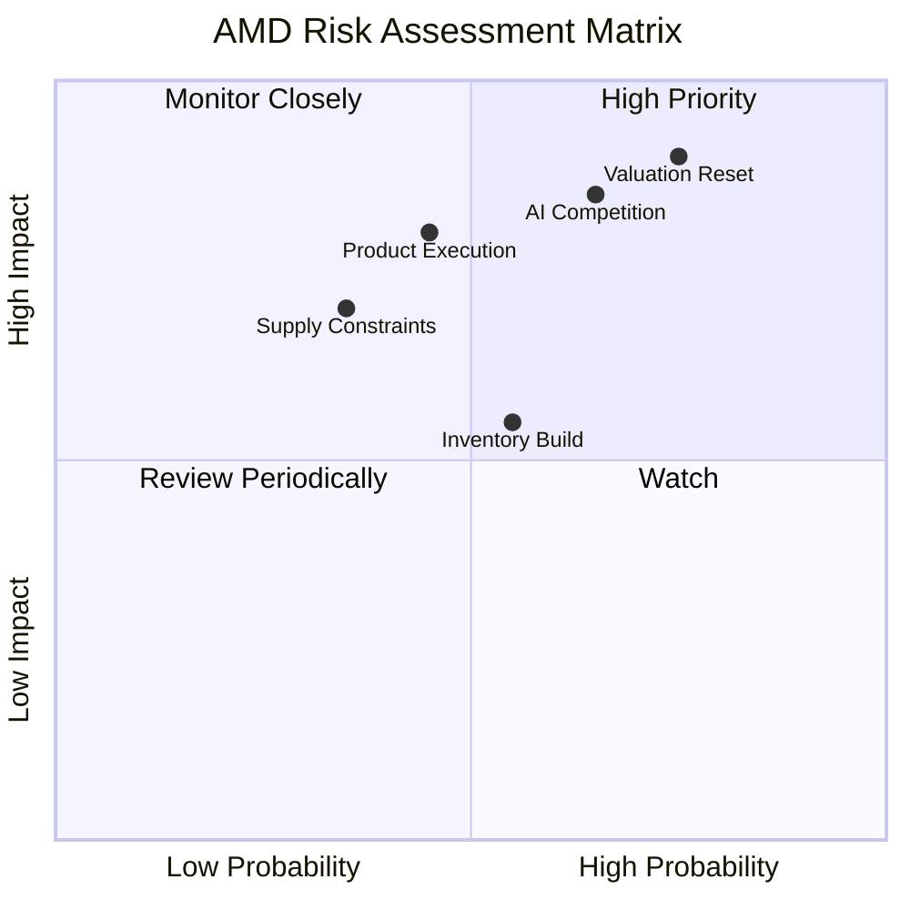
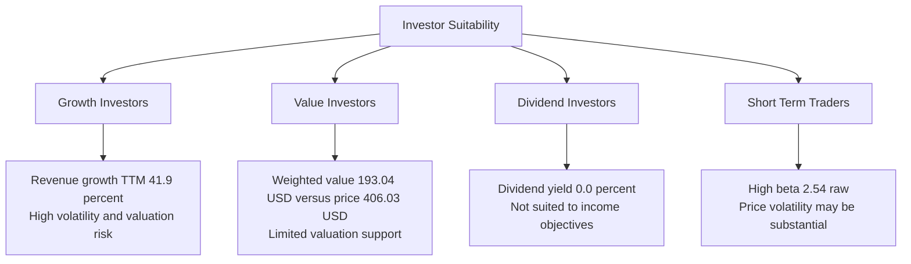

# AMD 基本面深度分析報告
> **報告日期**：2026-11-28 ｜ **語言**：繁體中文 ｜ **數據來源**：SEC 申報資料 (XBRL)、Yahoo Finance、Finviz、StockAnalysis、Roic.ai ｜ **分析師**：CFA 級機構研究

> **數據口徑提醒：**本報告以 2026-11-25 收盤價 **$406.03** 為唯一現價。部分資料源對營業利益率、總債務、季度財報日期及年度毛利數字存在差異；涉及「VERIFIED FIGURES」明列的指標時，優先引用該組數字，其他歷史欄位則標示其來源與口徑。EPS 預期值／實際值資料為缺漏，不能據此判斷近四季超預期或不及預期。

## 目錄

| # | 章節 | 核心結論 |
|---|------|----------|
| 1 | 執行摘要 | 賣出；加權合理價值 $193.04，MOS -110.3% |
| 2 | 公司概覽與商業模式 | 產品與生態系具競爭力，但市場份額及分部收入明細未提供 |
| 3 | 損益表深度分析 | TTM 營收 $45.44B、年增 41.9%；TTM 營業利益率 17.7% |
| 4 | 資產負債表分析 | 淨現金 $8.70B；流動性充足，存貨與應收款仍需追蹤 |
| 5 | 現金流量深度分析 | TTM FCF $7.06B，FCF yield 1.00% |
| 6 | 獲利能力與資本效率 | ROIC 12.8% 低於 WACC 14.0%，目前未覆蓋資本成本 |
| 7 | 相對估值分析 | AMD 估值高於多數同業倍數，自身 P/S 位於五年歷史高百分位 |
| 8 | DCF 內在價值評估 | DCF 基準價值 $72.25；加權合理價值 $193.04 |
| 9 | 成長催化劑 | AI 加速器、資料中心與客戶端產品為主要質化催化劑；TAM 數據未提供 |
| 10 | 風險矩陣 | 估值重定價、AI 競爭及產品執行為主要風險 |
| 11 | 投資建議 | 現價遠高於加權合理價值；等待估值或基本面安全墊改善 |

## 1. 執行摘要

AMD 最新 TTM 營收 **$45.44B**、年增 **41.9%**，最新一季單季營收年增 **44.7%**；TTM FCF 為 **$7.06B**，ROIC 為 **12.8%**。但股價以 2026-11-25 收盤 **$406.03** 計，前瞻 P/E 約 **24.1x**，而程式估值方法給出的加權合理價值為 **$193.04**、MOS 為 **-110.3%**。ROIC 亦低於採用的 WACC **14.0%**。因此，依 MOS 門檻評級為**賣出**；本報告不調整評級。這是估值與資本報酬要求的判斷，不等同於否認公司營收成長或產品競爭力。

### 1.0 一頁式投資儀表板

| 項目 | 內容 |
|------|------|
| **投資論點（3 句）** | ① TTM 營收年增 41.9%、最新一季單季年增 44.7%，成長動能仍高。② TTM FCF $7.06B、淨現金 $8.70B，資產負債表提供研發與投資緩衝。③ 現價 $406.03 對比加權合理價值 $193.04，MOS -110.3%，估值風險壓過基本面成長。 |
| **綜合評分** | **6.6/10**（引用 1.1） |
| **財務健康** | 🟢 現金及短期投資 $15.78B、債務 $7.08B、淨現金 $8.70B；流動比率 2.725 |
| **ROIC vs WACC** | **12.8% vs 14.0%**；差 -1.2 個百分點，尚未覆蓋資本成本 |
| **FCF 趨勢** | TTM FCF $7.06B；FCF yield **1.00%**。最新四季 FCF 仍為正，但季度間波動 |
| **估值** | Forward P/E **24.1x** ｜ EV/EBITDA **61.9x** ｜ FCF Yield **1.00%** |
| **DCF 內在價值（基準）** | **$72.25** ｜ 相對 DCF 基準價值的折溢價 **+462.3%** |
| **安全邊際（MOS）** | **-110.3%**＝($193.04 − $406.03) ÷ $193.04；🔴 <10% |
| **預期報酬（基準情境 12M）** | DCF 基準情境 $72.25，相對現價 **-82.2%**；這是模型價值對比，不是分析師共識報酬預測 |
| **關鍵風險（前二）** | AI 加速器需求與競爭使成長／利潤率不及市場預期；估值倍數回歸 |
| **評級 + 信心度** | 🔴 **賣出** ｜ 信心：中（資料源口徑差異及 DCF 模型限制降低信心） |

### 1.1 綜合評分卡

| 維度 | 評分（1–10） | 主要依據（引用數字與其來源章節） |
|------|--------------|----------------------------------|
| 成長性 | 8.5 | TTM 營收年增 41.9%、最新一季單季年增 44.7%（第 3 章） |
| 獲利能力 | 7.5 | TTM 營業利益率 17.7%、ROIC 12.8%；但低於 WACC 14.0%（第 6 章） |
| 財務健康 | 8.0 | 淨現金 $8.70B、流動比率 2.725、F-Score 7/9（第 4、6 章） |
| 估值 | 1.5 | 加權合理價值 $193.04，MOS -110.3%；P/S 五年百分位 90%（第 7、8 章） |
| 護城河 | 7.5 | CPU、GPU、加速器產品及軟體生態形成差異化，但市場份額量化數據未提供（第 2 章） |
| 管理層與資本配置 | 6.5 | FY2025 SBC $1.64B、稀釋股數測試未通過；研發投入 FY2025 $8.09B（第 3、5 章） |
| **綜合評分** | **6.6** | 六項算術平均：(8.5 + 7.5 + 8.0 + 1.5 + 7.5 + 6.5) ÷ 6 = 6.583，四捨五入至一位小數 |

### 1.2 五大投資論點 + 三大核心風險

| 類型 | 項目 | 具體依據 | 信心度 |
|------|------|----------|--------|
| 🟢 **投資論點①** | 營收增長維持高檔 | TTM 營收 $45.44B，TTM 年增 41.9%；最新一季單季年增 44.7% | 🟢 高 |
| 🟢 **投資論點②** | 資料中心與 AI 具增長選擇權 | 公司產品包含 AI 加速器及資料中心 GPU；相關分部營收未提供，需以後續披露驗證 | 🟡 中 |
| 🟢 **投資論點③** | 現金流轉正且具財務緩衝 | TTM OCF $9.12B、Capex $2.07B、FCF $7.06B | 🟢 高 |
| 🟢 **投資論點④** | 盈利能力有改善跡象 | TTM 營業利益率 17.7%，最新一季口徑值 21.2%；須留意不同資料表口徑差異 | 🟡 中 |
| 🟢 **投資論點⑤** | 現金部位可支持研發 | 現金及短期投資 $15.78B，FY2025 R&D $8.09B | 🟢 高 |
| 🟡 **風險①** | 現價隱含高成長預期 | DCF 基準 $72.25、加權合理價值 $193.04，均低於現價 $406.03 | 🔴 高衝擊 |
| 🔴 **風險②** | AI 晶片競爭與執行 | 同業最新一季營收年增：NVDA 103.2%、AVGO 85.5%，高於 AMD 的 44.7%；定價與產品週期可能改變 | 🔴 高衝擊 |
| 🟡 **風險③** | 營運資金與稀釋 | DIO 由 161 天升至 199 天；F-Score 的稀釋股數測試未通過 | 🟡 中度 |

### 1.3 快速統計卡片

| 指標 | 公司實際值（期間） | 同業中位數 | 狀態 |
|------|--------------------|------------|------|
| 營收成長（TTM） | **41.9%** | — | 🟢 |
| 營收成長（最新一季年增） | **44.7%** | **85.5%** | 🟡 |
| 毛利率（TTM） | **56.0%** | **74.9%** | 🟡 |
| 營業利益率（TTM） | **17.7%** | — | 🟢 |
| ROIC（TTM） | **12.8%** | — | 🟡 |
| Forward P/E | **24.1x** | **16.2x** | 🔴 |
| FCF Yield（TTM） | **1.00%** | — | 🔴 |
| Piotroski F-Score | **7 / 9** | — | 🟢 |

> 同業中位數只依 NVDA、INTC、AVGO 的 Peer multiples 計算；成長率中位數為 85.5%，毛利率中位數為 74.9%，Forward P/E 中位數為 16.2x。

### 1.4 投資結論

╔══════════════════════════════════════════════════════════════════╗  
║　　　　　　　　　📊 投資結論摘要　　　　　　　　　　　　　　║  
╠══════════════════════════════════════════════════════════════════╣  
║ 評級：🔴 賣出（依規則 20，未作質化調整）　　　　　　　　　　║  
║ 價格（2026-11-25 收盤）：$406.03　　　　　　　　　　　　　　║  
║ DCF 內在價值（基準）：$72.25（現價溢價 +462.3%）　　　　　　║  
║ 安全邊際 MOS：-110.3%（以加權合理價值 $193.04 為分母）　　　║  
║ 加權合理價值（8.8）：$193.04　　　　　　　　　　　　　　　　║  
║ DCF 情境價值：悲觀 $38.29（-90.6%）　　　　　　　　　　　　║  
║　　　　　　　基準 $72.25（-82.2%）　　　　　　　　　　　　║  
║　　　　　　　樂觀 $134.95（-66.8%）　　　　　　　　　　　 ║  
║ 綜合評分：6.6/10（引用 1.1）　　　　　　　　　　　　　　　　║  
║ 適合投資人：能承受高波動、且以基本面追蹤為主的成長投資人　　║  
╚══════════════════════════════════════════════════════════════════╝

## 2. 公司概覽與商業模式

### 2.1 業務結構與收入來源

公司資料列出 Data Center、Client and Gaming、Embedded 三個業務板塊，產品包括 CPU、GPU、AI 加速器、半客製化 SoC 與嵌入式處理器。然而各板塊營收及佔比未提供，因此不繪製虛構的分部比例圖。以下只呈現公司業務組成與已知總營收。

### 2.2 市場份額

市場份額的可引用數字及年份未提供，因此不列比例。已知 TTM 營收 $45.44B、年增 41.9%，顯示公司規模與成長均具相當份量；但最新一季營收年增 44.7% 低於同業 NVDA 的 103.2% 及 AVGO 的 85.5%，不能僅以營收成長推定市場份額正在提升。

### 2.3 競爭護城河分析

### 2.4 護城河強度

| 護城河項目 | 強度（強／中／弱） | 證據（引用數字或事實） | 會削弱它的情況 |
|------------|--------------------|------------------------|----------------|
| 技術與產品 | 中至強 | CPU、GPU、AI 加速器與資料中心產品線並存；FY2025 R&D $8.09B | 產品性能、供貨或能效落後競爭者 |
| 軟體生態 | 中 | AI 與 GPU 業務需依賴軟體工具及開發者採用；收入未單獨披露 | 開發者工具成熟度或相容性不足 |
| 客戶鎖定 | 中 | 伺服器與企業運算產品有驗證週期；公司未披露鎖定率 | 主要客戶轉向替代供應商、自研晶片 |
| 規模效應 | 中 | TTM 營收 $45.44B、研發投入規模可支持多產品線 | 研發投入無法轉為有利潤的產品收入 |
| 生態夥伴 | 中 | 商業模式依賴代工、封裝、OEM 與雲端客戶合作 | 供應瓶頸、地緣政治或合作方議價能力上升 |
| 網路效應 | 弱至中 | 開發者與相容性可增強產品黏著，但無量化用戶數據 | 軟體相容性無法持續擴大 |

1.1「護城河」評分為 **7.5/10**，依據是跨產品線、研發投入與生態合作帶來的競爭基礎；市場份額及軟體採用量缺少可量化數據，故未給更高評價。

## 3. 損益表深度分析

### 3.1 年度收入成長趨勢（近 4 年）

年度收入取年度損益表；圖中比例條以 $34.64B 為最大值縮放。

╔══════════════════════════════════════════════════════════════════╗  
║　　　　　　 AMD 年度收入趨勢（FY2022–FY2025）　　　　　　　　║  
╠══════════════════════════════════════════════════════════════════╣  
║ FY2022　$23.60B　██████████████　　　　　　　　 YoY：-3.9% 🟡 ║  
║ FY2023　$22.68B　█████████████　　　　　　　　YoY：-3.9% 🔴 ║  
║ FY2024　$25.79B　███████████████　　　　　　　YoY：+13.7% 🟢║  
║ FY2025　$34.64B　████████████████████　　　　 YoY：+34.3% 🟢║  
║ 2022–2025 CAGR：(34.64 ÷ 23.60)^(1/3) − 1 = **13.6%**　　　　 ║  
╚══════════════════════════════════════════════════════════════════╝

TTM 營收成長 41.9% 高於 FY2025 年增 34.3%，且最新一季單季年增 44.7%。這代表最近年度增長加速，但需後續觀察產品週期與高基期下的延續性，不能直接把單季成長外推為長期趨勢。

### 3.2 季度收入趨勢分析

| 季度 | 營收（$B） | QoQ 成長 | YoY 成長 | 備註 |
|------|-----------:|---------:|---------:|------|
| 2025 Q4 | 10.270 | +11.1% | +34.1% | QoQ 與上一季比較 |
| 2026 Q1 | 10.253 | -0.2% | +37.9% | 季度營收大致持平 |
| 2026 Q2 | 11.536 | +12.5% | +50.1% | 年增率進一步擴大 |
| 2026 Q3 | 13.377 | +16.0% | +44.7% | 單季年增率仍高；YoY 成長較 Q2 放緩 |

QoQ 以相鄰季度收入計算；YoY 使用 StockAnalysis 的單季年增率。2026 Q3 營收較 Q2 增加約 $1.841B，顯示季度營收仍在擴大；但在缺少分部營收拆解時，無法將成長精確歸因於資料中心、客戶端或其他產品。

### 3.3 利潤率演變分析

| 利潤率指標 | FY2022 | FY2023 | FY2024 | FY2025 | 趨勢 | 評估 |
|------------|-------:|-------:|-------:|-------:|------|------|
| **毛利率** | 44.9% | 46.1% | 49.3% | 49.5% | 近年改善 | 🟢 |
| **營業利益率** | 5.3% | 1.8% | 8.1% | 10.7% | FY2023 低點後回升 | 🟢 |
| **淨利率** | 5.6% | 3.8% | 6.4% | 12.5% | FY2025 明顯擴張 | 🟢 |

> 年度比率依年度收入、毛利、營業利益及淨利計算；毛利數字源自年度損益表。另一資料源對 FY2025 毛利有不同呈現，故不將年度毛利率與 TTM 毛利率混為同一序列。

**利潤率演變深度解析：**FY2023 營業利益率降至 1.8%，其後 FY2024 回升至 8.1%、FY2025 升至 10.7%，方向與收入復甦一致。TTM 營業利益率進一步達 17.7%，顯示當期營運槓桿改善；但季度資料的營業利益率有 17.8% 與 21.2% 等不同口徑，本文採用 VERIFIED FIGURES 的 **TTM 17.7%** 與**最新一季 21.2%**，不以不同口徑拼接趨勢。利潤率延續與否取決於產品組合、AI 加速器供貨及研發投入轉化效率，現有資料不能將改善全部歸因於單一因素。

### 3.4 費用結構分析

以下為 FY2025 依年度收入、毛利、營業利益及 R&D 計算的簡化結構：營收 $34.64B，毛利 $17.15B，營業利益 $3.69B，R&D $8.09B；其他營業費用為毛利扣除 R&D 與營業利益後的餘額 $5.37B。此為依年度損益表推算，不等同公司正式費用分類。

╔══════════════════════════════════════════════════════════════════╗  
║ FY2025 費用結構概要（$B）　　　　　　　　　　　　　　　　　　║  
╠══════════════════════════════════════════════════════════════════╣  
║ 營收 $34.64B：成本收入約 $17.49B；毛利 $17.15B　　　　　　　 ║  
║ R&D $8.09B；其他營業費用約 $5.37B；營業利益 $3.69B　　　　　║  
║ R&D / 營收 = 8.09 ÷ 34.64 = **23.4%**　　　　　　　　　　　　║  
╚══════════════════════════════════════════════════════════════════╝

### 3.5 季度 EPS 趨勢與盈餘品質（Quality of Earnings）

近四季 GAAP EPS 數值可由 StockAnalysis 季度資料引用，但 EPS Est 與 EPS Act 欄位在盈餘歷史資料中均為 nan，因此無法判斷是否超預期。

| 季度 | EPS | EPS YoY | 預期／實際比較 |
|------|----:|--------:|----------------|
| 2025 Q4 | $0.92 | +217.1% | N/A，預期值缺漏 |
| 2026 Q1 | $0.84 | +91.2% | N/A，預期值缺漏 |
| 2026 Q2 | $1.39 | +159.5% | N/A，預期值缺漏 |
| 2026 Q3 | $1.48 | +93.8% | N/A，預期值缺漏 |

| 盈餘品質項目 | 數值／佔比 | 評估 |
|--------------|------------|------|
| 股權薪酬 SBC / 營收 | 近四季 SBC 約 $2.00B；約 **4.4%** | 🟡 SBC 不是現金當期支出，但形成股東稀釋成本 |
| SBC / 營業現金流 | 約 **21.9%**（$2.00B ÷ $9.12B） | 🟡 比例不低，須同時觀察股數變化與回購 |
| FCF / 淨利（現金轉換率） | 約 **92.7%**（$7.06B ÷ TTM 淨利 $7.619B） | 🟢 接近 1 倍，現金轉換尚可 |
| 一次性／非經常性損益 | 未提供足以量化的明細 | N/A；不能認定本期盈利受一次性項目美化 |
| 有效稅率異常 | DCF 採用預設稅率 21.0%；實際 TTM 有效稅率 N/A | 🟡 無法確認是否有稅務利益 |
| 資本化支出 vs 費用化 | TTM Capex $2.07B；資本化政策明細未提供 | N/A；無法評估是否有成本遞延 |

**盈餘品質結論：**TTM FCF $7.06B 與 TTM 淨利 $7.619B 相比，現金轉換率約 92.7%，顯示 GAAP 盈利有現金支持；但 SBC 約佔營收 4.4%、佔 OCF 21.9%，會稀釋未來股東持有比例。一次性項目與實際稅率缺少資料，因此估值不應把當期 EPS 全數視為可無折扣延續的經濟盈餘。

## 4. 資產負債表分析

### 4.1 資產結構分解

總資產取 StockAnalysis 2026-09 TTM 資料；可計算流動資產 $39.471B，非流動資產為總資產扣除流動資產。下圖細項採已披露數字，並非所有分類的完整列示。

### 4.2 流動性與營運資金分析

| 指標 | 最新 TTM | 一年前 TTM | 變化 | 解讀 |
|------|----------|------------|------|------|
| DSO 應收帳款天數 | 74 天 | 71 天 | +3 天 | 收款天數略升，應追蹤應收款增速是否高於營收 |
| DIO 存貨天數 | 199 天 | 161 天 | +38 天 | 存貨占用資金增加；若需求或產品組合轉弱，可能提高跌價及周轉風險 |
| DPO 應付帳款天數 | 135 天 | 77 天 | +58 天 | 供應商付款週期拉長，可能改善現金流，但需避免把延付當作長期效率提升 |
| CCC 現金轉換週期 | 138 天 | 155 天 | -17 天 | 雖 DIO 上升，但 DPO 增幅更大，整體 CCC 縮短 |

流動比率 **2.725**、速動比率 **1.725**，短期償債緩衝充足。營運資金的主要警訊是 DIO 升至 199 天，需把存貨增長與未來出貨、需求及產品世代轉換一併核對。

### 4.3 債務結構分析

債務健康診斷採 VERIFIED FIGURES：現金及短期投資 $15.78B、總債務 $7.08B、淨現金 $8.70B。其他行情／財務彙整欄位出現總債務 $9.21B 與淨現金 $6.57B，口徑不一致，本節依指定 VERIFIED FIGURES 值引用。

╔══════════════════════════════════════════════════════════════════╗  
║　　　　　　　　 AMD 債務健康診斷　　　　　　　　　　　　　　║  
╠══════════════════════════════════════════════════════════════════╣  
║ 總債務：　　　　$7.08B　███░░░░░░░░░░░░░░░░░ 評：可管理　　　║  
║ 現金及短投：　 $15.78B　████████████████████ 評：充足　　　　║  
║ 淨現金：　　　 $8.70B　███████████░░░░░░░░░ 🟢　　　　　　　║  
║ 流動比率：　　 2.725x　🟢　　　　　　　　　　　　　　　　　║  
║ Debt/EBITDA：　 N/A（債務與 EBITDA 口徑未一致提供）　　　　 ║  
║ 利息保障倍數： N/A（利息費用未提供）　　　　　　　　　　　　║  
╚══════════════════════════════════════════════════════════════════╝

### 4.4 股東權益趨勢

| 年度 | 股東權益（$B） | YoY 變化 |
|------|---------------:|---------:|
| 2022 | 54.75 | — |
| 2023 | 55.89 | +2.1% |
| 2024 | 57.57 | +3.0% |
| 2025 | 63.00 | +9.4% |

╔══════════════════════════════════════════════════════════════════╗  
║ 股東權益（$B）　　　　　　　　　　　　　　　　　　　　　　　 ║  
╠══════════════════════════════════════════════════════════════════╣  
║ FY2022　$54.75B　█████████████████　　　　　　　　　　　　　║  
║ FY2023　$55.89B　██████████████████　　　　　　　　　　　　 ║  
║ FY2024　$57.57B　██████████████████　　　　　　　　　　　　 ║  
║ FY2025　$63.00B　████████████████████　　　　　　　　　　　 ║  
╚══════════════════════════════════════════════════════════════════╝

## 5. 現金流量深度分析

### 5.1 現金流量瀑布圖

股息殖利率與 payout ratio 均為 0.0%。近四季回購金額及淨現金變化的完整拆分未提供，因此不在瀑布中填入推測數值。

### 5.2 FCF 轉換率趨勢

| 財年 | FCF（$B） | 淨利（$B） | FCF / 淨利 |
|------|----------:|-----------:|-----------:|
| 2022 | 3.12 | 1.32 | 236.4% |
| 2023 | 1.12 | 0.854 | 131.1% |
| 2024 | 2.40 | 1.64 | 146.3% |
| 2025 | 6.74 | 4.33 | 155.7% |
| TTM | 7.06 | 7.619 | 92.7% |

FY2025 的 FCF 高於淨利，TTM 轉換率降至約 92.7%，仍接近 1 倍但低於 FY2025。不同年度的營運資金、付款週期及資本支出可能造成波動；單一年度不宜視為常態。

### 5.3 自由現金流趨勢

歷史 FCF 取現金流量表，TTM FCF 與 yield 取 VERIFIED FIGURES。FY2022–FY2025 年度 FCF yield 未提供，故不補算。

╔══════════════════════════════════════════════════════════════════╗  
║　　　　　　　 自由現金流（歷史實際，$B）　　　　　　　　　　║  
╠══════════════════════════════════════════════════════════════════╣  
║ FY2022　$3.12B　█████████░░░░░░░░░░░　YoY：—　　　　　　　 ║  
║ FY2023　$1.12B　███░░░░░░░░░░░░░░░　YoY：-64.1%　　　　　║  
║ FY2024　$2.40B　███████░░░░░░░░░░░　YoY：+114.3%　　　　 ║  
║ FY2025　$6.74B　████████████████████　YoY：+180.8%　　　　║  
║ TTM　　 $7.06B　FCF Yield：1.00%　　　　　　　　　　　　　 ║  
╚══════════════════════════════════════════════════════════════════╝

### 5.4 資本配置評估

FY2025 研發支出 $8.09B、資本支出 $0.974B、SBC $1.64B；股息殖利率 0.0%。回購金額、收購現金流及其餘完整資本配置金額未提供，因此不製作比例圓餅圖。

| 配置項目 | 已知數據 | 評估 |
|----------|---------|------|
| 研發 | FY2025 $8.09B | 維持產品競爭力的重要投入，但應以後續營收及利潤轉化驗證 |
| 資本支出 | FY2025 約 $0.974B；TTM $2.07B | TTM 高於 FY2025 年度值，可能反映投資強度改變，需觀察回報 |
| 股權薪酬 | FY2025 $1.64B | 對現金流無直接等額支出，但造成股東稀釋 |
| 股息 | 殖利率 0.0% | 公司不以現金股息作主要回饋 |
| 回購／併購 | 金額未提供 | N/A，無法定量評估 |

## 6. 獲利能力與資本效率

### 6.1 ROE / ROA / ROIC 趨勢

| 指標 | FY2022 | FY2023 | FY2024 | FY2025／TTM | 評估 |
|------|-------:|-------:|-------:|------------:|------|
| ROE | N/A | N/A | N/A | TTM 11.1%（品質指標）；另有彙整值 12.0% | 口徑有差異，採品質指標 11.1% |
| ROA | N/A | N/A | N/A | TTM 5.9% | 正值；歷史同口徑序列未提供 |
| ROIC | N/A | N/A | N/A | TTM 12.8% | 低於 WACC 14.0% |
| 行業均值對比 | — | — | — | 未提供 | 不填入無來源的均值 |

### 6.2 ROIC vs WACC 分析（核心價值創造判斷）

╔══════════════════════════════════════════════════════════════════╗  
║　　　　　　 ROIC vs WACC 深度分析　　　　　　　　　　　　　　║  
╠══════════════════════════════════════════════════════════════════╣  
║ WACC 輸入（成本資本資料）：　　　　　　　　　　　　　　　　 ║  
║ ├─ 無風險利率：4.94%　　　　　　　　　　　　　　　　　　　　║  
║ ├─ ERP：5.00%　　　　　　　　　　　　　　　　　　　　　　　║  
║ ├─ 原始 Beta：2.54；採調整 Beta：2.00　　　　　　　　　　　　║  
║ ├─ 股權成本 Ke：14.94%　　　　　　　　　　　　　　　　　　 ║  
║ ├─ 稅前債務成本：1.85%；稅後約 1.46%　　　　　　　　　　　 ║  
║ ├─ 股權／債務權重：99.0%／1.0%　　　　　　　　　　　　　　║  
║ └─ WACC 計算值 14.80%，區間上限限制後採用 **14.00%**　　　　║  
║　　　　　　　　　　　　　　　　　　　　　　　　　　　　　　║  
║ ROIC（TTM）：12.8%　　　　　　　　　　　　　　　　　　　　 ║  
║ EVA 利差 = ROIC − WACC = 12.8% − 14.0% = **-1.2pp**　　　　 ║  
║　　　　　　　　　　　　　　　　　　　　　　　　　　　　　　║  
║ ROIC　12.8%　▓▓▓▓▓▓▓▓▓▓▓▓▓▓▓▓▓▓▓░░░░░░░　🟡　　　　　　　║  
║ WACC　14.0%　▓▓▓▓▓▓▓▓▓▓▓▓▓▓▓▓▓▓▓▓▓░░░░░　基準　　　　　　║  
║　　　　　　　　　　　　　　　　　　　　　　　　　　　　　　║  
║ 結論：目前 ROIC/WACC = 12.8 ÷ 14.0 = **0.91x**；未覆蓋資本成本║  
╚══════════════════════════════════════════════════════════════════╝

WACC 以程式採用值 **14.00%** 為準，與 DCF 及 ROIC 比較一致。原始 Beta 2.54 經調整後為 2.00；資料明示 CAPM 股權成本為 14.94%，債務成本 1.85%，稅率 21.0%，市值權重 99.0%、債務權重 1.0%。未提供特定日期的美債殖利率觀測紀錄與利息費用明細，故此處不自行重建另一套 WACC。

### 6.3 杜邦三因素分解

| 因素 | 數值（TTM） | 解讀 |
|------|-------------|------|
| 淨利率 | 16.8% | 盈利能力對 ROE 的主要正向來源 |
| 資產週轉率 | 0.48 | 資產每年周轉約 0.48 次 |
| 權益乘數 | 1.39 | 槓桿幅度有限，ROE 並非主要靠高財務槓桿 |
| **ROE** | **11.1%** | 16.8% × 0.48 × 1.39 = 11.1%（四捨五入） |

### 6.4 財務體質：Piotroski F-Score

**Piotroski F-Score：7 / 9。**有缺漏輸入的測試會被排除；此處提供的九項測試均有判定。

| 測試 | 結果 | 解讀 |
|------|------|------|
| ROA > 0 | ✅ 通過 | TTM ROA 為正 |
| 營業現金流 > 0 | ✅ 通過 | TTM OCF $9.12B |
| ROA 高於一年前 | ✅ 通過 | 獲利資產效率改善 |
| 營業現金流 > 淨利 | ✅ 通過 | 現金流高於應計淨利 |
| 長期負債 ÷ 總資產低於一年前 | ❌ 未通過 | 槓桿相關指標未改善 |
| 流動比率高於一年前 | ✅ 通過 | 短期流動性提升 |
| 稀釋股數未增加 | ❌ 未通過 | 股數稀釋是股東報酬監控項 |
| 毛利率高於一年前 | ✅ 通過 | 毛利率指標改善 |
| 資產週轉率高於一年前 | ✅ 通過 | 資產使用效率改善 |

## 7. 相對估值分析

### 7.1 同業估值比較表格

AMD 公司估值採市場資料彙整欄位；同業倍數照 Peer multiples 引用。資料來源的 AMD TTM P/E 在歷史估值區塊為 88.3x，在另一估值欄位為 90.7x；本表採後者，歷史比較則使用前者。

| 估值指標 | **AMD** | **NVDA** | **INTC** | **AVGO** | AMD 評估 |
|----------|--------:|--------:|--------:|--------:|----------|
| **Trailing P/E** | 90.7x | 16.2x | N/A | 39.9x | 🔴 高；但同業來源倍數需按各公司盈利口徑解讀 |
| **Forward P/E** | 24.1x | 9.1x | 32.1x | 16.2x | 🟡 高於同業中位數 16.2x |
| **P/S Ratio** | 15.46x | 10.0x | 5.1x | 16.7x | 🔴 相對營收估值偏高於兩家同業 |
| **EV/EBITDA** | 61.9x | 14.7x | 16.6x | 29.2x | 🔴 明顯高於三家同業 |
| **最新一季營收年增** | 44.7% | 103.2% | 20.9% | 85.5% | 🟡 AMD 成長高於 INTC，但低於 NVDA、AVGO |
| **毛利率（TTM）** | 56.0% | 74.9% | 40.2% | 75.5% | 🟡 高於 INTC，低於 NVDA、AVGO |

同業估值不能脫離獲利成長與商業模式比較；但 AMD 的 EV/EBITDA 61.9x 高於三家同業資料，且 FCF yield 僅 1.00%，現價對未來執行要求高。

### 7.2 歷史估值區間分析

╔══════════════════════════════════════════════════════════════════╗  
║ AMD 五年 TTM P/E 區間　　　　　　　　　　　　　　　　　　　　║  
╠══════════════════════════════════════════════════════════════════╣  
║ 區間低點：36.7x　｜中位數：82.6x　｜目前：88.3x　　　　　　 ║  
║ 區間高點：934.7x｜目前百分位：53%　　　　　　　　　　　　　║  
║ P/S：目前 14.8x｜中位數 8.9x｜目前百分位 90%　　　　　　　 ║  
║ EV/EBITDA：目前 82.7x｜中位數 102.2x｜目前百分位 39%　　　║  
╚══════════════════════════════════════════════════════════════════╝

P/E 當前位於歷史區間約 53 百分位，但 P/S 位於 90 百分位，顯示按營收衡量的市場定價接近歷史偏高區。EV/EBITDA 百分位較低，需留意其歷史範圍受極端數值影響，不宜單獨作估值結論。

### 7.3 情境價值（Bear / Base / Bull，照抄 DCF MODEL 的 Scenarios）

| 情境 | 第 1 年營收成長 | 期末營業利潤率 | WACC | 每股價值 | 相對現價 | 機率 | 會發生的條件 |
|------|----------------:|----------------:|-----:|----------:|----------:|-----:|--------------|
| 🔴 悲觀 | 15.0% | 6.3% | 15.00% | $38.29 | -90.6% | 25% | AI 產品放量低於預期、競爭導致利潤率收縮、資本成本偏高 |
| 🟡 基準 | 30.0% | 7.4% | 14.00% | $72.25 | -82.2% | 50% | 成長按模型逐步降至成熟期，GAAP 利潤率回落至長期假設 |
| 🟢 樂觀 | 45.0% | 8.1% | 13.00% | $134.95 | -66.8% | 25% | AI／資料中心產品增長加速，期末利潤率高於基準且折現率下降 |

程式模型的機率加權情境價值為 **$79.44**（相對現價 -80.4%），僅作情境參考；第 8.8 節估值權重使用 DCF 基準價值，不以機率加權值替代。

### 7.4 相對估值隱含價格區間

╔══════════════════════════════════════════════════════════════════╗  
║ 相對估值方法每股價值　　　　　　　　　　　　　　　　　　　　 ║  
╠══════════════════════════════════════════════════════════════════╣  
║ 同業 Forward P/E：$285.06　（現價 $406.03 高於估值）　　　　 ║  
║ 同業 EV/EBITDA： $111.53　（現價 $406.03 高於估值）　　　　 ║  
║ 分析師共識目標價：$649.89（49 位分析師平均）　　　　　　　　║  
║ 參考區間：$111.53 ───── $285.06 ───── 現價 $406.03 ── $649.89║  
╚══════════════════════════════════════════════════════════════════╝

Forward P/E 方法採同業中位數 **16.2x × AMD Forward EPS $17.64 = $285.06**。EV/EBITDA 方法採同業中位數 **16.6x** 乘 TTM EBITDA 並加回淨現金，估值為 $111.53。這些方法用同業中位數倍數，不用 AMD 自身現行倍數。

## 8. DCF 內在價值評估（Discounted Cash Flow）

### 8.0 估值推理鏈（Thinking Logic）

**Step 1 — 價值來源與主導變數：**AMD 的價值由目前 $45.44B TTM 營收基礎、AI／資料中心等後續產品成長，以及最終能否維持 GAAP 營業利潤率共同決定。因分部收入佔比未提供，不能把某一產品線的營收權重臆測出來。模型的關鍵主導變數是營收成長與 GAAP 利潤率；敏感度矩陣另直接顯示 WACC 與終值成長率對每股價值的影響。

**Step 2 — 模型選擇**

| 決策點 | 本報告採用 | 理由（含數字） | 曾考慮但否決 | 否決理由 |
|--------|-----------|----------------|--------------|----------|
| 現金流定義 | FCFF | 以 WACC 折現並估算 EV；TTM OCF $9.12B、Capex $2.07B | FCFE | 模型既定為企業現金流與企業價值框架 |
| 預測期 N | 10 年 | 模型固定 10 年，收入增長從 30.0% 線性降至 3.0% | 5 年 | 會改變模型既定逐年預測與終值起算年 |
| 終值方法 | Gordon Growth | 模型設定永續成長 3.0%，WACC 14.0% | 退出倍數作主方法 | DCF MODEL 未提供退出倍數，不自行建模 |
| EBIT 基礎 | GAAP EBIT | 模型明列 GAAP EBIT；TTM 營業利益率 17.7% | 非 GAAP EBIT | 會加回 SBC，與模型定義不同 |

**Step 3 — 關鍵假設推導鏈**

- **預測期 N：**錨點＝模型設為 10 年 → 調整理由＝10 年涵蓋從高速成長到成熟期的逐步收斂 → **採用 10 年** → 曾考慮 5 年，但會改變既定的預測期現金流與終值年份，因此不採用。
- **營收增長：**錨點＝TTM 年增 41.9%、最新一季單季年增 44.7% → 調整＝不把高增長永久外推，第一年模型限至 30.0%，逐年線性降至第十年 3.0% → **採用 FY+1 30.0%、FY+10 3.0%** → 曾考慮以 TTM 41.9% 作首年，模型依據的增長上限為 30.0%，故未採用。
- **期末營業利潤率：**錨點＝TTM GAAP 營業利益率 17.7%；模型以過去五個財年中位數作成熟期基準 → 調整＝模型令利潤率從 17.7% 逐步收斂 → **採用 FY+10 7.4%** → 曾考慮維持 17.7%，但這忽略模型設定的歷史中位數回歸假設。
- **永續成長率 g：**錨點＝模型採 3.0%，屬長期成熟成長假設 → 調整＝維持低於 WACC 的條件 → **採用 3.0%** → 不採用等於或高於 WACC 的數值，因 Gordon Growth 分母會失效。
- **Capex／營收：**錨點＝TTM Capex／營收約 2.07 ÷ 45.44 = 4.6% → 調整＝模型以 4.5% 固定，約等於 TTM 水準 → **採用 FY+1 至 FY+10 4.5%** → 未採用更低的 1.1×D&A 對應比例，因模型採用值以 TTM 比率為基礎。
- **EBIT 基礎、SBC 與年稀釋率：**錨點＝模型明列 GAAP EBIT，且聲明採「GAAP EBIT、SBC 已計入費用、股數不再稀釋」 → **採用組合 (A)**，不另扣 SBC、股數假定固定 → 不採用非 GAAP 加回 SBC 或再擴大股數，避免改變指定模型口徑。
- **WACC：**錨點＝資本成本資料計算 14.80%，並明示限制在 7%–14% 區間 → **採用 14.00%** → 不採用未封頂 14.80%，因模型指定採用上限值。
- **有效稅率、D&A／營收：**錨點及採用值分別為 21.0%、6.7%，均依 DCF MODEL 的假設；不自行替換。
- **ΔWC：**DCF MODEL 明列「Working capital is not modelled」，因此不設 ΔWC 預測列；這是模型簡化，不代表營運資金實際變化為零。
- **終值方法：**錨點＝DCF MODEL 以 Gordon Growth 計算終值；**採用 Gordon Growth**。退出倍數因缺少模型輸入而不自建交叉驗證。

**Step 4 — 最脆弱的一環：**十年後 GAAP 利潤率降至 7.4% 與 14.0% WACC 共同壓低終值及每股價值；若實際增長或利潤率不同，估值會依敏感性矩陣大幅改變。

**Step 5 — 計算路徑圖**

### 8.1 模型假設總表（Model Inputs）

| 假設項目 | 採用值 | 依據／來源 | 敏感度 |
|----------|--------|-------------|--------|
| 預測期長度 N | 10 年 | DCF MODEL；增長由 30.0% 線性降至 3.0% | 🟡 中 |
| 營收增長 | FY+1 30.0% → FY+10 3.0% | TTM 增長 41.9%，模型首年受 30% 上限限制 | 🔴 高 |
| 營業利潤率 | FY+1 17.7% → FY+10 7.4% | TTM 17.7%，成熟期回歸近五年中位數 | 🔴 高 |
| 有效稅率 | 21.0% | DCF MODEL 預設稅率 | 🟢 低 |
| Capex／營收 | 4.5% | 模型值；TTM 2.07 ÷ 45.44 約 4.6% | 🟡 中 |
| D&A／營收 | 6.7% | DCF MODEL 的 TTM 比率 | 🟢 低 |
| 營運資金變動 | 未建模 | DCF MODEL 明確不建模 working capital | 🔴 高 |
| EBIT 基礎 | GAAP | 模型採 GAAP EBIT | 🟡 中 |
| SBC 處理 | GAAP EBIT 已含 SBC，不另扣 | DCF MODEL 明列 SBC 處理方式 | 🟡 中 |
| 年稀釋率 | 0%／股數不再稀釋 | DCF MODEL 組合 (A) 假設 | 🟡 中 |
| 永續成長率 g | 3.0% | DCF MODEL 假設；低於 WACC 14.0% | 🔴 高 |
| 終值方法 | Gordon Growth | DCF MODEL 唯一給出的終值方式 | 🔴 高 |
| WACC | 14.00% | 計算值 14.80%，受 7%–14% 上限限制 | 🔴 高 |

**FCFF 定義：**FCFF = NOPAT + D&A − Capex；working capital 不建模，故模型中沒有 ΔWC 項。  
**SBC 防呆說明：**本模型採用 **(A) GAAP EBIT + 固定股數**，故 SBC 影響已計入一次；FCFF 不再減 SBC，股數亦不另按年稀釋。

### 8.2 折現率推導（WACC）

╔══════════════════════════════════════════════════════════════════╗  
║　　　　　　　　　WACC 推導（折現率）　　　　　　　　　　　　║  
╠══════════════════════════════════════════════════════════════════╣  
║ 股權成本 Ke：　　　　　　　　　　　　　　　　　　　　　　　 ║  
║ ├─ 無風險利率 Rf：4.94%　　　　　　　　　　　　　　　　　　║  
║ ├─ ERP：5.00%　　　　　　　　　　　　　　　　　　　　　　　║  
║ ├─ 原始 Beta：2.54；調整 Beta：2.00　　　　　　　　　　　　║  
║ └─ Ke = 4.94% + 2.00 × 5.00% = 14.94%　　　　　　　　　　　║  
║　　　　　　　　　　　　　　　　　　　　　　　　　　　　　　║  
║ 債務成本：　　　　　　　　　　　　　　　　　　　　　　　　　║  
║ ├─ 稅前 Kd：1.85%　　　　　　　　　　　　　　　　　　　　　║  
║ ├─ 稅率：21.0%　　　　　　　　　　　　　　　　　　　　　　║  
║ └─ 稅後 Kd = 1.85% × (1 − 21.0%) = 1.4615%　　　　　　　　║  
║　　　　　　　　　　　　　　　　　　　　　　　　　　　　　　║  
║ 權重：股權 99.0%；債務 1.0%　　　　　　　　　　　　　　　　║  
║ 計算 WACC = 99.0% × 14.94% + 1.0% × 1.4615%　　　　　　　 ║  
║　　　　　　 = 14.7906% + 0.014615% = 14.805215%　　　　　　║  
║ 程式計算值 14.80%；依上限 14.00% 採用 **14.00%**　　　　　　║  
╚══════════════════════════════════════════════════════════════════╝

**逐步演算（WACC）：**

1. **Ke（CAPM）** = Rf + β × ERP = 4.94% + 2.00 × 5.00% = **14.94%**。
2. **稅前 Kd** = 資本成本資料提供 **1.85%**；利息費用及平均計息負債明細未提供，故不自行重建其分子、分母。
3. **稅後 Kd** = 1.85% × (1 − 21.0%) = **1.4615%**。
4. **權重** = 股權 **99.0%**、債務 **1.0%**，合計 100%；市場市值與可比口徑計息債務的逐項推導未提供，本節採資本成本資料既定權重。
5. **未封頂 WACC** = 99.0% × 14.94% + 1.0% × 1.4615% = **14.805215%**；四捨五入為 14.80%，模型受 14.00% 上限限制，採 **14.00%**。

Beta 調整依資料所列規則：原始 Beta 2.54，計算約 ⅔ × 2.54 + ⅓ = 2.027，並限制於 0.6–2.0 區間，採用 **2.00**。DCF 與第 6.2 節均使用 14.00%。由於利息費用與平均計息負債分項未提供，WACC 五步中 Kd 的原始財務推導不能獨立複算；此為模型稽核限制。

### 8.3 逐年自由現金流預測（基準情境）

金額單位 $B；折現因子按模型值保留三位小數。以下逐年資料照 DCF MODEL 列示，working capital 不建模，因此沒有 ΔWC 列。

| 年度 | FY+1 | FY+2 | FY+3 | FY+4 | FY+5 | FY+6 | FY+7 | FY+8 | FY+9 | FY+10 |
|------|-----:|-----:|-----:|-----:|-----:|-----:|-----:|-----:|-----:|------:|
| 營收 | 59.07 | 75.01 | 93.02 | 112.55 | 132.81 | 152.73 | 171.06 | 186.46 | 197.64 | 203.57 |
| 營收 YoY | 30.0% | 27.0% | 24.0% | 21.0% | 18.0% | 15.0% | 12.0% | 9.0% | 6.0% | 3.0% |
| 營業利潤率 | 17.7% | 16.6% | 15.4% | 14.3% | 13.1% | 12.0% | 10.8% | 9.7% | 8.5% | 7.4% |
| EBIT（GAAP） | 10.46 | 12.43 | 14.34 | 16.06 | 17.42 | 18.28 | 18.51 | 18.03 | 16.84 | 15.00 |
| − 稅 | (2.20) | (2.61) | (3.01) | (3.37) | (3.66) | (3.84) | (3.89) | (3.79) | (3.54) | (3.15) |
| = NOPAT | 8.27 | 9.82 | 11.33 | 12.69 | 13.76 | 14.44 | 14.62 | 14.24 | 13.30 | 11.85 |
| + D&A | 3.96 | 5.03 | 6.24 | 7.55 | 8.90 | 10.24 | 11.47 | 12.50 | 13.25 | 13.65 |
| − Capex | (2.69) | (3.41) | (4.23) | (5.12) | (6.04) | (6.95) | (7.78) | (8.48) | (8.99) | (9.26) |
| = FCFF | 9.54 | 11.43 | 13.33 | 15.11 | 16.63 | 17.73 | 18.31 | 18.26 | 17.56 | 16.24 |
| 折現因子 @14.00% | 0.877 | 0.769 | 0.675 | 0.592 | 0.519 | 0.456 | 0.400 | 0.351 | 0.308 | 0.270 |
| FCFF 現值 PV | 8.37 | 8.80 | 9.00 | 8.95 | 8.63 | 8.08 | 7.32 | 6.40 | 5.40 | 4.38 |

**預測期 FCF 現值合計：**  
$8.37 + $8.80 + $9.00 + $8.95 + $8.63 + $8.08 + $7.32 + $6.40 + $5.40 + $4.38 = **$75.33B**；模型列示合計 **$75.32B**，差額 $0.01B，屬逐年四捨五入造成的尾差。

**逐步演算（FY+1，按模型列值）：**

1. 營收 = $45.44B × (1 + 30.0%) = **$59.072B**，模型列示 $59.07B。
2. EBIT = $59.07B × 17.7% = **$10.45539B**，模型列示 $10.46B。
3. 稅 = 模型列示 EBIT $10.46B × 21.0% = **$2.1966B**，列示 $2.20B。
4. NOPAT = 模型列示 EBIT $10.46B − 模型列示稅 $2.20B = **$8.26B**；DCF MODEL 列示 NOPAT **$8.27B**，其細項可能使用未四捨五入值。
5. D&A = $59.07B × 6.7% = **$3.95769B**，列示 $3.96B。
6. Capex = $59.07B × 4.5% = **$2.65815B**；DCF MODEL 列示 **$2.69B**，與直接以已列營收乘 4.5% 的結果有差異。
7. ΔWC = **未建模**，不設數值。
8. FCFF = 模型列示 NOPAT $8.27B + D&A $3.96B − Capex $2.69B = **$9.54B**，與表列相符。
9. 折現因子 = 1 ÷ (1 + 14.00%)¹ = **0.877193…**；$9.54B × 0.877193… = **$8.37B**。

> **合理性自檢**
> - 預測期 FCF CAGR：以 FY+1 $9.54B 至 FY+10 $16.24B，(16.24 ÷ 9.54)^(1/9) − 1 約 **6.1%**；歷史 FY2022 至 FY2025 FCF CAGR = (6.74 ÷ 3.12)^(1/3) − 1 約 **29.3%**，預測顯著低於歷史，反映模型假設成長收斂。
> - FY+10 FCFF 利潤率 = $16.24B ÷ $203.57B = **8.0%**；目前 TTM FCF 利潤率 = $7.06B ÷ $45.44B = **15.5%**。同業最佳 FCF 利潤率未提供，不能宣稱模型超越或低於同業最佳。
> - 模型十個年度 FCFF 均為正值；但 working capital 未建模，若營收擴張需要大量營運資金，模型可能高估 FCFF。

╔══════════════════════════════════════════════════════════════════╗  
║　　　　　 自由現金流：歷史實際 vs 模型預測（$B）　　　　　　　║  
╠══════════════════════════════════════════════════════════════════╣  
║ FY2023 實際　$1.12B　███░░░░░░░░░░░░░░░░░　YoY：-64.1%　　 ║  
║ FY2024 實際　$2.40B　███████░░░░░░░░░░░░░　YoY：+114.3%　　║  
║ FY2025 實際　$6.74B　█████████████░░░░░░░　YoY：+180.8%　　║  
║ FY+1 預測　　$9.54B　██████████████████░░　模型值　　　　　║  
║ FY+10 預測　$16.24B　████████████████████　模型值　　　　　║  
╠══════════════════════════════════════════════════════════════════╣  
║ 模型預測 FY+1 至 FY+10 FCF CAGR 約 6.1%，低於 FY2022–FY2025 約29.3%║  
╚══════════════════════════════════════════════════════════════════╝

### 8.4 終值計算（Terminal Value）

**適用性檢查：WACC 14.00% vs g 3.00% → WACC > g？✅**

| 方法 | 計算式 | 終值 TV | TV 現值 | 佔總 EV 比重 |
|------|--------|---------|---------|--------------|
| Gordon Growth | 16.24 × (1 + 3.0%) ÷ (14.00% − 3.0%) | $152.04B | $41.01B | 35.3% |
| 退出倍數法 | N/A（DCF MODEL 未提供終值 EBITDA 退出倍數） | N/A | N/A | N/A |

**逐步演算（Gordon Growth）：**

1. FY+N FCFF = **$16.24B**。
2. 分子 = $16.24B × (1 + 3.0%) = **$16.7272B**。
3. 分母 = 14.00% − 3.00% = **11.00%**；TV = $16.7272B ÷ 11.00% = **$152.065B**，模型列示 **$152.04B**。
4. PV(TV) = 模型列示 $152.04B × 第十年折現因子 0.270 = **約 $41.05B**；模型列示 **$41.01B**，顯示其使用未列出的精確折現因子或未四捨五入現金流。
5. 終值佔比 = $41.01B ÷ $116.33B = **35.3%**。

模型列示終值現值佔 EV 35.3%，並非超過 75% 的高度終值依賴，但仍對長期假設敏感。退出倍數所需的 FY+10 EBITDA 與倍數未在 DCF MODEL 提供，故不自行估算。

### 8.5 企業價值 → 每股內在價值（Bridge）

╔══════════════════════════════════════════════════════════════════╗  
║　　　　　企業價值 → 每股內在價值 橋接表　　　　　　　　　　　║  
╠══════════════════════════════════════════════════════════════════╣  
║ 預測期 FCF 現值合計　　　　　　+$75.32B　　　　　　　　　　　║  
║ 終值現值 PV(TV)　　　　　　　 +$41.01B　　　　　　　　　　　║  
║ = 企業價值 EV　　　　　　　　 $116.33B　　　　　　　　　　 ║  
║ + 淨現金　　　　　　　　　　　+$8.70B　　　　　　　　　　　║  
║ = 股權價值　　　　　　　　　　$125.03B　　　　　　　　　　 ║  
║ 每股內在價值（模型列示）　　　 $72.25　　　　　　　　　　　 ║  
║ 當前股價（2026-11-25）　　　　 $406.03　　　　　　　　　　　║  
║ 折溢價：現價 ÷ DCF 價值 − 1　　 +462.3%（溢價）　　　　　　 ║  
╚══════════════════════════════════════════════════════════════════╝

**逐步演算（橋接）：**

1. EV = $75.32B + $41.01B = **$116.33B**。
2. 股權價值 = $116.33B + $8.70B = **$125.03B**。
3. DCF MODEL 明列每股換算為「股權價值 × 價格 ÷ 市值」，並列示 **$72.25**。市場資料另列市值 $702.64B、流通股數 1.66B；但 $125.03B ÷ 1.66B 約為 $75.32，與模型 $72.25 不一致，因此本報告依規則引用模型每股值，並將股數／每股橋接列為模型稽核限制。
4. 折溢價 = $406.03 ÷ $72.25 − 1 = **+462.3%**。
5. **本節不計算 MOS**；MOS 只在 8.8 以加權合理價值為分母。

現金及債務採 VERIFIED FIGURES 的淨現金 $8.70B；模型未提供少數股東權益扣項。DCF 的每股換算公式與市值、股數之間有口徑差異，不能當作已完全獨立複算的股數橋接。

### 8.6 敏感性分析（WACC × 永續成長率）

下表每股價值照 DCF MODEL。括號為相對現價 $406.03 的上行空間。

| g（列）／WACC（欄） | 12.00% | 13.00% | **14.00%（基準）** | 15.00% | 16.00% |
|-----------|------:|------:|------------------:|------:|------:|
| **2.0%** | $83.43 (-79.5%) | $76.15 (-81.2%) | $70.06 (-82.7%) | $64.91 (-84.0%) | $60.48 (-85.1%) |
| **2.5%** | $85.21 (-79.0%) | $77.50 (-80.9%) | $71.11 (-82.5%) | $65.73 (-83.8%) | $61.13 (-84.9%) |
| **3.0%（基準）** | $87.19 (-78.5%) | $78.99 (-80.5%) | **$72.25 (-82.2%)** | $66.62 (-83.6%) | $61.83 (-84.8%) |
| **3.5%** | $89.40 (-78.0%) | $80.63 (-80.1%) | $73.50 (-81.9%) | $67.58 (-83.4%) | $62.59 (-84.6%) |
| **4.0%** | $91.89 (-77.4%) | $82.46 (-79.7%) | $74.87 (-81.6%) | $68.64 (-83.1%) | $63.42 (-84.4%) |

**逐步演算（選格：WACC 13.00% > g 2.5% ✅）：**DCF MODEL 敏感度矩陣列示該格每股價值 **$77.50**。該格的新預測期 PV、重新計算的終值 PV、淨現金橋接中間值並未另列，且模型規則要求矩陣數值照抄；因此不能假裝提供完整中間算式。以矩陣讀值可複查結果，但無法只憑已列輸出逐項重建該格。

**三情境 DCF：**情境每股價值、假設與機率照模型列示；模型未提供各情境的 FY+10 營收、FCFF 與 TV 中間值，故不補造推導鏈。

| 情境 | 年 1 增長 | 期末營業利潤率 | g | WACC | 每股價值 | 相對現價 | 機率 |
|------|---------:|---------------:|---:|-----:|---------:|---------:|-----:|
| 🔴 悲觀 | 15.0% | 6.3% | 未另列 | 15.00% | $38.29 | -90.6% | 25% |
| 🟡 基準 | 30.0% | 7.4% | 3.0% | 14.00% | $72.25 | -82.2% | 50% |
| 🟢 樂觀 | 45.0% | 8.1% | 未另列 | 13.00% | $134.95 | -66.8% | 25% |
| **機率加權** | — | — | — | — | **$79.44** | **-80.4%** | **100%** |

情境價值加權算式 = $38.29 × 25% + $72.25 × 50% + $134.95 × 25% = **$79.435 ≈ $79.44**。

**敏感度結論（依矩陣）：**

- g 由 2.0% 升至 3.0%、WACC 固定 14.0%：$70.06 → $72.25，增加 **$2.19**，約 **3.1%**。
- WACC 由 13.0% 升至 14.0%、g 固定 3.0%：$78.99 → $72.25，減少 **$6.74**，約 **8.5%**。
- 期末營業利潤率每 +1pp：DCF MODEL 未提供該變數的單獨敏感度，**N/A**，不能用其他情境差額冒充單變量效應。
- 在已提供的矩陣中，WACC 變動 1pp 的影響高於 g 變動 1pp；對估值的關鍵影響仍需與營收、利潤率假設共同評估。

### 8.7 反推 DCF（Reverse DCF：市場在預期什麼）

固定基準值為 WACC 14.00%、稅率 21.0%、Capex／營收依模型逐年假設、ΔWC 不建模、預測期 10 年；股數／模型每股換算依 DCF MODEL 口徑。以下只引用模型提供的單變數反推結果，其他變數未計算。

| 求解的變數（一次一個） | 其餘變數設定 | 市場隱含值（令 DCF = 現價） | 公司歷史實際 | 判斷 |
|------------------------|--------------|------------------------------|--------------|------|
| 年 1 營收成長率 | 其餘採基準值 | **89.1%** | TTM 營收年增 41.9% | 🔴 顯著高於近期增長 |
| 固定營業利潤率 | 其餘採基準值 | **74.3%** | TTM 營業利益率 17.7% | 🔴 遠高於目前 |
| 永續成長率 g | 未提供反推 | 未計算 | — | N/A |
| 預測期長度 N | 未提供反推 | 未計算 | — | N/A |

模型提供的 Reverse DCF 兩個解是「一次只解一個變數」，但未提供迭代試算軌跡或中間收入、FCFF 及股價序列，因此無法忠實展示逐步收斂表。反推結果所示，要令基準模型支持現價，單獨放開營收增長需達 89.1%，或固定營業利潤率需達 74.3%；兩者均遠高於目前 TTM 指標，暗示市場價格高度依賴模型之外的成長選擇權或更高估值倍數。

### 8.8 估值三角驗證與安全邊際

| 估值方法 | 隱含每股價值 | 上行空間（÷現價） | 權重 | 說明 |
|----------|--------------:|-------------------:|-----:|------|
| DCF（基準） | $72.25 | -82.2% | 40% | 10 年 FCFF、WACC 14.00%、g 3.0% |
| 同業 Forward P/E | $285.06 | -29.8% | 25% | 同業中位數 16.2x × AMD Forward EPS 17.64 |
| 同業 EV/EBITDA | $111.53 | -72.5% | 25% | 同業中位數 16.6x × TTM EBITDA，加回淨現金 |
| 分析師共識目標價 | $649.89 | +60.1% | 10% | 49 位分析師平均目標價 |
| **加權合理價值** | **$193.04** | **-52.5%** | **100%** | profitable 公司類型固定權重 |

**逐步演算：**  
$72.25 × 40% + $285.06 × 25% + $111.53 × 25% + $649.89 × 10%  
= $28.900 + $71.265 + $27.8825 + $64.989  
= **$193.0365 ≈ $193.04**。權重合計 40% + 25% + 25% + 10% = **100%**。

╔══════════════════════════════════════════════════════════════════╗  
║　　　　　　　　估值區間與安全邊際　　　　　　　　　　　　　║  
╠══════════════════════════════════════════════════════════════════╣  
║ 悲觀 DCF $38.29 ─ 基準 DCF $72.25 ─ 加權值 $193.04 ─ 現價 $406.03║  
║　　　　　　　　　　　　　　　　　　　　　　　　　　　　　　║  
║ MOS = ($193.04 − $406.03) ÷ $193.04 = **-110.3%**　　　　　 ║  
║ 上行空間 = ($193.04 − $406.03) ÷ $406.03 = **-52.5%**　　　 ║  
║ 折溢價（對 DCF）= $406.03 ÷ $72.25 − 1 = **+462.3%**　　　 ║  
║　　　　　　　　　　　　　　　　　　　　　　　　　　　　　　║  
║ 按 MOS 規則：🔴 賣出　　　　　　　　　　　　　　　　　　　║  
║ 買入觀察價（MOS ≥ 10%）：$193.04 × 90% = **$173.74 以下**　║  
╚══════════════════════════════════════════════════════════════════╝

> 🔎 **程式複算（Python，依本節各項自動重算）**
>
> 加權合理價值 = $72.25 × 40% + $285.06 × 25% + $111.53 × 25% + $649.89 × 10% = **$193.04**（權重合計 100%）
>
> 以價格 $406.03 計：MOS = **-110.3%**，上行空間 = **-52.5%**
>
> ✅ 與本節所寫數值一致。

### 8.9 DCF 模型的局限與失效條件

- **終值依賴度：**模型 PV(TV) $41.01B ÷ EV $116.33B = **35.3%**；估值仍有逾三分之一來自終值。
- **最脆弱假設：**WACC 採用上限 14.00%，且模型利潤率從 17.7% 降至 7.4%；若 WACC 或利潤率偏離，價值可能落在敏感度矩陣或悲觀情境範圍內，悲觀情境為 **$38.29**。
- **營運資金未建模：**DIO 199 天、DSO 74 天，營收增長可能需要額外資金；忽略 ΔWC 可能高估未來 FCFF。
- **每股橋接限制：**模型列示的 $72.25 無法與其股權價值、市值及公開流通股數直接完全對上；另 FY+1 部分明細按已列營收與比率重算時有四捨五入／輸入差異。
- **不適用情境：**若產品週期令利潤或 FCF 大幅波動，DCF 對遠期利潤率及折現率較敏感；可輔以同業倍數、分部估值與單位經濟性分析，但本報告不自行增加估值方法。
- **風險連結：**AI 競爭、供貨、客戶自研與產品採用會衝擊營收成長和利潤率；利率上升會推高折現率；庫存累積會使未建模的營運資金需求上升。

### 8.10 複算檢核表（Audit Trail）

| # | 檢核項目 | 檢查方式 | 結果 |
|---|----------|----------|------|
| 1 | 高／中敏感度輸入均有四段式推導 | 對照 8.0 Step 3 | ✅ 已列出；模型缺少的輸入標明未建模 |
| 2 | 每個假設都有來歷 | 對照 8.1 依據欄 | ✅ |
| 3 | WACC 五步算式與權重 | 99.0% + 1.0%；計算值 14.805215% | ⚠️ Kd 原始利息與負債分項未提供，不能獨立重建 |
| 4 | Kd 分母與債務權重範圍一致 | 核對計息負債明細 | ⚠️ 分項未提供；採成本資本資料既定 Kd 及權重 |
| 5 | WACC 與第 6.2 節同值 | 比對兩節 | ✅ 均採 14.00% |
| 6 | 年度欄位數等於 N 且無省略 | 核對表格 | ✅ 10 個年度 |
| 7 | FY+1 算式可複算 | 檢查營收、EBIT、FCFF、PV | ⚠️ 表列 NOPAT、Capex 存在細項差異，依模型值照列 |
| 8 | 預測期 PV 加總 | 逐項相加 | ⚠️ 四捨五入值合計 $75.33B，模型合計 $75.32B，差 $0.01B |
| 9 | WACC > g | 14.00% > 3.00% | ✅ |
| 10 | 終值取 FY+10 並折現 10 期 | 核對模型 | ✅ |
| 11 | 橋接 EV 到每股價值 | EV 及股權價值加總可核 | ⚠️ $72.25 與股權價值／公開股數直接除法不完全一致 |
| 12 | SBC 組合合法 | GAAP、不扣 SBC、股數固定 | ✅ 組合 A |
| 13 | 敏感度基準格 = DCF 基準值 | 14%／3% 格 | ✅ $72.25 |
| 14 | 矩陣格有效性 | 所有列示 WACC 均大於 g | ✅ |
| 15 | 情境機率及加權 | 25% + 50% + 25% | ✅ $79.44 |
| 16 | Reverse DCF 一列一變數 | 核對已提供解 | ⚠️ 僅兩個解有數字；沒有迭代軌跡 |
| 17 | MOS 分母與折溢價基準 | MOS 用 $193.04；折溢價用 $72.25 | ✅ |
| 18 | 報告至第 11 章完整 | 檢查章節 | ✅ |
| 19 | 加權合理價值未微調 | 逐項重算 | ✅ $193.0365 ≈ $193.04 |
| 20 | 評級符合 MOS 門檻 | MOS -110.3% | ✅ 賣出 |

上述 ⚠️ 項目來自來源資料不足或模型表列數字無法逐項完全重建；已保留模型指定數值並明確揭露，沒有自行改動模型輸出。估值結論因此應以方向與區間解讀，對單一 DCF 每股數值的信心度較低。

## 9. 成長催化劑

### 9.1 催化劑時間軸

財務資料未提供具體產品發佈日期，以下按短、中、長期觀察區間呈現，不將其當作公司承諾時程。

### 9.2 TAM 市場規模分析

**N/A（TAM 數據未提供）。**AMD TTM 營收 $45.44B、年增 41.9%，最新一季單季年增 44.7%，可見近期收入增長加速；但缺乏可引用的 TAM、滲透率及公司市佔數據，不能自行填入市場規模或滲透率。

### 9.3 成長驅動力結構圖

## 10. 風險矩陣

### 10.1 風險評分矩陣

以下機率與衝擊為分析師質化估計，不是公司財務資料預測；矩陣用於排序，不代表精確統計機率。

### 10.2 風險清單詳細分析

| # | 風險項目 | 發生機率 | 財務衝擊 | 風險評分 | 緩解措施 |
|---|----------|----------|----------|----------|----------|
| 1 | 🔴 估值倍數收縮 | 高（分析估計 65%） | 高；現價 $406.03 對比加權合理價值 $193.04 | 🔴 高 | 以分批進場、估值區間及現金流驗證控制風險 |
| 2 | 🔴 AI／資料中心競爭 | 中高（分析估計 55%） | 高；AMD 最新一季營收年增 44.7%，低於 NVDA 103.2%、AVGO 85.5% | 🔴 高 | 追蹤分部增長、毛利率、客戶導入與軟體採用 |
| 3 | 🟡 產品執行與利潤率 | 中（分析估計 45%） | 高；最新一季營業利益率資料口徑 21.2%，TTM 17.7% | 🟡 中高 | 追蹤季度 GAAP 營業利益率及指引是否連續下修 |
| 4 | 🟡 存貨與營運資金 | 中（分析估計 50%） | 中；DIO 199 天，較一年前增加 38 天 | 🟡 中 | 比較存貨增幅、出貨與後續毛利，觀察存貨跌價風險 |
| 5 | 🟡 供應鏈與地緣政治 | 中低（分析估計 35%） | 高；可能影響晶片供應、交付與成本 | 🟡 中 | 追蹤供應商、產能與區域限制；資料未提供量化曝險 |

## 11. 投資建議

### 11.1 最終評級與評分

依加權合理價值 $193.04、現價 $406.03 算得 MOS **-110.3%**，符合規則 20 的🔴**賣出**門檻，未作一級調整。公司品質綜合評分 **6.6/10**，六項分數依序為成長性 8.5、獲利能力 7.5、財務健康 8.0、估值 1.5、護城河 7.5、管理層與資本配置 6.5；此評分不取代 MOS 評級。

### 11.2 合理價值與隱含報酬率

| 價值參考 | 每股價值 | 相對現價報酬／上行空間 | 機率 |
|----------|---------:|-------------------------:|-----:|
| 加權合理價值 | $193.04 | -52.5% | — |
| DCF 悲觀情境 | $38.29 | -90.6% | 25% |
| DCF 基準情境 | $72.25 | -82.2% | 50% |
| DCF 樂觀情境 | $134.95 | -66.8% | 25% |
| 分析師共識目標價 | $649.89 | +60.1% | 49 位分析師平均；非 DCF 情境 |

各目標價須結合其假設理解：DCF 基準採首年營收成長 30.0%、第十年營業利潤率 7.4%、WACC 14.0%；悲觀及樂觀情境分別採 15.0%／6.3%／15.0% 與 45.0%／8.1%／13.0%。模型的三個情境均低於現價。

### 11.3 買入時機與觸發因素

╔══════════════════════════════════════════════════════════════════╗  
║　　　　　　　　✅ 買入觸發因素 Checklist　　　　　　　　　　║  
╠══════════════════════════════════════════════════════════════════╣  
║ 立即買入觸發條件（多數符合後再評估）：　　　　　　　　　　　║  
║ ☐ 股價回落至加權合理價值 MOS ≥10% 的價位，即約 $173.74 以下║  
║ ☐ ROIC 回升並持續高於 WACC 14.0%　　　　　　　　　　　　　　║  
║ ☐ 營業利益率改善能由 GAAP 財報連續確認　　　　　　　　　　 ║  
║　　　　　　　　　　　　　　　　　　　　　　　　　　　　　　║  
║ 加碼觸發條件：　　　　　　　　　　　　　　　　　　　　　　 ║  
║ ☐ TTM FCF 高於 $7.06B 且 FCF yield 明顯高於目前 1.00%　　　║  
║ ☐ DIO 從 199 天回落且營收增長未同步轉弱　　　　　　　　　　║  
║ ☐ AI／資料中心分部增長與毛利貢獻有可核對披露　　　　　　　║  
║　　　　　　　　　　　　　　　　　　　　　　　　　　　　　　║  
║ 減碼／停損觸發條件：　　　　　　　　　　　　　　　　　　　 ║  
║ ☐ 最新一季單季營收年增連續兩季低於 30%　　　　　　　　　　║  
║ ☐ TTM 營業利益率低於 15% 或 FCF 轉負　　　　　　　　　　　║  
║ ☐ ROIC 持續低於 WACC，且庫存週轉再度惡化　　　　　　　　　║  
╚══════════════════════════════════════════════════════════════════╝

買入上限需與賣出評級一致，不宜以目前 $406.03 追價。上述約 $173.74 是依加權合理價值與至少 10% MOS 門檻計算的觀察參考，不是保證底部；DCF 模型橋接有已揭露限制，進場前應重新核對最新財報與股數口徑。

### 11.4 投資人適配度分析

### 11.5 每季財報監控清單（Quarterly Watch List）

| 指標 | 最新參考值 | 加碼觀察門檻 | 減碼／重新評估門檻 |
|------|----------:|-------------|-------------------|
| 營收成長 | TTM +41.9%；最新單季 YoY +44.7% | 單季增長維持 40% 左右或更高，並有分部披露支持 | 連續兩季單季 YoY <30% |
| 營業利益率 | TTM 17.7%；最新季資料列 21.2% | GAAP 利潤率持續擴張且數據口徑一致 | TTM 低於 15% 或連續下滑 |
| 毛利率 | TTM 56.0% | 以同口徑維持或改善 | 明顯跌破 50% 並伴隨營收放緩 |
| OCF／FCF | TTM OCF $9.12B、FCF $7.06B | FCF 持續為正並提高 | FCF 轉負或 OCF 持續低於淨利 |
| Capex | TTM $2.07B | 投資增加且後續現金流轉化可追蹤 | Capex 上升、但營收及 FCF 未同步改善 |
| 存貨 | DIO 199 天 | DIO 回落，出貨及毛利保持 | DIO 持續上升且營收增長放緩 |
| SBC／股數 | FY2025 SBC $1.64B；稀釋股數測試未通過 | SBC 佔營收下降或股數增幅受控 | 稀釋加速並抵銷 EPS 成長 |
| 資本效率 | ROIC 12.8%；WACC 14.0% | ROIC 高於 WACC 並持續 | ROIC 差距擴大、低於資本成本 |
| 管理層財測 | 未提供可引用的完整指引 | 實際營收及利潤達成或超過財測 | 連續下修年度指引 |

### 11.6 反面論證：什麼會證明論點錯誤（What Would Change My Mind）

╔══════════════════════════════════════════════════════════════════╗  
║　　　　　　⚠️ 論點失效條件（Disconfirming Evidence）　　　　　║  
╠══════════════════════════════════════════════════════════════════╣  
║ 本報告的負面估值論點若遇到下列情況，應重新檢視：　　　　　　║  
║ ☐ 最新一季營收年增連續兩季高於 60%，且分部數據證明並非單次 ║  
║ ☐ TTM GAAP 營業利益率升至 22% 以上並維持至少兩季　　　　　　║  
║ ☐ TTM FCF 高於 $10B，且 FCF yield 隨市值與現金流改善　　　　║  
║ ☐ ROIC 高於 WACC 14.0%，並維持兩個以上季度觀察期　　　　　║  
║ ☐ DIO 從 199 天回落至 170 天以下，且未伴隨營收萎縮　　　　　║  
║ ☐ 同業中位數估值或可驗證的分部盈利大幅上升，令加權合理價值 ║  
║　　接近或超過現價　　　　　　　　　　　　　　　　　　　　 ║  
╚══════════════════════════════════════════════════════════════════╝

> **免責聲明：**本報告為 AI 自動生成，僅供研究參考，不構成投資建議。投資有風險，入市需謹慎。

---

## 資料與來源

| 項目 | 內容 |
|------|------|
| 價格 | 406.03 USD，2026-11-25 收盤（Yahoo Finance 日線） |
| 財務報表 | SEC 10-Q filed 2026-11-04，最新季度 2026-09-26（FY2026 Q3） |
| 有回應的資料來源 | SEC 申報資料 (XBRL)、Yahoo Finance、Finviz、StockAnalysis、Roic.ai |
| 由程式計算 | TTM 數字、WACC、DCF 模型、估值方法與權重、加權合理價值、MOS、評級門檻、F-Score、杜邦分解、營運資金天數、綜合評分 |
| 撰寫模型 | openai / gpt-6-luna |

> 本區塊由產生報告的程式依實際取得的資料填寫，非模型撰寫。「由程式計算」的數字不是模型的估計；其餘判斷（評分、情境、策略）是模型的分析。
