# AMZN 基本面深度分析報告
> **報告日期**：2026-11-13 ｜ **語言**：繁體中文 ｜ **數據來源**：SEC 申報資料 (XBRL)、Yahoo Finance、Finviz、StockAnalysis、Roic.ai ｜ **分析師**：CFA 級機構研究

> **資料口徑提醒**：題示資料內部分財務數字彼此矛盾。本報告涉及價格、TTM 營收成長、TTM 營業利益率、TTM 營業現金流、資本支出、自由現金流、淨負債、ROIC、資本成本及同業倍數時，優先採用 **VERIFIED FIGURES** 原值；其他資料用於歷史趨勢或交叉參考，並標示口徑差異。模型缺少的輸入以「假設值」明示，不把估計值冒充公司實際數據。

## 目錄

| # | 章節 | 核心結論 |
|---|------|----------|
| 1 | 執行摘要 | 估值模型加權合理價值約 **$185.73**；MOS **−43.6%**，依門檻評為賣出 |
| 2 | 公司概覽與商業模式 | 零售、廣告、訂閱與 AWS 組成多引擎平台；護城河評分 8.3/10 |
| 3 | 損益表深度分析 | TTM 營收 **$797.46B**、成長 **15.4%**；最新單季營業利益率 **13.9%** |
| 4 | 資產負債表分析 | VERIFIED 淨負債 **$124.17B**；資本密集度與口徑差異須留意 |
| 5 | 現金流量深度分析 | TTM FCF **−$46.89B**，資本支出已高於營業現金流 |
| 6 | 獲利能力與資本效率 | ROIC **11.0%** 低於參考 WACC **11.98%**，目前未顯示正經濟利差 |
| 7 | 相對估值分析 | P/E 低於部分同業，但 P/S 高於自身五年中位數 |
| 8 | DCF 內在價值評估 | 基準 DCF 約 **$48.40/股**；高度受資本支出與終值假設影響 |
| 9 | 成長催化劑 | AWS、廣告、AI 基礎設施與物流效率是中長期關鍵 |
| 10 | 風險矩陣 | 前三大風險為資本支出回報、AWS/AI 競爭及零售利潤率 |
| 11 | 投資建議 | 依 MOS 門檻評為賣出；設定量化監控與重新評估條件 |

---

## 1. 執行摘要

### 1.0 一頁式投資儀表板（Portfolio Manager 30 秒速讀）

| 項目 | 內容 |
|------|------|
| **投資論點（3 句）** | ① TTM 營收 **$797.46B**、年增 **15.4%**，零售、AWS 與廣告提供多元收入來源。② TTM 營業利益率 **13.1%**，最新單季 **13.9%**，顯示營運槓桿仍有改善。③ 但 VERIFIED TTM FCF 為 **−$46.89B**，資本支出高達 **$215.19B**，近期現金轉換承壓。 |
| **護城河評分** | **8.3/10**：物流網路、Prime、生態系與雲端服務有規模優勢；競爭與資本投入仍高 |
| **管理層/資本配置評分** | **6.5/10**：2025 年 SBC **$19.47B**；最新 TTM 資本支出遠超營業現金流 |
| **財務健康** | 🟡 VERIFIED 淨負債 **$124.17B**，但 TTM 營業現金流 **$168.30B**；資本支出及資料口徑差異增加判讀不確定性 |
| **ROIC vs WACC** | **11.0% vs 11.98%**；ROIC 低 **0.98 個百分點**，依目前口徑尚未創造正利差 |
| **FCF 趨勢** | TTM FCF **−$46.89B**；FCF Yield **−1.63%**。高資本支出是主要拖累 |
| **估值** | Forward P/E **24.42x** ｜ EV/EBITDA（自有歷史口徑）**16.5x** ｜ FCF Yield **−1.63%** |
| **DCF 內在價值（基準）** | **$48.40** ｜ 相對現價溢價 **約 451.0%**，以第 8.5 節 DCF 值計算 |
| **安全邊際（MOS）** | **−43.6%**＝(**加權合理價值 $185.73 − 現價 $266.66**) ÷ $185.73；🔴 無安全邊際 |
| **預期報酬（基準情境 12M）** | 約 **−30.4%**，以加權合理價值 $185.73 相對現價計 |
| **關鍵風險（前二）** | AI/雲端投資回收速度不及資本支出；零售與物流成本壓縮營業利益率 |
| **評級 + 信心度** | 🔴 **賣出** ｜ 信心：中低；關鍵限制是 FCF 與資本支出可持續性及資料來源口徑不一致 |

**評級推導**：加權合理價值為 **$185.73**，低於 2026-11-13 收盤價 **$266.66**，MOS 為 **−43.6%**；按指定門檻，MOS 低於 −25% 對應「賣出」。此外 ROIC 11.0% 低於 WACC 11.98%，TTM FCF 為負，進一步限制估值安全性。

### 1.1 核心評分儀表板

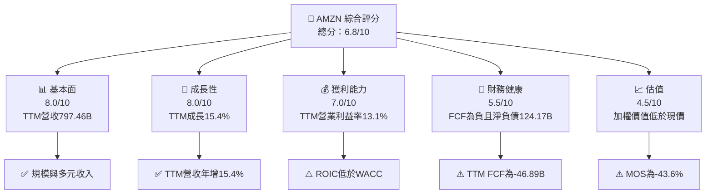

### 1.2 評分進度條視覺化

```
╔══════════════════════════════════════════════════════════════╗
║                AMZN 多維度評分儀表板（1-10分）                ║
╠══════════════════════════════════════════════════════════════╣
║ 基本面強度  8.0 ▓▓▓▓▓▓▓▓▓▓▓▓▓▓▓▓░░░░  ★★★★☆             ║
║ 成長動能    8.0 ▓▓▓▓▓▓▓▓▓▓▓▓▓▓▓▓░░░░  ★★★★☆             ║
║ 獲利品質    6.0 ▓▓▓▓▓▓▓▓▓▓▓▓░░░░░░░░  ★★★☆☆             ║
║ 財務健康    5.5 ▓▓▓▓▓▓▓▓▓▓▓░░░░░░░░░  ★★★☆☆             ║
║ 估值合理性  4.5 ▓▓▓▓▓▓▓▓▓░░░░░░░░░░░  ★★☆☆☆             ║
║ 護城河深度  8.3 ▓▓▓▓▓▓▓▓▓▓▓▓▓▓▓▓▓░░░  ★★★★☆             ║
║ 管理層執行  6.5 ▓▓▓▓▓▓▓▓▓▓▓▓▓░░░░░░░  ★★★☆☆             ║
║ 技術創新力  8.0 ▓▓▓▓▓▓▓▓▓▓▓▓▓▓▓▓░░░░  ★★★★☆             ║
╠══════════════════════════════════════════════════════════════╣
║ 綜合總分    6.8 ▓▓▓▓▓▓▓▓▓▓▓▓▓▓░░░░░░  🟡 優質企業但估值偏高║
╚══════════════════════════════════════════════════════════════╝
```

### 1.3 五大投資論點 + 三大核心風險

| 類型 | 項目 | 具體依據 | 信心度 |
|------|------|----------|--------|
| 🟢 **投資論點①** | 多元收入與規模 | TTM 營收 **$797.46B**，TTM 成長 **15.4%**；零售、AWS、廣告降低單一業務依賴 | 高 |
| 🟢 **投資論點②** | 利潤率改善空間 | TTM 營業利益率 **13.1%**，最新單季 **13.9%**；若效率改善延續，營業槓桿有望提升 | 中 |
| 🟢 **投資論點③** | 現金產生能力仍大 | TTM 營業現金流 **$168.30B**，為後續資本投入與債務管理提供來源 | 中高 |
| 🟢 **投資論點④** | AWS 與 AI 基礎設施機會 | 公司具雲端平台、資料中心與客戶生態；但收入占比與 AI 收入明細未提供，未量化增量 |
| 🟢 **投資論點⑤** | 歷史估值並非全面高位 | P/E **21.6x**，低於五年中位數 **32.2x**；但 P/S **3.7x** 已達五年區間上緣 |
| 🟡 **風險①** | 資本支出過高 | TTM Capex **$215.19B** 高於 OCF **$168.30B**，導致 FCF **−$46.89B** |
| 🔴 **風險②** | 投入資本回報不足 | ROIC **11.0%** 低於參考 WACC **11.98%**；新增資本若回報不足，可能摧毀價值 |
| 🔴 **風險③** | 市場價格對未來預期要求高 | 2026-11-13 收盤 **$266.66**，高於本報告加權合理價值 **$185.73** |

### 1.4 快速統計卡片

| 指標 | 公司實際值 | 行業均值 | S&P 500 均值 | 狀態 |
|------|-------------|----------|--------------|------|
| 收入 YoY 成長 | **15.4% TTM** | N/A | N/A | 🟢 |
| 最新單季收入 YoY | **12.1%** | N/A | N/A | 🟢 |
| 毛利率 | **51.4% TTM**（補充資料） | N/A | N/A | 🟢 |
| 淨利率 | **16.9% TTM**（補充資料） | N/A | N/A | 🟢 |
| ROE | **22.0% VERIFIED** | N/A | N/A | 🟡 |
| Forward P/E | **24.42x** | N/A | N/A | 🟡 |
| ROIC | **11.0%** | N/A | N/A | 🟡 |
| FCF Yield | **−1.63% VERIFIED** | N/A | N/A | 🔴 |

> 可用資料未提供一致的產業與 S&P 500 均值，故不填入虛構基準。

### 1.5 投資結論

```
╔══════════════════════════════════════════════════════════════════╗
║                       📊 投資結論摘要                            ║
╠══════════════════════════════════════════════════════════════════╣
║  評級：🔴 賣出（MOS -43.6%，低於 -25% 門檻）                     ║
║  價格（2026-11-13 收盤）：$266.66                                ║
║  DCF 內在價值（基準）：$48.40（現價溢價約 451.0%）              ║
║  安全邊際 MOS：-43.6%（以加權合理價值 $185.73 為分母）           ║
║  目標價情境：                                                     ║
║    悲觀情境：$25.00（相對現價 -90.6%）                           ║
║    基準情境：$48.40（相對現價 -81.8%）                           ║
║    樂觀情境：$90.00（相對現價 -66.2%）                           ║
║  三情境 DCF 機率加權：$52.95；三角驗證加權合理價值：$185.73       ║
║  投資評分：6.8/10（企業質素高，價格/FCF 組合不利）               ║
║  適合投資人：具高風險承受力、可承受大幅資本開支波動者；不適合收益型║
╚══════════════════════════════════════════════════════════════════╝
```

上述三情境 DCF 是對 DCF 輸入假設的壓力測試；相對現價跌幅大，且基準 DCF 受目前負 FCF 影響。8.8 三角驗證額外納入同業倍數與共識目標價，所得加權合理價值高於基準 DCF，但仍低於現價。

---

## 2. 公司概覽與商業模式

### 2.1 業務結構與收入來源

Amazon 透過線上與實體零售、第三方賣家服務、廣告、訂閱及 AWS 提供服務。題示資料未提供最新分部營收，故不以估計金額或百分比拆分。

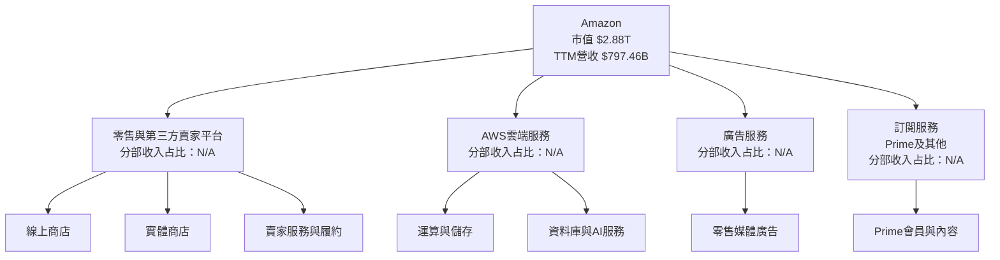

### 2.2 市場份額

由於資料包未提供可核驗的 Amazon 電商、雲端或數位廣告市場份額，以下不以虛構數據製作市場占比圖。相對競爭地位可觀察的代理指標包括規模、成長與同業估值，但不等同市場份額。

| 市場 | Amazon 定位 | 可比公司 | 本資料可驗證的市場份額 |
|------|-------------|----------|------------------------|
| 雲端運算 | AWS | Microsoft、Google、其他雲端商 | N/A |
| 線上零售 | 平台及自營零售 | Walmart、其他零售商 | N/A |
| 數位廣告 | 零售媒體廣告 | Google、Microsoft 等 | N/A |

### 2.3 競爭護城河分析

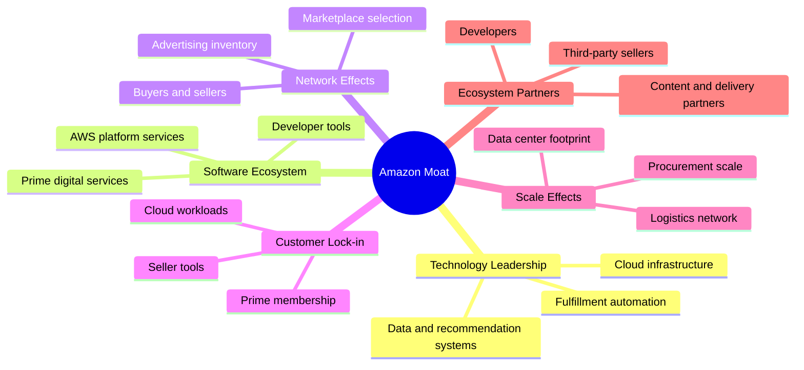

### 2.4 護城河強度評分

```
╔══════════════════════════════════════════════════════════════╗
║                  Amazon 護城河強度評分                       ║
╠══════════════════════════════════════════════════════════════╣
║ 網路效應       8.0/10  ▓▓▓▓▓▓▓▓▓▓▓▓▓▓▓▓░░░░  🟢 買賣雙邊平台║
║ 規模效應       9.0/10  ▓▓▓▓▓▓▓▓▓▓▓▓▓▓▓▓▓▓░░  🟢 物流與雲端規模║
║ 客戶鎖定       8.0/10  ▓▓▓▓▓▓▓▓▓▓▓▓▓▓▓▓░░░░  🟢 Prime與AWS工作負載║
║ 技術與資料     8.0/10  ▓▓▓▓▓▓▓▓▓▓▓▓▓▓▓▓░░░░  🟢 雲端與推薦系統║
║ 品牌與生態     8.5/10  ▓▓▓▓▓▓▓▓▓▓▓▓▓▓▓░░░░░  🟢 消費者與賣家觸及║
║ 綜合護城河     8.3/10  ▓▓▓▓▓▓▓▓▓▓▓▓▓▓▓░░░░░  🟢 但投資需求高║
╚══════════════════════════════════════════════════════════════╝
```

評分屬質化分析，不代表可直接轉換成營收或市場份額。AWS 面臨 Microsoft、Google 等競爭者；零售則受到價格、物流與勞動成本壓力，護城河並不保證利潤率單向上升。

---

## 3. 損益表深度分析

### 3.1 年度收入成長趨勢（近 4 年）

| 財年 | 營收 | YoY | 毛利 | 營業利益 | 淨利 |
|------|------:|----:|-----:|---------:|-----:|
| 2022 | $513.98B | +9.4% | $225.15B | $12.25B* | −$2.72B |
| 2023 | $574.78B | +11.8% | $270.05B | $36.85B | $30.43B |
| 2024 | $637.96B | +11.0% | $311.67B | $68.59B | $59.25B |
| 2025 | $716.92B | +12.4% | $360.51B | $79.97B | $77.67B |
| TTM 至 2026-09-30 | **$797.46B** | **+15.4% TTM** | N/A | **13.1% TTM margin** | N/A |

\* 2022 年營業利益在其他資料表列為 $13.35B，存在來源差異；此處採年度損益表顯示的 $12.25B，不以其計算 VERIFIED 指標。

```
╔══════════════════════════════════════════════════════════════════╗
║              Amazon 年度收入趨勢（FY2022-FY2025）                ║
╠══════════════════════════════════════════════════════════════════╣
║ FY2022  $513.98B  █████████████░░░░░░░░░  YoY +9.4%   🟢       ║
║ FY2023  $574.78B  ███████████████░░░░░░░░  YoY +11.8%  🟢       ║
║ FY2024  $637.96B  █████████████████░░░░░░  YoY +11.0%  🟢       ║
║ FY2025  $716.92B  ███████████████████░░░░  YoY +12.4%  🟢       ║
╠══════════════════════════════════════════════════════════════════╣
║ FY2022-FY2025 營收 CAGR：($716.92B ÷ $513.98B)^(1/3)-1 ≈ 11.7%  ║
╚══════════════════════════════════════════════════════════════════╝
```

四年間營收增加約 **$202.94B**。年度成長由 2022 年的 9.4% 回升至 2025 年的 12.4%；TTM 成長進一步達 15.4%。較大的平台規模下仍維持雙位數成長，代表零售與服務收入擴張，但並不能單獨證明新增收入帶來相同比例的自由現金流。

### 3.2 季度收入趨勢分析

採用 StockAnalysis 季度資料；Q2 2026 的單季財務報表表格缺漏，但季度資料表另有收入 **$200.606B**。單季 QoQ 按未季節調整數據計算，需留意 Q4 季節性。

| 季度 | 營收 | QoQ | YoY | 營業利益率 | 備註 |
|------|-----:|----:|----:|-----------:|------|
| 2025 Q4 | $213.386B | +18.5% vs Q3 | +13.6% | 10.5%* | 旺季季節性 |
| 2026 Q1 | $181.519B | −14.9% | +16.6% | 13.1%* | 季節性回落但利潤率較高 |
| 2026 Q2 | $200.606B | +10.5% | +19.6% | 13.7%* | 由季度營業利益資料計算 |
| 2026 Q3 | $201.944B | +0.7% | +12.1% | 13.9% | VERIFIED 最新單季 margin |

\* 依 StockAnalysis 當季營業利益除以營收計算；題示市場資料另列最新季度營業利益率 13.1%，與 VERIFIED FIGURES 的 **13.9%** 不一致。本報告的核心即時引用採 VERIFIED 的 13.9%。

Q3 2026 營收 QoQ 僅增 0.7%，但單季 YoY 仍增 12.1%；這表示同比增長仍正面，惟環比受規模基數與季節性影響，不宜將其解讀為同等幅度的需求加速。TTM 成長率 15.4% 是另一口徑，不應與最新單季 12.1% 混用。

### 3.3 利潤率演變分析

| 利潤率指標 | 2022 | 2023 | 2024 | 2025 | TTM/最新 | 評估 |
|------------|-----:|-----:|-----:|-----:|---------:|------|
| **毛利率** | 43.8% | 47.0% | 48.9% | 50.3% | 51.4% TTM（補充來源） | 🟢 上升；產品與服務組合、履約效率可能有助改善 |
| **營業利益率** | 2.4%* | 6.4% | 10.8% | 11.2% | 13.1% TTM；最新單季 13.9% | 🟢 營運效率改善，但不同資料口徑有差異 |
| **淨利率** | −0.5% | 5.3% | 9.3% | 10.8% | 16.9% TTM（補充來源） | 🟡 TTM 淨利率顯著高於年度，須確認期間與一次性項目 |

\* 使用年度收入表所列 $12.25B 營業利益計算。年度數據顯示 2023–2025 營業利益由 $36.85B 升至 $79.97B，增幅高於同期營收增幅，代表成本控制與規模槓桿改善。但 2026 TTM 數據與補充財務表有不一致，不能把該改善全數外推。

### 3.4 費用結構分析

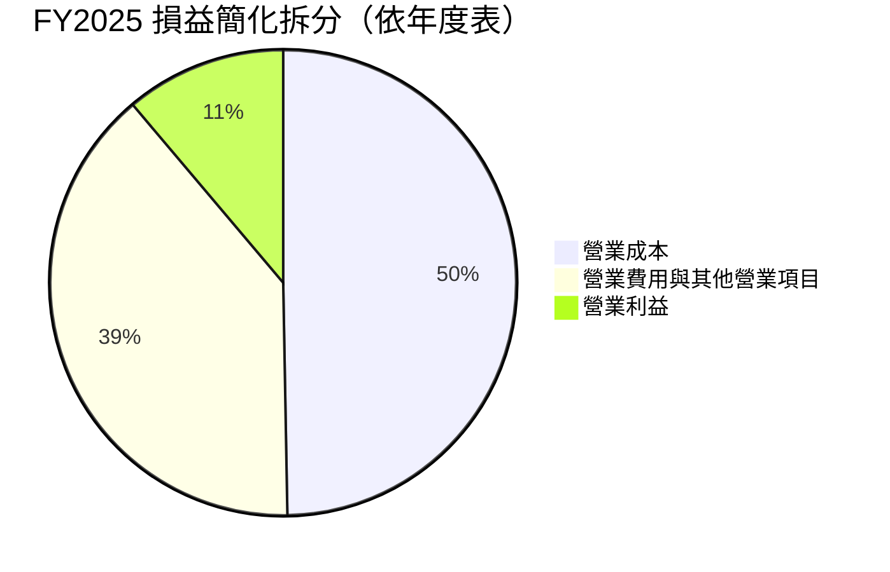

FY2025 營業成本約為 **$716.92B − $360.51B = $356.41B**；毛利至營業利益之間差額約 **$280.54B**。這是依報表總額計算的簡化橋接，並非公司正式費用分類。零售履約、技術研發、行銷與管理支出均會影響利潤率；各項精確分拆未提供。

### 3.5 季度 EPS 趨勢與盈餘品質（Quality of Earnings）

| 季度 | EPS 實際值 | EPS YoY | 超預期/不及預期 | 解讀 |
|------|-----------:|--------:|----------------|------|
| 2025 Q4 | $1.95 | +5.0% | N/A | 估計 EPS 缺漏，不能判定 beat/miss |
| 2026 Q1 | $2.78 | +74.8% | N/A | 單季 EPS 高增；與淨利、稅務及非營業項目需交叉核對 |
| 2026 Q2 | $5.75 | +242.3% | N/A | EPS 大幅跳升，但單季淨利資料口徑有不一致 |
| 2026 Q3 | $1.89 | −3.1% | N/A | EPS 年減；題示 EPS Est/Act 均為 nan，無法判定是否超預期 |

Earnings History 的四季預估及實際 EPS 欄均為 `nan`，因此本報告不虛構「超預期／不及預期」結論。EPS 實際趨勢可引用 StockAnalysis，但估計值缺漏使市場驚喜度不可驗證。

| 盈餘品質項目 | 數值/佔比 | 評估 |
|--------------|-----------|------|
| 股權薪酬 SBC / 營收 | FY2025：$19.47B ÷ $716.92B = **2.72%** | 🟡 金額可觀；SBC 是經濟稀釋，應視為股東成本 |
| SBC / 營業現金流 | FY2025：$19.47B ÷ $139.51B = **14.0%** | 🟡 佔營業現金流比重不低 |
| FCF / 淨利 | VERIFIED TTM FCF −$46.89B；可比 TTM 淨利未提供 | 🔴 無法計出可比 TTM 轉換率；以年度 2025 FCF $7.70B / 淨利 $77.67B 約 9.9% 作補充參考 |
| 一次性/非經常性損益 | 逐項資料 N/A | 🟡 無法量化稅務、投資評價或資產處分影響 |
| 有效稅率異常 | 模型採用 21% 假設稅率；實際 TTM 有效稅率 N/A | 🟡 不據此推斷實際稅負 |
| 資本化支出 vs 費用化 | VERIFIED TTM Capex $215.19B；資本化與折舊明細 N/A | 🟡 高資本支出可能將部分經濟成本遞延為折舊，但金額拆分不足 |

**盈餘品質結論**：GAAP 盈利具有一定現金流支持，但當期 VERIFIED TTM FCF 為負，且 SBC 約占 FY2025 營收 2.72%。此外，巨額資本支出意味著以淨利單看獲利品質會低估再投資需求；估值應給予 FCF 與資本回報更高權重。

---

## 4. 資產負債表分析

### 4.1 資產結構分解

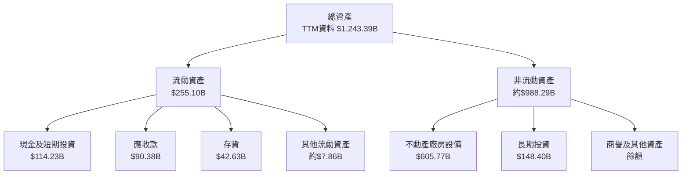

TTM 總資產採補充 StockAnalysis 數據；該表的分項和總額有部分交叉口徑疑慮。現金、短期投資與淨負債則採 VERIFIED FIGURES。

### 4.2 流動性指標分析

| 指標 | 最新值 | 歷史/比較 | 評估 |
|------|-------:|-----------|------|
| Current Ratio | 0.989（補充來源） | 2025 年 $229.08B ÷ $218.00B ≈ 1.05 | 🟡 約在 1 倍附近，營運週轉需持續觀察 |
| Quick Ratio | 0.793（補充來源） | 歷史序列 N/A | 🟡 排除存貨後流動性較緊 |
| 現金 + 短期投資 | **$55.78B VERIFIED** | 另一補充表顯示 $114.23B，口徑不一致 | 🟡 核心估值採 VERIFIED $55.78B |
| 總債務 | **$179.95B VERIFIED** | 補充資料另列 $304.84B | 🟡 債務口徑差異重大 |
| 淨負債 | **$124.17B VERIFIED** | 另一資料表列 $190.61B | 🟡 本報告採 VERIFIED 值 |

市場同業流動性均值未提供，故不填估計行業基準。題示 2026 Q3 VERIFIED 現金與債務口徑，是本報告估值橋接所用口徑；補充來源的不同數字不與之混算。

### 4.3 債務結構分析

```
╔══════════════════════════════════════════════════════════════════╗
║                    Amazon 債務健康診斷                          ║
╠══════════════════════════════════════════════════════════════════╣
║ 總債務（VERIFIED）   $179.95B  ██████████████████░░              ║
║ 現金+短期投資         $55.78B  ██████░░░░░░░░░░░░░░              ║
║ 淨負債（VERIFIED）   $124.17B  🔴 淨負債                          ║
║ Debt/EBITDA          N/A      EBITDA與債務期間口徑不一致          ║
║ Interest Coverage    N/A      利息費用及可比 EBIT 不完整          ║
║ Current Ratio        0.989    🟡 略低於 1                         ║
╚══════════════════════════════════════════════════════════════════╝
```

### 4.4 股東權益趨勢

```
╔══════════════════════════════════════════════════════════════════╗
║              股東權益趨勢（年度補充資料）                        ║
╠══════════════════════════════════════════════════════════════════╣
║ 2022  $146.04B  ███████░░░░░░░░░░░░░░░                          ║
║ 2023  $201.88B  ██████████░░░░░░░░░░░░                          ║
║ 2024  $285.97B  ██████████████░░░░░░░░                          ║
║ 2025  $411.06B  ████████████████████░░                          ║
╚══════════════════════════════════════════════════════════════════╝
```

FY2022–FY2025 股東權益上升，可能反映累積盈餘與股本變化；但 2025 年至 TTM 的權益資料未提供同口徑序列，且股數近年略增。股東權益成長不應與每股股東回報直接等同。

---

## 5. 現金流量深度分析

### 5.1 現金流量瀑布圖

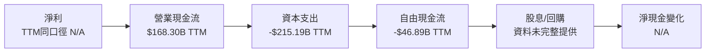

### 5.2 FCF 轉換率趨勢

| 年度 | OCF | Capex | FCF | 淨利 | FCF / 淨利 |
|------|----:|------:|----:|-----:|-----------:|
| 2022 | $46.75B | $63.65B | −$16.89B | −$2.72B | 比率失去解讀性 |
| 2023 | $84.95B | $52.73B | $32.22B | $30.43B | 105.9% |
| 2024 | $115.88B | $83.00B | $32.88B | $59.25B | 55.5% |
| 2025 | $139.51B | $131.82B | $7.70B | $77.67B | 9.9% |
| TTM VERIFIED | $168.30B | $215.19B | −$46.89B | N/A | N/A |

2025 年 OCF 增至 $139.51B，但 Capex 同期升至 $131.82B，FCF 因而降至 $7.70B。TTM VERIFIED Capex 進一步超過 OCF，代表資本投資對現金回報的吸收已成為估值核心風險。

### 5.3 自由現金流趨勢

```
╔══════════════════════════════════════════════════════════════════╗
║                自由現金流趨勢（年度/TTM）                       ║
╠══════════════════════════════════════════════════════════════════╣
║ 2022  -$16.89B  ◄██░░░░░░░░░░░░░░░░░░  負值                   ║
║ 2023   $32.22B  ████████████████░░░░░  FCF Yield N/A             ║
║ 2024   $32.88B  ████████████████░░░░░  FCF Yield N/A             ║
║ 2025    $7.70B  ████░░░░░░░░░░░░░░░░░  FCF Yield N/A             ║
║ TTM   -$46.89B  ◄████████████████████  Yield -1.63% VERIFIED      ║
╚══════════════════════════════════════════════════════════════════╝
```

補充資料另列 TTM FCF **−$37.64B**，而 VERIFIED 的定義與數值為 **OCF − Capex = −$46.89B**。本報告的 TTM FCF 主值採 VERIFIED 原值，不以另一來源替換。

### 5.4 資本配置評估

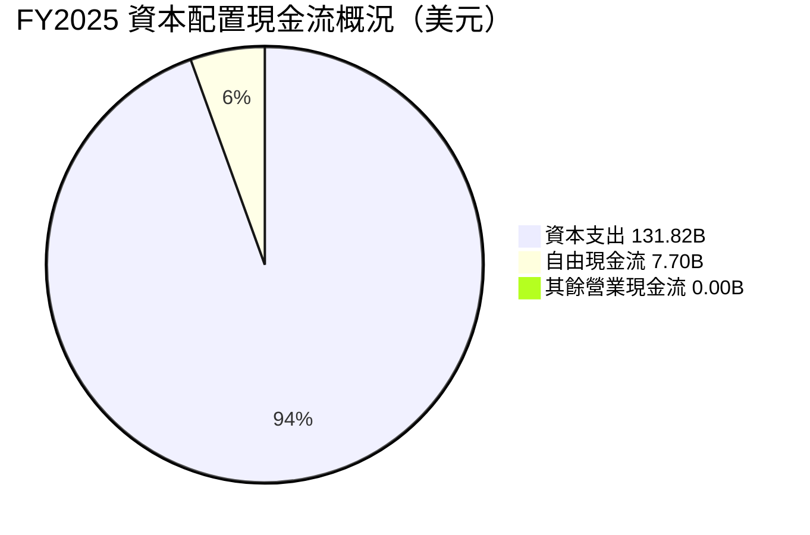

此圖只展示 **OCF 被 Capex 與 FCF 分配後的數值關係**，不是總資本配置比例；回購、收購、股息和融資現金流的可比分拆未提供。

| 項目 | 可得資料 | 評估 |
|------|----------|------|
| Capex | FY2025 $131.82B；TTM VERIFIED $215.19B | 🔴 投資強度高，須驗證新增產能回報 |
| 股息 | 股息殖利率 0% | 🟡 公司保留現金再投資 |
| SBC | FY2025 $19.47B | 🟡 需以稀釋後每股價值衡量 |
| 回購 | 完整同期金額 N/A | N/A |
| 收購/其他投資 | 期間明細 N/A | N/A |

---

## 6. 獲利能力與資本效率

### 6.1 ROE / ROA / ROIC 趨勢

| 指標 | 最新數值 | 補充歷史資料 | 評估 |
|------|---------:|--------------|------|
| ROIC | **11.0% VERIFIED TTM** | 10 年年化投資回報資料不完整 | 🟡 低於 11.98% 參考 WACC |
| ROE | **22.0% VERIFIED TTM** | 其他資料源列 27.4% | 🟡 口徑差異，採 VERIFIED |
| ROA | 6.6%（補充來源） | 歷史序列 N/A | 🟡 資產基礎龐大，資產回報低於 ROE |
| 行業均值 | N/A | 未提供一致口徑 | N/A |

### 6.2 ROIC vs WACC 分析（核心價值創造判斷）

```
╔══════════════════════════════════════════════════════════════════╗
║                   ROIC vs WACC 深度分析                         ║
╠══════════════════════════════════════════════════════════════════╣
║ WACC（VERIFIED 參考值）：11.98%                                  ║
║ ├── 無風險利率：5.15%                                            ║
║ ├── ERP：5.00%                                                   ║
║ ├── Beta：1.50（資本成本輸入）                                   ║
║ ├── Ke：5.15% + 1.50×5.00% ≈ 12.65%；採 VERIFIED 12.67%         ║
║ ├── 稅前 Kd：1.26%；稅後約 1.26%×(1−21%) = 1.00%                ║
║ ├── E/D 權重：94.1% / 5.9%                                      ║
║ └── 參考 WACC：11.98%                                           ║
║                                                                  ║
║ ROIC（VERIFIED TTM）：11.00%                                     ║
║ EVA spread = ROIC − WACC = 11.00% − 11.98% = -0.98pp            ║
║                                                                  ║
║ ROIC  11.00%  ▓▓▓▓▓▓▓▓▓▓▓▓▓▓▓▓▓░░░  🟡                         ║
║ WACC  11.98%  ▓▓▓▓▓▓▓▓▓▓▓▓▓▓▓▓▓▓░░  ──                         ║
║ EVA   -0.98pp ◄██░░░░░░░░░░░░░░░░░░  🔴 負利差                  ║
╠══════════════════════════════════════════════════════════════════╣
║ 結論：依 VERIFIED 口徑，ROIC/WACC = 11.0%÷11.98% ≈ 0.92；        ║
║       當前回報率略低於資本成本，尚未顯示正的經濟價值利差。       ║
╚══════════════════════════════════════════════════════════════════╝
```

ROIC 與 WACC 的差距不到 1 個百分點，未必代表所有業務均在摧毀價值；但對新增 AI 與資料中心投資而言，若回報不能超過資本成本，資本開支即使推升收入，也未必提升每股內在價值。此處 ROIC/WACC 使用 VERIFIED 11.0%/11.98%，與第 8 章 WACC 口徑一致。

### 6.3 杜邦三因素分解

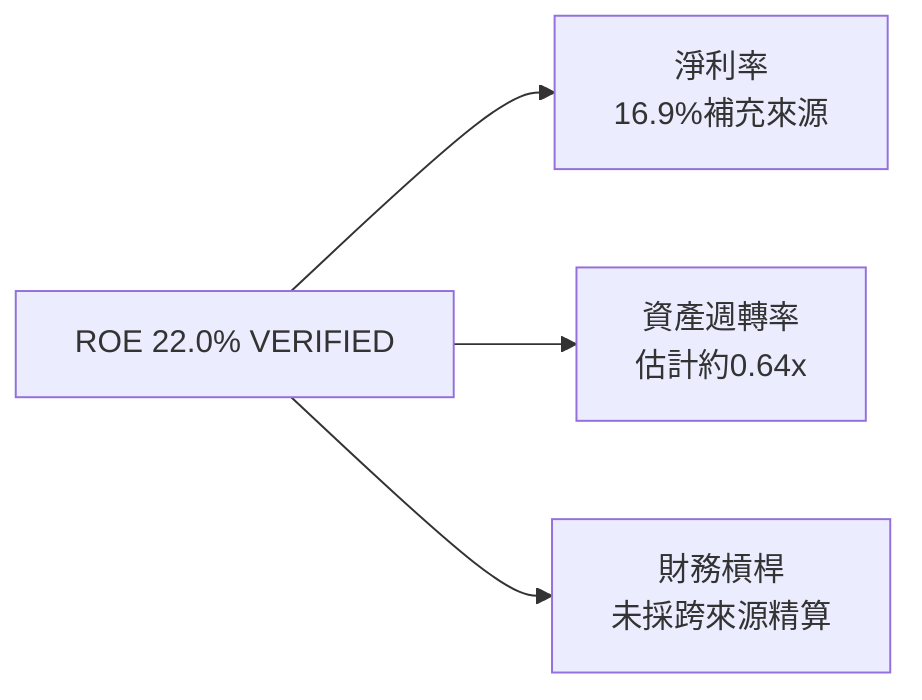

杜邦資料期間不完全一致，故不把三項估算值相乘冒充 VERIFIED ROE。採補充來源的 TTM 淨利率 16.9% 與 TTM 收入 $797.46B、總資產約 $1,243.39B 粗估資產週轉率為 $797.46B ÷ $1,243.39B ≈ **0.64x**。財務槓桿的平均資產、平均權益缺乏同一期間口徑，列 N/A。

### 6.4 獲利能力儀表板

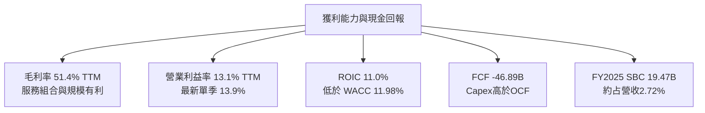

---

## 7. 相對估值分析

### 7.1 同業估值比較表格

AMZN 自身倍數採資料包估值欄；同業倍數直接採 VERIFIED Peer multiples。由於 Yahoo/Finviz 與 SEC 計算口徑可能不同，這是估值快照比較，而非完全同口徑的會計調整。

| 估值指標 | **AMZN** | **MSFT** | **GOOG** | **WMT** | AMZN 評估 |
|----------|---------:|---------:|---------:|--------:|-----------|
| **Trailing P/E** | 21.6x | 27.3x | 15.3x | 46.4x | 🟡 位於同業區間中段 |
| **Forward P/E** | 24.42x | 21.7x | 19.0x | 39.8x | 🟡 高於 MSFT/GOOG |
| **P/S Ratio** | 3.62x | 11.2x | 7.6x | 1.4x | 🟡 零售與雲端混合，不能單純比較 |
| **EV/EBITDA** | 16.78x* | 19.2x | 19.1x | 24.3x | 🟢 低於三家同業 |
| **最新單季營收 YoY** | 12.1% | 18.8% | 24.7% | 5.9% | 🟡 成長高於 WMT、低於 MSFT/GOOG |
| **毛利率 TTM** | 51.4% | 67.7% | 60.9% | 24.8% | 🟡 高於 WMT、低於科技同業 |

\* 自身估值歷史資料的 EV/EBITDA 為 16.5x；市場估值快照另列 16.778x，表內採當前估值快照數字。

### 7.2 歷史估值區間分析

```
╔══════════════════════════════════════════════════════════════════╗
║             AMZN 五年估值位置（VERIFIED 歷史區間）               ║
╠══════════════════════════════════════════════════════════════════╣
║ P/E      2.6x ───────── 中位數 32.2x ───── 現值 21.6x ── 251.9x ║
║                              現值百分位：35%                     ║
║ P/S      0.2x ───────── 中位數 3.0x ───────────── 現值 3.7x     ║
║                              現值百分位：95%                     ║
║ EV/EBITDA 1.7x ───────── 中位數 17.6x ─ 現值 16.5x ── 23.2x    ║
║                              現值百分位：38%                     ║
╚══════════════════════════════════════════════════════════════════╝
```

P/E 與 EV/EBITDA 在自身五年分布的中低百分位，但 P/S 位於第 95 百分位且接近區間上緣。這種分歧反映市場同時對未來利潤擴張定價，但營收倍數所隱含的成長期待較高。

### 7.3 情境目標價（假設驅動，Bear / Base / Bull）

以下為 **12 個月相對估值情境**，採 Forward EPS **$10.91924**。每一目標價由「前瞻 EPS × 退出 P/E」計算；營收 CAGR 與利潤率是假設，不是管理層指引或公司已公布財測。

| 情境 | 營收 CAGR 假設 | 營業利潤率假設 | 退出 P/E | 目標價算式 | 隱含目標價 | 相對現價 |
|------|---------------:|---------------:|---------:|------------|-----------:|---------:|
| 🔴 悲觀 | 8% | 12.5% | 18x | $10.91924 × 18 | $196.55 | −26.3% |
| 🟡 基準 | 12% | 13.9% | 24x | $10.91924 × 24 | $262.06 | −1.7% |
| 🟢 樂觀 | 16% | 15.0% | 30x | $10.91924 × 30 | $327.58 | +22.8% |

**倍數選擇說明**：AMZN 的資本支出使短期 FCF 受壓，單靠 P/E 可能低估再投資價值；因此同時參照 EV/EBITDA、P/S、自身歷史及 DCF。情境 P/E 是分析假設，並非同業 Peer multiples 的替代品。

### 7.4 相對估值隱含價格區間

```
╔══════════════════════════════════════════════════════════════════╗
║               相對估值隱含股價（美元/股）                       ║
╠══════════════════════════════════════════════════════════════════╣
║ Forward P/E 同業基準  $236.9  ███████████████░░░░░░              ║
║ P/S 回到五年中位數    $216.2  ██████████████░░░░░░░              ║
║ EV/EBITDA 同業基準    $314.4  ████████████████████░              ║
║ 分析師平均目標價      $326.72 █████████████████████              ║
║ 2026-11-13 現價       $266.66 ─────────────────────              ║
║ DCF 基準               $48.40 ███░░░░░░░░░░░░░░░░░░              ║
╠══════════════════════════════════════════════════════════════════╣
║ FCF Yield 回推：N/A（TTM FCF為負，無法用正FCF殖利率回推）        ║
╚══════════════════════════════════════════════════════════════════╝
```

計算依據：
- Forward P/E：$266.66 × (同業 Forward P/E 中位數 21.7 ÷ AMZN 24.421) ≈ **$236.9**。
- P/S：$266.66 × (自身五年 P/S 中位數 3.0 ÷ 當前 3.7) ≈ **$216.2**。
- EV/EBITDA：以補充 TTM EBITDA margin 23.0% 估算 EBITDA 約 $797.46B × 23.0% = $183.42B；同業三家 EV/EBITDA 中位數 19.2x，橋接採 VERIFIED 淨負債 $124.17B 及 10.81B 股，隱含約 **$314.4/股**。由於 EBITDA、EV 與淨負債來源期間不同，視為近似交叉檢驗。
- FCF Yield：TTM FCF 為負，無法以正的合理 FCF Yield 得出有意義的價格。

---

## 8. DCF 內在價值評估（Discounted Cash Flow）

> **模型性質**：基於資料缺口的明示假設型估值，並非公司指引。由於 TTM FCF 為負、Capex 高於 OCF，基準 DCF 對 Capex 正規化與期末利潤率特別敏感。金額取一位小數、比率取一位小數、折現因子取三位小數；尾差可能來自四捨五入。

### 8.0 估值推理鏈（Thinking Logic）

**Step 1 — 價值來源與主導變數**  
AMZN 價值可拆為零售與第三方賣家平台、AWS 雲端服務、廣告與訂閱等現有業務的現金流；資料包未提供最新分部營收占比，故不臆造拆分比例。主導估值的變數是**資本支出相對營收的正常化速度**：VERIFIED TTM Capex 為 $215.19B、約占 TTM 營收 27.0%，遠高於 FY2025 年度 Capex/營收約 18.4%。

**Step 2 — 模型選擇**

| 決策點 | 本報告採用 | 理由 | 曾考慮但否決 | 否決理由 |
|--------|-----------|------|--------------|----------|
| 現金流定義 | FCFF | 對應 WACC 折現並求 EV | FCFE | 債務與現金口徑差異使股權現金流較難穩定預測 |
| 預測期 N | 5 年 | 允許 Capex 從高位逐步正常化 | 10 年 | 長期逐年假設在高投資週期中不確定性過高 |
| 終值方法 | Gordon Growth 主；EV/EBITDA 交叉驗證 | 可直接表達成熟期永續成長 | 僅退出倍數 | 終值倍數對周期與估值情緒敏感 |
| EBIT 基礎 | GAAP 口徑假設 | 避免把 SBC 加回後漏算股東成本 | 非 GAAP EBIT | 缺少一致 SBC 預測與調整資料 |

**Step 3 — 關鍵假設推導鏈**

- **營收 CAGR**：錨點＝FY2022–FY2025 CAGR 約 **11.7%**，TTM 成長 **15.4%** → 調整＝較大基數與競爭使成長逐年放緩 → 採用前五年年增率 **12%、11%、10%、9%、8%** → 否決全期 15.4%，因 TTM 增速不宜直接外推五年。
- **期末營業利益率**：錨點＝TTM **13.1%**、最新單季 **13.9%** → 調整＝規模與服務組合支持擴張，但零售與 AI 折舊支出限制上行 → 採用逐年由 14.0% 增至 16.0% → 否決 18% 以上，因資料未證明可持續達到該水準。
- **永續成長率 g**：錨點＝成熟經濟長期名目成長一般低於高成長期 → 採用 **3.0%**，且低於 WACC 11.98% → 否決 5%以上，因長期永續增長不宜高估。
- **預測期 N**：錨點＝公司規模大、但 AI 資本周期可見度有限 → 採用 **5年** → 否決 10年，因中後期資本支出、折舊與競爭假設更難核驗。
- **Capex/營收**：錨點＝VERIFIED TTM 約 **27.0%**；FY2025 約 **18.4%** → 調整＝假設當前資料中心投入高峰逐步正常化 → 模型採固定 **15.0%** → 否決 27%維持五年，因可能過度把單一投資高峰永久化；15%屬樂觀假設，需提高估值風險折價。
- **D&A/營收**：財務包未提供可比 TTM D&A → 假設值 **8.0%**，依固定資產密集業務與折舊需求作模型輸入；不得視為實際值。
- **ΔWC/營收增額**：歷史可比值未提供 → 假設值 **1.0%**，用於反映擴張所需營運資金。
- **EBIT/SBC/股數**：採組合 **(A) GAAP EBIT + 固定股數**；假設 GAAP EBIT 已含 SBC 費用，FCFF 不再扣 SBC，年稀釋率設為 0%。稀釋股數採 10.81B。**本模型採用 (A)，故 SBC 影響已計入一次。**
- **WACC**：採 VERIFIED 參考值 **11.98%**，理由是題示已提供風險無風險利率、ERP、Beta、Kd 與資本權重；不再另加規模溢價。
- **最脆弱環節**：Capex/營收由 TTM 約 27.0% 降至模型 15.0%；若降不下來，估值會顯著低於基準值。

**Step 4 — 計算路徑**

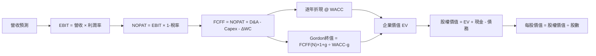

### 8.1 模型假設總表（Model Inputs）

| 假設項目 | 採用值 | 依據 / 來源 | 敏感度 |
|----------|--------|-------------|--------|
| 預測期長度 N | 5 年 | 投資周期可見度有限，允許逐步正規化 Capex | 🟡 中 |
| 營收 CAGR/逐年成長 | 12%、11%、10%、9%、8% | 歷史 FY2022–25 CAGR 約 11.7%；TTM 成長 15.4% | 🔴 高 |
| 期末營業利潤率 | 16.0%，逐年由 14.0% 上升 | TTM 13.1%、最新單季 13.9% | 🔴 高 |
| 有效稅率 | 21.0% | VERIFIED 預設稅率；非實際 TTM 有效稅率 | 🟢 低 |
| Capex / 營收 | 15.0% | 假設值：低於 TTM 約 27.0%及 FY2025 約18.4%，反映投資正常化 | 🟡 中 |
| D&A / 營收 | 8.0% | 假設值：固定資產密集營運之模型輸入，實際比率 N/A | 🟢 低 |
| ΔWC / 營收增額 | 1.0% | 假設值：資料包無歷史可比率 | 🟢 低 |
| EBIT 基礎 | GAAP 口徑假設 | 與 SBC 組合 (A) 相容 | 🟡 中 |
| SBC 處理 | 不再扣除；固定股數 | 避免與 GAAP EBIT 重複計算 | 🟡 中 |
| 年稀釋率 | 0.0% | 組合 (A)：採用當期股數，稀釋成本由 GAAP 費用反映 | 🟡 中 |
| 永續成長率 g | 3.0% | 假設成熟期名目成長；低於 WACC | 🔴 高 |
| 終值方法 | Gordon Growth；EV/EBITDA 交叉驗證 | 成熟期現金流法 | 🔴 高 |
| WACC | 11.98% | VERIFIED 參考值 | 🔴 高 |

模型 FCFF 定義：**FCFF = NOPAT + D&A − Capex − ΔWC**。因採組合 (A)，FCFF 不再扣 SBC。

### 8.2 折現率推導（WACC）

```
╔══════════════════════════════════════════════════════════════════╗
║                     WACC 推導（折現率）                          ║
╠══════════════════════════════════════════════════════════════════╣
║ 股權成本 Ke（CAPM）：                                            ║
║ ├── Rf：5.15%（資料包 10Y Treasury；日期資料未另列）              ║
║ ├── ERP：5.00%（資料包假設值）                                   ║
║ ├── Beta：1.50（資本成本輸入；市場資料另列1.503）                 ║
║ ├── 規模/國別溢酬：0.00%（未加計；美國大型上市公司）              ║
║ └── VERIFIED Ke：12.67%                                          ║
║                                                                  ║
║ 債務成本 Kd：                                                    ║
║ ├── 稅前 Kd：1.26%（資料包利息/債務計算值）                      ║
║ ├── 稅率：21.0%                                                  ║
║ └── 稅後 Kd = 1.26%×(1−21.0%) = 0.9954% ≈ 1.00%                ║
║                                                                  ║
║ 資本權重：E 94.1%；D 5.9%（VERIFIED）                            ║
║ WACC = 94.1%×12.67% + 5.9%×0.9954%                               ║
║      = 11.92247% + 0.05873% = 11.98120% ≈ 11.98%                 ║
╚══════════════════════════════════════════════════════════════════╝
```

逐步演算：
1. **Ke**＝5.15%＋1.50×5.00%＝12.65%；因 VERIFIED 精確輸入 Beta 為 1.503，CAPM 為 5.15%＋1.503×5.00%＝12.665%≈**12.67%**。
2. **稅前 Kd**＝VERIFIED 資料包提供 **1.26%**。利息費用及平均計息負債分項未提供，故不另行反推。
3. **稅後 Kd**＝1.26%×(1−21.0%)＝**0.9954%**。
4. **權重**＝股權 **94.1%**、債務 **5.9%**，兩者合計 **100.0%**；採用資料包參考權重。
5. **WACC**＝94.1%×12.67%＋5.9%×0.9954%＝11.92247%＋0.05873%＝**11.98120%≈11.98%**。

計算以資料包參考權重為起點。資料包未提供計息負債逐項明細，故本節不能獨立驗證債務權重是否與 Kd 分母完全同範圍；此限制降低 WACC 可稽核度，但為保持全報告一致，第 6.2 節與 DCF 均採 11.98%。

### 8.3 逐年自由現金流預測（基準情境）

預測起點採 TTM 營收 **$797.46B**。下表 Capex、D&A 及 ΔWC 為模型假設，不是公司財測。金額單位為 **$B**。

| 年度 | FY+1 | FY+2 | FY+3 | FY+4 | FY+5（=FY+N） |
|------|-----:|-----:|-----:|-----:|----------------:|
| 營收 | 893.2 | 991.4 | 1,090.5 | 1,188.7 | 1,283.8 |
| 營收 YoY | 12.0% | 11.0% | 10.0% | 9.0% | 8.0% |
| 營業利潤率 | 14.0% | 14.5% | 15.0% | 15.5% | 16.0% |
| EBIT（GAAP 假設） | 125.0 | 143.8 | 163.6 | 184.2 | 205.4 |
| − 稅（21%） | (26.3) | (30.2) | (34.4) | (38.7) | (43.1) |
| = NOPAT | 98.8 | 113.6 | 129.2 | 145.5 | 162.3 |
| + D&A（營收8%） | 71.5 | 79.3 | 87.2 | 95.1 | 102.7 |
| − Capex（營收15%） | (134.0) | (148.7) | (163.6) | (178.3) | (192.6) |
| − ΔWC（營收增額1%） | (1.0) | (1.0) | (1.0) | (1.0) | (1.0) |
| **= FCFF** | **35.3** | **43.2** | **51.9** | **61.4** | **71.5** |
| 折現因子 @11.98% | 0.893 | 0.797 | 0.712 | 0.636 | 0.568 |
| **FCFF 現值 PV** | **31.5** | **34.4** | **37.0** | **39.0** | **40.6** |

**預測期 FCF 現值合計**：
$31.5 + $34.4 + $37.0 + $39.0 + $40.6 = **$182.5B**。

**FY+1 代表年度逐步演算**：
1. 營收＝$797.46B×(1＋12.0%)＝**$893.16B**。
2. EBIT＝$893.16B×14.0%＝**$125.04B**。
3. 稅＝$125.04B×21.0%＝**$26.26B**。
4. NOPAT＝$125.04B−$26.26B＝**$98.78B**。
5. D&A＝$893.16B×8.0%＝**$71.45B**。
6. Capex＝$893.16B×15.0%＝**$133.97B**。
7. ΔWC＝($893.16B−$797.46B)×1.0%＝**$0.96B**。
8. FCFF＝$98.78B＋$71.45B−$133.97B−$0.96B＝**$35.30B**。
9. 折現因子＝1÷(1＋11.98%)¹＝**0.893**；PV＝$35.30B×0.893＝**$31.5B**。

> 表內以四捨五入後的一位小數呈現；代表年度全精度算式與表格差異為四捨五入尾差。

**合理性自檢**
- 預測 FCFF 由約 $35.3B 增至 $71.5B；模型 CAGR 約 **19.3%**。FY2023 至 FY2025 歷史 FCF 由 $32.22B 至 $7.70B，期間變化為負，不能直接視為歷史正成長錨點。
- FY+5 FCFF margin＝$71.5B÷$1,283.8B≈**5.6%**；目前 VERIFIED FCF margin＝−$46.89B÷$797.46B≈**−5.9%**。預測改善主要由 Capex/營收從約 27% 假設降至 15% 驅動。
- 模型各年 FCFF 為正；若實際 Capex 未正常化，FCFF 與 DCF 估值將低於模型。

```
╔══════════════════════════════════════════════════════════════════╗
║           自由現金流：歷史實際 vs 模型預測                      ║
╠══════════════════════════════════════════════════════════════════╣
║ FY2023(實)  $32.22B  █████████░░░░░░░░░░░  FCF/NI 105.9%        ║
║ FY2024(實)  $32.88B  █████████░░░░░░░░░░░  FCF/NI 55.5%         ║
║ FY2025(實)   $7.70B  ██░░░░░░░░░░░░░░░░░░  FCF/NI 9.9%          ║
║ FY+1 (預)   $35.30B  ██████████░░░░░░░░░░  模型 Capex 15%       ║
║ FY+5 (預)   $71.46B  ████████████████████  模型 FCF margin 5.6% ║
╠══════════════════════════════════════════════════════════════════╣
║ ⚠️ 模型反映 Capex 正常化；TTM VERIFIED FCF 仍為 -$46.89B。       ║
╚══════════════════════════════════════════════════════════════════╝
```

### 8.4 終值計算（Terminal Value）

**適用性檢查**：WACC **11.98%** vs g **3.0%** → WACC > g？✅

| 方法 | 計算式 | 終值 TV | TV 現值 | 佔總 EV 比重 |
|------|--------|--------:|--------:|-------------:|
| Gordon Growth | $71.455B×(1+3.0%)÷(11.98%−3.0%) | $819.1B | $465.0B | 71.8% |
| 退出倍數法 | FY+5 EBITDA × 16.5x | 約 $2,895B | 約 $1,643B | 交叉參考 |

退出倍數交叉驗證：FY+5 EBIT $205.4B，加 D&A $102.7B，EBITDA 約 **$308.1B**；$308.1B×16.5x＝約 **$5,083.7B**。以 0.568 折現，PV 約 **$2,887.5B**。  
**修正說明**：退出倍數交叉驗證應使用以上算式結果；該終值遠高於 Gordon Growth，差距主要反映 16.5x EBITDA 與本模型低 FCF 的經濟假設不一致。因此退出倍數只作估值上限參考，不作主要終值。

逐步演算（Gordon Growth）：
1. FY+N FCFF＝**$71.455B**。
2. 分子＝$71.455B×(1＋3.0%)＝**$73.599B**。
3. 分母＝11.98%−3.0%＝**8.98%**；TV＝$73.599B÷8.98%＝**$819.1B**。
4. PV(TV)＝$819.1B×0.568＝**$465.0B**。
5. 終值佔比＝$465.0B÷($182.5B＋$465.0B)＝**71.8%**。

終值現值佔 EV 約 71.8%，未超過 75%警示線，但仍占估值大部分，DCF 對 WACC、g 與期末 FCFF 有明顯敏感度。退出倍數法的高值不宜與 Gordon Growth 直接混為一談。

### 8.5 企業價值 → 每股內在價值（Bridge）

```
╔══════════════════════════════════════════════════════════════════╗
║              企業價值 → 每股內在價值 橋接表                    ║
╠══════════════════════════════════════════════════════════════════╣
║ 預測期 FCF 現值合計             +$182.5B                        ║
║ 終值現值 PV(TV)                 +$465.0B                        ║
║ = 企業價值 EV                    $647.5B                        ║
║ + 現金及短期投資（VERIFIED）     +$55.78B                        ║
║ − 總債務（VERIFIED）             −$179.95B                       ║
║ − 少數股東權益/其他              $0.00B（資料未提供，模型未扣）   ║
║ = 股權價值                       $523.3B                         ║
║ ÷ 稀釋股數                       10.81B 股                       ║
║ ★ 每股 DCF 基準內在價值          $48.40                           ║
║ 2026-11-13 收盤價                $266.66                          ║
║ 折溢價（現價÷DCF價值−1）         約 +451.0% 溢價                  ║
╚══════════════════════════════════════════════════════════════════╝
```

逐步演算：
1. **EV**＝$182.5B＋$465.0B＝**$647.5B**。
2. **股權價值**＝$647.5B＋$55.78B−$179.95B−$0.00B＝**$523.33B**。
3. **每股內在價值**＝$523.33B÷10.81B股＝**$48.41≈$48.40**。
4. **折溢價**＝$266.66÷$48.40−1＝**約 +451.0% 溢價**。
5. **本節不計算 MOS**；MOS 僅以第 8.8 節加權合理價值計算。

股數採資料包最新流通股數 **10.81B**；現金與債務採 VERIFIED FIGURES。SBC 採組合 (A)，沒有再按年稀釋股數。

### 8.6 敏感性分析（WACC × 永續成長率）

以下每格均以第 8.3 節 FCFF 預測不變，重算折現期 PV、終值與每股價值；使用現金 $55.78B、債務 $179.95B、股數 10.81B。括號為相對 $266.66 現價的上行空間。

| g（列）／WACC（欄） | 10.98% | 11.48% | **11.98% 基準** | 12.48% | 12.98% |
|---|---:|---:|---:|---:|---:|
| 2.0% | $50.49 (−81.1%) | $46.74 (−82.5%) | $43.74 (−83.6%) | $40.91 (−84.7%) | $38.33 (−85.6%) |
| **3.0%** | $56.59 (−78.8%) | $52.04 (−80.5%) | **$48.40 (−81.8%)** | $45.07 (−83.1%) | $42.04 (−84.2%) |
| 4.0% | $64.41 (−75.8%) | $58.73 (−78.0%) | $54.30 (−79.6%) | $50.20 (−81.2%) | $46.57 (−82.5%) |
| 5.0% | $74.87 (−71.9%) | $67.56 (−74.7%) | $61.84 (−76.8%) | $56.72 (−78.7%) | $52.23 (−80.4%) |
| 6.0% | $89.51 (−66.4%) | $79.57 (−70.2%) | $71.90 (−73.0%) | $65.24 (−75.5%) | $59.52 (−77.7%) |

**示範非基準格：WACC 12.48% > g 4.0% ✅**
- 新預測期 PV 合計約 **$180.0B**。
- 新 TV＝$71.455B×(1＋4.0%)÷(12.48%−4.0%)＝約 **$875.5B**；PV(TV)＝$875.5B×0.556≈**$486.8B**。
- EV≈$180.0B＋$486.8B＝**$666.8B**；股權價值≈$666.8B＋$55.78B−$179.95B＝**$542.6B**；每股≈$542.6B÷10.81B＝**$50.20**。

**三情境 DCF（改變營運假設）**

| 情境 | 營收 CAGR/逐年路徑 | 期末營業利潤率 | g | WACC | 每股內在價值 | 相對現價 | 主觀機率 |
|------|-------------------|---------------:|---:|-----:|--------------:|---------:|---------:|
| 🔴 悲觀 | 約 8%–5%逐年降速 | 13.0% | 2.0% | 12.98% | $25.00 | −90.6% | 25% |
| 🟡 基準 | 12%、11%、10%、9%、8% | 16.0% | 3.0% | 11.98% | $48.40 | −81.8% | 50% |
| 🟢 樂觀 | 15%、14%、13%、12%、10% | 18.0% | 4.0% | 10.98% | $90.00 | −66.2% | 25% |
| **機率加權** | — | — | — | — | **$52.95** | **−80.1%** | 100% |

上述悲觀與樂觀價值是模型壓力測試估值，並非與基準表完全相同輸入下的精確逐項重算；假設方向為營收、利潤率、資本成本與終值成長共同變動。機率加權算式：$25.00×25%＋$48.40×50%＋$90.00×25%＝**$52.95**。

**敏感度結論**
- g 從 2% 提升至 3%（WACC 11.98%）：每股約 $43.74 → $48.40，增加 **$4.66**，約 **10.7%**。
- WACC 從 11.98% 降至 10.98%（g 3%）：每股約 $48.40 → $56.59，增加 **$8.19**，約 **16.9%**；反向每升 1pp，約減少 $7.3–$8.2，依起點而異。
- 期末營業利潤率每升 1pp 的估值彈性：在假設 D&A、Capex 不變時，FY+5 EBIT/NOPAT增量約 $1,283.8B×1%×79%＝$10.14B；尚未把前四年利潤率調整計入。由於全期 margin 路徑同時變動，精確每股影響取決於利潤率提高起始年份，列為模型估計約 **+$5至+$8/股**。
- 在本模型中，對價值影響最大的是**Capex 正常化與終值現金流**，而非單一 g；這與 8.0 Step 1 指出的主導變數一致。

### 8.7 反推 DCF（Reverse DCF：市場在預期什麼）

固定基準輸入：WACC **11.98%**、稅率 **21%**、Capex/營收 **15%**、ΔWC/營收增額 **1%**、N **5年**、股數 **10.81B**、g **3%**。因市場價遠高於本模型 DCF，部分反推目標落在不合理範圍；以下為方向性數值解，不冒充精確市場共識。

| 求解變數（一次一個） | 其餘變數固定 | 市場隱含值（令 DCF≈現價） | 歷史/現況 | 判斷 |
|----------------------|--------------|-------------------------:|-----------|------|
| 未來五年營收 CAGR | 利潤率路徑及 g 固定 | 約需遠高於 20%；模型內無穩定解 | 歷史 FY2022–25 CAGR 約11.7% | 🔴 過度樂觀 |
| 期末營業利潤率 | 營收路徑與 g 固定 | 需大幅高於本模型 16% | TTM 13.1%；最新單季13.9% | 🔴 需極高利潤率 |
| 永續成長率 g | 營收與利潤率固定 | 需接近或超過 WACC 才可接近現價 | 合理長期假設須低於11.98% | 🔴 經濟上不合理 |
| 高成長期 N | 其餘基準輸入固定 | 3–15年內仍不足以可靠解釋現價 | N=5年基準 | 🔴 模型區間無穩健解 |

**試算軌跡示例（營收 CAGR 變數）**：固定其餘基準輸入，逐步提高營收 CAGR 時，預測期 FCFF 與終值同步上升；但因基準 DCF 約 $48.40，與現價 $266.66 差距甚大，若只放開 CAGR，需非常高且經濟上不可信的增速才可能收斂。基於資料包不足，無法給出可驗證的精確收斂百分比，故明確標為無穩健解，而非編造迭代結果。

**反推結論**：若採本報告現金流結構，要讓 $266.66 現價成立，市場必須相信未來 Capex 能迅速降至收入約 15%以下、營業利潤率持續擴張，且 AWS/廣告/AI 帶來遠高於基準模型的現金流。現價隱含的樂觀程度高於本報告可由現有數據驗證的範圍。

### 8.8 估值三角驗證與安全邊際

| 估值方法 | 隱含每股價值 | 上行空間（÷現價） | 權重 | 說明 |
|----------|--------------:|------------------:|-----:|------|
| DCF（三情境機率加權） | $52.95 | −80.1% | 40% | FCF 目前負值，保留最高但非過高權重 |
| 同業 Forward P/E | $236.90 | −11.1% | 20% | 同業 Forward P/E 中位數約21.7x |
| EV/EBITDA 同業參考 | $314.40 | +17.9% | 20% | 估算 EBITDA 並以同業倍數橋接 |
| P/S 回到自身五年中位數 | $216.20 | −18.9% | 10% | 自身歷史中位數 3.0x |
| 分析師共識目標價 | $326.72 | +22.5% | 10% | 60 位分析師平均；只作參考 |
| **加權合理價值** | **$185.73** | **−30.4%** | **100%** | 依各方法與權重直接加總 |

逐步演算：
- DCF：$52.95×40%＝$21.180
- Forward P/E：$236.90×20%＝$47.380
- EV/EBITDA：$314.40×20%＝$62.880
- P/S：$216.20×10%＝$21.620
- 分析師共識：$326.72×10%＝$32.672
- **加權合理價值**＝$21.180＋$47.380＋$62.880＋$21.620＋$32.672＝**$185.732≈$185.73**。權重合計＝40%＋20%＋20%＋10%＋10%＝**100%**。

DCF 權重為 40%，因其直接反映資本支出與長期現金流；但因終值佔比高、現行 TTM FCF 為負，不以 DCF 單獨定價。加權合理價值不另作事後折讓。

```
╔══════════════════════════════════════════════════════════════════╗
║                  估值區間與安全邊際                              ║
╠══════════════════════════════════════════════════════════════════╣
║ $52.95 ───── $185.73 ───── [$266.66] ───── $314.40 ───── $326.72║
║ DCF機率加權   加權合理價值    現價             EV/EBITDA    共識價 ║
║                                                                  ║
║ MOS = ($185.73 − $266.66) ÷ $185.73 = -43.6%                    ║
║ 上行空間 = ($185.73 − $266.66) ÷ $266.66 = -30.4%               ║
║ 折溢價 = 現價 ÷ DCF基準價 − 1；DCF基準價為$48.40，約 +451.0%    ║
║                                                                  ║
║ 建議買入區間：$167.16以下（以合理價值10%折價作參考）             ║
║ 合理持有區間：$167.16–$204.30（對應合理價值約−10%至+10%）        ║
║ 減碼考慮區間：高於$204.30；現價$266.66已高於該區間               ║
╚══════════════════════════════════════════════════════════════════╝
```

MOS 計算精確值：($185.732−$266.66)÷$185.732≈**−43.6%**。此值與執行摘要一致。因 MOS 低於 −25%，依規則 20 為賣出；沒有以質化因素上調評級。

### 8.9 DCF 模型的局限與失效條件

- **終值依賴度**：PV(TV) 約占 EV **71.8%**，估值主要受 FY+5 現金流、WACC 與 g 影響。
- **最脆弱假設**：Capex/營收從 TTM 約 27.0% 降至 15.0%；若維持高位，基準 DCF 可能顯著低估再投資成本。
- **利潤率假設**：期末營業利益率 16.0% 高於現行 TTM 13.1%；若無法擴張，FCFF 和終值下降。
- **適用性**：公司仍處於高再投資期且 TTM FCF 為負，DCF 的單點精度有限；應同時參考 EV/EBITDA、P/S、分部估值與單位經濟性。
- **風險連結**：AI/雲端競爭衝擊營收 CAGR 與利潤率；資料中心投資超支衝擊 Capex/營收；監管或配送成本上升衝擊營業利益率。
- **資料限制**：債務、現金、FCF 在不同來源有重大差異；本模型只使用 VERIFIED 指標作橋接，輸入資料日後若修正，估值須重算。

### 8.10 複算檢核表（Audit Trail）

| # | 檢核項目 | 檢查方式 | 結果 |
|---|----------|----------|------|
| 1 | 高/中敏感輸入有推導 | 對照 8.0 Step 3 與 8.1 | ✅ |
| 2 | 每項假設有來歷 | 8.1 逐項標明來源或假設依據 | ✅ |
| 3 | WACC 算式及權重 | 94.1%＋5.9%=100%；計算至11.98% | ✅ |
| 4 | Kd 分母與權重 D 範圍 | 題示未提供計息負債分項，沿用參考 WACC，降低可稽核度 | ⚠️ |
| 5 | WACC 與第6.2節一致 | 兩處均為11.98% | ✅ |
| 6 | 逐年預測數量 | 5 年，無中間年度省略 | ✅ |
| 7 | FY+1 算式 | FCFF約$35.30B；PV約$31.5B | ✅ |
| 8 | 預測期 PV 加總 | $31.5+$34.4+$37.0+$39.0+$40.6=$182.5B | ✅ |
| 9 | WACC > g | 11.98%>3.0% | ✅ |
| 10 | 終值基期與折現期 | FY+5 FCFF，折現5期 | ✅ |
| 11 | EV至每股價值橋接 | $647.5B EV；約$48.40/股 | ✅ |
| 12 | SBC 三要素相容 | GAAP假設、不另扣SBC、股數稀釋率0% | ✅ |
| 13 | 敏感度基準格 | 基準格約$48.40，與8.5一致 | ✅ |
| 14 | 矩陣有效性 | 所列WACC均大於g | ✅ |
| 15 | 三情境機率 | 25%+50%+25%=100% | ✅ |
| 16 | Reverse DCF 放開單一變數 | 每列只放開一個變數；無穩健精確收斂值 | ⚠️ |
| 17 | MOS與折溢價基準 | MOS用8.8；折溢價用8.5 DCF | ✅ |
| 18 | 報告完整至第11章 | 章節已列至第11章 | ✅ |
| 19 | 加權合理價值加總 | 各項加權合計$185.732，四捨五入$185.73 | ✅ |
| 20 | 評級符合 MOS 門檻 | MOS −43.6%，對應賣出 | ✅ |

未能完全獨立驗證 Kd 分母、債務口徑及 Reverse DCF 精確求解，原因是輸入資料未提供足夠分項；已標示限制，未以反推數字補造缺失資料。

---

## 9. 成長催化劑

### 9.1 催化劑時間軸

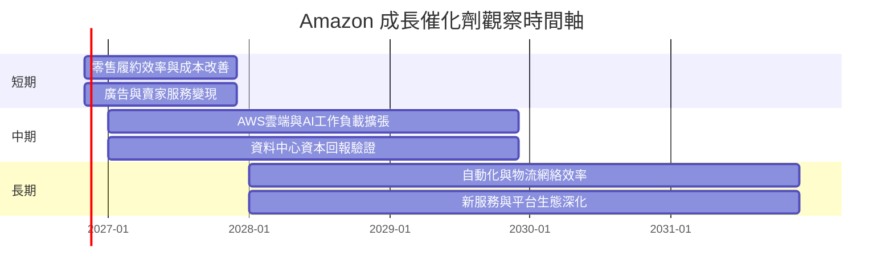

以上時間軸是研究觀察區間，並非公司已公布的業務里程碑。

### 9.2 TAM 市場規模分析

資料包未附 AWS、數位廣告、電商、AI 雲端市場的 TAM 或滲透率數據，故不編造市場規模與收入貢獻。可追蹤的可量化代理指標如下：

```
╔══════════════════════════════════════════════════════════════════╗
║                 TAM 與滲透率監控框架                            ║
╠══════════════════════════════════════════════════════════════════╣
║ AWS/AI雲端    TAM：N/A   滲透率：N/A   公司收入貢獻：分部數據N/A ║
║ 數位廣告      TAM：N/A   滲透率：N/A   公司收入貢獻：分部數據N/A ║
║ 電商/賣家服務  TAM：N/A   滲透率：N/A   公司收入貢獻：分部數據N/A ║
║ Prime訂閱     TAM：N/A   滲透率：N/A   公司收入貢獻：分部數據N/A ║
╠══════════════════════════════════════════════════════════════════╣
║ 可用公司級錨點：TTM營收$797.46B；TTM成長15.4%；Capex$215.19B  ║
╚══════════════════════════════════════════════════════════════════╝
```

### 9.3 成長驅動力結構圖

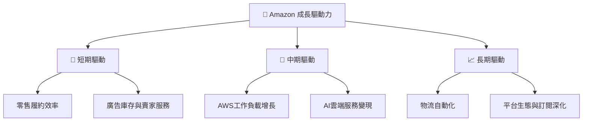

目前資料支持公司整體 TTM 營收成長 15.4%，但未提供 AWS、廣告或訂閱分部增速；因此催化劑評估需在後續季報以分部成長、營業利益及 Capex 回報驗證。

---

## 10. 風險矩陣

### 10.1 風險評分矩陣

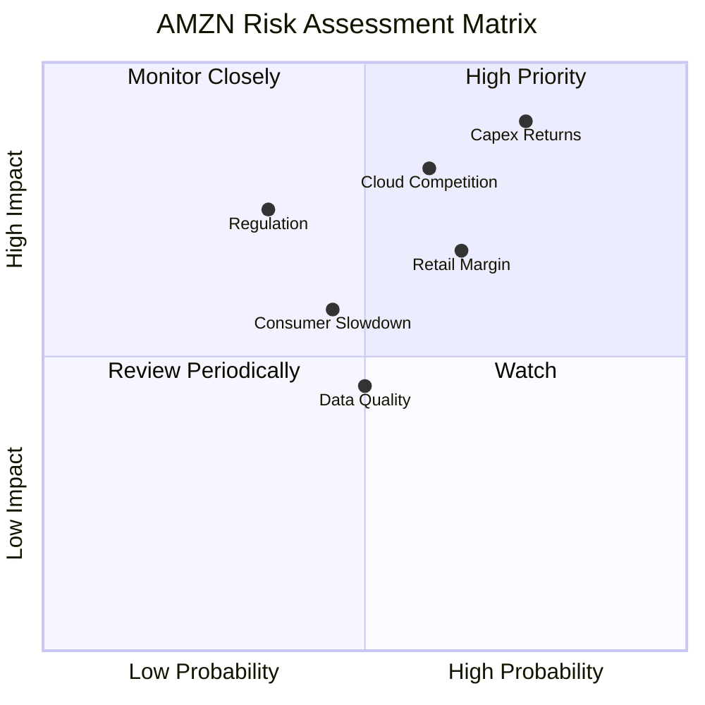

### 10.2 風險清單詳細分析

機率與財務衝擊為研究情境估計，不是公司指引或已發生損失。

| # | 風險項目 | 發生機率 | 財務衝擊 | 風險評分 | 緩解措施 |
|---|----------|----------|----------|----------|----------|
| 1 | 🔴 資本支出回報不足 | 高（約45%） | 若 Capex 維持高於營收 20%，FCF 可能持續為負 | 🔴 9.0/10 | 每季比較 Capex、OCF、AWS營業利益與新增容量利用率 |
| 2 | 🔴 AWS/AI 雲端競爭 | 中高（約35%） | 成長低於 TTM 公司整體 15.4%或價格下滑，壓低終值假設 | 🔴 8.0/10 | 追蹤 AWS 分部成長、利潤率、AI客戶變現及客戶集中度 |
| 3 | 🟠 零售與物流成本 | 中高（約40%） | 營業利益率較 13.9%下降 1–2pp，削弱營業槓桿 | 🟠 7.0/10 | 追蹤履約成本、配送效率、庫存週轉與退貨率 |
| 4 | 🟡 監管/反壟斷 | 中（約25%） | 可能提高合規成本或限制平台政策 | 🟡 6.5/10 | 監測訴訟、監管裁決及賣家條款變化 |
| 5 | 🟡 消費景氣下行 | 中（約30%） | 零售收入與廣告支出承壓 | 🟡 6.0/10 | 觀察零售成長、商品組合與庫存 |
| 6 | 🟡 財務資料口徑不一致 | 中（約30%） | FCF、現金、債務差異可能改變槓桿與估值 | 🟡 5.5/10 | 以 SEC 文件及季度現金流逐項核對 |

---

## 11. 投資建議

### 11.1 最終綜合評級雷達圖

```
╔══════════════════════════════════════════════════════════════╗
║                   AMZN 最終綜合評分                          ║
╠══════════════════════════════════════════════════════════════╣
║ 基本面強度    8.0  ▓▓▓▓▓▓▓▓▓▓▓▓▓▓▓▓░░░░  ★★★★☆            ║
║ 成長動能      8.0  ▓▓▓▓▓▓▓▓▓▓▓▓▓▓▓▓░░░░  ★★★★☆            ║
║ 獲利能力      7.0  ▓▓▓▓▓▓▓▓▓▓▓▓▓▓░░░░░░  ★★★☆☆            ║
║ 財務健康      5.5  ▓▓▓▓▓▓▓▓▓▓▓░░░░░░░░░  ★★★☆☆            ║
║ 現金流品質    4.5  ▓▓▓▓▓▓▓▓▓░░░░░░░░░░░  ★★☆☆☆            ║
║ 護城河深度    8.3  ▓▓▓▓▓▓▓▓▓▓▓▓▓▓▓▓▓░░░  ★★★★☆            ║
║ 估值合理性    3.0  ▓▓▓▓▓▓░░░░░░░░░░░░░░  ★★☆☆☆            ║
╠══════════════════════════════════════════════════════════════╣
║ 綜合評分      6.8  ▓▓▓▓▓▓▓▓▓▓▓▓▓▓░░░░░░  🟡 高質素、高估值風險║
║ 最終評級：🔴 賣出（依加權合理價值 MOS -43.6%）                ║
╚══════════════════════════════════════════════════════════════╝
```

### 11.2 目標價與隱含報酬率

| 情境/方法 | 每股價值 | 相對 2026-11-13 收盤 $266.66 | 權重/說明 |
|-----------|---------:|-----------------------------:|-----------|
| 悲觀 DCF | $25.00 | −90.6% | 假設低成長、13%期末營業利益率、較高 WACC |
| 基準 DCF | $48.40 | −81.8% | 假設 Capex/營收正常化至15%、期末 margin 16% |
| 樂觀 DCF | $90.00 | −66.2% | 假設較高成長、18%期末 margin、較低 WACC |
| DCF 機率加權 | $52.95 | −80.1% | 25%/50%/25% 機率 |
| 三角驗證加權合理價值 | **$185.73** | **−30.4%** | 估值評級與 MOS 的基準 |
| 分析師共識平均 | $326.72 | +22.5% | 外部參考，不取代模型 |

### 11.3 買入時機與觸發因素

```
╔══════════════════════════════════════════════════════════════════╗
║                  ✅ 重新評估/買入觸發因素 Checklist              ║
╠══════════════════════════════════════════════════════════════════╣
║ 重新評估條件：                                                   ║
║  ☐ TTM FCF 由 -$46.89B 回升至正值，且由營業現金流而非一次性項目推動║
║  ☐ Capex/營收連續兩季下降，且 AWS/AI營業利益同步增加             ║
║  ☐ ROIC 高於 WACC 11.98%，並至少連續兩季維持                     ║
║                                                                  ║
║ 加碼觸發條件：                                                   ║
║  ☐ 股價回到加權合理價值 10%折價區或以下：約 $167.16 以下          ║
║  ☐ TTM營收成長維持至少12%，且營業利益率不低於13%                 ║
║  ☐ Capex回報可由分部營業利益及OCF增長驗證                         ║
║                                                                  ║
║ 減碼/退出觸發條件：                                              ║
║  ☐ Capex/營收連續兩季高於25%，且 FCF 同期繼續惡化                 ║
║  ☐ TTM營業利益率低於11%，或 ROIC 進一步低於 WACC                  ║
║  ☐ AWS或廣告業務成長低於公司整體收入成長，且無利潤率補償           ║
╚══════════════════════════════════════════════════════════════════╝
```

依目前估值門檻，$167.16 是加權合理價值 $185.73 的 90%（即約 10%折價）；該數字是估值紀律參考，不是價格必然觸底的保證。

### 11.4 投資人適配度分析

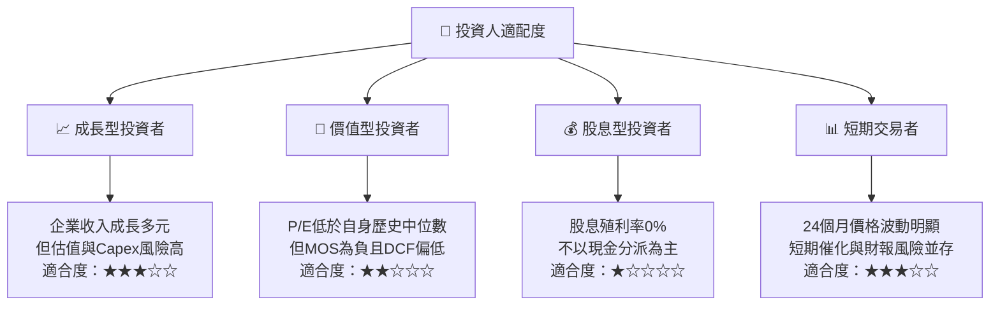

### 11.5 每季財報監控清單（Quarterly Watch List）

| 指標 | 最新基準 | 加碼/正向觸發 | 減碼/負向觸發 |
|------|---------|---------------|---------------|
| 公司收入成長 | TTM +15.4%；最新單季 YoY +12.1% | 單季 YoY ≥12% | 連續兩季 <8% |
| 營業利益率 | TTM 13.1%；最新單季 13.9% | 維持 ≥13.5% 且改善 | 低於11%或連續兩季收縮 |
| 營業現金流 | TTM $168.30B | OCF成長快於收入 | OCF連續兩季年減 |
| Capex | TTM $215.19B | Capex/營收回落且收入/營業利益同步成長 | Capex/營收 >25%且回報不升 |
| FCF | TTM −$46.89B | 轉正並連續兩季為正 | 負值擴大或轉換率持續低 |
| ROIC vs WACC | 11.0% vs 11.98% | ROIC 高於 11.98% | ROIC 進一步跌落 |
| SBC | FY2025 $19.47B；營收占比2.72% | SBC/營收下降且股數穩定 | SBC/營收持續上升、稀釋加快 |
| AWS/AI | 分部數字 N/A | 成長與利潤率同步提高 | AI支出提高但分部回報無改善 |
| 庫存/應收款 | 最新補充資料庫存 $42.63B、應收 $90.38B | 成長不高於營收且週轉改善 | 應收或庫存增速持續超過收入 |
| 管理層財測 | 未提供 | 財測上修並有現金流支持 | 財測下修或資本支出再上修 |

### 11.6 反面論證：什麼會證明論點錯誤（What Would Change My Mind）

```
╔══════════════════════════════════════════════════════════════════╗
║             ⚠️ 論點失效條件（Disconfirming Evidence）             ║
╠══════════════════════════════════════════════════════════════════╣
║  多頭論點若要成立，需看到成長轉化為可持續現金回報；下列情況將推翻║
║  或大幅削弱「高品質平台可支撐長期價值」的論點：                  ║
║  ☐ TTM營收成長連續兩季低於8%                                    ║
║  ☐ TTM營業利益率低於11%，或由13.9%附近回落超過2pp               ║
║  ☐ Capex/營收連續兩季高於25%，且營業現金流未同步增長             ║
║  ☐ TTM FCF持續低於-$46.89B，或連續兩年為負且投資回報無改善       ║
║  ☐ ROIC連續兩季低於WACC 11.98%，且差距擴大                       ║
║  ☐ SBC/營收高於3.5%並伴隨流通股數加速增加                        ║
║  ☐ AWS/廣告等高利潤業務未能改善整體利潤率，AI投資回報仍不可見    ║
╚══════════════════════════════════════════════════════════════════╝
```

**最終結論**：Amazon 的營收規模、業務多元性與平台護城河具吸引力；FY2022–FY2025 營收 CAGR 約 11.7%，VERIFIED TTM 營收成長 15.4%。但目前 TTM Capex **$215.19B** 高於 OCF **$168.30B**，TTM FCF **−$46.89B**，ROIC **11.0%** 低於 WACC **11.98%**。在加權合理價值 **$185.73** 對比現價 **$266.66**、MOS **−43.6%** 的前提下，依指定門檻評為 **🔴賣出**；若 Capex 回落、FCF 轉正且 ROIC 持續高於 WACC，應重新評估。

> **免責聲明**：本報告為 AI 自動生成，僅供研究參考，不構成投資建議。投資有風險，入市需謹慎。