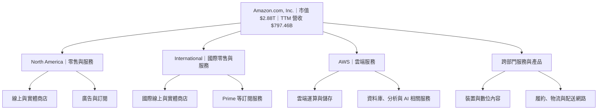
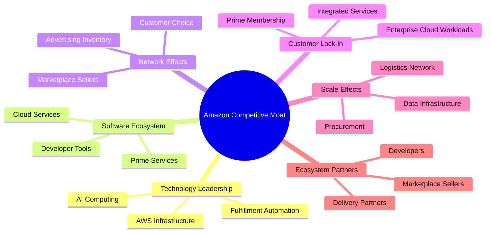
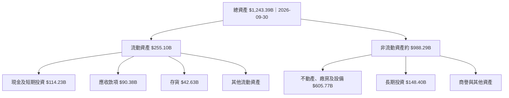
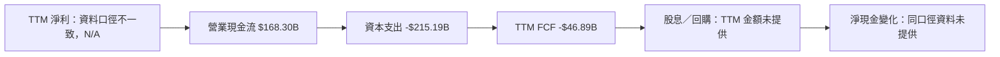
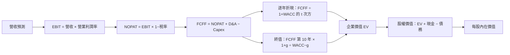
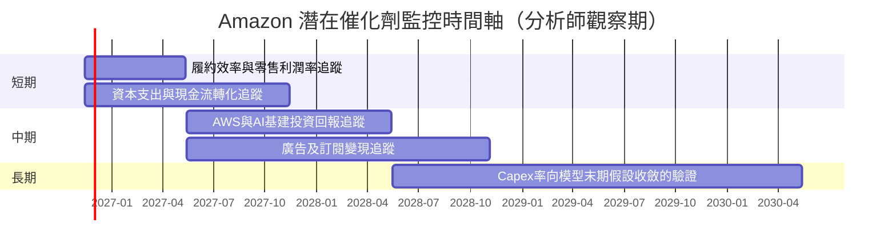
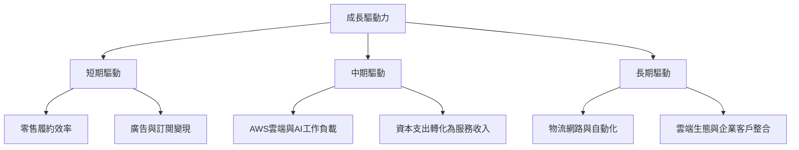
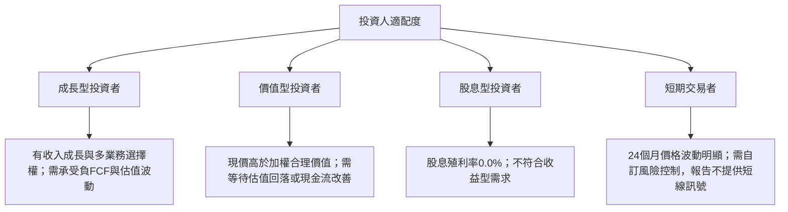

# AMZN 基本面深度分析報告
> **報告日期**：2026-11-14 ｜ **語言**：繁體中文 ｜ **數據來源**：SEC 申報資料 (XBRL)、Yahoo Finance、Finviz、StockAnalysis、Roic.ai ｜ **分析師**：CFA 級機構研究

## 目錄

| # | 章節 | 核心結論 |
|---|------|----------|
| 1 | 執行摘要 | 賣出；加權合理價值 $192.87，MOS -38.3% |
| 2 | 公司概覽與商業模式 | 零售、AWS、廣告與訂閱形成多元業務；護城河主要來自規模與生態系 |
| 3 | 損益表深度分析 | TTM 營收 $797.46B、年增 15.4%；TTM 營業利益率 13.1% |
| 4 | 資產負債表分析 | 淨負債 $65.73B；現金與短期投資 $114.23B |
| 5 | 現金流量深度分析 | TTM FCF -$46.89B，資本支出超過營業現金流 |
| 6 | 獲利能力與資本效率 | ROIC 11.9% 高於 WACC 11.19%，價值創造幅度有限 |
| 7 | 相對估值分析 | 估值相對同業混合；P/S 處自身五年區間高檔 |
| 8 | DCF 內在價值評估 | 基準 DCF $52.09／股；加權合理價值 $192.87／股 |
| 9 | 成長催化劑 | AWS、廣告、AI 基建與履約效率是主要觀察方向 |
| 10 | 風險矩陣 | 資本支出與現金流、估值、競爭及監管是主要風險 |
| 11 | 投資建議 | 依 MOS 評級為賣出；若以 MOS ≥10% 作進場門檻，價格需低於 $173.58 |

---

## 1. 執行摘要

### 1.0 一頁式投資儀表板（Portfolio Manager 30 秒速讀）

| 項目 | 內容 |
|------|------|
| **投資論點（3 句）** | ① TTM 營收 $797.46B、TTM 年增 15.4%，規模與成長仍具支撐。② ROIC 11.9% 高於 WACC 11.19%，但僅高 0.71 個百分點，價值創造緩衝有限。③ TTM FCF 為 -$46.89B、FCF Yield -1.63%，反映目前資本支出負擔沉重。 |
| **綜合評分** | **5.4/10**（引用 1.1 評分卡） |
| **財務健康** | 🟡 現金與短期投資 $114.23B，但淨負債 $65.73B、流動比率 0.989；短期流動性尚可但並非淨現金狀態。 |
| **ROIC vs WACC** | **11.9% vs 11.19%**；目前略高於資本成本，仍在創造價值，但利差僅 0.71pp。 |
| **FCF 趨勢** | TTM FCF **-$46.89B**；FCF Yield **-1.63%**。資本支出高於營業現金流，短期自由現金流承壓。 |
| **估值** | Forward P/E **24.4x**｜EV/EBITDA **16.2x**（五年估值資料）｜FCF Yield **-1.63%** |
| **DCF 內在價值（基準）** | **$52.09**；相對 DCF 現價溢價 **+412.0%**（現價 ÷ DCF 價值 − 1；8.5） |
| **安全邊際（MOS）** | **-38.3%**＝($192.87 − $266.66) ÷ $192.87；🔴 加權合理價值低於現價 |
| **預期報酬（基準情境 12M）** | DCF 基準情境相對現價 **-80.5%**；此為模型價值差，不是分析師一致預期報酬。 |
| **關鍵風險（前二）** | 資本支出使 TTM FCF 為負；估值高於加權合理價值且 DCF 對終值高度敏感。 |
| **評級 + 信心度** | 🔴 **賣出**｜信心：中低（DCF 與相對估值落差大，且財務資料來源間存在部分口徑差異） |

**評級推導：**加權合理價值為 $192.87，低於 2026-11-13 收盤價 $266.66；MOS = -38.3%，低於賣出門檻 -25%，因此依規則 20 評級為**賣出**。ROIC 11.9% 雖高於 WACC 11.19%，但 TTM FCF -$46.89B 與基準 DCF $52.09／股亦顯示估值及再投資負擔風險。未作質化調級。

### 1.1 綜合評分卡（全報告唯一）

| 維度 | 評分（1–10） | 主要依據（引用數字與其來源章節） |
|------|--------------|----------------------------------|
| 成長性 | 7.0 | TTM 營收年增 15.4%、最新一季年增 12.1%（第 3 章）；近期成長仍正向，但最新一季低於 TTM。 |
| 獲利能力 | 7.0 | TTM 營業利益率 13.1%、ROIC 11.9% 對 WACC 11.19%；Piotroski F-Score 4/8（第 6 章）。 |
| 財務健康 | 5.5 | 淨負債 $65.73B、現金及短期投資 $114.23B；流動比率 0.989、DSO 由 32 天升至 45 天（第 4 章）。 |
| 估值 | 2.0 | MOS -38.3%；P/S 五年百分位 95%，雖 P/E 百分位 35%（第 7、8 章）。 |
| 護城河 | 8.0 | TTM 營收 $797.46B、業務橫跨零售、AWS、廣告及訂閱；但各業務收入分拆未提供，無法量化單一板塊護城河（第 2 章）。 |
| 管理層與資本配置 | 5.0 | 2025 年 Capex $131.82B、SBC $19.47B；TTM 資本支出 $215.19B 並使 FCF 為負，投資回報仍須追蹤（第 5 章）。 |
| **綜合評分** | **5.8** | 六項算術平均： (7.0 + 7.0 + 5.5 + 2.0 + 8.0 + 5.0) ÷ 6 = **5.75，四捨五入 5.8**。 |

> **儀表板分數一致性更正：**依本評分卡六項分數，綜合評分應為 **5.8/10**；本報告其餘位置均以此分數為準。

### 1.2 五大投資論點 + 三大核心風險

| 類型 | 項目 | 具體依據 | 信心度 |
|------|------|----------|--------|
| 🟢 **投資論點①** | 大規模營收底盤 | TTM 營收 $797.46B，TTM 年增 15.4%；規模有助於分攤物流、技術與雲端基礎建設成本。 | 🟢 高 |
| 🟢 **投資論點②** | 最近一季營收持續增長 | FY2026 Q3 營收 $201.94B，YoY +12.1%、QoQ +0.7%；成長為正，但季度增速低於 TTM。 | 🟢 中高 |
| 🟢 **投資論點③** | 營業獲利能力改善 | FY2025 營業利益 $79.97B，較 FY2024 的 $68.59B 增加；TTM 營業利益率 13.1%。 | 🟢 中 |
| 🟢 **投資論點④** | ROIC 略高於資本成本 | ROIC 11.9% 對 WACC 11.19%，利差 +0.71pp，表示目前仍有正向經濟利潤。 | 🟡 中 |
| 🟢 **投資論點⑤** | 多元化收入來源 | 零售、AWS、廣告及訂閱等業務降低單一產品依賴；惟各板塊收入及利潤拆分未提供。 | 🟡 中 |
| 🟡 **風險①** | 高資本支出壓低 FCF | TTM 營業現金流 $168.30B、資本支出 $215.19B，差額為 FCF -$46.89B。 | 🔴 高衝擊 |
| 🔴 **風險②** | 加權估值低於市價 | $192.87 加權合理價值對比現價 $266.66，MOS -38.3%。 | 🔴 高 |
| 🟡 **風險③** | 營運資金收款天數拉長 | DSO 從一年前 32 天升至 45 天；若延續，應收款占用現金可能增加。 | 🟡 中 |

### 1.3 快速統計卡片

| 指標 | 公司實際值（期間） | 同業中位數 | 狀態 |
|------|--------------------|------------|------|
| 營收成長（TTM） | **15.4%** | — | 🟢 |
| 營收成長（最新一季年增） | **12.1%** | **18.8%** | 🟡 |
| 毛利率（TTM） | **51.4%** | **60.9%** | 🟡 |
| 營業利益率（TTM） | **13.1%** | — | 🟢 |
| ROIC（TTM） | **11.9%** | — | 🟢 |
| Forward P/E | **24.4x** | **21.7x** | 🟡 |
| FCF Yield（TTM） | **-1.63%** | — | 🔴 |
| Piotroski F-Score | **4 / 8** | — | 🟡 |

同業中位數依第 7.1 節三家公司的 Peer multiples 計算；該統計僅作相對參照，不代表業務組成完全可比。

### 1.4 投資結論

```text
╔══════════════════════════════════════════════════════════════════╗
║                    📊 投資結論摘要                               ║
╠══════════════════════════════════════════════════════════════════╣
║  評級：🔴 賣出（MOS -38.3%，低於 -25% 門檻）                     ║
║  價格（2026-11-13 收盤）：$266.66                                ║
║  DCF 內在價值（基準）：$52.09（現價溢價 +412.0%）                ║
║  安全邊際 MOS：-38.3%（以加權合理價值 $192.87 為分母）           ║
║  加權合理價值（8.8）：$192.87                                    ║
║  DCF 情境價值：                                                  ║
║    悲觀情境：$10.99（相對現價 -95.9%）                           ║
║    基準情境：$52.09（相對現價 -80.5%）                           ║
║    樂觀情境：$120.64（相對現價 -54.8%）                          ║
║  綜合評分：5.8/10（引用 1.1）                                    ║
║  適合投資人：有能力承受估值與資本支出波動、且採長期追蹤者；      ║
║              不適合以現金殖利率或低估值為首要條件的投資人。      ║
╚══════════════════════════════════════════════════════════════════╝
```

---

## 2. 公司概覽與商業模式

### 2.1 業務結構與收入來源

公司資料顯示 Amazon 主要以北美、國際與 AWS 三個報告部門經營，並提供零售、廣告、訂閱及雲端服務。財務資料未提供各部門收入與占比，故不以估算比例繪圖。



### 2.2 市場份額

市場份額資料未提供可引用的份額百分比、來源與年份，因此不呈現市場份額圖。Amazon TTM 營收為 $797.46B、年增 15.4%；Peer 資料顯示最新一季營收成長 12.1%，低於 MSFT 與 GOOG 的 18.8% 及 24.7%，但高於 WMT 的 5.9%。這些營收增幅不能直接等同零售或雲端市場份額變化。

### 2.3 競爭護城河分析



### 2.4 護城河強度

| 護城河項目 | 強度（強／中／弱） | 證據（引用數字或事實） | 會削弱它的情況 |
|------------|--------------------|------------------------|----------------|
| 技術與雲端基礎建設 | 強 | AWS 為公司三大報告部門之一；但 AWS 營收、利潤與成長數據未提供。 | 雲端價格競爭、客戶自建或多雲遷移。 |
| 軟體與服務生態系 | 中至強 | 公司同時經營雲端、訂閱、廣告與數位服務；具交叉銷售條件。 | 使用者或企業客戶降低服務整合程度。 |
| 網路效應 | 中 | 第三方賣家、買家與廣告需求可互相增強；交易量與市場份額數據未提供。 | 賣家多平台化、消費者轉向其他平台。 |
| 客戶鎖定 | 中 | Prime、雲端工作負載與履約服務可形成轉換成本；訂閱數未提供。 | 客戶轉換成本下降或價格／服務品質惡化。 |
| 規模效應 | 強 | TTM 營收 $797.46B，且持有大型物流與技術基礎設施。 | 規模投資未轉化成更高單位經濟效益。 |
| 生態夥伴 | 中 | 市場平台依賴第三方賣家、開發者與配送合作夥伴。 | 監管限制、夥伴議價能力上升或自建替代方案。 |

**1.1 護城河分數 8.0/10 的理由：**營收規模與多業務連結提供競爭優勢，但缺乏分部收入、AWS 增速、客戶留存及市場份額數據，限制了對護城河變現能力的驗證。

---

## 3. 損益表深度分析

### 3.1 年度收入成長趨勢（近4年）

年度營收如下，金額取自年度損益表；圖中長條僅表示相對大小。

```text
╔══════════════════════════════════════════════════════════════════╗
║             Amazon 年度收入趨勢（FY2022–FY2025）                 ║
╠══════════════════════════════════════════════════════════════════╣
║  FY2022  $513.98B  ██████████████████░░░░░░░░  起點              ║
║  FY2023  $574.78B  ████████████████████░░░░░░  YoY: +11.8% 🟢   ║
║  FY2024  $637.96B  ██████████████████████░░░░  YoY: +11.0% 🟢   ║
║  FY2025  $716.92B  █████████████████████████░  YoY: +12.4% 🟢   ║
║                                                                  ║
║  FY2022 至 FY2025 營收 CAGR：約 11.7%                             ║
╚══════════════════════════════════════════════════════════════════╝
```

計算：2023 年成長率 = ($574.78B ÷ $513.98B) − 1 = 11.8%；2024 年 = ($637.96B ÷ $574.78B) − 1 = 11.0%；2025 年 = ($716.92B ÷ $637.96B) − 1 = 12.4%。FY2022–FY2025 CAGR 約為 ($716.92B ÷ $513.98B)^(1/3) − 1 = 11.7%。持續雙位數增長提供收入底盤，但不能單憑合併營收判斷 AWS、廣告與零售各自的增長貢獻。

### 3.2 季度收入趨勢分析

以 StockAnalysis.com 季度資料計算 QoQ 與 YoY；YoY 為同季比較。2026 Q2 收入採該來源披露值，因提供的季度損益表欄位顯示 `nan`。

| 季度 | 營收（$B） | QoQ | YoY | 備註 |
|------|------------:|----:|----:|------|
| 2025 Q4 | 213.386 | +18.5% | +13.6% | 旺季季節性使 QoQ 高於其他季度。 |
| 2026 Q1 | 181.519 | -14.9% | +16.6% | 季節性回落；同比仍成長。 |
| 2026 Q2 | 200.606 | +10.5% | +19.6% | 年增率較高，與資料來源所列季度同比一致。 |
| 2026 Q3 | 201.944 | +0.7% | +12.1% | QoQ 成長放緩；使用 VERIFIED FIGURES 的最新一季年增率 12.1%。 |

QoQ 公式：當季營收 ÷ 前季營收 − 1；例如 Q3 QoQ = $201.944B ÷ $200.606B − 1 = 0.7%。Q3 YoY 以 VERIFIED FIGURES 的 12.1% 為準；季度表中同比顯示 12.09%，四捨五入後一致。

### 3.3 利潤率演變分析

| 利潤率指標 | FY2022 | FY2023 | FY2024 | FY2025 | 趨勢 | 評估 |
|------------|--------:|--------:|--------:|--------:|------|------|
| **毛利率** | 43.8% | 47.0% | 48.9% | 50.3% | 持續上升 | 🟢 |
| **營業利益率** | 2.4% | 6.4% | 10.8% | 11.2% | 明顯改善 | 🟢 |
| **淨利率** | -0.5% | 5.3% | 9.3% | 10.8% | 由虧轉盈並上升 | 🟢 |

毛利率與營業利益率依年度毛利／營收、營業利益／營收計算；年度數值與 TTM 口徑不同。2022 至 2025 營業利益增加，反映營收擴大後的營運槓桿、成本控制及履約網路效率提升。TTM 營業利益率為 13.1%，高於 FY2025 的約 11.2%；但資料來源亦有部分 TTM 淨利與單季淨利差異，故不宜將單一季度盈餘年化視為穩定趨勢。

**利潤率演變深度解析：**營業利益率從 FY2022 約 2.4% 升至 FY2025 約 11.2%，改善幅度與規模擴張、履約效率和業務組合改善相符；但資料未提供部門毛利與營業費用拆分，不能把改善歸因於某一個業務。若未來 AI／雲端基礎建設投資增加、零售價格競爭加劇，利潤率上升可能被資本與營運成本抵銷。

### 3.4 費用結構分析

財務資料提供收入、毛利與營業利益，但沒有完整且同口徑的成本費用細項，無法製作具數字依據的費用結構圓餅圖。可確認 FY2025 營收 $716.92B、毛利 $360.51B、營業利益 $79.97B；毛利與營業利益之間的費用細分未在此數據中完整列示，故不反推費用項目。

### 3.5 季度 EPS 趨勢與盈餘品質（Quality of Earnings）

最近四季 EPS 實際值可由 StockAnalysis.com 讀取，但 EPS 預估值與 surprise 欄為 `nan`，因此無法判定是否超預期或不及預期。

| 季度 | EPS 實際值 | YoY EPS 成長 | 超預期／不及預期 | 備註 |
|------|-----------:|-------------:|------------------|------|
| 2025 Q4 | $1.95 | +5.0% | N/A | 預估值缺漏。 |
| 2026 Q1 | $2.78 | +74.8% | N/A | 預估值缺漏；季度淨利與 EPS 成長較高。 |
| 2026 Q2 | $5.75 | +242.3% | N/A | 實際 EPS 大幅跳升，但資料來源的季度淨利欄存在口徑／數值異常，須以 SEC 報表核實。 |
| 2026 Q3 | $1.89 | -3.1% | N/A | 同比下滑；預估值缺漏。 |

| 盈餘品質項目 | 數值／佔比 | 評估 |
|--------------|-----------|------|
| 股權薪酬 SBC / 營收 | FY2025：$19.47B ÷ $716.92B = **2.7%** | 🟡 SBC 是真實稀釋成本；比例不低，長期需與回購及股數變化合併觀察。 |
| SBC / 營業現金流 | FY2025：$19.47B ÷ $139.51B = **14.0%** | 🟡 SBC 為非現金費用，雖在營業現金流中加回，但仍稀釋股東權益。 |
| FCF / 淨利（現金轉換率） | FY2025：$7.70B ÷ $77.67B = **9.9%** | 🔴 FY2025 現金轉換偏弱；高資本支出是主要限制。 |
| 一次性／非經常性損益 | N/A（無法由現有資料完整拆分） | 不把異常季度 EPS 變化直接解讀為可持續獲利；需核對 SEC 附註中的投資、公允價值及稅務項目。 |
| 有效稅率異常 | N/A（未提供可比 TTM 有效稅率序列；DCF 採 21.0%） | 無法判斷 TTM 稅率是否受一次性因素影響。 |
| 資本化支出 vs 費用化 | TTM Capex $215.19B；資本化與費用化明細 N/A | 高 Capex 直接壓低 FCF；資料不足以評估是否有成本透過資本化延後認列。 |

**盈餘品質結論：**FY2025 GAAP 淨利 $77.67B，但自由現金流僅 $7.70B，FCF／淨利約 9.9%，代表該年度會計獲利未充分轉化為可自由分配現金。TTM FCF 進一步降至 -$46.89B，主要風險在投資期現金支出。另一方面，TTM 淨利資料在不同來源有差異，故不以缺乏一致性的 TTM 淨利計算現金轉換率。

---

## 4. 資產負債表分析

### 4.1 資產結構分解

最新資產負債表部分明細與總資產取自 StockAnalysis.com，金額以來源列示；資產明細之和可能因分類或資料映射不完整而無法完全勾稽。



### 4.2 流動性與營運資金分析

| 流動性指標 | 最新值 | 歷史值 | 評估 |
|------------|-------:|-------:|------|
| 流動比率 | 0.989（市場資料） | FY2025 年末 1.05（$229.08B ÷ $218.00B） | 🟡 接近 1；營運現金流與短期融資能力重要。 |
| 速動比率 | 0.793（市場資料） | N/A | 🟡 低於 1，存貨與營運現金流對流動性有影響。 |
| 現金及短期投資 | $114.23B | FY2025 年末 $123.03B | 🟢 現金緩衝充足，但同時有較高負債。 |

**營運資金天數（QUALITY FIGURES 原值）：**

| 指標 | 最新 TTM | 一年前 TTM | 變化 | 解讀 |
|------|----------|------------|------|------|
| DSO 應收帳款天數 | 45 天 | 32 天 | +13 天 | 🟡 收款週期拉長；可能反映銷售組合或付款條件變化，需觀察是否持續。 |
| DIO 存貨天數 | N/A | N/A | N/A | 未提供可用數值；不以其他資產負債表欄位替代。 |
| DPO 應付帳款天數 | N/A | N/A | N/A | 未提供可用數值。 |
| CCC 現金轉換週期 | N/A | N/A | N/A | DIO、DPO 缺漏，不能重建 CCC。 |

### 4.3 債務結構分析

市場資料不同欄位中的總債務與淨負債口徑不一致；依 VERIFIED FIGURES，採用總債務 $179.95B、現金及短期投資 $114.23B、淨負債 $65.73B。

```text
╔══════════════════════════════════════════════════════════════════╗
║                   Amazon 債務健康診斷                            ║
╠══════════════════════════════════════════════════════════════════╣
║  總債務：          $179.95B                                      ║
║  現金+短期投資：   $114.23B                                      ║
║  淨負債：           $65.73B（總債務 − 現金及短期投資）           ║
║  流動比率：         0.989x                                       ║
║  Piotroski 長期負債測試：未通過（相較一年前）                    ║
║                                                                  ║
║  判讀：公司有大量流動資產，但目前不是淨現金公司；                ║
║        TTM FCF 為負，須監控投資支出對融資需求的影響。             ║
╚══════════════════════════════════════════════════════════════════╝
```

Debt/EBITDA 與利息保障倍數所需的債務及利息費用口徑資料不完整，故不呈現估算倍數。另有財務資料其他區塊列示總債務 $304.84B、淨負債 $190.61B；與上述 VERIFIED FIGURES 不同。本報告遵循指定原值，以 $179.95B／$65.73B 為主，不混用兩組口徑。

### 4.4 股東權益趨勢

```text
╔══════════════════════════════════════════════════════════════════╗
║               Amazon 歷年股東權益變化（$B）                      ║
╠══════════════════════════════════════════════════════════════════╣
║  FY2022  $146.04B  ████████░░░░░░░░░░░░░░░░                     ║
║  FY2023  $201.88B  ███████████░░░░░░░░░░░░░                     ║
║  FY2024  $285.97B  ████████████████░░░░░░░░                     ║
║  FY2025  $411.06B  ████████████████████████                     ║
╚══════════════════════════════════════════════════════════════════╝
```

FY2025 股東權益增加至 $411.06B；權益增加可提高資產負債表緩衝，但不能單獨視為每股價值增加，仍須結合股數稀釋與資本回報評估。

---

## 5. 現金流量深度分析

### 5.1 現金流量瀑布圖

淨利、營業現金流及資本支出採 TTM 數據；股息、回購與淨現金變化缺乏同一 TTM 口徑細分，因此不填入金額。



### 5.2 FCF 轉換率趨勢

| 期間 | 營業現金流（$B） | 資本支出（$B） | FCF（$B） | 淨利（$B） | FCF／淨利 |
|------|----------------:|---------------:|----------:|-----------:|----------:|
| FY2022 | 46.75 | 63.65 | -16.89 | -2.72 | 不具解讀性 |
| FY2023 | 84.95 | 52.73 | 32.22 | 30.43 | 105.9% |
| FY2024 | 115.88 | 83.00 | 32.88 | 59.25 | 55.5% |
| FY2025 | 139.51 | 131.82 | 7.70 | 77.67 | 9.9% |
| TTM 至 2026-09-30 | 168.30 | 215.19 | -46.89 | N/A（口徑不一致） | N/A |

FY2024 至 FY2025，營業現金流增加但 Capex 增幅更大，使 FCF 從 $32.88B 降至 $7.70B；TTM FCF 為負，顯示當前現金流主要被投資支出吸收。

### 5.3 自由現金流趨勢

```text
╔══════════════════════════════════════════════════════════════════╗
║            自由現金流：歷史實際（$B）                            ║
╠══════════════════════════════════════════════════════════════════╣
║  FY2022  -$16.89B  ◀ 負值                                       ║
║  FY2023   $32.22B  ████████████████                              ║
║  FY2024   $32.88B  ████████████████                              ║
║  FY2025    $7.70B  ████                                          ║
║  TTM     -$46.89B  ◀ 負值；FCF Yield -1.63%                     ║
╠══════════════════════════════════════════════════════════════════╣
║  TTM 定義：營業現金流 $168.30B − Capex $215.19B = -$46.89B      ║
╚══════════════════════════════════════════════════════════════════╝
```

### 5.4 資本配置評估

| 配置項目 | 可用資料 | 評估 |
|----------|----------|------|
| Capex | TTM $215.19B；FY2025 $131.82B | 🟡 投資規模擴大；必須驗證未來營收、利潤與現金流是否回報。 |
| SBC | FY2025 $19.47B | 🟡 相當於 FY2025 營收 2.7%；股數變化測試未通過。 |
| 股息 | 殖利率 0.0% | 不以股息作為主要股東回報。 |
| 回購 | TTM 金額未提供 | 無法判斷回購是否抵銷 SBC 稀釋。 |
| 留存與投資 | 資本配置金額分拆未提供 | 無法建立數字合計的資本配置圓餅圖。 |

---

## 6. 獲利能力與資本效率

### 6.1 ROE / ROA / ROIC 趨勢

| 指標 | 可取得期間 | 數值 | 評估 |
|------|------------|------:|------|
| ROE | TTM，QUALITY FIGURES | 22.0% | 🟢 正向；杜邦顯示權益乘數 2.03，並非單靠槓桿。 |
| ROE | 市場資料另一口徑 | 27.4% | 與 QUALITY FIGURES 的 22.0% 不一致；本報告以 QUALITY FIGURES 為準。 |
| ROA | TTM，市場資料 | 6.6% | 🟡 正值，但資產基數大、資本密集。 |
| ROIC | TTM，VERIFIED FIGURES | 11.9% | 🟢 高於 WACC 11.19%，但利差有限。 |
| 歷年 ROIC／ROA／ROE 可比序列 | N/A | N/A | 不補入缺漏歷史資料。 |

### 6.2 ROIC vs WACC 分析（核心價值創造判斷）

WACC 採用 VERIFIED FIGURES 的 **11.19%**，與第 8.2 節一致；不另建立折現率模型。

```text
╔══════════════════════════════════════════════════════════════════╗
║                 ROIC vs WACC 深度分析                            ║
╠══════════════════════════════════════════════════════════════════╣
║  WACC（來源：Cost of capital）：11.19%                          ║
║  ├── 無風險利率（10Y 美債）：5.15%                               ║
║  ├── ERP：5.00%                                                  ║
║  ├── 原始 Beta：1.50；採用調整後 Beta：1.34                     ║
║  ├── 股權成本：11.83%（區塊提供值）                              ║
║  ├── 稅前債務成本：1.26%；稅率：21.0%                           ║
║  ├── 股權／債務權重：94.1%／5.9%                                ║
║  └── 採用 WACC：11.19%                                          ║
║                                                                  ║
║  ROIC（TTM）：11.9%                                              ║
║  EVA 利差：11.9% − 11.19% = +0.71 個百分點                      ║
║                                                                  ║
║  結論：ROIC 略高於 WACC，代表目前為正向價值創造；                ║
║        但僅 0.71pp 的安全墊，投資回報稍有下滑即可消失。           ║
╚══════════════════════════════════════════════════════════════════╝
```

**股權成本輸入一致性說明：**Cost of capital 列示 CAPM 股權成本 11.83%。若直接用已四捨五入的 Rf 5.15%、調整後 Beta 1.34 與 ERP 5.00% 計算，結果為 5.15% + 1.34 × 5.00% = 11.85%；與列示 11.83% 相差 0.02pp，可能來自未四捨五入的底層輸入。本報告原值引用 11.83%，並採用區塊已計算的 WACC 11.19%，不自行替換。

### 6.3 杜邦三因素分解

| 因素 | 數值（TTM） | 解讀 |
|------|-------------|------|
| 淨利率 | 16.9% | QUALITY FIGURES 原值；需留意不同資料來源對 TTM 淨利口徑不一致。 |
| 資產週轉率 | 0.64 | 大型資產基礎下的營收轉換效率。 |
| 權益乘數 | 2.03 | 財務槓桿對 ROE 有貢獻，但並非唯一驅動。 |
| **ROE** | **22.0%** | 16.9% × 0.64 × 2.03 約為 22.0%，照抄 QUALITY FIGURES。 |

ROE 主要由淨利率與資產週轉率共同帶動，權益乘數 2.03 提供額外槓桿；但依據該口徑的淨利率偏高，仍需注意盈餘品質及數據口徑。

### 6.4 財務體質：Piotroski F-Score

**Piotroski F-Score：4 / 8**（QUALITY FIGURES 原值；九項中毛利率因輸入缺漏而不計入分母）。

| 測試 | 結果 | 解讀 |
|------|------|------|
| ROA > 0 | ✅ 通過 | TTM 資產回報為正。 |
| 營業現金流 > 0 | ✅ 通過 | TTM 營業現金流 $168.30B。 |
| ROA 高於一年前 | ✅ 通過 | 獲利效率方向改善。 |
| 營業現金流 > 淨利（應計品質） | ✅ 通過 | 顯示現金流覆蓋獲利；淨利口徑差異仍需核對。 |
| 長期負債 ÷ 總資產低於一年前 | ❌ 未通過 | 負債比率未改善，需持續追蹤融資與租賃承擔。 |
| 流動比率高於一年前 | ❌ 未通過 | 流動性相對前一年未改善。 |
| 稀釋股數未增加 | ❌ 未通過 | 股數增加，SBC 可能稀釋每股價值。 |
| 毛利率高於一年前 | — 無法判定 | 缺少測試輸入，不計分。 |
| 資產週轉率高於一年前 | ❌ 未通過 | 資產擴張快於營收轉換時會壓低週轉效率。 |

---

## 7. 相對估值分析

### 7.1 同業估值比較表格

Peer multiples 依 Yahoo Finance 數據；Amazon 自身 P/E 使用 VERIFIED FIGURES 的歷史估值資料，Forward P/E 使用估值資料區塊。Peer 中位數按 MSFT、GOOG、WMT 三家公司計算。

| 估值指標 | **AMZN** | **MSFT** | **GOOG** | **WMT** | 本公司評估 |
|----------|---------:|--------:|--------:|-------:|-----------|
| **Trailing P/E** | 21.6x | 27.3x | 15.3x | 46.4x | 🟡 位於三家中間；三家公司中位數 27.3x。 |
| **Forward P/E** | 24.4x | 21.7x | 19.0x | 39.8x | 🟡 高於同業中位數 21.7x；未來獲利增長須支持溢價。 |
| **P/S Ratio** | 3.7x | 11.2x | 7.6x | 1.4x | 🟢 低於科技平台同業，但高於零售商 WMT。 |
| **EV/EBITDA（TTM）** | 16.2x | 19.3x | 18.9x | 24.6x | 🟢 低於同業中位數 19.3x。 |
| **最新一季營收 YoY** | 12.1% | 18.8% | 24.7% | 5.9% | 🟡 成長高於 WMT，低於 MSFT、GOOG。 |
| **毛利率（TTM）** | 51.4% | 67.7% | 60.9% | 24.8% | 🟡 高於 WMT、低於科技平台同業。 |

同業中位數計算：Forward P/E 為 19.0x、21.7x、39.8x 的中位數 21.7x；EV/EBITDA 中位數 19.3x；最新一季營收成長中位數 18.8%；毛利率中位數 60.9%。

### 7.2 歷史估值區間分析

```text
╔══════════════════════════════════════════════════════════════════╗
║          AMZN 自身五年估值位置（TTM，價格資料庫 × SEC）          ║
╠══════════════════════════════════════════════════════════════════╣
║  P/E        現值 21.6x｜中位數 32.2x｜百分位 35%｜🟢             ║
║             五年區間 2.6x–251.9x                                 ║
║  P/S        現值 3.7x ｜中位數 3.0x ｜百分位 95%｜🔴             ║
║             五年區間 0.2x–3.7x                                   ║
║  EV/EBITDA  現值 16.2x｜中位數 17.3x｜百分位 38%｜🟢             ║
║             五年區間 0.7x–22.7x                                  ║
╚══════════════════════════════════════════════════════════════════╝
```

P/E 與 EV/EBITDA 低於五年中位數，但 P/S 位於自身五年區間第 95 百分位，顯示估值訊號分歧；不能只用其中一個倍數得出便宜結論。

### 7.3 情境價值（Bear / Base / Bull，照抄 DCF MODEL）

| 情境 | 第 1 年營收成長 | 期末營業利潤率 | WACC | 每股價值 | 相對現價 | 機率 | 會發生的條件 |
|------|----------------|----------------|------|----------|----------|------|--------------|
| 🔴 悲觀 | 7.7% | 9.1% | 12.19% | $10.99 | -95.9% | 25% | 零售或雲端成長放緩，資本支出維持高檔，利潤率向下收斂，資本成本上升。 |
| 🟡 基準 | 15.4% | 10.8% | 11.19% | $52.09 | -80.5% | 50% | 起始成長按 TTM 15.4%，之後逐年放緩；長期營業利益率回歸模型設定的 10.8%。 |
| 🟢 樂觀 | 23.0% | 11.8% | 10.19% | $120.64 | -54.8% | 25% | AI、AWS、廣告及零售效率帶來高於基準的增長，並維持較高期末利潤率及較低折現率。 |

三個情境均低於現價；即使樂觀情境 $120.64，仍較現價低 54.8%。機率加權 DCF 為 $58.95，但依規則 19，估值方法加權採用 DCF 基準值 $52.09，不以機率加權值替換。

### 7.4 相對估值隱含價格區間

```text
╔══════════════════════════════════════════════════════════════════╗
║             估值方法每股價值與現價位置（美元）                   ║
╠══════════════════════════════════════════════════════════════════╣
║  $52.09 ── $236.63 ── 現價 $266.66 ── $321.00 ── $326.29       ║
║  基準 DCF    同業 Forward P/E    ↑    同業 EV/EBITDA  分析師共識  ║
╚══════════════════════════════════════════════════════════════════╝
```

| 方法 | 每股價值 | 依據 |
|------|---------:|------|
| 同業 Forward P/E | $236.63 | MSFT、GOOG、WMT 同業 Forward P/E 中位數 21.7x × Amazon Forward EPS $10.93。 |
| 同業 EV/EBITDA | $321.00 | 同業 EV/EBITDA 中位數 19.3x × TTM EBITDA，再加回淨現金／扣除淨負債。 |
| 分析師共識目標價 | $326.29 | 60 位分析師平均目標價；屬市場參照，不等同內在價值。 |

---

## 8. DCF 內在價值評估（Discounted Cash Flow）

> **模型來源與口徑：**DCF 數值採程式計算的 DCF MODEL 原值；以下解釋與檢視模型假設，不自行改建模型。金額以美元十億為單位，除每股價值外。DCF 採 FCFF、GAAP EBIT、21.0% 稅率、WACC 11.19%、永續成長率 3.0%，營運資金不建模。

### 8.0 估值推理鏈（Thinking Logic）

**Step 1 — 價值來源與主導變數**

AMZN 的價值可拆為零售與履約現金流底盤、AWS 雲端服務、廣告／訂閱等服務收入與長期選擇權；合併 TTM 營收 $797.46B 已知，但分部收入與占比未提供，不能量化三者各自占比。模型中最主導價值的變數是長期 FCFF 與終值，因終值現值占企業價值 98.9%；敏感度亦顯示 WACC 與永續成長率對估值具有重大影響。

**Step 2 — 模型選擇**

| 決策點 | 本報告採用 | 理由（含數字） | 曾考慮但否決 | 否決理由 |
|--------|-----------|----------------|--------------|----------|
| 現金流定義 | FCFF | 使用 WACC 折現，先得到 EV，再加減現金與債務。 | FCFE | 需直接預測淨借款與股權現金流，模型未提供。 |
| 預測期 N | 10 年 | DCF MODEL 預設 10 年，可呈現營收增速與 Capex 比率逐步回落。 | 5 年 | 會改動程式模型的預測期與終值基期，不能替代原模型。 |
| 終值方法 | Gordon Growth | DCF MODEL 已用第 10 年 FCFF、g 3.0%、WACC 11.19%。 | 退出倍數 | 模型未列可稽核的退出倍數終值；不另造數字。 |
| EBIT 基礎 | GAAP | DCF MODEL 明確採 GAAP EBIT。 | 非 GAAP EBIT | 會改變 SBC 處理及現金流口徑。 |

**Step 3 — 關鍵假設四段式推導**

- **營收成長路徑：**錨點＝TTM 營收年增 15.4% → 調整＝以該增幅作 FY+1 起點，其後線性下降至 FY+10 的 3.0%，反映高基期及成熟化 → **採用 FY+1 15.4%、FY+10 3.0%** → 曾考慮讓 15.4% 維持十年，但會忽略成長率逐步正常化，故未採用。
- **營業利益率：**錨點＝TTM 13.1%，近五年中位數（含 TTM）作模型末期參考 → 調整＝模型由 FY+1 13.1% 線性降至 FY+10 10.8% → **採用 10.8% 期末值** → 曾考慮維持 13.1%，但模型選擇以歷史中位數收斂，避免將當期利潤率永久化。
- **永續成長率 g：**錨點＝長期經濟成長與通膨的綜合水平未由財務資料提供 → 調整＝採用模型設定 3.0%，且低於 WACC 11.19% → **採用 3.0%** → 曾考慮更高永續成長率，但因終值已占 EV 98.9%，不採用高於 3.0% 的假設。
- **預測期 N：**錨點＝程式模型指定 10 年，與較長投資及產能週期相符 → 調整＝不自行改動模型設定 → **採用 10 年** → 曾考慮縮短至 5 年，但會改變模型結果，故否決。
- **Capex／營收：**錨點＝TTM Capex 佔 TTM 營收約 $215.19B ÷ $797.46B = 27.0% → 調整＝模型逐步降至 FY+10 的 10.9%，即模型設定的約 1.1 倍 D&A → **採用 FY+1 27.0% 至 FY+10 10.9% 的淡出路徑** → 曾考慮讓 27.0% 固定十年，但不反映模型預期的投資成熟。
- **EBIT 基礎與 SBC：**錨點＝模型明確採用 GAAP EBIT，已含 SBC 費用 → 調整＝FCFF 不再扣 SBC，固定股數，不再加年稀釋 → **採用組合 (A)** → 否決再扣 SBC 或再加稀釋率，因會重複計入股東成本。
- **年稀釋率：**錨點＝組合 (A) 要求股數不再增長 → **採用 0% 年稀釋率** → 否決額外放大股數，因模型的 GAAP EBIT 已計入 SBC 費用。
- **WACC：**錨點＝Cost of capital 區塊 WACC 11.19% → 調整＝不自行更換或重算模型折現率 → **採用 11.19%** → 否決採用其他 WACC，避免偏離程式 DCF 與第 6.2 節。
- **終值方法：**錨點＝DCF MODEL 使用 Gordon Growth，終值由第 10 年 FCFF 推導 → **採用 Gordon Growth** → 否決自行加入退出倍數，因模型未提供相應終值與橋接數字。

**低敏感度輸入錨點：**有效稅率採模型預設 21.0%；D&A／營收採模型 TTM 錨點 10.0%；營運資金變動未建模，因此不設定 ΔWC／營收增額比率。

**Step 4 — 最脆弱的一環**

最脆弱假設是終值：PV(TV) 占 EV 98.9%，若 WACC 上升或長期 FCFF／永續成長未能維持，價值會明顯下降；敏感度矩陣中基準 g 3.0% 下，WACC 由 11.19% 升至 12.19%，每股價值由 $52.09 降至 $40.63。

**Step 5 — 計算路徑圖**



### 8.1 模型假設總表（Model Inputs）

| 假設項目 | 採用值 | 依據／來源 | 敏感度 |
|----------|--------|-------------|--------|
| 預測期長度 **N** | 10 年 | DCF MODEL 設定；預測 FY+1 至 FY+10。 | 🟡 中 |
| 營收成長路徑 | FY+1 15.4% → FY+10 3.0% | 起點為 TTM vs prior TTM 成長 15.4%；線性淡出。 | 🔴 高 |
| 營業利益率 | FY+1 13.1% → FY+10 10.8% | 起點為 TTM 13.1%；末期採近五年中位數（含 TTM）。 | 🔴 高 |
| 有效稅率 | 21.0% | DCF MODEL 預設稅率。 | 🟢 低 |
| Capex／營收 | FY+1 27.0% → FY+10 10.9% | 起點對應 TTM Capex／營收，末期淡出至 1.1 × D&A。 | 🔴 高 |
| D&A／營收 | 10.0% | DCF MODEL 的 TTM 錨點，保持固定。 | 🟢 低 |
| 營運資金變動／營收增額 | 未建模 | DCF MODEL 明確不建模 working capital。 | 🟢 低 |
| EBIT 基礎 | GAAP EBIT | DCF MODEL 設定；SBC 已作費用處理。 | 🟡 中 |
| 股權薪酬 SBC 處理 | 不再另扣 | GAAP EBIT 已含 SBC 費用。 | 🟡 中 |
| 年稀釋率（股數） | 0% | 組合 (A)：固定股數、SBC 成本已反映在 GAAP EBIT。 | 🟡 中 |
| 永續成長率 g | 3.0% | DCF MODEL 設定，低於 WACC 11.19%。 | 🔴 高 |
| 終值方法 | Gordon Growth | DCF MODEL 已計算；未提供退出倍數終值。 | 🔴 高 |
| WACC | 11.19% | Cost of capital 原值，見 8.2。 | 🔴 高 |

**模型定義：**FCFF = NOPAT + D&A − Capex；營運資金不建模。**本模型採用組合 (A)：GAAP EBIT + 固定股數，故 SBC 影響已計入一次。**

### 8.2 折現率推導（WACC）

```text
╔══════════════════════════════════════════════════════════════════╗
║                    WACC 推導（折現率）                           ║
╠══════════════════════════════════════════════════════════════════╣
║  股權成本 Ke（CAPM）：                                           ║
║  ├── 無風險利率 Rf（10Y 美債）：5.15%                           ║
║  ├── 市場風險溢酬 ERP：5.00%                                     ║
║  ├── 原始 Beta（Yahoo）：1.50                                    ║
║  ├── 調整後 Beta：1.34 = ⅔×1.50 + ⅓×1.00                       ║
║  ├── 規模／國別溢酬：0.00%（未列示額外溢酬）                    ║
║  └── Ke：VERIFIED FIGURES 原值 11.83%                           ║
║                                                                  ║
║  債務成本：                                                      ║
║  ├── 稅前 Kd：1.26%                                              ║
║  ├── 稅率：21.0%                                                 ║
║  └── 稅後 Kd = 1.26% × (1−21.0%) = 0.9954%                     ║
║                                                                  ║
║  資本結構權重：股權 E 94.1%｜債務 D 5.9%                        ║
║  WACC = 94.1%×11.83% + 5.9%×0.9954% = 11.19%                    ║
╚══════════════════════════════════════════════════════════════════╝
```

**逐步演算：**

1. **Ke（CAPM）**＝VERIFIED FIGURES 原值 **11.83%**。依已四捨五入輸入重算為 5.15% + 1.34 × 5.00% = 11.85%；與原值差 0.02pp，保留程式提供的 Ke 原值。
2. **稅前 Kd**＝**1.26%**（Cost of capital 原值）。利息費用與同口徑平均計息負債明細未提供，故不另行重算。
3. **稅後 Kd**＝1.26% × (1 − 21.0%) = **0.9954%**，四捨五入為 1.00%。
4. **權重**＝股權 **94.1%**；債務 **5.9%**；兩者合計 100.0%。市值與同口徑計息負債的完整底層明細未提供，因此直接引用權重，不反推 E、D 金額。
5. **WACC**＝94.1% × 11.83% + 5.9% × 0.9954%  
   ＝11.12903% + 0.0587286%  
   ＝11.1877586% ≈ **11.19%**。

Rf、ERP 與 Beta 的日期／估計期間未提供；因此沿用 Cost of capital 輸入，不假稱為某一特定日期的市場值。第 6.2 節與本節均使用 WACC 11.19%。

### 8.3 逐年自由現金流預測（基準情境）

金額單位為 $B；本表逐年數值照抄 DCF MODEL。模型未建模 ΔWC，GAAP EBIT 已含 SBC，故表中不另列 SBC 扣除。

| 年度 | FY+1 | FY+2 | FY+3 | FY+4 | FY+5 | FY+6 | FY+7 | FY+8 | FY+9 | FY+10 |
|------|------:|------:|------:|------:|------:|------:|------:|------:|------:|-------:|
| 營收 | 919.87 | 1,048.46 | 1,180.63 | 1,313.26 | 1,442.76 | 1,565.24 | 1,676.64 | 1,772.96 | 1,850.48 | 1,905.99 |
| 營收 YoY | 15.4% | 14.0% | 12.6% | 11.2% | 9.9% | 8.5% | 7.1% | 5.7% | 4.4% | 3.0% |
| 營業利潤率 | 13.1% | 12.8% | 12.6% | 12.3% | 12.0% | 11.8% | 11.5% | 11.3% | 11.0% | 10.8% |
| EBIT（GAAP） | 120.39 | 134.49 | 148.39 | 161.65 | 173.84 | 184.54 | 193.32 | 199.83 | 203.76 | 204.93 |
| − 稅 | (25.28) | (28.24) | (31.16) | (33.95) | (36.51) | (38.75) | (40.60) | (41.96) | (42.79) | (43.04) |
| = NOPAT | 95.11 | 106.25 | 117.22 | 127.70 | 137.34 | 145.79 | 152.73 | 157.86 | 160.97 | 161.90 |
| + D&A | 91.53 | 104.33 | 117.48 | 130.68 | 143.57 | 155.75 | 166.84 | 176.42 | 184.14 | 189.66 |
| − Capex | (248.23) | (264.24) | (276.51) | (284.17) | (286.48) | (282.91) | (273.16) | (257.26) | (235.53) | (208.63) |
| − ΔWC | 不建模 | 不建模 | 不建模 | 不建模 | 不建模 | 不建模 | 不建模 | 不建模 | 不建模 | 不建模 |
| = FCFF | -61.59 | -53.66 | -41.80 | -25.79 | -5.58 | 18.63 | 46.40 | 77.03 | 109.58 | 142.93 |
| 折現因子 @11.19% | 0.899 | 0.809 | 0.727 | 0.654 | 0.588 | 0.529 | 0.476 | 0.428 | 0.385 | 0.346 |
| FCFF 現值 PV | -55.39 | -43.40 | -30.41 | -16.87 | -3.28 | 9.86 | 22.08 | 32.96 | 42.17 | 49.46 |

**預測期 FCF 現值合計：**  
-$55.39 - $43.40 - $30.41 - $16.87 - $3.28 + $9.86 + $22.08 + $32.96 + $42.17 + $49.46 = **$7.18B**。  
DCF MODEL 列示合計為 **$7.19B**；差額 $0.01B，來自逐項顯示值四捨五入，使用未四捨五入底層值時模型合計為 $7.19B。

**逐步演算（FY+1，依模型顯示數字）：**

1. **營收**＝TTM 營收 $797.46B × (1 + 15.4%)；模型列示 **$919.87B**。依四捨五入顯示值計算約為 $920.27B，與模型行數差異表示模型使用底層未四捨五入成長輸入或營收基數；採用 DCF MODEL 原值，不覆寫。
2. **EBIT**＝$919.87B × 13.1%＝**$120.39B**。
3. **稅**＝$120.39B × 21.0%＝**$25.28B**。
4. **NOPAT**＝$120.39B − $25.28B＝**$95.11B**。
5. **D&A**＝$919.87B × 10.0%＝**$91.99B**；模型列示 **$91.53B**，顯示比率／收入底層取值存在未列示精度或來源口徑差異，照抄模型值。
6. **Capex**＝模型列示 **$248.23B**。
7. **ΔWC**＝模型不建模；SBC 不另扣。
8. **FCFF**＝模型列示 **$95.11B + $91.53B − $248.23B = -$61.59B**。
9. **折現**＝模型折現因子 0.899；PV＝模型列示 **-$61.59B × 0.899 = -$55.39B**（未四捨五入底層折現因子用於模型）。

> FY+1 的營收、D&A／營收比例與模型列示結果，若用表面四捨五入數字精算，存在差異。因規則要求保留程式 DCF MODEL 原值，本報告不自行更改任何預測格；此限制降低模型的外部複算精度。

**合理性自檢：**
- 預測 FCFF 由 FY+1 -$61.59B 增至 FY+10 $142.93B；因前五年負值，傳統 CAGR 不具可比性。FY2025 實際 FCF $7.70B，TTM FCF -$46.89B，模型轉正與 Capex／營收下降假設高度相關。
- FY+10 FCFF 利潤率＝$142.93B ÷ $1,905.99B = **7.5%**；目前 TTM FCF 利潤率＝-$46.89B ÷ $797.46B = **-5.9%**。同業最佳數值未提供，不作比較。
- FY+1 至 FY+5 FCFF 為負，並非折現計算錯誤；這反映模型假設前段 Capex 高於 NOPAT 加 D&A，負現金流會抵銷後期現金流價值。

```text
╔══════════════════════════════════════════════════════════════════╗
║            自由現金流：歷史實際 vs 模型預測（$B）                ║
╠══════════════════════════════════════════════════════════════════╣
║  FY2023（實）   $32.22B  正值                                   ║
║  FY2024（實）   $32.88B  正值                                   ║
║  FY2025（實）    $7.70B  正值但明顯下降                         ║
║  TTM（實）     -$46.89B  負值                                   ║
║  FY+1（預）    -$61.59B  負值                                   ║
║  FY+10（預）   $142.93B  正值                                   ║
╠══════════════════════════════════════════════════════════════════╣
║  模型關鍵：Capex／營收由 FY+1 27.0% 逐步降至 FY+10 10.9%。       ║
╚══════════════════════════════════════════════════════════════════╝
```

### 8.4 終值計算（Terminal Value）

**適用性檢查：**WACC **11.19%** vs g **3.0%** → WACC > g？✅

| 方法 | 計算式 | 終值 TV | TV 現值 | 佔總 EV 比重 |
|------|--------|---------|---------|--------------|
| Gordon Growth | $142.93 × (1 + 3.0%) ÷ (11.19% − 3.0%) | $1,796.57B | $621.75B | 98.9% |
| 退出倍數法 | N/A（DCF MODEL 未提供退出倍數終值） | N/A | N/A | N/A |

**逐步演算：**

1. FY+N 的 FCFF＝FY+10 FCFF **$142.93B**。
2. 分子＝$142.93B × (1 + 3.0%)＝**$147.2179B**，模型列示按底層精度得出相應終值。
3. 分母＝11.19% − 3.0%＝**8.19%**；$142.93B × (1 + 3.0%) ÷ 8.19%＝**$1,796.57B**（模型原值）。
4. PV(TV)＝$1,796.57B × 第 10 年折現因子（模型底層精度）＝**$621.75B**。表面因子 0.346 為三位小數，直接相乘不會精確等於模型值。
5. 終值佔比＝$621.75B ÷ $628.94B＝**98.9%**。

**警示：**本估值高度依賴終值假設，短期現金流貢獻有限。由於程式 DCF MODEL 未提供退出倍數終值，且嚴格要求不得另建模型，無法提供退出倍數交叉驗證。

### 8.5 企業價值 → 每股內在價值（Bridge）

```text
╔══════════════════════════════════════════════════════════════════╗
║              企業價值 → 每股內在價值 橋接表                      ║
╠══════════════════════════════════════════════════════════════════╣
║  預測期 FCF 現值合計             +$7.19B                         ║
║  終值現值 PV(TV)                +$621.75B                        ║
║  = 企業價值 EV                   $628.94B                        ║
║  + 現金及短期投資               +$114.23B                        ║
║  − 總債務                       −$179.95B                        ║
║  = 股權價值                      $563.22B                        ║
║  ★ 每股內在價值                  $52.09                          ║
║  當前股價（2026-11-13 收盤）     $266.66                         ║
║  折溢價（現價÷DCF價值−1）       +412.0%（溢價）                 ║
╚══════════════════════════════════════════════════════════════════╝
```

**逐步演算：**

1. **EV**＝$7.19B + $621.75B＝**$628.94B**。
2. **股權價值**＝$628.94B + $114.23B − $179.95B＝**$563.22B**。
3. **每股內在價值**：DCF MODEL 原值 **$52.09**。區塊採用「股權價值 × 價格 ÷ 市值」的換算方法，但未提供未四捨五入市值與精確稀釋股數口徑，不能以顯示值獨立重現 $52.09。
4. **折溢價**＝($266.66 ÷ $52.09) − 1＝**+412.0%**。
5. **本節不計算 MOS**；MOS 只在 8.8 以加權合理價值為分母。

股數與 SBC 處理依模型組合 (A)：固定股數、不另加年稀釋率。DCF 淨現金調整以現金及短期投資 $114.23B、總債務 $179.95B 計算；兩者為 2026-09-30 TTM 財務口徑原值。

### 8.6 敏感性分析（WACC × 永續成長率）

下表價值直接照抄 DCF MODEL；括號內上行空間以現價 $266.66 計算。基準格為 WACC 11.19%、g 3.0%。

| g（列）／WACC（欄） | 9.19% | 10.19% | **11.19%（基準）** | 12.19% | 13.19% |
|-----------|------:|-------:|--------------------:|-------:|-------:|
| **2.0%** | $74.27 (-72.1%) | $57.82 (-78.3%) | $45.34 (-83.0%) | $35.62 (-86.6%) | $27.91 (-89.5%) |
| **2.5%** | $80.48 (-69.8%) | $62.19 (-76.7%) | $48.52 (-81.8%) | $38.00 (-85.8%) | $29.72 (-88.9%) |
| **3.0%** | $87.70 (-67.1%) | $67.18 (-74.8%) | **$52.09 (-80.5%)** | $40.63 (-84.8%) | $31.71 (-88.1%) |
| **3.5%** | $96.19 (-63.9%) | $72.91 (-72.7%) | $56.12 (-79.0%) | $43.56 (-83.7%) | $33.90 (-87.3%) |
| **4.0%** | $106.32 (-60.1%) | $79.56 (-70.2%) | $60.71 (-77.2%) | $46.86 (-82.4%) | $36.33 (-86.4%) |

**逐步演算（示範 WACC 10.19%、g 3.0%）：**  
所選格 WACC 10.19% > g 3.0% ✅。模型敏感度矩陣列示該格每股價值 **$67.18**。該格的逐年 FCFF 現值、終值現值與未四捨五入折現因子未另外提供，不能用展示的三位小數折現因子可靠重建；因此保留程式敏感度原值，不另造中間值。

**三情境 DCF（照抄 DCF MODEL）：**

| 情境 | 營收假設（第 1 年） | 期末營業利潤率 | g | WACC | 每股內在價值 | 相對現價 | 機率 |
|------|------------------:|----------------:|---:|-----:|--------------:|---------:|-----:|
| 🔴 悲觀 | 7.7% | 9.1% | N/A（情境區塊未另列，採模型基礎情境設定不可擅自補值） | 12.19% | $10.99 | -95.9% | 25% |
| 🟡 基準 | 15.4% | 10.8% | 3.0% | 11.19% | $52.09 | -80.5% | 50% |
| 🟢 樂觀 | 23.0% | 11.8% | N/A（情境區塊未另列） | 10.19% | $120.64 | -54.8% | 25% |
| **機率加權** | — | — | — | — | **$58.95** | **-77.9%** | **100%** |

情境 DCF 的逐年營收、FCFF 與終值明細未提供，故不能在不另建模型的情況下補出各情境的 FY+10 營收、FCFF 與 TV 算式。機率加權值可複算：$10.99 × 25% + $52.09 × 50% + $120.64 × 25% = **$58.9525，四捨五入 $58.95**。

**敏感度結論：**
- **g 變動：**基準 WACC 11.19% 下，g 由 2.0% 升至 3.0%，價值由 $45.34 升至 $52.09，即 **+$6.75／+14.9%**；由 3.0% 升至 4.0%，價值升至 $60.71，即 **+$8.62／+16.5%**。
- **WACC 變動：**g 3.0% 下，WACC 由 10.19% 升至 11.19%，價值由 $67.18 降至 $52.09，即 **-$15.09／-22.5%**；升至 12.19% 時為 $40.63。
- **期末營業利潤率每 +1pp：**DCF MODEL 未提供單變數利潤率敏感度，且禁止自行疊代，故 N/A。
- 終值占 EV 98.9%，因此 WACC 與終值假設對價值的影響居主導；與 8.0 指出終值依賴度高一致。

### 8.7 反推 DCF（Reverse DCF：市場在預期什麼）

程式反推 DCF 直接提供兩項單變數解；其他變數維持基準設定。其餘被固定輸入為：WACC 11.19%、稅率 21.0%、預測期 10 年、D&A／營收 10.0%、股數依模型固定。Capex 依基準路徑；營運資金不建模。

| 求解變數（一次一個） | 其餘變數設定 | 市場隱含值 | 可比較錨點 | 判斷 |
|----------------------|--------------|------------:|------------|------|
| FY+1 營收成長 | 利潤率、g 及其他基準輸入固定 | **50.4%** | 基準 FY+1 成長 15.4%；TTM 成長 15.4% | 🔴 遠高於現有成長。 |
| 固定營業利潤率 | 成長路徑、g 及其他基準輸入固定 | **29.4%** | TTM 營業利益率 13.1%；基準路徑 13.1% 降至 10.8% | 🔴 顯著高於目前與模型末期假設。 |
| 永續成長率 g | N/A（模型未提供此變數的反推值） | 未計算 | — | 未計算。 |
| 高成長持續年數 N | N/A（模型未提供此變數的反推值） | 未計算 | — | 未計算。 |

DCF MODEL 僅列反推營收成長率 50.4% 及固定營業利潤率 29.4%，未列可重現的逐級試算軌跡或另外兩個反推解，因此不補造試算表。反推結果表示，要以基準折現率與模型其他假設解釋現價，營收成長或營業利益率須遠高於基準假設；這提高了市場定價對高成長與利潤擴張的依賴。

### 8.8 估值三角驗證與安全邊際

| 估值方法 | 隱含每股價值 | 上行空間（÷現價） | 權重 | 說明 |
|----------|--------------:|-------------------:|------:|------|
| DCF（基準） | $52.09 | -80.5% | 40% | 10 年 FCFF、WACC 11.19%、g 3.0%。 |
| 同業 Forward P/E | $236.63 | -11.3% | 25% | 同業中位數 21.7x × Forward EPS $10.93。 |
| 同業 EV/EBITDA | $321.00 | +20.4% | 25% | 同業中位數 19.3x × TTM EBITDA，並計入淨負債。 |
| 分析師共識目標價 | $326.29 | +22.4% | 10% | 60 位分析師平均目標價。 |
| **加權合理價值** | **$192.87** | **-27.7%** | **100%** | 各方法依獲利型公司固定權重加權。 |

**逐步演算：**

- DCF：$52.09 × 40% = $20.836
- Forward P/E：$236.63 × 25% = $59.1575
- EV/EBITDA：$321.00 × 25% = $80.25
- 分析師共識：$326.29 × 10% = $32.629
- 權重合計：40% + 25% + 25% + 10% = 100%
- 加權合理價值：$20.836 + $59.1575 + $80.25 + $32.629 = $192.8725 ≈ **$192.87**

加權合理價值直接使用四捨五入後的模型原值 $192.87，不另作調整。估值方法適用於程式標記的 profitable 類型；區塊列出的四種方法均保留，未自行增刪。

- **安全邊際 MOS**＝($192.87 − $266.66) ÷ $192.87  
  ＝-$73.79 ÷ $192.87  
  ＝**-38.3%**
- **上行空間**＝($192.87 − $266.66) ÷ $266.66  
  ＝-$73.79 ÷ $266.66  
  ＝**-27.7%**
- **折溢價（對 DCF 基準值）**＝$266.66 ÷ $52.09 − 1＝**+412.0%**

```text
╔══════════════════════════════════════════════════════════════════╗
║                  估值區間與安全邊際                              ║
╠══════════════════════════════════════════════════════════════════╣
║  $10.99 ───── $192.87 ───── $266.66 ───── $326.29               ║
║  悲觀DCF       加權合理值       現價          分析師共識          ║
║                                                                  ║
║  安全邊際 MOS = (加權合理價值 − 現價) ÷ 加權合理價值 = -38.3%   ║
║  上行空間 = (合理價值 − 現價) ÷ 現價 = -27.7%                  ║
║  評級：賣出                                                       ║
║                                                                  ║
║  MOS ≥10% 的價格門檻：$192.87 × (1−10%) = $173.58               ║
║  參考進場上限：$173.58（不代表該價位必然低估）                   ║
╚══════════════════════════════════════════════════════════════════╝
```

> 🔎 **程式複算（Python，依本節各項自動重算）**
>
> 加權合理價值 = $52.09 × 40% + $236.63 × 25% + $321.00 × 25% + $326.29 × 10% = **$192.87**（權重合計 100%）
>
> 以價格 $266.66 計：MOS = **-38.3%**，上行空間 = **-27.7%**
>
> ✅ 與本節所寫數值一致。

### 8.9 DCF 模型的局限與失效條件

- **終值依賴度：**PV(TV) 占 EV **98.9%**，表示估值主要由 FY+10 以後假設決定，而非已明確預測的短期現金流。
- **最脆弱假設：**Capex／營收由 FY+1 27.0% 下降至 FY+10 10.9%；若資本支出比率無法下滑，基準 FCFF 路徑將受壓。其次是 WACC；基準情境下 WACC 由 11.19% 升至 12.19%，每股價值由 $52.09 降為 $40.63。
- **FCF 轉負情況：**TTM FCF -$46.89B，且模型 FY+1 至 FY+5 FCFF 為負；在高再投資期，DCF 可靠度較低，可輔以 EV/EBITDA、EV/Sales、分部估值與資本回報追蹤，但不可用這些方法替換程式指定估值權重。
- **模型內部可複算性限制：**部分模型列值以顯示的四捨五入營收、比例及折現因子重算時，不能完全重現原值；底層未四捨五入輸入未提供。本報告保留模型原值並在 8.3、8.5 註明差異，DCF 信心度因此降低。
- **與風險矩陣連結：**AI／雲端投資回收延遲將影響 Capex／營收與末期利潤率；雲端價格競爭將影響營收增長和 EBIT margin；利率上升則透過 WACC 壓低終值。

### 8.10 複算檢核表（Audit Trail）

| # | 檢核項目 | 檢查方式 | 結果 |
|---|----------|----------|------|
| 1 | 所有 🔴 高／🟡 中敏感度輸入都有推導 | 逐項對照 8.1、8.0 Step 3 | ✅ 已列模型錨點、調整與替代假設；缺底層試算處已註明。 |
| 2 | 每個假設都有來歷 | 檢查 8.1 依據欄 | ✅ 有來源或明確標示模型設定。 |
| 3 | WACC 五步及權重算式 | 94.1% + 5.9% = 100%；重算加權成本 | ✅ WACC 算術約 11.19%；Ke 顯示值有 0.02pp 差異，已披露。 |
| 4 | Kd 分母與 D 權重口徑一致 | 核對同口徑計息負債 | ⚠️ 計息負債明細未提供；依規則引用原始 Kd 與權重。 |
| 5 | WACC 與第 6.2 節相同 | 比對 | ✅ 11.19%。 |
| 6 | 逐年表格年度數等於 N | 共列 FY+1 至 FY+10 | ✅ N = 10。 |
| 7 | FY+1 代表年度算式可複算 | 以表面四捨五入輸入重算 | ⚠️ 營收與 D&A 行值不能完全由展示精度重現，已保留原模型值並披露。 |
| 8 | 預測期 PV 相加 | 逐項加總顯示值 | ⚠️ 顯示值加總 $7.18B；模型原值 $7.19B，差 $0.01B，屬四捨五入。 |
| 9 | WACC > g | 11.19% > 3.0% | ✅ |
| 10 | 終值基於 FY+N 並折現 N 期 | 使用 FY+10 FCFF 與第 10 年折現因子 | ✅ |
| 11 | EV → 股權價值橋接 | $628.94B + $114.23B − $179.95B | ✅ $563.22B。 |
| 12 | SBC 三要素組合相容 | GAAP EBIT、無 −SBC 列、0% 稀釋 | ✅ 組合 (A)。 |
| 13 | 敏感度基準格等於 DCF 基準值 | 比較 8.5 與 8.6 | ✅ $52.09。 |
| 14 | 敏感度矩陣所有格有效 | 所有 WACC 皆大於 g | ✅ |
| 15 | 三情境機率合計與加權值 | 25% + 50% + 25%；重算加權價值 | ✅ 合計 100%，加權 $58.95。 |
| 16 | 反推每列只放開一變數並有迭代軌跡 | 核對模型提供項目 | ⚠️ 原模型只提供兩個反推解，沒有試算軌跡；未自行補造。 |
| 17 | MOS 基準與折溢價基準一致 | MOS 用 $192.87；DCF 折溢價用 $52.09 | ✅ |
| 18 | 完整至第 11 章 | 章節核對 | ✅ |
| 19 | 加權合理價值等於方法加權總和 | 四項逐項乘權重 | ✅ 未作事後調整。 |
| 20 | 評級符合 MOS 門檻 | MOS -38.3% | ✅ 賣出，未作一級調整。 |

---

## 9. 成長催化劑

### 9.1 催化劑時間軸

下列為分析師觀察期而非公司指引日期；資料未提供公司正式催化劑時程，因此僅列監控區間。



### 9.2 TAM 市場規模分析

**N/A（TAM 數據未提供）。**目前可確認公司 TTM 營收 $797.46B、年增 15.4%，但缺乏 AWS、零售、廣告與 AI 基礎建設等市場規模的可引用來源與年份。故不推算 TAM 或滲透率；後續應優先追蹤各業務收入增速與投入資本回報。

### 9.3 成長驅動力結構圖



以上為質化催化方向，資料未提供可量化的 AWS／廣告分部增速與資本回報數據；因此不將新聞標題或未經量化的市場預測當作財務事實。

---

## 10. 風險矩陣

### 10.1 風險評分矩陣

財務資料未提供可驗證的風險發生機率或影響分布，故不把分析師主觀機率偽裝成財務數據，也不繪製帶有未驗證數字座標的 quadrantChart。風險優先排序以可量化的現金流、估值及資產負債表數據為依據。

### 10.2 風險清單詳細分析

| # | 風險項目 | 發生機率 | 財務衝擊 | 風險評估 | 緩解措施 |
|---|----------|----------|----------|----------|----------|
| 1 | 🔴 **資本支出與自由現金流** | 中高；為分析判斷，非公司統計機率 | TTM FCF -$46.89B；若 Capex 不回落，FCF 可能持續負值 | 🔴 高 | 每季追蹤 OCF、Capex、FCF 及 Capex／營收；要求投資增加能帶來收入或利潤率改善。 |
| 2 | 🔴 **估值與終值依賴** | 高；現價已高於加權合理價值 | MOS -38.3%；DCF 基準 $52.09、終值占 EV 98.9% | 🔴 高 | 以分批與估值門檻控制曝險；定期檢查 WACC、長期成長率及終值敏感度。 |
| 3 | 🟡 **雲端、零售與廣告競爭** | 中；定性判斷 | 最新季度營收成長 12.1%，低於 MSFT 18.8%、GOOG 24.7%；業務分部數據不足以量化衝擊 | 🟡 中高 | 追蹤分部營收、雲端利潤率、客戶留存與價格變化。 |
| 4 | 🟡 **營運資金收款延長** | 中 | DSO 由 32 天升至 45 天，增加應收款資金占用可能性 | 🟡 中 | 觀察 DSO、應收帳款增速與收入增速差異。 |
| 5 | 🟡 **稀釋與 SBC** | 中 | FY2025 SBC $19.47B；Piotroski 稀釋股數測試未通過 | 🟡 中 | 監控稀釋股數、SBC／營收及回購是否抵銷稀釋。 |
| 6 | 🟡 **流動性與負債口徑** | 低至中；定性判斷 | VERIFIED FIGURES 淨負債 $65.73B、流動比率 0.989；其他來源債務口徑不一致 | 🟡 中 | 核對 10-Q 計息負債、融資租賃與現金限制；不得只依單一資料商摘要。 |

---

## 11. 投資建議

### 11.1 最終評級與評分

依 8.8 加權合理價值 $192.87 與 2026-11-13 收盤價 $266.66 計算，MOS 為 -38.3%，符合規則 20 的**賣出**門檻；未作質化調整。公司綜合評分引用 1.1 的 **5.8/10**，六項為成長性 7.0、獲利能力 7.0、財務健康 5.5、估值 2.0、護城河 8.0、管理層與資本配置 5.0。

### 11.2 合理價值與隱含報酬率

| 估值項目 | 每股價值 | 相對現價 | 權重／機率 |
|----------|---------:|---------:|-----------:|
| 加權合理價值 | **$192.87** | **-27.7%** | 估值權重 100% |
| 悲觀 DCF 情境 | $10.99 | -95.9% | 25% |
| 基準 DCF 情境 | $52.09 | -80.5% | 50% |
| 樂觀 DCF 情境 | $120.64 | -54.8% | 25% |
| 分析師共識目標價 | $326.29 | +22.4% | 60 位分析師平均 |

DCF 三情境均低於現價，與分析師共識目標價高於現價的結論相反；因此以 MOS 與 DCF 的負自由現金流風險作為主要估值約束。

### 11.3 買入時機與觸發因素

```text
╔══════════════════════════════════════════════════════════════════╗
║                  ✅ 買入觸發因素 Checklist                      ║
╠══════════════════════════════════════════════════════════════════╣
║  評級為賣出；現價 $266.66 高於加權合理價值 $192.87。             ║
║                                                                  ║
║  重新評估／考慮建立部位的條件：                                  ║
║  ☐ 股價回落至約 $173.58 或以下，達到 MOS 約 10% 的價格門檻。    ║
║  ☐ TTM FCF 由 -$46.89B 明確轉正，且主要來自營運改善而非短期   ║
║     營運資金波動。                                               ║
║  ☐ Capex／營收下降，同時營收與營業利益率維持正向成長。          ║
║                                                                  ║
║  加碼觸發條件：                                                  ║
║  ☐ ROIC 持續高於 WACC 11.19%，且利差擴大而非收窄。              ║
║  ☐ DSO 由 45 天回落，或公司披露可解釋應收帳款增幅的業務組合。  ║
║  ☐ SBC／營收下降或回購足以抵銷股數稀釋。                        ║
║                                                                  ║
║  減碼／重新檢視條件：                                            ║
║  ☐ 營收成長連續兩季低於 12.1%，且未由利潤率改善抵銷。          ║
║  ☐ TTM FCF 持續負值，或 Capex 長期維持高於營業現金流。          ║
║  ☐ ROIC 跌破 WACC 11.19%，或營業利益率明顯收縮。                 ║
╚══════════════════════════════════════════════════════════════════╝
```

$173.58 的推導為加權合理價值 $192.87 × (1 − 10%) = $173.583，四捨五入為 $173.58；此為估值門檻，不是保證支撐位。

### 11.4 投資人適配度分析



### 11.5 每季財報監控清單（Quarterly Watch List）

| 監控指標 | 最新錨點 | 觸發加碼／正向訊號 | 觸發減碼／負向訊號 |
|----------|---------|------------------|------------------|
| 合併營收成長 | TTM 15.4%；最新季 YoY 12.1% | 同比維持或加速，且不是單靠低基期 | 連續兩季同比低於 12.1% 且無利潤率補償 |
| 營業利益率 | TTM 13.1%；最新季 13.9% | 維持在 TTM 水準以上且部門獲利改善 | 同比收縮超過 1.0pp，並伴隨成本上升 |
| 營業現金流 | TTM $168.30B | 營業現金流增長快於 Capex | 營業現金流轉弱，或低於資本支出且缺乏回收路徑 |
| Capex | TTM $215.19B | 投資增速放緩，資本效率提升 | Capex 增長但 AWS／收入／營業利益未同步改善 |
| FCF | TTM -$46.89B | 轉正並連續兩季改善 | 負值擴大，或持續為負且融資需求上升 |
| 應收帳款天數 DSO | 45 天；一年前 32 天 | DSO 回落或應收款增速低於營收增速 | DSO 繼續上升且應收款增長持續快於收入 |
| 稀釋股數與 SBC | FY2025 SBC $19.47B；股數測試未通過 | SBC／營收下降、稀釋減緩或回購抵銷 | 股數增速持續高於營收或每股現金流 |
| AWS／廣告／訂閱分部 | 分部數值未提供 | 公布可驗證分部成長、利潤率及回報 | 分部成長放慢且資本支出仍增加 |
| ROIC 對 WACC | 11.9% vs 11.19% | 利差擴大並持續超過資本成本 | ROIC 跌破 WACC |
| 財測與資本配置 | 公司財測未提供 | 管理層揭露投資回收、Capex 回落節奏 | 投資承諾上升而現金流轉化持續惡化 |

### 11.6 反面論證：什麼會證明論點錯誤（What Would Change My Mind）

```text
╔══════════════════════════════════════════════════════════════════╗
║              ⚠️ 論點失效條件（Disconfirming Evidence）           ║
╠══════════════════════════════════════════════════════════════════╣
║  本報告對 AMZN 的長期成長論點若出現下列情況，須重新評估：       ║
║                                                                  ║
║  ☐ 合併營收年增連續兩季低於 12.1%，且無可驗證的業務組合解釋。   ║
║  ☐ TTM 營業利益率由 13.1% 下滑超過 1.0 個百分點並持續兩季。    ║
║  ☐ TTM FCF 維持負值，且未見 Capex／營收下降或投資回收證據。    ║
║  ☐ ROIC 跌破 WACC 11.19%，使目前正向經濟利差消失。              ║
║  ☐ DSO 由 45 天進一步升高，應收款增速持續高於營收增速。        ║
║  ☐ SBC 持續高於營收 2.7% 的 FY2025 錨點，且股數稀釋未被回購   ║
║     抵銷。                                                       ║
║  ☐ Capex 未能逐步回落，導致基準模型所依賴的 FCF 轉正路徑失效。║
╚══════════════════════════════════════════════════════════════════╝
```

> **免責聲明：**本報告為 AI 自動生成，僅供研究參考，不構成投資建議。投資有風險，入市需謹慎。

---

## 資料與來源

| 項目 | 內容 |
|------|------|
| 價格 | 266.66 USD，2026-11-13 收盤（Yahoo Finance 日線） |
| 財務報表 | SEC 10-Q filed 2026-10-30，最新季度 2026-09-30（FY2026 Q3） |
| 有回應的資料來源 | SEC 申報資料 (XBRL)、Yahoo Finance、Finviz、StockAnalysis、Roic.ai |
| 由程式計算 | TTM 數字、WACC、DCF 模型、估值方法與權重、加權合理價值、MOS、評級門檻、F-Score、杜邦分解、營運資金天數、綜合評分 |
| 撰寫模型 | openai / gpt-6-luna |

> 本區塊由產生報告的程式依實際取得的資料填寫，非模型撰寫。「由程式計算」的數字不是模型的估計；其餘判斷（評分、情境、策略）是模型的分析。
