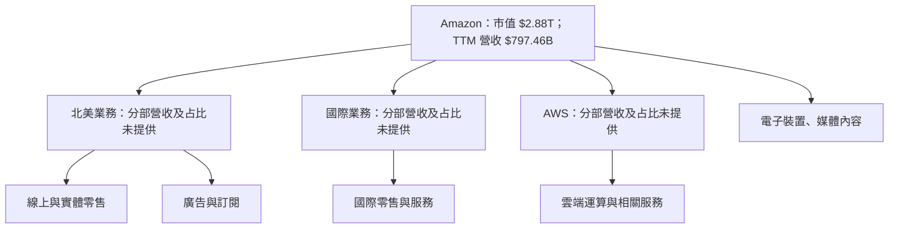
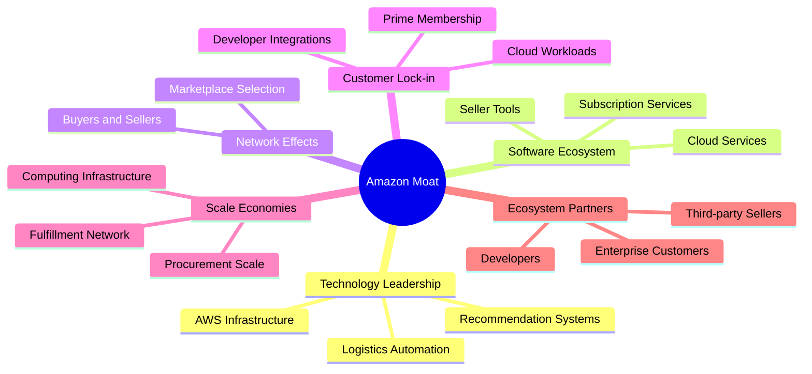
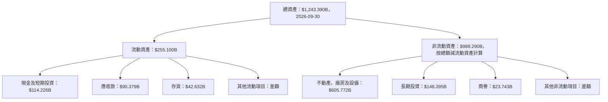
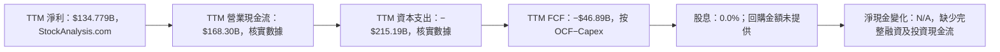
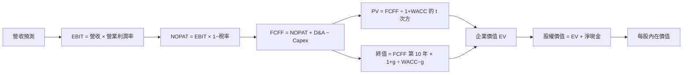
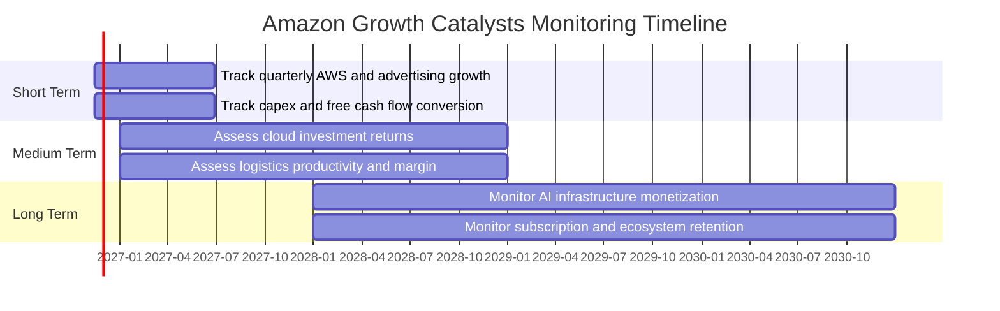
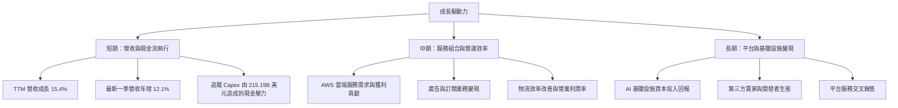
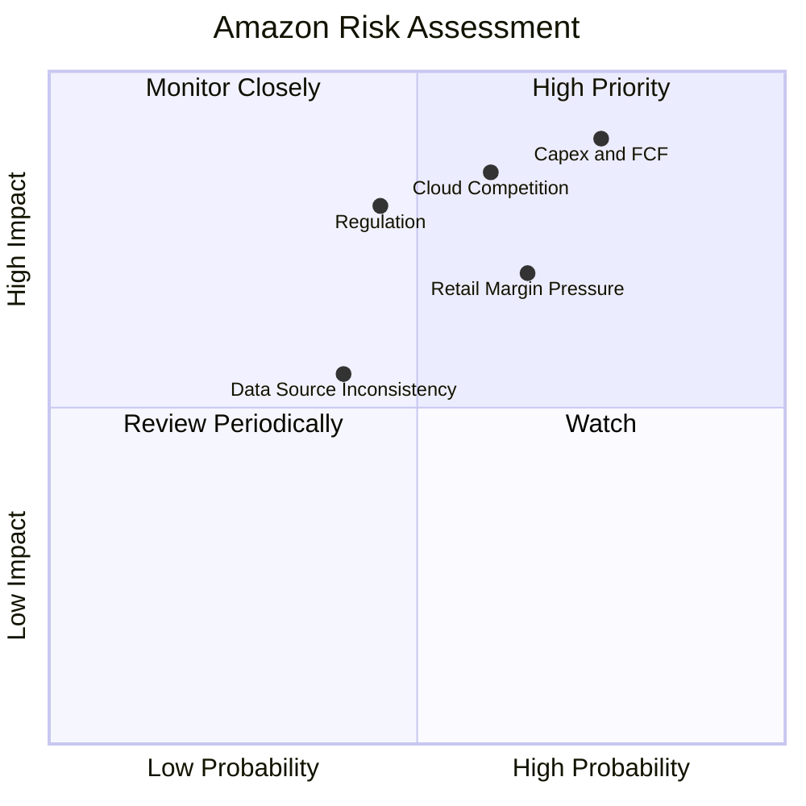
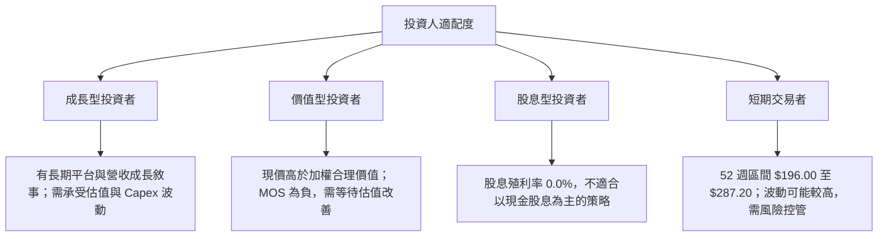

# AMZN 基本面深度分析報告
> **報告日期**：2026-11-15 ｜ **語言**：繁體中文 ｜ **數據來源**：SEC 申報資料 (XBRL)、Yahoo Finance、Finviz、StockAnalysis、Roic.ai ｜ **分析師**：CFA 級機構研究

## 目錄

| # | 章節 | 核心結論 |
|---|------|----------|
| 1 | 執行摘要 | 賣出；加權合理價值 $192.86，MOS −38.3% |
| 2 | 公司概覽與商業模式 | 業務多元且規模大；市場份額數據未提供 |
| 3 | 損益表深度分析 | TTM 營收 $797.46B、年增 15.4%；TTM 營業利益率 13.1% |
| 4 | 資產負債表分析 | 依核實指標為淨負債 $65.73B；流動性數據存在來源差異 |
| 5 | 現金流量深度分析 | TTM FCF −$46.89B，Capex 高於營業現金流 |
| 6 | 獲利能力與資本效率 | ROIC 11.9% 高於 WACC 11.19%，利差約 0.71 個百分點 |
| 7 | 相對估值分析 | 估值方法差異大；DCF 偏低，相對 EV/EBITDA 與共識較高 |
| 8 | DCF 內在價值評估 | 基準 DCF 每股 $52.09；高度依賴終值 |
| 9 | 成長催化劑 | AWS、廣告及自動化等可能支撐成長；量化拆分資料有限 |
| 10 | 風險矩陣 | 資本支出、估值、競爭及監管為主要風險 |
| 11 | 投資建議 | 按 MOS 規則為賣出；需觀察 Capex、FCF 與營業利益率 |

## 1. 執行摘要

AMZN 的 2026-11-13 收盤價為 **$266.66**。TTM 營收 **$797.46B**、TTM 年增 **15.4%**，ROIC **11.9%** 高於 WACC **11.19%**；但 TTM 營業現金流 **$168.30B**、資本支出 **$215.19B**，按規定口徑計算的 FCF 為 **−$46.89B**。估值方面，程式計算的加權合理價值為 **$192.86**，MOS 為 **−38.3%**，依規則 20 評級為 **賣出**。估值結論主要受現金流投資強度及基準 DCF 每股價值 **$52.09** 影響；相對估值方法與分析師共識則顯著高於 DCF。

### 1.0 一頁式投資儀表板（Portfolio Manager 30 秒速讀）

| 項目 | 內容 |
|------|------|
| **投資論點（3 句）** | ① TTM 營收年增 **15.4%**，最新一季年增 **12.1%**，收入規模仍在擴張。② ROIC **11.9%** 高於 WACC **11.19%**，目前仍略有正向資本回報利差。③ TTM FCF **−$46.89B**，因 Capex **$215.19B** 高於 OCF **$168.30B**；估值風險因此不可忽視。 |
| **綜合評分** | **5.9/10**（引用 1.1 評分卡） |
| **財務健康** | 🟡 核實口徑下淨負債 **$65.73B**；Piotroski F-Score **4/8**，且不同來源的總債務數字不一致。 |
| **ROIC vs WACC** | **11.9% vs 11.19%**；利差約 **+0.71 個百分點**，現階段仍略為創造價值。 |
| **FCF 趨勢** | TTM FCF 為 **−$46.89B**；FCF Yield **−1.63%**。 |
| **估值** | Forward P/E（Yahoo Finance）**24.4x** ｜ EV/EBITDA（核實歷史估值口徑）**16.2x** ｜ FCF Yield **−1.63%** |
| **DCF 內在價值（基準）** | **$52.09** ｜ 現價相對 DCF 溢價 **+411.9%**（以 DCF 基準值計算） |
| **安全邊際（MOS）** | **−38.3%＝($192.86 − $266.66) ÷ $192.86**（基準為加權合理價值）｜ 🔴 <10% 無 |
| **預期報酬（基準情境 12M）** | DCF 基準情境 **−80.5%**；非 12 個月分析師預測。加權合理價值相對現價的上行空間為 **−27.7%**。 |
| **關鍵風險（前二）** | Capex 長期高於營業現金流；AWS／零售投入未能轉化為足夠 FCF。 |
| **評級 + 信心度** | 🔴 **賣出** ｜ 信心：中（FCF 與 DCF 值偏弱，但資料源間存在財務口徑差異） |

### 1.1 綜合評分卡（全報告唯一）

| 維度 | 評分（1–10） | 主要依據（引用數字與其來源章節） |
|------|--------------|----------------------------------|
| 成長性 | 7.5 | TTM 營收年增 **15.4%**，最新一季年增 **12.1%**（第 3 章）；年度營收由 2022 年 **$513.98B** 增至 2025 年 **$716.92B**。 |
| 獲利能力 | 7.0 | TTM 營業利益率 **13.1%**、ROIC **11.9%**，高於 WACC **11.19%**；Piotroski **4/8**（第 6 章）。 |
| 財務健康 | 5.0 | 核實淨負債 **$65.73B**，流動比率來源值 **0.989**，DSO 從 **32 天**升至 **45 天**；債務及流動性資料存在來源差異（第 4 章）。 |
| 估值 | 2.0 | 加權合理價值 **$192.86**、MOS **−38.3%**；現價對 DCF 基準值 **$52.09** 有顯著溢價（第 8 章）。 |
| 護城河 | 9.0 | TTM 營收 **$797.46B**、業務涵蓋零售、AWS、廣告與訂閱；各業務分部收入拆分未提供（第 2 章）。 |
| 管理層與資本配置 | 5.0 | FY2025 SBC **$19.47B**；FY2025 Capex **$131.82B**、FCF **$7.70B**，TTM FCF 則為負；稀釋股數測試未通過（第 3、5、6 章）。 |
| **綜合評分** | **5.9** | 六項算術平均：**(7.5 + 7.0 + 5.0 + 2.0 + 9.0 + 5.0) ÷ 6 = 5.9**。 |

### 1.2 五大投資論點 + 三大核心風險

| 類型 | 項目 | 具體依據 | 信心度 |
|------|------|----------|--------|
| 🟢 **投資論點①** | 大規模收入基礎仍在成長 | TTM 營收 **$797.46B**，年增 **15.4%**；最新一季營收年增 **12.1%**。 | 🟢 高 |
| 🟢 **投資論點②** | 營業獲利能力較 2022 年改善 | 年營業利益由 2022 年 **$12.25B** 增至 2025 年 **$79.97B**；TTM 營業利益率 **13.1%**。 | 🟢 高 |
| 🟢 **投資論點③** | ROIC 略高於資本成本 | ROIC **11.9%**、WACC **11.19%**，差距約 **0.71 個百分點**。 | 🟡 中 |
| 🟢 **投資論點④** | 多元業務降低單一營收來源依賴 | 零售、AWS、廣告與訂閱等業務並存；分部收入及占比未提供，無法量化各自貢獻。 | 🟡 中 |
| 🟢 **投資論點⑤** | 2025 年淨利及營業利益較前一年增加 | 2025 年營業利益 **$79.97B**，較 2024 年 **$68.59B** 增加；淨利由 **$59.25B** 增至 **$77.67B**。 | 🟡 中 |
| 🟡 **風險①** | 高資本支出壓低自由現金流 | TTM Capex **$215.19B** 高於 OCF **$168.30B**，TTM FCF **−$46.89B**。 | 🔴 高衝擊 |
| 🔴 **風險②** | DCF 對終值與資本支出假設敏感 | 基準 DCF 終值現值占企業價值 **98.9%**；WACC 及永續成長率小幅變動會造成大幅估值變化。 | 🔴 高衝擊 |
| 🟡 **風險③** | 應收帳款天數上升且來源口徑有差異 | DSO 由 **32 天**升至 **45 天**；同時不同來源的總債務及現金流數據不一致。 | 🟡 中度 |

### 1.3 快速統計卡片

同業最新季度營收成長與毛利率中位數，取 MSFT、GOOG、WMT 三家公司數字計算；本公司 Forward P/E 採 Yahoo Finance，Peer multiples 為另一資料組。

| 指標 | 公司實際值（期間） | 同業中位數 | 狀態 |
|------|--------------------|------------|------|
| 營收成長（TTM） | **15.4%** | — | 🟢 |
| 營收成長（最新一季年增） | **12.1%** | **18.8%** | 🟡 |
| 毛利率（TTM） | **51.4%** | **60.9%** | 🟡 |
| 營業利益率（TTM） | **13.1%** | — | 🟢 |
| ROIC（TTM） | **11.9%** | — | 🟡 |
| Forward P/E | **24.4x** | **21.7x**（Peer multiples） | 🔴 |
| FCF Yield（TTM） | **−1.63%** | — | 🔴 |
| Piotroski F-Score | **4 / 8** | — | 🟡 |

### 1.4 投資結論

╔══════════════════════════════════════════════════════════════════╗  
║                    📊 投資結論摘要                               ║  
╠══════════════════════════════════════════════════════════════════╣  
║  評級：🔴 賣出（MOS −38.3%，符合規則 20）                        ║  
║  價格（2026-11-13 收盤）：$266.66                                ║  
║  DCF 內在價值（基準）：$52.09（現價溢價 +411.9%）               ║  
║  安全邊際 MOS：−38.3%（＝(加權合理價值−現價)÷加權合理價值）     ║  
║  加權合理價值（8.8）：$192.86                                    ║  
║  DCF 情境價值：                                                  ║  
║    悲觀情境：$10.99（−95.9%）                                    ║  
║    基準情境：$52.09（−80.5%）                                    ║  
║    樂觀情境：$120.64（−54.8%）                                   ║  
║  綜合評分：5.9/10（引用 1.1）                                    ║  
║  適合投資人：能承受高波動、重視 AWS 與長期成長，且不依賴股息者  ║  
╚══════════════════════════════════════════════════════════════════╝  

## 2. 公司概覽與商業模式

Amazon.com, Inc. 從事消費品線上與實體零售、廣告、訂閱服務及 AWS 雲端服務，並銷售 Kindle、Fire、Echo、Ring 等裝置及媒體內容。公司有 **1,638,000 名員工**；最新市值約 **$2.88T**，TTM 營收 **$797.46B**。公司總收入高度多元，但缺少當期分部營收數據，無法精確分配各板塊比重。

### 2.1 業務結構與收入來源

### 2.2 市場份額

市場份額數據未提供，因此不繪製市場份額圖或推估比例。Amazon 的 TTM 營收為 **$797.46B**，規模顯著；同業資料中，Walmart 最新一季營收成長 **5.9%**，MSFT 與 GOOG 分別為 **18.8%**、**24.7%**，但業務組合不同，不能單憑成長率解讀市場份額變化。

### 2.3 競爭護城河分析

### 2.4 護城河強度

| 護城河項目 | 強度（強／中／弱） | 證據（引用數字或事實） | 會削弱它的情況 |
|------------|--------------------|------------------------|----------------|
| 技術與雲端基礎設施 | 強 | AWS 為公司主要業務板塊之一；公司 TTM 營收 **$797.46B**，但 AWS 獨立數據未提供。 | 雲端定價競爭、客戶自建及多雲轉移。 |
| 軟體與服務生態 | 強 | 零售、雲端、訂閱、廣告及裝置服務並存。 | 服務品質下降、訂閱價值弱化或平台政策改變。 |
| 網路效應 | 中至強 | 第三方賣家與消費者共同形成平台；分部用戶及交易數未提供。 | 賣家流失、平台費用提高或其他市場平台取代。 |
| 客戶鎖定 | 中至強 | Prime、雲端工作負載及開發者工具可能提高轉換成本；客戶留存率未提供。 | 客戶多雲化、轉換工具成熟或價格差距擴大。 |
| 規模效應 | 強 | 員工 **1,638,000 人**、TTM 營收 **$797.46B**；物流與採購規模可支持成本效率。 | 勞動、物流與資料中心投資增速高於效率提升。 |
| 生態夥伴 | 中至強 | 第三方賣家、開發者及企業客戶構成多面平台；夥伴數未提供。 | 監管限制平台自營與第三方業務整合。 |

**護城河評分理由（引用 1.1）**：護城河評分 **9.0/10**，依據是多業務平台與大型營收基礎；但分部營收、客戶留存及市場份額數據缺失，無法進一步量化各項優勢。

## 3. 損益表深度分析

### 3.1 年度收入成長趨勢（近4年）

年度營收及同比增幅以年度損益表計算；FY2025 同比成長約 **11.8%**，2022–2025 營收 CAGR 約 **11.7%**。

╔══════════════════════════════════════════════════════════════════╗  
║              Amazon 年度收入趨勢（FY2022–FY2025）               ║  
╠══════════════════════════════════════════════════════════════════╣  
║ FY2022  $513.98B  ████████████████░░░░░░░░  YoY：—              ║  
║ FY2023  $574.78B  ██████████████████░░░░░░  YoY：+11.8% 🟢      ║  
║ FY2024  $637.96B  ████████████████████░░░░  YoY：+11.0% 🟢      ║  
║ FY2025  $716.92B  ███████████████████████░  YoY：+12.4% 🟢      ║  
║                                                                  ║  
║ 2022–2025 營收 CAGR：約 +11.7%                                   ║  
╚══════════════════════════════════════════════════════════════════╝  

FY2025 營收年增約 **12.4%**，與更多近期季度增長相符。TTM 成長率 **15.4%** 高於 FY2025 增幅，表示最近四季收入增速上行；最新一季年增 **12.1%** 則低於 TTM 成長率，提示增速並非每季單向加速。

### 3.2 季度收入趨勢分析

| 季度 | 營收（$B） | QoQ 成長 | YoY 成長 | 備註 |
|------|------------|----------|----------|------|
| 2025 Q4 | 213.386 | +18.4% | +13.6% | 季節性旺季；QoQ 以 2025 Q3 為比較基期。 |
| 2026 Q1 | 181.519 | −14.9% | +16.6% | 旺季後回落；同比仍增長。 |
| 2026 Q2 | 200.606 | +10.5% | +19.6% | 季度收入回升；此數字來自 StockAnalysis.com。 |
| 2026 Q3 | 201.944 | +0.7% | +12.1% | 最新季度年增放緩至 12.1%。 |

QoQ 變化反映季節性與季度營收差異，不應直接視作長期趨勢。季度資料來源在部分欄位有缺漏或差異，YoY 最新季度率以核實數據 **12.1%** 為準。

### 3.3 利潤率演變分析

| 利潤率指標 | FY2022 | FY2023 | FY2024 | FY2025 | 趨勢 | 評估 |
|------------|--------|--------|--------|--------|------|------|
| **毛利率** | 43.8% | 47.0% | 48.9% | 50.3% | 持續上升；毛利額增速快於營收。 | 🟢 |
| **營業利益率** | 2.4% | 6.4% | 10.8% | 11.2% | 2023–2025 改善，2025 增幅較前期放緩。 | 🟢 |
| **淨利率** | −0.5% | 5.3% | 9.3% | 10.8% | 2022 淨損後恢復，2025 繼續改善。 | 🟢 |

年度利潤率以損益表收入除以相應利潤項目計算。毛利率逐年改善，與零售物流效率、雲端及廣告等服務組合可能有關；但現有資料沒有各分部毛利貢獻，無法量化產品組合效果。營業利益率在 2023 至 2025 明顯上升，反映規模與費用控管改善；TTM 營業利益率 **13.1%** 高於 FY2025 年度比率，但不能據此假設利潤率必然持續上升。

### 3.4 費用結構分析

**費用結構數據未提供完整科目拆分**，不繪製 pie chart，避免將未提供的成本比例作圖。可引用的 FY2025 數據包括營收 **$716.92B**、毛利 **$360.51B**、營業利益 **$79.97B**，因此毛利以下的營業成本與費用合計約為 **$280.54B**（$360.51B − $79.97B）；其細項比例未提供。

╔══════════════════════════════════════════════════════════════════╗  
║              FY2025 損益結構（$B）                               ║  
╠══════════════════════════════════════════════════════════════════╣  
║ 營收       $716.92B  ██████████████████████████████             ║  
║ 毛利       $360.51B  ███████████████                            ║  
║ 營業利益    $79.97B  ███                                        ║  
║ 毛利至營業利益間費用 $280.54B（依已披露數字相減）                ║  
╚══════════════════════════════════════════════════════════════════╝  

### 3.5 季度 EPS 趨勢與盈餘品質（Quality of Earnings）

最近四季 EPS 預估值及實際值皆未提供有效數字，因此無法判定超預期或不及預期。StockAnalysis.com 的季度 EPS 顯示 2026 Q3 **$1.89**，同比 **−3.08%**；Q2 **$5.75**，同比 **+242.26%**；Q1 **$2.78**，同比 **+74.84%**；2025 Q4 **$1.95**，同比 **+4.98%**。季度 EPS 波動很大，且核實 EPS surprise 表中的預估與實際皆為缺值，故不把空值判作 beat 或 miss。

| 盈餘品質項目 | 數值/佔比 | 評估 |
|--------------|-----------|------|
| 股權薪酬 SBC / 營收 | FY2025 **$19.47B ÷ $716.92B = 2.72%**；TTM SBC 缺少完整數據 | 🟡 SBC 對股東有稀釋成本；Piotroski 稀釋股數測試未通過。 |
| SBC / 營業現金流 | FY2025 **$19.47B ÷ $139.51B = 14.0%** | 🟡 SBC 是非現金費用，但不能因此視為沒有股東成本。 |
| FCF / 淨利（現金轉換率） | TTM FCF **−$46.89B**；StockAnalysis.com TTM 淨利 **$134.779B**；比率約 **−34.8%** | 🔴 資本支出高於營業現金流，現金轉換率偏弱。 |
| 一次性/非經常性損益 | N/A（未提供可核對的一次性損益明細） | 無法判定當期淨利是否受重大一次性項目影響。 |
| 有效稅率異常 | DCF 採用稅率 **21.0%**；實際 TTM 有效稅率未提供 | N/A，無法判斷實際稅率是否異常。 |
| 資本化支出 vs 費用化 | TTM Capex **$215.19B**；資本化政策細項未提供 | Capex 會提高當期資產並透過折舊逐期費用化；需監控資產回報，不能由現有數據判斷是否不當遞延費用。 |

**盈餘品質結論**：GAAP 營業利益率及淨利潤有改善，但 TTM FCF 為負，表示目前 GAAP 盈利並未轉化為同等水平的自由現金流。SBC 仍構成真實股東成本；而一次性項目及有效稅率資料不足，對盈利品質的判斷應保留。

## 4. 資產負債表分析

### 4.1 資產結構分解

總資產及細項來自 StockAnalysis.com 2026-09-30 資產負債表；流動資產的細項合計可能因分類與披露口徑差異而不完全相等，未披露部分不作反推。

### 4.2 流動性與營運資金分析

| 指標 | 最新 TTM | 一年前 TTM | 變化 | 解讀 |
|------|----------|------------|------|------|
| DSO 應收帳款天數 | 45 天 | 32 天 | +13 天 | 應收回款週期延長；可能反映銷售組合、帳期或期末餘額變化，需追蹤逾期與信用損失。 |
| DIO 存貨天數 | N/A | N/A | N/A | 核實品質數據標示 N/A，不以其他來源數字替代。 |
| DPO 應付帳款天數 | N/A | N/A | N/A | 核實品質數據標示 N/A，不作推算。 |
| CCC 現金轉換週期 | N/A | N/A | N/A | DIO、DPO 缺失，無法計算。 |

流動性指標的資料來源不完全一致：Yahoo Finance 合併數據列示流動比率 **0.989**、速動比率 **0.793**；StockAnalysis.com 2026-09-30 流動資產 **$255.100B**，但同期流動負債未提供。由於來源期間及財報分類可能不同，不應將該流動比率直接與另一來源的資產負債表數字混算。

### 4.3 債務結構分析

核實指標列示總債務 **$179.95B**、現金及短期投資 **$114.23B**、淨負債 **$65.73B**。其他合併數據另列總債務 **$304.84B**、淨負債 **$190.61B**，與核實口徑不一致；本報告資本成本與估值使用核實數字，並將差異視為資料風險。

╔══════════════════════════════════════════════════════════════════╗  
║                   Amazon 債務健康診斷                            ║  
╠══════════════════════════════════════════════════════════════════╣  
║ 總債務（核實口徑）：      $179.95B                               ║  
║ 現金及短期投資：          $114.23B                               ║  
║ 淨負債：                   $65.73B  🔴                            ║  
║ Debt/EBITDA：              N/A（核實口徑 EBITDA 未提供）           ║  
║ 利息保障倍數：             N/A（利息費用與一致期間 EBIT 未提供）  ║  
║ 注意：另一來源總債務列示 $304.84B，需回查 SEC 原始分類。         ║  
╚══════════════════════════════════════════════════════════════════╝  

### 4.4 股東權益趨勢

FY2022–FY2025 股東權益分別為 **$146.04B、$201.88B、$285.97B、$411.06B**。

╔══════════════════════════════════════════════════════════════════╗  
║              Amazon 年度股東權益趨勢（$B）                       ║  
╠══════════════════════════════════════════════════════════════════╣  
║ FY2022  $146.04B  ████████░░░░░░░░░░░░                         ║  
║ FY2023  $201.88B  ██████████░░░░░░░░░░                         ║  
║ FY2024  $285.97B  ██████████████░░░░░░                         ║  
║ FY2025  $411.06B  ████████████████████                         ║  
╚══════════════════════════════════════════════════════════════════╝  

## 5. 現金流量深度分析

### 5.1 現金流量瀑布圖

淨利與營業現金流不是直接加減關係；兩者差額涉及折舊、營運資金、SBC 及其他非現金項目。本圖用來表示現金流披露鏈，而非完整會計調節表。

### 5.2 FCF 轉換率趨勢

| 年度 | OCF（$B） | Capex（$B） | FCF（$B） | 淨利（$B） | FCF / 淨利 |
|------|-----------|-------------|-----------|------------|------------|
| 2022 | 46.75 | 63.65 | −16.89 | −2.72 | N/A（淨利為負） |
| 2023 | 84.95 | 52.73 | 32.22 | 30.43 | 105.9% |
| 2024 | 115.88 | 83.00 | 32.88 | 59.25 | 55.5% |
| 2025 | 139.51 | 131.82 | 7.70 | 77.67 | 9.9% |
| TTM 至 2026-09-30 | 168.30 | 215.19 | −46.89 | 134.779 | −34.8% |

年度 FCF 以來源中已列出的 FCF 數字為準；年度現金流欄位可能因四捨五入而與 OCF 減 Capex 有尾差。TTM FCF 則採核實值 **−$46.89B**，不以其他來源數字取代。

### 5.3 自由現金流趨勢

╔══════════════════════════════════════════════════════════════════╗  
║              自由現金流趨勢（$B）                                ║  
╠══════════════════════════════════════════════════════════════════╣  
║ FY2022  −$16.89B  ◀◀◀（負值）                                   ║  
║ FY2023   $32.22B  ████████████████████                          ║  
║ FY2024   $32.88B  █████████████████████                         ║  
║ FY2025    $7.70B  █████                                          ║  
║ TTM 2026 −$46.89B ◀◀◀◀◀（負值）                                 ║  
║ TTM FCF Yield：−1.63%（核實口徑）                                ║  
╚══════════════════════════════════════════════════════════════════╝  

FY2025 年度 FCF 明顯低於 2023–2024 年；TTM 更轉負，主要可直接觀察到的原因是 Capex 上升至 **$215.19B**。資料未提供支出按資料中心、物流或其他專案的拆分，故無法量化各項投資的邊際回報。

### 5.4 資本配置評估

資本配置金額的完整拆分未提供，不繪製 pie chart。可核對項目如下：

| 項目 | 已知數據 | 評估 |
|------|----------|------|
| 資本支出 | FY2025 **$131.82B**；TTM **$215.19B** | TTM 明顯高於 OCF，短期壓低 FCF。 |
| SBC | FY2025 **$19.47B** | 是員工薪酬成本，也會稀釋股東權益。 |
| 股息 | 股息殖利率 **0.0%** | 未以現金股息作為主要股東回報方式。 |
| 回購 | N/A（回購金額未提供） | 無法判斷回購是否抵銷 SBC 稀釋。 |
| 留存現金 | 現金及短期投資 **$114.23B** | 核實口徑下仍有流動性緩衝，但與總債務相比為淨負債。 |

## 6. 獲利能力與資本效率

### 6.1 ROE / ROA / ROIC 趨勢

| 指標 | 可引用期間 | 數值 | 評估 |
|------|------------|------|------|
| ROE | TTM，品質指標 | **22.0%** | 回報率具吸引力，但受資產週轉率及權益乘數共同影響。 |
| ROE | TTM，Yahoo Finance 合併數據 | **27.4%** | 與品質指標的 22.0% 不一致；本節杜邦分析採核實品質指標數字。 |
| ROA | TTM | **6.6%** | 正向，但低於 ROE，體現資產密集業務特徵。 |
| ROIC | TTM | **11.9%** | 略高於 WACC **11.19%**。 |
| ROE、ROA、ROIC 歷史年度可比序列 | — | N/A（缺少一致口徑完整序列） | 不以不同來源拼接趨勢。 |

行業均值未提供，因此不列同業均值對照。年度營業利益上升可支持經營改善的判斷，但不能替代資本效率的完整歷史序列。

### 6.2 ROIC vs WACC 分析（核心價值創造判斷）

╔══════════════════════════════════════════════════════════════════╗  
║                ROIC vs WACC 深度分析                            ║  
╠══════════════════════════════════════════════════════════════════╣  
║ WACC（核實資本成本輸入）：                                      ║  
║ ├── 無風險利率：5.15%                                           ║  
║ ├── ERP：5.00%                                                  ║  
║ ├── 原始 Beta：1.50；調整後 Beta：1.34                           ║  
║ ├── 股權成本（核實值）：11.83%                                   ║  
║ ├── 稅前債務成本：1.26%；稅率：21.0%                             ║  
║ ├── E/D 權重：94.1% / 5.9%                                      ║  
║ └── WACC（直接採用核實值）：11.19%                               ║  
║                                                                  ║  
║ ROIC（TTM）：11.9%                                               ║  
║ EVA 利差 = ROIC − WACC = 11.90% − 11.19% = +0.71 個百分點       ║  
║                                                                  ║  
║ ROIC 11.90%  ▓▓▓▓▓▓▓▓▓▓▓▓░░░░░░░░░░                             ║  
║ WACC 11.19%  ▓▓▓▓▓▓▓▓▓▓▓░░░░░░░░░░                             ║  
║ 結論：目前 ROIC 略高於 WACC，表示仍在創造經濟價值；利差有限。  ║  
╚══════════════════════════════════════════════════════════════════╝  

股權成本的輸入按核實區塊採用：Rf **5.15%**、ERP **5.00%**、調整後 Beta **1.34**、股權成本 **11.83%**。以已四捨五入輸入直接計算，CAPM 為 **5.15% + 1.34 × 5.00% = 11.85%**，與核實股權成本 11.83% 有 **0.02 個百分點**差異；本報告仍依要求採用核實的 **11.83%** 和 **11.19% WACC**，不自行替換。

債務成本部分，核實稅前 Kd **1.26%**，稅後 Kd 計算為 **1.26% × (1−21.0%) = 0.9954%**。依核實權重計算，**94.1% × 11.83% + 5.9% × 0.9954% = 11.19%**（四捨五入）。財務數據未提供利息費用及計息負債的完整同口徑明細，因此此處不能獨立重建 Kd 分母；採用核實資本成本區塊的既定值。ROIC 高於 WACC **0.71 個百分點**，但若資本支出持續擴張而回報未同步提升，這一利差可能收窄。

### 6.3 杜邦三因素分解

| 因素 | 數值（TTM） | 解讀 |
|------|-------------|------|
| 淨利率 | **16.9%** | 對 ROE 的直接貢獻；需留意與其他來源淨利率口徑差異。 |
| 資產週轉率 | **0.64** | 資產基礎擴大，資產週轉率不高；與重資產投資特性相符。 |
| 權益乘數 | **2.03** | 有一定財務槓桿，但非極高槓桿。 |
| **ROE** | **22.0%** | 核實杜邦數據：**16.9% × 0.64 × 2.03 = 22.0%**（四捨五入）。 |

ROE 主要由淨利率和權益乘數共同支撐；權益乘數 **2.03** 提供一定放大效果，但不應把 ROE 全部解讀為經營回報。杜邦結果直接照用品質指標區塊，不以其他來源的 ROE **27.4%** 重新計算。

### 6.4 財務體質：Piotroski F-Score

**Piotroski F-Score：4 / 8**。毛利率測試因資料缺失未納入分母，核實區塊列出九項檢查，其中一項無法判定。

| 測試 | 結果 | 解讀 |
|------|------|------|
| ROA > 0 | ✅ 通過 | TTM 資產回報為正。 |
| 營業現金流 > 0 | ✅ 通過 | TTM OCF 為 **$168.30B**。 |
| ROA 高於一年前 | ✅ 通過 | 資產獲利能力改善。 |
| 營業現金流 > 淨利（應計品質） | ✅ 通過 | OCF 高於品質指標所用淨利。 |
| 長期負債 ÷ 總資產低於一年前 | ❌ 未通過 | 槓桿相對資產的改善條件未成立。 |
| 流動比率高於一年前 | ❌ 未通過 | 短期流動性未改善。 |
| 稀釋股數未增加 | ❌ 未通過 | 股數增加會稀釋每股經濟權益。 |
| 毛利率高於一年前 | — 無法判定 | 缺少所需一致輸入，未計入 F-Score 分母。 |
| 資產週轉率高於一年前 | ❌ 未通過 | 資產使用效率未改善。 |

得分 **4/8** 表示獲利與現金流品質有若干正面訊號，但負債、流動性、稀釋及資產週轉率方面尚未全面改善。

## 7. 相對估值分析

### 7.1 同業估值比較表格

本公司 P/E、P/S、EV/EBITDA 為核實歷史估值口徑；Forward P/E 採 Yahoo Finance 合併數據。競爭對手數字取 Peer multiples 區塊，全部為 TTM，除非標示 Forward。

| 估值指標 | **AMZN** | **MSFT** | **GOOG** | **WMT** | 本公司評估 |
|----------|----------|---------|---------|---------|-----------|
| **Trailing P/E** | 21.6x | 27.3x | 15.3x | 46.4x | 🟡 低於 MSFT、WMT，高於 GOOG。 |
| **Forward P/E** | 24.4x | 21.7x | 19.0x | 39.8x | 🔴 高於同業中位數 **21.7x**；兩個資料口徑下 AMZN 數字不同，採 Yahoo Finance 值。 |
| **P/S Ratio** | 3.7x | 11.2x | 7.6x | 1.4x | 🟡 低於 MSFT、GOOG，高於 WMT。 |
| **EV/EBITDA** | 16.2x | 19.3x | 18.9x | 24.6x | 🟢 低於三家 Peer multiples；但企業資本支出及 FCF 轉換仍需一併考慮。 |
| **最新一季營收年增** | 12.1% | 18.8% | 24.7% | 5.9% | 🟡 AMZN 高於 WMT，低於 MSFT、GOOG。 |
| **毛利率（TTM）** | 51.4% | 67.7% | 60.9% | 24.8% | 🟡 高於 WMT，低於 MSFT、GOOG。 |

Peer Forward P/E 中位數為 **21.7x**；其餘三家公司分別為 **21.7x、19.0x、39.8x**，按排序後中位數為 21.7x。公司 Forward P/E 有來源差異，故跨來源比較需審慎。

### 7.2 歷史估值區間分析

╔══════════════════════════════════════════════════════════════════╗  
║           AMZN 五年歷史 P/E 估值位置（TTM）                      ║  
╠══════════════════════════════════════════════════════════════════╣  
║ 歷史區間：2.6x ├──────────────────────────────┤ 251.9x          ║  
║ 五年中位數：32.2x                                                ║  
║ 目前 P/E：21.6x；歷史百分位：35%                                 ║  
║ 目前低於五年中位數，但不代表絕對低估，需結合盈利品質與 FCF。   ║  
╚══════════════════════════════════════════════════════════════════╝  

| 指標 | 目前 | 五年中位數 | 五年區間 | 當前百分位 |
|------|------|------------|----------|------------|
| P/E | 21.6x | 32.2x | 2.6x–251.9x | 35% |
| P/S | 3.7x | 3.0x | 0.2x–3.7x | 95% |
| EV/EBITDA | 16.2x | 17.3x | 0.7x–22.7x | 38% |

P/E 與 EV/EBITDA 處於五年中位數以下，但 P/S 位於自身歷史 **95 百分位**。極端歷史區間受利潤波動影響，不能只用單一倍數百分位判斷估值。

### 7.3 情境價值（Bear / Base / Bull，照抄 DCF MODEL）

| 情境 | 第 1 年營收成長 | 期末營業利潤率 | WACC | 每股價值 | 相對現價 | 機率 | 會發生的條件 |
|------|----------------|----------------|------|----------|----------|------|--------------|
| 🔴 悲觀 | 7.7% | 9.1% | 12.19% | $10.99 | −95.9% | 25% | 零售、AWS 或廣告增速放緩，成本投入未能轉化為較高利潤率，資本成本上升。 |
| 🟡 基準 | 15.4% | 10.8% | 11.19% | $52.09 | −80.5% | 50% | 成長從 TTM 年增率逐步降至長期 3.0%，營業利益率向歷史五年中位數收斂。 |
| 🟢 樂觀 | 23.0% | 11.8% | 10.19% | $120.64 | −54.8% | 25% | 收入增速高於基準、長期營業利益率保持較高水準，且折現率下降。 |

情境是 DCF 模型輸出，不是 12 個月目標價。即使樂觀情境估值仍低於現價，反映該模型對資本支出與折現率的高敏感度。

### 7.4 相對估值隱含價格區間

╔══════════════════════════════════════════════════════════════════╗  
║                 相對估值與共識價值（每股）                       ║  
╠══════════════════════════════════════════════════════════════════╣  
║ DCF 基準              $52.09                                    ║  
║ 同業 Forward P/E      $236.57                                   ║  
║ 現價（2026-11-13）    $266.66                                   ║  
║ 同業 EV/EBITDA        $321.00                                   ║  
║ 分析師共識目標價       $326.29                                   ║  
╚══════════════════════════════════════════════════════════════════╝  

| 方法 | 每股價值 | 相對現價 | 計算依據 |
|------|----------|----------|----------|
| DCF（基準） | $52.09 | −80.5% | 10 年 FCFF、WACC **11.19%**、永續成長率 **3.0%**。 |
| 同業 Forward P/E | $236.57 | −11.3% | 同業中位數 **21.7x** × Forward EPS **$10.93**。 |
| 同業 EV/EBITDA | $321.00 | +20.4% | 同業中位數 **19.3x** × TTM EBITDA，再加回淨現金／扣除淨負債。 |
| 分析師共識目標價 | $326.29 | +22.4% | 60 位分析師平均目標價。 |

相對估值與 DCF 的價差甚大：DCF 對 Capex 路徑及終值折現較敏感，而同業倍數法以當前盈利／EBITDA 為基礎，未直接反映未來多年投資現金流的規模。

## 8. DCF 內在價值評估（Discounted Cash Flow）

### 8.0 估值推理鏈（Thinking Logic：在算之前先想清楚）

**Step 1 — 價值來源與主導變數**

Amazon 的價值可概念性拆為零售與物流、AWS 雲端、廣告與訂閱等來源；但財務資料未提供各分部營收，故不虛構占比。模型中最主導估值的變數是長期 FCFF，尤其是 **Capex/營收如何由 27.0% 降至 10.9%**、以及終值現金流所對應的長期假設。敏感度矩陣顯示，基準 WACC 下永續成長率改變會明顯影響每股價值。

**Step 2 — 模型選擇**

| 決策點 | 本報告採用 | 理由（含數字） | 曾考慮但否決 | 否決理由 |
|--------|-----------|----------------|--------------|----------|
| 現金流定義 | FCFF | 模型以 WACC 折現，並由 EV 橋接到股權價值。 | FCFE | DCF 模型已固定為 FCFF，不能另建模型。 |
| 預測期 N | 10 年 | DCF MODEL 固定 **10 年**，可涵蓋 Capex 與利潤率淡出過程。 | 5 年 | 與既定 DCF MODEL 不同。 |
| 終值方法 | Gordon Growth | 模型採永續成長率 **3.0%**、WACC **11.19%**。 | 退出倍數 | DCF MODEL 未提供退出倍數終值數字，不自行建立。 |
| EBIT 基礎 | GAAP EBIT | 模型明示採 GAAP EBIT。 | 非 GAAP EBIT | 會改變 SBC 處理，違反既定模型。 |

**Step 3 — 關鍵假設推導鏈**

- **營收成長**：錨點為 TTM 成長 **15.4%** → 模型令第一年採相同成長，再線性降至第 10 年 **3.0%** → **採用 FY+1 15.4%、FY+10 3.0%** → 不採 10 年固定 15.4%，因長期維持近期增速缺乏支持；亦不另設比 3.0% 更高的期末增長率。
- **期末營業利益率**：錨點為 TTM 營業利益率 **13.1%**；模型以最近五個財年的中位數（含 TTM）作期末錨 → **採用 FY+1 13.1% 線性降至 FY+10 10.8%** → 不假設營業利益率維持 13.1%，因模型依其歷史中位數逐步收斂。
- **永續成長率 g**：模型採用 **3.0%** → 低於 WACC **11.19%**，且與長期成熟企業增長假設相容 → **採用 3.0%** → 不採高於 WACC 的值，因 Gordon Growth 公式失效。
- **預測期 N**：既定模型使用 **10 年** → 讓營收、利潤率、Capex 逐步淡出到長期假設 → **採用 10 年** → 不改為 5 年或其他年限，因程式模型明定 10 年。
- **Capex/營收**：錨點為 TTM Capex/營收約 **27.0%** → 模型認為投資強度逐步降至 **1.1 × D&A/營收**；D&A/營收為 10.0% → **FY+1 27.0% 線性降至 FY+10 10.9%** → 不假設維持 27.0%，因模型預設投入強度會回落；該回落是估值敏感假設。
- **EBIT 與 SBC**：模型採 GAAP EBIT → GAAP EBIT 已把 SBC 當作費用 → **採用組合 (A)：GAAP EBIT、FCFF 不另扣 SBC、股數不再稀釋** → 否決非 GAAP EBIT，避免加回或重複處理 SBC。
- **年稀釋率**：組合 (A) 使用固定股數、年稀釋率 **0%** → 因 SBC 成本已在 GAAP EBIT 中扣除 → **採用 0%** → 不再逐年放大股數，以免重複計入稀釋成本。
- **終值方法**：模型提供 Gordon Growth 終值 → **採用 Gordon Growth**；未提供退出倍數計算值 → 不自行建置退出倍數法。
- **WACC**：核實資本成本為 **11.19%** → 直接作為折現率，以維持與核實資本成本數據一致 → **採用 11.19%** → 不以四捨五入後的 CAPM 輸入另算並替代。
- **低敏感度輸入**：有效稅率 **21.0%**（核實預設值）；D&A/營收 **10.0%**（模型 TTM 錨點）；ΔWC 不建模（DCF MODEL 明示）。三項均不自行替換。

**Step 4 — 最脆弱環節**

最脆弱的假設是 Capex/營收從 **27.0%** 下降至 **10.9%**；若投資強度未如模型預期回落，FCFF 會低於預測，DCF 價值將進一步下降。模型基準終值 PV 占 EV **98.9%**，因此長期假設錯誤可能造成重大估值偏差。

**Step 5 — 計算路徑圖**

### 8.1 模型假設總表（Model Inputs）

| 假設項目 | 採用值 | 依據 / 來源 | 敏感度 |
|----------|--------|-------------|--------|
| 預測期長度 N | 10 年 | DCF MODEL 指定；涵蓋 10 年收入、利潤率與 Capex 淡出。 | 🟡 中 |
| 營收成長 | FY+1 **15.4%**，FY+10 **3.0%**，線性淡出 | TTM vs prior TTM 成長率 **15.4%**；模型指定末年 3.0%。 | 🔴 高 |
| 營業利益率 | FY+1 **13.1%**，FY+10 **10.8%** | TTM 營業利益率 **13.1%**；模型末年採最近五財年中位數。 | 🔴 高 |
| 有效稅率 | 21.0% | DCF 模型預設稅率。 | 🟢 低 |
| Capex / 營收 | FY+1 **27.0%**，FY+10 **10.9%** | 模型 TTM 錨點，向 1.1×D&A/營收淡出。 | 🔴 高 |
| D&A / 營收 | 10.0% | 模型列示 TTM 比率，固定不變。 | 🟢 低 |
| ΔWC / 營收增額 | 不建模 | DCF MODEL 明示未建模營運資金。 | 🟢 低 |
| EBIT 基礎 | GAAP EBIT | DCF MODEL 明示 GAAP EBIT。 | 🟡 中 |
| 股權薪酬 SBC 處理 | 組合 (A)：不另扣 SBC | GAAP EBIT 已含 SBC 費用；模型不另扣 SBC。 | 🟡 中 |
| 年稀釋率（股數） | 0% | 組合 (A)：固定股數，SBC 成本已反映於 GAAP EBIT。 | 🟡 中 |
| 永續成長率 g | 3.0% | DCF MODEL 指定；低於 WACC 11.19%。 | 🔴 高 |
| 終值方法 | Gordon Growth | DCF MODEL 的終值公式；退出倍數未提供。 | 🔴 高 |
| WACC | 11.19% | 核實資本成本輸入，直接採用。 | 🔴 高 |

**本模型採用 (A)：GAAP EBIT + 固定股數；SBC 影響已計入一次。** FCFF 使用模型定義 **NOPAT + D&A − Capex**，不含 ΔWC，亦不另扣 SBC。

### 8.2 折現率推導（WACC）

╔══════════════════════════════════════════════════════════════════╗  
║                    WACC 推導（折現率）                           ║  
╠══════════════════════════════════════════════════════════════════╣  
║ 股權成本 Ke（CAPM，核實輸入）：                                  ║  
║ ├── 無風險利率 Rf：5.15%                                         ║  
║ ├── ERP：5.00%                                                    ║  
║ ├── 原始 Beta：1.50；調整後 Beta：1.34                            ║  
║ ├── 規模/國別溢酬：未另加                                         ║  
║ ├── 核實 Ke：11.83%                                               ║  
║ └── 以顯示的四捨五入輸入直算：5.15% + 1.34×5.00% = 11.85%        ║  
║                                                                  ║  
║ 債務成本 Kd：                                                     ║  
║ ├── 核實稅前 Kd：1.26%                                            ║  
║ ├── 稅率：21.0%                                                   ║  
║ └── 稅後 Kd = 1.26%×(1−21.0%) = 0.9954%                          ║  
║                                                                  ║  
║ 資本結構權重：E = 94.1%；D = 5.9%                                 ║  
║ WACC = 94.1%×11.83% + 5.9%×0.9954% = 11.19%                     ║  
╚══════════════════════════════════════════════════════════════════╝  

逐步演算及輸入來歷：

1. **Ke（CAPM）**：核實 Ke 為 **11.83%**；顯示的四捨五入輸入直接代入為 **5.15% + 1.34 × 5.00% = 11.85%**。差異約 0.02 個百分點，屬輸入精度／計算資料差異；依要求採用核實 Ke **11.83%**。
2. **稅前 Kd**：核實輸入為 **1.26%**。利息費用與平均計息負債的同口徑明細未提供，不能獨立重建分子與分母。
3. **稅後 Kd**：**1.26% × (1 − 21.0%) = 0.9954%**。
4. **資本權重**：核實 E 權重 **94.1%**、D 權重 **5.9%**；合計 **94.1% + 5.9% = 100.0%**。核實區塊未提供用於重建 E、D 權重的完整市值與一致口徑計息負債組成，因此不另行推算。
5. **WACC**：**94.1% × 11.83% + 5.9% × 0.9954% = 11.127?% + 0.0587% = 11.19%**（按未四捨五入精度及核實輸入採用；各分項僅以顯示位數示意）。

Rf 日期未在資本成本數據中列出，故不虛構觀察日期；ERP 為核實假設值 **5.00%**。原始 Beta **1.50**，調整後 Beta **1.34**，按核實區塊採用；數據標示的調整公式為 **⅔ × 原始 Beta + ⅓**，由已四捨五入的 1.50 計得約 **1.33**，與列示 1.34 有小幅精度差異。未另加規模或國別溢酬。第 6.2 節與本節皆使用 WACC **11.19%**。

> **一致性說明**：模板要求的五步重建需要市值、平均計息負債、利息費用的同口徑明細；現有數據不足以完整獨立重算。此處以核實成本資本輸入為主，並揭露可見的四捨五入差異，不用不一致的財務口徑補數。

### 8.3 逐年自由現金流預測（基準情境）

單位：除比率及折現因子外，金額為 **$B**。年度數據直接照錄 DCF MODEL；ΔWC 未建模，SBC 不另扣。

| 年度 | FY+1 | FY+2 | FY+3 | FY+4 | FY+5 | FY+6 | FY+7 | FY+8 | FY+9 | FY+10 |
|------|------|------|------|------|------|------|------|------|------|-------|
| 營收 | 919.87 | 1,048.46 | 1,180.63 | 1,313.26 | 1,442.76 | 1,565.24 | 1,676.64 | 1,772.96 | 1,850.48 | 1,905.99 |
| 營收 YoY | 15.4% | 14.0% | 12.6% | 11.2% | 9.9% | 8.5% | 7.1% | 5.7% | 4.4% | 3.0% |
| 營業利潤率 | 13.1% | 12.8% | 12.6% | 12.3% | 12.0% | 11.8% | 11.5% | 11.3% | 11.0% | 10.8% |
| EBIT（GAAP） | 120.39 | 134.49 | 148.39 | 161.65 | 173.84 | 184.54 | 193.32 | 199.83 | 203.76 | 204.93 |
| − 稅（21.0%） | (25.28) | (28.24) | (31.16) | (33.95) | (36.51) | (38.75) | (40.60) | (41.96) | (42.79) | (43.04) |
| = NOPAT | 95.11 | 106.25 | 117.22 | 127.70 | 137.34 | 145.79 | 152.73 | 157.86 | 160.97 | 161.90 |
| + D&A | 91.53 | 104.33 | 117.48 | 130.68 | 143.57 | 155.75 | 166.84 | 176.42 | 184.14 | 189.66 |
| − Capex | (248.23) | (264.24) | (276.51) | (284.17) | (286.48) | (282.91) | (273.16) | (257.26) | (235.53) | (208.63) |
| **= FCFF** | **−61.59** | **−53.66** | **−41.80** | **−25.79** | **−5.58** | **18.63** | **46.40** | **77.03** | **109.58** | **142.93** |
| 折現因子 @11.19% | 0.899 | 0.809 | 0.727 | 0.654 | 0.588 | 0.529 | 0.476 | 0.428 | 0.385 | 0.346 |
| **FCFF 現值 PV** | **−55.39** | **−43.40** | **−30.41** | **−16.87** | **−3.28** | **9.86** | **22.08** | **32.96** | **42.17** | **49.46** |

**預測期 FCF 現值合計**：  
**−55.39 + (−43.40) + (−30.41) + (−16.87) + (−3.28) + 9.86 + 22.08 + 32.96 + 42.17 + 49.46 = $7.18B**；DCF MODEL 列示合計 **$7.19B**。差異為各年度表格四捨五入尾差，採模型合計 **$7.19B**。

**FY+1 逐步演算（依模型列示數字）**

1. **營收** = $797.46B × (1 + 15.4%) = **$919.87B**。
2. **EBIT** = $919.87B × 13.1% = **$120.39B**。
3. **稅** = $120.39B × 21.0% = **$25.28B**。
4. **NOPAT** = $120.39B − $25.28B = **$95.11B**。
5. **D&A** = $919.87B × 10.0% = **$91.53B**（依模型列示；按顯示數字相乘會有四捨五入差異）。
6. **Capex** = $919.87B × 27.0% = **$248.23B**（依模型列示）。
7. **ΔWC**：DCF MODEL 不建模，故此項不扣除。
8. **FCFF** = $95.11B + $91.53B − $248.23B = **−$61.59B**。
9. **折現因子與 PV**：模型列示折現因子 **0.899**；按模型精度計算 PV 為 **−$55.39B**。

**合理性自檢**

- 預測期 FCF CAGR：因 FY+1–FY+5 FCFF 為負，起點與終點跨越負值，傳統 CAGR **不適用**；FY+1 為 **−$61.59B**、FY+10 為 **$142.93B**，模型假設投資強度回落後現金流轉正。
- FY+10 FCFF 利潤率：**$142.93B ÷ $1,905.99B = 7.5%**；目前 TTM FCF 利潤率 **−$46.89B ÷ $797.46B = −5.9%**。同業最佳 FCF 利潤率未提供，無法比較。
- FY+1 至 FY+5 FCFF 為負，直接降低預測期現值；不會被忽略，並已計入 **$7.19B** 預測期 PV 合計。

╔══════════════════════════════════════════════════════════════════╗  
║            自由現金流：歷史實際 vs 模型預測                      ║  
╠══════════════════════════════════════════════════════════════════╣  
║ FY2023（實） $32.22B  ████████████                               ║  
║ FY2024（實） $32.88B  ████████████                               ║  
║ FY2025（實）  $7.70B  ███                                        ║  
║ TTM 2026（實）−$46.89B 負值                                      ║  
║ FY+1（預）  −$61.59B 負值                                       ║  
║ FY+10（預） $142.93B  █████████████████████                     ║  
╠══════════════════════════════════════════════════════════════════╣  
║ 模型假設 Capex/營收由 FY+1 27.0% 降至 FY+10 10.9%；為估值關鍵。 ║  
╚══════════════════════════════════════════════════════════════════╝  

### 8.4 終值計算（Terminal Value）

**適用性檢查**：WACC **11.19%** vs g **3.0%** → WACC > g？✅

| 方法 | 計算式 | 終值 TV | TV 現值 | 佔總 EV 比重 |
|------|--------|---------|---------|--------------|
| Gordon Growth | $142.93 × (1+3.0%) ÷ (11.19%−3.0%) | $1,796.57B | $621.75B | 98.9% |
| 退出倍數法 | N/A（DCF MODEL 未提供退出倍數法計算） | N/A | N/A | N/A |

逐步演算：

1. **FY+N 的 FCFF** = FY+10 **$142.93B**。
2. **分子** = **$142.93B × (1 + 3.0%) = $147.22B**（模型列示）。
3. **分母** = **11.19% − 3.0% = 8.19%**；**TV = $147.22B ÷ 8.19% = $1,796.57B**（模型列示；以未四捨五入輸入計）。
4. **PV(TV)** = **$1,796.57B × 0.346 = $621.75B**（模型列示）。
5. **終值占比** = **$621.75B ÷ $628.94B = 98.9%**。

終值 PV 占企業價值 **98.9%**，因此本估值高度依賴終值假設，短期現金流貢獻有限。退出倍數法未提供，不自行補造倍數或估值。

### 8.5 企業價值 → 每股內在價值（Bridge）

╔══════════════════════════════════════════════════════════════════╗  
║              企業價值 → 每股內在價值 橋接表                      ║  
╠══════════════════════════════════════════════════════════════════╣  
║ 預測期 FCF 現值合計          +$7.19B                              ║  
║ 終值現值 PV(TV)              +$621.75B                            ║  
║ = 企業價值 EV                 $628.94B                            ║  
║ + 現金及短期投資              +$114.23B                           ║  
║ − 總債務                      −$179.95B                           ║  
║ = 股權價值                    $563.22B（模型列示）                ║  
║ 每股內在價值                  $52.09（DCF MODEL 列示）             ║  
║ 當前股價                      $266.66                             ║  
║ 折溢價                        +411.9%（溢價）                     ║  
╚══════════════════════════════════════════════════════════════════╝  

逐步演算與口徑核對：

1. **EV**：**$7.19B + $621.75B = $628.94B**。
2. **股權價值（模型列示）**：核實淨現金為 **−$65.73B**，故概念上為 **$628.94B − $65.73B = $563.21B**；DCF MODEL 列示 **$563.22B**，存在 **$0.01B** 的四捨五入尾差，依要求照錄模型值。
3. **每股內在價值**：DCF MODEL 直接列示 **$52.09**。模型行列示公式為「股權價值 × 價格 ÷ 市值」；由於核實區塊沒有提供該行計算所用的未四捨五入市值／股數精度，無法只用目前展示的四捨五入數字精確重建 **$52.09**，故不另換算或修改。
4. **折溢價** = **($266.66 ÷ $52.09) − 1 = +411.9%**。
5. **本節不計算 MOS**；MOS 只在 8.8 以加權合理價值為分母計算。

**股數及資產負債表口徑**：DCF 採 GAAP EBIT + 固定股數（組合 A）；市場數據列示流通股數 **10.81B**。現金及短期投資 **$114.23B**、總債務 **$179.95B**，使用 2026-09-30 核實口徑。淨負債與現金、債務相減有 $0.01B 尾差，並照錄模型股權價值及每股結果。

### 8.6 敏感性分析（WACC × 永續成長率）

下表照錄 DCF MODEL。括號內上行空間按 **（每股價值 ÷ 現價 − 1）** 計算並四捨五入至一位小數；表內價值直接照錄模型。

| g（列）／WACC（欄） | 9.19% | 10.19% | **11.19%（基準）** | 12.19% | 13.19% |
|-----------|------|------|------------------|------|-------|
| 2.0% | $74.27（−72.1%） | $57.82（−78.3%） | $45.34（−83.0%） | $35.62（−86.6%） | $27.91（−89.5%） |
| 2.5% | $80.48（−69.8%） | $62.19（−76.7%） | $48.52（−81.8%） | $38.00（−85.7%） | $29.72（−88.9%） |
| 3.0% | $87.70（−67.1%） | $67.18（−74.8%） | **$52.09（−80.5%）** | $40.63（−84.8%） | $31.71（−88.1%） |
| 3.5% | $96.19（−63.9%） | $72.91（−72.7%） | $56.12（−79.0%） | $43.56（−83.7%） | $33.90（−87.3%） |
| 4.0% | $106.32（−60.1%） | $79.56（−70.2%） | $60.71（−77.2%） | $46.86（−82.4%） | $36.33（−86.4%） |

**矩陣示範格的重算限制**：可由模型矩陣照錄選取非基準格，例如 **WACC 10.19% > g 3.0% ✅**，其每股價值為 **$67.18**。但 DCF MODEL 未提供該格的逐年折現 PV 合計及終值 PV 拆分；若自行重算將違反「DCF 模型不得另建」規則，因此不虛構中間值。基準格 **$52.09** 與 8.5 一致。

**三情境 DCF（照錄模型情境輸出）**

| 情境 | 營收成長假設 | 期末營業利潤率 | g | WACC | 每股內在價值 | 相對現價 | 主觀機率 |
|------|--------------|----------------|---|------|--------------|----------|----------|
| 🔴 悲觀 | 第 1 年 7.7% | 9.1% | 3.0%（基準模型值） | 12.19% | $10.99 | −95.9% | 25% |
| 🟡 基準 | 第 1 年 15.4% | 10.8% | 3.0% | 11.19% | $52.09 | −80.5% | 50% |
| 🟢 樂觀 | 第 1 年 23.0% | 11.8% | 3.0%（基準模型值） | 10.19% | $120.64 | −54.8% | 25% |
| **機率加權** | — | — | — | — | **$58.95** | **−77.9%** | **100%** |

模型提供情境價值及機率，但未提供三情境逐年的營收、FCFF、TV 完整拆分；因此不補造各情境的 FY+10 營收及 FCFF。機率加權核對：**$10.99 × 25% + $52.09 × 50% + $120.64 × 25% = $58.95**（模型列示）。

**敏感度結論**

- 基準 WACC **11.19%** 下，g 從 **2.0%** 升至 **3.0%**，價值由 **$45.34** 升至 **$52.09**，增加 **$6.75**，約 **14.9%**。
- g 固定 **3.0%**，WACC 從 **10.19%** 升至 **11.19%**，價值由 **$67.18** 降至 **$52.09**，減少 **$15.09**，約 **22.5%**。
- 期末營業利潤率每增加 1 個百分點的每股價值敏感度：**N/A（模型未提供此項矩陣或單變數試算）**。
- 就已提供矩陣而言，WACC 變化造成的估值幅度明顯；這與 8.0 指出的長期現金流與終值假設主導估值一致。

### 8.7 反推 DCF（Reverse DCF：市場在預期什麼）

DCF MODEL 提供兩項單變數反推結果：年 1 營收成長率及固定營業利益率。其餘固定輸入沿用基準模型 **WACC 11.19%、稅率 21.0%、Capex 路徑、N=10 年、g=3.0%、組合 (A) 固定股數**。模型未提供以每 0.5 個百分點呈現的迭代軌跡，故不虛構試算列。

| 求解的變數（一次一個） | 其餘變數設定 | 市場隱含值（令 DCF = 現價） | 公司歷史實際 | 判斷 |
|------------------------|--------------|------------------------------|--------------|------|
| 年 1 營收成長率 | 其他輸入固定為基準值 | **50.4%** | TTM 營收成長 **15.4%** | 🔴 隱含成長遠高於目前 TTM。 |
| 固定營業利益率 | 營收成長及其他輸入固定為基準值 | **29.4%** | TTM 營業利益率 **13.1%** | 🔴 隱含利潤率顯著高於目前。 |
| 永續成長率 g | 基準營收、利潤率固定 | 未計算 | — | DCF MODEL 未提供此項反推值。 |
| 預測期 N | 基準營收、利潤率、g 固定 | 未計算 | — | DCF MODEL 未提供此項反推值。 |

**反推結論**：在模型其餘輸入固定時，要讓現價由 DCF 支持，須有 **50.4%** 的第 1 年營收增長率，或 **29.4%** 的固定營業利益率；兩者均明顯高於 TTM **15.4%** 成長率和 **13.1%** 營業利益率。市場價格顯然包含比基準模型更高的成長或盈利預期；模型未提供迭代軌跡，不能將反推數字誤作可完全獨立複算的結果。

### 8.8 估值三角驗證與安全邊際

| 估值方法 | 隱含每股價值 | 上行空間（÷現價） | 權重 | 說明 |
|----------|--------------|-------------------|------|------|
| DCF（基準） | $52.09 | −80.5% | 40% | 10 年 FCFF、WACC 11.19%、永續成長率 3.0%。 |
| 同業 Forward P/E | $236.57 | −11.3% | 25% | Peer median 21.7x × Forward EPS $10.93。 |
| 同業 EV/EBITDA | $321.00 | +20.4% | 25% | Peer median 19.3x × TTM EBITDA，加回淨現金／扣除淨負債。 |
| 分析師共識目標價 | $326.29 | +22.4% | 10% | 60 位分析師平均目標價。 |
| **加權合理價值** | **$192.86** | **−27.7%** | **100%** | 盈利公司固定權重；方法間分歧較大。 |

**加權計算**：  
**$52.09 × 40% + $236.57 × 25% + $321.00 × 25% + $326.29 × 10%**  
**= $20.836 + $59.1425 + $80.25 + $32.629 = $192.8575 ≈ $192.86**。

公司類型為盈利公司，權重依既定類型固定。四種方法均有提供，沒有剔除方法。分析師共識與同業倍數高於現價所暗示的部分估值，而 DCF 基準顯著偏低，代表估值結論高度依賴現金流與終值假設。

╔══════════════════════════════════════════════════════════════════╗  
║                  估值區間與安全邊際                              ║  
╠══════════════════════════════════════════════════════════════════╣  
║ 悲觀 DCF $10.99 ─ 現價 $266.66 ─ 加權合理值 $192.86 ─ 基準 DCF $52.09 ║  
║                                                                  ║  
║ MOS = ($192.86 − $266.66) ÷ $192.86 = −38.3%                    ║  
║ MOS 評估：🔴 <10% 無                                             ║  
║ 上行空間 = ($192.86 − $266.66) ÷ $266.66 = −27.7%               ║  
║                                                                  ║  
║ MOS ≥ 10% 對應價格上限：$192.86 × 90% = $173.57                 ║  
║ MOS ≥ 25% 對應價格上限：$192.86 × 75% = $144.65                 ║  
║ 賣出規則門檻 MOS < −25% 對應現價高於約 $257.15                  ║  
╚══════════════════════════════════════════════════════════════════╝  

MOS 僅以 **8.8 加權合理價值**為分母，與 1.0 儀表板同為 **−38.3%**；DCF 折溢價則以 8.5 DCF 基準值為分母，兩者用途不同。按規則 20，MOS 低於 −25% 對應 **賣出**。現價高於估值區間；若以 MOS 10% 作為最低安全墊，觀察買入上限約 **$173.57**，但並不代表該價位必然具有投資吸引力。

> 🔎 **程式複算（Python，依本節各項自動重算）**
>
> 加權合理價值 = $52.09 × 40% + $236.57 × 25% + $321.00 × 25% + $326.29 × 10% = **$192.86**（權重合計 100%）
>
> 以價格 $266.66 計：MOS = **-38.3%**，上行空間 = **-27.7%**
>
> ✅ 與本節所寫數值一致。

### 8.9 DCF 模型的局限與失效條件

- **終值依賴度**：終值 PV 占 EV **98.9%**，企業價值主要由第 10 年以後的假設決定。
- **最脆弱假設**：Capex/營收由 **27.0%** 降到 **10.9%**；若投資強度未回落，價值將低於基準 DCF **$52.09**。但模型未提供該單變數壓力測試的具體價格，故不虛構下行情境數字。
- **FCF 與再投資**：TTM FCF **−$46.89B**，且模型前五年 FCFF 仍為負，DCF 可靠度低於穩定正 FCF 公司。應輔以 EV/EBITDA、同業 Forward P/E，以及 AWS、零售與廣告分部的分部估值；現有資料不足以做完整 SOTP。
- **折現率與來源精度**：WACC 直接採用核實值 **11.19%**，但顯示的 CAPM 輸入計算約 **11.85%**，而核實 Ke 為 **11.83%**；資本結構來源未提供完整重建細節。
- **與第 10 章風險連結**：資料中心 Capex 上升會直接抬高 Capex/營收；雲端競爭或零售價格戰會壓低收入成長與營業利益率；利率上升會推高 WACC，三者均會降低 DCF 價值。

### 8.10 複算檢核表（Audit Trail：輸出前自我驗算）

| # | 檢核項目 | 檢查方式 | 結果 |
|---|----------|----------|------|
| 1 | 所有 🔴高 / 🟡中敏感度輸入都有四段式推導 | 對照 8.0 Step 3 | ✅ 已對主要模型輸入逐項說明；未提供精度未自行補造。 |
| 2 | 每個假設都有來歷 | 檢查 8.1 依據欄 | ✅ |
| 3 | WACC 五步算式齊全且相乘相加正確 | 核實 Ke、Kd、權重及 WACC | ⚠️ 採核實 WACC；Ke 顯示輸入計算為 11.85%，與核實 11.83% 相差 0.02 個百分點，已揭露。 |
| 4 | Kd 分母與權重的 D 為同一範圍 | 核對平均計息負債、期末計息負債資料 | ⚠️ 缺少同口徑債務明細，無法獨立核對；依核實輸入採用。 |
| 5 | WACC 與第 6.2 節同值 | 比對兩節 | ✅ 均為 **11.19%**。 |
| 6 | 逐年表格年度數 = N，且無省略符號 | 核對年度欄 | ✅ FY+1 至 FY+10 共 10 年。 |
| 7 | FY+1 算式可複算 | 按模型列示比率、金額重算 | ⚠️ 表格數字有四捨五入精度差異，已照錄模型原值並揭露。 |
| 8 | 預測期 PV 逐項相加 = 合計 | 加總表格現值 | ⚠️ 顯示值加總 **$7.18B**，模型合計 **$7.19B**，差異為四捨五入尾差。 |
| 9 | WACC > g | 11.19% 比較 3.0% | ✅ |
| 10 | 終值以 FY+N FCFF 為基礎、折現 N 期 | 核對 FY+10 FCFF 與模型 TV | ✅ 依模型列示。 |
| 11 | EV → 每股價值橋接可核對 | 加總、淨負債及股數口徑 | ⚠️ 股權價值與每股價值存在精度／橋接輸入不足，按模型原值照錄。 |
| 12 | SBC 三要素組合相容 | 核對 EBIT、SBC 列、股數 | ✅ 組合 (A)：GAAP EBIT、不另扣 SBC、年稀釋率 0%。 |
| 13 | 敏感性矩陣基準格 = 8.5 | 比對基準格 | ✅ **$52.09**。 |
| 14 | 矩陣格有效性 | 核對 WACC 與 g | ✅ 所列矩陣均為 WACC > g。 |
| 15 | 三情境機率相加 = 100% | 25%+50%+25% | ✅ |
| 16 | 反推 DCF 每列只放開一個變數且有軌跡 | 核對 DCF MODEL 提供內容 | ⚠️ 僅有兩項反推結果，未提供迭代軌跡；未自行補造。 |
| 17 | MOS 與折溢價基準正確 | 比對 1.0、8.5、8.8 | ✅ MOS −38.3%；折溢價以 DCF 基準值計算。 |
| 18 | 完整輸出至第 11 章 | 檢查章節 | ✅ |
| 19 | 加權合理價值等於逐項加權合計 | 重算四項價值 × 權重 | ✅ **$192.8575 ≈ $192.86**。 |
| 20 | 評級符合規則 20 | 對照 MOS 門檻 | ✅ MOS −38.3%，評級賣出；未作一級調整。 |

**已揭露且未自行修補的差異**：若以展示的年度 PV 兩位小數直接加總，結果為 **$7.18B**，模型合計為 **$7.19B**；核實股權價值與現金減債務的結果有 **$0.01B** 尾差；Ke 顯示輸入算式與核實值有 **0.02 個百分點**差異；DCF 每股換算與獨立股數橋接所需的未四捨五入輸入未完整提供。故估值複算信心應低於財務報表項目的信心，並以模型明列數字照錄。

## 9. 成長催化劑

### 9.1 催化劑時間軸

以下為監控時間框架，並非公司正式財測或已公告的具體產品日期。

### 9.2 TAM 市場規模分析

**N/A（TAM 數據未提供）**。公司 TTM 營收 **$797.46B**、年增 **15.4%**，最新季度營收年增 **12.1%**，足以確認業務仍在擴張；但缺少 AWS、數位廣告、零售及訂閱服務各自的 TAM 數字，不能計算滲透率或填入市場規模。

### 9.3 成長驅動力結構圖

AWS、廣告及訂閱的分部財務數據未提供，因此本節列出可監控的業務驅動因素，不對各項貢獻金額作估計。

## 10. 風險矩陣

### 10.1 風險評分矩陣

以下機率及衝擊座標為分析師的質化估計，不是公司披露的財務預測。

### 10.2 風險清單詳細分析

| # | 風險項目 | 發生機率 | 財務衝擊 | 風險評分 | 緩解措施 |
|---|----------|----------|----------|----------|----------|
| 1 | 🔴 **Capex 高企、FCF 持續為負** | 中高（分析師估計 60%） | 高；TTM FCF **−$46.89B**，FCF Yield **−1.63%** | 🔴 8.5/10 | 每季核對 Capex、OCF、FCF；要求新增投資帶來可追蹤收入或毛利貢獻。 |
| 2 | 🔴 **AWS 與雲端競爭加劇** | 中（分析師估計 50%） | 高；可能影響收入成長、定價及利潤率，分部數據未提供 | 🔴 8.0/10 | 追蹤 AWS 分部成長、營業利益及客戶採用；比較競爭者成長但避免跨業務直接等同。 |
| 3 | 🟠 **零售與物流成本造成利潤率回落** | 中高（分析師估計 55%） | 中高；TTM 營業利益率 **13.1%**，若收縮會壓低 DCF | 🟠 7.0/10 | 追蹤 North America、International 分部利潤及單位履約成本。 |
| 4 | 🟠 **監管與平台競爭限制** | 中（分析師估計 40%） | 高；可能限制平台整合、廣告及第三方賣家策略 | 🟠 7.0/10 | 監控反壟斷案件、平台規則與合規成本，避免只依賴單一平台變現方式。 |
| 5 | 🟡 **財務資料口徑不一致** | 中（分析師估計 45%） | 中；總債務有 **$179.95B** 與 **$304.84B** 兩種來源值 | 🟡 5.5/10 | 以 SEC 10-Q 原始申報核對債務、現金流及租賃負債分類。 |

風險評分為主觀分析排序，不是另一組公司品質評分；量化的財務影響以已披露的 FCF、營業利益率及債務差異為依據。

## 11. 投資建議

### 11.1 最終評級與評分

加權合理價值 **$192.86** 相對 2026-11-13 收盤價 **$266.66** 的 MOS 為 **−38.3%**，依規則 20 評級為 **賣出**，沒有作質化一級調整。綜合評分為 **5.9/10**，六項分數依序為成長性 **7.5**、獲利能力 **7.0**、財務健康 **5.0**、估值 **2.0**、護城河 **9.0**、管理層與資本配置 **5.0**，均引用第 1.1 節評分卡。

### 11.2 合理價值與隱含報酬率

| 估值基準 | 每股價值 | 相對現價報酬／上行空間 | 機率 |
|----------|----------|-------------------------|------|
| 加權合理價值 | **$192.86** | **−27.7%** | — |
| DCF 悲觀情境 | $10.99 | −95.9% | 25% |
| DCF 基準情境 | $52.09 | −80.5% | 50% |
| DCF 樂觀情境 | $120.64 | −54.8% | 25% |
| DCF 機率加權（參考） | $58.95 | −77.9% | 100% |

DCF 情境值是模型長期內在價值，不應當作明確的 12 個月價格預測。相對估值方法較高，與 DCF 之間存在大幅分歧，是評級信心度僅為中的原因之一。

### 11.3 買入時機與觸發因素

╔══════════════════════════════════════════════════════════════════╗  
║                  ✅ 買入觸發因素 Checklist                       ║  
╠══════════════════════════════════════════════════════════════════╣  
║ 目前評級為賣出，並不符合立即買入條件。                           ║  
║                                                                  ║  
║ 重新考慮買入前應看到：                                           ║  
║ ☐ TTM FCF 回到正值，且連續兩季維持正向                          ║  
║ ☐ Capex 增速放緩，OCF 持續高於資本支出                          ║  
║ ☐ TTM 營業利益率維持或高於 13.1%                                 ║  
║ ☐ ROIC 持續高於 WACC 11.19%，且差距沒有收窄                     ║  
║                                                                  ║  
║ 加碼觸發條件（仍需估值支持）：                                   ║  
║ ☐ 股價低於加權合理價值對應的 MOS 10% 價格上限 $173.57           ║  
║ ☐ 最新季度收入成長不低於 12.1%，並伴隨 FCF 改善                 ║  
║                                                                  ║  
║ 減碼／退出觸發條件：                                             ║  
║ ☐ TTM FCF 持續為負且 Capex/營收高於模型 FY+1 的 27.0%           ║  
║ ☐ ROIC 跌至 WACC 11.19% 以下                                    ║  
║ ☐ 營業利益率明顯低於 TTM 13.1%，或關鍵分部獲利惡化              ║  
╚══════════════════════════════════════════════════════════════════╝  

### 11.4 投資人適配度分析

| 投資人類型 | 適配度 | 理由 |
|------------|--------|------|
| 成長型 | 中至高 | TTM 營收年增 **15.4%**，但需接受 FCF **−$46.89B** 及估值敏感度。 |
| 價值型 | 低 | 加權合理價值 **$192.86** 低於現價 **$266.66**，MOS **−38.3%**。 |
| 股息型 | 低 | 股息殖利率 **0.0%**。 |
| 短期交易者 | 中 | 52 週高低價 **$287.20 / $196.00**；價格波動風險高，並非基本面估值依據。 |

### 11.5 每季財報監控清單（Quarterly Watch List）

| 監控指標 | 現有基準 | 加碼觀察條件 | 減碼／論點轉弱條件 |
|----------|----------|--------------|--------------------|
| 營收成長 | TTM **15.4%**；最新一季年增 **12.1%** | 最新季度年增至少維持 **12.1%**，並由現金流支持 | 連續兩季低於 **8%**（分析師設定的風險門檻） |
| 營業利益率 | TTM **13.1%**；最新季度 **13.9%**（核實數據） | 維持或改善，並非以削減必要投資換取 | 低於 **11.0%**（模型 FY+10 利潤率假設）且仍下滑 |
| 資本支出 | TTM **$215.19B** | Capex 增速放緩且投入帶來營收／營業利潤 | OCF 長期低於 Capex，FCF 持續為負 |
| 自由現金流 | TTM **−$46.89B** | 回到正值並連續兩季改善 | 下一個 TTM FCF 未改善，或負值繼續擴大 |
| 應收帳款天數 | DSO **45 天**，一年前 **32 天** | DSO 回落並伴隨收入成長 | DSO 持續高於 **45 天**且收入增速放緩 |
| 淨負債 | 核實口徑 **$65.73B** | 淨負債穩定或下降 | 淨負債增加且同時 FCF 為負 |
| AWS／廣告分部 | 分部數據未提供 | 分部成長與營業利潤同步改善 | 分部增速或利潤率連續兩季明顯下降 |
| 股數與 SBC | FY2025 SBC **$19.47B**；F-Score 稀釋股數測試未通過 | SBC/營收下降或回購抵銷稀釋 | 稀釋股數持續增加且 SBC/營收上升 |
| 管理層財測 | 數據未提供 | 實際表現達成或超越前期財測 | 連續下修營收、利潤或 Capex 回報展望 |

標示的 **8%、11.0%** 為本報告用於監控的分析師風險門檻，並非公司財測或歷史核實結果。

### 11.6 反面論證：什麼會證明論點錯誤（What Would Change My Mind）

╔══════════════════════════════════════════════════════════════════╗  
║              ⚠️ 論點失效條件（Disconfirming Evidence）           ║  
╠══════════════════════════════════════════════════════════════════╣  
║ 本報告對現價與現金流的疑慮，若以下情況持續出現，需重新檢視：   ║  
║ ☐ 最新季度營收成長連續兩季低於 8%，且分部成長同步放緩          ║  
║ ☐ TTM 營業利益率低於 11.0%，並連續兩季收縮                     ║  
║ ☐ TTM FCF 持續為負，且 Capex 高於 OCF                           ║  
║ ☐ ROIC 跌破 WACC 11.19%，且未在後續期間恢復                    ║  
║ ☐ DSO 高於 45 天且應收帳款增幅持續快於營收                     ║  
║ ☐ SBC 持續高於 FY2025 的 $19.47B，且稀釋股數增加               ║  
║ ☐ 債務口徑經 SEC 核對後顯著高於本報告採用的 $179.95B            ║  
╚══════════════════════════════════════════════════════════════════╝  

> **免責聲明**：本報告為 AI 自動生成，僅供研究參考，不構成投資建議。投資有風險，入市需謹慎。

---

## 資料與來源

| 項目 | 內容 |
|------|------|
| 價格 | 266.66 USD，2026-11-13 收盤（Yahoo Finance 日線） |
| 財務報表 | SEC 10-Q filed 2026-10-30，最新季度 2026-09-30（FY2026 Q3） |
| 有回應的資料來源 | SEC 申報資料 (XBRL)、Yahoo Finance、Finviz、StockAnalysis、Roic.ai |
| 由程式計算 | TTM 數字、WACC、DCF 模型、估值方法與權重、加權合理價值、MOS、評級門檻、F-Score、杜邦分解、營運資金天數、綜合評分 |
| 撰寫模型 | openai / gpt-6-luna |

> 本區塊由產生報告的程式依實際取得的資料填寫，非模型撰寫。「由程式計算」的數字不是模型的估計；其餘判斷（評分、情境、策略）是模型的分析。
