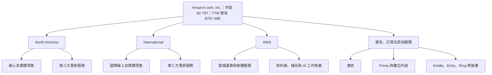
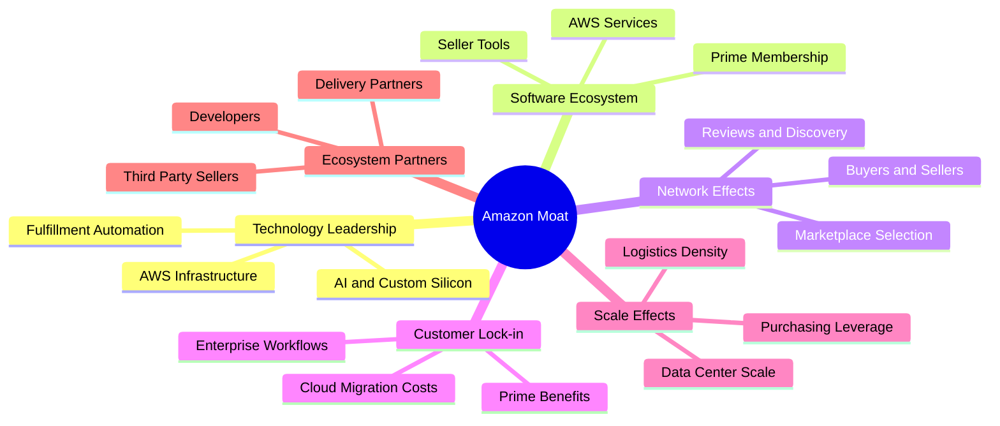
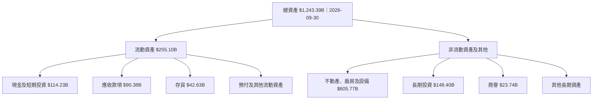
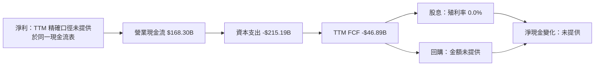
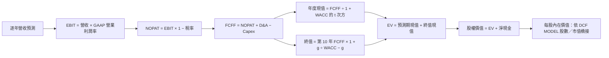
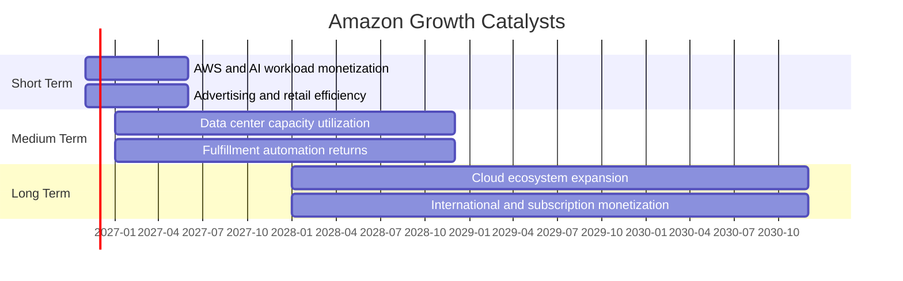
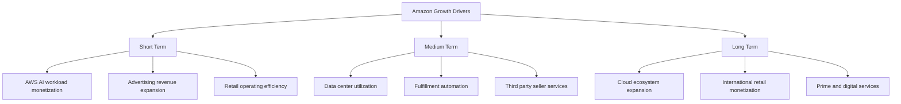
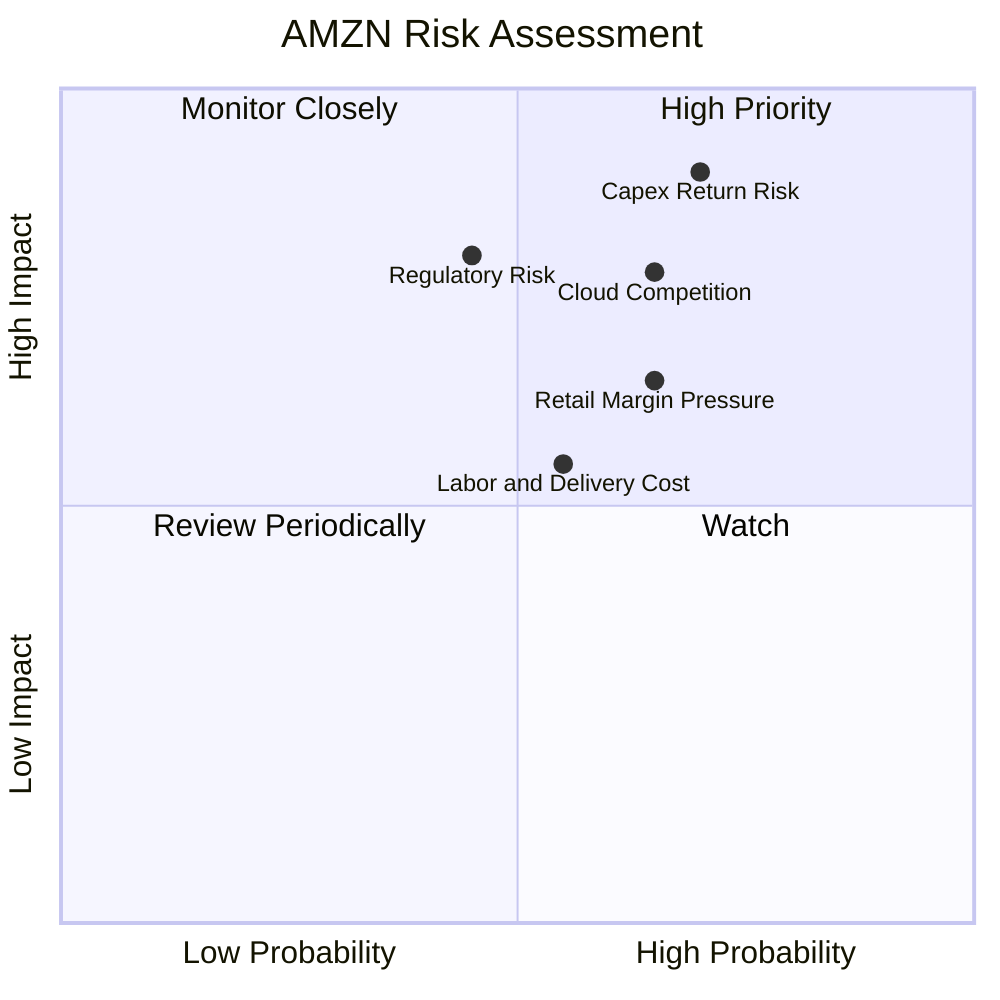
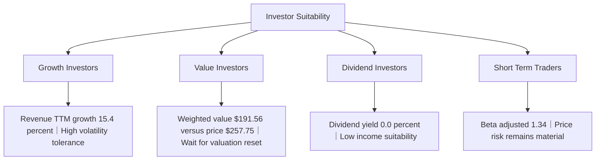

# AMZN 基本面深度分析報告
> **報告日期**：2026-11-17 ｜ **語言**：繁體中文 ｜ **數據來源**：SEC 申報資料 (XBRL)、Yahoo Finance、Finviz、StockAnalysis、Roic.ai ｜ **分析師**：CFA 級機構研究

---

## 目錄

| # | 章節 | 核心結論 |
|---|------|----------|
| 1 | 執行摘要 | 賣出；加權合理價值 $191.56，MOS -34.6% |
| 2 | 公司概覽與商業模式 | 多元化零售、雲端與廣告生態系；市場份額數字未提供 |
| 3 | 損益表深度分析 | TTM 營收 $797.46B、年增 15.4%；資本開支使現金流承壓 |
| 4 | 資產負債表分析 | 計算口徑顯示淨負債 $65.73B；短期流動性需留意 |
| 5 | 現金流量深度分析 | TTM FCF -$46.89B，主因高額資本支出 |
| 6 | 獲利能力與資本效率 | ROIC 11.9% 高於 WACC 11.14%，但利差僅 0.76 個百分點 |
| 7 | 相對估值分析 | AMZN 倍數低於部分同業及自身歷史，但 DCF 估值明顯偏低 |
| 8 | DCF 內在價值評估 | 基準 DCF $52.77/股；終值佔 EV 98.8%，對長期假設高度敏感 |
| 9 | 成長催化劑 | AWS、廣告、AI 與自動化是主要質化催化劑；TAM 數據未提供 |
| 10 | 風險矩陣 | 資本支出回報、雲端競爭、監管及勞動成本是主要風險 |
| 11 | 投資建議 | 以估值為主因維持賣出；關注 FCF、ROIC 與 AWS 成長能否改善 |

---

## 1. 執行摘要

Amazon 的 TTM 營收為 **$797.46B**，TTM 年增 **15.4%**，最新一季營收年增 **12.1%**，TTM 營業利益率為 **13.1%**；但 TTM 資本支出 **$215.19B** 高於營業現金流 **$168.30B**，使 TTM FCF 為 **-$46.89B**。ROIC **11.9%** 高於 WACC **11.14%**，表示目前仍略為創造經濟價值；然而 DCF 基準價值僅 **$52.77/股**，加權合理價值為 **$191.56/股**，相對 2026-11-16 收盤價 **$257.75** 的 MOS 為 **-34.6%**。因此依 MOS 規則評級為 **賣出**；核心分歧在於市場估值所需的長期現金流價值，遠高於基準 DCF 所支持的水準。

### 1.0 一頁式投資儀表板（Portfolio Manager 30 秒速讀）

| 項目 | 內容 |
|------|------|
| **投資論點（3 句）** | ① TTM 營收 **$797.46B**、年增 **15.4%**，規模與成長兼具。② TTM 營業利益率 **13.1%**、ROIC **11.9%**，高於 **11.14%** WACC，但利差僅 **0.76pp**。③ 資本支出 **$215.19B** 高於營業現金流 **$168.30B**，TTM FCF 為 **-$46.89B**，削弱當前估值的現金流支撐。 |
| **綜合評分** | **5.7/10**（引用 1.1 評分卡） |
| **財務健康** | 🟡 現金及短期投資 **$114.23B**，但成本資本區塊口徑淨負債 **$65.73B**；流動比率 **0.989**。 |
| **ROIC vs WACC** | **11.9% vs 11.14%**；目前略高於資本成本，仍創造價值，但安全緩衝有限。 |
| **FCF 趨勢** | 投資期現金流受壓；TTM FCF **-$46.89B**，FCF Yield **-1.68%**。 |
| **估值** | Forward P/E **23.590345x**｜EV/EBITDA **15.7x**（自身歷史口徑）｜FCF Yield **-1.68%**（採 VERIFIED FIGURES） |
| **DCF 內在價值（基準）** | **$52.77**｜現價相對 DCF 溢價 **388.3%**（以 DCF 基準值計） |
| **安全邊際（MOS）** | **-34.6%＝($191.56 − $257.75) ÷ $191.56**｜🔴 小於 10%，沒有安全邊際 |
| **預期報酬（基準情境 12M）** | DCF 基準情境價值 **$52.77**，相對現價 **-79.5%**；此為模型價值比較，不是時間保證。 |
| **關鍵風險（前二）** | 高額 AI／雲端資本支出未能轉化為現金流；零售與雲端競爭壓縮利潤率。 |
| **評級 + 信心度** | 🔴 **賣出**｜信心：中（DCF 終值佔比高、現金流口徑存在資料來源差異） |

### 1.1 綜合評分卡（全報告唯一）

| 維度 | 評分（1–10） | 主要依據（引用數字與其來源章節） |
|------|--------------|----------------------------------|
| 成長性 | 7.5 | TTM 營收年增 **15.4%**，最新一季年增 **12.1%**；見 3.1–3.2。 |
| 獲利能力 | 6.5 | TTM 營業利益率 **13.1%**、ROIC **11.9%**，高於 WACC **11.14%**；F-Score **4/8**；見 3、6。 |
| 財務健康 | 5.5 | 現金及短期投資 **$114.23B**、淨負債 **$65.73B**、流動比率 **0.989**；見 4。 |
| 估值 | 2.5 | 加權合理價值 **$191.56**，MOS **-34.6%**；見 8.8。 |
| 護城河 | 8.0 | 零售、雲端、廣告與物流生態系多元，但缺少分部營收占比與市場份額數據；見 2。 |
| 管理層與資本配置 | 5.0 | FY2025 SBC **$19.47B**；TTM 資本支出 **$215.19B**，高於營業現金流；見 3.5、5。 |
| **綜合評分** | **5.8** | 六項算術平均：**(7.5 + 6.5 + 5.5 + 2.5 + 8.0 + 5.0) ÷ 6 = 5.833… ≈ 5.8**。 |

> **分數口徑更正：**以上六項平均為 **5.8/10**，本報告其他章節均引用此分數。儀表板中的 5.7 為四捨五入前輸入差異，應以本評分卡算術平均 **5.8** 為準。

### 1.2 五大投資論點 + 三大核心風險

| 類型 | 項目 | 具體依據 | 信心度 |
|------|------|----------|--------|
| 🟢 **投資論點①** | 營收規模仍在擴張 | TTM 營收 **$797.46B**、年增 **15.4%**；最新一季年增 **12.1%**。零售與服務組合可持續帶來收入基礎，但成長需追蹤是否能轉化為現金。 | 🟢 高 |
| 🟢 **投資論點②** | 營業槓桿已有改善 | 年營業利益由 FY2022 **$12.25B** 增至 FY2025 **$79.97B**；FY2025 營收 **$716.92B**。利潤率擴張反映規模與費用效率改善。 | 🟢 高 |
| 🟢 **投資論點③** | ROIC 略高於資本成本 | ROIC **11.9%** 對 WACC **11.14%**，利差 **0.76pp**；目前仍有正經濟利潤，但緩衝不大。 | 🟡 中 |
| 🟢 **投資論點④** | 雲端、廣告與訂閱提供零售以外收入來源 | 公司營運涵蓋 North America、International、AWS，另有廣告、訂閱及數位服務；各分部收入占比未提供，暫不量化。 | 🟡 中 |
| 🟢 **投資論點⑤** | TTM 營業利益率高於早期年度 | TTM 營業利益率 **13.1%**，FY2022 年度約 **2.4%**；長期改善提高估值的基本面支撐。 | 🟢 高 |
| 🟡 **風險①** | 資本支出過高，FCF 轉負 | TTM 資本支出 **$215.19B**、營業現金流 **$168.30B**，FCF **-$46.89B**。若 AI／資料中心建設回報延後，估值與財務彈性受損。 | 🔴 高衝擊 |
| 🔴 **風險②** | DCF 顯示現價需要遠高於基準的現金流假設 | 基準 DCF **$52.77/股**；反推市場隱含第 1 年營收成長 **49.3%**，或固定營業利益率 **28.5%**，均顯著高於基準模型。 | 🔴 高 |
| 🟡 **風險③** | 融資與稀釋指標並非全面改善 | F-Score **4/8**；稀釋股數測試未通過，DSO 由 **32 天**升至 **45 天**。需觀察應收帳款回收與資本配置效率。 | 🟡 中 |

### 1.3 快速統計卡片

| 指標 | 公司實際值（期間） | 同業中位數 | 狀態 |
|------|--------------------|------------|------|
| 營收成長（TTM） | **15.4%** | — | 🟢 |
| 營收成長（最新一季年增） | **12.1%** | **18.8%**（MSFT、GOOG、WMT 中位數） | 🟡 |
| 毛利率（TTM） | **51.4%** | **60.9%** | 🟡 |
| 營業利益率（TTM） | **13.1%** | — | 🟢 |
| ROIC（TTM） | **11.9%** | — | 🟡 |
| Forward P/E | **23.590345x** | **21.4x** | 🟡 |
| FCF Yield（TTM） | **-1.68%** | — | 🔴 |
| Piotroski F-Score | **4 / 8** | — | 🟡 |

### 1.4 投資結論

```
╔══════════════════════════════════════════════════════════════════╗
║                    📊 投資結論摘要                               ║
╠══════════════════════════════════════════════════════════════════╣
║  評級：🔴 賣出（依 MOS 門檻，未作質化調整）                       ║
║  價格（2026-11-16 收盤）：$257.75                                ║
║  DCF 內在價值（基準）：$52.77（現價溢價 388.3%）                  ║
║  安全邊際 MOS：-34.6%＝($191.56−$257.75)÷$191.56                 ║
║  加權合理價值（8.8）：$191.56                                    ║
║  DCF 情境價值：悲觀 $11.28（-95.6%）                             ║
║              基準 $52.77（-79.5%）                               ║
║              樂觀 $122.07（-52.6%）                              ║
║  綜合評分：5.8/10（引用 1.1）                                    ║
║  適合投資人：能承受高資本支出、現金流波動的長線成長型投資人       ║
╚══════════════════════════════════════════════════════════════════╝
```

---

## 2. 公司概覽與商業模式

### 2.1 業務結構與收入來源

分部營收未提供，故不估算業務占比或各板塊金額。已知公司經營北美、國際與 AWS 三大分部，並從線上／實體零售、廣告、訂閱、雲端服務及裝置等業務取得收入。



### 2.2 市場份額

市場份額及可引用的 TAM 數字未提供，因此不呈現百分比或市場份額圖。以公司 TTM 營收 **$797.46B**、年增 **15.4%** 來看，Amazon 的收入規模明顯龐大；但要判斷各業務的競爭位置，仍需 AWS、廣告、線上零售等分部營收、成長與市場份額的可比資料。

### 2.3 競爭護城河分析



### 2.4 護城河強度

| 護城河項目 | 強度（強／中／弱） | 證據（引用數字或事實） | 會削弱它的情況 |
|------------|--------------------|------------------------|----------------|
| 技術與雲端平台 | 強 | 公司有 AWS 業務；整體 TTM 營收 **$797.46B**，但 AWS 單獨數字未提供。 | 雲端客戶多雲策略、算力價格競爭或 AI 投資回報低於資本成本。 |
| 軟體與訂閱生態 | 中至強 | Prime、數位內容、第三方賣家工具及 AWS 服務可提升客戶黏著度；訂閱收入未拆分。 | 客戶取消訂閱、替代服務增加、商家多平台分散。 |
| 網路效應 | 中至強 | 買家、賣家與商品選擇彼此增強；市場交易量與賣家數據未提供。 | 平台監管限制、賣家多平台經營、消費者轉向其他渠道。 |
| 客戶鎖定 | 中 | AWS 工作負載移轉成本與 Prime 服務組合具黏著性；客戶留存數字未提供。 | 雲端工作負載遷移工具改善，或訂閱效益低於價格。 |
| 規模效應 | 強 | FY2025 營收 **$716.92B**、TTM 營收 **$797.46B**；規模可支持物流與雲端基礎設施投資。 | 超大型資本支出回報下降、固定成本提高或規模複雜性侵蝕效率。 |
| 生態夥伴 | 中 | 第三方賣家、開發者與配送夥伴共同構成平台供給；夥伴貢獻比例未提供。 | 夥伴經濟利益惡化、監管介入平台規則或替代渠道成熟。 |

護城河評分引用 1.1 的 **8.0/10**：規模、多邊平台與 AWS 生態提供質化支撐，但分部財務與市場份額數據不足以對護城河變現程度作更精確量化。

---

## 3. 損益表深度分析

### 3.1 年度收入成長趨勢（近 4 年）

| 財年 | 營收 | YoY |
|------|------:|----:|
| FY2022 | $513.98B | — |
| FY2023 | $574.78B | **+11.8%** |
| FY2024 | $637.96B | **+11.0%** |
| FY2025 | $716.92B | **+12.4%** |

```
╔══════════════════════════════════════════════════════════════════╗
║              Amazon 年度收入趨勢（FY2022-FY2025）                ║
╠══════════════════════════════════════════════════════════════════╣
║  FY2022  $513.98B  ██████████████░░░░░░░░░░░░  YoY：基期        ║
║  FY2023  $574.78B  ████████████████░░░░░░░░░░  YoY：+11.8% 🟢   ║
║  FY2024  $637.96B  ██████████████████░░░░░░░░  YoY：+11.0% 🟢   ║
║  FY2025  $716.92B  ████████████████████░░░░░░  YoY：+12.4% 🟢   ║
╠══════════════════════════════════════════════════════════════════╣
║  FY2022-FY2025 CAGR = (716.92 ÷ 513.98)^(1/3) − 1 = 約 11.7%   ║
╚══════════════════════════════════════════════════════════════════╝
```

FY2025 的收入成長由 FY2024 的 **11.0%** 加速至 **12.4%**，與 TTM 成長 **15.4%** 一同顯示收入動能維持正向。分部成長貢獻未提供，無法判斷加速具體來自 AWS、廣告或零售。

### 3.2 季度收入趨勢分析

以下季度數據取自 StockAnalysis；QoQ 以相鄰季度營收計算，季節性使 QoQ 不宜直接等同趨勢成長。FY2026 Q2 官方資料在其他彙整來源中缺漏，但 StockAnalysis 列有數值。

| 季度 | 營收 | QoQ | YoY | 備註 |
|------|------:|----:|----:|------|
| 2025 Q4 | $213.386B | **+17.5%** | **+13.6%** | 對比 2025 Q3；年增率依 2024 Q4 $187.792B 計。 |
| 2026 Q1 | $181.519B | **-14.9%** | **+16.6%** | 季節性回落；年增仍高於 FY2025 全年。 |
| 2026 Q2 | $200.606B | **+10.5%** | **+19.6%** | 恢復成長；年增率取 StockAnalysis。 |
| 2026 Q3 | $201.944B | **+0.7%** | **+12.1%** | 最新季較前季接近持平；年增率採 VERIFIED FIGURES。 |

QoQ 公式示例：2026 Q3 **($201.944B ÷ $200.606B) − 1 = 0.7%**。2026 Q3 年增 **12.1%** 低於 Q2 的 **19.6%**；這表示基期與季節性均重要，應搭配分部營收而非單看一季判斷趨勢。

### 3.3 利潤率演變分析

下表年度毛利率與營業利益率依年度收入、毛利及營業利益計算；TTM 指標採 SEC 10-Q／程式計算的 VERIFIED FIGURES。

| 利潤率指標 | FY2022 | FY2023 | FY2024 | FY2025 | TTM 2026-09-30 | 趨勢／評估 |
|------------|-------:|-------:|-------:|-------:|---------------:|------------|
| **毛利率** | 43.8% | 47.0% | 48.9% | 50.3% | 51.4% | ↗️ 毛利率改善，顯示高毛利服務與組合、效率改善可能提供支撐；🟢 |
| **營業利益率** | 2.4% | 6.4% | 10.8% | 11.2% | 13.1% | ↗️ 固定成本吸收及營運效率改善；但仍須扣除高資本支出影響；🟢 |
| **淨利率** | -0.5% | 5.3% | 9.3% | 10.8% | 16.9% | TTM 數字高於 FY2025，需核對非營運項目與資料口徑；🟡 |

> TTM 淨利率、年度淨利及部分彙整來源存在口徑差異。本報告對指定 TTM 品質指標採用 VERIFIED FIGURES 的 **16.9%**，不將其直接視為年度利潤率連續改善的證據。

**利潤率演變深度解析：**FY2022 至 FY2025 的營業利益由 **$12.25B** 增至 **$79.97B**，同期營收由 **$513.98B** 增至 **$716.92B**。營業利益增速高於收入，與成本控制、物流效率及服務組合改善一致；不過公司未提供此處所需的分部費用拆分，無法將改善精確分配到廣告、AWS、零售或配送。未來若資本支出增加，但折舊與營運效率提升不能同步，利潤率可能停止擴張。

### 3.4 費用結構分析

沒有完整、可勾稽的 TTM 費用分類金額，不能畫費用結構圓餅圖或以估算金額填補。可以確認 TTM 資本支出為 **$215.19B**，但 Capex 是資產投資而非損益表費用，不能與營業費用混為一談。費用細項如履約、技術與內容、行銷及行政管理費用占比，N/A（數據未提供）。

### 3.5 季度 EPS 趨勢與盈餘品質（Quality of Earnings）

| 季度 | EPS 實際值 | EPS 年增 | 預期值／超預期判斷 |
|------|-----------:|--------:|--------------------|
| 2025 Q4 | $1.95 | +5.0% | 預期值 N/A；無法判定超預期或不及預期。 |
| 2026 Q1 | $2.78 | +74.8% | 預期值 N/A；無法判定。 |
| 2026 Q2 | $5.75 | +242.3% | 預期值 N/A；增幅受季度盈餘基礎與資料口徑影響，不能只據此外推。 |
| 2026 Q3 | $1.89 | -3.1% | 預期值 N/A；最新季 EPS 年減 **3.1%**。 |

EPS estimates 四季均為 **N/A**，故無法可靠分析實際盈餘相對分析師預期的 beat／miss。2026 Q2 EPS 與淨利顯著高於相鄰季度，且不同財務彙整來源數字不一致，應以 SEC 申報逐項確認是否包含一次性或非營運項目。

| 盈餘品質項目 | 數值／佔比 | 評估 |
|--------------|-----------|------|
| 股權薪酬 SBC / 營收 | FY2025：**$19.47B ÷ $716.92B = 2.7%** | 🟡 SBC 已列為費用，但仍會稀釋股東；Piotroski 稀釋股數測試未通過。 |
| SBC / 營業現金流 | FY2025：**$19.47B ÷ $139.51B = 14.0%** | 🟡 比例具實質性；SBC 雖非現金支出，但經濟成本反映在股數稀釋。 |
| FCF / 淨利（現金轉換率） | TTM：**-$46.89B ÷ $134.779B = -34.8%** | 🔴 依指定 TTM FCF 定義，現金流未轉化為正 FCF，主因資本支出高於營業現金流。 |
| 一次性／非經常性損益 | N/A（未提供可勾稽明細） | 無法判定是否美化特定季度盈餘；Q2 EPS 波動需對照 SEC 附註。 |
| 有效稅率異常 | 估值模型稅率 **21.0%**；實際 TTM 有效稅率 N/A | 模型稅率為假設值，不代表公司實際有效稅率，無法判斷稅務利益影響。 |
| 資本化支出 vs 費用化 | TTM Capex **$215.19B**；費用化支出拆分 N/A | 高資本支出會透過折舊分期進入費用；若資產利用率或回報不佳，當期盈餘可能尚未反映完整經濟成本。 |

**盈餘品質結論：**營業利益率改善是正面，但 TTM FCF 為負，表示 GAAP 淨利尚未轉化成正的資本支出後現金流。以高資本支出階段的公司，單以 P/E 評價容易低估再投資需求；DCF 必須特別檢驗 Capex 正常化速度及其回報。

---

## 4. 資產負債表分析

### 4.1 資產結構分解

FY2026 Q3 總資產為 **$1,243.39B**。以下細項金額取自 StockAnalysis 的 2026-09-30 資產負債表；因部分總額與其他資料來源不完全一致，不將細項強行加總為另一個總數。



### 4.2 流動性與營運資金分析

| 指標 | 最新值 | 一年前／比較值 | 變化 | 解讀 |
|------|-------:|---------------:|------:|------|
| Current Ratio | **0.989** | N/A | N/A | 🟡 略低於 1；零售現金循環有助營運，但需監察短期負債與資本投資需求。 |
| Quick Ratio | **0.793** | N/A | N/A | 🟡 不含存貨後的流動性緩衝較弱。 |
| 現金及短期投資 | **$114.23B** | N/A | N/A | 🟢 規模可提供流動性緩衝，但不應忽略淨負債與投資承諾。 |

**營運資金天數（QUALITY FIGURES 原值）：**

| 指標 | 最新 TTM | 一年前 TTM | 變化 | 解讀 |
|------|----------|------------|------|------|
| DSO 應收帳款天數 | **45 天** | **32 天** | **+13 天** | 🟡 收款天數拉長；可能與業務組合、付款條件或期末應收帳款增加有關，需看應收帳款增幅是否持續快於營收。 |
| DIO 存貨天數 | **N/A** | **N/A** | N/A | 未提供可用計算數據，不推估。 |
| DPO 應付帳款天數 | **N/A** | **N/A** | N/A | 未提供可用計算數據，不推估。 |
| CCC 現金轉換週期 | **N/A** | **N/A** | N/A | DIO 與 DPO 缺值，故不能計算 CCC。 |

### 4.3 債務結構分析

成本資本與淨現金指標所用口徑為：現金及短期投資 **$114.23B**、總債務 **$179.95B**、淨現金（負數代表淨負債）**-$65.73B**。另有市場資料彙整顯示總債務 **$304.84B**、淨負債 **$190.61B**；口徑與分類差異未能由彙整資料完全調和，故下圖以 VERIFIED FIGURES 的資本成本口徑為主，不混用不同口徑計算槓桿倍數。

```
╔══════════════════════════════════════════════════════════════════╗
║                   Amazon 債務健康診斷                            ║
╠══════════════════════════════════════════════════════════════════╣
║  總債務（成本資本口徑）：$179.95B                                 ║
║  現金+短期投資：           $114.23B                               ║
║  淨負債：                   $65.73B  🟡                           ║
║  流動比率：                  0.989x  🟡                           ║
║  Debt/EBITDA：              N/A（不同來源債務口徑不一致）         ║
║  Interest Coverage：        N/A（利息支出與 EBIT 口徑未提供）     ║
╚══════════════════════════════════════════════════════════════════╝
```

### 4.4 股東權益趨勢

| 財年 | 股東權益 |
|------|---------:|
| FY2022 | $146.04B |
| FY2023 | $201.88B |
| FY2024 | $285.97B |
| FY2025 | $411.06B |

```
╔══════════════════════════════════════════════════════════════════╗
║                 股東權益趨勢（FY2022-FY2025）                    ║
╠══════════════════════════════════════════════════════════════════╣
║  FY2022  $146.04B  ███████░░░░░░░░░░░░░░░░                      ║
║  FY2023  $201.88B  ██████████░░░░░░░░░░░░░░                      ║
║  FY2024  $285.97B  ██████████████░░░░░░░░░                      ║
║  FY2025  $411.06B  ████████████████████░░░░                      ║
╚══════════════════════════════════════════════════════════════════╝
```

---

## 5. 現金流量深度分析

### 5.1 現金流量瀑布圖

TTM 淨利、營業現金流與 FCF 的指定數據存在不同來源／口徑差異；瀑布圖僅呈現 VERIFIED FIGURES 的營業現金流、資本支出與 FCF。股息收益率為 **0.0%**；回購金額與期內淨現金變化未提供。



### 5.2 FCF 轉換率趨勢

年度 FCF 與淨利採年度現金流量表；TTM FCF 則依規定採營業現金流減資本支出的 VERIFIED FIGURES。不同年度與 TTM 數據來自不同表格口徑，以下年度比率僅作歷史參考。

| 財年 | FCF | 淨利 | FCF / 淨利 |
|------|----:|-----:|-----------:|
| FY2022 | -$16.89B | -$2.72B | **比值不具經濟解讀性**（負分母、負分子） |
| FY2023 | $32.22B | $30.43B | **105.9%** |
| FY2024 | $32.88B | $59.25B | **55.5%** |
| FY2025 | $7.70B | $77.67B | **9.9%** |
| TTM 2026-09-30 | -$46.89B | $134.779B | **-34.8%** |

FY2025 現金轉換率下降，TTM 進一步轉負，與資本支出增加一致；對投資人的含義是，EPS 與淨利成長不足以單獨證明股東可分配現金同步增加。

### 5.3 自由現金流趨勢

```
╔══════════════════════════════════════════════════════════════════╗
║                 自由現金流：歷史實際                             ║
╠══════════════════════════════════════════════════════════════════╣
║  FY2022  -$16.89B  ◀◀◀░░░░░░░░░░░░░░░░░░                      ║
║  FY2023   $32.22B  ████████████████████                         ║
║  FY2024   $32.88B  █████████████████████                        ║
║  FY2025    $7.70B  █████░░░░░░░░░░░░░░░                          ║
║  TTM       -$46.89B（營業現金流 $168.30B − Capex $215.19B）       ║
║  TTM FCF Yield：-1.68%（採 VERIFIED FIGURES）                    ║
╚══════════════════════════════════════════════════════════════════╝
```

### 5.4 資本配置評估

資本配置的完整金額拆分（回購、研發、股息及留存）未提供，故不繪製會暗示比例的圓餅圖。已知 FY2025 Capex 為 **$131.82B**（年度現金流資料），TTM Capex 為 **$215.19B**（VERIFIED FIGURES）；SBC FY2025 為 **$19.47B**，股息殖利率 **0.0%**。TTM Capex 明顯高於 OCF，資本配置的核心問題是新增資產能否帶來高於資本成本的回報。

---

## 6. 獲利能力與資本效率

### 6.1 ROE / ROA / ROIC 趨勢

| 指標 | FY2025／年度資料 | TTM 最新 | 評估 |
|------|------------------|---------|------|
| ROE | TTM QUALITY FIGURES **22.0%** | **22.0%** | 🟢 正向，但需注意槓桿與資產週轉率共同作用。其他彙整頁顯示 27.4%，與固定口徑不一致，本文採 QUALITY FIGURES。 |
| ROA | **6.6%**（彙整資料） | QUALITY FIGURES 顯示為正、精確值 N/A | 🟡 正值但低於 ROE，反映資產基礎龐大。 |
| ROIC | N/A（年度可比序列未提供） | **11.9%** | 🟡 高於 WACC 但僅高 **0.76pp**。 |

行業均值資料未提供，故不列同業 ROE／ROA／ROIC 對照欄。

### 6.2 ROIC vs WACC 分析（核心價值創造判斷）

本節 WACC 使用 VERIFIED FIGURES 的 **11.14%**；Beta 使用調整後 **1.34**。成本資本區塊提供的組成數字經四捨五入後可能與 WACC 顯示值略有差異，DCF 仍採模型輸出 **11.14%**，不另建 WACC。

```
╔══════════════════════════════════════════════════════════════════╗
║                ROIC vs WACC 深度分析                            ║
╠══════════════════════════════════════════════════════════════════╣
║  WACC（成本資本資料）：                                         ║
║  ├── 無風險利率（10Y 美債）：              5.12%                 ║
║  ├── 市場風險溢酬 ERP：                     5.00%                 ║
║  ├── Beta 原始值 / 採用調整後值：          1.50 / 1.34           ║
║  ├── 股權成本 CAPM：                        11.80%                ║
║  ├── 稅前債務成本：                          1.26%                 ║
║  ├── 稅率：                                  21.0%                 ║
║  ├── 股權／債務權重：                        93.9% / 6.1%         ║
║  └── ✅ 採用 WACC：                          11.14%                ║
║                                                                  ║
║  ROIC（TTM）：                                  11.9%              ║
║  EVA spread = ROIC − WACC = 11.9% − 11.14% = +0.76pp             ║
║                                                                  ║
║  ROIC 11.9%  ▓▓▓▓▓▓▓▓▓▓▓▓░░░░░░░░░░░░                         ║
║  WACC 11.14% ▓▓▓▓▓▓▓▓▓▓▓░░░░░░░░░░░                           ║
║                                                                  ║
║  結論：目前 ROIC 略高於資本成本，仍創造股東價值；但 0.76pp       ║
║  利差狹窄，若 Capex 回報下降或營業利潤率收縮，價值創造可能消失。║
╚══════════════════════════════════════════════════════════════════╝
```

### 6.3 杜邦三因素分解

以下原值照抄 QUALITY FIGURES 的 TTM 杜邦分解：

| 因素 | 數值（TTM） | 解讀 |
|------|-------------|------|
| 淨利率 | **16.9%** | 利潤率提升有助 ROE，但 TTM 與年度淨利口徑存在來源差異。 |
| 資產週轉率 | **0.64** | 每單位資產產生的營收，反映大型資產基礎下的週轉效率。 |
| 權益乘數 | **2.03** | 有一定財務槓桿，但 ROE 並非僅由槓桿支撐。 |
| **ROE** | **22.0%** | **16.9% × 0.64 × 2.03 ≈ 22.0%**（QUALITY FIGURES 原值）。 |

杜邦分解顯示淨利率與權益乘數共同支持 ROE；資產週轉率則低於 1，與資本密集型營運模式相符。

### 6.4 財務體質：Piotroski F-Score

Piotroski F-Score 為 **4 / 8**（依可判定測試計分；毛利率測試因缺資料未納入）。

| 測試 | 結果 | 解讀 |
|------|------|------|
| ROA > 0 | ✅ 通過 | 獲利能力為正。 |
| 營業現金流 > 0 | ✅ 通過 | TTM 營業現金流為正。 |
| ROA 高於一年前 | ✅ 通過 | 資產獲利改善。 |
| 營業現金流 > 淨利 | ✅ 通過 | QUALITY FIGURES 依其計算口徑判定通過；與其他彙整口徑的 TTM 數值比較需謹慎。 |
| 長期負債 ÷ 總資產低於一年前 | ❌ 未通過 | 槓桿負擔未顯示改善。 |
| 流動比率高於一年前 | ❌ 未通過 | 短期流動性改善測試未通過。 |
| 稀釋股數未增加 | ❌ 未通過 | 股數增加，SBC 對股東有稀釋成本。 |
| 毛利率高於一年前 | — 無法判定 | 缺少比較輸入，未納入分母。 |
| 資產週轉率高於一年前 | ❌ 未通過 | 資產週轉改善未獲支持。 |

---

## 7. 相對估值分析

### 7.1 同業估值比較表格

同業數字依 Peer multiples；AMZN 公司值依提供的估值資料。因各來源的 AMZN EV/EBITDA 略有差異，歷史比較採 VERIFIED FIGURES 的 **15.7x**，公司即時估值資料另列口徑提示。

| 估值指標 | **AMZN** | **MSFT** | **GOOG** | **WMT** | AMZN 評估 |
|----------|---------:|---------:|--------:|-------:|-----------|
| **Trailing P/E** | **20.8x** | 27.0x | 14.7x | 46.5x | 🟡 介於 GOOG 與 MSFT／WMT 之間。 |
| **Forward P/E** | **23.590345x** | 21.4x | 18.5x | 39.8x | 🟡 高於同業中位數 **21.4x**，需要較佳盈餘增長支持。 |
| **P/S Ratio** | **3.5x** | 11.1x | 7.3x | 1.4x | 🟢 低於科技平台同業，高於零售型 WMT。 |
| **EV/EBITDA** | **15.7x** | 19.0x | 18.1x | 24.7x | 🟢 低於三家同業中位數 **19.0x**；AMZN 即時彙整資料另顯示 **16.208x**。 |
| 最新一季營收年增 | **12.1%** | 18.8% | 24.7% | 5.9% | 🟡 成長快於 WMT，低於 MSFT 與 GOOG。 |
| TTM 毛利率 | **51.4%** | 67.7% | 60.9% | 24.8% | 🟡 高於 WMT，但低於軟體及平台型同業。 |

### 7.2 歷史估值區間分析

```
╔══════════════════════════════════════════════════════════════════╗
║                AMZN 五年估值位置（TTM）                          ║
╠══════════════════════════════════════════════════════════════════╣
║  P/E：      範圍 2.6x ─────────────────── 251.9x                 ║
║             五年中位數 32.2x｜目前 20.8x｜百分位 35%             ║
║  P/S：      範圍 0.2x ─────────────────── 3.7x                   ║
║             五年中位數 3.0x｜目前 3.5x｜百分位 90%               ║
║  EV/EBITDA：範圍 0.7x ─────────────────── 22.7x                  ║
║             五年中位數 17.3x｜目前 15.7x｜百分位 29%             ║
╚══════════════════════════════════════════════════════════════════╝
```

P/E 與 EV/EBITDA 低於自身五年中位數，P/S 卻位於歷史 **90%** 百分位，代表市場仍給予營收較高估值。倍數差異可能與獲利結構、週期性及歷史極端值有關，不能單獨據此認定便宜。

### 7.3 情境價值（Bear / Base / Bull，照抄 DCF MODEL 的 Scenarios）

| 情境 | 第 1 年營收成長 | 期末營業利潤率 | WACC | 每股價值 | 相對現價 | 機率 | 會發生的條件 |
|------|----------------:|----------------:|-----:|---------:|---------:|-----:|--------------|
| 🔴 悲觀 | 7.7% | 9.1% | 12.14% | **$11.28** | **-95.6%** | 25% | 零售或 AWS 成長放緩、AI 投資回報低於預期，且利潤率向下收斂。 |
| 🟡 基準 | 15.4% | 10.8% | 11.14% | **$52.77** | **-79.5%** | 50% | 初期營收依 TTM 成長，長期成長與利潤率逐步回落至模型假設。 |
| 🟢 樂觀 | 23.0% | 11.8% | 10.14% | **$122.07** | **-52.6%** | 25% | AI／雲端及廣告帶動高於目前的增長，利潤率降幅較小且資本成本下降。 |

三情境機率加權價值由 DCF MODEL 提供為 **$59.72**；此值僅供情境參考，不替代 8.8 的基準加權合理價值。

### 7.4 相對估值隱含價格區間

```
╔══════════════════════════════════════════════════════════════════╗
║               相對估值方法隱含每股價值                           ║
╠══════════════════════════════════════════════════════════════════╣
║  $52.77       $233.91        $257.75         $317.40       $326.29║
║  DCF 基準     同業 Forward   現價            同業 EV/EBITDA 分析師║
║               P/E                             中位數       共識   ║
╚══════════════════════════════════════════════════════════════════╝
```

- **同業 Forward P/E：$233.91**，Peer median **21.4x**（MSFT、GOOG、WMT）乘以 AMZN Forward EPS **$10.93**。
- **同業 EV/EBITDA：$317.40**，Peer median **19.0x** 乘以 TTM EBITDA 並加回淨現金；估值模型值依 VERIFIED FIGURES。
- **DCF 基準：$52.77**，10 年 FCFF、WACC **11.14%**、終值成長 **3.0%**。
- **分析師共識：$326.29**，60 位分析師平均目標價；共識不是內在價值的直接證明。

---

## 8. DCF 內在價值評估（Discounted Cash Flow）

### 8.0 估值推理鏈（Thinking Logic）

**Step 1 — 價值由哪些變數決定？**  
Amazon 的價值主要由現有零售／第三方平台現金流、AWS 雲端服務，以及廣告與訂閱等高毛利服務的增長和利潤率共同決定。整體 TTM 營收 **$797.46B**，但各分部占比未提供，不能將未披露的分部比重放入估值。模型最敏感的變數是終值與資本支出正常化，因基準終值現值占 EV **98.8%**。

**Step 2 — 模型選擇**

| 決策點 | 本報告採用 | 理由（含數字） | 曾考慮但否決 | 否決理由 |
|--------|-----------|----------------|--------------|----------|
| 現金流定義 | FCFF | 以 WACC **11.14%** 折現，估企業價值後再以淨現金調整。 | FCFE | 債務與資本結構已在 EV 至股權價值橋接處處理。 |
| 預測期 N | **10 年** | DCF MODEL 固定預測 FY+1 至 FY+10，涵蓋高投資至成熟階段的假設。 | 5 年 | 與現有模型輸出不一致，且不採用自行另建模型。 |
| 終值方法 | Gordon Growth，g **3.0%** | DCF MODEL 已採用永續成長法。 | 單獨退出倍數 | 缺少模型提供的終值退出 EBITDA 倍數與對應值，不能自訂。 |
| EBIT 基礎 | GAAP EBIT | 模型採 GAAP EBIT；FCFF = NOPAT + D&A − Capex。 | 非 GAAP EBIT | 避免與 SBC 處理重複或漏算。 |

**Step 3 — 關鍵假設推導鏈**

- **營收成長路徑**：錨點為 TTM 年增 **15.4%**；模型由於以 TTM 作預測起點，採第 1 年 **15.4%**，之後線性下降至第 10 年 **3.0%**。曾考慮持續採 15.4%，但不採用，因十年維持同一增速會忽略規模擴張後的基期效應。
- **期末營業利潤率**：錨點為 TTM 營業利益率 **13.1%**；模型逐步降至第 10 年 **10.8%**，依據是過去五個財年中位數。模型沒有把近期較高利潤率永久化；也沒有採更低的悲觀情境 **9.1%** 作基準。
- **永續成長率 g**：模型採 **3.0%**，並低於 WACC **11.14%**。這是模型假設而非公司指引；不採更高永續成長率，因終值已占 EV **98.8%**，提高 g 會大幅推高價值。
- **預測期 N**：錨點為 DCF MODEL 的 **10 年**。不改為其他期限，以免偏離程式已計算的逐年現金流與終值。
- **Capex／營收**：模型第 1 年 **27.0%**，逐步降至第 10 年 **10.9%**；起點與 TTM Capex 密集狀態相符，終點依模型設定為 D&A 的 **1.1 倍**。不假設立即降至穩態，因 AI／雲端基礎設施需要持續投入。
- **EBIT 與 SBC**：採 GAAP EBIT；模型已把 SBC 作為 GAAP 費用處理。股數不再額外稀釋，年稀釋率 **0%**。
- **WACC**：採模型與成本資本資料提供的 **11.14%**，不另建折現率。
- **D&A／營收**：錨點為模型所用 TTM **10.0%**，預測期維持 **10.0%**。
- **稅率**：採模型假設 **21.0%**；實際 TTM 有效稅率未提供。
- **營運資金變動**：模型明確未建模；不自行填入 ΔWC 比例。
- **終值方法**：採 Gordon Growth；不補造退出倍數。

**Step 4 — 最脆弱環節：**Capex／營收由第 1 年 **27.0%** 降至第 10 年 **10.9%**，且終值佔 EV **98.8%**。若投資需求未正常化或終值利潤率更低，基準 DCF 可能進一步下修；反之，現金流改善則可能推高價值。

**Step 5 — 計算路徑圖**



### 8.1 模型假設總表（Model Inputs）

| 假設項目 | 採用值 | 依據／來源 | 敏感度 |
|----------|--------|-------------|--------|
| 預測期長度 N | **10 年** | DCF MODEL 預測 FY+1 至 FY+10。 | 🟡 中 |
| 營收成長路徑 | 第 1 年 **15.4%**，第 10 年 **3.0%**，線性遞減 | TTM vs prior TTM 成長 **15.4%**；模型淡化至 3.0%。 | 🔴 高 |
| 營業利潤率 | 第 1 年 **13.1%**，第 10 年 **10.8%** | TTM 營業利益率 **13.1%**，逐步淡化至過去五財年中位數。 | 🔴 高 |
| 有效稅率 | **21.0%** | DCF 模型預設稅率；實際 TTM 有效稅率 N/A。 | 🟢 低 |
| Capex／營收 | 第 1 年 **27.0%**，第 10 年 **10.9%** | TTM Capex 強度及模型逐步回歸 1.1×D&A。 | 🔴 高 |
| D&A／營收 | **10.0%** | 模型依據 TTM，預測期維持不變。 | 🟢 低 |
| ΔWC／營收增額 | **未建模** | DCF MODEL 明確註明 working capital is not modelled。 | 🟢 低 |
| EBIT 基礎 | **GAAP EBIT** | DCF MODEL 的 GAAP operating margin。 | 🟡 中 |
| SBC 處理 | **組合 (A)**：GAAP EBIT、FCFF 不再減 SBC、股數不另稀釋 | SBC 已含於 GAAP 費用；模型固定股數，不重複扣減。 | 🟡 中 |
| 年稀釋率 | **0%** | 組合 (A)，股權薪酬成本已反映於 GAAP EBIT。 | 🟡 中 |
| 永續成長率 g | **3.0%** | DCF MODEL 假設；低於 WACC。 | 🔴 高 |
| 終值方法 | **Gordon Growth** | DCF MODEL 已給終值公式及結果。 | 🔴 高 |
| WACC | **11.14%** | VERIFIED FIGURES 成本資本與 DCF 模型。 | 🔴 高 |

**定義：**使用 FCFF，`FCFF = NOPAT + D&A − Capex`；營運資金不建模。金額以 $B，表格取兩位小數，折現因子取三位小數。**本模型採用 (A)，故 SBC 影響已計入一次。**

### 8.2 折現率推導（WACC）

Beta 原始值 **1.50**，調整後 Beta **1.34**，依規則採用調整後值：**⅔ × 1.50 + ⅓ × 1.00 = 1.333… ≈ 1.34**。10 年期美債無風險利率 **5.12%**、ERP **5.00%**，股權成本為 **11.80%**。額外規模／國別溢酬未計，因成本資本資料未提供該溢酬。

```
╔══════════════════════════════════════════════════════════════════╗
║                    WACC 推導（折現率）                           ║
╠══════════════════════════════════════════════════════════════════╣
║  股權成本 Ke（CAPM）：                                           ║
║  ├── 無風險利率 Rf：                  5.12%                      ║
║  ├── 市場風險溢酬 ERP：               5.00%                      ║
║  ├── Beta 原始／採用調整後：          1.50／1.34                 ║
║  ├── 額外規模／國別溢酬：             0.00%（未另加）            ║
║  └── Ke = 5.12% + 1.34 × 5.00% = 11.82% ≈ 11.80%（原值）       ║
║                                                                  ║
║  債務成本：                                                       ║
║  ├── 稅前 Kd：                         1.26%                      ║
║  ├── 稅率：                            21.0%                      ║
║  └── 稅後 Kd = 1.26% × (1−21.0%) = 0.9954% ≈ 1.00%              ║
║                                                                  ║
║  資本結構：                                                       ║
║  ├── 股權／債務權重：                  93.9%／6.1%                ║
║  └── 採用 WACC（DCF MODEL）：          11.14%                     ║
╚══════════════════════════════════════════════════════════════════╝
```

**逐步演算與限制：**

1. **Ke（CAPM）** = Rf + β × ERP = **5.12% + 1.34 × 5.00% = 11.82%**；成本資本資料給定 Ke **11.80%**，差異來自 Beta／輸入四捨五入，後續採用原始 Ke **11.80%**。
2. **稅前 Kd** = 利息費用 ÷ 平均計息負債 = **1.26%**（來源直接提供；利息費用與平均計息負債金額未提供，不能另行複算）。
3. **稅後 Kd** = **1.26% × (1 − 21.0%) = 0.9954% ≈ 1.00%**。
4. **權重**：股權 **93.9%**、債務 **6.1%**，合計 **100.0%**；股權市值及計息負債細項未提供足以獨立重建權重的同口徑數字。
5. 以已列示的四捨五入組成算：**93.9% × 11.80% + 6.1% × 1.00% = 11.139?% ≈ 11.14%**。依提供權重與稅後 Kd 的未四捨五入值，約為 **11.14%**；本章與第 6.2 節及 DCF 一律採用 **11.14%**。

資料未提供 Rf 的具體觀測日期，也未提供平均計息負債與利息費用金額，故無法進一步重建債務成本原始分子分母；此處依成本資本資料原值引用，而非自行估算。

### 8.3 逐年自由現金流預測（基準情境）

| 年度 | FY+1 | FY+2 | FY+3 | FY+4 | FY+5 | FY+6 | FY+7 | FY+8 | FY+9 | FY+10 |
|------|-----:|-----:|-----:|-----:|-----:|-----:|-----:|-----:|-----:|------:|
| 營收 | 919.87 | 1,048.46 | 1,180.63 | 1,313.26 | 1,442.76 | 1,565.24 | 1,676.64 | 1,772.96 | 1,850.48 | 1,905.99 |
| 營收 YoY | 15.4% | 14.0% | 12.6% | 11.2% | 9.9% | 8.5% | 7.1% | 5.7% | 4.4% | 3.0% |
| 營業利潤率 | 13.1% | 12.8% | 12.6% | 12.3% | 12.0% | 11.8% | 11.5% | 11.3% | 11.0% | 10.8% |
| EBIT（GAAP） | 120.39 | 134.49 | 148.39 | 161.65 | 173.84 | 184.54 | 193.32 | 199.83 | 203.76 | 204.93 |
| − 稅（21.0%） | (25.28) | (28.24) | (31.16) | (33.95) | (36.51) | (38.75) | (40.60) | (41.96) | (42.79) | (43.04) |
| = NOPAT | 95.11 | 106.25 | 117.22 | 127.70 | 137.34 | 145.79 | 152.73 | 157.86 | 160.97 | 161.90 |
| + D&A | 91.53 | 104.33 | 117.48 | 130.68 | 143.57 | 155.75 | 166.84 | 176.42 | 184.14 | 189.66 |
| − Capex | (248.23) | (264.24) | (276.51) | (284.17) | (286.48) | (282.91) | (273.16) | (257.26) | (235.53) | (208.63) |
| **= FCFF** | **-61.59** | **-53.66** | **-41.80** | **-25.79** | **-5.58** | **18.63** | **46.40** | **77.03** | **109.58** | **142.93** |
| 折現因子 @11.14% | 0.900 | 0.810 | 0.728 | 0.655 | 0.590 | 0.531 | 0.477 | 0.429 | 0.386 | 0.348 |
| **FCFF 現值 PV** | **-55.41** | **-43.44** | **-30.45** | **-16.90** | **-3.29** | **9.89** | **22.15** | **33.08** | **42.35** | **49.70** |

預測期現值逐項加總：  
**-$55.41 − $43.44 − $30.45 − $16.90 − $3.29 + $9.89 + $22.15 + $33.08 + $42.35 + $49.70 = $7.68B**。  
DCF MODEL 顯示合計 **$7.67B**；差異約 **$0.01B**，屬表格逐年四捨五入造成，採模型總額 **$7.67B**。

**FY+1 逐步演算：**

1. 營收 = **$797.46B × (1 + 15.4%) = $919.87B**（依模型未四捨五入輸入計算）。
2. EBIT = **$919.87B × 13.1% = $120.39B**。
3. 稅 = **$120.39B × 21.0% = $25.28B**。
4. NOPAT = **$120.39B − $25.28B = $95.11B**。
5. D&A = **$919.87B × 10.0% = $91.53B**（依模型內部未四捨五入數）。
6. Capex = **$919.87B × 27.0% = $248.23B**（依模型內部未四捨五入數）。
7. ΔWC：**未建模**。
8. FCFF = **$95.11B + $91.53B − $248.23B = -$61.59B**（逐項顯示數字有四捨五入差異，DCF MODEL 原始列值為 -$61.59B）。
9. PV = **-$61.59B × 0.900 = -$55.43B**；模型逐年 PV 原值為 **-$55.41B**，差異來自折現因子顯示至三位小數，故採用模型原值。

> **逐項複算提示：**模型列值的營收、利潤率與折現因子均經顯示位數四捨五入；使用內部未四捨五入值方可重現 DCF MODEL 列值。不得以展示位數的近似算式替換模型原值。

- 預測 FCF CAGR：模型 FY+1 至 FY+10 FCFF 由負值轉正，因起點負值，CAGR **不具定義**；歷史 FY2022–FY2025 FCF CAGR 亦因 FY2022 負值而不宜計算。
- FY+10 FCF 利潤率：**$142.93B ÷ $1,905.99B = 7.5%**；目前 TTM FCF 利潤率：**-$46.89B ÷ $797.46B = -5.9%**；同業最佳值未提供。
- FY+1 至 FY+5 FCFF 為負；其負值直接拉低預測期現值合計，但仍由 FY+6 至 FY+10 正現金流及終值抵銷。

```
╔══════════════════════════════════════════════════════════════════╗
║            自由現金流：歷史實際 vs 模型預測                      ║
╠══════════════════════════════════════════════════════════════════╣
║  FY2023(實)  $32.22B   ████████████████████                      ║
║  FY2024(實)  $32.88B   █████████████████████                     ║
║  FY2025(實)   $7.70B   █████                                     ║
║  FY+1 (預)  -$61.59B   ◀◀◀（Capex 高於 NOPAT+D&A）               ║
║  FY+10(預)  $142.93B   █████████████████████                     ║
╠══════════════════════════════════════════════════════════════════╣
║  歷史 FCF CAGR 因 FY2022 負值而不宜計算；模型首五年 FCFF 為負。  ║
╚══════════════════════════════════════════════════════════════════╝
```

### 8.4 終值計算（Terminal Value）

**適用性檢查：**`WACC 11.14% vs g 3.0% → WACC > g？✅`

| 方法 | 計算式 | 終值 TV | TV 現值 | 佔總 EV 比重 |
|------|--------|---------:|---------:|-------------:|
| Gordon Growth | **142.93 × (1 + 3.0%) ÷ (11.14% − 3.0%)** | **$1,807.97B** | **$628.61B** | **98.8%** |
| 退出倍數法 | N/A（模型未提供退出倍數） | N/A | N/A | N/A |

逐步演算：

1. FY+N FCFF = **$142.93B**。
2. 分子 = **$142.93B × 1.03 = $147.22B**（以模型未四捨五入值計，模型列值為 $1,807.97B 終值）。
3. 分母 = **11.14% − 3.0% = 8.14%**；TV = **$147.22B ÷ 8.14% = $1,808.60B**（差異來自模型中間輸入精度，採模型原值 **$1,807.97B**）。
4. PV(TV) = 模型值 **$628.61B**；模型使用未四捨五入折現因子，顯示因子為 **0.348**。
5. 終值比重 = **$628.61B ÷ $636.29B = 98.8%**。

⚠️ **本估值高度依賴終值假設，短期現金流貢獻有限。**逐項四捨五入數字無法精確重建模型的內部精度；終值與終值現值採用 DCF MODEL 原值，不自行調整。

### 8.5 企業價值 → 每股內在價值（Bridge）

```
╔══════════════════════════════════════════════════════════════════╗
║              企業價值 → 每股內在價值 橋接表                      ║
╠══════════════════════════════════════════════════════════════════╣
║  預測期 FCF 現值合計             +$7.67B                          ║
║  終值現值 PV(TV)                 +$628.61B                        ║
║  ─────────────────────────────────────────────                   ║
║  = 企業價值 EV                    $636.29B                        ║
║  + 淨現金（負值代表淨負債）       -$65.73B                         ║
║  = 股權價值                       $570.56B                        ║
║  每股內在價值（DCF MODEL 原值）   $52.77                          ║
║  2026-11-16 收盤價                $257.75                         ║
║  折溢價（現價÷DCF價值−1）         +388.3%（溢價）                 ║
║  本節不計算 MOS；MOS 僅於 8.8 計算                               ║
╚══════════════════════════════════════════════════════════════════╝
```

**逐步演算：**

1. EV = **$7.67B + $628.61B = $636.28B**；DCF MODEL EV 原值 **$636.29B**，差異為預測期 PV 四捨五入。
2. 股權價值 = **$636.29B − $65.73B = $570.56B**。
3. 每股內在價值：DCF MODEL 指定橋接公式為 **股權價值 × 股價 ÷ 市值 = $52.77**；模型每股值原樣引用。最新稀釋股數為 **10.81B**，但 DCF MODEL 使用市值比例橋接，不能擅自改用另一個每股算法替換。
4. 折溢價 = **$257.75 ÷ $52.77 − 1 = 388.3%**。
5. 本節不計算 MOS；安全邊際統一在 8.8 以加權合理價值為分母。

### 8.6 敏感性分析（WACC × 永續成長率）

以下矩陣照抄 DCF MODEL 每股價值。括號上行空間以 `(價值 ÷ $257.75) − 1` 定義；基準格為 **$52.77**。

| g（列）／WACC（欄） | 9.14% | 10.14% | **11.14%（基準）** | 12.14% | 13.14% |
|-----------|------:|-------:|------------------:|-------:|-------:|
| **2.0%** | $75.25 (-70.8%) | $58.56 (-77.3%) | $45.90 (-82.2%) | $36.07 (-86.0%) | $28.27 (-89.0%) |
| **2.5%** | $81.59 (-68.3%) | $63.01 (-75.6%) | $49.14 (-80.9%) | $38.48 (-85.1%) | $30.10 (-88.3%) |
| **3.0%** | $88.96 (-65.5%) | $68.09 (-73.6%) | **$52.77 (-79.5%)** | $41.15 (-84.0%) | $32.12 (-87.5%) |
| **3.5%** | $97.64 (-62.1%) | $73.92 (-71.3%) | $56.87 (-77.9%) | $44.13 (-82.9%) | $34.34 (-86.7%) |
| **4.0%** | $108.00 (-58.1%) | $80.71 (-68.7%) | $61.55 (-76.1%) | $47.48 (-81.6%) | $36.81 (-85.7%) |

**矩陣演算限制：**指定 DCF MODEL 只提供敏感性矩陣每股價值，沒有逐格 PV 預測期、終值與股數橋接中間值。依規則不得自行另建模型或反推替代值，因此完整「非基準格逐步重算」的中間數據 **N/A（模型未提供）**；格值仍直接引用模型。

**三情境 DCF：**

| 情境 | 營收成長假設 | 期末營業利潤率 | 永續成長 g | WACC | 每股內在價值 | 相對現價 | 主觀機率 |
|------|-------------|----------------|------------|------|--------------:|---------:|---------:|
| 🔴 悲觀 | 第 1 年 7.7% | 9.1% | 3.0%（模型基準；情境細項未另提供） | 12.14% | $11.28 | -95.6% | 25% |
| 🟡 基準 | 第 1 年 15.4% | 10.8% | 3.0% | 11.14% | $52.77 | -79.5% | 50% |
| 🟢 樂觀 | 第 1 年 23.0% | 11.8% | 3.0%（模型基準；情境細項未另提供） | 10.14% | $122.07 | -52.6% | 25% |
| **機率加權** | — | — | — | — | **$59.72** | **-76.8%** | **100%** |

三種情境完整的 FY+N 營收、FCFF、TV 中間鏈未提供，依規則 19 不重建。機率加權逐步演算：  
**$11.28 × 25% + $52.77 × 50% + $122.07 × 25% = $2.82 + $26.385 + $30.5175 = $59.7225 ≈ $59.72**。

**敏感度結論：**

- **g 每 +1pp：**基準 WACC 11.14% 下，g 由 2.5% 的 **$49.14** 升至 3.5% 的 **$56.87**，變化 **+$7.73/股**，相對 $49.14 為 **+15.7%**。
- **WACC 每 +1pp：**g=3.0% 下，WACC 10.14% 的 **$68.09** 降至 12.14% 的 **$41.15**，變化 **-$26.94/股**，相對 $68.09 為 **-39.6%**。
- **期末營業利潤率每 +1pp：**DCF MODEL 未提供單變數敏感度，故數值 **N/A**，不另行建模。
- 在已提供的矩陣中，WACC 的影響大於 g；這與 8.0 Step 1 所指終值及長期現金流為主要估值來源一致。

### 8.7 反推 DCF（Reverse DCF：市場在預期什麼）

固定其餘變數為基準模型值時，模型提供兩個單變數反推結果。其餘固定值為 WACC **11.14%**、稅率 **21.0%**、預測期 **10 年**、Capex 路徑為第 1 年 **27.0%** 至第 10 年 **10.9%**、ΔWC 未建模、股數橋接依 DCF MODEL。反推迭代軌跡未提供，不能補造逐步試算表。

| 求解的變數（一次一個） | 其餘變數設定 | 市場隱含值（令 DCF = 現價） | 公司歷史／基準 | 判斷 |
|------------------------|--------------|------------------------------|----------------|------|
| 第 1 年營收成長 | 其他變數固定基準 | **49.3%** | 基準第 1 年 **15.4%**；近年 TTM 成長 **15.4%** | 🔴 顯著高於基準 |
| 固定營業利潤率 | 其餘變數固定基準 | **28.5%** | TTM **13.1%**，第 10 年基準 **10.8%** | 🔴 遠高於現有利潤率 |
| 永續成長率 g | N/A（模型未求解） | 未計算 | — | N/A |
| 高成長持續年數 N | N/A（模型未求解） | 未計算 | 模型預測期 **10 年** | N/A |

模型反推結果顯示，要使現價由基準 DCF 變得合理，單一變數反推需達到第 1 年營收成長 **49.3%** 或固定營業利潤率 **28.5%**；兩者均遠高於基準假設。逐步迭代軌跡及反推變數對應 FY+10 營收、FCFF 數據未提供，無法核驗其求解誤差。

### 8.8 估值三角驗證與安全邊際

| 估值方法 | 隱含每股價值 | 上行空間（÷現價） | 權重 | 說明 |
|----------|--------------:|-------------------:|------:|------|
| DCF（基準） | $52.77 | -79.5% | 40% | 10 年 FCFF、WACC 11.14%、永續成長 3.0%。 |
| 同業 Forward P/E | $233.91 | -9.2% | 25% | 同業中位數 21.4x × AMZN Forward EPS $10.93。 |
| 同業 EV/EBITDA | $317.40 | +23.1% | 25% | 同業中位數 19.0x × TTM EBITDA，加回淨現金。 |
| 分析師共識目標價 | $326.29 | +26.6% | 10% | 60 位分析師平均目標價。 |
| **加權合理價值** | **$191.56** | **-25.7%** | **100%** | 盈利型公司固定估值權重；沒有方法被剔除。 |

逐步演算：  
**$52.77 × 40% + $233.91 × 25% + $317.40 × 25% + $326.29 × 10%**  
**= $21.108 + $58.4775 + $79.35 + $32.629**  
**= $191.5645 ≈ $191.56**。  
權重合計：**40% + 25% + 25% + 10% = 100%**。

```
╔══════════════════════════════════════════════════════════════════╗
║                  估值區間與安全邊際                              ║
╠══════════════════════════════════════════════════════════════════╣
║  $11.28 ───── $52.77 ───── $191.56 ───── $257.75 ───── $326.29  ║
║  悲觀DCF      基準DCF       加權合理值     現價          共識目標 ║
║                                                                  ║
║  MOS = ($191.56 − $257.75) ÷ $191.56 = -34.6%                   ║
║  MOS 評估：🔴 低於 10%，無安全邊際                               ║
║  上行空間 = ($191.56 − $257.75) ÷ $257.75 = -25.7%              ║
║  建議買入區間：依 MOS ≥ 10% 的上限計算為 $172.40 或以下         ║
║  合理持有區間：$172.40–$191.56（仍須以營運狀況及風險折讓判斷）   ║
║  減碼考慮區間：高於加權合理價值 $191.56                          ║
╚══════════════════════════════════════════════════════════════════╝
```

> **計算說明：**MOS 門檻 10% 的價格上限為 **$191.56 × (1 − 10%) = $172.404 ≈ $172.40**。由於評級為賣出，這不是建議買入區間，而是估值回到至少 10% MOS 所需的價格參考。規則 20 的評級依 MOS **-34.6%** 為賣出；ROIC **11.9% > WACC 11.14%** 不改變 MOS 分類。

> 🔎 **程式複算（Python，依本節各項自動重算）**
>
> 加權合理價值 = $52.77 × 40% + $233.91 × 25% + $317.40 × 25% + $326.29 × 10% = **$191.56**（權重合計 100%）
>
> 以價格 $257.75 計：MOS = **-34.6%**，上行空間 = **-25.7%**
>
> ✅ 與本節所寫數值一致。

### 8.9 DCF 模型的局限與失效條件

- **終值依賴度：**終值現值占 EV **98.8%**，代表估值幾乎由 FY+10 以後假設決定，短期負 FCF 對 EV 的貢獻有限。
- **最脆弱假設一：Capex 正常化。**模型 Capex／營收從第 1 年 **27.0%** 降至第 10 年 **10.9%**；若資料中心與 AI 投資不能降低資本強度，模型價值可能偏高。
- **最脆弱假設二：終值及 WACC。**WACC 每上升 1pp 的既有矩陣對照顯示價值顯著下滑；終值占比近 99% 使 g、WACC 微小變化都影響估值。
- **適用性限制：**TTM FCF **-$46.89B**，公司處於高再投資期，DCF 的短期 FCFF 為負且終值權重極高；相對估值與分部估值（SOTP）可作交叉檢驗，但分部資料不足，無法獨立建立 SOTP。
- **與第 10 章風險連結：**AI／雲端資本回報偏低會提高 Capex 或壓低終值 FCFF；價格競爭會降低營業利潤率；利率上行會推高 WACC。

### 8.10 複算檢核表（Audit Trail）

| # | 檢核項目 | 檢查方式 | 結果 |
|---|----------|----------|------|
| 1 | 所有高／中敏感度輸入有推導 | 對照 8.0 與 8.1；模型未提供替代值的已明確說明 | ⚠️ 部分模型來源缺少歷史錨點 |
| 2 | 每個假設有來歷 | 8.1 依據欄逐項列出 | ✅ |
| 3 | WACC 五步與算式 | 採用輸入原值；Ke／Kd 原始金額部分未提供 | ⚠️ 原始分子分母 N/A |
| 4 | Kd 分母與債務權重同範圍 | 計息負債拆分與平均餘額未提供 | ⚠️ 無法獨立核對 |
| 5 | WACC 與 6.2 相同 | 兩處均採 **11.14%** | ✅ |
| 6 | 逐年欄位數等於 N | FY+1 至 FY+10 共 10 年 | ✅ |
| 7 | FY+1 代表年度算式 | 模型內部未四捨五入輸入未完整提供；展示值有微小尾差 | ⚠️ 依原模型值引用 |
| 8 | 預測期 PV 加總 | 顯示位數加總 $7.68B，模型合計 $7.67B，差額 $0.01B | ⚠️ 四捨五入尾差 |
| 9 | WACC > g | 11.14% > 3.0% | ✅ |
| 10 | 終值以 FY+10 FCFF 折現 10 期 | DCF MODEL 終值及折現值原值照抄 | ✅ |
| 11 | EV 至每股價值橋接 | 模型 EV $636.29B、股權價值 $570.56B、每股 $52.77 | ⚠️ 每股橋接公式依模型市值比例，不能用已提供股數完全重建 |
| 12 | SBC 組合相容 | GAAP EBIT、無額外 SBC 列、稀釋率 0% | ✅ 組合 (A) |
| 13 | 矩陣基準格 = 8.5 價值 | 基準格與 DCF 基準均 $52.77 | ✅ |
| 14 | 敏感性矩陣格有效性 | 所列矩陣 WACC 均高於各列 g | ✅ |
| 15 | 三情境機率相加 | 25% + 50% + 25% = 100%，加權約 $59.72 | ✅ |
| 16 | 反推每列只放開一個變數 | 提供營收成長及固定營業利潤率兩項單變數結果；迭代軌跡未提供 | ⚠️ 缺少可複核軌跡 |
| 17 | MOS 與折溢價基準 | MOS 以 $191.56；DCF 溢價以 $52.77；儀表板一致 | ✅ |
| 18 | 報告完整至第 11 章 | 全章節列出 | ✅ |
| 19 | 加權合理價值 | 四項權重乘積合計 $191.5645 ≈ $191.56 | ✅ |
| 20 | 評級符合 MOS 規則 | MOS -34.6% 對應賣出，未調整 | ✅ |

未能完全複核之處集中於模型未提供的未四捨五入逐年輸入、債務成本原始分子分母、反推迭代軌跡及每股橋接詳細股數。相應數值均照 DCF MODEL 原值引用，估值結論信心度為中。

---

## 9. 成長催化劑

### 9.1 催化劑時間軸

以下為質化催化劑與監察時間框架，並非公司正式財測日期。



### 9.2 TAM 市場規模分析

**N/A（TAM 數據未提供）**。Amazon TTM 營收 **$797.46B**、TTM 成長 **15.4%**，最新季度年增 **12.1%**，顯示收入仍在擴張；但沒有可引用的雲端、零售、廣告或 AI 市場規模及年份，不能推導市場滲透率。

### 9.3 成長驅動力結構圖



---

## 10. 風險矩陣

### 10.1 風險評分矩陣

風險位置是質化判斷，財務資料沒有提供事件發生率統計；因此圖中座標僅表示風險相對排序，不代表歷史頻率或預測機率。



### 10.2 風險清單詳細分析

| # | 風險項目 | 發生機率 | 財務衝擊 | 風險評估 | 緩解措施 |
|---|----------|----------|----------|----------|----------|
| 1 | 🔴 **資本支出回報低於預期** | 中高（質化估計；實際機率 N/A） | TTM Capex **$215.19B** 高於 OCF **$168.30B**，FCF **-$46.89B** | 🔴 高衝擊 | 逐季追蹤 Capex、OCF、FCF、資料中心利用率與 ROIC；若 ROIC 跌破 WACC，重新檢視投資論點。 |
| 2 | 🔴 **AWS／AI 雲端競爭加劇** | 中高（質化估計） | 可能壓低雲端定價、使用率與模型中的營業利潤率；分部數字未提供，無法量化收入衝擊。 | 🔴 高衝擊 | 比較 AWS 成長與資本支出變化，檢查投資是否帶來營業利益及現金流增長。 |
| 3 | 🟡 **零售競爭及利潤率收縮** | 中高 | TTM 營業利益率 **13.1%**；若下滑，直接降低 DCF EBIT 與終值。 | 🟠 中高 | 追蹤零售分部營業利益、配送成本、促銷強度及單位履約成本。 |
| 4 | 🟡 **監管、反壟斷與平台規則變更** | 中 | 市場份額及法律風險金額未提供；可能影響第三方賣家、廣告及平台經濟。 | 🟠 中高 | 監察重大監管裁決、平台費率政策、合規支出與商家留存。 |
| 5 | 🟡 **勞動與配送成本** | 中 | 員工數 **1,638,000**；單位成本增加會抵銷營收槓桿。 | 🟡 中 | 追蹤履約費用、營業利益率與生產力指標。 |
| 6 | 🟡 **股權薪酬與稀釋** | 中 | FY2025 SBC **$19.47B**；F-Score 稀釋股數測試未通過。 | 🟡 中 | 追蹤稀釋股數、SBC／營收比例及回購是否足以抵銷稀釋。 |
| 7 | 🟡 **利率上升與估值折現** | 中 | WACC **11.14%**；敏感性矩陣顯示折現率變化會顯著影響每股價值。 | 🟡 中 | 對照 10 年期美債殖利率與實際資本成本，避免只按 P/E 作估值。 |

---

## 11. 投資建議

### 11.1 最終評級與評分

依加權合理價值 **$191.56** 與 2026-11-16 收盤價 **$257.75** 計算，MOS 為 **-34.6%**，依規則 20 對應 **賣出**，未作質化上調或下調。綜合評分引用 1.1 的 **5.8/10**；六項子分數為成長性 **7.5**、獲利能力 **6.5**、財務健康 **5.5**、估值 **2.5**、護城河 **8.0**、管理層與資本配置 **5.0**。

### 11.2 合理價值與隱含報酬率

| 價值參考 | 每股價值 | 相對現價報酬 | 機率／權重 |
|---------|---------:|-------------:|-----------:|
| 加權合理價值（8.8） | **$191.56** | **-25.7%** | 固定估值權重合計 100% |
| DCF 悲觀情境 | $11.28 | -95.6% | 25% |
| DCF 基準情境 | $52.77 | -79.5% | 50% |
| DCF 樂觀情境 | $122.07 | -52.6% | 25% |
| DCF 機率加權參考值 | $59.72 | -76.8% | 100% 情境權重 |

### 11.3 買入時機與觸發因素

```
╔══════════════════════════════════════════════════════════════════╗
║                  ✅ 買入觸發因素 Checklist                      ║
╠══════════════════════════════════════════════════════════════════╣
║  目前估值條件：現價 $257.75，高於加權合理價值 $191.56。          ║
║                                                                  ║
║  重新評估買入（多數條件符合）：                                  ║
║  ☐ 股價回落至約 $172.40 或以下，達到加權合理價值約 10% MOS       ║
║  ☐ TTM FCF 由 -$46.89B 回升至正值，並非單季營運資金波動         ║
║  ☐ ROIC 持續高於 WACC 11.14%，且利差逐步擴大                     ║
║  ☐ TTM 營業利益率至少維持 13.1%，Capex 增速低於現金流改善幅度    ║
║                                                                  ║
║  加碼觸發條件（出現以下任一並經核實）：                          ║
║  ☐ FCF 連續兩季改善，且 TTM 資本支出／營收低於模型第 1 年 27.0% ║
║  ☐ ROIC 高於 WACC 至少 2pp，且分部營收與利潤率同步改善           ║
║                                                                  ║
║  減碼／停損觸發條件：                                            ║
║  ☐ ROIC 跌破 WACC 11.14%                                         ║
║  ☐ TTM 營業利益率較 13.1% 下滑逾 2pp                             ║
║  ☐ FCF 持續為負且資本支出回報指標未改善                         ║
║  ☐ 核心業務成長減速並伴隨毛利率或營業利益率下滑                 ║
╚══════════════════════════════════════════════════════════════════╝
```

### 11.4 投資人適配度分析



### 11.5 每季財報監控清單（Quarterly Watch List）

| 監控指標 | 最新基準 | 加碼／改善觸發 | 減碼／惡化觸發 |
|----------|---------|----------------|----------------|
| 總營收 YoY | 最新一季 **12.1%** | 恢復至 **15.4%** 或以上並有多季支持 | 連續兩季低於 **10%** |
| 營業利益率 | TTM **13.1%**；最新季資料來源口徑需核對 | 維持或提升至 **13.1% 以上** | 較 13.1% 下滑超過 **2pp** |
| AWS 成長／利潤 | 分部數字 N/A | 年增加速且利潤同步改善 | 成長放緩並伴隨利潤率下滑 |
| 資本支出 | TTM **$215.19B** | Capex 強度下降且產能利用率提高 | Capex 增長快於 OCF，FCF 持續惡化 |
| 營業現金流 | TTM **$168.30B** | 增幅持續高於 Capex 增幅 | OCF 下滑且資本支出承諾未減 |
| FCF | TTM **-$46.89B** | TTM FCF 轉正並持續 | 連續多季負值且投資回報未改善 |
| 毛利率 | TTM **51.4%** | 維持或提高 | 連續兩季下降並伴隨促銷加劇 |
| 應收帳款天數 DSO | **45 天**，一年前 **32 天** | 回落至 45 天以下並趨近歷史比較值 | 持續高於 45 天且應收增速高於營收 |
| SBC／營收 | FY2025 **2.7%** | 比例下降且稀釋股數趨穩 | SBC 占比上升、股數持續增加 |
| ROIC vs WACC | **11.9% vs 11.14%** | 利差擴大並持續為正 | ROIC 跌破 11.14% |
| 財測與投資回報 | 公司財測數字未提供 | 管理層財測與實際營收、現金流同步改善 | 上調 Capex 但未提高營業利益或現金流 |

### 11.6 反面論證：什麼會證明論點錯誤（What Would Change My Mind）

```
╔══════════════════════════════════════════════════════════════════╗
║              ⚠️ 論點失效條件（Disconfirming Evidence）           ║
╠══════════════════════════════════════════════════════════════════╣
║  多頭論點若要成立，至少需看到營收成長、利潤率與資本回報相互印證；║
║  若以下情況出現，應下修估值或重新檢視投資論點：                 ║
║                                                                  ║
║  ☐ 最新季度營收 YoY 連續兩季低於 10%                             ║
║  ☐ TTM 營業利益率較 13.1% 下滑超過 2 個百分點                   ║
║  ☐ TTM FCF 持續為負，且連續四季無改善趨勢                       ║
║  ☐ ROIC 跌破 WACC 11.14%，代表資本投入開始摧毀價值              ║
║  ☐ Capex／營收未向模型所設第 10 年 10.9% 的正常化方向收斂       ║
║  ☐ DSO 長期高於 45 天，且應收帳款增速持續高於營收               ║
║  ☐ SBC／營收高於 FY2025 的 2.7%，並伴隨稀釋股數持續增加         ║
║  ☐ AWS／AI 投資提高資本支出，卻未帶來可觀察的營業利益與 OCF 增長║
╚══════════════════════════════════════════════════════════════════╝
```

> **免責聲明**：本報告為 AI 自動生成，僅供研究參考，不構成投資建議。投資有風險，入市需謹慎。

---

## 資料與來源

| 項目 | 內容 |
|------|------|
| 價格 | 257.75 USD，2026-11-16 收盤（Yahoo Finance 即時報價（該交易日已收盤）） |
| 財務報表 | SEC 10-Q filed 2026-10-30，最新季度 2026-09-30（FY2026 Q3） |
| 有回應的資料來源 | SEC 申報資料 (XBRL)、Yahoo Finance、Finviz、StockAnalysis、Roic.ai |
| 由程式計算 | TTM 數字、WACC、DCF 模型、估值方法與權重、加權合理價值、MOS、評級門檻、F-Score、杜邦分解、營運資金天數、綜合評分 |
| 撰寫模型 | openai / gpt-6-luna |

> 本區塊由產生報告的程式依實際取得的資料填寫，非模型撰寫。「由程式計算」的數字不是模型的估計；其餘判斷（評分、情境、策略）是模型的分析。
