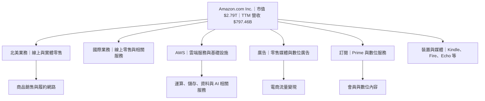
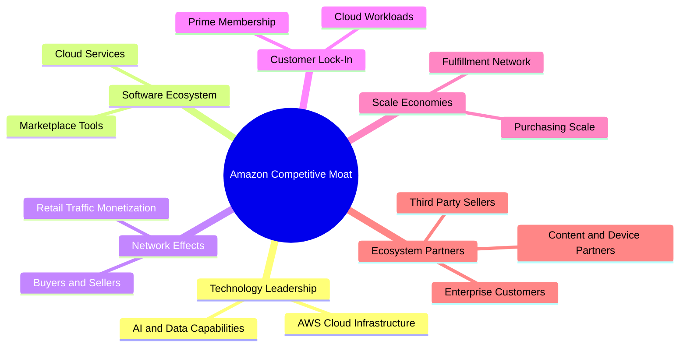
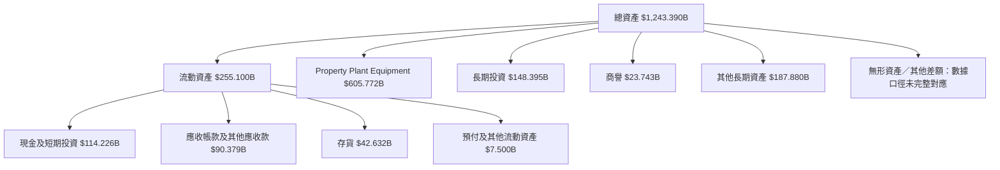
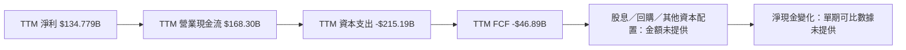
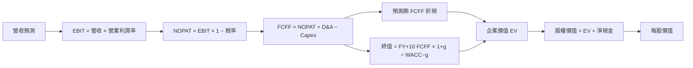
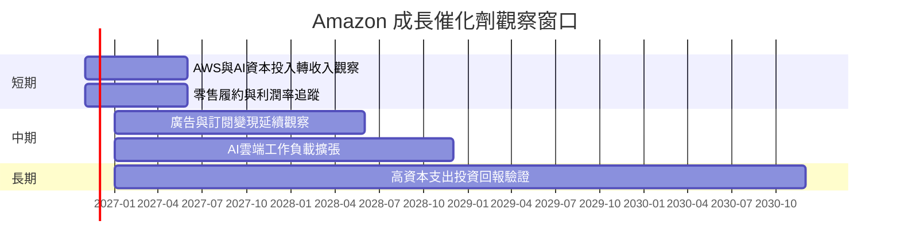
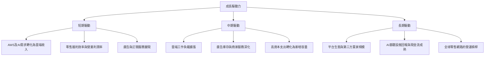
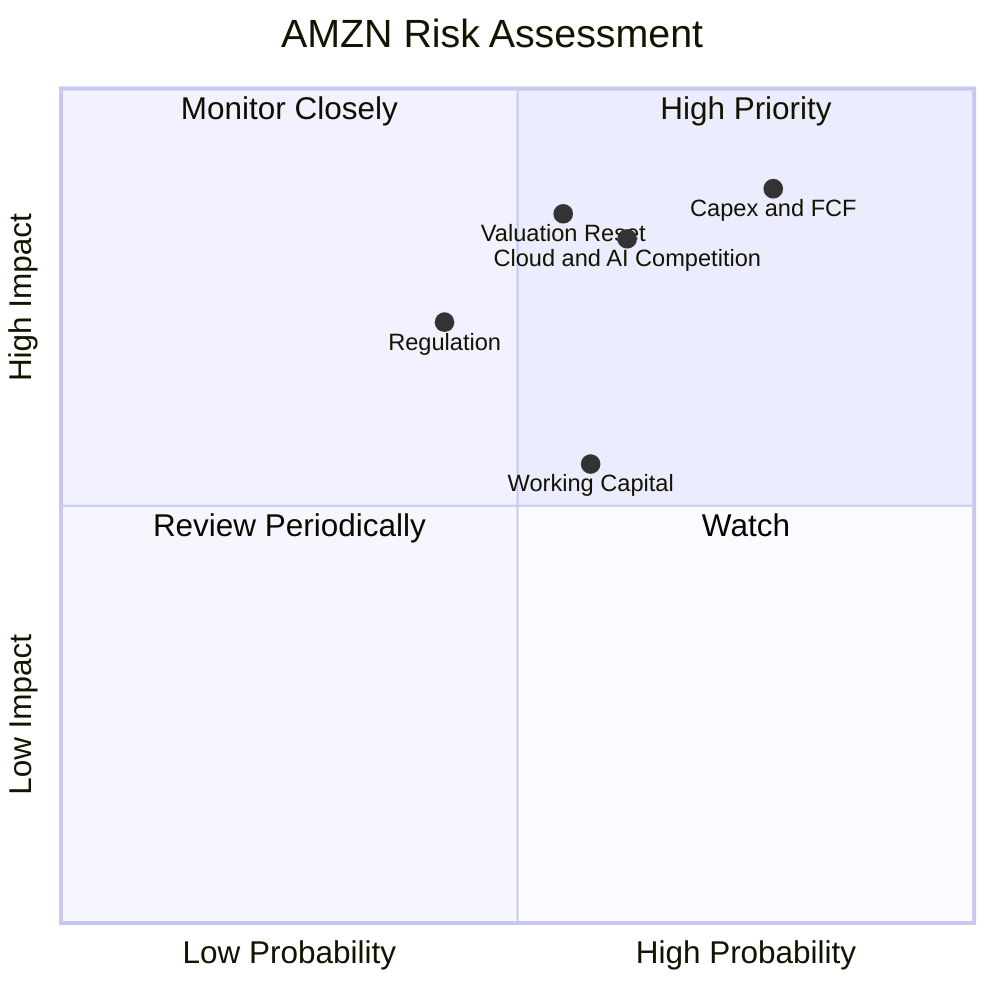
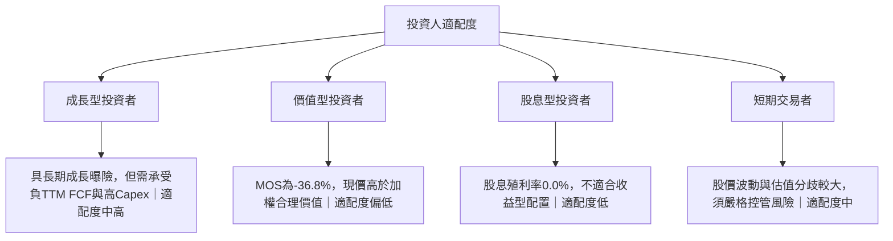

# AMZN 基本面深度分析報告
> **報告日期**：2026-11-18 ｜ **語言**：繁體中文 ｜ **數據來源**：SEC 申報資料 (XBRL)、Yahoo Finance、Finviz、StockAnalysis、Roic.ai ｜ **分析師**：CFA 級機構研究

> **資料口徑說明**：財務數據來源間存在若干差異。本文涉及 TTM 營收、最新季度成長、ROIC、WACC、TTM FCF、現金與債務，以及 DCF 與估值方法時，優先採用 SEC 申報資料經程式計算的核驗數字；其他來源的差異會明確標註，不混用為同一口徑。股價統一使用 **2026-11-17 收盤價 $257.89**。

## 目錄

| # | 章節 | 核心結論 |
|---|------|----------|
| 1 | 執行摘要 | 賣出；加權合理價值 $188.50；MOS -36.8% |
| 2 | 公司概覽與商業模式 | 電商、AWS、廣告及訂閱形成多元平台；護城河強但缺少分部營收拆分 |
| 3 | 損益表深度分析 | TTM 營收 $797.46B、成長 15.4%；TTM 營業利益率 13.1% |
| 4 | 資產負債表分析 | 核驗口徑為淨負債 $65.73B；Piotroski F-Score 4/8 |
| 5 | 現金流量深度分析 | TTM FCF -$46.89B，主因資本支出高於營業現金流 |
| 6 | 獲利能力與資本效率 | ROIC 11.9% 高於 WACC 11.13%，但利差僅 0.77 個百分點 |
| 7 | 相對估值分析 | 倍數相對自身歷史偏低或偏高不一；估值方法區間分歧大 |
| 8 | DCF 內在價值評估 | 基準 DCF $52.99；加權合理價值 $188.50；模型終值依賴度高 |
| 9 | 成長催化劑 | AWS、AI 基礎設施、廣告及零售效率為主要觀察方向 |
| 10 | 風險矩陣 | 高資本支出、估值與競爭／監管是主要風險 |
| 11 | 投資建議 | 依 MOS 為賣出；持續追蹤 AWS、利潤率、Capex 與 FCF |

---

## 1. 執行摘要

### 1.0 一頁式投資儀表板（Portfolio Manager 30 秒速讀）

| 項目 | 內容 |
|------|------|
| **投資論點（3 句）** | ① TTM 營收 $797.46B、年增 15.4%，業務仍在擴張。② TTM 營業利益率 13.1%，ROIC 11.9% 高於 WACC 11.13%，但價值利差只有 0.77 個百分點。③ TTM 資本支出 $215.19B 高於營業現金流 $168.30B，依統一定義 TTM FCF 為 -$46.89B。 |
| **綜合評分** | **6.7/10**（引用 1.1 評分卡） |
| **財務健康** | 🟡 現金及短期投資 $114.23B，但核驗口徑總債務 $179.95B、淨負債 $65.73B；FCF 為負，且 F-Score 4/8。 |
| **ROIC vs WACC** | **11.9% vs 11.13%**；目前仍高於資本成本，創造價值，但緩衝有限。 |
| **FCF 趨勢** | TTM FCF 為負；FCF Yield **-1.68%**。Capex 擴張是主要壓力來源。 |
| **估值** | Forward P/E 23.6x ｜ EV/EBITDA 16.2x ｜ FCF Yield -1.68% |
| **DCF 內在價值（基準）** | **$52.99** ｜ 現價相對 DCF 折溢價 **+386.7%**（現價／DCF 價值 − 1） |
| **安全邊際（MOS）** | **-36.8%**＝($188.50 − $257.89) ÷ $188.50；🔴 <10% 無安全邊際。基準為 8.8 加權合理價值。 |
| **預期報酬（基準情境 12M）** | **-79.5%**（DCF 基準情境 $52.99 相對現價；此為模型情境，不是保證報酬） |
| **關鍵風險（前二）** | Capex 持續高於營業現金流、AI／雲端投資回報不及預期；零售及雲端競爭壓縮利潤率。 |
| **評級 + 信心度** | 🔴 **賣出** ｜ 信心：中；估值方法差異大，DCF 的高終值依賴度降低估值確信度。 |

### 1.1 綜合評分卡（全報告唯一）

| 維度 | 評分（1–10） | 主要依據（引用數字與其來源章節） |
|------|--------------|----------------------------------|
| 成長性 | 8 | TTM 營收成長 15.4%、最新季度年增 12.1%（第 3 章）；成長可觀但季度增速較 TTM 慢。 |
| 獲利能力 | 8 | TTM 營業利益率 13.1%、ROIC 11.9% 高於 WACC 11.13%；但差距有限，F-Score 為 4/8（第 6 章）。 |
| 財務健康 | 6 | 核驗淨負債 $65.73B、現金及短期投資 $114.23B；TTM FCF -$46.89B，DSO 由 32 天增至 45 天（第 4、5 章）。 |
| 估值 | 3 | MOS -36.8%；Forward P/E 23.6x，高於同業中位數 20.9x；估值方法結果分散（第 7、8 章）。 |
| 護城河 | 9 | 多業務平台、規模與雲端服務形成結構性優勢；但缺少分部營收及市場份額數據，限制量化驗證（第 2 章）。 |
| 管理層與資本配置 | 6 | 2025 年 Capex $131.82B、SBC $19.47B，2025 年 FCF $7.70B；投資規模大但短期現金回報受壓（第 5 章）。 |
| **綜合評分** | **6.7** | 六項算術平均：(8 + 8 + 6 + 3 + 9 + 6) ÷ 6 = 6.7。 |

### 1.2 五大投資論點 + 三大核心風險

| 類型 | 項目 | 具體依據 | 信心度 |
|------|------|----------|--------|
| 🟢 **投資論點①** | 收入規模與成長仍具韌性 | TTM 營收 $797.46B，TTM 成長 15.4%；最新季度年增 12.1%。較大的營收底盤有利於支撐物流、雲端及廣告投資。 | 🟢 高 |
| 🟢 **投資論點②** | 營業獲利能力顯著高於低谷期 | 年度營業利益由 2022 年 $12.25B 增至 2025 年 $79.97B；2025 年營業利益率約 11.2%，體現成本控制及規模效應。 | 🟢 高 |
| 🟢 **投資論點③** | AWS 與廣告增加零售以外的盈利來源 | 公司業務涵蓋 AWS、廣告、訂閱及零售；分部營收數字未提供，故不推算各項貢獻。 | 🟡 中 |
| 🟢 **投資論點④** | 資本回報目前仍高於資本成本 | ROIC 11.9%，WACC 11.13%，正利差 0.77 個百分點。若投資回報不降，仍具價值創造能力。 | 🟡 中 |
| 🟢 **投資論點⑤** | 歷史估值部分指標低於自身中位數 | TTM P/E 20.8x，低於五年中位數 32.2x；EV/EBITDA 15.7x，低於中位數 17.3x。 | 🟡 中 |
| 🟡 **風險①** | 資本支出與自由現金流壓力 | TTM Capex $215.19B，超過 OCF $168.30B；TTM FCF -$46.89B。若投資回收期延長，估值與資金彈性受壓。 | 🔴 高 |
| 🔴 **風險②** | 現價高於多數內在價值估計 | 加權合理價值 $188.50，低於現價 $257.89；MOS -36.8%。DCF 基準值僅 $52.99，雖高度受終值假設影響，仍顯示價格要求極高成長。 | 🔴 高 |
| 🟡 **風險③** | 營運資金收款天數拉長 | DSO 由一年前 32 天增至 45 天；可能反映應收帳款增長快於營收，需追蹤回款與廣告／雲端客戶付款條件。 | 🟡 中 |

### 1.3 快速統計卡片

| 指標 | 公司實際值（期間） | 同業中位數 | 狀態 |
|------|--------------------|------------|------|
| 營收成長（TTM） | **15.4%** | — | 🟢 |
| 營收成長（最新一季年增） | **12.1%** | 18.8% | 🟡 |
| 毛利率（TTM） | **51.4%** | 60.9% | 🟡 |
| 營業利益率（TTM） | **13.1%** | — | 🟢 |
| ROIC（TTM） | **11.9%** | — | 🟡 |
| Forward P/E | **23.6x** | 20.9x | 🔴 |
| FCF Yield（TTM） | **-1.68%** | — | 🔴 |
| Piotroski F-Score | **4 / 8** | — | 🟡 |

> 同業中位數取 MSFT、GOOG、WMT 三家公司資料；營收成長與毛利率的中位數分別為 18.8% 與 60.9%。

### 1.4 投資結論

╔══════════════════════════════════════════════════════════════════╗  
║　　　　　　　　　📊 投資結論摘要　　　　　　　　　　　　　　　║  
╠══════════════════════════════════════════════════════════════════╣  
║　評級：🔴 賣出（依 MOS -36.8%，未作質化調整）　　　　　　　　║  
║　價格（2026-11-17 收盤）：$257.89　　　　　　　　　　　　　　║  
║　DCF 內在價值（基準）：$52.99（現價溢價 +386.7%）　　　　　 ║  
║　安全邊際 MOS：-36.8%　　　　　　　　　　　　　　　　　　　║  
║　加權合理價值（8.8）：$188.50　　　　　　　　　　　　　　　 ║  
║　DCF 情境價值：　　　　　　　　　　　　　　　　　　　　　　║  
║　　悲觀情境：$11.37（-95.6%）　　　　　　　　　　　　　　　║  
║　　基準情境：$52.99（-79.5%）　　　　　　　　　　　　　　　║  
║　　樂觀情境：$122.54（-52.5%）　　　　　　　　　　　　　　║  
║　綜合評分：6.7/10（引用 1.1）　　　　　　　　　　　　　　　║  
║　適合投資人：能承受波動、以長期雲端與 AI 成長為核心假設者；║  
║　　　　　　　不適合要求現金收益或估值安全邊際的投資人。　║  
╚══════════════════════════════════════════════════════════════════╝

---

## 2. 公司概覽與商業模式

### 2.1 業務結構與收入來源

公司披露主要業務包括北美、國際與 AWS；另提供廣告、訂閱、線上與實體零售、裝置及媒體內容。各分部營收及占比未提供，因此不以公司總營收自行拆分業務比例。

### 2.2 市場份額

市場份額數據未提供，近期新聞亦未提供可核對的市占率及年份，因此不畫市占圖、不填入推測比例。可確認的規模指標是 TTM 營收 $797.46B，TTM 成長 15.4%；最新季度營收年增 12.1%。同業數據顯示三家比較公司最新季度營收成長中位數為 18.8%，但業務組合不同，不能直接視為零售市場份額比較。

### 2.3 競爭護城河分析

### 2.4 護城河強度

| 護城河項目 | 強度（強／中／弱） | 證據（引用數字或事實） | 會削弱它的情況 |
|------------|--------------------|------------------------|----------------|
| 技術與雲端基礎設施 | 強 | AWS 是公司主要業務板塊之一；公司 TTM 營收 $797.46B，且持續投入高額資本支出。AWS 分部營收及利潤未提供。 | 雲端價格競爭、AI 投資回收較慢、企業客戶轉向多雲或自建。 |
| 軟體生態系統 | 中至強 | 雲端服務與零售平台可結合資料、履約與商家工具；缺少使用者或服務附著率資料。 | 開放標準降低轉換成本、競爭者服務更完整。 |
| 網路效應 | 強 | 買家、第三方賣家與商品供給具相互吸引特性；市場份額與活躍商家數未提供。 | 賣家分流、平台費用提高引發多平台經營或自建渠道。 |
| 客戶鎖定 | 中至強 | Prime 訂閱與 AWS 工作負載可提高留存；會員數、流失率及客戶集中度未提供。 | 價格上漲造成退訂、雲端遷移工具降低轉換成本。 |
| 規模效應 | 強 | TTM 營收 $797.46B；零售履約與採購規模可攤薄固定成本。 | 物流成本、薪資與維護成本增速超過收入；資本回報下降。 |
| 生態夥伴 | 中 | 依賴第三方賣家、企業客戶及內容／服務夥伴；合作夥伴營收占比未提供。 | 監管限制平台自營與第三方業務的協同，或夥伴轉向競爭平台。 |

1.1 評分卡的護城河分數為 **9/10**，依據是平台、雲端、物流與會員機制的相互強化；因分部及客戶留存數據缺失，不能將高分解讀為所有業務均已量化驗證。

---

## 3. 損益表深度分析

### 3.1 年度收入成長趨勢（近 4 年）

下列收入取自年度損益表。年度 YoY 由相鄰年度營收計算，百分比取一位小數；累計 CAGR 以 2022 至 2025 共三年計算。

╔══════════════════════════════════════════════════════════════════╗  
║　　　　　Amazon 年度收入趨勢（FY2022–FY2025）　　　　　　　　　║  
╠══════════════════════════════════════════════════════════════════╣  
║　FY2022　$513.98B　██████████████████　　　　 YoY：—　　　　　 ║  
║　FY2023　$574.78B　████████████████████　　　 YoY：+11.8%　🟢　║  
║　FY2024　$637.96B　██████████████████████　　 YoY：+11.0%　🟢　║  
║　FY2025　$716.92B　█████████████████████████　YoY：+12.4%　🟢　║  
╠══════════════════════════════════════════════════════════════════╣  
║　2022–2025 營收 CAGR：($716.92 ÷ $513.98)^(1/3) − 1 = 11.7%　║  
╚══════════════════════════════════════════════════════════════════╝

2025 年收入增幅高於 2024 年，營收規模擴張有利於固定成本攤薄；但公司最新季度年增率 12.1%，略低於 TTM 成長 15.4%，需觀察加速是否延續。

### 3.2 季度收入趨勢分析

| 季度 | 營收（$B） | QoQ 成長 | YoY 成長 | 備註 |
|------|-----------:|---------:|---------:|------|
| 2025 Q4 | 213.386 | +18.7% | +13.6% | QoQ 與 2025 Q3 $180.169B 比較；年增來自季度資料。 |
| 2026 Q1 | 181.519 | -14.9% | +16.6% | 季節性回落；同比仍增長。 |
| 2026 Q2 | 200.606 | +10.5% | +19.6% | QoQ 以 StockAnalysis 季度序列計算；同比成長較快。 |
| 2026 Q3 | 201.944 | +0.7% | +12.1% | 最新季 YoY 採核驗數字；QoQ 由季度收入計算。 |

QoQ 算式示例：2026 Q3 QoQ = ($201.944B ÷ $200.606B) − 1 = **0.7%**。2026 Q2 同比約 19.6%，但 Q3 同比降至核驗的 12.1%，反映增長率有放緩跡象；季度收入仍較 Q2 增長，未呈現環比收縮。

### 3.3 利潤率演變分析

| 利潤率指標 | FY2022 | FY2023 | FY2024 | FY2025 | 趨勢 | 評估 |
|------------|-------:|-------:|-------:|-------:|------|------|
| **毛利率** | 43.8% | 47.0% | 48.9% | 50.3% | 持續改善 | 🟢 |
| **營業利益率** | 2.4%* | 6.4% | 10.8% | 11.2% | 明顯回升 | 🟢 |
| **淨利率** | -0.5% | 5.3% | 9.3% | 10.8% | 由虧轉盈並改善 | 🟢 |

\* FY2022 營業利益率以年度損益表營業利益 $12.25B ÷ 營收 $513.98B 計算；另一歷史資料列的 FY2022 營業利益為 $13.348B，口徑不一致。此處採同一年度損益表的數字計算。毛利率計算採毛利 ÷ 營收。

**利潤率演變深度解析：**年度毛利率由 2022 年 43.8% 升至 2025 年 50.3%，與履約及營運效率改善、AWS／廣告等服務組合可能提升整體毛利結構相符，但分部數據不足以量化各項因素。營業利益率由 2022 年約 2.4% 升至 2025 年約 11.2%，反映收入恢復、成本控制與固定成本吸收的綜合作用。核驗 TTM 營業利益率為 13.1%，高於 FY2025；最新季度營業利益率核驗值為 13.9%。數據來源另列最新季度 13.1%，故季度利潤率存在來源差異，本文採核驗值 13.9%。

### 3.4 費用結構分析

可用資料未提供完整、同期間的 TTM 費用科目拆分，因此不畫費用結構圓餅圖，也不以營收減毛利反推各類營業費用。年度營業利益由 $79.97B（2025）與毛利 $360.51B 可觀察到公司承擔大量履約、研發、行銷及管理成本，但各項占比無法由現有數字準確拆分。

### 3.5 季度 EPS 趨勢與盈餘品質（Quality of Earnings）

財報資料列示季度 EPS 實績，但 EPS 預估及驚喜率為缺失值；因此無法可靠判斷最近四季超預期或不及預期。下表只陳述可確認的季度 EPS 實績與同比變化。

| 季度 | EPS 實績 | EPS YoY | 超預期／不及預期 |
|------|---------:|--------:|------------------|
| 2025 Q4 | $1.95 | +5.0% | N/A（分析師預估缺失） |
| 2026 Q1 | $2.78 | +74.8% | N/A（分析師預估缺失） |
| 2026 Q2 | $5.75 | +242.3% | N/A（分析師預估缺失） |
| 2026 Q3 | $1.89 | -3.1% | N/A（分析師預估缺失） |

季度 EPS 波動很大，不能只按單季同比外推；尤其 2026 Q2 的 EPS 成長與 Q3 的回落，應搭配一次性項目、分部獲利與稅項解讀。具體季度非經常性損益拆分未提供。

| 盈餘品質項目 | 數值／佔比 | 評估 |
|--------------|------------|------|
| 股權薪酬 SBC / 營收 | TTM SBC 約 $18.69B；$18.69B ÷ $797.46B = **2.3%** | 🟡 SBC 已是股東經濟成本，規模具稀釋影響。TTM SBC 由四季季度數據加總估算，季度序列不完整程度需留意。 |
| SBC / 營業現金流 | 約 **11.1%**；$18.69B ÷ $168.30B | 🟡 SBC 為非現金加回項目，若忽略會高估股東可得現金。 |
| FCF / 淨利（現金轉換率） | 約 **-34.8%**；-$46.89B ÷ $134.779B TTM 淨利 | 🔴 核驗 TTM FCF 為負，原因是 Capex 高；營收成長尚未完全轉為可分配現金。 |
| 一次性／非經常性損益 | N/A（未提供可核對拆分） | 🟡 不能排除季度 EPS 波動受一次性項目影響。 |
| 有效稅率異常 | DCF 採用 21.0% 預設稅率；實際 TTM 有效稅率 N/A | 🟡 無法確認當期淨利是否受稅務利益顯著推動。 |
| 資本化支出 vs 費用化 | TTM Capex $215.19B；資本化與費用化細項 N/A | 🟡 高資本支出會透過折舊逐年進入費用，投資回收與折舊年限是重要假設。 |

**盈餘品質結論：**營業現金流 TTM 為 $168.30B，顯示公司核心營運仍產生現金；但 TTM Capex $215.19B 使 FCF 轉換為負，不能把 GAAP 淨利直接等同於當期股東可分配盈餘。DCF 採 GAAP EBIT，因此 SBC 已作為費用反映；若投資者另以非 GAAP 盈餘估值，應明確扣回 SBC 或計入股數稀釋，避免重複或漏計。

---

## 4. 資產負債表分析

### 4.1 資產結構分解

最新 TTM 資產負債表摘要列示總資產 $1,243.390B，並列出主要資產項目。項目合計與總資產間存在資料口徑／未列示科目差異，故圖示僅呈現來源列出的數字，不補造差額。

### 4.2 流動性與營運資金分析

| 指標 | 最新 TTM | 一年前 TTM | 變化 | 解讀 |
|------|---------:|------------:|------:|------|
| DSO 應收帳款天數 | 45 天 | 32 天 | +13 天 | 🟡 收款天數增加，可能是應收帳款增長快於營收或收入組合變化；需追蹤帳齡與回款。 |
| DIO 存貨天數 | N/A | N/A | N/A | N/A（資料未提供；核驗品質指標未列可用存貨天數）。 |
| DPO 應付帳款天數 | N/A | N/A | N/A | N/A（資料未提供）。 |
| CCC 現金轉換週期 | N/A | N/A | N/A | N/A（DIO、DPO 缺失，不能推算）。 |

其他流動性資料來源列示 Current Ratio 0.989、Quick Ratio 0.793；但該組數據不屬於指定 QUALITY FIGURES 營運資金天數口徑，且與總資產及流動資產資料來源不同。可作為補充觀察：流動比率略低於 1，流動資產緩衝有限，但大型零售平台的營運負債與供應商付款週期亦須一併考量。

### 4.3 債務結構分析

核驗口徑總債務為 $179.95B，現金及短期投資 $114.23B，淨負債 $65.73B。另有彙整資料列示總債務 $304.84B、淨負債 $190.61B，可能納入不同負債範圍；本報告估值與財務健康判斷採核驗口徑，不能將兩組債務混為一談。

╔══════════════════════════════════════════════════════════════════╗  
║　　　　　　　　　Amazon 債務健康診斷　　　　　　　　　　　　　║  
╠══════════════════════════════════════════════════════════════════╣  
║　總債務：　　　 $179.95B　████████████████　　　　　　　　　║  
║　現金及短期投資 $114.23B　██████████　　　　　　　　　　　　║  
║　淨負債：　　　　$65.73B　██████　　　　　　　　 🟡　　　　║  
║　Debt/EBITDA： N/A（未提供相同核驗口徑 EBITDA）　　　　　　　║  
║　利息保障倍數：N/A（利息費用與 EBIT 口徑未完整提供）　　　　║  
║　債務成本：稅前 1.26%（資本成本資料）　　　　　　　　　　　║  
╚══════════════════════════════════════════════════════════════════╝

Debt/EBITDA 與利息保障倍數不以非同口徑數字推算。低稅前債務成本與較高現金存量提供融資彈性，但負 FCF 及大型投資計畫使債務方向、租賃義務範圍與資金回收仍須監控。

### 4.4 股東權益趨勢

╔══════════════════════════════════════════════════════════════════╗  
║　　　　　　Amazon 年度股東權益變化（年度資料）　　　　　　　　║  
╠══════════════════════════════════════════════════════════════════╣  
║　FY2022　$146.04B　█████████　　　　　　　　　　　　　　　║  
║　FY2023　$201.88B　████████████　　　　　　　　　　　　　　║  
║　FY2024　$285.97B　█████████████████　　　　　　　　　　　║  
║　FY2025　$411.06B　█████████████████████████　　　　　　　　║  
╚══════════════════════════════════════════════════════════════════╝

2022–2025 股東權益增加 $265.02B。股東權益變化除淨利留存外，也可能包含其他綜合損益及資本交易；不可把全部增幅直接歸因於營運獲利。

---

## 5. 現金流量深度分析

### 5.1 現金流量瀑布圖

可得資料沒有同期間股息及回購的完整金額，故不為兩者補造數字。

### 5.2 FCF 轉換率趨勢

| 年度／期間 | FCF（$B） | 淨利（$B） | FCF / 淨利 | 解讀 |
|------------|---------:|-----------:|-----------:|------|
| FY2022 | -16.89 | -2.72 | 621.0%* | 分子、分母皆為負，正比率不代表現金轉換良好。 |
| FY2023 | 32.22 | 30.43 | 105.9% | FCF 略高於淨利。 |
| FY2024 | 32.88 | 59.25 | 55.5% | 資本支出及非現金項目影響現金轉換。 |
| FY2025 | 7.70 | 77.67 | 9.9% | 年度淨利增加，但自由現金流下降。 |
| TTM 至 2026-09-30 | -46.89 | 134.779 | -34.8% | 核驗口徑下 Capex 超過 OCF，現金轉換為負。 |

\* FY2022 比率為數學計算值，不具正向經濟解讀。年度 FCF 取年度現金流表；TTM FCF 依核驗定義 OCF − Capex 計算，兩組數據來源及期間口徑不同。

### 5.3 自由現金流趨勢

╔══════════════════════════════════════════════════════════════════╗  
║　　　　　　自由現金流：年度資料與核驗 TTM　　　　　　　　　　　║  
╠══════════════════════════════════════════════════════════════════╣  
║　FY2022　-$16.89B　負值　　　　　　　　　　　　　　 🔴　　　║  
║　FY2023　 $32.22B　████████████████████　　　　　　　　　║  
║　FY2024　 $32.88B　████████████████████　　　　　　　　　║  
║　FY2025　　$7.70B　█████　　　　　　　　　　　　　　　　║  
║　TTM　　 -$46.89B　負值；FCF Yield -1.68%　　　　 🔴　　　║  
╠══════════════════════════════════════════════════════════════════╣  
║　TTM OCF $168.30B − Capex $215.19B = FCF -$46.89B　　　　　　║  
╚══════════════════════════════════════════════════════════════════╝

2025 年年度 FCF $7.70B，與最新 TTM FCF -$46.89B 方向不同，反映 TTM 投資支出顯著增加。季度現金流資料亦列示 2026 Q3 Capex $77.26B、OCF $42.42B；單季資本密集度偏高，需查證投資是否轉化為新增雲端容量與收入。

### 5.4 資本配置評估

可得資料沒有完整回購、股息、研發及投資金額的同一期間拆分，故不畫資本配置比例圓餅圖。

| 資本配置項目 | 可得數據 | 評估 |
|--------------|----------|------|
| 資本支出 | FY2025 $131.82B；TTM 核驗 $215.19B | 🟡／🔴 支出增加支撐長期容量，但短期壓低 FCF。 |
| 股權薪酬 | FY2025 $19.47B；TTM 估算約 $18.69B | 🟡 對每股價值及現有股東持份造成稀釋。 |
| 股息 | 股息殖利率 0.0% | 🔴 不以現金股息提供投資回報。 |
| 回購 | 近期期金額未提供 | N/A，不能判斷是否抵銷 SBC 稀釋。 |
| 留存現金 | 現金及短期投資 $114.23B | 🟢 提供資金彈性，但淨債務仍為 $65.73B。 |

---

## 6. 獲利能力與資本效率

### 6.1 ROE / ROA / ROIC 趨勢

| 指標 | 可用期間 | 數值 | 評估 |
|------|----------|-----:|------|
| ROE | TTM，QUALITY FIGURES | 22.0% | 🟢 盈利能力良好；採 DuPont 同口徑數據。 |
| ROA | TTM | 6.6%（彙整來源）；F-Score 顯示 ROA > 0 | 🟡 資產規模大、資本密集，ROA 低於 ROE。 |
| ROIC | TTM 至 2026-09-30 | 11.9% | 🟢 高於 WACC 11.13%，但差距只有 0.77pp。 |
| 歷史 ROIC／ROE／ROA 同口徑序列 | — | N/A（未提供可比完整序列） | 不以不同來源混算歷史趨勢。 |

行業均值未提供，故不列行業比較欄。市場彙整來源的 ROE 為 27.4%，與 QUALITY FIGURES 的 22.0% 不一致；本節採指定品質指標 22.0%。

### 6.2 ROIC vs WACC 分析（核心價值創造判斷）

╔══════════════════════════════════════════════════════════════════╗  
║　　　　　　　 ROIC vs WACC 深度分析　　　　　　　　　　　　　║  
╠══════════════════════════════════════════════════════════════════╣  
║　WACC 資本成本：　　　　　　　　　　　　　　　　　　　　　　║  
║　├─ 無風險利率 Rf：5.10%　　　　　　　　　　　　　　　　　　║  
║　├─ ERP：5.00%　　　　　　　　　　　　　　　　　　　　　　　║  
║　├─ 原始 Beta：1.50；採用調整後 Beta：1.34　　　　　　　　║  
║　├─ 股權成本：核驗值 11.78%　　　　　　　　　　　　　　　　║  
║　├─ 稅前債務成本：1.26%；稅後約 1.00%　　　　　　　　　　║  
║　├─ 權重：股權 93.9%，債務 6.1%　　　　　　　　　　　　　║  
║　└─ WACC：11.13%　　　　　　　　　　　　　　　　　　　　　║  
║　　　　　　　　　　　　　　　　　　　　　　　　　　　　　　　║  
║　ROIC（TTM）：11.90%　　　　　　　　　　　　　　　　　　　　║  
║　ROIC − WACC = 11.90% − 11.13% = +0.77 個百分點　　　　　　║  
║　　　　　　　　　　　　　　　　　　　　　　　　　　　　　　　║  
║　ROIC 11.90%　▓▓▓▓▓▓▓▓▓▓▓▓▓▓▓▓▓▓▓▓▓▓▓▓　　　　　　　║  
║　WACC 11.13%　▓▓▓▓▓▓▓▓▓▓▓▓▓▓▓▓▓▓▓▓▓　　　　　　　　║  
║　價值利差 +0.77pp　🟡 正值但緩衝有限　　　　　　　　　　　║  
╚══════════════════════════════════════════════════════════════════╝

依核驗資本成本數據，調整後 Beta = ⅔ × 1.50 + ⅓ × 1 = **1.33**，但程式採用值為 **1.34**；後續 WACC 一律照抄核驗值，不自行改寫。股權成本核驗值為 11.78%；若僅使用顯示到兩位小數的 Rf、Beta、ERP，CAPM 約為 5.10% + 1.34 × 5.00% = 11.80%，與核驗值相差 0.02pp，應視為底層未四捨五入輸入造成的顯示差異。

WACC 核對：  
稅後 Kd = 1.26% × (1 − 21.0%) = **0.9954%**。  
股權貢獻 = 93.9% × 11.78% = **11.078%**；債務貢獻 = 6.1% × 0.9954% = **0.061%**；合計約 **11.14%**。因權重與輸入皆經四捨五入，核驗 WACC **11.13%** 為後續採用值。

結論：ROIC 高於 WACC，當前仍創造經濟價值；但 0.77pp 的價差較窄，若 AI／雲端與物流投資的增量回報低於資本成本，ROIC 可能跌破 WACC。

### 6.3 杜邦三因素分解

| 因素 | 數值（TTM） | 解讀 |
|------|-------------|------|
| 淨利率 | 16.9% | 依 QUALITY FIGURES；顯著高於年度 FY2025 淨利率計算值，顯示資料口徑／期間差異，本文不混用。 |
| 資產週轉率 | 0.64 | 大型資產底盤帶來較低週轉率，符合資本密集業務特徵。 |
| 權益乘數 | 2.03 | 財務槓桿對 ROE 有放大作用，但並非唯一驅動因素。 |
| **ROE** | **22.0%** | 指定 DuPont 數值：16.9% × 0.64 × 2.03 ≈ 22.0%。 |

淨利率與資產週轉率共同貢獻 ROE，權益乘數 2.03 使回報放大，但不能僅據此判定 ROE 完全由槓桿支撐。

### 6.4 財務體質：Piotroski F-Score

| 測試 | 結果 | 解讀 |
|------|------|------|
| ROA > 0 | ✅ 通過 | TTM 資產回報為正。 |
| 營業現金流 > 0 | ✅ 通過 | TTM OCF 為 $168.30B。 |
| ROA 高於一年前 | ✅ 通過 | 獲利資產效率較一年前改善。 |
| 營業現金流 > 淨利 | ✅ 通過 | 指定測試通過；但 FCF 仍為負，代表 OCF 不能替代資本支出後的現金分析。 |
| 長期負債 ÷ 總資產低於一年前 | ❌ 未通過 | 槓桿比率未改善。 |
| 流動比率高於一年前 | ❌ 未通過 | 短期流動性未見改善。 |
| 稀釋股數未增加 | ❌ 未通過 | 股數增加，SBC 對股東造成稀釋。 |
| 毛利率高於一年前 | — 無法判定 | 缺少指定比較所需的可比輸入。 |
| 資產週轉率高於一年前 | ❌ 未通過 | 資產擴張可能快於收入效率提升。 |
| **Piotroski F-Score** | **4 / 8** | 🟡 中性偏弱；未通過項目集中在槓桿、流動性、稀釋與周轉效率。 |

---

## 7. 相對估值分析

### 7.1 同業估值比較表格

本公司估值取市場資料；Peer multiples 取 Yahoo Finance 同業資料。公司 forward P/E 以一般估值欄位的 23.603x 呈現；估值方法中的同業 P/E 計算則使用獨立核驗的 forward EPS $10.93 與同業中位數 20.9x。

| 估值指標 | **AMZN** | **MSFT** | **GOOG** | **WMT** | 本公司評估 |
|----------|---------:|---------:|---------:|-------:|-----------|
| **Trailing P/E** | 20.8x | 26.4x | 14.5x | 46.2x | 🟡 低於 MSFT、WMT，高於 GOOG；三家中位數 26.4x。 |
| **Forward P/E** | 23.6x | 20.9x | 18.3x | 39.5x | 🔴 高於同業中位數 20.9x；價格要求較高預期。 |
| **P/S Ratio** | 3.5x | 10.9x | 7.2x | 1.4x | 🟢 低於 MSFT、GOOG；高於 WMT；同業中位數 7.2x。 |
| **EV/EBITDA** | 16.2x | 18.6x | 17.9x | 24.5x | 🟢 低於三家同業中位數 18.6x。 |
| **最新季度營收成長** | 12.1% | 18.8% | 24.7% | 5.9% | 🟡 落後 MSFT、GOOG，但快於 WMT。 |
| **TTM 毛利率** | 51.4% | 67.7% | 60.9% | 24.8% | 🟡 低於雲端／軟體公司，高於零售同業 WMT。 |

同業商業組合差異大，尤其 WMT 與 MSFT／GOOG 的利潤結構不同，故倍數比較適合作為參照而非單獨定價依據。

### 7.2 歷史估值區間分析

╔══════════════════════════════════════════════════════════════════╗  
║　　　　　　AMZN 五年 TTM P/E 估值區間　　　　　　　　　　　　　║  
╠══════════════════════════════════════════════════════════════════╣  
║　低點　2.6x　│●　　　　　　　　　　　　　　　　　　　　　　 ║  
║　中位　32.2x │　　　　　　　　　●　　　　　　　　　　　　　║  
║　目前　20.8x │　　　　　　●　百分位 35%　　　　　　　　　　║  
║　高點　251.9x│　　　　　　　　　　　　　　　　　●　　　　 ║  
╠══════════════════════════════════════════════════════════════════╣  
║　P/S：目前 3.5x｜五年中位數 3.0x｜百分位 90%　　　　　　　　║  
║　EV/EBITDA：目前 15.7x｜五年中位數 17.3x｜百分位 29%　　　　║  
╚══════════════════════════════════════════════════════════════════╝

P/E 與 EV/EBITDA 位於自身歷史中低區間，但 P/S 位於五年百分位 90%，顯示以營收衡量的估值仍接近歷史高檔。歷史 P/E 區間極寬（2.6x–251.9x），中位數及百分位只能作背景參考，不能取代現金流估值。

### 7.3 情境價值（Bear / Base / Bull，照抄 DCF MODEL 的 Scenarios）

| 情境 | 第 1 年營收成長 | 期末營業利潤率 | WACC | 每股價值 | 相對現價 | 機率 | 會發生的條件 |
|------|----------------:|----------------:|-----:|----------:|---------:|-----:|--------------|
| 🔴 悲觀 | 7.7% | 9.1% | 12.13% | $11.37 | -95.6% | 25% | AWS／零售需求放緩、Capex 維持高位，利潤率向下回落且資本成本上升。 |
| 🟡 基準 | 15.4% | 10.8% | 11.13% | $52.99 | -79.5% | 50% | TTM 成長延續初期，之後逐步趨緩；期末利潤率回落至五年中位數假設。 |
| 🟢 樂觀 | 23.0% | 11.8% | 10.13% | $122.54 | -52.5% | 25% | 雲端／AI 投資迅速變現、收入高於基準且利潤率保持較高。 |

情境機率加權每股價值由模型列示為 **$59.97**，僅供背景參考；依規定第 8.8 加權估值使用基準 DCF 與指定估值方法，不以機率加權 DCF 取代。

### 7.4 相對估值隱含價格區間

╔══════════════════════════════════════════════════════════════════╗  
║　　　　　　估值方法隱含每股價值（美元）　　　　　　　　　　　　║  
╠══════════════════════════════════════════════════════════════════╣  
║　DCF 基準　　　 $52.99 ───────── 現價 $257.89　　　　　　　　║  
║　同業 Forward P/E $228.59 ──● 現價　　　　　　　　　　　　　　║  
║　同業 EV/EBITDA　$310.20 ─────● 現價　　　　　　　　　　　　║  
║　分析師共識　　 $326.09 ───────● 現價　　　　　　　　　　　║  
╚══════════════════════════════════════════════════════════════════╝

| 方法 | 每股價值 | 相對現價 | 依據 |
|------|---------:|---------:|------|
| 同業 Forward P/E | $228.59 | -11.4% | MSFT、GOOG、WMT 同業中位數 20.9x × Forward EPS $10.93。 |
| 同業 EV/EBITDA | $310.20 | +20.3% | 同業中位數 18.6x × TTM EBITDA，並納入淨現金／淨負債橋接。 |

---

## 8. DCF 內在價值評估（Discounted Cash Flow）

> DCF 模型數字採程式計算的既定模型。模型採用 10 年 FCFF、GAAP EBIT、21.0% 稅率、WACC 11.13%、永續成長率 3.0%，且未建模營運資金變動。以下逐項說明假設及計算；不自行重建或改動模型數值。

### 8.0 估值推理鏈（Thinking Logic）

**Step 1 — 價值由哪些變數決定？**  
Amazon 的估值主要取決於既有零售與 AWS 營收底盤、未來營收增長，以及龐大資本支出能否轉化為足夠的營業利潤與 FCFF。公司 TTM 總營收 $797.46B，但 AWS、北美與國際分部收入占比未提供，不能為各分部設定虛構占比。模型中最主導估值的變數是**終值與長期自由現金流能力**：終值現值占企業價值 98.8%，因此 WACC、永續成長率與期末 FCFF 對價值影響最大。

**Step 2 — 模型選擇**

| 決策點 | 本報告採用 | 理由（含數字） | 曾考慮但否決 | 否決理由 |
|--------|-----------|----------------|--------------|----------|
| 現金流定義 | FCFF | 與 WACC 折現並估算企業價值一致；FCFF = NOPAT + D&A − Capex。 | FCFE | 債務與資本結構影響另在 EV 至股權價值橋接處處理。 |
| 預測期 N | 10 年 | DCF 模型固定採 10 年；營收增速由 15.4% 線性降至 3.0%。 | 5 年 | 無法照核驗模型輸出，且更換期限會改變預測期與終值。 |
| 終值方法 | Gordon Growth | 模型使用永續成長率 3.0%，WACC 為 11.13%，滿足 WACC > g。 | 退出倍數作主估值 | DCF 模型未提供退出倍數終值的計算結果，不能自行補建。 |
| EBIT 基礎 | GAAP EBIT | 模型明確採 GAAP EBIT。 | 非 GAAP EBIT | 會改變 SBC 與現金流口徑，非核驗模型設定。 |

**Step 3 — 關鍵假設推導鏈**

- **營收成長**：錨點＝TTM 營收成長 15.4% → 調整＝模型以 15.4% 作第一年成長，往後線性淡化至 3.0% → **採用 FY+1 15.4%、FY+10 3.0%** → 曾考慮全期維持 15.4%，但否決，因無資料證明成熟期仍能長期維持目前成長。
- **營業利潤率**：錨點＝TTM 13.1% → 調整＝模型由當前水準逐步淡化至過去五年中位數 10.8% → **採用 FY+1 13.1% 至 FY+10 10.8%** → 曾考慮期末維持 13.1%，但否決，因模型以歷史五年中位數作成熟期錨點。
- **永續成長率 g**：錨點＝DCF 模型採 3.0%，並要求低於 WACC → 採用 3.0% → 未採用高於 3.0% 的假設，因長期永久成長必須謹慎且小於 WACC 11.13%；公司專屬長期 GDP／通膨估算未提供。
- **預測期 N**：錨點＝模型指定 10 年 → **採用 10 年** → 曾考慮縮短預測期，但否決，因會偏離已核驗模型。
- **Capex／營收**：錨點＝TTM Capex $215.19B、TTM 營收 $797.46B，比例約 27.0% → 模型以 FY+1 27.0% 逐步降至 FY+10 10.9% → **採用模型所列 27.0% 至 10.9%** → 曾考慮維持 27.0%，但否決，因模型假設支出率逐漸回落至 D&A 的 1.1 倍附近。
- **EBIT 基礎與 SBC**：錨點＝模型明示 GAAP EBIT，已把 SBC 當作營業費用；**採用組合 (A)**，不另扣 SBC，股數不再逐年稀釋 → 曾考慮另外扣 SBC，因與 GAAP EBIT 已含 SBC 會重複計成本而否決。
- **年稀釋率**：採用 0%，因模型採組合 (A)，以費用化 SBC 反映成本；不另放大股數。此為模型處理方式，不代表現實中股數不會變動。
- **WACC**：錨點＝核驗資本成本 WACC 11.13% → 採用同一數值 → 未自行調高或調低，因不得另建 WACC。
- **有效稅率、D&A／營收**：模型採稅率 21.0%、D&A／營收 10.0%；未提供一致期間的逐年實際稅率及 D&A／收入序列，故直接沿用模型輸入。
- **營運資金變動**：模型明示不建模；沒有可核驗歷史 ΔWC／新增營收比率，因此不加入自創假設。
- **終值方法**：模型採 Gordon Growth；未加入退出倍數交叉驗證，因模型沒有提供可照抄的退出倍數終值。
- **FCFF 公式**：模型明示 `FCFF = NOPAT + D&A − Capex`，不列 ΔWC，也不單獨扣 SBC。

**Step 4 — 最脆弱一環**  
最脆弱的假設是遠期 FCFF、尤其終值：終值現值占 EV 的 98.8%；若永續成長或期末現金流低於模型假設，內在價值將大幅下降，敏感度表中基準 g 3.0%、WACC 11.13% 對應每股 $52.99，而 g 2.0%、WACC 13.13% 時降至 $28.38。

**Step 5 — 計算路徑圖**

### 8.1 模型假設總表（Model Inputs）

| 假設項目 | 採用值 | 依據／來源 | 敏感度 |
|----------|--------|-------------|--------|
| 預測期長度 N | 10 年 | DCF MODEL 固定期間；以 FY+1 至 FY+10 展開。 | 🟡 中 |
| 營收成長 | FY+1 15.4% 至 FY+10 3.0% | TTM vs prior TTM 成長 15.4%；模型線性淡化。 | 🔴 高 |
| 營業利潤率 | FY+1 13.1% 至 FY+10 10.8% | TTM 13.1%；期末為過去五年中位數假設。 | 🔴 高 |
| 有效稅率 | 21.0% | DCF 預設稅率；實際 TTM 稅率資料未提供。 | 🟢 低 |
| Capex／營收 | FY+1 27.0% 至 FY+10 10.9% | TTM Capex／營收約 27.0%；模型逐步淡化。 | 🟡 中 |
| D&A／營收 | 10.0% | DCF 模型假設。 | 🟢 低 |
| 營運資金變動／營收增額 | 未建模 | DCF 模型明示 Working Capital is not modelled。 | 🟢 低 |
| EBIT 基礎 | GAAP EBIT | 模型假設明列 GAAP EBIT。 | 🟡 中 |
| SBC 處理 | 組合 (A)：GAAP EBIT、不另扣 SBC、股數不再稀釋 | GAAP EBIT 已含 SBC 費用，遵從模型說明。 | 🟡 中 |
| 年稀釋率 | 0%（模型處理） | 固定股數組合 (A)；非對未來股數變化的獨立預測。 | 🟡 中 |
| 永續成長率 g | 3.0% | DCF MODEL 指定值，且低於 WACC 11.13%。 | 🔴 高 |
| 終值方法 | Gordon Growth | DCF MODEL 提供的終值公式。退出倍數值未提供。 | 🔴 高 |
| WACC | 11.13% | 核驗 Cost of capital。 | 🔴 高 |
| 淨負債 | $65.73B | 核驗值：負現金淨額，作為 EV 至股權價值扣減。 | 🟡 中 |
| 股數 | 模型使用市值／股價換算 | DCF 每股公式為 equity value × price ÷ market cap；不另行重建股數。 | 🟡 中 |

**SBC 處理聲明：本模型採用 (A)，故 SBC 影響已計入一次。** 由於模型採 GAAP EBIT，不另扣 SBC，且不對股數逐年稀釋。模型明示 FCFF 不含營運資金變動，因此 8.3 不加入 ΔWC 列。

### 8.2 折現率推導（WACC）

╔══════════════════════════════════════════════════════════════════╗  
║　　　　　　　　　WACC 推導（折現率）　　　　　　　　　　　　　║  
╠══════════════════════════════════════════════════════════════════╣  
║　股權成本 Ke（CAPM，核驗值）：　　　　　　　　　　　　　　　║  
║　├─ 無風險利率 Rf：5.10%　　　　　　　　　　　　　　　　　　║  
║　├─ 市場風險溢酬 ERP：5.00%　　　　　　　　　　　　　　　　║  
║　├─ 原始 Beta：1.50；調整後 Beta：1.34　　　　　　　　　　　║  
║　├─ 規模／國別溢酬：0.00%（未另加）　　　　　　　　　　　　║  
║　└─ Ke：核驗值 11.78%　　　　　　　　　　　　　　　　　　　║  
║　　　　　　　　　　　　　　　　　　　　　　　　　　　　　　　║  
║　債務成本 Kd：　　　　　　　　　　　　　　　　　　　　　　　║  
║　├─ 稅前 Kd：1.26%　　　　　　　　　　　　　　　　　　　　　║  
║　├─ 稅率：21.0%　　　　　　　　　　　　　　　　　　　　　　║  
║　└─ 稅後 Kd = 1.26% × (1 − 21.0%) = 0.9954%　　　　　　　　║  
║　　　　　　　　　　　　　　　　　　　　　　　　　　　　　　　║  
║　資本結構權重：股權 93.9%；債務 6.1%　　　　　　　　　　　　║  
║　WACC = 11.13%（沿用核驗資本成本，不自行改算）　　　　　　　║  
╚══════════════════════════════════════════════════════════════════╝

1. **Ke（CAPM）**：核驗股權成本 = **11.78%**。以顯示精度輸入重算為 5.10% + 1.34 × 5.00% = 11.80%；採用核驗的 11.78%，差異來自底層未四捨五入值。  
2. **稅前 Kd**：核驗資本成本資料直接提供 **1.26%**；利息費用及相同範圍的平均計息負債明細未提供，故不自行反推。  
3. **稅後 Kd**：1.26% × (1 − 21.0%) = **0.9954%**，約 1.00%。  
4. **權重**：核驗值 E/D = **93.9%／6.1%**。市場市值約 $2.79T、債務核驗值 $179.95B，與此權重大致一致；因市場市值以約數提供，不以約數替代核驗權重。  
5. **WACC**：核驗採用值 **11.13%**。以顯示精度計算：93.9% × 11.78% + 6.1% × 0.9954% ≈ **11.12%**；與 11.13% 的微小差距來自輸入及權重顯示精度，後續模型統一使用核驗值 11.13%。

Rf 來源為 10 年期美國公債，資料日期未單獨提供；ERP 5.00% 為資本成本資料所列假設值。Beta 原始值 1.50，使用調整後 Beta 1.34。未另加規模／國別溢酬。WACC 與第 6.2 節一致。

### 8.3 逐年自由現金流預測（基準情境）

金額單位：$B；折現因子保留三位小數。以下數字逐格照錄 DCF MODEL。表內模型假設為 D&A／收入 10.0%，但部分列示年度 D&A 數值與表面百分比相差少量，反映模型底層精度或資料列示差異；為遵守核驗模型，不自行改動任何一格。

| 年度 | FY+1 | FY+2 | FY+3 | FY+4 | FY+5 | FY+6 | FY+7 | FY+8 | FY+9 | FY+10 |
|------|------:|------:|------:|------:|------:|------:|------:|------:|------:|-------:|
| 營收 | 919.87 | 1,048.46 | 1,180.63 | 1,313.26 | 1,442.76 | 1,565.24 | 1,676.64 | 1,772.96 | 1,850.48 | 1,905.99 |
| 營收 YoY | 15.4% | 14.0% | 12.6% | 11.2% | 9.9% | 8.5% | 7.1% | 5.7% | 4.4% | 3.0% |
| 營業利潤率 | 13.1% | 12.8% | 12.6% | 12.3% | 12.0% | 11.8% | 11.5% | 11.3% | 11.0% | 10.8% |
| 營業利益 EBIT（GAAP） | 120.39 | 134.49 | 148.39 | 161.65 | 173.84 | 184.54 | 193.32 | 199.83 | 203.76 | 204.93 |
| − 稅 | (25.28) | (28.24) | (31.16) | (33.95) | (36.51) | (38.75) | (40.60) | (41.96) | (42.79) | (43.04) |
| = NOPAT | 95.11 | 106.25 | 117.22 | 127.70 | 137.34 | 145.79 | 152.73 | 157.86 | 160.97 | 161.90 |
| + D&A | 91.53 | 104.33 | 117.48 | 130.68 | 143.57 | 155.75 | 166.84 | 176.42 | 184.14 | 189.66 |
| − Capex | (248.23) | (264.24) | (276.51) | (284.17) | (286.48) | (282.91) | (273.16) | (257.26) | (235.53) | (208.63) |
| = FCFF | -61.59 | -53.66 | -41.80 | -25.79 | -5.58 | 18.63 | 46.40 | 77.03 | 109.58 | 142.93 |
| 折現因子 @11.13% | 0.900 | 0.810 | 0.729 | 0.656 | 0.590 | 0.531 | 0.478 | 0.430 | 0.387 | 0.348 |
| **FCFF 現值 PV** | **-55.42** | **-43.45** | **-30.46** | **-16.91** | **-3.29** | **9.90** | **22.17** | **33.12** | **42.40** | **49.77** |

**預測期 FCF 現值合計：**  
-$55.42 − $43.45 − $30.46 − $16.91 − $3.29 + $9.90 + $22.17 + $33.12 + $42.40 + $49.77 = **$7.83B**。

**FY+1 逐步演算：**

1. **營收** = TTM 營收 $797.46B × (1 + 15.4%) = $797.46B × 1.154 = **$919.87B**。  
2. **EBIT** = $919.87B × 13.1% ≈ **$120.39B**。  
3. **稅** = $120.39B × 21.0% ≈ **$25.28B**。  
4. **NOPAT** = $120.39B − $25.28B = **$95.11B**。  
5. **D&A** = 模型列示 **$91.53B**；其與簡化的 $919.87B × 10.0% = $91.99B 不完全相同，保留核驗模型值。  
6. **Capex** = 模型列示 **$248.23B**。  
7. **ΔWC** = **未建模**，不列入 FCFF。  
8. **FCFF** = $95.11B + $91.53B − $248.23B = **-$61.59B**（以未四捨五入數據計算；顯示值存在 0.01B 尾差）。  
9. **折現與現值** = 1 ÷ (1 + 11.13%)¹ ≈ 0.900；-$61.59B × 0.900 ≈ **-$55.42B**（使用未四捨五入折現因子及現金流）。

**合理性自檢：**

- 預測 FCFF CAGR：N/A（FY+1 為負、FY+10 為正，負值起點無可解釋的 CAGR）。歷史年度 FCF 由 FY2023 $32.22B、FY2024 $32.88B 降至 FY2025 $7.70B；最新 TTM 為 -$46.89B，與預測轉正路徑差異顯著，主因是模型假設 Capex／營收逐步下降。
- FY+10 FCFF 利潤率 = $142.93B ÷ $1,905.99B = **7.5%**；目前 TTM FCF 利潤率 = -$46.89B ÷ $797.46B = **-5.9%**。同業最佳值不適用，因 Peer multiples 未提供同業 FCF 利潤率。
- FY+1 至 FY+5 FCFF 為負，因模型 Capex 大於 NOPAT 加 D&A；折現後降低預測期 PV。終值仍主導總估值，不能因遠期 FCF 轉正就忽視前期現金流缺口。

╔══════════════════════════════════════════════════════════════════╗  
║　　　　　　自由現金流：歷史實際 vs 模型預測　　　　　　　　　　║  
╠══════════════════════════════════════════════════════════════════╣  
║　FY2023（實）　$32.22B　█████████　　　　　　　　　　　　　 ║  
║　FY2024（實）　$32.88B　█████████　　　　　　　　　　　　　 ║  
║　FY2025（實）　 $7.70B　██　　　　　　　　　　　　　　　　　║  
║　TTM（核驗）　-$46.89B　負值　　　　　　　　　　　　　　　　║  
║　FY+1（預）　-$61.59B　負值　　　　　　　　　　　　　　　　║  
║　FY+10（預） $142.93B　████████████████████　　　　　　　　║  
╠══════════════════════════════════════════════════════════════════╣  
║　模型依賴 Capex／營收由 27.0% 降至 10.9%；此為轉正關鍵。　　║  
╚══════════════════════════════════════════════════════════════════╝

### 8.4 終值計算（Terminal Value）

**適用性檢查：**WACC 11.13% vs g 3.0% → WACC > g？✅

| 方法 | 計算式 | 終值 TV | TV 現值 | 佔總 EV 比重 |
|------|--------|--------:|--------:|--------------:|
| Gordon Growth | $142.93B × (1 + 3.0%) ÷ (11.13% − 3.0%) | $1,811.66B | $630.84B | 98.8% |
| 退出倍數法 | N/A（DCF MODEL 未提供退出倍數終值） | N/A | N/A | N/A |

**逐步演算：**

1. **FY+N 的 FCFF** = FY+10 FCFF = **$142.93B**。  
2. **分子** = $142.93B × (1 + 3.0%) = $142.93B × 1.03 = **$147.22B**（按未四捨五入模型值，程式終值為 $1,811.66B）。  
3. **分母** = 11.13% − 3.0% = **8.13%**；TV = $147.22B ÷ 8.13% ≈ **$1,811.66B**（差異來自未顯示的精確輸入）。  
4. **PV(TV)** = $1,811.66B × 0.348 = **$630.84B**（使用未四捨五入折現因子）。  
5. **終值佔比** = $630.84B ÷ $638.66B = **98.8%**。

終值現值占 EV 98.8%，本估值高度依賴終值假設，短期現金流貢獻有限。因 DCF MODEL 未提供退出倍數結果，也未提供同一基礎下成熟期 EBITDA 的倍數交叉驗證，本報告不自行補造。

### 8.5 企業價值 → 每股內在價值（Bridge）

╔══════════════════════════════════════════════════════════════════╗  
║　　　　　　企業價值 → 每股內在價值橋接表　　　　　　　　　　　║  
╠══════════════════════════════════════════════════════════════════╣  
║　預測期 FCF 現值合計　　　　 +$7.83B　　　　　　　　　　　　║  
║　終值現值 PV(TV)　　　　　　 +$630.84B　　　　　　　　　　　║  
║　────────────────────────────────────────────　　　　　　　　║  
║　= 企業價值 EV　　　　　　　 $638.66B　　　　　　　　　　　║  
║　+ 現金淨額調整　　　　　　　-$65.73B（淨負債）　　　　　　║  
║　= 股權價值　　　　　　　　 $572.94B　　　　　　　　　　　║  
║　每股內在價值（模型）　　　 $52.99　　　　　　　　　　　　║  
║　當前股價　　　　　　　　　 $257.89　　　　　　　　　　　 ║  
║　折溢價（現價／DCF−1）　　　 +386.7%（溢價）　　　　　　　║  
╚══════════════════════════════════════════════════════════════════╝

1. **EV** = 預測期 PV 合計 $7.83B + PV(TV) $630.84B = **$638.67B**；DCF MODEL 列示 EV **$638.66B**，0.01B 尾差來自列示四捨五入，保留核驗 EV。  
2. **股權價值** = EV $638.66B − 淨負債 $65.73B = **$572.93B**；DCF MODEL 列示 $572.94B，保留模型值。  
3. **每股內在價值**：模型公式為 equity value × price ÷ market cap；程式核驗結果 **$52.99**。市值及股價約數下直接以 $572.94B 除以股數會有微小差異，故採核驗值。  
4. **折溢價** = $257.89 ÷ $52.99 − 1 = **+386.7%**。正值代表現價較 DCF 基準內在價值溢價。  
5. **本節不計算 MOS**；MOS 僅依第 8.8 節的加權合理價值計算。

股數處理採模型公式「股權價值 × 價格 ÷ 市值」，不另以季度股數重新計算；SBC 採組合 (A)。現金與債務採核驗資料截至 2026-09-30 的現金及短期投資與總債務淨額，淨負債為 $65.73B。

### 8.6 敏感性分析（WACC × 永續成長率）

矩陣每股價值照錄 DCF MODEL；括號中上行空間依每股價值 ÷ 現價 − 1 計算，現價為 $257.89。

| g（列）／WACC（欄） | 9.13% | 10.13% | **11.13%（基準）** | 12.13% | 13.13% |
|-----------|------:|-------:|------------------:|-------:|-------:|
| 2.0% | $75.57 (-70.7%) | $58.80 (-77.2%) | $46.09 (-82.1%) | $36.21 (-86.0%) | $28.38 (-89.0%) |
| 2.5% | $81.95 (-68.2%) | $63.27 (-75.5%) | $49.34 (-80.9%) | $38.63 (-85.0%) | $30.23 (-88.3%) |
| **3.0%（基準）** | $89.37 (-65.3%) | $68.38 (-73.5%) | **$52.99 (-79.5%)** | $41.32 (-84.0%) | $32.25 (-87.5%) |
| 3.5% | $98.11 (-61.9%) | $74.25 (-71.2%) | $57.11 (-77.9%) | $44.32 (-82.8%) | $34.49 (-86.6%) |
| 4.0% | $108.55 (-57.9%) | $81.09 (-68.6%) | $61.82 (-76.0%) | $47.68 (-81.5%) | $36.97 (-85.7%) |

**逐步演算說明：**  
所選格 WACC 10.13% > g 3.0% ✅。矩陣是程式預先計算的核驗輸出，但未提供該敏感度格的折現期現金流 PV、終值與精確股數中間值；依規則不得自建第二套模型或臆造中間數，因此該格完整重算所需的分項資料為 **N/A（模型未提供）**。對應核驗每股值為 $68.38。

**三情境 DCF**

| 情境 | 營收假設 | 期末營業利潤率 | 永續成長率 | WACC | 每股內在價值 | 相對現價 | 主觀機率 |
|------|----------|----------------:|-----------:|-----:|--------------:|---------:|---------:|
| 🔴 悲觀 | 第一年 7.7% | 9.1% | 3.0%（模型基準；情境未另列） | 12.13% | $11.37 | -95.6% | 25% |
| 🟡 基準 | 第一年 15.4% | 10.8% | 3.0% | 11.13% | $52.99 | -79.5% | 50% |
| 🟢 樂觀 | 第一年 23.0% | 11.8% | 3.0%（模型基準；情境未另列） | 10.13% | $122.54 | -52.5% | 25% |
| **機率加權** | — | — | — | — | **$59.97** | **-76.7%** | **100%** |

三情境所需 FY+10 營收、FY+10 FCFF 及各自終值等逐步中間值未在 DCF MODEL 中列出；不能臆造。各情境每股值與假設依程式輸出照錄。

**敏感度結論（依已提供矩陣）：**

- g 由 2.0% 升至 3.0%（WACC 11.13% 固定）：$46.09 升至 $52.99，增加 **$6.90／15.0%**。
- WACC 由 10.13% 升至 11.13%（g 3.0% 固定）：$68.38 降至 $52.99，下降 **$15.39／22.5%**。
- 期末營業利潤率每 +1pp：模型未提供相應敏感度矩陣，**N/A（資料未提供）**。
- 在已提供的敏感度格中，WACC 變動的影響幅度大於 g 由 2% 至 3% 的變動；與 8.0 所述終值及折現率主導估值方向一致。終值現值占比 98.8% 是這項敏感度的主要原因。

### 8.7 反推 DCF（Reverse DCF：市場在預期什麼）

市場價格 $257.89 高於 DCF 基準值 $52.99。反推結果照錄 DCF MODEL，除指定變數外其餘輸入固定於基準模型；模型未提供試算軌跡及全部反推輸入，故不補造疊代表。

| 求解的變數（一次一個） | 固定條件 | 市場隱含值（令 DCF = 現價） | 公司歷史實際／基準 | 判斷 |
|------------------------|----------|------------------------------|--------------------|------|
| 年 1 營收成長 | 其他模型輸入固定於基準 | 49.2% | TTM 成長 15.4% | 🔴 遠高於目前成長，要求非常樂觀。 |
| 固定營業利潤率 | 其他模型輸入固定於基準 | 28.4% | 目前 TTM 13.1% | 🔴 約為目前利潤率 2.2 倍，要求歷史與模型未支持的利潤躍升。 |
| 永續成長率 g | N/A | 未計算 | — | 模型未提供此變數的反推解。 |
| 高成長持續年數 N | N/A | 未計算 | 基準 N 為 10 年 | 模型未提供此變數的反推解。 |

反推 DCF 顯示，若其他條件不變，要以營收成長單一變數解釋現價，第一年成長需達 49.2%；若以固定營業利潤率解釋，則需達 28.4%。模型未提供這些解的迭代軌跡或對應 FY+N 數據，因此只能引用其求解結果，不能聲稱有獨立複算驗證。

### 8.8 估值三角驗證與安全邊際

| 估值方法 | 隱含每股價值 | 上行空間（÷現價） | 權重 | 說明 |
|----------|--------------:|-------------------:|------:|------|
| DCF（基準） | $52.99 | -79.5% | 40% | 10 年 FCFF、WACC 11.13%、終值成長 3.0%。 |
| 同業 Forward P/E | $228.59 | -11.4% | 25% | 同業中位數 20.9x × Forward EPS $10.93。 |
| 同業 EV/EBITDA | $310.20 | +20.3% | 25% | 同業中位數 18.6x × TTM EBITDA，並經淨負債橋接。 |
| 分析師共識目標價 | $326.09 | +26.4% | 10% | 60 位分析師平均目標價；作參照而非主要內在價值錨點。 |
| **加權合理價值** | **$188.50** | — | **100%** | 盈利型公司估值權重；方法間差異顯著。 |

**逐步演算：**  
$52.99 × 40% + $228.59 × 25% + $310.20 × 25% + $326.09 × 10%  
= $21.196 + $57.1475 + $77.550 + $32.609  
= **$188.5025 ≈ $188.50**。權重：40% + 25% + 25% + 10% = **100%**。採盈利型公司固定權重；區塊提供的四種方法均納入，沒有剔除方法。

**MOS 與上行空間：**

- MOS = ($188.50 − $257.89) ÷ $188.50  
  = -$69.39 ÷ $188.50  
  = **-36.8%**。
- 上行空間 = ($188.50 − $257.89) ÷ $257.89  
  = -$69.39 ÷ $257.89  
  = **-26.9%**。
- DCF 折溢價另以 DCF 基準值為分母：$257.89 ÷ $52.99 − 1 = **+386.7%**。

╔══════════════════════════════════════════════════════════════════╗  
║　　　　　　　　估值區間與安全邊際　　　　　　　　　　　　　　║  
╠══════════════════════════════════════════════════════════════════╣  
║　悲觀 DCF $11.37 ─ 加權合理值 $188.50 ─ 現價 $257.89　　　　　║  
║　基準 DCF $52.99　　樂觀 DCF $122.54　　　　　　　　　　　　║  
║　　　　　　　　　　　　　　　　　　　　　　　　　　　　　　　║  
║　MOS = ($188.50 − $257.89) ÷ $188.50 = -36.8%　　　　　　　║  
║　MOS 評估：🔴 無安全邊際　　　　　　　　　　　　　　　　　　║  
║　上行空間 = ($188.50 − $257.89) ÷ $257.89 = -26.9%　　　　║  
║　　　　　　　　　　　　　　　　　　　　　　　　　　　　　　　║  
║　建議買入區間：≤ $169.65（MOS 至少 10%）　　　　　　　　　║  
║　合理持有區間：約 $169.65–$207.35　　　　　　　　　　　　　║  
║　減碼考慮區間：> $235.63（MOS 低於 -25%）　　　　　　　　║  
╚══════════════════════════════════════════════════════════════════╝

買入區間上限 $169.65 = 加權合理價值 $188.50 × (1 − 10%)；MOS -25% 對應價格 $188.50 × 1.25 = $235.63。依 MOS -36.8%，規則 20 評級為 **賣出**。

> 🔎 **程式複算（Python，依本節各項自動重算）**
>
> 加權合理價值 = $52.99 × 40% + $228.59 × 25% + $310.20 × 25% + $326.09 × 10% = **$188.50**（權重合計 100%）
>
> 以價格 $257.89 計：MOS = **-36.8%**，上行空間 = **-26.9%**
>
> ✅ 與本節所寫數值一致。

### 8.9 DCF 模型的局限與失效條件

- **終值依賴度**：終值現值占 EV **98.8%**，代表估值主要取決於 FY+10 之後的 FCFF、WACC 與永續成長率。
- **最脆弱假設**：第一，Capex／營收從 27.0% 降至 10.9%；若高投入延續，FCFF 轉正及終值會低於模型。第二，終值假設 3.0% 永續成長；敏感度矩陣顯示基準格 $52.99，g 2.0%、WACC 13.13% 時為 $28.38。
- **模型適用性**：公司 TTM FCF 為 -$46.89B，處於高再投資期，DCF 可靠度低於成熟、正 FCF 公司；可搭配 EV/EBITDA、EV/Sales、分部估值及單位經濟性分析，但現有資料不足以自行建立 SOTP。
- **與第 10 章風險矩陣連結**：AI／雲端投資回報低於預期會推高 Capex／收入、壓低 FCFF；價格競爭與成本上升會壓低營業利潤率；利率上升會提高 WACC，三者都可能降低 DCF 價值。
- **資料一致性限制**：模型假設 D&A／營收固定 10.0%，但部分逐年 D&A 與列示營收乘 10.0% 不完全相符；模型內部保留數字照錄，計算精度限制降低逐格複算能力。

### 8.10 複算檢核表（Audit Trail）

| # | 檢核項目 | 檢查方式 | 結果 |
|---|----------|----------|------|
| 1 | 高／中敏感度輸入均有推導 | 對照 8.0 Step 3 與 8.1 | ✅ 有說明錨點、採用值及替代值處理；個別歷史系列未提供已標示。 |
| 2 | 每個假設有來歷 | 檢查 8.1 依據欄 | ✅ 缺資料者標明模型假設或 N/A。 |
| 3 | WACC 五步算式與權重 | 以顯示精度核對 | ⚠️ 核驗 WACC 11.13%；四捨五入輸入重算約 11.12%–11.14%。沿用核驗值。 |
| 4 | Kd 負債範圍與債務權重一致 | 檢查利息、計息負債明細 | ⚠️ Kd 明細與計息負債範圍未提供；不自行反推，採核驗資本成本。 |
| 5 | WACC 與第 6.2 節一致 | 數值比對 | ✅ 兩處均為 11.13%。 |
| 6 | 逐年表格有 10 年且無省略 | FY+1 至 FY+10 | ✅ |
| 7 | FY+1 代表年度 FCFF 與 PV | 用列示數字重算 | ⚠️ 顯示值因四捨五入產生約 0.01B 尾差；沿用模型輸出。 |
| 8 | 預測期 PV 加總 | 加總十年 PV | ✅ -55.42 -43.45 -30.46 -16.91 -3.29 +9.90 +22.17 +33.12 +42.40 +49.77 = 7.83B。 |
| 9 | WACC > g | 11.13% > 3.0% | ✅ |
| 10 | 終值以 FY+10 FCFF、折現 10 期 | 比對 DCF MODEL | ✅ |
| 11 | EV 至每股價值橋接 | 比對模型橋接 | ⚠️ 顯示資料有 0.01B 尾差；每股價值採程式核驗 $52.99。 |
| 12 | SBC 組合相容 | GAAP、無 SBC 再扣、股數不另稀釋 | ✅ 採組合 (A)。 |
| 13 | 敏感度基準格 = DCF 基準值 | 11.13%、g 3.0% 格 | ✅ $52.99。 |
| 14 | 敏感度矩陣有效性 | 所列格均 WACC > g | ✅ |
| 15 | 三情境機率加總 | 25% + 50% + 25% | ✅ 100%；加權值照錄 $59.97。 |
| 16 | 反推 DCF 每列只放開一個變數 | 檢視提供的解 | ✅ 有兩個單變數解；迭代軌跡未提供，未虛構。 |
| 17 | MOS 與折溢價定義 | MOS 用加權價值；溢價用 DCF 值 | ✅ MOS -36.8%；DCF 折溢價 +386.7%。 |
| 18 | 報告完整至第 11 章 | 檢查章節 | ✅ |
| 19 | 加權合理價值等於方法加權和 | 逐項相乘再加總 | ✅ 未作事後微調，$188.50。 |
| 20 | 評級符合 MOS 門檻 | MOS -36.8% | ✅ 賣出，未作質化調整。 |

---

## 9. 成長催化劑

### 9.1 催化劑時間軸

下列為觀察窗口而非公司正式財測；具體落地時點與財務貢獻未提供。

### 9.2 TAM 市場規模分析

**N/A（TAM 數據未提供）**。現有財務資料可確認 TTM 營收 $797.46B、TTM 成長 15.4%，但沒有可核對的雲端、電商、廣告或 AI 市場 TAM 金額與來源年份，因此不推算滲透率。公司成長空間取決於 AWS、廣告、訂閱及零售服務能否在高基期持續擴張，並改善資本支出的現金回報。

### 9.3 成長驅動力結構圖

---

## 10. 風險矩陣

### 10.1 風險評分矩陣

機率與衝擊座標為分析師質化評估，不是公司財務預測；財務衝擊門檻列於下表。

### 10.2 風險清單詳細分析

| # | 風險項目 | 發生機率 | 財務衝擊 | 風險評分 | 緩解措施 |
|---|----------|----------|----------|----------|----------|
| 1 | 🔴 **Capex 增長快於營業現金流** | 高（約 65%） | 高；若 TTM Capex 持續高於 OCF，FCF 可能維持負值，現已為 -$46.89B | 🔴 8.5/10（風險排序分，不是公司評分卡） | 逐季追蹤 OCF、Capex、FCF、Capex／營收及新建容量利用率；若連續兩季 FCF 惡化且營收成長放緩，重新評估估值。 |
| 2 | 🔴 **雲端與 AI 投資競爭加劇** | 中高（約 60%） | 高；若 AWS 成長顯著低於公司 15.4% TTM 成長或利潤率下滑，終值及回報率受壓 | 🔴 8.0/10（風險排序分） | 追蹤 AWS 分部成長、營業利益率、客戶需求及資本回收；目前 AWS 分部數據未提供，後續財報需補足。 |
| 3 | 🔴 **估值修正風險** | 中高（約 55%） | 高；加權合理價值 $188.50，低於現價 $257.89；MOS -36.8% | 🔴 8.0/10（風險排序分） | 以估值區間與盈利假設分層建倉；若市場價格上升但估值及現金流未改善，避免追價。 |
| 4 | 🟡 **監管與平台規範** | 中（約 40%） | 中高；可能改變平台費用、商家關係、廣告與併購策略；金額影響 N/A | 🟡 6.5/10（風險排序分） | 追蹤監管調查、訴訟與政策變更，將平台規則改變納入商家留存與營業利潤率壓力測試。 |
| 5 | 🟡 **應收帳款及營運資金惡化** | 中（約 50%） | 中；DSO 由 32 天升至 45 天，若回款持續變慢，會增加營運資金占用 | 🟡 6.0/10（風險排序分） | 追蹤 DSO、應收帳齡及坏帳；若 DSO 再增加 10 天以上且收入成長放緩，調降現金流預估。 |

---

## 11. 投資建議

### 11.1 最終評級與評分

依加權合理價值 $188.50 與 2026-11-17 收盤價 $257.89 計算，MOS 為 -36.8%，依規則 20 評級為 **🔴 賣出**，未作質化調整。公司品質綜合評分為 **6.7/10**，引用 1.1 六項分數：成長性 8、獲利能力 8、財務健康 6、估值 3、護城河 9、管理層與資本配置 6。

### 11.2 合理價值與隱含報酬率

| 估值情境／方法 | 每股價值 | 相對現價 | 機率／權重 |
|----------------|---------:|---------:|-----------:|
| 加權合理價值 | $188.50 | -26.9% 上行空間 | 估值權重合計 100% |
| 悲觀 DCF | $11.37 | -95.6% | 25% |
| 基準 DCF | $52.99 | -79.5% | 50% |
| 樂觀 DCF | $122.54 | -52.5% | 25% |
| 分析師共識目標價 | $326.09 | +26.4% | 60 位分析師平均值 |

三個 DCF 情境即使在樂觀情境下仍低於現價；加權合理價值高於基準 DCF，是因相對估值及分析師共識方法提供較高估值。這種方法差異代表估值不確定性高，不應把分析師共識單獨視為內在價值。

### 11.3 買入時機與觸發因素

╔══════════════════════════════════════════════════════════════════╗  
║　　　　　　　　✅ 買入觸發因素 Checklist　　　　　　　　　　　║  
╠══════════════════════════════════════════════════════════════════╣  
║　立即重新評估條件（多數符合）：　　　　　　　　　　　　　　　║  
║　☐ 股價回落至 $169.65 以下，對應加權價值至少 10% MOS　　　　 ║  
║　☐ TTM FCF 從 -$46.89B 明確改善並轉正　　　　　　　　　　　　║  
║　☐ ROIC 維持高於 WACC 11.13%，且價值利差擴大　　　　　　　　║  
║　　　　　　　　　　　　　　　　　　　　　　　　　　　　　　　║  
║　加碼觸發條件（需同時核對估值與基本面）：　　　　　　　　　║  
║　☐ Capex／營收下降，且 AWS／廣告成長維持或加速　　　　　　 ║  
║　☐ 營業利益率維持 13.1% 附近或以上　　　　　　　　　　　　 ║  
║　☐ DSO 自 45 天回落，營運現金流轉化改善　　　　　　　　　　║  
║　　　　　　　　　　　　　　　　　　　　　　　　　　　　　　　║  
║　減碼／停損觸發條件：　　　　　　　　　　　　　　　　　　　║  
║　☐ ROIC 跌破 WACC 11.13% 並連續兩季未恢復　　　　　　　　 ║  
║　☐ TTM FCF 持續惡化，或資本支出上升但營收成長降至 10% 以下 ║  
║　☐ 營業利益率由 TTM 13.1% 收縮 2 個百分點以上　　　　　　　║  
╚══════════════════════════════════════════════════════════════════╝

### 11.4 投資人適配度分析

### 11.5 每季財報監控清單（Quarterly Watch List）

| 監控指標 | 目前基準 | 加碼觀察門檻 | 減碼／重新評估門檻 |
|----------|----------|--------------|----------------------|
| 總營收成長 | TTM 15.4%；最新季度 YoY 12.1% | 最新季度 YoY 回到 15% 以上，且未靠單一非經常項目 | 連續兩季低於 10% |
| 營業利益率 | TTM 13.1%；最新季度核驗 13.9% | 維持 13% 以上並伴隨 FCF 改善 | 低於 11.1%，或單季較前期下滑 2pp 以上 |
| 營業現金流 | TTM $168.30B | OCF 成長且高於資本支出 | OCF 下降、同時 Capex 繼續擴張 |
| Capex | TTM $215.19B | Capex／營收下降而收入仍成長 | Capex／營收持續約 27% 或更高，且收入成長低於 10% |
| FCF | TTM -$46.89B | 轉正並連續改善 | 負 FCF 擴大或 FCF Yield 進一步下滑 |
| AWS／AI 投資回報 | 分部財務數據未提供 | 要求財報披露分部成長、利潤率與資本投入效率 | AWS 成長明顯落後公司整體且資本支出上升 |
| 營運資金 DSO | 45 天；一年前 32 天 | 回落至 40 天以下並改善回款 | 升至 55 天以上，或應收增加快於營收 |
| 稀釋股數／SBC | 稀釋股數 Piotroski 測試未通過；FY2025 SBC $19.47B | SBC／營收下降、股數增速放慢 | SBC／營收持續升高或稀釋速度擴大 |
| 公司財測 | 可核驗財測數據未提供 | 財測上調且資本回報指標同步改善 | 財測下修、同時利潤率與 FCF 惡化 |

### 11.6 反面論證：什麼會證明論點錯誤（What Would Change My Mind）

╔══════════════════════════════════════════════════════════════════╗  
║　　　　　⚠️ 論點失效條件（Disconfirming Evidence）　　　　　　 ║  
╠══════════════════════════════════════════════════════════════════╣  
║　本分析若出現下列可量化狀況，應重新檢視估值與投資結論：　　　║  
║　☐ 最新季度營收 YoY 連續兩季低於 10%　　　　　　　　　　　　║  
║　☐ TTM 營業利益率由 13.1% 下滑至 11.1% 以下　　　　　　　　║  
║　☐ TTM FCF 持續低於 -$46.89B，且 Capex 未開始下降　　　　　║  
║　☐ ROIC 跌破 WACC 11.13%，並持續兩季　　　　　　　　　　　║  
║　☐ DSO 升至 55 天以上且應收帳款增長快於收入　　　　　　　　║  
║　☐ 高資本支出未帶動雲端／廣告成長或營業利潤率改善　　　　　║  
║　☐ 稀釋股數與 SBC 增長快於每股盈利增長　　　　　　　　　　　║  
║　　　　　　　　　　　　　　　　　　　　　　　　　　　　　　　║  
║　反之，若 FCF 轉正、ROIC–WACC 利差擴大、Capex 效率改善，　║  
║　且股價接近加權合理價值所對應的買入區間，則應重估賣出判斷。║  
╚══════════════════════════════════════════════════════════════════╝

> **免責聲明**：本報告為 AI 自動生成，僅供研究參考，不構成投資建議。投資有風險，入市需謹慎。

---

## 資料與來源

| 項目 | 內容 |
|------|------|
| 價格 | 257.89 USD，2026-11-17 收盤（Yahoo Finance 日線） |
| 財務報表 | SEC 10-Q filed 2026-10-30，最新季度 2026-09-30（FY2026 Q3） |
| 有回應的資料來源 | SEC 申報資料 (XBRL)、Yahoo Finance、Finviz、StockAnalysis、Roic.ai |
| 由程式計算 | TTM 數字、WACC、DCF 模型、估值方法與權重、加權合理價值、MOS、評級門檻、F-Score、杜邦分解、營運資金天數、綜合評分 |
| 撰寫模型 | openai / gpt-6-luna |

> 本區塊由產生報告的程式依實際取得的資料填寫，非模型撰寫。「由程式計算」的數字不是模型的估計；其餘判斷（評分、情境、策略）是模型的分析。
