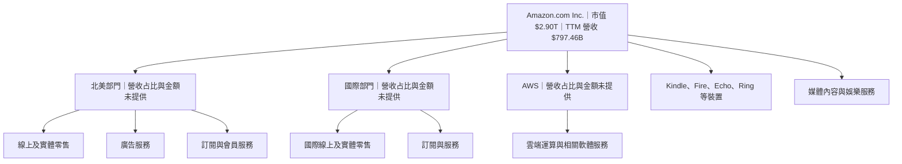
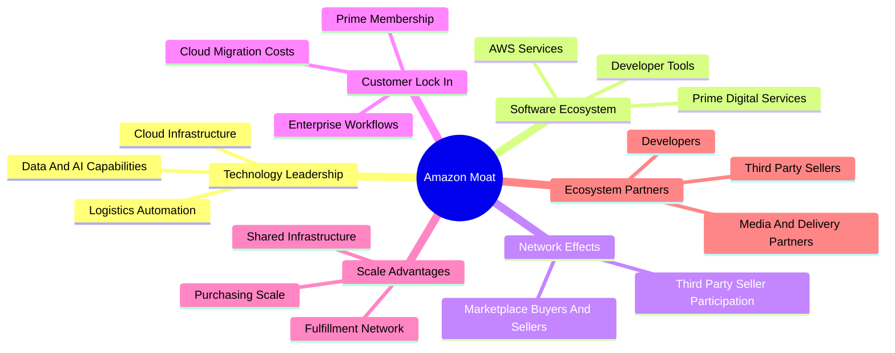
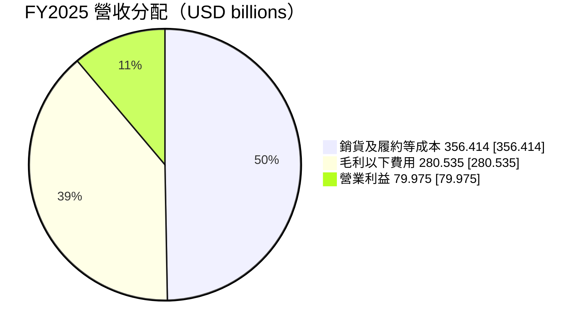
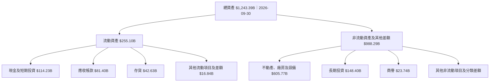
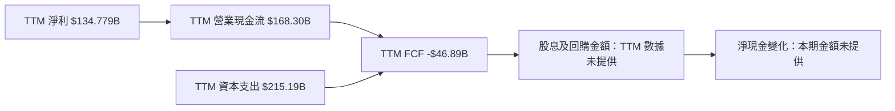
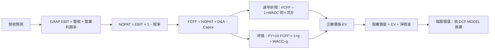
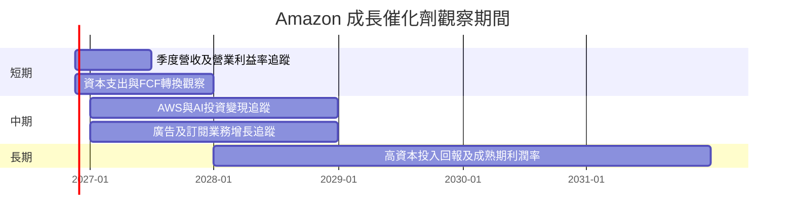
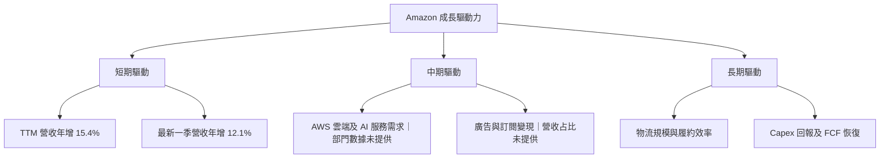
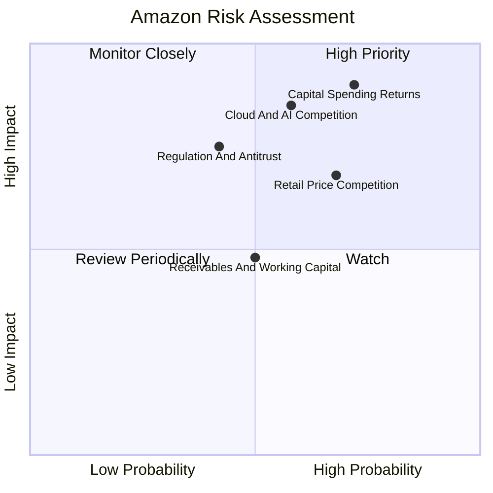
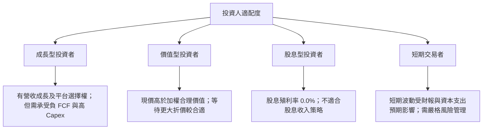

# AMZN 基本面深度分析報告
> **報告日期**：2026-11-19 ｜ **語言**：繁體中文 ｜ **數據來源**：SEC 申報資料 (XBRL)、Yahoo Finance、Finviz、StockAnalysis、Roic.ai ｜ **分析師**：CFA 級機構研究

## 目錄

| # | 章節 | 核心結論 |
|---|------|----------|
| 1 | 執行摘要 | 賣出；加權合理價值 $188.80，MOS -41.8% |
| 2 | 公司概覽與商業模式 | 多元零售、雲端與廣告平台構成護城河；部門營收細分未提供 |
| 3 | 損益表深度分析 | TTM 營收 $797.46B、成長 15.4%；最新一季營業利益率 13.9% |
| 4 | 資產負債表分析 | 淨負債 $65.73B；最新流動性指標顯示流動比率低於 1 |
| 5 | 現金流量深度分析 | TTM FCF -$46.89B，資本支出高於營業現金流 |
| 6 | 獲利能力與資本效率 | ROIC 11.9% 高於 WACC 11.11%，但價值利差僅 0.79 個百分點 |
| 7 | 相對估值分析 | P/E 低於同業中位數，但 P/S 位於自身五年區間高位 |
| 8 | DCF 內在價值評估 | 基準 DCF $53.15；終值現值佔 EV 98.8%，估值高度依賴長期假設 |
| 9 | 成長催化劑 | AWS、廣告與 AI 投資具成長潛力；TAM 及部門營收占比數據未提供 |
| 10 | 風險矩陣 | AI／雲端投資回報、資本支出、零售競爭為主要風險 |
| 11 | 投資建議 | 依 MOS 評級為賣出；建議等候估值或現金流改善 |

---

## 1. 執行摘要

截至 2026-11-18 收盤，AMZN 股價為 **$267.74**。按估值方法固定權重計算，加權合理價值為 **$188.80**，因此 **MOS = -41.8%**；依評級門檻為**賣出**。基準 DCF 每股價值為 **$53.15**，低於現價 80.1%；同時 TTM FCF 為 **-$46.89B**，顯示高額投資尚未轉化為正的自由現金流。另一方面，TTM 營收成長 15.4%、ROIC 11.9% 高於 WACC 11.11%，支持公司仍具經營韌性，但不足以抵銷現價相對加權價值的溢價。

### 1.0 一頁式投資儀表板（Portfolio Manager 30 秒速讀）

| 項目 | 內容 |
|------|------|
| **投資論點（3 句）** | ① TTM 營收 $797.46B、年增 15.4%，提供規模及成長底盤。② ROIC 11.9% 高於 WACC 11.11%，仍創造正經濟利差。③ TTM FCF -$46.89B、資本支出 $215.19B，投資回報尚未充分反映於現金流。 |
| **綜合評分** | **5.6/10**（引用 1.1 評分卡） |
| **財務健康** | 🟡 現金及短期投資 $114.23B，但淨負債 $65.73B、流動比率 0.989 |
| **ROIC vs WACC** | 11.9% vs 11.11%；創造正值，但利差僅 0.79 個百分點 |
| **FCF 趨勢** | TTM FCF 為負；FCF Yield **-1.62%** |
| **估值** | Forward P/E 24.5x ｜ EV/EBITDA 16.3x ｜ FCF Yield -1.62% |
| **DCF 內在價值（基準）** | $53.15 ｜現價相對 DCF 折溢價 **+403.9%**（折溢價＝現價÷DCF價值−1） |
| **安全邊際（MOS）** | **-41.8%**＝($188.80−$267.74)÷$188.80；🔴 <10% 無 |
| **預期報酬（基準情境 12M）** | **-80.1%**（DCF MODEL 基準情境每股價值 $53.15，相對現價） |
| **關鍵風險（前二）** | 高資本支出壓低 FCF；AI／資料中心投資回報及折舊風險 |
| **評級 + 信心度** | 🔴 **賣出** ｜信心：中（公司品質高，但 DCF 終值占比極高且不同資料源有財務口徑差異） |

### 1.1 綜合評分卡（全報告唯一）

| 維度 | 評分（1–10） | 主要依據（引用數字與其來源章節） |
|------|--------------|----------------------------------|
| 成長性 | 7.5 | TTM 營收成長 15.4%、最新一季年增 12.1%（第 3 章） |
| 獲利能力 | 7.0 | TTM 營業利益率 13.1%、ROIC 11.9% 高於 WACC 11.11%，F-Score 4/8（第 3、6 章） |
| 財務健康 | 5.5 | 淨負債 $65.73B、流動比率 0.989；DSO 由 32 天升至 45 天（第 4 章） |
| 估值 | 2.0 | 加權合理價值 $188.80，MOS -41.8%；P/S 為自身五年區間第 95 百分位（第 7、8 章） |
| 護城河 | 8.0 | 2025 年營收 $716.92B，雲端、物流、電商與廣告形成跨業務規模優勢；部門數據未提供（第 2 章） |
| 管理層與資本配置 | 5.5 | 2025 年資本支出 $131.82B、SBC $19.47B；TTM 資本支出 $215.19B 並使 FCF 為負（第 5 章） |
| **綜合評分** | **5.9** | 六項算術平均：(7.5+7.0+5.5+2.0+8.0+5.5)÷6＝5.9167，四捨五入為 5.9 |

### 1.2 五大投資論點 + 三大核心風險

| 類型 | 項目 | 具體依據 | 信心度 |
|------|------|----------|--------|
| 🟢 **投資論點①** | 營收規模與成長仍具韌性 | TTM 營收 $797.46B，TTM 年增 15.4%；最新一季年增 12.1% | 🟢 高 |
| 🟢 **投資論點②** | 營業獲利能力改善 | 年營業利益由 2022 年 $12.25B 升至 2025 年 $79.97B；TTM 營業利益率 13.1% | 🟢 高 |
| 🟢 **投資論點③** | ROIC 高於資金成本 | ROIC 11.9% 對 WACC 11.11%，利差 +0.79 個百分點 | 🟡 中 |
| 🟢 **投資論點④** | 多業務平台可交叉導流 | 電商、物流、AWS、廣告及訂閱服務共用客戶與基礎設施；營收占比未提供 | 🟡 中 |
| 🟢 **投資論點⑤** | 資產及現金儲備仍具規模 | 現金及短期投資 $114.23B，足以支持大型投資，但淨負債仍為 $65.73B | 🟡 中 |
| 🟡 **風險①** | 資本支出增速快於現金生成 | TTM 資本支出 $215.19B 高於營業現金流 $168.30B，FCF -$46.89B | 🔴 高衝擊 |
| 🔴 **風險②** | 現價相對合理價值偏高 | 加權合理價值 $188.80，現價 $267.74，MOS -41.8% | 🔴 高 |
| 🟡 **風險③** | 應收款回收天數上升 | DSO 由一年前 32 天升至 45 天；需確認是否由業務組合或收款效率造成 | 🟡 中 |

### 1.3 快速統計卡片

| 指標 | 公司實際值（期間） | 同業中位數 | 狀態 |
|------|--------------------|------------|------|
| 營收成長（TTM） | **15.4%** | — | 🟢 |
| 營收成長（最新一季年增） | **12.1%** | 18.8%（MSFT、GOOG、WMT 中位數） | 🟡 |
| 毛利率（TTM） | **51.4%** | 60.9% | 🟡 |
| 營業利益率（TTM） | **13.1%** | — | 🟢 |
| ROIC（TTM） | **11.9%** | — | 🟡 |
| Forward P/E | **24.5x** | 21.0x | 🔴 |
| FCF Yield（TTM） | **-1.62%** | — | 🔴 |
| Piotroski F-Score | **4 / 8** | — | 🟡 |

> 同業營收成長與毛利率中位數分別採 MSFT、GOOG、WMT 三家公司給定數值計算；Forward P/E 中位數為 21.0x。財務指標來源口徑不一致處，以 SEC／品質指標的 VERIFIED FIGURES 數值為主。

### 1.4 投資結論

```text
╔══════════════════════════════════════════════════════════════════╗
║                    📊 投資結論摘要                               ║
╠══════════════════════════════════════════════════════════════════╣
║  評級：賣出（依 MOS 門檻；未作質化調整）                        ║
║  價格（2026-11-18 收盤）：$267.74                                ║
║  DCF 內在價值（基準）：$53.15（現價折溢價 +403.9%）              ║
║  安全邊際 MOS：-41.8%（以加權合理價值為分母）                    ║
║  加權合理價值（8.8）：$188.80                                    ║
║  DCF 情境價值：                                                   ║
║    悲觀情境：$11.44（-95.7%）                                    ║
║    基準情境：$53.15（-80.1%）                                    ║
║    樂觀情境：$122.88（-54.1%）                                   ║
║  綜合評分：5.9/10（引用 1.1）                                    ║
║  適合投資人：可承受高資本支出與估值波動的長線成長型投資人；       ║
║              不適合以折價或股息收益為主要策略者                   ║
╚══════════════════════════════════════════════════════════════════╝
```

---

## 2. 公司概覽與商業模式

### 2.1 業務結構與收入來源

公司資料列出北美、國際及 AWS 三個報告部門，並提供電商、實體零售、廣告、訂閱、裝置及媒體等產品服務。未提供各部門營收、占比或分部利潤，故不推算或製作比例圖。



### 2.2 市場份額

市場份額數據未提供，因此不列份額或推估市場占有率。Amazon 的 TTM 營收為 $797.46B、年增 15.4%，其絕對營收規模顯著，但無法只憑公司營收與同業倍數精確推算電商、雲端或廣告市場份額。

### 2.3 競爭護城河分析



### 2.4 護城河強度

| 護城河項目 | 強度（強／中／弱） | 證據（引用數字或事實） | 會削弱它的情況 |
|------------|--------------------|------------------------|----------------|
| 技術與雲端能力 | 強 | AWS 為公司報告部門之一；公司 TTM 營收 $797.46B，但 AWS 獨立數字未提供 | 雲端服務價格競爭、AI 基建投資回報低於資金成本 |
| 軟體與服務生態 | 中至強 | 雲端、訂閱、裝置與媒體服務共存；部門營收占比未提供 | 服務品質下降、價格上升導致客戶轉移 |
| 雙邊網路效應 | 中至強 | 線上商城連結消費者與第三方賣家；賣家數與交易額未提供 | 賣家依賴平台成本上升，或競爭平台分流 |
| 客戶鎖定 | 中 | Prime、AWS 及企業工作流具有持續使用特性；留存率與訂戶數未提供 | 企業雲端遷移成本下降、會員取消增加 |
| 規模效應 | 強 | 2025 年營收 $716.92B、員工 1,638,000 人，物流與履約規模提供成本優勢 | 勞動、運輸及資本成本上升，或規模複雜度抵銷效率 |
| 生態夥伴 | 中 | 第三方賣家、開發者、配送及媒體合作構成供給面；合作夥伴量未提供 | 監管限制平台自營與第三方業務的整合方式 |

1.1「護城河」評分為 **8.0/10**，理由是規模與跨業務平台有事實支撐，但各部門收入、客戶留存及市場份額資料不足以將其評為最高區間。

---

## 3. 損益表深度分析

### 3.1 年度收入成長趨勢（近 4 年）

年度營收來自 StockAnalysis／年度損益表；成長率按相鄰年度營收計算，金額取一位小數，百分比取一位小數。

```text
╔══════════════════════════════════════════════════════════════════╗
║             Amazon 年度收入趨勢（FY2022-FY2025）                 ║
╠══════════════════════════════════════════════════════════════════╣
║  FY2022  $514.0B  ██████████████████░░░░░░░░░░░  YoY：+9.4%    ║
║  FY2023  $574.8B  ████████████████████░░░░░░░░░  YoY：+11.8%   ║
║  FY2024  $638.0B  ██████████████████████░░░░░░░  YoY：+11.0%   ║
║  FY2025  $716.9B  █████████████████████████░░░░  YoY：+12.4%   ║
╠══════════════════════════════════════════════════════════════════╣
║  FY2022-FY2025 CAGR：(716.92 ÷ 513.98)^(1/3) − 1 = 11.7%       ║
╚══════════════════════════════════════════════════════════════════╝
```

FY2025 營收成長快於 FY2024，並與 TTM 15.4% 成長方向一致。營收擴大可提升物流和平台固定成本的吸收能力；但若新增營收需依賴更高履約、雲端及資料中心投入，營收成長不必然立即轉化為 FCF。

### 3.2 季度收入趨勢分析

季度營收使用 StockAnalysis 數據，單位為 $B。QoQ 為相鄰季度營收變化；YoY 按同季比較。Q4 2024 比較基期為 Roic.ai 所列 $187.792B。

| 季度 | 營收 | QoQ 成長 | YoY 成長 | 備註 |
|------|------:|---------:|---------:|------|
| 2025 Q4 | $213.386B | +15.8% | +13.6% | 季節性旺季，QoQ 對比 Q3 2025 |
| 2026 Q1 | $181.519B | -14.9% | +16.6% | 旺季後回落，但年增維持雙位數 |
| 2026 Q2 | $200.606B | +10.5% | +19.6% | 年增率為提供資料中的季度年增率 |
| 2026 Q3 | $201.944B | +0.7% | +12.1% | 最新一季成長減速，但營收仍高於去年同期 |

最新一季年增 12.1%低於 2026 Q2 的 19.6%。季度資料顯示營收保持成長，但不能將單季成長直接延伸為全年預測；旺季季節性及比較基期可能影響 QoQ。

### 3.3 利潤率演變分析

以下年度比率依年度損益表營收、毛利、營業利益與淨利計算；TTM 營業利益率則引用品質數據中的 13.1%。

| 利潤率指標 | FY2022 | FY2023 | FY2024 | FY2025 | 趨勢 | 評估 |
|------------|-------:|-------:|-------:|-------:|------|------|
| **毛利率** | 43.8% | 47.0% | 48.9% | 50.3% | 逐年改善 | 🟢 |
| **營業利益率** | 2.4% | 6.4% | 10.8% | 11.2% | 明顯改善 | 🟢 |
| **淨利率** | -0.5% | 5.3% | 9.3% | 10.8% | 由虧轉盈並擴張 | 🟢 |

**利潤率演變深度解析：** FY2022 至 FY2025 營業利益由 $12.25B 升至 $79.97B，營收同期由 $513.98B 增至 $716.92B。營業利益增幅遠高於營收，反映營運槓桿及成本效率改善；可能來源包括履約網路調整、服務和廣告等業務組合變化，以及規模擴大。資料未提供各部門利潤，故不能將整體利潤率改善完全歸因於 AWS 或廣告。TTM 營業利益率 13.1%高於 FY2025 年度 11.2%，但最新一季數字有資料來源口徑差異：品質數據為 13.9%，其他市場數據列 13.1%，本報告以 VERIFIED FIGURES 的最新季度 13.9%為準。

### 3.4 費用結構分析

以 FY2025 數字呈現收入分配：營收 $716.924B、毛利 $360.510B、營業利益 $79.975B。成本及費用項目為以提供數據相減得到的分類，不代表公司正式披露的完整費用科目。



```text
╔══════════════════════════════════════════════════════════════════╗
║              FY2025 收入至營業利益（USD billions）               ║
╠══════════════════════════════════════════════════════════════════╣
║  營收 $716.924B                                                 ║
║  ├─ 毛利 $360.510B                                              ║
║  │  ├─ 銷貨及履約等成本：716.924 − 360.510 = $356.414B           ║
║  │  └─ 毛利以下費用：360.510 − 79.975 = $280.535B               ║
║  └─ 營業利益 $79.975B                                           ║
╚══════════════════════════════════════════════════════════════════╝
```

### 3.5 季度 EPS 趨勢與盈餘品質（Quality of Earnings）

EPS 實際值可由 StockAnalysis 季度資料引用；EPS 預期值與驚喜幅度皆為 `nan`，因此不能判定超預期或不及預期。

| 季度 | EPS 實際 | EPS 年增 | 超預期／不及預期 |
|------|---------:|--------:|------------------|
| 2025 Q4 | $1.95 | +5.0% | N/A，預期值未提供 |
| 2026 Q1 | $2.78 | +74.8% | N/A，預期值未提供 |
| 2026 Q2 | $5.75 | +242.3% | N/A，預期值未提供 |
| 2026 Q3 | $1.89 | -3.1% | N/A，預期值未提供 |

| 盈餘品質項目 | 數值/佔比 | 評估 |
|--------------|-----------|------|
| 股權薪酬 SBC / 營收 | FY2025：$19.47B ÷ $716.92B = **2.72%** | 🟡 SBC 造成持續股權稀釋；FY2025 股數變動與 SBC 佔 TTM 數值未能完整對齊 |
| SBC / 營業現金流 | FY2025：$19.47B ÷ $139.51B = **14.0%** | 🟡 非現金費用但具股東稀釋成本，評估現金流時不可忽略 |
| FCF / 淨利（現金轉換率） | TTM FCF -$46.89B ÷ TTM 淨利 $134.779B = **-34.8%** | 🔴 正淨利未轉化為正 FCF，主要需考慮高額資本支出 |
| 一次性／非經常性損益 | N/A（資料未提供足以辨識的完整明細） | 不宜假設淨利完全由經常性項目構成 |
| 有效稅率異常 | N/A（本期實際有效稅率未提供） | DCF 採用 21.0%預設稅率，不等同於已披露實際有效稅率 |
| 資本化支出 vs 費用化 | TTM 資本支出 $215.19B；資本化分類明細未提供 | 🔴 資本支出先以資產列帳，再透過折舊反映；投資規模已明顯壓低 TTM FCF |

過去四季 EPS 預期值均缺失，故無法評估實際盈餘相對市場共識的 beat/miss。EPS 年增率在 2026 Q2 顯著升高，但 Q3 轉為 -3.1%，代表單季盈餘波動不能只用營收增長解釋。TTM FCF 對淨利轉換率為負，短期 GAAP 淨利的現金含量較弱；主要估值不確定性在於高額資本投入能否形成未來可持續的現金流，而非只看當期淨利。

---

## 4. 資產負債表分析

### 4.1 資產結構分解

採 2026-09-30 StockAnalysis 資產數據。流動資產為 $255.10B、總資產 $1,243.39B；總資產與細項之間的分類資料不完整，因此只呈現有明確數字的項目。



### 4.2 流動性與營運資金分析

| 指標 | 最新值 | 歷史／一年前 | 變化 | 解讀 |
|------|-------:|--------------:|------|------|
| 流動比率 | 0.989 | FY2025：229.08÷218.00＝1.05 | 低於 1 | 以最新市場數據看短期流動資產略低於流動負債；公司營運現金流規模仍大，但此比率不宜孤立判斷 |
| Quick Ratio | 0.793 | 一年前 TTM N/A | N/A | 扣除存貨後短期流動性較緊 |
| 現金及短期投資 | $114.23B | FY2025：$123.03B | 下降 | 現金儲備仍高，但較 FY2025 年末減少 |
| DSO 應收帳款天數 | 45 天 | 32 天 | +13 天 | 應收款周轉變慢；可能與業務組合或收款條件變化有關，需持續追蹤 |
| DIO 存貨天數 | N/A | N/A | N/A | 數據計算所需口徑未提供，不補值 |
| DPO 應付帳款天數 | N/A | N/A | N/A | 數據未提供，不推算 |
| CCC 現金轉換週期 | N/A | N/A | N/A | DIO、DPO 未提供，無法計算 |

DSO 上升 13 天是營運資金需留意的變化；但由於 DIO、DPO 及 CCC 均為 N/A，不能據此推斷整體現金轉換週期惡化幅度。

### 4.3 債務結構分析

依照 VERIFIED FIGURES 使用總債務 $179.95B、現金及短期投資 $114.23B、淨負債 $65.73B。市場資料另有總債務 $304.84B 的數值，口徑與品質數據不同；本報告在本節及估值中使用一致的 VERIFIED FIGURES 口徑。

```text
╔══════════════════════════════════════════════════════════════════╗
║                   Amazon 債務健康診斷                            ║
╠══════════════════════════════════════════════════════════════════╣
║  總債務：       $179.95B                                        ║
║  現金＋短期投資：$114.23B                                        ║
║  淨負債：       $65.73B（VERIFIED FIGURES 原值）                 ║
║                                                                  ║
║  總債務 / EBITDA：N/A（同口徑債務與 EBITDA 計算未提供）          ║
║  Interest Coverage：N/A（利息費用與覆蓋倍數未提供）             ║
║  WACC 使用的稅前債務成本：1.26%（資本成本資料）                  ║
╚══════════════════════════════════════════════════════════════════╝
```

### 4.4 股東權益趨勢

| 年末 | 股東權益 |
|------|---------:|
| 2022 | $146.04B |
| 2023 | $201.88B |
| 2024 | $285.97B |
| 2025 | $411.06B |

```text
╔══════════════════════════════════════════════════════════════════╗
║             股東權益趨勢（USD billions）                         ║
╠══════════════════════════════════════════════════════════════════╣
║  2022  $146.04B  ███████░░░░░░░░░░░░░░░░                       ║
║  2023  $201.88B  ██████████░░░░░░░░░░░░                         ║
║  2024  $285.97B  ██████████████░░░░░░                           ║
║  2025  $411.06B  ████████████████████                           ║
╚══════════════════════════════════════════════════════════════════╝
```

股東權益逐年上升，與淨利改善及資產擴張一致；但權益增長不能單獨證明資本回報改善，仍應與 ROIC、現金流及股本稀釋合併觀察。

---

## 5. 現金流量深度分析

### 5.1 現金流量瀑布圖

TTM 數據使用 VERIFIED FIGURES；淨利、股息及回購等 TTM 對應細項不足，故不填入未提供數字。



### 5.2 FCF 轉換率趨勢

| 年度 | FCF | 淨利 | FCF / 淨利 |
|------|----:|----:|-----------:|
| 2022 | -$16.89B | -$2.72B | 不具代表性：分母為負 |
| 2023 | $32.22B | $30.43B | 105.9% |
| 2024 | $32.88B | $59.25B | 55.5% |
| 2025 | $7.70B | $77.67B | 9.9% |
| TTM 至 2026-09-30 | -$46.89B | $134.779B | -34.8% |

FY2025 FCF 下降與資本支出由 FY2024 的 $83.00B 增至 $131.82B 同期發生；最新 TTM 資本支出進一步升至 $215.19B，令 FCF 轉負。這表示投資周期使帳面盈餘與可分配現金流背離，若資本支出無法在後續產生足夠回報，資本效率及估值將承壓。

### 5.3 自由現金流趨勢

```text
╔══════════════════════════════════════════════════════════════════╗
║         自由現金流趨勢（營業現金流 − 資本支出）                  ║
╠══════════════════════════════════════════════════════════════════╣
║  2022  -$16.89B  ◀█████░░░░░░░░░░░░░░░░                        ║
║  2023   $32.22B   ██████████░░░░░░░░░░                          ║
║  2024   $32.88B   ██████████░░░░░░░░░░                          ║
║  2025    $7.70B   ██░░░░░░░░░░░░░░░░░░                          ║
║  TTM    -$46.89B  ◀███████████████░░░░░                         ║
╠══════════════════════════════════════════════════════════════════╣
║  TTM FCF Yield：-1.62%（依 VERIFIED FIGURES）                    ║
║  注意：其他市場資料列出 -1.30%，本報告依優先數據採 -1.62%。       ║
╚══════════════════════════════════════════════════════════════════╝
```

### 5.4 資本配置評估

各用途在本期的完整金額資料未提供，不以缺漏資料製作比例圓餅圖。

| 資本配置項目 | 可用數據 | 評估 |
|--------------|----------|------|
| 資本支出 | TTM $215.19B；FY2025 $131.82B | 🔴 投資規模高於 TTM 營業現金流 |
| 股權薪酬 | FY2025 $19.47B | 🟡 SBC 為非現金項目，但會稀釋股東 |
| 股息 | 殖利率 0.0% | 🟢 目前保留資金供再投資 |
| 股票回購 | 近期金額未提供 | N/A |
| 留存資金／併購 | TTM 金額未提供 | N/A |

---

## 6. 獲利能力與資本效率

### 6.1 ROE / ROA / ROIC 趨勢

提供資料僅能確認 TTM 的 ROIC、ROE、ROA；不以其他來源不同口徑數字補造歷史序列，也不列沒有來源的行業均值。

| 指標 | FY2025／TTM 可用值 | 歷史趨勢資料 | 評估 |
|------|--------------------:|--------------|------|
| ROE | TTM 22.0%（品質數據） | N/A（其他市場資料另列 27.4%，口徑不同） | 🟢 具獲利能力，但受資產週轉率與槓桿共同影響 |
| ROA | 6.6%（市場數據） | 一年前與同口徑年度序列未提供 | 🟡 |
| ROIC | 11.9%（TTM） | N/A | 🟢 略高於 WACC |
| 行業均值 | N/A | 數據未提供 | 不列比較 |

### 6.2 ROIC vs WACC 分析（核心價值創造判斷）

```text
╔══════════════════════════════════════════════════════════════════╗
║                ROIC vs WACC 深度分析                            ║
╠══════════════════════════════════════════════════════════════════╣
║  資本成本輸入（VERIFIED FIGURES）：                              ║
║  ├── 無風險利率（10Y 美債）：       5.07%                       ║
║  ├── 市場風險溢酬 ERP：             5.00%                       ║
║  ├── 原始 Beta：                    1.50                        ║
║  ├── 調整後 Beta：                  1.34                        ║
║  ├── 股權成本（來源值）：           11.74%                      ║
║  ├── 稅前債務成本：                 1.26%                       ║
║  ├── 股權／債務權重：               94.1%／5.9%                 ║
║  └── WACC（採用值）：               11.11%                      ║
║                                                                  ║
║  ROIC（TTM）：                       11.9%                       ║
║  經濟利差：11.9% − 11.11% =          +0.79 個百分點              ║
║                                                                  ║
║  ROIC 11.9%  ▓▓▓▓▓▓▓▓▓▓▓▓░░░░░░░░░░  略高於 WACC              ║
║  WACC 11.11%  ▓▓▓▓▓▓▓▓▓▓▓░░░░░░░░░░  資金成本                  ║
║                                                                  ║
║  結論：依採用數值，公司仍創造正經濟價值，但利差有限。           ║
╚══════════════════════════════════════════════════════════════════╝
```

**資料一致性註記：**資本成本區塊提供股權成本 11.74%、稅前債務成本 1.26%、稅率 21.0%、權重 94.1%／5.9%，並指定採用 WACC 11.11%。這些輸入以所列四捨五入數字直接代入，未能完全重現 11.11%；此外，調整後 Beta 為 1.34 時，CAPM 代入亦與所列股權成本存在差異。本報告依 VERIFIED FIGURES 的指示使用 **WACC 11.11%**，不另行計算替代折現率。此差異降低資本成本估算的可稽核性。

### 6.3 杜邦三因素分解

| 因素 | 數值（TTM） | 解讀 |
|------|-------------|------|
| 淨利率 | 16.9% | 淨利潤率支撐 ROE，但資料來源口徑與部分市場數據不一致 |
| 資產週轉率 | 0.64 | 大型資產底盤令資產週轉率低於 1 |
| 權益乘數 | 2.03 | 使用一定程度財務槓桿，但非極高槓桿 |
| **ROE** | **22.0%** | 16.9% × 0.64 × 2.03 = 21.98%，四捨五入為 22.0% |

依提供的杜邦數據，ROE 主要由淨利率與資產規模共同支持，權益乘數 2.03 亦有助放大權益報酬；不能將 22.0% ROE 全部歸因於營運效率。

### 6.4 財務體質：Piotroski F-Score

| 測試 | 結果 | 解讀 |
|------|------|------|
| ROA > 0 | ✅ 通過 | 獲利能力為正 |
| 營業現金流 > 0 | ✅ 通過 | TTM 營業現金流為正 |
| ROA 高於一年前 | ✅ 通過 | 資產獲利表現改善 |
| 營業現金流 > 淨利 | ✅ 通過 | 該測試期現金流高於淨利 |
| 長期負債 ÷ 總資產低於一年前 | ❌ 未通過 | 槓桿相對資產的變化未達通過條件 |
| 流動比率高於一年前 | ❌ 未通過 | 短期流動性指標沒有改善 |
| 稀釋股數未增加 | ❌ 未通過 | 股數增加，SBC 對現有股東存在稀釋 |
| 毛利率高於一年前 | — 無法判定 | 缺少該測試所需輸入 |
| 資產週轉率高於一年前 | ❌ 未通過 | 資產周轉未改善 |
| **Piotroski F-Score** | **4 / 8** | 缺少輸入的毛利率測試不納入分母；整體訊號中性偏弱 |

---

## 7. 相對估值分析

### 7.1 同業估值比較表格

AMZN 的 Forward P/E 取市場估值欄；同業倍數一律採 Yahoo Finance Peer multiples。公司與同業 P/E、EV/EBITDA 估值日期及資料口徑可能不完全同步，解讀應保守。

| 估值指標 | **AMZN** | **MSFT** | **GOOG** | **WMT** | 本公司評估 |
|----------|---------:|---------:|---------:|--------:|-----------|
| **Trailing P/E** | 21.6x | 26.5x | 14.6x | 46.1x | 🟡 低於 MSFT、WMT，高於 GOOG |
| **Forward P/E** | 24.5x | 21.0x | 18.3x | 39.5x | 🔴 高於同業中位數 21.0x |
| **P/S Ratio** | 3.7x | 10.9x | 7.3x | 1.4x | 🟡 高於 WMT，低於兩家科技同業 |
| **EV/EBITDA** | 16.3x | 18.6x | 17.9x | 24.5x | 🟢 低於三家同業中位數 18.6x |
| **最新一季營收年增** | 12.1% | 18.8% | 24.7% | 5.9% | 🟡 成長快於 WMT，低於 MSFT、GOOG |
| **毛利率（TTM）** | 51.4% | 67.7% | 60.9% | 24.8% | 🟡 低於 MSFT、GOOG，高於 WMT |

Forward P/E 高於同業中位數，與目前成長性及商業組合需共同考量；EV/EBITDA 則低於同業中位數。不同公司的零售、雲端及軟體收入組合差異顯著，單一倍數比較不能視為同質企業的精確定價。

### 7.2 歷史估值區間分析

```text
╔══════════════════════════════════════════════════════════════════╗
║                AMZN 自身五年估值位置                            ║
╠══════════════════════════════════════════════════════════════════╣
║  P/E        範圍 2.6x ───────── 251.9x                          ║
║             中位數 32.2x｜目前 21.6x｜百分位 35%                 ║
║                                                                  ║
║  P/S        範圍 0.2x ───────── 3.7x                            ║
║             中位數 3.0x｜目前 3.7x｜百分位 95%                   ║
║                                                                  ║
║  EV/EBITDA  範圍 0.7x ───────── 22.7x                           ║
║             中位數 17.3x｜目前 16.3x｜百分位 38%                 ║
╚══════════════════════════════════════════════════════════════════╝
```

P/E 和 EV/EBITDA 低於自身五年中位數；P/S 則位於五年區間高端，第 95 百分位。這種分歧反映營收估值已高於歷史常態，而利潤倍數因盈利上升相對不高。

### 7.3 情境價值（Bear / Base / Bull，照抄 DCF MODEL 的 Scenarios）

| 情境 | 第 1 年營收成長 | 期末營業利潤率 | WACC | 每股價值 | 相對現價 | 機率 | 會發生的條件 |
|------|----------------:|----------------:|-----:|---------:|---------:|-----:|--------------|
| 🔴 悲觀 | 7.7% | 9.1% | 12.11% | $11.44 | -95.7% | 25% | 零售或雲端成長降速，資料中心投資回報不及預期，利潤率收縮 |
| 🟡 基準 | 15.4% | 10.8% | 11.11% | $53.15 | -80.1% | 50% | TTM 成長逐步下降、利潤率向五年中位數收斂 |
| 🟢 樂觀 | 23.0% | 11.8% | 10.11% | $122.88 | -54.1% | 25% | AI／AWS 需求加速且投入形成收入，營業利潤率維持較高水平 |

### 7.4 相對估值隱含價格區間

```text
╔══════════════════════════════════════════════════════════════════╗
║                 相對估值方法與價格位置                          ║
╠══════════════════════════════════════════════════════════════════╣
║  $53.15 ─── $229.52 ─── [$267.74 現價] ─── $310.20 ─── $326.09 ║
║  基準 DCF     Forward P/E        現價          EV/EBITDA   共識價 ║
╚══════════════════════════════════════════════════════════════════╝
```

| 方法 | 每股價值 | 依據 |
|------|---------:|------|
| DCF（基準） | $53.15 | 10 年 FCFF、WACC 11.11%、終值成長率 3.0% |
| 同業 Forward P/E | $229.52 | 同業中位數 21.0x × Forward EPS $10.93 |
| 同業 EV/EBITDA | $310.20 | 同業中位數 18.6x × TTM EBITDA，並加回淨現金 |
| 分析師共識目標價 | $326.09 | 60 位分析師平均目標價 |

現價高於 Forward P/E 回推價值，但低於同業 EV/EBITDA 及分析師共識目標價。相對估值提供較高價值，而 DCF 反映資本支出及終值折現後的較低價值；兩者差距提示估值結論對長期再投資需求及成熟期利潤率相當敏感。

---

## 8. DCF 內在價值評估（Discounted Cash Flow）

> 下列模型數字遵照程式計算的 DCF MODEL 原值引用，不另建模型。金額單位為 USD billions，除每股價值外皆同。

### 8.0 估值推理鏈（Thinking Logic）

**Step 1 — 價值來源與主導變數**

Amazon 的價值可拆為零售與履約現金流、AWS 雲端服務及廣告／訂閱等服務業務；目前資料未提供各部門收入占比，因此不填入分部比例。模型最敏感的環節是**長期投資回報與終值**：FY+10 終值現值佔企業價值 98.8%，所以期末 FCFF、WACC 與永續成長率對結果影響大於短期單年營收變化。

**Step 2 — 模型選擇**

| 決策點 | 本報告採用 | 理由（含數字） | 曾考慮但否決 | 否決理由 |
|--------|-----------|----------------|--------------|----------|
| 現金流定義 | FCFF | 配合 WACC 折現，導出 EV；FCFF = NOPAT + D&A − Capex | FCFE | 資本結構與負債應在企業價值橋接後處理 |
| 預測期 N | 10 年 | DCF MODEL 固定採用 10 年，讓營收成長與資本支出逐步淡化 | 5 年 | 與指定模型不一致，且不能改動模型期間 |
| 終值方法 | Gordon Growth | 模型給定 g=3.0%，WACC=11.11% | 退出倍數 | DCF MODEL 未提供退出倍數終值，不另建模型 |
| EBIT 基礎 | GAAP EBIT | 模型指定 GAAP EBIT，且 SBC 已列為費用 | 非 GAAP EBIT | 會改變模型既定 EBIT 和 SBC 處理 |

**Step 3 — 關鍵假設推導鏈**

- **營收成長：**錨點＝TTM 營收年增 15.4% → 調整＝預測期內線性下降至第 10 年 3.0%，反映現有高成長不宜永久延續 → **FY+1 採用 15.4%，FY+10 採用 3.0%** → 曾考慮持續 15.4%，但否決，因其假設十年成長完全不衰減。
- **營業利潤率：**錨點＝TTM 13.1% → 調整＝依模型向近五年中位數收斂 → **FY+1 13.1%，FY+10 10.8%** → 曾考慮維持 13.1%十年，因模型採用的歷史中位數較低而否決。
- **永續成長率 g：**錨點＝模型設定 3.0%，符合低於 WACC 的要求 → 採用 3.0% → 曾考慮更高永續成長，但未採用，因長期增長應受成熟期名目經濟增長及 WACC 限制。
- **預測期 N：**錨點＝模型固定 10 年 → **採用 10 年** → 未採用較短期間，因必須維持程式模型原值；不將 N 解讀成企業護城河只存在十年。
- **Capex／營收：**錨點＝TTM Capex／營收為模型基礎約 27.0% → 調整＝隨投資周期成熟逐步降至 10.9% → **FY+1 27.0%、FY+10 10.9%** → 曾考慮一直維持 27.0%，因模型預設資本強度將下降而否決。
- **GAAP EBIT 與 SBC：**錨點＝採 GAAP EBIT，SBC 已計入費用 → **採用組合 (A)：GAAP EBIT＋固定股數、不再扣 SBC、年稀釋率 0%** → 不採加回 SBC 或另加股數稀釋，避免同一成本重複或漏計。
- **WACC：**錨點＝成本資本資料指定 11.11% → **採用 11.11%** → 不改用自算的替代值，因模型明確要求沿用該數字；但資本成本輸入算術未完全對得上，構成模型風險。
- **稅率及 D&A：**錨點＝模型稅率 21.0%、D&A／營收 10.0% → 採用原值；實際有效稅率及未來 D&A 比率序列未提供，視為模型假設。
- **ΔWC：**模型說明 Working capital is not modelled，故不列 ΔWC，不以假設值另行加減。
- **終值方法：**採 Gordon Growth，因模型提供終值公式；不另行補建退出倍數法。

**Step 4 — 最脆弱假設**

最脆弱之處是長期資本支出下降及終值假設；模型終值 PV 佔 EV 98.8%，因此若成熟期 FCFF 或 WACC 不利，基準 DCF $53.15 可能被敏感度矩陣中的 $32.35–$62.02 區間進一步壓低或提高。

**Step 5 — 計算路徑圖**



### 8.1 模型假設總表（Model Inputs）

| 假設項目 | 採用值 | 依據／來源 | 敏感度 |
|----------|--------|-------------|--------|
| 預測期長度 N | 10 年 | DCF MODEL 固定預測期 | 🟡 中 |
| 營收成長率 | FY+1 15.4% → FY+10 3.0% | FY+1 錨定 TTM 成長 15.4%，之後線性淡化 | 🔴 高 |
| 營業利潤率 | FY+1 13.1% → FY+10 10.8% | TTM 13.1%淡化至近五年中位數 | 🔴 高 |
| 有效稅率 | 21.0% | DCF MODEL 預設稅率；非公司實際有效稅率 | 🟢 低 |
| Capex／營收 | FY+1 27.0% → FY+10 10.9% | TTM 起點，逐步降至 1.1×D&A | 🔴 高 |
| D&A／營收 | 10.0% | TTM 比率，模型固定 | 🟢 低 |
| 營運資金變動 | 不建模 | DCF MODEL 明確排除 Working Capital | 🟢 低 |
| EBIT 基礎 | GAAP EBIT | DCF MODEL 明確採 GAAP | 🟡 中 |
| SBC 處理 | 組合 (A)：已含於 GAAP EBIT，不再扣 SBC | 與模型公式相容 | 🟡 中 |
| 年稀釋率 | 0% | 組合 (A)，固定股數；SBC 已經由費用反映 | 🟡 中 |
| 永續成長率 g | 3.0% | 模型原值；低於 WACC 11.11% | 🔴 高 |
| 終值方法 | Gordon Growth | DCF MODEL 已列 TV 公式；未提供退出倍數估值 | 🔴 高 |
| WACC | 11.11% | 成本資本資料指定值 | 🔴 高 |

**SBC 處理聲明：**本模型採用 **(A) GAAP EBIT + 固定股數**，故 SBC 影響已計入一次；8.3 不另扣 SBC，年稀釋率為 0%。

FCFF 定義為 **FCFF = NOPAT + D&A − Capex**。模型沒有 ΔWC 列，因其明確未建模營運資金變動。

### 8.2 折現率推導（WACC）

```text
╔══════════════════════════════════════════════════════════════════╗
║                    WACC 推導（折現率）                           ║
╠══════════════════════════════════════════════════════════════════╣
║  股權成本 Ke（來源所列）：                                       ║
║  ├── 無風險利率 Rf（10Y 美債）：      5.07%                       ║
║  ├── 市場風險溢酬 ERP：               5.00%                       ║
║  ├── 原始 Beta（Yahoo Finance）：      1.50                        ║
║  ├── 調整後 Beta：                     1.34                        ║
║  ├── Beta 調整：                       ⅔×1.50 + ⅓×1 = 1.333…≈1.34 ║
║  ├── 規模／國別溢酬：                  0.00%（未另加）            ║
║  └── 股權成本來源值：                  11.74%                      ║
║                                                                  ║
║  債務成本：                                                     ║
║  ├── 稅前 Kd（來源值）：               1.26%                       ║
║  ├── 稅率：                            21.0%                       ║
║  └── 稅後 Kd：                         1.26%×(1−21.0%) = 0.9954%  ║
║                                                                  ║
║  資本權重：E 94.1%／D 5.9%                                     ║
║  WACC（採用值）：                   11.11%                       ║
╚══════════════════════════════════════════════════════════════════╝
```

Rf、ERP、Beta、債務成本及權重均採成本資本資料原值；該資料未標示 10 年期殖利率的精確觀察日，亦未給出規模溢酬。原始 Beta 1.50 經指定調整後採用 1.34。為遵循模型，不另算替代 WACC。

**五步演算與資料限制：**

1. **Ke（CAPM）**：成本資本來源列示 Ke = **11.74%**；使用其 Beta、Rf、ERP 顯示值重算不完全相符，故保留來源原值。
2. **稅前 Kd**：來源直接提供 **1.26%**；利息費用及同一口徑平均計息負債明細未提供，不能重建其分子與分母。
3. **稅後 Kd** = 1.26% × (1 − 21.0%) = **0.9954%**。
4. **權重**：E = **94.1%**、D = **5.9%**；兩者合計 **100.0%**。市場市值、負債範圍與來源權重計算的未四捨五入底數未提供。
5. **WACC**：來源指定採用 **11.11%**；依四捨五入後的股權成本、稅後債務成本及權重不能完全重現此數字，因此不以不一致的輸入自行替換模型 WACC。

**一致性檢查：**第 6.2 節與 DCF 均採用 WACC **11.11%**。Kd 的平均計息負債明細及權重所用債務口徑無法由已列資訊完整複核，應視為估值限制。

### 8.3 逐年自由現金流預測（基準情境）

以下逐年數字、折現因子與 PV 全數照錄 DCF MODEL；折現因子保留三位小數，金額保留兩位小數。模型未列 ΔWC，亦不另加該列。

| 年度 | FY+1 | FY+2 | FY+3 | FY+4 | FY+5 | FY+6 | FY+7 | FY+8 | FY+9 | FY+10 |
|------|-----:|-----:|-----:|-----:|-----:|-----:|-----:|-----:|-----:|------:|
| 營收 | 919.87 | 1,048.46 | 1,180.63 | 1,313.26 | 1,442.76 | 1,565.24 | 1,676.64 | 1,772.96 | 1,850.48 | 1,905.99 |
| 營收 YoY | 15.4% | 14.0% | 12.6% | 11.2% | 9.9% | 8.5% | 7.1% | 5.7% | 4.4% | 3.0% |
| 營業利潤率 | 13.1% | 12.8% | 12.6% | 12.3% | 12.0% | 11.8% | 11.5% | 11.3% | 11.0% | 10.8% |
| 營業利益 EBIT（GAAP） | 120.39 | 134.49 | 148.39 | 161.65 | 173.84 | 184.54 | 193.32 | 199.83 | 203.76 | 204.93 |
| − 稅（21.0%） | (25.28) | (28.24) | (31.16) | (33.95) | (36.51) | (38.75) | (40.60) | (41.96) | (42.79) | (43.04) |
| = NOPAT | 95.11 | 106.25 | 117.22 | 127.70 | 137.34 | 145.79 | 152.73 | 157.86 | 160.97 | 161.90 |
| + D&A | 91.53 | 104.33 | 117.48 | 130.68 | 143.57 | 155.75 | 166.84 | 176.42 | 184.14 | 189.66 |
| − Capex | (248.23) | (264.24) | (276.51) | (284.17) | (286.48) | (282.91) | (273.16) | (257.26) | (235.53) | (208.63) |
| **= FCFF** | **-61.59** | **-53.66** | **-41.80** | **-25.79** | **-5.58** | **18.63** | **46.40** | **77.03** | **109.58** | **142.93** |
| 折現因子 @11.11% | 0.900 | 0.810 | 0.729 | 0.656 | 0.590 | 0.531 | 0.478 | 0.430 | 0.387 | 0.349 |
| **FCFF 現值 PV** | **-55.43** | **-43.46** | **-30.47** | **-16.92** | **-3.29** | **9.90** | **22.19** | **33.15** | **42.44** | **49.82** |

**預測期 FCF 現值合計：**  
`-55.43 + (-43.46) + (-30.47) + (-16.92) + (-3.29) + 9.90 + 22.19 + 33.15 + 42.44 + 49.82 = 7.93B`。  
DCF MODEL 列示的合計為 **$7.94B**；差異為四捨五入尾差，約 0.01B。

**逐步演算（FY+1）：**

1. **營收** = $797.46B × (1 + 15.4%) = **$919.87B**
2. **EBIT** = $919.87B × 13.1% = **$120.39B**
3. **稅** = $120.39B × 21.0% = **$25.28B**
4. **NOPAT** = $120.39B − $25.28B = **$95.11B**
5. **D&A** = $919.87B × 10.0% = **$91.53B**
6. **Capex** = $919.87B × 27.0% = **$248.23B**
7. **ΔWC** = **不建模**，依 DCF MODEL 不設此列
8. **FCFF** = $95.11B + $91.53B − $248.23B = **-$61.59B**
9. **折現及 PV**：模型列示折現因子 0.900；-$61.59B × 0.900 = **-$55.43B**（精確折現因子未四捨五入值未提供）

**合理性自檢：**
- FY+1 至 FY+10 FCFF 由 -$61.59B 增至 $142.93B，因起點為負，通常的 FCF CAGR 不具數學代表性；歷史 FCF 亦由 FY2025 $7.70B 轉為 TTM -$46.89B，呈現投資周期波動。
- FY+10 FCF 利潤率 = $142.93B ÷ $1,905.99B = **7.50%**；目前 TTM FCF 利潤率 = -$46.89B ÷ $797.46B = **-5.88%**。同業最佳可比數據未提供，不作排名。
- FY+1 至 FY+5 FCFF 為負，原因是模型假設 Capex／營收仍高；負值已逐年折現，因此降低預測期 PV，不會被忽略。

```text
╔══════════════════════════════════════════════════════════════════╗
║            自由現金流：歷史實際 vs 模型預測                      ║
╠══════════════════════════════════════════════════════════════════╣
║  FY2023（實）   $32.22B  █████████░░░░░░░░░░░                   ║
║  FY2024（實）   $32.88B  █████████░░░░░░░░░░░                   ║
║  FY2025（實）    $7.70B  ██░░░░░░░░░░░░░░░░░░                   ║
║  TTM（實）     -$46.89B  ◀█████████████░░░░░░                   ║
║  FY+1（預）    -$61.59B  ◀█████████████████░░                   ║
║  FY+10（預）   $142.93B  ████████████████████                   ║
╠══════════════════════════════════════════════════════════════════╣
║  ⚠️ 模型預測需由負 FCF 過渡至正 FCF；歷史波動使預測不確定性高。 ║
╚══════════════════════════════════════════════════════════════════╝
```

### 8.4 終值計算（Terminal Value）

**適用性檢查：**`WACC 11.11% vs g 3.0% → WACC > g？✅`

| 方法 | 計算式 | 終值 TV | TV 現值 | 佔總 EV 比重 |
|------|--------|---------:|--------:|------------:|
| Gordon Growth | $142.93 × (1+3.0%) ÷ (11.11%−3.0%) | $1,814.38B | $632.48B | 98.8% |
| 退出倍數法 | N/A（DCF MODEL 未提供退出倍數終值，依要求不另建模型） | N/A | N/A | N/A |

**逐步演算：**

1. **FY+N 的 FCFF** = **$142.93B**，即 FY+10。
2. **分子** = $142.93B × (1 + 3.0%) = **$147.2179B**。
3. **分母** = 11.11% − 3.0% = **8.11%**；依模型列示，TV = **$1,814.38B**。
4. **PV(TV)** = $1,814.38B × FY+10 折現因子 0.349（模型以未四捨五入因子計算）= **$632.48B**。
5. **終值佔比** = $632.48B ÷ $640.42B = **98.8%**。

终值佔企業價值 98.8%，模型高度依賴第十年之後的假設，短期現金流貢獻有限。因 DCF MODEL 未提供退出倍數值，不以自訂倍數補建第二套終值。

### 8.5 企業價值 → 每股內在價值（Bridge）

```text
╔══════════════════════════════════════════════════════════════════╗
║              企業價值 → 每股內在價值 橋接表                      ║
╠══════════════════════════════════════════════════════════════════╣
║  預測期 FCF 現值合計            +$7.94B                          ║
║  終值現值 PV(TV)                +$632.48B                        ║
║  ─────────────────────────────────────────────                  ║
║  = 企業價值 EV                   $640.42B                        ║
║  + 淨現金（負值代表淨負債）     -$65.73B                         ║
║  = 股權價值                      $574.69B                        ║
║  每股內在價值（模型值）          $53.15                          ║
║  當前股價（2026-11-18）           $267.74                         ║
║  折溢價（現價÷DCF價值−1）        +403.9%（溢價）                 ║
╚══════════════════════════════════════════════════════════════════╝
```

**逐步演算及模型口徑檢核：**

1. **EV** = 預測期 PV $7.94B + PV(TV) $632.48B = **$640.42B**。
2. **股權價值** = EV $640.42B + 淨現金（負債）-$65.73B = **$574.69B**。
3. **每股內在價值**：DCF MODEL 原值為 **$53.15**；模型列示的換算式為「股權價值 × 價格 ÷ 市值」，但未提供未四捨五入市值及逐股數換算所用底數，故不能完整重建該每股換算。此處依要求照錄模型原值，不以另一組股數替換。
4. **折溢價** = $267.74 ÷ $53.15 − 1 = **+403.9%**。
5. **本節不計算 MOS**；MOS 僅在 8.8 以加權合理價值為分母計算。

股數口徑方面，模型採 GAAP EBIT 與固定股數組合 (A)，但 DCF MODEL 顯示的每股換算式依價格與市值換算，並未列出明確稀釋股數；因此模型每股值沿用程式原值，不宣稱已由公開股數完整複算。

### 8.6 敏感性分析（WACC × 永續成長率）

以下矩陣完全照錄 DCF MODEL。括號內上行空間依矩陣每股價值相對 $267.74 計算並四捨五入至一位小數。

| g（列）／WACC（欄） | 9.11% | 10.11% | **11.11%（基準）** | 12.11% | 13.11% |
|-----------|------:|-------:|-------------------:|-------:|-------:|
| **2.0%** | $75.81 (-71.7%) | $58.98 (-78.0%) | $46.22 (-82.7%) | $36.32 (-86.4%) | $28.47 (-89.4%) |
| **2.5%** | $82.22 (-69.3%) | $63.47 (-76.3%) | $49.49 (-81.5%) | $38.75 (-85.5%) | $30.32 (-88.7%) |
| **3.0%（基準）** | $89.67 (-66.5%) | $68.60 (-74.4%) | **$53.15 (-80.1%)** | $41.44 (-84.5%) | $32.35 (-87.9%) |
| **3.5%** | $98.46 (-63.2%) | $74.50 (-72.2%) | $57.29 (-78.6%) | $44.45 (-83.4%) | $34.59 (-87.1%) |
| **4.0%** | $108.96 (-59.3%) | $81.37 (-69.6%) | $62.02 (-76.8%) | $47.83 (-82.1%) | $37.08 (-86.2%) |

**逐步演算限制：**矩陣由程式預先計算，依要求不得另建模型或修改格子；DCF MODEL 未提供矩陣各格的逐年現金流 PV 拆分及未四捨五入折現因子，因此不能在不重新建模的情況下重演格子計算。基準格 $53.15 與 DCF 基準值一致。

**三情境 DCF（照錄程式計算）：**

| 情境 | 營收成長假設 | 期末營業利潤率 | 永續成長 g | WACC | 每股內在價值 | 相對現價 | 主觀機率 |
|------|--------------|----------------:|------------:|-----:|--------------:|---------:|---------:|
| 🔴 悲觀 | 第 1 年 7.7% | 9.1% | 3.0%（模型情境預設） | 12.11% | $11.44 | -95.7% | 25% |
| 🟡 基準 | 第 1 年 15.4% | 10.8% | 3.0% | 11.11% | $53.15 | -80.1% | 50% |
| 🟢 樂觀 | 第 1 年 23.0% | 11.8% | 3.0%（模型情境預設） | 10.11% | $122.88 | -54.1% | 25% |
| **機率加權** | — | — | — | — | **$60.15** | **-77.5%** | 100% |

悲觀、基準及樂觀的逐年情境營收、期末 FCFF 和終值拆分並未在模型資料中提供；因不得自行重建情境 DCF，此處只引用情境每股值、假設與機率。已提供的機率加權值為 $60.15，僅作情境參考；8.8 評值使用基準 DCF 值 $53.15。

**敏感度結論（使用模型矩陣）：**

- g 由 3.0%升至 4.0%，基準 WACC 11.11%下價值由 $53.15 升至 $62.02：增加 **$8.87／16.7%**。
- WACC 由 11.11%升至 12.11%，g=3.0%下價值由 $53.15 降至 $41.44：減少 **$11.71／22.0%**。
- 期末營業利潤率每 +1 個百分點的獨立敏感度，模型未提供，故 **N/A**。
- 就給定矩陣而言，WACC 的 1 個百分點變化造成的價值影響大於 g 上升 1 個百分點的影響；這與 8.0 所指出估值高度依賴長期折現及終值的方向一致。

### 8.7 反推 DCF（Reverse DCF：市場在預期什麼）

反推 DCF 只列程式已求解的單一變數結果。固定其他輸入的完整清單與疊代軌跡未提供，故不補造試算表。

| 求解變數（一次一個） | 其餘變數設定 | 市場隱含值 | 公司歷史實際 | 判斷 |
|----------------------|--------------|-------------:|--------------:|------|
| 第 1 年營收成長 | 其餘變數固定基準模型值 | 50.1% | TTM 成長 15.4% | 🔴 顯著高於當前成長率 |
| 固定營業利潤率 | 其餘變數固定基準模型值 | 29.2% | TTM 13.1% | 🔴 遠高於當前營業利潤率 |
| 永續成長率 g | 未提供解 | 未計算 | — | N/A |
| 預測期 N | 未提供解 | 未計算 | — | N/A |

模型表示，若只放開第 1 年營收成長，需達 50.1% 才使 DCF 等於現價；若只放開固定營業利潤率，需達 29.2%。兩者都明顯高於當前 TTM 的 15.4% 營收成長與 13.1% 營業利潤率。逐步疊代軌跡未提供，因此不宣稱上述結果可從目前資料獨立複算。

### 8.8 估值三角驗證與安全邊際

| 估值方法 | 隱含每股價值 | 上行空間（÷現價） | 權重 | 說明 |
|----------|--------------:|-------------------:|-----:|------|
| DCF（基準） | $53.15 | -80.1% | 40% | 10 年 FCFF、WACC 11.11%、g=3.0% |
| 同業 Forward P/E | $229.52 | -14.3% | 25% | 同業中位數 21.0x × Forward EPS $10.93 |
| 同業 EV/EBITDA | $310.20 | +15.9% | 25% | 同業中位數 18.6x × TTM EBITDA，加回淨現金 |
| 分析師共識目標價 | $326.09 | +21.8% | 10% | 60 位分析師平均目標價 |
| **加權合理價值** | **$188.80** | **-29.5%** | **100%** | 有利潤企業固定權重 |

**逐步演算：**

`$53.15×40% + $229.52×25% + $310.20×25% + $326.09×10%`  
`= $21.26 + $57.38 + $77.55 + $32.609`  
`= $188.799 ≈ $188.80`。

權重合計 40%+25%+25%+10%=100%。公司類型為有利潤企業；未增加或刪除估值方法。分析師共識權重只有 10%，不作主要價值錨。

```text
╔══════════════════════════════════════════════════════════════════╗
║                  估值區間與安全邊際                              ║
╠══════════════════════════════════════════════════════════════════╣
║  $53.15 ───── $188.80 ───── [$267.74] ───── $310.20 ───── $326.09║
║  基準 DCF     加權合理值         現價        EV/EBITDA    共識價  ║
║                                                                  ║
║  安全邊際 MOS = ($188.80 − $267.74) ÷ $188.80 = -41.8%          ║
║  MOS 評估：🔴 <10% 無；負值代表現價高於加權合理價值              ║
║  上行空間 = ($188.80 − $267.74) ÷ $267.74 = -29.5%              ║
║                                                                  ║
║  建議買入區間：不高於 $169.92（加權價值 × 90%）                 ║
║  合理持有區間：$169.92–$207.68（加權價值 ±10%）                 ║
║  減碼考慮區間：高於 $207.68；現價 $267.74 已高於此區間           ║
╚══════════════════════════════════════════════════════════════════╝
```

建議買入上限算式：$188.80×(1−10%)=$169.92。依規則 MOS 門檻，現價 $267.74 對應賣出評級；未進行質化調整。

> 🔎 **程式複算（Python，依本節各項自動重算）**
>
> 加權合理價值 = $53.15 × 40% + $229.52 × 25% + $310.20 × 25% + $326.09 × 10% = **$188.80**（權重合計 100%）
>
> 以價格 $267.74 計：MOS = **-41.8%**，上行空間 = **-29.5%**
>
> ✅ 與本節所寫數值一致。

### 8.9 DCF 模型的局限與失效條件

- **終值依賴度：**PV(TV) $632.48B ÷ EV $640.42B = **98.8%**，估值主要由 FY+10 之後的現金流假設決定。
- **最脆弱假設：**Capex／營收由 FY+1 27.0%降至 FY+10 10.9%，以及 3.0%永續成長。若投資強度長期高於模型假設，FCFF與價值將下降；敏感度矩陣基準 g、WACC 變動已顯示價值範圍從 $32.35 至 $62.02。
- **負 FCF 與模型適用性：**TTM FCF -$46.89B，且模型前五年 FCFF 為負。公司處於高再投資期時，DCF 對 Capex 時點及成熟期利潤率的可靠度下降；應同時檢視 EV/EBITDA、相對估值及 AWS／零售分部單位經濟性。分部資料不足，無法作 SOTP。
- **風險連結：**AI／資料中心投資回報低於預期，影響 Capex、D&A、營業利潤率及終值；零售競爭加劇影響營收成長與利潤率；資本成本上升會使 WACC 增加，按矩陣會降低每股價值。
- **模型輸入缺口：**實際有效稅率、營運資金、退出倍數、分部營收與模型採用股數未完整列出；每股換算及 WACC 組成無法由公開表格完全重建。

### 8.10 複算檢核表（Audit Trail）

| # | 檢核項目 | 檢查方式 | 結果 |
|---|----------|----------|------|
| 1 | 所有高／中敏感度輸入都有推導鏈 | 對照 8.0 Step 3 與 8.1 | ⚠️ 已列模型輸入；部分模型外歷史分解未提供 |
| 2 | 每個假設都有來歷 | 對照 8.1 依據欄 | ⚠️ 有列來源；部分稅率、固定股數等為模型設定 |
| 3 | WACC 五步算式及重算 | 對照成本資本來源數字 | ❌ 來源提供的 Ke、Beta、權重與 WACC 無法完全互相重現；採用原 WACC 11.11% |
| 4 | Kd 分母與權重 D 範圍一致 | 檢查平均負債及期末債務明細 | ❌ 負債範圍與利息分母細項未提供，不能完整核對 |
| 5 | WACC 與第 6.2 節一致 | 比對數值 | ✅ 均為 11.11% |
| 6 | 年度數等於 N，無省略 | 核對 FY+1 至 FY+10 | ✅ 10 年皆列 |
| 7 | FY+1 九步算式可複算 | 對照營收、EBIT、稅、FCFF | ✅ 金額符合模型列示，折現因子為四捨五入值 |
| 8 | 預測期 PV 加總 | 逐項加總 10 年 PV | ⚠️ 顯示值合計 $7.93B，模型列 $7.94B，屬約 $0.01B 四捨五入差 |
| 9 | WACC > g | 11.11% > 3.0% | ✅ |
| 10 | 終值基於 FY+N 並折現 N 期 | FY+10 FCFF、10 年折現 | ✅ 模型原值 |
| 11 | EV 到每股價值可完整重建 | 檢查 EV、淨負債、股數換算 | ❌ 股數與每股換算底數未完整提供；照錄模型值 $53.15 |
| 12 | SBC 組合經濟上相容 | GAAP EBIT、無 SBC 列、0%稀釋 | ✅ 採組合 (A) |
| 13 | 矩陣基準格等於 DCF 基準 | 比對 $53.15 | ✅ |
| 14 | 矩陣格有效性 | WACC 9.11%–13.11%均高於 g 2.0%–4.0% | ✅ |
| 15 | 三情境機率 | 25%+50%+25% | ✅ 100%；加權值照錄 $60.15 |
| 16 | 反推每列只放開一個變數 | 只列模型已求解兩項 | ⚠️ 單變數結果已列；疊代軌跡及固定輸入清單未提供 |
| 17 | MOS、折溢價基準正確 | MOS 用 8.8；折溢價用 8.5 | ✅ MOS -41.8%；DCF 折溢價 +403.9% |
| 18 | 完整至第 11 章 | 檢查章節 | ✅ |
| 19 | 加權合理價值等於加權總和 | 逐項相乘相加 | ✅ $188.799≈$188.80 |
| 20 | 評級符合 MOS 門檻 | MOS -41.8% | ✅ 賣出 |

未能完整修復的項目為 WACC 組成、股數換算、反推 DCF 疊代細節；因此 DCF 每股價值應視為模型原值及方向性參考，而非完全可獨立複算的精確目標價。

---

## 9. 成長催化劑

### 9.1 催化劑時間軸

以下是分析師追蹤期間，不代表公司已提供具體財務指引。



### 9.2 TAM 市場規模分析

**N/A（TAM 數據未提供）**。公司 TTM 營收 $797.46B、年增 15.4%，可觀察到營收仍在擴張，但缺少雲端、電商、廣告及訂閱各自市場規模與公司部門營收，無法計算滲透率或市場空間。

### 9.3 成長驅動力結構圖



---

## 10. 風險矩陣

### 10.1 風險評分矩陣

下圖座標為分析師定性評估，不是財務資料或公司提供的機率預測。



### 10.2 風險清單詳細分析

| # | 風險項目 | 發生機率 | 財務衝擊 | 風險評分 | 緩解措施 |
|---|----------|----------|----------|----------|----------|
| 1 | 🔴 **資本支出無法轉化為現金流** | 中高（分析師估計 60%） | 高；TTM FCF 已為 -$46.89B | 🔴 8.5/10 | 每季追蹤 Capex、營業現金流、FCF；若資本支出持續高於 OCF，需下修終值假設 |
| 2 | 🔴 **AWS／AI 競爭及投資回報不如預期** | 中（分析師估計 50%） | 高；壓低成長率、營業利潤率及 DCF 終值 | 🔴 8.0/10 | 追蹤雲端成長與利潤率；部門數字缺失時，不以 AI 市場敘事取代現金流證據 |
| 3 | 🟠 **零售價格競爭與履約成本上升** | 中高（分析師估計 60%） | 中高；壓低整體營業利益率 | 🟠 7.0/10 | 追蹤北美／國際營業利潤率、履約費用與單位經濟性 |
| 4 | 🟡 **監管及反壟斷限制** | 中（分析師估計 40%） | 中高；可能限制平台與第三方賣家整合 | 🟡 6.5/10 | 追蹤監管裁決、平台政策變動及合規費用 |
| 5 | 🟡 **應收款天數持續增加** | 中（分析師估計 50%） | 中；DSO 已由 32 天升至 45 天 | 🟡 5.5/10 | 追蹤 DSO、應收帳款增幅是否長期高於營收增幅 |

---

## 11. 投資建議

### 11.1 最終評級與評分

加權合理價值 $188.80 對應 MOS -41.8%，依規則 20 評級為**賣出**，未作一級質化調整。1.1 綜合評分為 **5.9/10**，六項分數依序為成長性 7.5、獲利能力 7.0、財務健康 5.5、估值 2.0、護城河 8.0、管理層與資本配置 5.5；公司經營基礎仍有韌性，但現價估值與負 FCF 是主要限制。

### 11.2 合理價值與隱含報酬率

| 方法／情境 | 每股價值 | 相對現價 | 機率 |
|------------|---------:|---------:|-----:|
| 加權合理價值 | $188.80 | -29.5% | — |
| 悲觀 DCF | $11.44 | -95.7% | 25% |
| 基準 DCF | $53.15 | -80.1% | 50% |
| 樂觀 DCF | $122.88 | -54.1% | 25% |
| DCF 機率加權參考值 | $60.15 | -77.5% | 100% |

DCF 情境全部低於現價，且機率加權參考值不是 8.8 的加權合理價值；投資決策的 MOS 仍以 $188.80 為基準。

### 11.3 買入時機與觸發因素

```text
╔══════════════════════════════════════════════════════════════════╗
║                  ✅ 買入觸發因素 Checklist                      ║
╠══════════════════════════════════════════════════════════════════╣
║  目前判斷：現價高於加權合理價值，不符合買入價格條件             ║
║                                                                  ║
║  重新評估買入條件（需同時檢視估值與基本面）：                    ║
║  ☐ 股價降至 $169.92 或以下（加權合理價值的 90%）                 ║
║  ☐ TTM FCF 轉正，且不是單一季度營運資金波動造成                 ║
║  ☐ Capex／營收下降且營業現金流仍能維持正成長                    ║
║                                                                  ║
║  加碼觸發條件：                                                  ║
║  ☐ ROIC 維持高於 WACC 11.11%，且 ROIC 利差持續擴大               ║
║  ☐ 最新一季營收年增維持雙位數，營業利益率不較 TTM 13.1%收縮      ║
║                                                                  ║
║  減碼／退出觸發條件：                                            ║
║  ☐ TTM FCF 持續低於 -$46.89B，且 Capex 未見回落                  ║
║  ☐ ROIC 跌破 WACC 11.11%                                         ║
║  ☐ 營業利潤率持續下降或應收款天數進一步上升                      ║
╚══════════════════════════════════════════════════════════════════╝
```

### 11.4 投資人適配度分析



### 11.5 每季財報監控清單（Quarterly Watch List）

| 監控指標 | 最新基準 | 加碼觀察條件 | 減碼／重估條件 |
|----------|---------:|--------------|----------------|
| 營收成長 | TTM +15.4%；最新季度年增 +12.1% | 單季年增維持 ≥12% | 連續兩季低於 8% |
| 營業利益率 | TTM 13.1%；最新季度 13.9%（品質數據） | 維持或提升，且收入同步成長 | 連續兩季低於 11% |
| 營業現金流 | TTM $168.30B | 成長不低於資本支出增幅 | 明顯下滑或轉負 |
| 資本支出 | TTM $215.19B | Capex／營收下降並維持營運成長 | 持續高於 OCF，且沒有可見回報 |
| 自由現金流 | TTM -$46.89B | 轉正並保持正值 | 負值擴大或長期未改善 |
| 應收款天數 DSO | 45 天；一年前 32 天 | 回落至 40 天以下 | 繼續上升並快於營收 |
| ROIC | TTM 11.9% | 高於 WACC 11.11% 且利差擴大 | 跌破 WACC 11.11% |
| 股權薪酬 | FY2025 $19.47B | SBC／營收下降 | SBC 增速持續高於營收 |
| EPS | 2026 Q3 $1.89、年減 3.1% | 盈餘成長恢復並有現金流支持 | 盈餘成長轉弱且 FCF 同步惡化 |
| AWS／AI 投資回報 | 分部數字未提供 | 營收及利潤率均改善 | 投資增長但營業獲利及現金流未改善 |

### 11.6 反面論證：什麼會證明論點錯誤（What Would Change My Mind）

```text
╔══════════════════════════════════════════════════════════════════╗
║              ⚠️ 論點失效條件（Disconfirming Evidence）           ║
╠══════════════════════════════════════════════════════════════════╣
║  ☐ TTM 營收成長連續兩季低於 8%，且無可見的業務組合改善           ║
║  ☐ TTM 營業利益率低於 11%，或較 13.1%基準收縮超過 2 個百分點     ║
║  ☐ TTM FCF 仍為負，且連續兩季資本支出高於營業現金流              ║
║  ☐ ROIC 跌破 WACC 11.11%，表示公司不再覆蓋資金成本               ║
║  ☐ DSO 高於 50 天且應收款成長持續快於營收                         ║
║  ☐ AWS／AI 投資未帶動可驗證的營收、營業利潤或 FCF 改善            ║
╚══════════════════════════════════════════════════════════════════╝
```

> **免責聲明**：本報告為 AI 自動生成，僅供研究參考，不構成投資建議。投資有風險，入市需謹慎。

---

## 資料與來源

| 項目 | 內容 |
|------|------|
| 價格 | 267.74 USD，2026-11-18 收盤（Yahoo Finance 日線） |
| 財務報表 | SEC 10-Q filed 2026-10-30，最新季度 2026-09-30（FY2026 Q3） |
| 有回應的資料來源 | SEC 申報資料 (XBRL)、Yahoo Finance、Finviz、StockAnalysis、Roic.ai |
| 由程式計算 | TTM 數字、WACC、DCF 模型、估值方法與權重、加權合理價值、MOS、評級門檻、F-Score、杜邦分解、營運資金天數、綜合評分 |
| 撰寫模型 | openai / gpt-6-luna |

> 本區塊由產生報告的程式依實際取得的資料填寫，非模型撰寫。「由程式計算」的數字不是模型的估計；其餘判斷（評分、情境、策略）是模型的分析。
