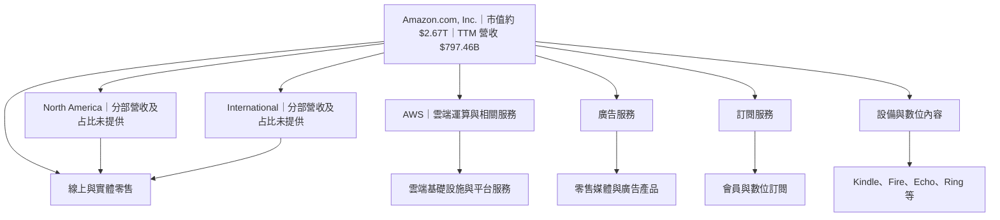
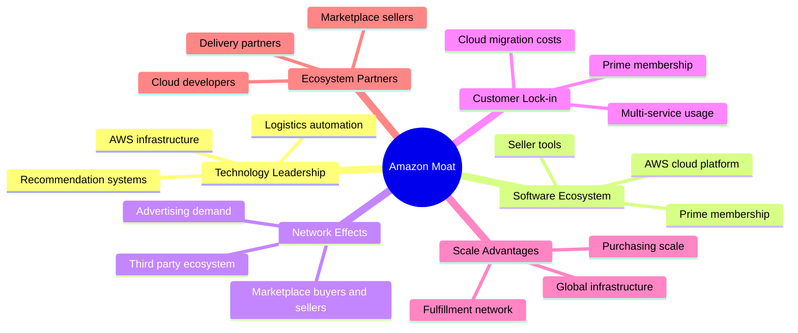
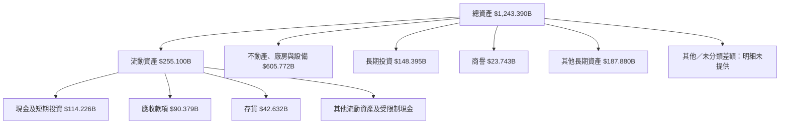
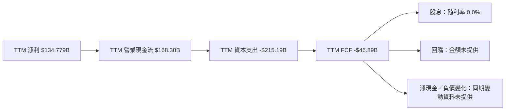
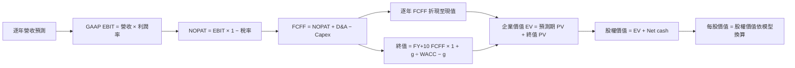
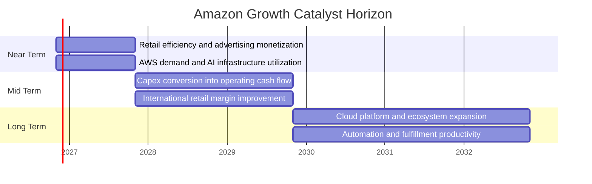
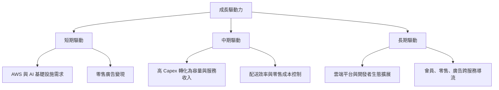
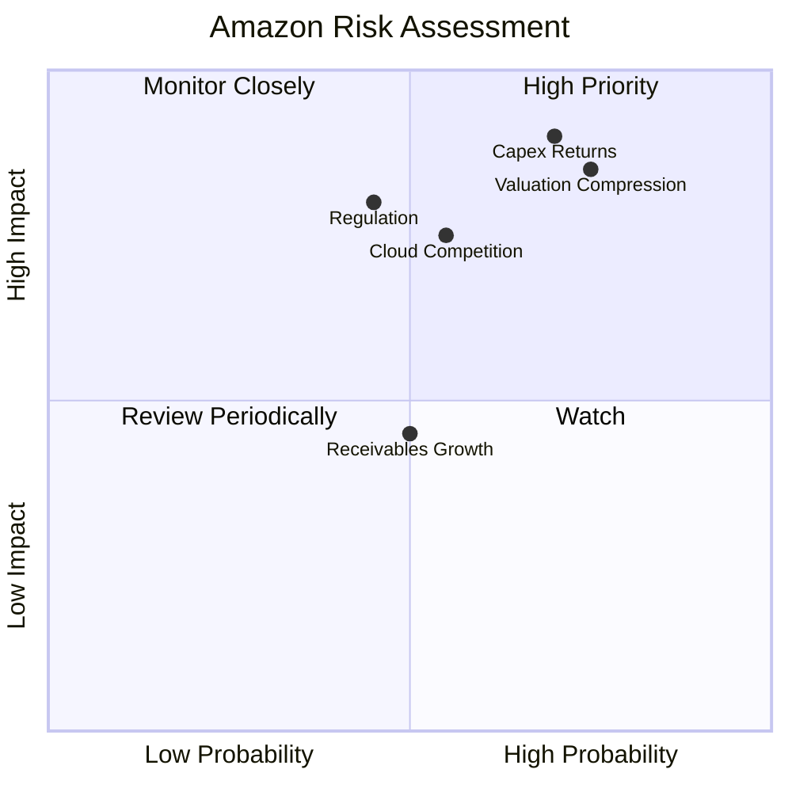
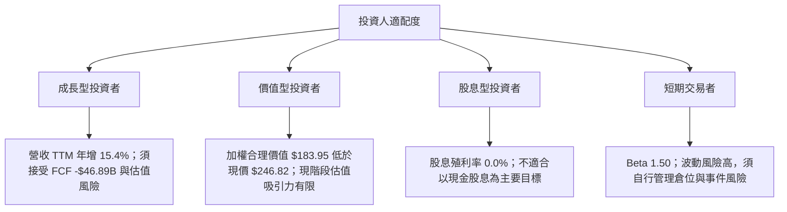

# AMZN 基本面深度分析報告
> **報告日期**：2026-11-20 ｜ **語言**：繁體中文 ｜ **數據來源**：SEC 申報資料 (XBRL)、Yahoo Finance、Finviz、StockAnalysis、Roic.ai ｜ **分析師**：CFA 級機構研究

## 目錄

| # | 章節 | 核心結論 |
|---|------|----------|
| 1 | 執行摘要 | 賣出；加權合理價值 $183.95；MOS -34.2% |
| 2 | 公司概覽與商業模式 | 零售、AWS、廣告與訂閱構成多元生態；分部收入占比未提供 |
| 3 | 損益表深度分析 | TTM 營收 $797.46B、年增 15.4%；TTM 營業利益率 13.1% |
| 4 | 資產負債表分析 | 淨負債 $65.73B；DSO 由 32 天升至 45 天 |
| 5 | 現金流量深度分析 | TTM FCF -$46.89B；主要受資本支出高於營業現金流影響 |
| 6 | 獲利能力與資本效率 | ROIC 11.9% 高於 WACC 10.92%，價值創造幅度有限 |
| 7 | 相對估值分析 | P/E 低於同業中位數，但 DCF 與加權估值均低於現價 |
| 8 | DCF 內在價值評估 | 基準每股價值 $55.81；終值占 EV 98.5%，估值高度依賴長期假設 |
| 9 | 成長催化劑 | AWS、廣告、AI 基礎設施與零售效率是主要潛在驅動力 |
| 10 | 風險矩陣 | 資本支出回報、估值與競爭監管是主要風險 |
| 11 | 投資建議 | 依 MOS 評級為賣出；持續追蹤 AWS 成長、利潤率與 FCF |

---

## 1. 執行摘要

AMZN 的 TTM 營收為 **$797.46B**，年增 **15.4%**，最新一季營收年增 **12.1%**；TTM 營業利益率為 **13.1%**，ROIC 為 **11.9%**，高於 **10.92% WACC**，顯示目前仍略有正經濟利潤。然而，TTM 營業現金流 **$168.30B** 低於資本支出 **$215.19B**，導致 FCF **-$46.89B**、FCF Yield **-1.76%**；以 **2026-11-20 收盤價 $246.82** 對照第 8.8 節加權合理價值 **$183.95**，MOS 為 **-34.2%**。依 MOS 門檻評級為 **賣出**，並未因質化因素調整。

### 1.0 一頁式投資儀表板

| 項目 | 內容 |
|------|------|
| **投資論點（3 句）** | ① TTM 營收 $797.46B、年增 15.4%，核心零售與雲端生態仍有規模成長。② ROIC 11.9% 高於 WACC 10.92%，但利差僅 0.98 個百分點。③ TTM FCF -$46.89B，表示當前投資強度尚未轉化為正自由現金流。 |
| **綜合評分** | **6.3/10**（引用 1.1 評分卡） |
| **財務健康** | 🟡 現金及短期投資 $114.23B，但依一致口徑總債務 $179.95B，淨負債 $65.73B |
| **ROIC vs WACC** | **11.9% vs 10.92%**，目前略為創造價值 |
| **FCF 趨勢** | TTM FCF 為負；FCF Yield **-1.76%** |
| **估值** | Forward P/E **22.59x** ｜ EV/EBITDA **16.19x**（市場資料欄位）｜ FCF Yield **-1.76%** |
| **DCF 內在價值（基準）** | **$55.81** ｜ 現價相對 DCF 溢價 **+342.2%**；DCF 價值相對現價低 77.4% |
| **安全邊際（MOS）** | **-34.2%＝($183.95 − $246.82) ÷ $183.95**（加權合理價值基準）｜ 🔴 無 |
| **預期報酬（基準情境 12M）** | DCF 基準情境相對現價 **-77.4%**；此為 DCF 模型情境，不等同 12 個月公司指引 |
| **關鍵風險（前二）** | 巨額 Capex 尚未轉為正 FCF；雲端／AI 投資回報與競爭環境不確定 |
| **評級 + 信心度** | 🔴 **賣出** ｜ 信心：中（估值數據指向明確，但 DCF 對終值高度敏感） |

> 「溢價」採規則定義：現價 ÷ DCF 內在價值 − 1；MOS 則以第 8.8 節加權合理價值為分母，兩者基準不同。

### 1.1 綜合評分卡（全報告唯一）

| 維度 | 評分（1–10） | 主要依據（引用數字與其來源章節） |
|------|--------------|----------------------------------|
| 成長性 | 8.0 | TTM 營收年增 15.4%、最新一季年增 12.1%（第 3 章） |
| 獲利能力 | 7.0 | TTM 營業利益率 13.1%；ROIC 11.9% 高於 WACC 10.92%；F-Score 4/8（第 3、6 章） |
| 財務健康 | 6.0 | 淨負債 $65.73B；DSO 45 天，高於一年前 32 天（第 4 章） |
| 估值 | 3.0 | MOS -34.2%；P/E 低於 5 年中位數，但 DCF 明顯低於現價（第 7、8 章） |
| 護城河 | 8.0 | 零售、AWS、廣告、訂閱與配送網路互相導流；分部收入占比未提供（第 2 章） |
| 管理層與資本配置 | 6.0 | FY2025 Capex $131.82B、SBC $19.47B；FY2025 FCF $7.70B，現階段投資回報仍需驗證（第 5 章） |
| **綜合評分** | **6.3** | 六項算術平均：\((8+7+6+3+8+6)÷6=6.3\) |

### 1.2 五大投資論點 + 三大核心風險

| 類型 | 項目 | 具體依據 | 信心度 |
|------|------|----------|--------|
| 🟢 **投資論點①** | 多元業務支撐收入規模 | TTM 營收 $797.46B、年增 15.4%；零售之外另有 AWS、廣告、訂閱與實體店 | 🟢 高 |
| 🟢 **投資論點②** | 營業獲利能力提升 | TTM 營業利益率 13.1%，高於 2022 年約 2.4%、2023 年約 6.4% | 🟢 高 |
| 🟢 **投資論點③** | 資本報酬率仍高於資金成本 | ROIC 11.9% vs WACC 10.92%，利差約 0.98 個百分點 | 🟡 中 |
| 🟢 **投資論點④** | 營收持續擴大 | FY2022–FY2025 營收由 $513.98B 增至 $716.92B，三年 CAGR 約 11.7% | 🟢 高 |
| 🟢 **投資論點⑤** | 股東權益基礎擴張 | FY2022–FY2025 股東權益由 $146.04B 增至 $411.06B；其中包含年度獲利與資本結構變化 | 🟡 中 |
| 🟡 **風險①** | 高 Capex 壓抑自由現金流 | TTM Capex $215.19B 高於 OCF $168.30B，FCF 為 -$46.89B | 🔴 高衝擊 |
| 🔴 **風險②** | 現價高於估值模型中樞 | 加權合理價值 $183.95，較現價低 25.5%；MOS -34.2% | 🔴 高 |
| 🟡 **風險③** | 收款週期拉長、資料口徑不一致 | DSO 由 32 天升至 45 天；不同資料來源的債務與現金流數字有差異 | 🟡 中 |

### 1.3 快速統計卡片

| 指標 | 公司實際值（期間） | 同業中位數 | 狀態 |
|------|--------------------|------------|------|
| 營收成長（TTM） | **15.4%** | — | 🟢 |
| 營收成長（最新一季年增） | **12.1%** | **18.8%** | 🟡 |
| 毛利率（TTM） | **51.4%** | **60.9%** | 🟡 |
| 營業利益率（TTM） | **13.1%** | — | 🟢 |
| ROIC（TTM） | **11.9%** | — | 🟢 |
| Forward P/E | **22.59x** | **20.0x** | 🟡 |
| FCF Yield（TTM） | **-1.76%** | — | 🔴 |
| Piotroski F-Score | **4 / 8** | — | 🟡 |

### 1.4 投資結論

╔══════════════════════════════════════════════════════════════════╗  
║                    📊 投資結論摘要                               ║  
╠══════════════════════════════════════════════════════════════════╣  
║  評級：🔴 賣出（MOS -34.2%，符合規則 20）                         ║  
║  價格（2026-11-20 收盤）：$246.82                                ║  
║  DCF 內在價值（基準）：$55.81（現價相對 DCF 溢價 +342.2%）       ║  
║  安全邊際 MOS：-34.2%（以加權合理價值 $183.95 為基準）           ║  
║  加權合理價值（8.8）：$183.95                                    ║  
║  DCF 情境價值：悲觀 $12.58（-94.9%）｜基準 $55.81（-77.4%）     ║  
║    樂觀情境：$128.52（-47.9%）                                   ║  
║  綜合評分：6.3/10（引用 1.1）                                    ║  
║  適合投資人：可承受高波動、願意追蹤資本支出回報的長期投資人      ║  
╚══════════════════════════════════════════════════════════════════╝  

---

## 2. 公司概覽與商業模式

### 2.1 業務結構與收入來源

公司資料列示的主要營運分部為 North America、International 與 AWS；此外，Amazon 透過線上及實體零售、廣告、訂閱服務與設備業務經營。分部收入金額與占比未提供，因此不推算各分部百分比。

營運上，零售帶來商品交易與流量，廣告及訂閱可增加每位客戶的變現機會，AWS 則提供與零售不同的雲端服務收入來源。分部營收、營業利益與成長率未提供，本報告不以總營收以外的數字推定各項業務規模。

### 2.2 市場份額

市場份額數據未提供，因此不繪製市占圖或填列市占比例。Amazon TTM 營收達 **$797.46B**，最新一季年增 **12.1%**；在所列比較公司中，Walmart 的最新一季營收成長為 5.9%，Microsoft 為 18.8%、Google 為 24.7%，但三者業務組合不同，不宜直接解讀為同一市場的份額競爭。

### 2.3 競爭護城河分析

### 2.4 護城河強度

| 護城河項目 | 強度（強／中／弱） | 證據（引用數字或事實） | 會削弱它的情況 |
|------------|--------------------|------------------------|----------------|
| 技術與基礎設施 | 強 | AWS 是獨立主要業務分部；分部營收未提供，不能量化其單獨貢獻 | 雲端服務價格競爭、AI 基建回報低於資本成本 |
| 軟體生態系統 | 中至強 | AWS、賣家工具、會員及廣告業務可形成跨服務關係 | 客戶多雲策略、會員價值下降 |
| 網路效應 | 中至強 | Marketplace 同時連結買家與第三方賣家；交易量及活躍用戶數未提供 | 賣家多平台化、流量轉向其他渠道 |
| 客戶鎖定 | 中 | Prime、雲端工具及物流服務可提高轉換成本；留存率未提供 | 服務價格提高、替代品便利性上升 |
| 規模效應 | 強 | TTM 營收 $797.46B，具大規模採購、物流與基礎設施營運條件 | 規模帶來固定成本、監管限制或低回報投資 |
| 生態夥伴 | 中 | Marketplace 賣家、開發者與配送夥伴擴展產品服務範圍 | 合作夥伴依賴下降或平台規則爭議 |

1.1「護城河」評分為 **8.0/10**，主要依據是多業務平台、規模與跨服務連結；但分部經濟性、客戶留存與網路活躍度數據未提供，故不將質化優勢視為必然高回報。

---

## 3. 損益表深度分析

### 3.1 年度收入成長趨勢（近 4 年）

╔══════════════════════════════════════════════════════════════════╗  
║              Amazon 年度收入趨勢（FY2022–FY2025）               ║  
╠══════════════════════════════════════════════════════════════════╣  
║ FY2022  $513.98B  ██████████████░░░░░░░░░░  基期              ║  
║ FY2023  $574.78B  ████████████████░░░░░░░░  YoY: +11.8% 🟢    ║  
║ FY2024  $637.96B  ██████████████████░░░░░░  YoY: +11.0% 🟢    ║  
║ FY2025  $716.92B  ████████████████████░░░░  YoY: +12.4% 🟢    ║  
║                                                                  ║  
║ FY2022–FY2025 收入 CAGR：                                        ║  
║ (($716.92B ÷ $513.98B)^(1/3) − 1) = 約 11.7%                   ║  
╚══════════════════════════════════════════════════════════════════╝  

收入由 FY2022 的 **$513.98B** 增至 FY2025 的 **$716.92B**，三年 CAGR 約 **11.7%**。FY2025 年增 12.4%，高於 FY2024 的 11.0%；持續成長顯示平台交易與服務收入擴張，但單靠總收入無法判定成長中高毛利業務占比是否上升。

### 3.2 季度收入趨勢分析

| 季度 | 營收（$B） | QoQ 成長 | YoY 成長 | 備註 |
|------|------------|----------|----------|------|
| 2025 Q4 | 213.386 | +18.4% | +13.63% | 相較 2025 Q3；季節性可能影響 QoQ |
| 2026 Q1 | 181.519 | -14.9% | +16.61% | 季度營收回落，仍高於去年同期 |
| 2026 Q2 | 200.606 | +10.5% | +19.62% | 同比成長加速 |
| 2026 Q3 | 201.944 | +0.7% | +12.09% | 單季年增率回落，不可視為 TTM 成長率 |

2026 Q3 營收年增 **12.1%**，低於 Q2 的 **19.62%**。這可能反映季度比較基期、業務組合或需求變化；分部資料未提供，無法把減速精確歸因到零售或 AWS。季度表中另一來源 Q2 2026 為缺值，但 StockAnalysis 列示 $200.606B，本報告採用該明列數值計算 QoQ。

### 3.3 利潤率演變分析

| 利潤率指標 | FY2022 | FY2023 | FY2024 | FY2025／TTM | 趨勢 | 評估 |
|------------|--------|--------|--------|-------------|------|------|
| **毛利率** | 43.8% | 47.0% | 48.9% | FY2025 50.3%；TTM 51.4% | ↗️ 持續改善 | 🟢 |
| **營業利益率** | 約 2.4% | 約 6.4% | 約 10.8% | FY2025 約 11.2%；TTM 13.1% | ↗️ 改善 | 🟢 |
| **淨利率** | -0.5% | 5.3% | 9.3% | FY2025 10.8%；TTM 16.9% | ↗️ 改善但 TTM 較高 | 🟡 |

年度毛利率以年度毛利除以年度營收計算；年度營業利益率以年度營業利益除以收入計算。TTM 毛利率、營業利益率與淨利率採用 SEC／品質指標數值。不同來源的 TTM 淨利口徑存在差異，因此不將年度數列外推為未提供的季度數字。

**利潤率演變深度解析：**毛利率由 FY2022 約 43.8% 提高至 FY2025 約 50.3%，TTM 達 51.4%；營業利益率同期由約 2.4% 增至 11.2%，TTM 為 13.1%。這代表收入規模增加後，營業成本與履約效率改善可能帶來營運槓桿；但可用資料沒有部門成本、物流單位成本或分部營業利益，不能把改善完全歸因於特定措施。TTM 淨利率 16.9% 高於 FY2025 的 10.8%，且 2026 Q2 淨利明顯高於營業利益，需注意非營業項目可能令 TTM 淨利率偏離常態。

### 3.4 費用結構分析

缺少足以完整拆解營業成本、研發、銷售管理及其他費用的同期間資料，不繪製費用比例圓餅圖。可確認的方向是 TTM 營業利益率 13.1%，而 TTM 毛利率 51.4%；兩者差額包含多項營運費用，未提供完整可核對分項，不能反推或分配。

### 3.5 季度 EPS 趨勢與盈餘品質（Quality of Earnings）

| 季度 | EPS 實際值 | EPS YoY | 預估／超預期 | 說明 |
|------|------------|--------|-------------|------|
| 2025 Q4 | $1.95 | +4.98% | N/A | EPS 估值資料缺漏 |
| 2026 Q1 | $2.78 | +74.84% | N/A | 獲利同比提高 |
| 2026 Q2 | $5.75 | +242.26% | N/A | 單季 EPS 大幅提高；非營業項目明細未提供 |
| 2026 Q3 | $1.89 | -3.08% | N/A | EPS 同比下滑；淨利同比 -2.4% |

過去四季是否超預期或不及預期，EPS Est 均為 NaN，故**無法判定**；不能用實際 EPS 同比變化代替盈餘驚喜。

| 盈餘品質項目 | 數值／佔比 | 評估 |
|--------------|-----------|------|
| 股權薪酬 SBC / 營收 | FY2025：$19.47B ÷ $716.92B = **2.72%** | 🟡 SBC 是非現金費用，但會造成股東稀釋；TTM SBC 未提供 |
| SBC / 營業現金流 | FY2025：$19.47B ÷ $139.51B = **13.96%** | 🟡 對經營現金流規模具實質影響；此為 FY2025 比率，非 TTM |
| FCF / 淨利（現金轉換率） | TTM：-$46.89B ÷ $134.779B = **-34.8%** | 🔴 Capex 超過營業現金流，現金轉換為負 |
| 一次性／非經常性損益 | 2026 Q2 淨利 $62.647B、營業利益 $27.461B；差額原因明細未提供 | 🟡 存在顯著營業利益以下差額，需查 SEC 申報附註 |
| 有效稅率異常 | N/A（TTM 實際有效稅率未提供；DCF 採用 21.0%） | 無法判斷是否由稅務利益帶動 |
| 資本化支出 vs 費用化 | TTM Capex $215.19B；資本化項目明細未提供 | 🟡 高資本化支出使當期 FCF 低於淨利；不得據此斷言費用遞延 |

**盈餘品質結論：**TTM 淨利仍為正，但 FCF 轉換率 **-34.8%**，表示當期股東可分配現金與會計獲利方向不一致。負 FCF 可能部分代表成長投資而非永久性獲利惡化，但投資回收前，使用 P/E 評估須搭配 Capex 與現金流檢視。2026 Q2 淨利與營業利益的差距、有效稅率及 TTM SBC 均需從完整 10-Q 附註確認。

---

## 4. 資產負債表分析

### 4.1 資產結構分解

最新 TTM 資產負債表資料列示總資產 **$1,243.390B**。以下為已列出的項目；由於可取得項目加總與總資產有差額，圖表不是完整資產組成比例圖。

### 4.2 流動性與營運資金分析

| 指標 | 最新 TTM | 一年前 TTM | 變化 | 解讀 |
|------|----------|------------|------|------|
| 流動比率 | 0.989（另來源） | N/A | N/A | 低於 1；須結合零售營運的供應商付款週期評估 |
| 速動比率 | 0.793（另來源） | N/A | N/A | 現金與應收款對流動負債覆蓋低於 1 |
| DSO 應收帳款天數 | **45 天** | **32 天** | **+13 天** | 收款週期拉長；可能與業務組合、應收帳款增加或結算時點有關，需追蹤 |
| DIO 存貨天數 | **N/A** | **N/A** | N/A | 品質指標未提供有效數值 |
| DPO 應付帳款天數 | **N/A** | **N/A** | N/A | 品質指標未提供有效數值 |
| CCC 現金轉換週期 | **N/A** | **N/A** | N/A | DIO、DPO 不完整，不計算 CCC |

現金及短期投資為 **$114.23B**，而 2026 Q3 的應收款項在其他來源列示較高數值；DSO 從 32 天增至 45 天值得留意。因 DIO、DPO 被品質指標明確標為 N/A，本報告不依其他資產負債資料自行補算營運資金天數。

### 4.3 債務結構分析

核心財務指標採用 SEC／程式計算口徑：總債務 **$179.95B**、現金及短期投資 **$114.23B**、淨現金欄位為 **-$65.73B**，即淨負債。其他彙總來源另列總債務 $304.84B、淨負債 $190.61B，口徑不一致；本報告估值與關鍵比率採用 VERIFIED FIGURES 的一致口徑，不混用不同來源數字。

╔══════════════════════════════════════════════════════════════════╗  
║                   Amazon 債務健康診斷                            ║  
╠══════════════════════════════════════════════════════════════════╣  
║  總債務：       $179.95B  ████████████████░░░░  程式計算口徑     ║  
║  現金及短期投資：$114.23B  ██████████░░░░░░░░░░                     ║  
║  淨負債：        $65.73B  🟡 仍有可觀現金緩衝                     ║  
║  Debt/EBITDA：N/A（相同債務口徑下 EBITDA 未提供）                 ║  
║  利息保障倍數：N/A（利息費用總額未提供）                          ║  
║  流動比率：0.989（另一彙總資料）                                  ║  
╚══════════════════════════════════════════════════════════════════╝  

### 4.4 股東權益趨勢

| 財年 | 股東權益（$B） | YoY 變化 |
|------|----------------|----------|
| FY2022 | 146.04 | — |
| FY2023 | 201.88 | +38.2% |
| FY2024 | 285.97 | +41.7% |
| FY2025 | 411.06 | +43.7% |

╔══════════════════════════════════════════════════════════════════╗  
║                 股東權益趨勢（年度）                             ║  
╠══════════════════════════════════════════════════════════════════╣  
║ FY2022  $146.04B  ███████░░░░░░░░░░░░░                         ║  
║ FY2023  $201.88B  ██████████░░░░░░░░░                         ║  
║ FY2024  $285.97B  ██████████████░░░░░                         ║  
║ FY2025  $411.06B  ████████████████████                         ║  
╚══════════════════════════════════════════════════════════════════╝  

FY2022–FY2025 股東權益擴大，但股東權益變動並非單由營運盈餘決定；增資、其他綜合損益與資本交易明細未在現有資料完整列示。

---

## 5. 現金流量深度分析

### 5.1 現金流量瀑布圖

營業現金流高於淨利，顯示營運現金生成能力仍在；但資本支出較 OCF 高 **$46.89B**，所以按照「FCF = OCF − Capex」定義，TTM FCF 為負。股息殖利率為 0.0%，回購金額與同期淨現金變動未提供。

### 5.2 FCF 轉換率趨勢

| 期間 | FCF（$B） | 淨利（$B） | FCF / 淨利 | 解讀 |
|------|-----------|------------|------------|------|
| FY2022 | -16.89 | -2.72 | 不具可比性 | 分子、分母皆負，比例無法代表現金轉換 |
| FY2023 | 32.22 | 30.43 | 105.9% | FCF 略高於淨利 |
| FY2024 | 32.88 | 59.25 | 55.5% | 獲利成長快於 FCF |
| FY2025 | 7.70 | 77.67 | 9.9% | 資本支出提高，現金轉換大幅下降 |
| TTM 至 2026-09-30 | -46.89 | 134.779 | -34.8% | 目前投資支出超過 OCF |

### 5.3 自由現金流趨勢

歷年 FCF 依年度現金流資料；TTM FCF 採用程式計算的 OCF 減 Capex 數值。不同來源的 TTM OCF、Capex 口徑有差異，不以較低層級彙總值替代。

╔══════════════════════════════════════════════════════════════════╗  
║            自由現金流：歷史實際 vs 最新 TTM                      ║  
╠══════════════════════════════════════════════════════════════════╣  
║ FY2022  -$16.89B  ░░░░░░░░░░░░░░░░░░░░  負值                  ║  
║ FY2023   $32.22B  ████████████████████  FCF / 淨利 105.9%       ║  
║ FY2024   $32.88B  ████████████████████  FCF / 淨利 55.5%        ║  
║ FY2025    $7.70B  █████░░░░░░░░░░░░░░░  FCF / 淨利 9.9%         ║  
║ TTM      -$46.89B  🔴 FCF Yield -1.76%                           ║  
╚══════════════════════════════════════════════════════════════════╝  

### 5.4 資本配置評估

現有資料可量化的 FY2025 Capex 為 **$131.82B**、SBC 為 **$19.47B**、FCF 為 **$7.70B**；但現金回購、研發費用、併購與留存現金的完整金額未提供，不繪製比例圓餅圖。

| 資本配置項目 | 可用數據 | 評估 |
|--------------|----------|------|
| 資本支出 | FY2025 $131.82B；TTM $215.19B | 🟡 投資規模大，需以後續 OCF、FCF 與 ROIC 驗證回報 |
| 股息 | 殖利率 0.0%；派息率 0.0% | 現金主要留在公司再投資或其他用途 |
| 股權薪酬 | FY2025 $19.47B | 股東需承擔稀釋成本 |
| 回購 | 金額未提供 | 無法量化抵銷稀釋程度 |
| FY2025 FCF | $7.70B | 遠低於當年淨利 $77.67B |

---

## 6. 獲利能力與資本效率

### 6.1 ROE / ROA / ROIC 趨勢

| 指標 | 最新可用值 | 歷史資料 | 評估 |
|------|------------|----------|------|
| ROIC | TTM **11.9%** | Roic.ai 歷史序列部分年份有缺漏，不能建立完整同口徑年度趨勢 | 高於 WACC 10.92%，但利差不大 |
| ROE | TTM **22.0%**（Quality Figures） | 另一來源列示 27.4%，口徑有差異 | 本報告以品質指標 22.0% 為準 |
| ROA | TTM **6.6%**（彙總來源） | 品質指標確認 ROA 為正且高於一年前，但未提供精確歷史值 | 正向但資產基數龐大 |

資料包不同區段的 ROE 分別列示 22.0% 與 27.4%；後續杜邦分析依指定的 QUALITY FIGURES 數值 **22.0%**，不將另一來源數字混入。

### 6.2 ROIC vs WACC 分析（核心價值創造判斷）

╔══════════════════════════════════════════════════════════════════╗  
║                ROIC vs WACC 深度分析                            ║  
╠══════════════════════════════════════════════════════════════════╣  
║  WACC 組成（採用程式計算值）：                                    ║  
║  ├── 無風險利率（10Y 美債）：4.91%                                ║  
║  ├── 市場風險溢酬 ERP：5.00%                                      ║  
║  ├── 原始 Beta：1.50；調整後 Beta：1.34                           ║  
║  ├── 股權成本：11.59%                                             ║  
║  ├── 稅前債務成本：1.26%；稅後約 0.995%                           ║  
║  ├── 資本權重：股權 93.7%、債務 6.3%                              ║  
║  └── WACC：10.92%                                                 ║  
║                                                                  ║  
║  ROIC（TTM）：11.9%                                               ║  
║  EVA 利差：11.9% − 10.92% = +0.98 個百分點                       ║  
║                                                                  ║  
║  ROIC  11.9%  ▓▓▓▓▓▓▓▓▓▓▓▓░░░░░░░░                              ║  
║  WACC  10.92% ▓▓▓▓▓▓▓▓▓▓▓░░░░░░░░                              ║  
║                                                                  ║  
║  結論：ROIC 略高於 WACC，現階段創造價值；優勢幅度有限。          ║  
╚══════════════════════════════════════════════════════════════════╝  

WACC 使用指定資本成本區塊，不另行重估。調整後 Beta 由原始 1.50 按「2/3 × 原始 Beta + 1/3 × 1」計算，得 1.34。資金成本與權重採用程式提供值；ROIC 11.9% 只比 WACC 高 **0.98 個百分點**，若 Capex 回報下降或營業利潤率收縮，價值創造空間可能消失。

### 6.3 杜邦三因素分解

| 因素 | 數值（TTM） | 解讀 |
|------|-------------|------|
| 淨利率 | **16.9%** | 淨利轉換率；需留意非營業項目對淨利的影響 |
| 資產週轉率 | **0.64** | 每單位資產創造的收入；大型資產投入使週轉率較低 |
| 權益乘數 | **2.03** | 財務槓桿對 ROE 有正向放大作用，但不是唯一來源 |
| **ROE** | **22.0%** | 16.9% × 0.64 × 2.03 ≈ 22.0% |

ROE 由淨利率、資產週轉率與權益乘數共同決定；乘數 2.03 顯示存在槓桿放大，但 ROE 並非只靠高槓桿支撐。

### 6.4 財務體質：Piotroski F-Score

**Piotroski F-Score：4 / 8**。九項測試中有一項因缺少輸入未納入可判定分母。

| 測試 | 結果 | 解讀 |
|------|------|------|
| ROA > 0 | ✅ 通過 | 資產仍產生正回報 |
| 營業現金流 > 0 | ✅ 通過 | TTM OCF 為正 |
| ROA 高於一年前 | ✅ 通過 | 獲利效率改善 |
| 營業現金流 > 淨利（應計品質） | ✅ 通過 | 該測試期間現金流高於淨利 |
| 長期負債 ÷ 總資產低於一年前 | ❌ 未通過 | 槓桿相對負擔未改善 |
| 流動比率高於一年前 | ❌ 未通過 | 短期流動性指標未改善 |
| 稀釋股數未增加 | ❌ 未通過 | 股數增加會稀釋每股價值 |
| 毛利率高於一年前 | — 無法判定 | 缺少測試所需資料 |
| 資產週轉率高於一年前 | ❌ 未通過 | 資產運用效率未改善 |

4/8 反映獲利與現金流部分測試為正，但負債、流動性、股數與資產週轉率測試未通過。F-Score 是財務方向性檢核，不單獨替代對 Capex 投資回報的判斷。

---

## 7. 相對估值分析

### 7.1 同業估值比較表格

同業倍數依 Yahoo Finance Peer multiples；AMZN 倍數依市場估值資料。Microsoft 與 Google 是大型雲端／數位服務及廣告相關公司，Walmart 是更直接的零售比較對象，但業務組合差異使倍數比較只能作相對參照。

| 估值指標 | **AMZN** | **MSFT** | **GOOG** | **WMT** | 本公司評估 |
|----------|---------|---------|---------|---------|-----------|
| **Trailing P/E** | 20.0x | 25.3x | 13.8x | 46.4x | 🟡 位於比較公司範圍中間 |
| **Forward P/E** | 22.59x | 20.0x | 17.3x | 39.6x | 🟡 高於同業中位數 20.0x |
| **P/S Ratio** | 3.4x | 10.4x | 6.9x | 1.4x | 🟢 低於雲端／數位同業，但高於 WMT |
| **EV/EBITDA** | 16.19x（市場資料） | 17.8x | 17.4x | 24.5x | 🟢 低於比較公司中位數 17.8x |
| **最新一季營收年增** | 12.1% | 18.8% | 24.7% | 5.9% | 🟡 高於 WMT、低於 MSFT 與 GOOG |
| **毛利率（TTM）** | 51.4% | 67.7% | 60.9% | 24.8% | 🟡 介於軟體／數位服務與零售之間 |

AMZN Forward P/E **22.59x** 高於同業中位數 **20.0x**，但其 EV/EBITDA 倍數低於同業中位數。不同資料源列示 AMZN EV/EBITDA 15.0x 與 16.19x，本表採市場估值區塊的 16.19x；自身歷史比較則使用指定的 15.0x。

### 7.2 歷史估值區間分析

╔══════════════════════════════════════════════════════════════════╗  
║                  AMZN 五年估值位置                               ║  
╠══════════════════════════════════════════════════════════════════╣  
║ P/E：20.0x｜5 年中位數 32.2x｜區間 2.6x–251.9x｜百分位 30%     ║  
║ 當前位置：低於五年中位數，歷史區間受極端獲利變動影響。          ║  
║                                                                  ║  
║ P/S：3.4x ｜5 年中位數 3.0x ｜區間 0.2x–3.7x ｜百分位 71%       ║  
║ EV/EBITDA：15.0x｜中位數 17.3x｜區間 0.7x–22.7x｜百分位 19%    ║  
╚══════════════════════════════════════════════════════════════════╝  

P/E 低於歷史中位數，但 P/S 高於中位數；兩者給出不同訊號，反映獲利率及營收倍數不能單獨判斷便宜程度。自身歷史 P/E 區間極寬，百分位比單看中位數更有參考價值。

### 7.3 情境價值（Bear / Base / Bull，照抄 DCF MODEL 的 Scenarios）

| 情境 | 第 1 年營收成長 | 期末營業利潤率 | WACC | 每股價值 | 相對現價 | 機率 | 會發生的條件 |
|------|----------------|----------------|------|----------|----------|------|--------------|
| 🔴 悲觀 | 7.7% | 9.1% | 11.92% | $12.58 | -94.9% | 25% | 零售及雲端成長降速，資本回報低於基準，資金成本上升 |
| 🟡 基準 | 15.4% | 10.8% | 10.92% | $55.81 | -77.4% | 50% | TTM 成長作為第一年起點，長期利潤率回歸五年中位數 |
| 🟢 樂觀 | 23.0% | 11.8% | 9.92% | $128.52 | -47.9% | 25% | 雲端、廣告與零售效率同時高於基準，資金成本下降 |

以上情境為 DCF MODEL 原列數值。即使樂觀情境，模型每股價值仍低於 $246.82 現價，顯示此模型框架下現價已反映高於情境表的營運假設。

### 7.4 相對估值隱含價格區間

╔══════════════════════════════════════════════════════════════════╗  
║             估值方法隱含價值與現價位置                           ║  
╠══════════════════════════════════════════════════════════════════╣  
║ $55.81 ───── $218.75 ───── $246.82 ───── $297.15 ───── $326.51 ║  
║ 基準 DCF     Forward P/E      現價        EV/EBITDA     共識目標 ║  
╚══════════════════════════════════════════════════════════════════╝  

| 方法 | 每股價值 | 相對現價 | 計算依據 |
|------|----------|----------|----------|
| DCF（基準） | $55.81 | -77.4% | 10 年 FCFF、WACC 10.92%、永續成長 3.0% |
| 同業 Forward P/E | $218.75 | -11.4% | 同業中位數 20.0x × AMZN Forward EPS $10.93 |
| 同業 EV/EBITDA | $297.15 | +20.4% | 同業中位數 17.8x × TTM EBITDA，再加淨現金／扣淨負債 |
| 分析師共識目標價 | $326.51 | +32.3% | 60 位分析師平均目標價 |

---

## 8. DCF 內在價值評估（Discounted Cash Flow）

> DCF 採用程式提供的 10 年模型與預測表。模型輸入缺少逐年營運資金變動及部分終值交叉驗證細節，因此不自行補造模型外數字。

### 8.0 估值推理鏈（Thinking Logic）

**Step 1 — 價值由哪些變數決定？**  
本模型的核心是營收擴張、GAAP 營業利潤率與再投資強度共同決定 FCFF；可觀察的營運分部包括 North America、International、AWS，但分部營收比重未提供，不能把 $797.46B 總營收拆成分部占比。模型最敏感的是終值：基準 DCF 的終值現值占企業價值 **98.5%**，所以長期現金流、WACC 與永續成長率會主導估值。

**Step 2 — 模型選擇**

| 決策點 | 本報告採用 | 理由（含數字） | 曾考慮但否決 | 否決理由 |
|--------|-----------|----------------|--------------|----------|
| 現金流定義 | FCFF | 以 WACC 折現並推得 EV；模型列示 OCF、Capex 與逐年營運預測 | FCFE | 需另行建模融資現金流，現有模型未提供 |
| 預測期 N | 10 年 | DCF 模型固定 10 年，營收成長由 15.4% 逐步降至 3.0% | 5 年 | 不能覆蓋模型設定的成熟化路徑 |
| 終值方法 | Gordon Growth | 模型以 g=3.0%、WACC=10.92% 計算 | 退出倍數 | DCF 模型未提供退出倍數及退出倍數終值，故不自行建立 |
| EBIT 基礎 | GAAP EBIT | 模型明確列示 GAAP EBIT；SBC 已作費用處理 | 非 GAAP EBIT | 會改變 SBC 處理及股數假設 |

**Step 3 — 關鍵假設推導鏈**

- **營收成長**：錨點＝TTM 營收成長 15.4%（較前一 TTM）→ 調整＝模型把成長由年 1 線性減速至年 10 的 3.0%，反映基期擴大與長期成熟 → **採用年 1 15.4%、年 10 3.0%** → 曾可考慮長期維持 15.4%，但否決，因 10 年後仍維持現有增速缺乏成熟期依據。
- **期末營業利潤率**：錨點＝TTM 13.1% → 調整＝模型向近五個財年的中位數收斂 → **年 10 採用 10.8%** → 曾考慮維持 13.1%，但模型採歷史中位數作均值回歸，避免把近期利潤率改善永久化。
- **永續成長率 g**：錨點＝長期名目經濟增長的一般合理上限約 3%–4%（此為模型外宏觀假設）→ 調整＝採區間低端 → **採用 3.0%** → 不採 4.0%，因終值敏感，且較高 g 會顯著提高終值。
- **預測期 N**：錨點＝模型採 10 年 → 調整＝遵循模型固定期限，不另延長 → **採用 10 年** → 不改採 5 年或 15 年，因模型未提供其他期限的現金流路徑。
- **Capex／營收**：錨點＝TTM Capex $215.19B ÷ TTM 營收 $797.46B ≈ 27.0% → 調整＝隨時間下降，模型在年 10 採 10.9%，接近 1.1 倍 D&A 的規則 → **年 1 27.0%，年 10 10.9%** → 不採永久維持 27.0%，否則長期自由現金流持續受高投資壓抑；但快速下降也有執行風險。
- **EBIT 與 SBC**：錨點＝模型以 GAAP EBIT、年 1 利潤率 13.1% → 調整＝不再扣一次 SBC、不另增股數 → **採組合 (A)：GAAP EBIT、無額外 −SBC 列、固定股數、年稀釋率 0%** → 否決再扣 SBC 或另加稀釋，避免重複計入同一成本。
- **WACC**：錨點＝指定資本成本計算 WACC 10.92% → 調整＝不另作主觀調整 → **採用 10.92%** → 不採用自行重算的其他 WACC，以保持與資本成本輸入一致。
- **稅率**：錨點＝模型 default 21.0% → **採用 21.0%**；實際有效稅率資料未提供，故不將其宣稱為近期實際稅率。
- **D&A／營收**：錨點＝模型 TTM 比率 10.0% → **採用 10.0% 全期不變**。
- **營運資金變動**：模型明確註明未建模 → **ΔWC 不納入 FCFF**，不能視為實際營運資金需求為零。
- **稀釋股數**：模型採固定股數；SBC 已列入 GAAP 費用 → **年稀釋率 0%**，使用組合 (A)。

**Step 4 — 最脆弱一環**  
最脆弱的是終值依賴程度：終值 PV 占企業價值 98.5%；若長期 Capex 無法降至模型路徑、或 WACC 上升，估值會進一步下降，敏感度參照下方矩陣。

**Step 5 — 計算路徑圖**

### 8.1 模型假設總表（Model Inputs）

| 假設項目 | 採用值 | 依據／來源 | 敏感度 |
|----------|--------|-------------|--------|
| 預測期長度 **N** | 10 年 | DCF 模型設定 | 🟡 中 |
| 營收成長 | 年 1 15.4% 線性降至年 10 3.0% | TTM 成長 15.4%；長期收斂為模型假設 | 🔴 高 |
| 營業利潤率 | 年 1 13.1% 至年 10 10.8% | TTM 營業利益率 13.1%；年 10 為近五財年中位數 | 🔴 高 |
| 有效稅率 | 21.0% | DCF 模型 default；實際有效稅率未提供 | 🟢 低 |
| Capex / 營收 | 年 1 27.0% 至年 10 10.9% | TTM Capex／營收約 27.0%；其後依模型逐步下滑 | 🔴 高 |
| D&A / 營收 | 10.0% | DCF 模型以 TTM 比率固定 | 🟢 低 |
| 營運資金變動 | 未建模 | DCF 模型明列 Working capital is not modelled | 🟡 中 |
| EBIT 基礎 | GAAP | DCF 模型明列 GAAP EBIT | 🟡 中 |
| SBC 處理 | 組合 A：GAAP EBIT、FCFF 不再扣 SBC | 模型說明 SBC 已為費用 | 🟡 中 |
| 年稀釋率 | 0%（固定股數） | 組合 A；SBC 已反映於 GAAP EBIT | 🟡 中 |
| 永續成長率 g | 3.0% | 模型設定；低於 WACC 10.92% | 🔴 高 |
| 終值方法 | Gordon Growth | DCF 模型明列終值公式 | 🔴 高 |
| WACC | 10.92% | Cost of capital 計算值 | 🔴 高 |

FCFF 定義採模型指定的 **NOPAT + D&A − Capex**；營運資金不建模。**本模型採用 (A)，故 SBC 影響已計入一次。**

### 8.2 折現率推導（WACC）

╔══════════════════════════════════════════════════════════════════╗  
║                    WACC 推導（折現率）                           ║  
╠══════════════════════════════════════════════════════════════════╣  
║ 股權成本 Ke（CAPM）：                                            ║  
║ ├── Rf（10Y 美債）：4.91%（資料未列具體觀察日）                  ║  
║ ├── ERP：5.00%（假設值，成本資本輸入）                           ║  
║ ├── 原始 Beta：1.50；調整後 Beta：1.34                            ║  
║ ├── Ke = 4.91% + 1.34 × 5.00% = 11.61%（輸入值列 11.59%）       ║  
║ └── 採用 Ke：11.59%（直接採成本資本區塊）                       ║  
║                                                                  ║  
║ 債務成本 Kd：                                                    ║  
║ ├── 稅前 Kd：1.26%                                               ║  
║ ├── 稅率：21.0%                                                  ║  
║ └── 稅後 Kd = 1.26% × (1 − 21.0%) = 0.9954%                     ║  
║                                                                  ║  
║ 資本結構權重：股權 93.7%；債務 6.3%                              ║  
║ WACC = 93.7% × 11.59% + 6.3% × 0.9954% = 10.92%                  ║  
╚══════════════════════════════════════════════════════════════════╝  

**逐步演算（WACC，採用指定輸入）：**

1. **Ke（CAPM）**  
   \[
   Ke=Rf+\beta \times ERP=4.91\%+1.34\times5.00\%=11.61\%
   \]  
   成本資本區塊列示採用 Ke 為 **11.59%**；兩者有 0.02 個百分點的四捨五入／來源精度差異。為遵循指定輸入，WACC 計算沿用列示 Ke 11.59%。

2. **稅前 Kd**  
   \[
   Kd=1.26\%
   \]  
   利息費用及平均計息負債明細未提供，因此不可獨立重建分子、分母；此處直接引用 Cost of capital 輸入。

3. **稅後 Kd**  
   \[
   1.26\%\times(1-21.0\%)=1.26\%\times0.79=0.9954\%
   \]

4. **資本權重**  
   \[
   E權重=93.7\%,\quad D權重=6.3\%,\quad 93.7\%+6.3\%=100.0\%
   \]  
   市值及債務權重按指定成本資本輸入；E、D 的精確金額與同範圍計息負債拆分未提供，故不自行推導。

5. **WACC**  
   \[
   93.7\%\times11.59\%+6.3\%\times0.9954\%
   =10.8588\%+0.0627\%=10.9215\%\approx10.92\%
   \]

WACC 與第 6.2 節同為 **10.92%**。由於利息費用、平均計息負債與精確市值權重金額缺漏，WACC 可複核到提供的權重與成本輸入，但無法由原始資產負債明細完整重建。

### 8.3 逐年自由現金流預測（基準情境）

以下逐年數值照 DCF MODEL 原表列示。模型未納入 ΔWC，故無 ΔWC 列；SBC 已包含於 GAAP EBIT，不再扣除。

| 年度 | FY+1 | FY+2 | FY+3 | FY+4 | FY+5 | FY+6 | FY+7 | FY+8 | FY+9 | FY+10 |
|------|------|------|------|------|------|------|------|------|------|-------|
| 營收（$B） | 919.87 | 1,048.46 | 1,180.63 | 1,313.26 | 1,442.76 | 1,565.24 | 1,676.64 | 1,772.96 | 1,850.48 | 1,905.99 |
| 營收 YoY | 15.4% | 14.0% | 12.6% | 11.2% | 9.9% | 8.5% | 7.1% | 5.7% | 4.4% | 3.0% |
| 營業利潤率 | 13.1% | 12.8% | 12.6% | 12.3% | 12.0% | 11.8% | 11.5% | 11.3% | 11.0% | 10.8% |
| GAAP EBIT（$B） | 120.39 | 134.49 | 148.39 | 161.65 | 173.84 | 184.54 | 193.32 | 199.83 | 203.76 | 204.93 |
| − 稅（21.0%）（$B） | (25.28) | (28.24) | (31.16) | (33.95) | (36.51) | (38.75) | (40.60) | (41.96) | (42.79) | (43.04) |
| = NOPAT（$B） | 95.11 | 106.25 | 117.22 | 127.70 | 137.34 | 145.79 | 152.73 | 157.86 | 160.97 | 161.90 |
| + D&A（$B） | 91.53 | 104.33 | 117.48 | 130.68 | 143.57 | 155.75 | 166.84 | 176.42 | 184.14 | 189.66 |
| − Capex（$B） | (248.23) | (264.24) | (276.51) | (284.17) | (286.48) | (282.91) | (273.16) | (257.26) | (235.53) | (208.63) |
| **= FCFF（$B）** | **-61.59** | **-53.66** | **-41.80** | **-25.79** | **-5.58** | **18.63** | **46.40** | **77.03** | **109.58** | **142.93** |
| 折現因子 | 0.902 | 0.813 | 0.733 | 0.661 | 0.596 | 0.537 | 0.484 | 0.436 | 0.393 | 0.355 |
| **FCFF 現值 PV（$B）** | **-55.52** | **-43.61** | **-30.63** | **-17.04** | **-3.32** | **10.01** | **22.46** | **33.62** | **43.12** | **50.70** |

**預測期 FCFF 現值合計：**

\[
-55.52-43.61-30.63-17.04-3.32+10.01+22.46+33.62+43.12+50.70
=9.79\text{B}
\]

DCF 模型列示合計 **$9.78B**；逐項以已四捨五入至 0.01B 的年度現值相加為 **$9.79B**，差額 $0.01B，屬四捨五入尾差，模型後續橋接沿用原列示 **$9.78B**。

**逐步演算（FY+1，金額取 2 位小數；折現因子取 3 位）：**

1. **營收**  
   \[
   797.46\times(1+15.4\%)=919.87\text{B}
   \]

2. **EBIT**  
   \[
   919.87\times13.1\%=120.50\text{B}
   \]  
   DCF 表列 EBIT 為 **$120.39B**；其計算採未四捨五入的利潤率／收入底層數據，明列數字因輸入精度不同存在約 $0.11B 尾差，後續依模型表值。

3. **稅**  
   \[
   120.39\times21.0\%=25.28\text{B}
   \]

4. **NOPAT**  
   \[
   120.39-25.28=95.11\text{B}
   \]

5. **D&A**  
   \[
   919.87\times10.0\%=91.99\text{B}
   \]  
   模型表列 **$91.53B**；反映內部未四捨五入輸入或比例精度差異，採用模型原列數值。

6. **Capex**  
   \[
   919.87\times27.0\%=248.36\text{B}
   \]  
   模型表列 **$248.23B**，後續採用模型原列數值。

7. **ΔWC**  
   模型不建模，**未納入 FCFF**。

8. **FCFF**  
   \[
   95.11+91.53-248.23=-61.59\text{B}
   \]

9. **折現因子與 PV**  
   \[
   1\div(1+10.92\%)^1=0.902
   \]  
   \[
   -61.59\times0.902\approx-55.52\text{B}
   \]

上述表列 EBIT、D&A、Capex 與收入比率存在小幅精度差異；依規則 19，不重建或改寫模型數字。模型前五年 FCFF 為負，代表此模型假設高 Capex 的早期現金支出，對企業價值形成負貢獻；後五年轉正後，折現現值仍不足以顯著增加總 EV。

**合理性自檢：**

- 預測期 FCF CAGR：FY+1 為 -$61.59B、FY+10 為 $142.93B，起點為負，CAGR **不適用**；FY2023–FY2025 FCF 由 $32.22B、$32.88B 降至 $7.70B，短期歷史與遠期轉正路徑差異很大，原因是模型假設 Capex／營收逐步下降。
- FY+10 FCFF 利潤率：\($142.93B ÷ $1,905.99B\) = **7.5%**；目前 TTM FCF 利潤率為 \(-$46.89B ÷ $797.46B\) = **-5.9%**。同業最佳值未提供，不能判斷是否高於同業最佳。
- FY+1 至 FY+5 FCFF 為負，模型仍折現這些負現金流；這正是前期 Capex 投資負擔在 DCF 中的反映，而非被忽略。

╔══════════════════════════════════════════════════════════════════╗  
║            自由現金流：歷史實際 vs 模型預測                      ║  
╠══════════════════════════════════════════════════════════════════╣  
║ FY2023（實） $32.22B  █████████░░░░░░░░░░░  FCF               ║  
║ FY2024（實） $32.88B  █████████░░░░░░░░░░░  FCF               ║  
║ FY2025（實）  $7.70B  ██░░░░░░░░░░░░░░░░░░  FCF               ║  
║ FY+1（預）  -$61.59B  負值，Capex 高於 NOPAT + D&A             ║  
║ FY+10（預） $142.93B  FCFF 轉正後擴大                          ║  
╠══════════════════════════════════════════════════════════════════╣  
║ ⚠️ 模型的關鍵轉折是 Capex/營收由 27.0% 降至 10.9%。              ║  
╚══════════════════════════════════════════════════════════════════╝  

### 8.4 終值計算（Terminal Value）

**適用性檢查：** WACC **10.92%** vs g **3.0%** → WACC > g？✅

| 方法 | 計算式 | 終值 TV | TV 現值 | 佔總 EV 比重 |
|------|--------|---------|---------|--------------|
| Gordon Growth | $142.93B × (1+3.0%) ÷ (10.92%−3.0%) | $1,858.87B（模型列示） | $659.42B（模型列示） | 98.5% |
| 退出倍數法 | N/A | N/A（DCF MODEL 未提供退出倍數） | N/A | N/A |

**逐步演算（按模型列示數值）：**

1. FY+10 FCFF = **$142.93B**。
2. 分子：  
   \[
   142.93\times(1+3.0\%)=147.2179\text{B}
   \]
3. 分母：  
   \[
   10.92\%-3.0\%=7.92\%
   \]  
   模型列示：
   \[
   TV=142.93\times1.03\div(10.92\%-3.0\%)=\$1,858.87B
   \]
4. PV(TV)：模型列示 **$659.42B**，折現因子列示 0.355。
5. 終值占 EV：  
   \[
   659.42\div669.20=98.5\%
   \]

模型列示的 TV、折現因子及 PV(TV) 使用未公開的底層精度；依要求不以四捨五入後的顯示數重建不同結果。終值 PV 占 EV **98.5%**，估值高度依賴終值假設，短期現金流貢獻有限。

### 8.5 企業價值 → 每股內在價值（Bridge）

╔══════════════════════════════════════════════════════════════════╗  
║              企業價值 → 每股內在價值 橋接表                      ║  
╠══════════════════════════════════════════════════════════════════╣  
║  預測期 FCF 現值合計             +$9.78B                         ║  
║  終值現值 PV(TV)                +$659.42B                        ║  
║  = 企業價值 EV                   $669.20B                        ║  
║  + Net cash（負數代表淨負債）    -$65.73B                        ║  
║  = 股權價值                      $603.48B                        ║  
║  每股價值（模型換算）             $55.81                          ║  
║  2026-11-20 收盤價                $246.82                         ║  
║  折溢價（現價÷DCF內在價值−1）      +342.2% 溢價                   ║  
╚══════════════════════════════════════════════════════════════════╝  

逐步橋接：

1. **EV**  
   \[
   9.78+659.42=669.20\text{B}
   \]

2. **股權價值**  
   \[
   669.20+(-65.73)=603.47\text{B}
   \]  
   模型列示 **$603.48B**，與顯示位數相差 $0.01B，按原模型使用 $603.48B。

3. **每股內在價值**  
   模型原列公式為：
   \[
   每股價值=股權價值\times價格\div市值=\$55.81
   \]  
   股數／市值的精確未四捨五入值未提供，市值只列約 $2.67T，因此無法用顯示精度完全重建每股數字；本報告照抄 DCF 模型基準值 **$55.81**。

4. **折溢價**  
   \[
   246.82\div55.81-1=+342.2\%
   \]

5. **本節不計算 MOS**；MOS 僅在 8.8 以加權合理價值為分母。

股數假設為固定股數、年稀釋率 0%，與 SBC 組合 (A) 相容。模型使用淨現金輸入 **-$65.73B**；不得將其他來源的總債務口徑混入橋接。

### 8.6 敏感性分析（WACC × 永續成長率）

下表 DCF 每股價值逐格照模型；括號為依同一現價 $246.82 計算的上行空間 \((價值-現價)÷現價\)。

| g（列）／WACC（欄） | 8.92% | 9.92% | **10.92%（基準）** | 11.92% | 12.92% |
|-----------|------|------|-------------------|-------|-------|
| 2.0% | $79.71 (-67.7%) | $61.88 (-74.9%) | $48.45 (-80.4%) | $38.06 (-84.6%) | $29.86 (-87.9%) |
| 2.5% | $86.60 (-64.9%) | $66.68 (-73.0%) | $51.91 (-79.0%) | $40.63 (-83.5%) | $31.81 (-87.1%) |
| **3.0%（基準）** | $94.67 (-61.6%) | $72.17 (-70.8%) | **$55.81 (-77.4%)** | $43.48 (-82.4%) | $33.95 (-86.2%) |
| 3.5% | $104.21 (-57.8%) | $78.52 (-68.2%) | $60.24 (-75.6%) | $46.68 (-81.1%) | $36.32 (-85.3%) |
| 4.0% | $115.70 (-53.1%) | $85.95 (-65.2%) | $65.30 (-73.5%) | $50.28 (-79.6%) | $38.95 (-84.2%) |

**逐步演算限制：**矩陣只提供每股輸出，沒有替代 WACC 下的逐年 PV、終值 PV、股權價值中間項。為遵守 DCF MODEL 原值優先，不自建中間現金流或另算一個矩陣格。基準格 $55.81 與 8.5 DCF 基準值一致。

**三情境 DCF（模型輸出）**

| 情境 | 營收成長假設 | 期末營業利潤率 | 永續成長 g | WACC | 每股內在價值 | 相對現價 | 主觀機率 |
|------|-------------|----------------|------------|------|--------------|----------|----------|
| 🔴 悲觀 | 年 1 7.7% | 9.1% | 3.0%（模型基準） | 11.92% | $12.58 | -94.9% | 25% |
| 🟡 基準 | 年 1 15.4% | 10.8% | 3.0% | 10.92% | $55.81 | -77.4% | 50% |
| 🟢 樂觀 | 年 1 23.0% | 11.8% | 3.0%（模型基準） | 9.92% | $128.52 | -47.9% | 25% |
| **機率加權** | — | — | — | — | **$63.18** | **-74.4%** | **100%** |

情境模型未提供各情境的 FY+10 營收、FCFF、終值分項，因此不另行推算其完整中間計算鏈；三情境每股值、假設與機率採模型原值。機率加權可驗算：

\[
12.58\times25\%+55.81\times50\%+128.52\times25\%
=3.145+27.905+32.130
=63.18
\]

**敏感度結論：**

- g 從 2.0% 升至 3.0%、WACC 固定 10.92%：  
  \[
  55.81-48.45=+\$7.36；\quad7.36\div48.45=+15.2\%
  \]
- WACC 從 10.92% 升至 11.92%、g 固定 3.0%：  
  \[
  43.48-55.81=-\$12.33；\quad12.33\div55.81=22.1\%\text{ 下跌}
  \]
- 期末營業利潤率每 +1pp 的單獨彈性：模型未提供該項敏感性矩陣，**無法由指定輸出取得**，不自行試算。
- 矩陣顯示 WACC 變化對價值的影響大於 g 的 1 個百分點變動；與 8.0 的終值敏感、資金成本風險一致。

### 8.7 反推 DCF（Reverse DCF：市場在預期什麼）

固定基準輸入包括：WACC 10.92%、稅率 21.0%、Capex／營收依模型逐年路徑、ΔWC 不建模、預測期 N=10 年、固定股數。

| 求解的變數（一次一個） | 其餘變數設定 | 市場隱含值（令 DCF = 現價） | 公司歷史實際 | 判斷 |
|------------------------|--------------|------------------------------|--------------|------|
| 年 1 營收成長率 | 其他模型輸入固定 | **47.0%** | TTM 成長 15.4% | 🔴 高於當前成長約 31.6pp |
| 固定營業利潤率 | 其他模型輸入固定 | **26.8%** | 基準路徑 13.1% → 10.8% | 🔴 遠高於基準利潤率 |
| 永續成長率 g | 未列於 Reverse DCF 輸出 | 未計算 | — | N/A |
| 預測期 N | 未列於 Reverse DCF 輸出 | 未計算 | — | N/A |

DCF MODEL 只提供營收成長率及固定營業利潤率兩個反推結果，未提供試算梯度或迭代軌跡；不臆造收斂過程。依模型反推，市場價格若以其他基準假設固定，要求首年營收增長 **47.0%** 或固定營業利潤率 **26.8%** 才能支持現價，兩者均明顯高於已列示營運基準。

### 8.8 估值三角驗證與安全邊際

| 估值方法 | 隱含每股價值 | 上行空間（÷現價） | 權重 | 說明 |
|----------|--------------|-------------------|------|------|
| DCF（基準） | $55.81 | -77.4% | 40% | 10 年 FCFF、WACC 10.92%、g 3.0% |
| 同業 Forward P/E | $218.75 | -11.4% | 25% | 同業中位數 20.0x × Forward EPS $10.93 |
| 同業 EV/EBITDA | $297.15 | +20.4% | 25% | 同業中位數 17.8x × TTM EBITDA，加回淨現金／扣除淨負債 |
| 分析師共識目標價 | $326.51 | +32.3% | 10% | 60 位分析師平均目標價 |
| **加權合理價值** | **$183.95** | **-25.5%** | **100%** | — |

**加權合理價值計算：**

\[
55.81\times40\%+218.75\times25\%+297.15\times25\%+326.51\times10\%
\]
\[
=22.324+54.6875+74.2875+32.651=183.95
\]

權重對應公司類型「profitable」；四種估值方法均照列，沒有方法被剔除。

**安全邊際與上行空間：**

\[
MOS=(183.95-246.82)\div183.95=-34.2\%
\]

\[
上行空間=(183.95-246.82)\div246.82=-25.5\%
\]

╔══════════════════════════════════════════════════════════════════╗  
║                  估值區間與安全邊際                              ║  
╠══════════════════════════════════════════════════════════════════╣  
║ $12.58 ─── $55.81 ─── $183.95 ─── $246.82 ─── $326.51          ║  
║ 悲觀 DCF    基準 DCF   加權合理值    現價       分析師共識       ║  
║                                                                  ║  
║ MOS = (183.95 − 246.82) ÷ 183.95 = -34.2% 🔴                   ║  
║ 上行空間 = (183.95 − 246.82) ÷ 246.82 = -25.5%                 ║  
║                                                                  ║  
║ MOS ≥ 10% 對應價格上限：183.95 × 90% = $165.56                 ║  
║ MOS 在 -10% 至 +10% 的價格範圍：約 $165.56–$202.35              ║  
╚══════════════════════════════════════════════════════════════════╝  

> 🔎 **程式複算（Python，依本節各項自動重算）**
>
> 加權合理價值 = $55.81 × 40% + $218.75 × 25% + $297.15 × 25% + $326.51 × 10% = **$183.95**（權重合計 100%）
>
> 以價格 $246.82 計：MOS = **-34.2%**，上行空間 = **-25.5%**
>
> ✅ 與本節所寫數值一致。

### 8.9 DCF 模型的局限與失效條件

- **終值依賴度：**終值現值占 EV **98.5%**，代表估值主要由第 10 年後假設決定。
- **最脆弱假設：**Capex／營收從年 1 的 27.0% 降至年 10 的 10.9%；若投資強度無法下降，FCF 及內在價值低於模型。另一脆弱假設為 WACC 與長期現金流；WACC 增加 1pp、g 固定時，基準值由 $55.81 降至 $43.48。
- **不適用情境：**TTM FCF 為 -$46.89B，且前五年模型 FCFF 為負；傳統 DCF 在高再投資期的可靠度較低。可輔以 EV/EBITDA、P/S、分部估值與單位經濟性，不宜只依賴單一 DCF 數字。
- **與風險矩陣連結：**AI／雲端 Capex 回報不足會推高 Capex 假設；零售競爭會壓低營業利潤率；利率提高會推升 WACC；監管與平台規則改變可能影響營收成長及利潤率。

### 8.10 複算檢核表（Audit Trail）

| # | 檢核項目 | 檢查方式 | 結果 |
|---|----------|----------|------|
| 1 | 高／中敏感度輸入均有推導 | 對照 8.0、8.1；部分模型輸入已註明模型原值及缺漏 | ✅ |
| 2 | 每個假設都有來歷 | 8.1 已列明數據錨點或模型設定 | ✅ |
| 3 | WACC 五步算式及權重 | 權重 93.7%+6.3%=100%；採用 WACC 10.92% | ✅ |
| 4 | Kd 分母與 D 權重口徑一致 | 原始計息負債、利息費用及精確金額缺漏，無法獨立驗證 | ❌ |
| 5 | WACC 與第 6.2 節同值 | 兩處均為 10.92% | ✅ |
| 6 | 逐年表格欄數等於 N | FY+1 至 FY+10，共 10 年 | ✅ |
| 7 | FY+1 FCFF/PV 算式 | 依模型表列中間值重算 | ✅ |
| 8 | 預測期 PV 加總 | 顯示值相加 $9.79B；模型合計 $9.78B，差 $0.01B | ✅（四捨五入尾差） |
| 9 | WACC > g | 10.92% > 3.0% | ✅ |
| 10 | 終值基於 FY+N 並折現 N 期 | 模型以 FY+10 FCFF 及 10 期折現 | ✅ |
| 11 | EV 至每股橋接 | EV 與股權價值存在 $0.01B 尾差；每股市值底層精度未提供 | ⚠️ |
| 12 | SBC 組合一致 | GAAP EBIT、無額外 SBC 扣除、固定股數 | ✅ |
| 13 | 敏感性基準格等於 DCF 基準值 | 矩陣基準格與 8.5 均 $55.81 | ✅ |
| 14 | 矩陣有效格及示範格 | 模型矩陣格為正確輸出；沒有足夠中間項重算示範格 | ⚠️ |
| 15 | 三情境機率及加權 | 25%+50%+25%=100%；加權值 $63.18 | ✅ |
| 16 | Reverse DCF 逐列單變數 | 模型僅提供兩個求解結果，無迭代軌跡 | ⚠️ |
| 17 | MOS／折溢價基準 | MOS 以 $183.95；折溢價以 DCF $55.81 | ✅ |
| 18 | 完整至第 11 章 | 章節完整列示 | ✅ |
| 19 | 加權合理價值未微調 | 加權值等於四項加權和 $183.95 | ✅ |
| 20 | 評級符合 MOS 門檻 | MOS -34.2%，評級賣出 | ✅ |

未能獨立重建的項目包括精確計息負債、利息費用、逐年模型底層未四捨五入值、敏感性中間項及反推迭代軌跡；因此相關數字採模型原值，DCF 信心度為中偏低。

---

## 9. 成長催化劑

### 9.1 催化劑時間軸

具體產品推出日期及公司財測未提供，以下按營運周期而非預測事件日期排列。

### 9.2 TAM 市場規模分析

N/A（TAM 數據未提供）。Amazon TTM 營收 **$797.46B**、TTM 年增 **15.4%**，顯示公司仍處於大規模收入擴張階段；但沒有可引用的零售、雲端、廣告市場 TAM 與公司分部營收資料，因此不估算市場滲透率。

### 9.3 成長驅動力結構圖

主要檢驗點不是只看新增投資，而是觀察新增基建是否帶動營收、營業利潤率及現金流。當前 TTM Capex $215.19B、FCF -$46.89B，令投資回收是未來數季至數年的關鍵催化因素。

---

## 10. 風險矩陣

### 10.1 風險評分矩陣

風險座標為分析師的質化排序，不是財務報表數字；僅用於相對機率與衝擊比較。

### 10.2 風險清單詳細分析

| # | 風險項目 | 發生機率 | 財務衝擊 | 風險評分 | 緩解措施 |
|---|----------|----------|----------|----------|----------|
| 1 | 🔴 **Capex 回報低於預期** | 中高（約 60%） | 高；TTM FCF 已為 -$46.89B，若投入回收延後，FCF 可能持續負值 | 🔴 8/10 | 追蹤 AWS／零售投資帶來的收入與營業利潤；比較 ROIC 與 10.92% WACC |
| 2 | 🔴 **估值收縮** | 高（約 65%） | 高；加權合理價值 $183.95，現價 $246.82，MOS -34.2% | 🔴 8/10 | 分批控倉；以現金流、EPS、估值倍數和財報指引重新評估 |
| 3 | 🟠 **雲端及 AI 基礎設施競爭** | 中高（約 55%） | 高；可能壓低雲端定價、提高維持技術領先的投資需求 | 🟠 7/10 | 追蹤 AWS 成長率、利潤率及 Capex 轉化效率；目前分部數值未提供 |
| 4 | 🟡 **平台監管與競爭政策** | 中（約 45%） | 高；可能增加合規成本或限制平台商業模式 | 🟠 7/10 | 跟進監管案件、規則變動與法律成本；避免將平台利益視為無風險 |
| 5 | 🟡 **應收帳款及收款週期拉長** | 中（約 50%） | 中；DSO 從 32 天增至 45 天，可能增加營運資金需求 | 🟡 5/10 | 每季檢查 DSO、應收款增速與壞帳準備，釐清分部與結算因素 |

表中的機率與風險評分是分析師情境估計，不是公司披露的統計機率。第 1、2 項與 DCF 的 Capex 路徑、終值依賴度及現價折溢價直接相關。

---

## 11. 投資建議

### 11.1 最終評級與評分

MOS 為 **-34.2%**，低於 -25% 賣出門檻，因此評級為 **🔴 賣出**；沒有作一級質化調整。公司品質綜合評分為 **6.3/10**，六項分數依序為成長性 8.0、獲利能力 7.0、財務健康 6.0、估值 3.0、護城河 8.0、管理層與資本配置 6.0。

### 11.2 合理價值與隱含報酬率

| 估值參考 | 每股價值 | 機率 | 相對現價 $246.82 | 說明 |
|----------|----------|------|------------------|------|
| 加權合理價值 | **$183.95** | — | **-25.5%** | MOS 為 -34.2% |
| 🔴 悲觀 DCF | $12.58 | 25% | -94.9% | 年 1 成長 7.7%、期末利潤率 9.1%、WACC 11.92% |
| 🟡 基準 DCF | $55.81 | 50% | -77.4% | 年 1 成長 15.4%、期末利潤率 10.8%、WACC 10.92% |
| 🟢 樂觀 DCF | $128.52 | 25% | -47.9% | 年 1 成長 23.0%、期末利潤率 11.8%、WACC 9.92% |

### 11.3 買入時機與觸發因素

╔══════════════════════════════════════════════════════════════════╗  
║                  ✅ 買入觸發因素 Checklist                      ║  
╠══════════════════════════════════════════════════════════════════╣  
║  目前價格高於加權合理價值，以下為重新評估條件：                  ║  
║                                                                  ║  
║  重新評估條件（多數符合後再研究）：                              ║  
║  ☐ 股價回到 MOS ≥10% 的價格上限約 $165.56 以下                   ║  
║  ☐ TTM FCF 由 -$46.89B 改善並轉為正數                            ║  
║  ☐ Capex 增速低於營業現金流增速，且投資回報可觀察                 ║  
║  ☐ ROIC 維持高於 WACC 10.92%，且利差擴大                         ║  
║                                                                  ║  
║  加碼觸發條件（須同時檢驗估值）：                                ║  
║  ☐ AWS 或其他高毛利服務收入增長改善，且營業利益率同步提升         ║  
║  ☐ DSO 從 45 天回落，且營收成長未因收緊信用條件而惡化             ║  
║  ☐ 連續兩季 FCF 改善，且非單靠延後必要資本支出                    ║  
║                                                                  ║  
║  減碼／停損觸發條件：                                            ║  
║  ☐ ROIC 跌至 WACC 10.92% 以下並持續兩季                          ║  
║  ☐ TTM FCF 持續惡化且 Capex 未帶來收入或利潤率改善                ║  
║  ☐ 最新一季營收年增連續兩季低於 8%，且營業利益率收縮              ║  
╚══════════════════════════════════════════════════════════════════╝  

### 11.4 投資人適配度分析

### 11.5 每季財報監控清單（Quarterly Watch List）

| 監控指標 | 最新基準 | 觸發加碼／改善訊號 | 觸發減碼／惡化訊號 |
|----------|----------|---------------------|---------------------|
| 營收成長 | TTM 15.4%；最新季 YoY 12.1% | 最新季年增回升至 15% 以上且持續 | 連續兩季低於 8% |
| 營業利益率 | TTM 13.1%；最新季資料另列 13.9% | TTM 維持 13% 以上並擴大 | 低於 11% 或連續兩季收縮 |
| 營業現金流 | TTM $168.30B | OCF 增速持續高於 Capex 增速 | OCF 明顯下降或轉負 |
| 資本支出 | TTM $215.19B | 新投資帶動營收、營業利益與 ROIC 提升 | Capex 維持高位，FCF 連續惡化 |
| FCF | TTM -$46.89B | 轉正並持續至少兩季 | 進一步低於 -$46.89B 且無明確回報證據 |
| FCF Yield | TTM -1.76% | 轉正並逐季改善 | 維持負值、股價仍大幅高於估值 |
| ROIC vs WACC | 11.9% vs 10.92% | 利差擴大至 2pp 以上 | ROIC 跌破 10.92% |
| DSO | 45 天；一年前 32 天 | 回落至 40 天以下 | 升至 50 天以上並伴隨應收款快速增加 |
| SBC／稀釋 | FY2025 SBC $19.47B；稀釋股數測試未通過 | SBC 占營收下降、股數穩定 | SBC 增速高於營收且股數續增 |
| EPS 與盈餘品質 | 2026 Q3 EPS $1.89，YoY -3.08% | EPS 與 OCF 同向改善 | EPS 上升但 FCF／OCF 持續背離 |
| AWS／AI 及研發支出 | 分部及支出明細未提供 | 分部成長與利潤率可被財報驗證 | 投入增加但分部獲利與現金回報不改善 |

### 11.6 反面論證：什麼會證明論點錯誤（What Would Change My Mind）

╔══════════════════════════════════════════════════════════════════╗  
║              ⚠️ 論點失效條件（Disconfirming Evidence）           ║  
╠══════════════════════════════════════════════════════════════════╣  
║ 本報告的營運與估值判斷應在以下情況重新檢視：                    ║  
║                                                                  ║  
║ ☐ 最新一季營收年增連續兩季低於 8%                                ║  
║ ☐ TTM 營業利益率低於 11%，或從 13.1% 水準持續收縮               ║  
║ ☐ TTM FCF 仍低於 -$46.89B，且 Capex 未產生可辨認的收益改善      ║  
║ ☐ ROIC 低於 WACC 10.92% 並維持兩個季度以上                      ║  
║ ☐ DSO 高於 50 天，且應收款增速持續快於營收                      ║  
║ ☐ 股權薪酬增速高於營收、稀釋股數持續增加且回購未能抵銷           ║  
║ ☐ AWS 或 AI 相關投入增加，但收入、營業利潤率及現金流均未改善     ║  
╚══════════════════════════════════════════════════════════════════╝  

> **免責聲明**：本報告為 AI 自動生成，僅供研究參考，不構成投資建議。投資有風險，入市需謹慎。

---

## 資料與來源

| 項目 | 內容 |
|------|------|
| 價格 | 246.82 USD，2026-11-20 收盤（Yahoo Finance 日線） |
| 財務報表 | SEC 10-Q filed 2026-10-30，最新季度 2026-09-30（FY2026 Q3） |
| 有回應的資料來源 | SEC 申報資料 (XBRL)、Yahoo Finance、Finviz、StockAnalysis、Roic.ai |
| 由程式計算 | TTM 數字、WACC、DCF 模型、估值方法與權重、加權合理價值、MOS、評級門檻、F-Score、杜邦分解、營運資金天數、綜合評分 |
| 撰寫模型 | openai / gpt-6-luna |

> 本區塊由產生報告的程式依實際取得的資料填寫，非模型撰寫。「由程式計算」的數字不是模型的估計；其餘判斷（評分、情境、策略）是模型的分析。
