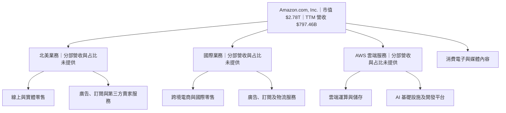
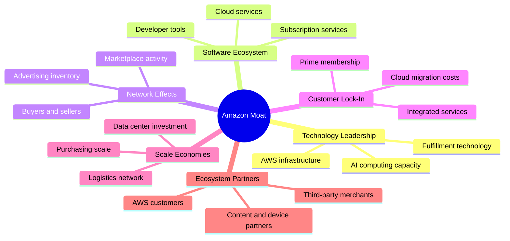
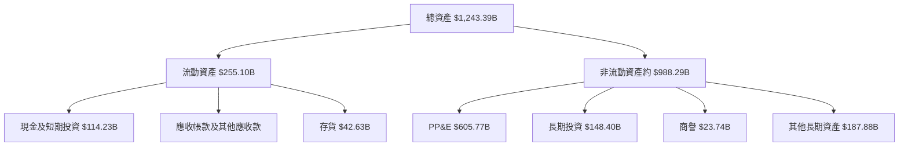
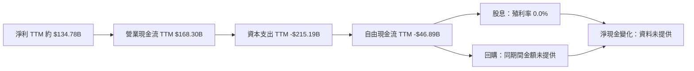
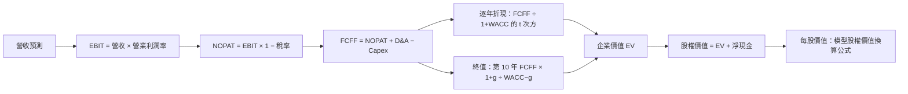
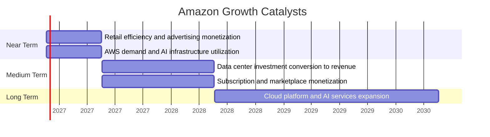
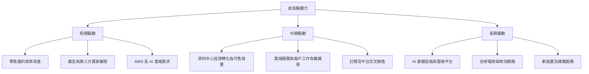
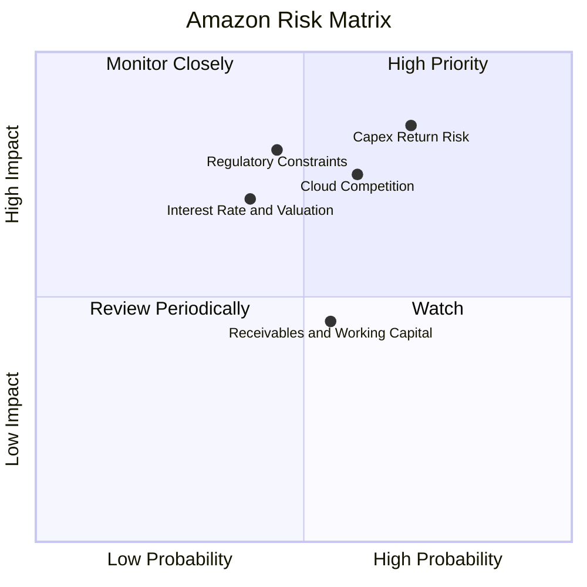
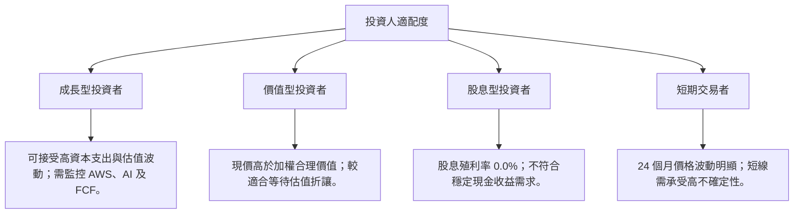

# AMZN 基本面深度分析報告
> **報告日期**：2026-11-20 ｜ **語言**：繁體中文 ｜ **數據來源**：SEC 申報資料 (XBRL)、Yahoo Finance、Finviz、StockAnalysis、Roic.ai ｜ **分析師**：CFA 級機構研究

> **資料口徑說明**：財務數據中存在不同來源、期間與口徑的差異。本報告對營收、TTM 營業利益率、營業現金流、資本支出、自由現金流、現金、債務、ROIC、WACC、估值方法及品質指標，優先採用 SEC 申報資料與程式計算的指定數值；其他來源只在該項目未被指定或可作補充時使用。DCF 逐年預測與估值方法照錄程式模型；該模型部分算式與表列數字存在可見尾差，於第 8.10 節明確披露，不自行改寫模型輸出。

## 目錄

| # | 章節 | 核心結論 |
|---|------|----------|
| 1 | 執行摘要 | 賣出；加權合理價值 $186.64；MOS -37.9% |
| 2 | 公司概覽與商業模式 | 零售、AWS、廣告及訂閱形成互補，但各板塊營收拆分未提供 |
| 3 | 損益表深度分析 | TTM 營收 $797.46B、年增 15.4%；TTM 營業利益率 13.1% |
| 4 | 資產負債表分析 | 淨負債 $65.73B；流動性尚可，應收天數上升 |
| 5 | 現金流量深度分析 | TTM FCF -$46.89B，主因資本支出高於營業現金流 |
| 6 | 獲利能力與資本效率 | ROIC 11.9% 高於 WACC 11.08%，但利差僅 0.82 個百分點 |
| 7 | 相對估值分析 | 多數相對倍數低於部分同業，但估值方法加權結果仍低於現價 |
| 8 | DCF 內在價值評估 | DCF 基準 $53.64；加權合理價值 $186.64；終值依賴度高 |
| 9 | 成長催化劑 | AWS、AI 基礎設施、廣告與零售效率可能支撐成長 |
| 10 | 風險矩陣 | 資本支出回報、雲端競爭及監管為主要風險 |
| 11 | 投資建議 | 現價高於加權合理價值；以估值與 FCF 改善作為持續追蹤條件 |

## 1. 執行摘要

AMZN 的 TTM 營收為 **$797.46B**、TTM 年增 **15.4%**，最新一季營收年增 **12.1%**，而 TTM 營業利益率為 **13.1%**、ROIC 為 **11.9%**，略高於 **11.08% WACC**。另一方面，TTM 營業現金流 **$168.30B** 低於資本支出 **$215.19B**，使 TTM FCF 為 **-$46.89B**；加權合理價值為 **$186.64**，低於 2026-11-19 收盤價 **$257.37**，MOS 為 **-37.9%**。按 MOS 門檻，評級為 **賣出**；這代表現價要求投資人承擔相當程度的未來成長與投資回報風險。

### 1.0 一頁式投資儀表板（Portfolio Manager 30 秒速讀）

| 項目 | 內容 |
|------|------|
| **投資論點（3 句）** | ① TTM 營收年增 **15.4%**，規模與業務多元性提供成長基礎。② ROIC **11.9%** 高於 WACC **11.08%**，目前仍略有正經濟利差。③ TTM FCF **-$46.89B**，資本支出 **$215.19B** 高於營業現金流 **$168.30B**，投資回報仍須驗證。 |
| **綜合評分** | **6.4/10**（引用 1.1 評分卡） |
| **財務健康** | 🟡 現金及短期投資 **$114.23B**，但總債務 **$179.95B**、淨負債 **$65.73B**，且 TTM FCF 為負。 |
| **ROIC vs WACC** | **11.9% vs 11.08%**，利差 **+0.82 個百分點**；目前仍創造價值，但緩衝有限。 |
| **FCF 趨勢** | TTM 為負；FCF Yield **-1.68%**。 |
| **估值** | Forward P/E **23.56x** ｜ EV/EBITDA **15.7x**（歷史口徑）｜ FCF Yield **-1.68%**。 |
| **DCF 內在價值（基準）** | **$53.64** ｜ 相對 DCF 溢價 **+379.8%**（現價 ÷ DCF 價值 − 1；不同於模型所列「價值相對現價」-79.2%）。 |
| **安全邊際（MOS）** | **-37.9%＝($186.64 − $257.37) ÷ $186.64**；以第 8.8 節加權合理價值為基準。🔴 無安全邊際。 |
| **預期報酬（基準情境 12M）** | DCF 基準情境相對現價 **-79.2%**；此為模型情境輸出，不等同分析師共識目標價報酬。 |
| **關鍵風險（前二）** | AI／資料中心資本支出回收期拉長；零售與雲端的價格競爭和監管約束。 |
| **評級 + 信心度** | 🔴 **賣出** ｜ 信心：中（DCF 對終值高度敏感，且自由現金流投入期使短期估值不確定性偏高）。 |

### 1.1 綜合評分卡（全報告唯一）

| 維度 | 評分（1–10） | 主要依據（引用數字與其來源章節） |
|------|--------------|----------------------------------|
| 成長性 | 7.0 | TTM 營收成長 **15.4%**，最新一季年增 **12.1%**（第 3 章）。 |
| 獲利能力 | 7.5 | TTM 營業利益率 **13.1%**，ROIC **11.9%** 高於 WACC **11.08%**；Piotroski **4/8**（第 6 章）。 |
| 財務健康 | 6.0 | 淨負債 **$65.73B**；DSO **45 天**、一年前 **32 天**，流動比率及速動比率來源口徑分歧（第 4 章）。 |
| 估值 | 3.0 | MOS **-37.9%**；現價高於加權合理價值 **$186.64**（第 8.8 節）。 |
| 護城河 | 8.5 | 零售、物流、AWS、廣告與訂閱互補；TTM 營收 **$797.46B**，但分部市場份額數據未提供（第 2 章）。 |
| 管理層與資本配置 | 6.5 | 2025 年資本支出 **$131.82B**、SBC **$19.47B**；近年投資規模大，稀釋股數未通過 Piotroski 測試（第 3、5、6 章）。 |
| **綜合評分** | **6.4** | 六項算術平均：**(7.0 + 7.5 + 6.0 + 3.0 + 8.5 + 6.5) ÷ 6 = 6.4**。 |

### 1.2 五大投資論點 + 三大核心風險

| 類型 | 項目 | 具體依據 | 信心度 |
|------|------|----------|--------|
| 🟢 **投資論點①** | 多元業務支撐營收韌性 | TTM 營收 **$797.46B**，TTM 年增 **15.4%**；零售、雲端、廣告及訂閱提供不同需求來源。 | 🟢 高 |
| 🟢 **投資論點②** | 最新季營運利潤率維持兩位數 | 最新一季營業利益率 **13.9%**，TTM **13.1%**；規模與效率若持續改善，可能支撐獲利增長。 | 🟡 中 |
| 🟢 **投資論點③** | 目前 ROIC 仍高於資本成本 | ROIC **11.9%**、WACC **11.08%**，正利差 **0.82 個百分點**。 | 🟡 中 |
| 🟢 **投資論點④** | AWS 與 AI 投資具長期選擇權 | 公司提供 AWS 雲端服務，並有 AI 基礎設施相關新聞；但分部營收及訂單數據未提供，短期財務回報不可量化。 | 🟡 中 |
| 🟢 **投資論點⑤** | 相對部分同業估值較低 | AMZN Forward P/E **23.56x**，低於 MSFT **20.6x**以外的同業表現並高於 GOOG **17.7x**；同業比較受業務組合差異影響。 | 🟡 中 |
| 🟡 **風險①** | 資本支出壓過營業現金流 | TTM Capex **$215.19B**，高於 OCF **$168.30B**，導致 FCF **-$46.89B**；若投資回報延遲，估值基礎會弱化。 | 🔴 高衝擊 |
| 🔴 **風險②** | 股價隱含價值高於模型合理價值 | 現價 **$257.37**，加權合理價值 **$186.64**，MOS **-37.9%**。 | 🔴 高 |
| 🟡 **風險③** | 應收帳款回收速度變慢 | DSO 從 **32 天**升至 **45 天**；若持續上升，可能增加營運資金需求。 | 🟡 中 |

### 1.3 快速統計卡片

| 指標 | 公司實際值（期間） | 同業中位數 | 狀態 |
|------|--------------------|------------|------|
| 營收成長（TTM） | **15.4%** | — | 🟢 |
| 營收成長（最新一季年增） | **12.1%** | **18.8%** | 🟡 |
| 毛利率（TTM） | **51.4%** | **60.9%** | 🟡 |
| 營業利益率（TTM） | **13.1%** | — | 🟢 |
| ROIC（TTM） | **11.9%** | — | 🟢 |
| Forward P/E | **23.56x** | **20.6x** | 🟡 |
| FCF Yield（TTM） | **-1.68%** | — | 🔴 |
| Piotroski F-Score | **4 / 8** | — | 🟡 |

### 1.4 投資結論

```text
╔══════════════════════════════════════════════════════════════════╗
║                    📊 投資結論摘要                               ║
╠══════════════════════════════════════════════════════════════════╣
║  評級：賣出（MOS -37.9%，依規則 20）                              ║
║  價格（2026-11-19 收盤）：$257.37                                ║
║  DCF 內在價值（基準）：$53.64（現價相對 DCF 溢價 +379.8%）       ║
║  安全邊際 MOS：-37.9%（以加權合理價值 $186.64 為分母）           ║
║  加權合理價值（8.8）：$186.64                                    ║
║  DCF 情境價值：                                                   ║
║    悲觀情境：$11.66（相對現價 -95.5%）                            ║
║    基準情境：$53.64（相對現價 -79.2%）                            ║
║    樂觀情境：$123.93（相對現價 -51.8%）                           ║
║  綜合評分：6.4/10（引用 1.1）                                    ║
║  適合投資人：可承受高波動、持有期限長且重視雲端與 AI 成長者；      ║
║              不適合以估值折讓或穩定股息為首要考量者。              ║
╚══════════════════════════════════════════════════════════════════╝
```

## 2. 公司概覽與商業模式

### 2.1 業務結構與收入來源

公司總營收 TTM 為 **$797.46B**，市值約 **$2.78T**。財務數據未提供北美、國際、AWS、廣告或訂閱服務各自的最新營收與占比，因此不以推估比例繪製分部占比圖。



### 2.2 市場份額

市場份額數據未提供，無法以可引用的年份及來源呈現零售、雲端或廣告份額。以公司規模觀察，TTM 營收達 **$797.46B**，增長 **15.4%**；最新一季年增 **12.1%**，低於 MSFT、GOOG 的同季營收增長，但公司業務組合與比較基礎並不相同。

### 2.3 競爭護城河分析



### 2.4 護城河強度

| 護城河項目 | 強度（強／中／弱） | 證據（引用數字或事實） | 會削弱它的情況 |
|------------|--------------------|------------------------|----------------|
| 技術與雲端能力 | 強 | AWS 是公司主要業務板塊之一；AI 基礎設施投資受到市場關注，但分部數據未提供。 | 雲端價格戰、運算資源供過於求、AI 投資回報偏低。 |
| 軟體與訂閱生態 | 中至強 | 電商、訂閱、裝置與 AWS 服務可形成產品交叉使用。訂閱用戶數未提供。 | 客戶降低訂閱、雲端遷移變容易或替代服務成熟。 |
| 網路效應 | 中至強 | 消費者與第三方賣家共同構成平台；第三方賣家規模未提供。 | 監管限制平台自營與第三方賣家之間的整合。 |
| 客戶鎖定 | 中 | Prime 與 AWS 服務可能提高留存及切換成本；客戶流失率未提供。 | 雲端多雲策略、訂閱價格敏感度提高。 |
| 規模效應 | 強 | TTM 營收 **$797.46B**；物流與資料中心的固定投入可由更大交易量分攤。 | 超大規模資本支出未能轉成單位成本下降。 |
| 生態夥伴 | 中 | 依賴第三方商家、雲端客戶及內容夥伴；合作夥伴收入比例未提供。 | 夥伴轉向競爭平台或平台條款受到限制。 |

第 1.1 節護城河評分為 **8.5/10**，理由是平台、雲端與物流具有互補規模，但缺少可量化的分部市占、留存及單位經濟數據，故不宜把質化優勢等同於已驗證的超額回報。

## 3. 損益表深度分析

### 3.1 年度收入成長趨勢（近4年）

| 財年 | 營收 | YoY |
|------|------|-----|
| 2022 | $513.98B | — |
| 2023 | $574.78B | +11.8% |
| 2024 | $637.96B | +11.0% |
| 2025 | $716.92B | +12.4% |

2022 至 2025 年營收 CAGR 約 **11.7%**，計算為 **($716.92B ÷ $513.98B)^(1/3) − 1**。年度數據顯示營收增長回升，但年度資料與 TTM 口徑不同，TTM 年增以指定數值 **15.4%** 為準。

```text
╔══════════════════════════════════════════════════════════════════╗
║              Amazon 年度收入趨勢（FY2022–FY2025）                ║
╠══════════════════════════════════════════════════════════════════╣
║ FY2022  $513.98B  ██████████████░░░░░░  基期                   ║
║ FY2023  $574.78B  ████████████████░░░░  YoY +11.8%              ║
║ FY2024  $637.96B  ██████████████████░░  YoY +11.0%              ║
║ FY2025  $716.92B  ████████████████████  YoY +12.4%              ║
╠══════════════════════════════════════════════════════════════════╣
║ 2022–2025 營收 CAGR：約 +11.7%                                  ║
╚══════════════════════════════════════════════════════════════════╝
```

### 3.2 季度收入趨勢分析

季度營收採 StockAnalysis 季度序列；QoQ 為本季相對前一季，YoY 為本季相對去年同季。

| 季度 | 營收 | QoQ | YoY | 備註 |
|------|------|-----|-----|------|
| 2025 Q4 | $213.39B | +18.7% | +13.6% | 季節性旺季；Q3 2025 營收 $180.17B。 |
| 2026 Q1 | $181.52B | -14.9% | +16.6% | 季節性回落，但同比仍增。 |
| 2026 Q2 | $200.61B | +10.5% | +19.6% | 來源季度表顯示同比較高；需留意來源口徑。 |
| 2026 Q3 | $201.94B | +0.7% | +12.1% | 同比增速低於前兩季，仍為正增長。 |

最新季度營收同比增長放緩，意味著單靠營收擴張不足以支持估值；後續需觀察 AWS、廣告及零售履約效率能否帶動利潤率和現金流。

### 3.3 利潤率演變分析

年度毛利率與營業利益率以年度損益表數據計算；TTM 數值以指定 TTM 口徑為準。

| 利潤率指標 | FY2022 | FY2023 | FY2024 | FY2025 | 趨勢 | 評估 |
|------------|--------|--------|--------|--------|------|------|
| **毛利率** | 43.8% | 47.0% | 48.9% | 50.3% | ↗️ 改善；TTM 指標為 51.4%。 | 🟢 |
| **營業利益率** | 2.4% | 6.4% | 10.8% | 11.2% | ↗️ 年度改善；TTM 為 13.1%。 | 🟢 |
| **淨利率** | -0.5% | 5.3% | 9.3% | 10.8% | ↗️ 從虧損轉為獲利；TTM 品質指標口徑為 16.9%。 | 🟡 |

年度營業利益率上升，與成本控制、物流網路效率及高毛利服務占比增加相符；但資料未提供各分部利潤貢獻，不能將改善精確歸因於某一業務。TTM 營業利益率 **13.1%** 高於 FY2025 年度比率，代表最近期間營運槓桿仍有改善；若零售履約成本上升或 AWS 價格競爭加劇，改善可能逆轉。

### 3.4 費用結構分析

可用資料未提供完整 TTM 服務成本、履約、技術與內容、銷售行銷、管理費用拆分；因此不繪製缺乏數字基礎的費用圓餅圖。年度營業利益改善顯示整體費用吸收能力提升，但未能量化各費用項目對毛利率變化的貢獻。

### 3.5 季度 EPS 趨勢與盈餘品質（Quality of Earnings）

| 季度 | EPS 實際值 | EPS YoY | 超預期／不及預期 |
|------|------------|--------|------------------|
| 2025 Q4 | $1.95 | +5.0% | 預估 EPS 未提供，無法判定。 |
| 2026 Q1 | $2.78 | +74.8% | 預估 EPS 未提供，無法判定。 |
| 2026 Q2 | $5.75 | +242.3% | 預估 EPS 未提供，無法判定。 |
| 2026 Q3 | $1.89 | -3.1% | 預估 EPS 未提供，無法判定。 |

EPS 歷史表的估值與實際值欄為缺失值，故無法可靠判定過去四季是否超出分析師預期。季度 EPS 變動幅度大，尤其 Q2 與其他季度差異明顯，評估時應結合一次性投資收益、稅務及股權投資變化；但本資料未提供足以拆解的細項。

| 盈餘品質項目 | 數值／佔比 | 評估 |
|--------------|-----------|------|
| 股權薪酬 SBC / 營收 | FY2025：**$19.47B ÷ $716.92B = 2.7%** | 🟡 SBC 為非現金費用，但會稀釋股東；Piotroski 稀釋股數測試未通過。 |
| SBC / 營業現金流 | FY2025：**$19.47B ÷ $139.51B = 14.0%** | 🟡 佔比不可忽略。FY2025 SBC 與 OCF 同年度比較。 |
| FCF / 淨利（現金轉換率） | TTM：**-$46.89B ÷ $134.78B = -34.8%** | 🔴 淨利未轉為正 FCF，主因高額資本支出。 |
| 一次性／非經常性損益 | N/A（缺少完整調整項及稅務附註） | 無法判斷是否美化或壓低本期 GAAP 盈餘。 |
| 有效稅率異常 | N/A（實際 TTM 有效稅率未提供） | DCF 採用稅率 **21.0%** 是模型假設，不代表實際稅率。 |
| 資本化支出 vs 費用化 | TTM Capex **$215.19B** | 高資本支出形成資產並透過折舊攤銷計入費用；資本化會令當期費用低於現金投入，但不等同於會計不當。 |

**盈餘品質結論**：GAAP 獲利具正向營運現金流支持，但 TTM FCF 為負、FCF 對淨利轉換率為 **-34.8%**，顯示當期盈利含金量受高資本投資壓低。估值不宜只依 P/E，必須追蹤新增資產的利用率與未來現金回收；SBC 亦是股東經濟成本，應同時觀察稀釋股數。

## 4. 資產負債表分析

### 4.1 資產結構分解

最新 TTM 資產總額可由 StockAnalysis 顯示為 **$1,243.39B**，流動資產 **$255.10B**；細項數據包括 PP&E **$605.77B**、長期投資 **$148.40B**、其他長期資產 **$187.88B**。這些資產數字來自不同資料來源，以下只作結構性呈現，不與 SEC 季報中的指定淨負債口徑混用。



### 4.2 流動性與營運資金分析

| 指標 | 最新 TTM | 一年前 TTM | 變化 | 解讀 |
|------|----------|------------|------|------|
| DSO 應收帳款天數 | **45 天** | **32 天** | **+13 天** | 應收回收天數增加；可能反映業務組合或結算時間變化，需進一步檢查逾期應收。 |
| DIO 存貨天數 | **N/A** | **N/A** | N/A | 資料指示無可用餘額，不推算。 |
| DPO 應付帳款天數 | **N/A** | **N/A** | N/A | 資料指示無可用餘額，不推算。 |
| CCC 現金轉換週期 | **N/A** | **N/A** | N/A | 因 DIO、DPO 缺失，不能計算。 |

流動比率與速動比率在不同來源數據分別為 **0.989**、**0.793**，但兩者所屬財務報表口徑與最新期日需核對；不將其與營運資金天數混為同一期間。DSO 上升 13 天值得關注，若應收增長持續快於營收，將增加營運資金佔用。

### 4.3 債務結構分析

```text
╔══════════════════════════════════════════════════════════════════╗
║                   Amazon 債務健康診斷                            ║
╠══════════════════════════════════════════════════════════════════╣
║  總債務（指定口徑）：       $179.95B                              ║
║  現金及短期投資：           $114.23B                              ║
║  淨負債：                    $65.73B                              ║
║                                                                  ║
║  淨負債算式：$179.95B − $114.23B = $65.72B                       ║
║  程式指定淨負債：$65.73B；差異約 $0.01B，屬輸入精度／四捨五入差異。║
║  Debt/EBITDA：N/A（債務口徑與 EBITDA 期間未提供一致輸入）         ║
║  利息保障倍數：N/A（利息費用未提供）                              ║
╚══════════════════════════════════════════════════════════════════╝
```

另有資料來源呈現 TTM 債務 **$304.84B**、淨負債 **$190.61B**，與指定 SEC 計算口徑不一致；本報告依指定數值採用總債務 **$179.95B**、淨負債 **$65.73B**，並避免以不同口徑的債務計算槓桿倍數。

### 4.4 股東權益趨勢

| 財年 | 股東權益 |
|------|----------|
| 2022 | $146.04B |
| 2023 | $201.88B |
| 2024 | $285.97B |
| 2025 | $411.06B |

```text
╔══════════════════════════════════════════════════════════════════╗
║                   股東權益趨勢（年度）                            ║
╠══════════════════════════════════════════════════════════════════╣
║ FY2022  $146.04B  ███████░░░░░░░░░░░░░░░                        ║
║ FY2023  $201.88B  ██████████░░░░░░░░░░░                         ║
║ FY2024  $285.97B  ██████████████░░░░░░                          ║
║ FY2025  $411.06B  ████████████████████                          ║
╚══════════════════════════════════════════════════════════════════╝
```

股東權益近年增加，但部分增長可能來自留存盈餘、股權薪酬與其他會計項目；僅憑年度帳面權益不能把增長直接視為每股價值同步提升。

## 5. 現金流量深度分析

### 5.1 現金流量瀑布圖

TTM 淨利約 **$134.78B**（StockAnalysis），但現金流量表指定數值為 OCF **$168.30B**、Capex **$215.19B**、FCF **-$46.89B**。股息殖利率為 **0.0%**；資料未提供同一 TTM 期間的回購金額與淨現金變化，故不填入推估金額。



### 5.2 FCF 轉換率趨勢

| 財年 | OCF | Capex | FCF | FCF / 淨利 |
|------|-----|-------|-----|-----------|
| 2022 | $46.75B | $63.65B | -$16.89B | N/A（該年淨利為 -$2.72B，比例不具經濟解讀性） |
| 2023 | $84.95B | $52.73B | $32.22B | 105.9% |
| 2024 | $115.88B | $83.00B | $32.88B | 55.5% |
| 2025 | $139.51B | $131.82B | $7.70B | 9.9% |
| TTM | $168.30B | $215.19B | -$46.89B | -34.8% |

年度現金流顯示 2023–2025 年 Capex 上升，FCF 由約 **$32B** 回落至 **$7.70B**；最新 TTM 轉負主要反映資本支出進一步超過 OCF。這代表成長投資正在佔用現金，未來回報需要由營業現金流和資產利用率證明。

### 5.3 自由現金流趨勢

歷史 FCF Yield 未有一致年度資料，以下不臆造年度殖利率；TTM FCF Yield 採指定值 **-1.68%**。

```text
╔══════════════════════════════════════════════════════════════════╗
║                 自由現金流趨勢（美元十億）                        ║
╠══════════════════════════════════════════════════════════════════╣
║ FY2022  -$16.89B  ◀ 負值                                       ║
║ FY2023   $32.22B  ████████████████████                          ║
║ FY2024   $32.88B  ████████████████████                          ║
║ FY2025    $7.70B  █████                                         ║
║ TTM      -$46.89B ◀ 負值；FCF Yield -1.68%                      ║
╚══════════════════════════════════════════════════════════════════╝
```

### 5.4 資本配置評估

| 資本配置項目 | 可用數據 | 評估 |
|--------------|----------|------|
| 資本支出 | FY2025 **$131.82B**；TTM **$215.19B** | 是 FCF 轉負的主要來源；投資回報與折舊負擔需跟進。 |
| 股權薪酬 | FY2025 **$19.47B** | 對現金流不直接構成現金支出，但會稀釋股東。 |
| 股息 | 殖利率 **0.0%** | 沒有可見現金股息回饋。 |
| 回購 | 最新 TTM 金額未提供 | 不以資料不足的金額繪製資本配置圓餅圖。 |
| 留存／淨現金變化 | 期間數據未提供 | N/A。 |

## 6. 獲利能力與資本效率

### 6.1 ROE / ROA / ROIC 趨勢

| 指標 | 可用期間數值 | 評估 |
|------|--------------|------|
| ROE | TTM **22.0%**（指定品質數據） | 正向；杜邦分解顯示淨利率是主要因素，權益乘數亦提供部分放大。 |
| ROA | Piotroski 測試顯示 TTM ROA 為正，絕對值 N/A | 無法可靠呈現完整歷史序列。 |
| ROIC | TTM **11.9%** | 高於 WACC **11.08%**，仍有正經濟利差，但只有 0.82 個百分點。 |

其他來源提供 ROE **27.4%**、ROA **6.6%**，與指定品質數據中的 ROE **22.0%**不一致；本報告依指定 DuPont 數據採用 **22.0%**。未提供可一致比較的行業均值，因此不列行業均值欄。

### 6.2 ROIC vs WACC 分析（核心價值創造判斷）

```text
╔══════════════════════════════════════════════════════════════════╗
║                 ROIC vs WACC 深度分析                            ║
╠══════════════════════════════════════════════════════════════════╣
║ WACC 估算（採用指定資本成本數值）：                               ║
║ ├── 無風險利率 Rf（10Y 美債）：                  5.05%           ║
║ ├── 股權風險溢酬 ERP：                           5.00%           ║
║ ├── Yahoo 原始 Beta：                            1.50            ║
║ ├── 調整後 Beta：                                1.34            ║
║ ├── 股權成本 Ke（指定值）：                     11.73%           ║
║ ├── 稅前債務成本：                               1.26%           ║
║ ├── 稅率：                                       21.0%           ║
║ ├── 股權／債務權重：                             93.9% / 6.1%    ║
║ └── WACC（指定值）：                             11.08%           ║
║                                                                  ║
║ ROIC（TTM）：                                    11.90%           ║
║ EVA 利差 = ROIC − WACC = 11.90% − 11.08% =       +0.82 個百分點  ║
║                                                                  ║
║ ROIC 11.90%  ▓▓▓▓▓▓▓▓▓▓▓▓░░░░░░░░░░░░                           ║
║ WACC 11.08%  ▓▓▓▓▓▓▓▓▓▓▓░░░░░░░░░░░                           ║
║                                                                  ║
║ 結論：ROIC 略高於 WACC，代表目前仍創造股東價值；但利差不大，    ║
║       若 AI／雲端投資回報下滑，ROIC 可能跌破資本成本。            ║
╚══════════════════════════════════════════════════════════════════╝
```

依指定輸入，Ke 為 **11.73%**、稅前 Kd 為 **1.26%**、資本權重為 **93.9%／6.1%**，採用 WACC **11.08%**。原始 Beta **1.50** 調整後為 **1.34**，調整方式為 **⅔ × 1.50 + ⅓ × 1.00 = 1.33**（按指定資料列示為 1.34，差異來自中間精度）。由於資料沒有提供利息費用與平均計息負債的完整細項，本節不另行重算債務成本或 WACC。

### 6.3 杜邦三因素分解

| 因素 | 數值（TTM） | 解讀 |
|------|-------------|------|
| 淨利率 | **16.9%** | 提供 ROE 的主要基礎。 |
| 資產週轉率 | **0.64** | 大型資產基礎下仍有一定營收轉化效率。 |
| 權益乘數 | **2.03** | 財務槓桿對 ROE 有放大作用，但不是唯一來源。 |
| **ROE** | **22.0%** | 指定資料：**16.9% × 0.64 × 2.03 = 22.0%**（四捨五入）。 |

### 6.4 財務體質：Piotroski F-Score

指定 F-Score 為 **4/8**；毛利率測試缺少資料而未納入分母，故總測試數為 8。

| 測試 | 結果 | 解讀 |
|------|------|------|
| ROA > 0 | ✅ 通過 | 資產具正獲利能力。 |
| 營業現金流 > 0 | ✅ 通過 | TTM OCF **$168.30B**。 |
| ROA 高於一年前 | ✅ 通過 | 獲利效率方向改善。 |
| 營業現金流 > 淨利（應計品質） | ✅ 通過 | 現金流支持獲利品質測試。 |
| 長期負債 ÷ 總資產低於一年前 | ❌ 未通過 | 負債相對資產未改善。 |
| 流動比率高於一年前 | ❌ 未通過 | 短期流動性趨勢未改善。 |
| 稀釋股數未增加 | ❌ 未通過 | SBC 及股數稀釋仍是股東回報成本。 |
| 毛利率高於一年前 | — 無法判定 | 缺少輸入，不計入分母。 |
| 資產週轉率高於一年前 | ❌ 未通過 | 資產效率未較一年前改善。 |

4/8 顯示公司並非財務困境型，但資產負債與股數稀釋等測試沒有全面改善；得分不應單獨取代現金流與資本回報分析。

## 7. 相對估值分析

### 7.1 同業估值比較表格

下表同業數值採 Yahoo Finance 指定 Peer multiples。AMZN 倍數以指定同業估值區塊及 Yahoo/Finviz 補充估值資料為參考；不同來源中的 TTM 期間與市場資料口徑可能略有差異。

| 估值指標 | **AMZN** | **MSFT** | **GOOG** | **WMT** | AMZN 評估 |
|----------|----------|---------|---------|---------|-----------|
| **Trailing P/E** | **20.8x** | 26.0x | 14.2x | 45.7x | 🟡 介於 GOOG 與 MSFT、WMT 之間。 |
| **Forward P/E** | **23.56x** | 20.6x | 17.7x | 39.0x | 🟡 高於 MSFT、GOOG 中位數 **20.6x**。 |
| **P/S Ratio** | **3.49x** | 10.7x | 7.1x | 1.4x | 🟢 低於 MSFT、GOOG，但高於 WMT。 |
| **EV/EBITDA** | **15.7x** | 18.3x | 17.4x | 24.5x | 🟢 低於三家同業中位數 **18.3x**。 |
| **最新一季營收成長** | **12.1%** | 18.8% | 24.7% | 5.9% | 🟡 增長高於 WMT、低於 MSFT 與 GOOG。 |
| **毛利率（TTM）** | **51.4%** | 67.7% | 60.9% | 24.8% | 🟡 中位數 **60.9%**；與純軟體或雲端業務不可直接等同。 |

同業中位數依三家公司資料排序計算：Forward P/E **20.6x**、P/S **7.1x**、EV/EBITDA **18.3x**、最新季營收增長 **18.8%**、毛利率 **60.9%**。同業估值只作交叉參考，因各公司零售、軟體、廣告與雲端業務占比差異顯著。

### 7.2 歷史估值區間分析

```text
╔══════════════════════════════════════════════════════════════════╗
║                  AMZN 五年估值位置（TTM）                         ║
╠══════════════════════════════════════════════════════════════════╣
║ P/E：      2.6x ├────────●──────────────┤ 251.9x                ║
║                         現值 20.8x｜歷史中位數 32.2x｜百分位 35% ║
║ P/S：      0.2x ├─────────────────────●─┤ 3.7x                  ║
║                         現值 3.5x｜歷史中位數 3.0x｜百分位 90%  ║
║ EV/EBITDA：0.7x ├────────●──────────────┤ 22.7x                ║
║                         現值 15.7x｜歷史中位數 17.3x｜百分位 29%║
╚══════════════════════════════════════════════════════════════════╝
```

P/E 與 EV/EBITDA 現值低於各自五年中位數，位於第 35 與第 29 百分位；P/S 則位於第 90 百分位，顯示營收倍數相對自身歷史偏高。估值訊號並不一致，且 P/E 歷史區間極寬，不能只憑單一倍數判斷低估。

### 7.3 情境價值（Bear / Base / Bull，照抄 DCF MODEL 的 Scenarios）

| 情境 | 第 1 年營收成長 | 期末營業利潤率 | WACC | 每股價值 | 相對現價 | 機率 | 會發生的條件 |
|------|----------------|----------------|------|----------|----------|------|--------------|
| 🔴 悲觀 | 7.7% | 9.1% | 12.08% | **$11.66** | -95.5% | 25% | 零售／雲端成長放慢，資本成本升高，營業槓桿倒退。 |
| 🟡 基準 | 15.4% | 10.8% | 11.08% | **$53.64** | -79.2% | 50% | 按模型基準成長與利潤率逐步淡出。 |
| 🟢 樂觀 | 23.0% | 11.8% | 10.08% | **$123.93** | -51.8% | 25% | AI、AWS 與廣告帶動較快增長，利潤率維持較高且 WACC 下行。 |

情境價值與現價差距很大，反映模型輸出高度受資本支出假設、終值及估值輸入影響，不應把情境表視為短期價格預測。

### 7.4 相對估值隱含價格區間

```text
╔══════════════════════════════════════════════════════════════════╗
║                 相對估值方法回推價格（每股美元）                 ║
╠══════════════════════════════════════════════════════════════════╣
║ $53.64 DCF ── $224.97 Forward P/E ── $257.37 現價               ║
║                         ── $305.32 EV/EBITDA ── $326.09 共識      ║
╚══════════════════════════════════════════════════════════════════╝
```

| 方法 | 每股價值 | 相對現價 | 依據 |
|------|----------|----------|------|
| 同業 Forward P/E | **$224.97** | -12.6% | 同業 Forward P/E 中位數 **20.6x** × AMZN Forward EPS **$10.93**。 |
| 同業 EV/EBITDA | **$305.32** | +18.6% | 同業 EV/EBITDA 中位數 **18.3x** × TTM EBITDA，並按指定模型加回淨現金。 |

同業 EV/EBITDA 方法隱含高於現價的價值，但 Forward P/E 方法低於現價；加權合理價值的計算依第 8.8 節固定權重，不以主觀偏好修改。

## 8. DCF 內在價值評估（Discounted Cash Flow）

> 本節僅使用指定 DCF 模型輸出；模型預測使用 FCFF、GAAP EBIT，且不再另扣 SBC 或增加股數稀釋。模型內部分列數字與所列公式有少數差異，詳見 8.10，避免將不一致的輸出誤稱為完全可複算。

### 8.0 估值推理鏈（Thinking Logic：在算之前先想清楚）

**Step 1 — 價值由哪些變數決定？**  
AMZN 的價值主要由零售與履約規模、AWS／廣告等服務型業務，以及高額再投資能否轉化為長期現金流決定。公司整體 TTM 營收 **$797.46B**，但各業務營收占比未提供，不能假設特定板塊的占比。模型中最主導估值的變數是**長期 Capex 強度與終值**：終值現值占 EV **98.7%**，而 TTM Capex **$215.19B** 已高於 OCF **$168.30B**。

**Step 2 — 模型選擇**

| 決策點 | 本報告採用 | 理由（含數字） | 曾考慮但否決 | 否決理由 |
|--------|-----------|----------------|--------------|----------|
| 現金流定義 | FCFF | 以 WACC 折現，得到 EV，再以淨負債橋接股權價值。 | FCFE | 槓桿及資本結構變動會影響股東現金流。 |
| 預測期 N | 10 年 | 指定 DCF 模型固定為 10 年，適合表達投資支出逐步淡出的假設。 | 5 年 | 無法涵蓋 Capex 由 27.0% 逐步降至 10.9% 的模型路徑。 |
| 終值方法 | Gordon Growth | 指定模型以永續成長率 **3.0%** 計算。 | 退出倍數替代主值 | DCF MODEL 未提供退出倍數法的終值輸出，不能另建模型。 |
| EBIT 基礎 | GAAP EBIT | 指定模型營業利益率採 GAAP。 | 非 GAAP EBIT | 會加回 SBC，並與模型口徑不一致。 |

**Step 3 — 關鍵假設推導鏈**

- **預測期成長**：錨點＝TTM 營收年增 **15.4%** → 模型假設第一年延續該成長，再線性淡出至第十年 **3.0%** → **採用模型逐年遞減路徑** → 曾考慮全期維持 15.4%，但十年持續高增長對成熟大型公司的要求過高，否決。
- **期末營業利益率**：錨點＝TTM 營業利益率 **13.1%**，模型第十年 **10.8%** → 依模型採用近五財年中位數作成熟期收斂值 → **採用 10.8%** → 曾考慮維持 13.1%，但長期不變的高利潤率可能低估零售競爭及成本壓力，否決。
- **Capex／營收**：錨點＝TTM Capex／營收 **27.0%** → 模型假設資本支出逐步淡出至第十年 **10.9%**，且按 1.1 倍 D&A 作為長期下限 → **採用模型路徑** → 曾考慮維持 27.0%，但這會持續造成大額負 FCFF，與成熟期投資回落假設不一致。
- **永續成長率 g**：錨點＝模型採 **3.0%** → 低於 WACC **11.08%**，並代表成熟期名目長期增長假設 → **採用 3.0%** → 曾考慮更高 g，但會提高終值依賴並逼近資本成本，否決。
- **WACC**：錨點＝指定資本成本模型 **11.08%** → 直接採用指定數值，不因估值結果而調低 → **採用 11.08%** → 曾考慮使用較低折現率，但資料未提供可支持調整的資本成本證據，否決。
- **EBIT 與 SBC**：錨點＝GAAP EBIT 已費用化 SBC → 採用組合 **(A)**，不另扣 SBC、股數年稀釋率設為 0% → **SBC 成本透過 GAAP 費用反映一次** → 不採非 GAAP 加回，避免模型與指定輸出不符。
- **終值方法**：錨點＝模型以第 10 年 FCFF 及 g **3.0%** 計算 → 採 Gordon Growth，因模型明確指定 → **採用 Gordon Growth** → 退出倍數法缺少模型值，不能自行創造另一終值。

**Step 4 — 最脆弱的一環**  
最脆弱的是 Capex 比率能否由首年 **27.0%** 降至第十年 **10.9%**，以及終值現值佔 EV **98.7%** 的假設；若再投資需求持續偏高，DCF 價值將進一步下降。

**Step 5 — 計算路徑圖**



### 8.1 模型假設總表（Model Inputs）

| 假設項目 | 採用值 | 依據／來源 | 敏感度 |
|----------|--------|-------------|--------|
| 預測期長度 N | 10 年 | 指定 DCF 模型；逐年預測 FY+1 至 FY+10。 | 🟡 中 |
| 營收成長 | FY+1 **15.4%**，FY+10 **3.0%**，線性淡出 | TTM 成長 **15.4%** 起步，模型逐年淡出。 | 🔴 高 |
| 營業利益率 | FY+1 **13.1%** → FY+10 **10.8%** | 起點為 TTM **13.1%**；期末採模型近五財年中位數。 | 🔴 高 |
| 有效稅率 | **21.0%** | 模型預設值；非實際 TTM 稅率。 | 🟢 低 |
| Capex／營收 | FY+1 **27.0%** → FY+10 **10.9%** | TTM 起始 **27.0%**，逐年淡出至模型下限。 | 🔴 高 |
| D&A／營收 | **10.0%** | 指定 DCF 模型 TTM 比率，持平。 | 🟢 低 |
| 營運資金變動 | 不建模 | 指定 DCF 模型註明 working capital is not modelled。 | 🟢 低 |
| EBIT 基礎 | GAAP | 模型採 GAAP EBIT。 | 🟡 中 |
| SBC 處理 | 不另扣 SBC | 採組合 **(A)**：GAAP EBIT 已含 SBC。 | 🟡 中 |
| 年稀釋率 | **0%** | 組合 (A) 固定股數；估值採指定每股換算公式，不另逐年稀釋。 | 🟡 中 |
| 永續成長率 g | **3.0%** | 指定 DCF 模型。 | 🔴 高 |
| 終值方法 | Gordon Growth | 指定 DCF 模型；未提供退出倍數終值。 | 🔴 高 |
| WACC | **11.08%** | 指定資本成本模型；詳見 8.2。 | 🔴 高 |

**FCFF 定義**：`FCFF = NOPAT + D&A − Capex`，模型不含營運資金變動列。  
**SBC 一次性處理**：本模型採用 **(A)**，GAAP EBIT 已含 SBC，因此不另減 SBC，亦不再加入年稀釋率。

### 8.2 折現率推導（WACC）

```text
╔══════════════════════════════════════════════════════════════════╗
║                    WACC 推導（折現率）                           ║
╠══════════════════════════════════════════════════════════════════╣
║ 股權成本 Ke（CAPM，指定數值）：                                   ║
║ ├── 無風險利率 Rf：                         5.05%                ║
║ ├── ERP：                                    5.00%                ║
║ ├── 原始 Beta：                              1.50                 ║
║ ├── 調整後 Beta：                            1.34                 ║
║ ├── 規模／國別溢酬：                         未另加                ║
║ └── 指定 Ke：                                11.73%               ║
║                                                                  ║
║ 債務成本（指定數值）：                                            ║
║ ├── 稅前 Kd：                                1.26%                ║
║ ├── 稅率：                                   21.0%                ║
║ └── 稅後 Kd = 1.26% × (1 − 21.0%) =          0.9954%              ║
║                                                                  ║
║ 資本結構權重：股權 93.9%｜債務 6.1%                              ║
║ 指定 WACC：                                  11.08%               ║
╚══════════════════════════════════════════════════════════════════╝
```

**指定值與公式對照**：

1. **Ke（CAPM）**：指定成本資本資料為 **11.73%**。按顯示的四捨五入輸入計算，`5.05% + 1.34 × 5.00% = 11.75%`；與指定 **11.73%** 相差 0.02 個百分點，可能來自未顯示的原始精度。模型要求採用指定值，故以下採 **11.73%**。
2. **稅前 Kd**：指定值 **1.26%**。利息費用與平均計息負債的原始金額未提供，故不能獨立複算。
3. **稅後 Kd**：`1.26% × (1 − 21.0%) = 0.9954% ≈ 1.00%`。
4. **權重**：股權 **93.9%**、債務 **6.1%**，合計 **100.0%**。市值與債務權重的底層未四捨五入輸入未完整提供，直接採用指定權重。
5. **WACC**：`93.9% × 11.73% + 6.1% × 0.9954% = 11.0755% ≈ 11.08%`。

本節採用 WACC **11.08%**，與第 6.2 節一致。Rf 的觀察日期未提供；ERP 為指定假設；沒有另加規模或國別風險溢酬。

### 8.3 逐年自由現金流預測（基準情境）

金額單位為美元十億。表內數值照錄指定 DCF 模型；ΔWC 不建模、SBC 不另扣。

| 年度 | FY+1 | FY+2 | FY+3 | FY+4 | FY+5 | FY+6 | FY+7 | FY+8 | FY+9 | FY+10 |
|------|------|------|------|------|------|------|------|------|------|-------|
| 營收 | 919.87 | 1,048.46 | 1,180.63 | 1,313.26 | 1,442.76 | 1,565.24 | 1,676.64 | 1,772.96 | 1,850.48 | 1,905.99 |
| 營收 YoY | 15.4% | 14.0% | 12.6% | 11.2% | 9.9% | 8.5% | 7.1% | 5.7% | 4.4% | 3.0% |
| 營業利潤率 | 13.1% | 12.8% | 12.6% | 12.3% | 12.0% | 11.8% | 11.5% | 11.3% | 11.0% | 10.8% |
| EBIT（GAAP） | 120.39 | 134.49 | 148.39 | 161.65 | 173.84 | 184.54 | 193.32 | 199.83 | 203.76 | 204.93 |
| − 稅 | (25.28) | (28.24) | (31.16) | (33.95) | (36.51) | (38.75) | (40.60) | (41.96) | (42.79) | (43.04) |
| = NOPAT | 95.11 | 106.25 | 117.22 | 127.70 | 137.34 | 145.79 | 152.73 | 157.86 | 160.97 | 161.90 |
| + D&A | 91.53 | 104.33 | 117.48 | 130.68 | 143.57 | 155.75 | 166.84 | 176.42 | 184.14 | 189.66 |
| − Capex | (248.23) | (264.24) | (276.51) | (284.17) | (286.48) | (282.91) | (273.16) | (257.26) | (235.53) | (208.63) |
| − ΔWC | 不建模 | 不建模 | 不建模 | 不建模 | 不建模 | 不建模 | 不建模 | 不建模 | 不建模 | 不建模 |
| **= FCFF** | **-61.59** | **-53.66** | **-41.80** | **-25.79** | **-5.58** | **18.63** | **46.40** | **77.03** | **109.58** | **142.93** |
| 折現因子 @11.08% | 0.900 | 0.810 | 0.730 | 0.657 | 0.591 | 0.532 | 0.479 | 0.432 | 0.388 | 0.350 |
| **FCFF 現值 PV** | **-55.44** | **-43.49** | **-30.50** | **-16.94** | **-3.30** | **9.92** | **22.24** | **33.24** | **42.57** | **49.99** |

預測期 PV 加總：  
`-55.44 + (-43.49) + (-30.50) + (-16.94) + (-3.30) + 9.92 + 22.24 + 33.24 + 42.57 + 49.99 = 8.29B`

**FY+1 代表年度逐步演算**（按模型表列值示範；因顯示精度，部分中間步驟有小幅尾差）：

1. **營收**：模型表列 **$919.87B**；按起始營收及顯示成長率計算，`$797.46B × (1 + 15.4%) = $920.27B`，與模型列值相差 **$0.40B**。
2. **EBIT**：`$919.87B × 13.1% = $120.39B`（以模型輸出為準；直接使用四捨五入利潤率會有小幅差異）。
3. **稅**：`$120.39B × 21.0% = $25.28B`。
4. **NOPAT**：`$120.39B − $25.28B = $95.11B`。
5. **D&A**：模型值 **$91.53B**；約為營收的 **10.0%**。
6. **Capex**：模型值 **$248.23B**；約為營收的 **27.0%**。
7. **ΔWC**：模型不建模。
8. **FCFF**：`$95.11B + $91.53B − $248.23B = -$61.59B`。
9. **折現**：`-$61.59B × 0.900 = -$55.44B`（保留模型所列折現因子）。

**合理性自檢**

- 預測 FCF 由 FY+1 **-$61.59B** 轉至 FY+10 **$142.93B**；早期 FCF 為負，故整段 FCFF CAGR 不具通常的百分比解讀性。歷史 FY2022 FCF **-$16.89B**、FY2023 **$32.22B**、FY2024 **$32.88B**、FY2025 **$7.70B**，波動較大，模型的現金流路徑取決於 Capex 下降。
- FY+10 FCFF 利潤率：`$142.93B ÷ $1,905.99B = 7.5%`。目前 TTM FCF 利潤率：`-$46.89B ÷ $797.46B = -5.9%`。同業最佳值未在可比口徑下提供，故不作比較。
- FY+1 至 FY+5 FCFF 為負，會拉低預測期 PV；模型依賴後半期 FCFF 正值與終值抵銷，並非短期現金流已能支撐估值。

```text
╔══════════════════════════════════════════════════════════════════╗
║            自由現金流：歷史實際 vs 模型預測                      ║
╠══════════════════════════════════════════════════════════════════╣
║ FY2023（實）  $32.22B  ████████████                             ║
║ FY2024（實）  $32.88B  ████████████                             ║
║ FY2025（實）   $7.70B  ███                                      ║
║ TTM（實）    -$46.89B  ◀ 負值                                   ║
║ FY+1（預）   -$61.59B  ◀ 負值                                   ║
║ FY+10（預）  $142.93B  ████████████████████                     ║
╠══════════════════════════════════════════════════════════════════╣
║ ⚠️ 預測依賴 Capex／營收從 27.0% 下降至 10.9%，回收路徑須驗證。  ║
╚══════════════════════════════════════════════════════════════════╝
```

### 8.4 終值計算（Terminal Value）

適用性檢查：**WACC 11.08% vs g 3.0% → WACC > g？✅**

模型提供 Gordon Growth 終值；未提供退出倍數法數值，依規則不另建替代估值。

| 方法 | 計算式 | 終值 TV | TV 現值 | 佔總 EV 比重 |
|------|--------|---------|---------|--------------|
| Gordon Growth | FY+10 FCFF × (1 + g) ÷ (WACC − g) | **$1,822.68B**（模型列值） | **$637.49B**（模型列值） | **98.7%** |
| 退出倍數法 | N/A（指定 DCF 模型未提供） | N/A | N/A | N/A |

逐步演算按模型指定值：

1. **FY+N FCFF**：FY+10 FCFF = **$142.93B**。
2. **分子**：`$142.93B × (1 + 3.0%) = $147.2179B`。
3. **分母**：`11.08% − 3.0% = 8.08%`；按顯示值計算，`$147.2179B ÷ 8.08% = $1,821.9988B`，約 **$1,822.00B**，與模型列示 **$1,822.68B** 有約 **$0.68B** 差異。
4. **PV(TV)**：模型列示 ` $1,822.68B × 0.350 = $637.49B`；依顯示的乘數直接計算為 **$637.94B**，存在約 **$0.45B** 差異。
5. **終值佔比**：模型列示 **98.7%**。終值現值佔 EV 超過 75%，故本估值高度依賴終值假設，短期現金流貢獻有限。

以上採模型列值作為後續估值輸入，但逐步演算揭露了模型輸出與四捨五入公式之間的差異；不可把該差異解讀為可由已顯示數字完全重現。

### 8.5 企業價值 → 每股內在價值（Bridge）

```text
╔══════════════════════════════════════════════════════════════════╗
║              企業價值 → 每股內在價值 橋接表                      ║
╠══════════════════════════════════════════════════════════════════╣
║ 預測期 FCF 現值合計                 +$8.29B                       ║
║ 終值現值 PV(TV)                   +$637.49B                       ║
║ = 企業價值 EV                     $645.78B                        ║
║ + 淨現金（負數代表淨負債）         -$65.73B                       ║
║ = 股權價值                        $580.05B                        ║
║ 每股價值（模型指定換算）            $53.64                         ║
║ 2026-11-19 收盤價                   $257.37                        ║
║ 現價相對 DCF 折溢價                +379.8% 溢價                   ║
╚══════════════════════════════════════════════════════════════════╝
```

1. **EV**：`$8.29B + $637.49B = $645.78B`。
2. **股權價值**：`$645.78B − $65.73B = $580.05B`。
3. **每股內在價值**：模型指定換算為 **$53.64**。股數／每股換算的完整未四捨五入輸入未提供，模型表列的換算形式為「股權價值 × 價格 ÷ 市值」。
4. **折溢價**：`$257.37 ÷ $53.64 − 1 = 379.8%`。模型另列「DCF 價值相對現價」為 **-79.2%**，兩者分母不同，並不矛盾。
5. **本節不計算 MOS**：MOS 只以第 8.8 節加權合理價值作分母。

**股數與資產負債表口徑**：DCF 採固定股數組合 (A)，不另加稀釋率；模型每股價值採指定的價格／市值換算方式。現金及債務採指定淨負債 **-$65.73B**，不是以其他來源的債務數字重新橋接。

### 8.6 敏感性分析（WACC × 永續成長率）

下表每格為指定模型的每股價值；括號為相對現價 **$257.37** 的上行／下行空間，依 `(估值 ÷ 現價 − 1)` 計算。

| g（列）／WACC（欄） | 9.08% | 10.08% | **11.08%（基準）** | 12.08% | 13.08% |
|-----------|------:|------:|------:|------:|------:|
| **2.0%** | $76.54（-70.3%） | $59.51（-76.9%） | $46.64（-81.9%） | $36.65（-85.8%） | $28.73（-88.8%） |
| **2.5%** | $83.03（-67.7%） | $64.07（-75.1%） | $49.94（-80.6%） | $39.10（-84.8%） | $30.60（-88.1%） |
| **3.0%（基準）** | $90.60（-64.8%） | $69.26（-73.1%） | **$53.64（-79.2%）** | $41.82（-83.8%） | $32.65（-87.3%） |
| **3.5%** | $99.52（-61.3%） | $75.24（-70.8%） | $57.84（-77.5%） | $44.87（-82.6%） | $34.91（-86.4%） |
| **4.0%** | $110.20（-57.2%） | $82.21（-68.1%） | $62.63（-75.7%） | $48.29（-81.2%） | $37.43（-85.5%） |

**有效格演算示範**：選取 WACC **10.08%**、g **2.5%**，`10.08% > 2.5% ✅`。指定矩陣值為 **$64.07／股**。模型未提供此格的逐年 PV、終值與股數換算中間值，因此不能聲稱可由已給出的模型數字逐步重算得到該格；此表只照錄指定敏感度矩陣。

**三情境 DCF**：指定模型只提供每股價值、第一年成長、期末利潤率、WACC 與機率；未提供每種情境的逐年收入、FY+10 FCFF 及終值拆分，故不得自行補造情境推導鏈。

| 情境 | 營收成長（第 1 年） | 期末營業利潤率 | 永續成長 g | WACC | 每股內在價值 | 相對現價 | 主觀機率 |
|------|---------------------|----------------|------------|------|--------------|----------|----------|
| 🔴 悲觀 | 7.7% | 9.1% | 未另列 | 12.08% | $11.66 | -95.5% | 25% |
| 🟡 基準 | 15.4% | 10.8% | 3.0% | 11.08% | $53.64 | -79.2% | 50% |
| 🟢 樂觀 | 23.0% | 11.8% | 未另列 | 10.08% | $123.93 | -51.8% | 25% |
| **機率加權** | — | — | — | — | **$60.72** | **-76.4%** | 100% |

模型機率加權值算式：`$11.66 × 25% + $53.64 × 50% + $123.93 × 25% = $60.72`（按模型列值計算，未四捨五入數字未提供）。

敏感度結論以指定矩陣為準：

- **g 每 +1 個百分點**：在 WACC **11.08%** 下，由 g **2.0%** 的 **$46.64** 升至 g **3.0%** 的 **$53.64**，增加 **$7.00／股，+15.0%**（相對 $46.64）。
- **WACC 每 +1 個百分點**：在 g **3.0%** 下，由 WACC **11.08%** 的 **$53.64** 降至 **12.08%** 的 **$41.82**，減少 **$11.82／股，-22.0%**（相對 $53.64）。
- **期末營業利潤率每 +1 個百分點**：指定矩陣沒有單獨的利潤率敏感度，故 **N/A（未提供）**。
- 在可量化的兩項中，WACC 變動的價格影響較大；估值仍最脆弱於長期投資回報和終值假設，與 8.0 Step 1 的判斷一致。

### 8.7 反推 DCF（Reverse DCF：市場在預期什麼）

指定模型提供兩項反推結果：第一年營收成長 **48.9%**，以及固定營業利潤率 **28.2%**，才能使模型價值等於現價。以下其餘輸入固定為基準：WACC **11.08%**、稅率 **21.0%**、Capex／營收按基準模型路徑、營運資金不建模、預測期 **10 年**、股數採模型固定股數口徑。

| 求解的變數（一次一個） | 其餘變數設定 | 市場隱含值 | 公司歷史實際 | 判斷 |
|------------------------|--------------|--------------|--------------|------|
| 第 1 年營收成長 | 利潤率、g 等其餘固定在基準 | **48.9%** | TTM 成長 **15.4%** | 🔴 明顯高於當前成長基準。 |
| 固定營業利潤率 | 成長、g 等其餘固定在基準 | **28.2%** | TTM 營業利益率 **13.1%** | 🔴 大幅高於現有營業利益率。 |
| 永續成長率 g | 其餘固定 | 未計算 | — | 模型未提供此反推值。 |
| 預測期 N | 其餘固定 | 未計算 | — | 模型未提供此反推值。 |

**求解軌跡限制**：模型沒有提供逐級試算表、每個試算值對應的 FY+10 營收／FCFF／股價，也沒有未四捨五入迭代資料；因此無法以不編造數字的方式呈現收斂軌跡。反推值照錄指定模型結果，但不宣稱其可由本報告展示的中間值獨立複算。

反推結果顯示，若以該基準 DCF 解釋現價，市場需要接受遠高於目前 **15.4% TTM 成長**的第一年增長，或約 **28.2%** 的固定營業利潤率。兩者均高於目前 TTM 營業利益率 **13.1%**，因此現價對營運執行與未來盈利能力有較高要求。

### 8.8 估值三角驗證與安全邊際

| 估值方法 | 隱含每股價值 | 上行空間（÷現價） | 權重 | 說明 |
|----------|--------------|-------------------|------|------|
| DCF（基準） | **$53.64** | **-79.2%** | **40%** | 10 年 FCFF、WACC **11.08%**、終值成長率 **3.0%**。 |
| 同業 Forward P/E | **$224.97** | **-12.6%** | **25%** | 同業中位數 **20.6x** × AMZN Forward EPS **$10.93**。 |
| 同業 EV/EBITDA | **$305.32** | **+18.6%** | **25%** | 同業中位數 **18.3x** × TTM EBITDA，並加回淨現金。 |
| 分析師共識目標價 | **$326.09** | **+26.7%** | **10%** | 60 位分析師平均目標價。 |
| **加權合理價值** | **$186.64** | **-27.5%** | **100%** | 四種指定方法加權，不作事後調整。 |

逐步演算：  
`$53.64 × 40% + $224.97 × 25% + $305.32 × 25% + $326.09 × 10%`  
`= $21.456 + $56.2425 + $76.330 + $32.609`  
`= $186.6375 ≈ $186.64`。

此權重依指定公司類型 **profitable** 固定。沒有方法被剔除或額外增列。MOS：  
`($186.64 − $257.37) ÷ $186.64 = -$70.73 ÷ $186.64 = -37.9%`。  
上行空間：  
`($186.64 − $257.37) ÷ $257.37 = -$70.73 ÷ $257.37 = -27.5%`。

```text
╔══════════════════════════════════════════════════════════════════╗
║                  估值區間與安全邊際                              ║
╠══════════════════════════════════════════════════════════════════╣
║ $11.66 ─── $53.64 ─── $186.64 ─── $257.37 ─── $326.09           ║
║ 悲觀DCF      基準DCF     加權合理值      現價       分析師共識     ║
║                                                                  ║
║ MOS = ($186.64 − $257.37) ÷ $186.64 = -37.9%                    ║
║ MOS 評估：🔴 無安全邊際                                          ║
║ 上行空間 = ($186.64 − $257.37) ÷ $257.37 = -27.5%                ║
║                                                                  ║
║ MOS ≥ 10% 的價格上限：$186.64 × 90% = $167.98                   ║
║ 建議買入區間：不高於 $167.98                                     ║
║ MOS 在 -10% 至 +10% 的價格區間：約 $167.98–$205.30               ║
║ 減碼考慮區間：高於加權合理價值 $186.64，尤其接近或高於 $257.37   ║
╚══════════════════════════════════════════════════════════════════╝
```

> 🔎 **程式複算（Python，依本節各項自動重算）**
>
> 加權合理價值 = $53.64 × 40% + $224.97 × 25% + $305.32 × 25% + $326.09 × 10% = **$186.64**（權重合計 100%）
>
> 以價格 $257.37 計：MOS = **-37.9%**，上行空間 = **-27.5%**
>
> ✅ 與本節所寫數值一致。

### 8.9 DCF 模型的局限與失效條件

- **終值依賴度**：終值現值占 EV **98.7%**，估值主要由第 10 年後現金流假設決定；即使逐年預測精確，終值仍是主要價值來源。
- **最脆弱假設**：Capex／營收從 **27.0%** 降至 **10.9%**；若資本密集程度無法下降，FCFF 可能低於模型路徑。另一脆弱假設是模型終值成長率 **3.0%** 與 WACC **11.08%** 的差距。
- **模型適用性**：公司 TTM FCF 為 **-$46.89B**，處於高再投資期。DCF 可靠度較低，應並用 EV/EBITDA、Forward P/E、AWS／廣告分部獲利及資本支出回報檢視。
- **與風險矩陣連結**：AI／資料中心回報延後會推高 Capex 或壓低 FCFF；雲端競爭可能壓低營業利潤率；利率上升會提高折現率並壓低 DCF 終值。

### 8.10 複算檢核表（Audit Trail：輸出前自我驗算）

| # | 檢核項目 | 檢查方式 | 結果 |
|---|----------|----------|------|
| 1 | 高／中敏感度輸入有四段式推導 | 逐項對照 8.0、8.1 | ✅ 已列出主要高／中敏感度假設；模型未提供的逐情境中間值已標示。 |
| 2 | 每個假設都有來歷 | 檢查 8.1 依據欄 | ✅ 有依據；缺資料處明確標示。 |
| 3 | WACC 五步算式及權重 | 檢查權重及顯示輸入 | 🟡 權重相加 100%；Ke 顯示輸入重算為 11.75%，指定值 11.73%，使用指定值並揭露精度差異。 |
| 4 | Kd 分母與權重債務範圍一致 | 檢查計息負債細項 | 🟡 底層利息及債務分項未提供，不能獨立驗證；未把無息負債加入計算。 |
| 5 | WACC 與第 6.2 節同值 | 比對 | ✅ 皆採 **11.08%**。 |
| 6 | 逐年欄位數等於 N，無省略 | 檢查 8.3 | ✅ 10 年，FY+1 至 FY+10。 |
| 7 | FY+1 九步演算 | 檢查模型列值 | 🟡 FCFF 算式吻合；營收推算與模型列值有 **$0.40B** 差異。 |
| 8 | 預測期 PV 加總 | 逐項加總模型現值 | ✅ 表列加總 **$8.29B**。 |
| 9 | WACC > g | 11.08% vs 3.0% | ✅ |
| 10 | 終值基於 FY+N，折現 N 期 | 檢查模型 | ✅ 模型採 FY+10；其終值數字與顯示公式有差異，已披露。 |
| 11 | EV、股權價值橋接 | 檢查橋接 | ✅ **$8.29B + $637.49B = $645.78B**；**$645.78B − $65.73B = $580.05B**。 |
| 12 | SBC 組合相容 | GAAP EBIT、無 SBC 扣除、0% 稀釋 | ✅ 採組合 (A)。 |
| 13 | 敏感度基準格等於 DCF 每股價值 | 比對 8.5、8.6 | ✅ **$53.64**。 |
| 14 | 敏感度矩陣有效性 | WACC 均高於 g | ✅ |
| 15 | 三情境機率相加 | 25% + 50% + 25% | ✅ 100%；採模型機率加權值 **$60.72**。 |
| 16 | 反推 DCF 單一變數及迭代軌跡 | 檢查模型輸出 | 🟡 每列只放開一個變數；未提供試算軌跡，已標示不可複算。 |
| 17 | MOS、折溢價基準 | 比對 1.0、8.5、8.8 | ✅ MOS 使用 $186.64；折溢價使用 DCF $53.64。 |
| 18 | 完整至第 11 章 | 檢查章節 | ✅ |
| 19 | 加權價值等於加權總和 | 逐項乘權重並加總 | ✅ 未四捨五入值 $186.6375，顯示 $186.64。 |
| 20 | 評級符合 MOS 門檻 | 比對 MOS -37.9% | ✅ 賣出，未作質化調整。 |

**已披露的模型差異**：以顯示值重算，終值 `142.93 × 1.03 ÷ 0.0808` 約為 **$1,822.00B**，不等於模型列值 **$1,822.68B**；`$1,822.68B × 0.350` 約為 **$637.94B**，不等於模型列值 **$637.49B**。模型橋接以其指定列值計算可得 EV **$645.78B** 及股權價值 **$580.05B**。為遵守指定模型輸出，本報告保留模型每股價值 **$53.64**，但對完全可複算性的信心作相應保留。

## 9. 成長催化劑

### 9.1 催化劑時間軸

以下時間帶為研究框架而非公司財測日期；財務資料及新聞未提供可量化的落地時間表。



### 9.2 TAM 市場規模分析

N/A（TAM 市場規模數據未提供）。公司 TTM 營收 **$797.46B**、TTM 年增 **15.4%**，顯示其仍有擴張規模；但缺少可引用的市場總額與滲透率資料，不能量化剩餘市場空間。

### 9.3 成長驅動力結構圖



## 10. 風險矩陣

### 10.1 風險評分矩陣

機率與衝擊座標為研究判斷，不是公司已揭露的實際發生率；各風險的財務量化數據未提供，因此不將座標解讀為精確預測。



### 10.2 風險清單詳細分析

| # | 風險項目 | 發生機率 | 財務衝擊 | 風險評分 | 緩解措施 |
|---|----------|----------|----------|----------|----------|
| 1 | 🔴 **AI／資料中心資本回報低於預期** | 中高（研究判斷） | 高；目前 TTM Capex **$215.19B**，超過 OCF **$168.30B**，FCF **-$46.89B**。 | 🔴 高 | 追蹤 Capex／營收、AWS 增長、折舊與營運現金流；若支出上升而 OCF 未同步增加，降低估值信心。 |
| 2 | 🔴 **雲端價格競爭與技術替代** | 中高（研究判斷） | 高；可能壓低 TTM 營業利益率 **13.1%**，並使 ROIC **11.9%** 跌破 WACC **11.08%**。 | 🔴 高 | 追蹤雲端分部成長、營業利潤率、客戶工作負載與 AI 服務變現。 |
| 3 | 🟠 **監管與反壟斷限制** | 中（研究判斷） | 高；可能限制平台自營、第三方賣家、廣告或物流整合。 | 🟠 中高 | 追蹤司法訴訟、監管措施、平台規則變更及合規成本；以可量化財務影響更新模型。 |
| 4 | 🟡 **應收帳款及營運資金佔用增加** | 中（研究判斷） | 中；DSO 從 **32 天**升至 **45 天**。 | 🟡 中 | 追蹤 DSO、逾期應收及營收增長差距；若 DSO 持續上升，重新檢視現金流預測。 |
| 5 | 🟡 **折現率上升與估值收縮** | 中（研究判斷） | 高；DCF 基準價 **$53.64**，而現價 **$257.37**，估值對長期假設敏感。 | 🟡 中高 | 監控 10 年期公債殖利率、Beta 與風險溢酬；使用相對估值交叉驗證，避免依賴單一 DCF。 |

## 11. 投資建議

### 11.1 最終評級與評分

MOS **-37.9%** 低於 -25% 的賣出門檻，故評級為 **賣出**，未因質化因素調整。綜合評分為 **6.4/10**，引用第 1.1 節六項分數：成長性 **7.0**、獲利能力 **7.5**、財務健康 **6.0**、估值 **3.0**、護城河 **8.5**、管理層與資本配置 **6.5**；公司品質與估值吸引力並非同一件事。

### 11.2 合理價值與隱含報酬率

| 指標／情境 | 每股價值 | 相對現價報酬 | 機率 |
|------------|----------|--------------|------|
| 加權合理價值 | **$186.64** | **-27.5%** | — |
| DCF 悲觀情境 | **$11.66** | **-95.5%** | 25% |
| DCF 基準情境 | **$53.64** | **-79.2%** | 50% |
| DCF 樂觀情境 | **$123.93** | **-51.8%** | 25% |
| DCF 機率加權值（參考） | **$60.72** | **-76.4%** | 100% |

情境值是指定 DCF 模型結果；加權合理價值則依估值方法固定權重計算，兩者不可互換。

### 11.3 買入時機與觸發因素

```text
╔══════════════════════════════════════════════════════════════════╗
║                  ✅ 買入觸發因素 Checklist                      ║
╠══════════════════════════════════════════════════════════════════╣
║  價格與估值觸發條件：                                            ║
║  ☐ 股價回到 $167.98 或以下，達到加權合理價值約 10% MOS 門檻。    ║
║  ☐ Forward P/E 回到同業中位數 20.6x 附近，且盈利預期未下修。    ║
║                                                                  ║
║  基本面觸發條件：                                                ║
║  ☐ TTM FCF 由 -$46.89B 明確改善，Capex 增速低於 OCF 增速。       ║
║  ☐ ROIC 持續高於 WACC 11.08%，且利差不再收窄。                   ║
║  ☐ 最新一季營業利益率維持或高於 TTM 13.1%。                      ║
║                                                                  ║
║  減碼／退出觸發條件：                                            ║
║  ☐ ROIC 跌破 WACC 11.08%。                                       ║
║  ☐ TTM FCF 進一步轉弱且 Capex 回報指標沒有改善。                 ║
║  ☐ DSO 持續高於 45 天並伴隨應收帳款增長快於營收。                ║
╚══════════════════════════════════════════════════════════════════╝
```

### 11.4 投資人適配度分析



### 11.5 每季財報監控清單（Quarterly Watch List）

| 監控指標 | 最新基準 | 觸發加碼門檻 | 觸發減碼／重估門檻 |
|----------|----------|--------------|--------------------|
| 營收增長 | TTM **15.4%**；最新季 YoY **12.1%** | 最新季同比恢復至 **15% 以上**且連續改善。 | 連續兩季低於 **10%**。 |
| 營業利益率 | TTM **13.1%**；最新季 **13.9%** | TTM 維持或提升至 **13.1% 以上**。 | 連續兩季低於 **11%**。 |
| OCF | TTM **$168.30B** | OCF 增幅高於 Capex 增幅。 | OCF 連續下降且資本支出維持高位。 |
| Capex | TTM **$215.19B** | Capex／營收從模型起始 **27.0%** 有序下降並保持營收成長。 | Capex 持續高於 OCF 且利用率或收入增長未改善。 |
| FCF | TTM **-$46.89B**；Yield **-1.68%** | FCF 明確轉正並維持改善。 | FCF 持續加深為負或 FCF Yield 進一步下降。 |
| DSO | **45 天**，一年前 **32 天** | 回落並接近或低於 **40 天**。 | 高於 **45 天**且再增加。 |
| 稀釋股數與 SBC | FY2025 SBC **$19.47B**；Piotroski 稀釋測試未通過 | 稀釋股數穩定或回落，SBC／營收下降。 | 稀釋股數持續增加且 SBC 占比上升。 |
| 資本回報 | ROIC **11.9%**；WACC **11.08%** | ROIC 高於 WACC 且利差擴大。 | ROIC 跌破 WACC。 |
| 分析師財測與 EPS | 60 位分析師共識目標價 **$326.09**；EPS 預估歷史資料缺失 | 實際營收、營業利益率與現金流共同支持上修。 | 目標價下修並伴隨營運數據惡化。 |

### 11.6 反面論證：什麼會證明論點錯誤（What Would Change My Mind）

```text
╔══════════════════════════════════════════════════════════════════╗
║              ⚠️ 論點失效條件（Disconfirming Evidence）           ║
╠══════════════════════════════════════════════════════════════════╣
║ 本報告偏保守的估值判斷若出現以下資料，應重新檢視：               ║
║ ☐ TTM 營收年增持續高於 15.4%，且不是由低基期單獨造成。           ║
║ ☐ TTM 營業利益率由 13.1% 持續提升，而非短期季節性改善。          ║
║ ☐ TTM FCF 由 -$46.89B 轉正，且不是單靠延後必要資本支出達成。     ║
║ ☐ Capex／營收下降，同時 AWS／零售增長及營業現金流保持韌性。      ║
║ ☐ ROIC 進一步高於 WACC 11.08%，並且利差逐步擴大。                ║
║                                                                  ║
║ 多頭論點被推翻的可量化條件：                                     ║
║ ☐ 最新一季營收同比連續兩季低於 10%。                             ║
║ ☐ TTM 營業利益率低於 11%，或 ROIC 跌破 WACC 11.08%。             ║
║ ☐ TTM FCF 持續為負並進一步惡化，且 Capex／營收未下降。           ║
║ ☐ DSO 持續高於 45 天，同時營收與營業現金流增長放緩。             ║
║ ☐ 高額 AI／資料中心投資沒有帶來可觀察的營收、利用率或回報改善。  ║
╚══════════════════════════════════════════════════════════════════╝
```

> **免責聲明**：本報告為 AI 自動生成，僅供研究參考，不構成投資建議。投資有風險，入市需謹慎。

---

## 資料與來源

| 項目 | 內容 |
|------|------|
| 價格 | 257.37 USD，2026-11-19 收盤（Yahoo Finance 日線） |
| 財務報表 | SEC 10-Q filed 2026-10-30，最新季度 2026-09-30（FY2026 Q3） |
| 有回應的資料來源 | SEC 申報資料 (XBRL)、Yahoo Finance、Finviz、StockAnalysis、Roic.ai |
| 由程式計算 | TTM 數字、WACC、DCF 模型、估值方法與權重、加權合理價值、MOS、評級門檻、F-Score、杜邦分解、營運資金天數、綜合評分 |
| 撰寫模型 | openai / gpt-6-luna |

> 本區塊由產生報告的程式依實際取得的資料填寫，非模型撰寫。「由程式計算」的數字不是模型的估計；其餘判斷（評分、情境、策略）是模型的分析。
