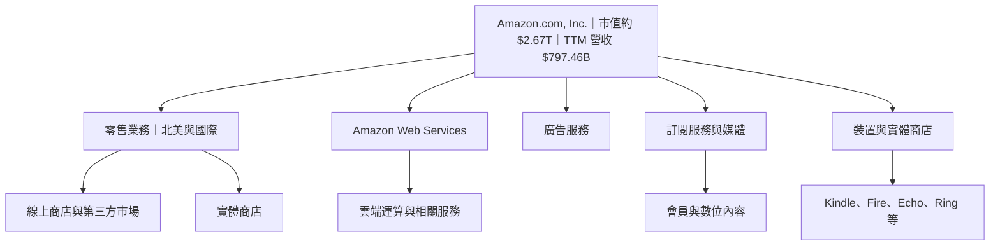
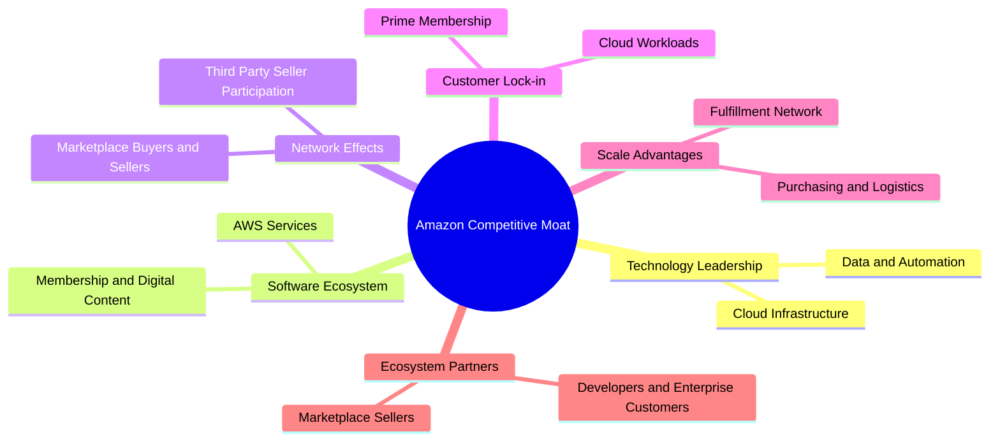
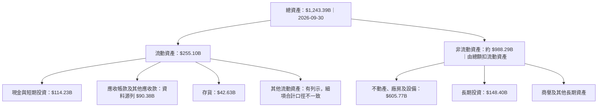
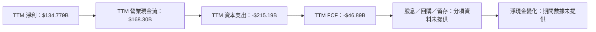
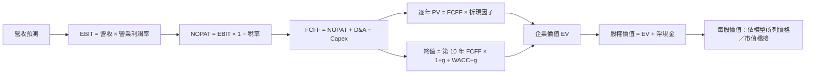
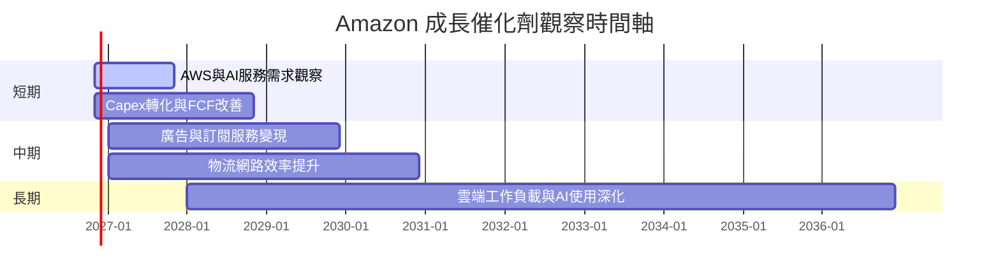
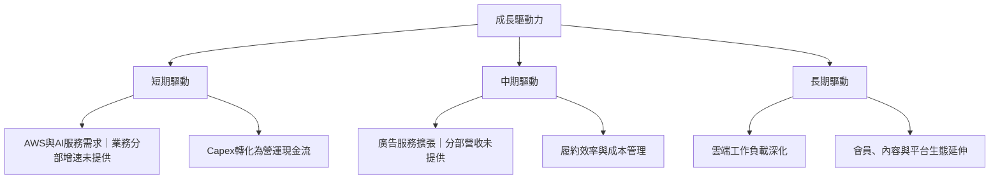
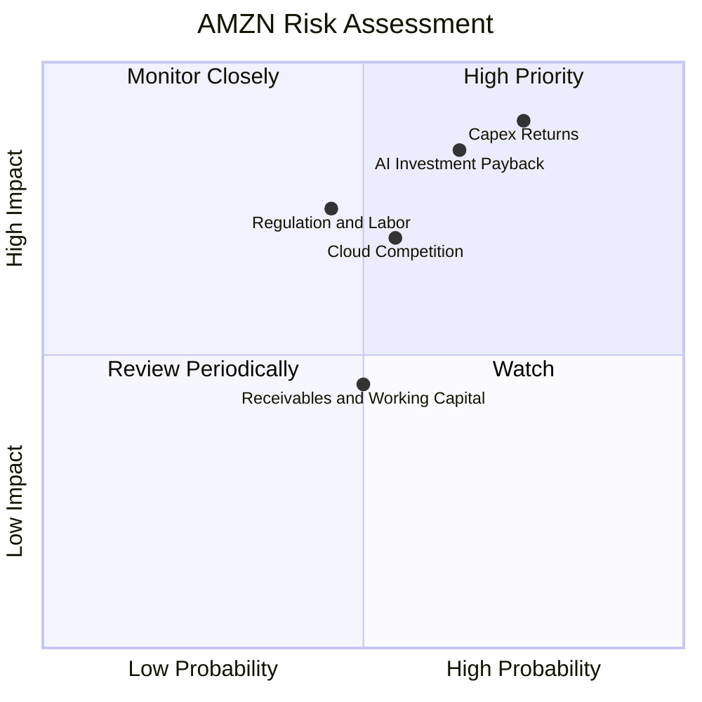
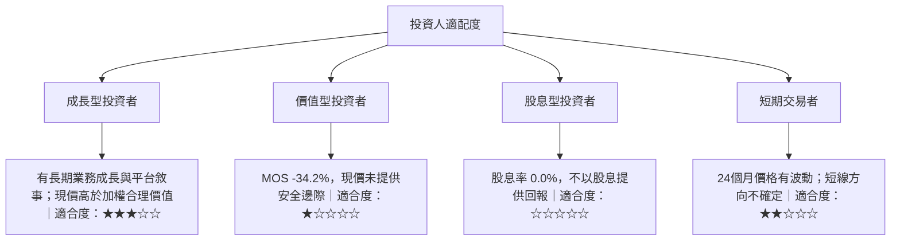

# AMZN 基本面深度分析報告
> **報告日期**：2026-11-21 ｜ **語言**：繁體中文 ｜ **數據來源**：SEC 申報資料 (XBRL)、Yahoo Finance、Finviz、StockAnalysis、Roic.ai ｜ **分析師**：CFA 級機構研究

## 目錄

| # | 章節 | 核心結論 |
|---|------|----------|
| 1 | 執行摘要 | 賣出；加權合理價值 $183.87，MOS -34.2% |
| 2 | 公司概覽與商業模式 | 零售、廣告、訂閱與 AWS 組合提供規模與生態優勢；分部營收資料未提供 |
| 3 | 損益表深度分析 | TTM 營收 $797.46B、年增 15.4%；資本支出上升使自由現金流承壓 |
| 4 | 資產負債表分析 | 依 SEC 口徑為淨負債 $65.73B；DSO 由 32 天升至 45 天 |
| 5 | 現金流量深度分析 | TTM FCF -$46.89B，Capex 高於營業現金流 |
| 6 | 獲利能力與資本效率 | ROIC 11.9% 高於 WACC 10.92%，仍創造價值但利差有限 |
| 7 | 相對估值分析 | P/E 低於同業中位數，但 P/S 高於自身五年中位數 |
| 8 | DCF 內在價值評估 | 基準 DCF $55.81；終值占企業價值 98.5%，估值高度依賴長期假設 |
| 9 | 成長催化劑 | AWS、廣告、AI 與物流效率是潛在動力；TAM 數據未提供 |
| 10 | 風險矩陣 | 資本支出回報、AI 投資回收與競爭／監管為主要風險 |
| 11 | 投資建議 | 依規則 20 為賣出；等待估值回落或現金流改善後再評估 |

---

## 1. 執行摘要

2026-11-20 收盤價為 **$246.82**。程式計算的加權合理價值為 **$183.87**，安全邊際 **MOS = -34.2%**；基準 DCF 為 **$55.81**，現價相對 DCF 溢價 **342.2%**。同時，TTM ROIC 11.9% 高於 WACC 10.92%，但 TTM FCF 為 **-$46.89B**、FCF Yield **-1.76%**。依 MOS 門檻，評級為 **🔴 賣出**：盈利能力與規模優勢尚在，但資本密集投入造成的現金流壓力與估值落差，降低現價的風險報酬吸引力。

### 1.0 一頁式投資儀表板（Portfolio Manager 30 秒速讀）

| 項目 | 內容 |
|------|------|
| **投資論點（3 句）** | ① TTM 營收 $797.46B、年增 15.4%，規模仍在擴大。② ROIC 11.9% 高於 WACC 10.92%，目前仍略為創造價值。③ TTM Capex $215.19B 高於營業現金流 $168.30B，使 FCF 降至 -$46.89B。 |
| **綜合評分** | **6.3/10**（引用 1.1 評分卡） |
| **財務健康** | 🟡 現金與短期投資 $114.23B，但依同口徑總債務 $179.95B，淨負債 $65.73B。 |
| **ROIC vs WACC** | **11.9% vs 10.92%**；ROIC 高 0.98 個百分點，仍創造價值，但安全緩衝不大。 |
| **FCF 趨勢** | 資本支出大幅高於 OCF；TTM FCF Yield **-1.76%**。 |
| **估值** | Forward P/E **22.6x** ｜ EV/EBITDA **15.0x**（五年歷史口徑）｜ FCF Yield **-1.76%**。 |
| **DCF 內在價值（基準）** | **$55.81** ｜現價相對 DCF 溢價 **342.2%**（以 DCF 基準值計）。 |
| **安全邊際（MOS）** | **-34.2%**＝($183.87 − $246.82) ÷ $183.87（基準為 8.8 加權合理價值）｜ 🔴 <10%：無安全邊際。 |
| **預期報酬（基準情境 12M）** | 加權合理價值口徑上行空間 **-25.5%**；此為估值差距，不是保證報酬。 |
| **關鍵風險（前二）** | 資本支出未能轉化為相應現金流；AWS／AI 投資回報不及資本成本。 |
| **評級 + 信心度** | 🔴 **賣出** ｜信心：中（估值訊號明確，DCF 終值依賴度高，且資料口徑有差異）。 |

### 1.1 綜合評分卡（全報告唯一）

| 維度 | 評分（1–10） | 主要依據（引用數字與其來源章節） |
|------|--------------|----------------------------------|
| 成長性 | 8.0 | TTM 營收年增 15.4%、最新季度年增 12.1%（第 3 章）；規模大且仍有雙位數成長。 |
| 獲利能力 | 8.0 | TTM 營業利益率 13.1%、ROIC 11.9% 高於 WACC 10.92%；Piotroski 4/8（第 6 章）。 |
| 財務健康 | 5.0 | 淨負債 $65.73B、流動比率 0.989；DSO 45 天，高於一年前 32 天（第 4 章）。 |
| 估值 | 2.0 | MOS -34.2%；基準 DCF $55.81，低於 $246.82 現價（第 8 章）。 |
| 護城河 | 9.0 | 多業務平台、規模與生態具競爭優勢，但分部數據及市占數字未提供（第 2 章）。 |
| 管理層與資本配置 | 6.0 | 2025 年 Capex $131.82B、SBC $19.47B，投資可支持成長但壓低 FCF；稀釋股數測試未通過（第 5、6 章）。 |
| **綜合評分** | **6.3** | 六項算術平均：(8+8+5+2+9+6) ÷ 6 = 6.333，四捨五入至小數一位。 |

### 1.2 五大投資論點 + 三大核心風險

| 類型 | 項目 | 具體依據 | 信心度 |
|------|------|----------|--------|
| 🟢 **投資論點①** | 大規模營收底盤仍成長 | TTM 營收 $797.46B，年增 15.4%；最新季度年增 12.1%。 | 🟢 高 |
| 🟢 **投資論點②** | 營業獲利能力提升 | FY2022 營業利益 $12.25B，FY2025 $79.97B；2025 年營業利益率約 11.2%。 | 🟢 高 |
| 🟢 **投資論點③** | 資本效率仍略高於資本成本 | ROIC 11.9% vs WACC 10.92%，價差 0.98 個百分點。 | 🟡 中 |
| 🟢 **投資論點④** | 多元化業務與平台生態 | 零售、訂閱、廣告、雲端與裝置形成多元服務組合；各分部營收未提供，無法量化貢獻。 | 🟡 中 |
| 🟢 **投資論點⑤** | 歷史倍數部分指標低於自身中位數 | P/E 20.0x vs 五年中位數 32.2x；EV/EBITDA 15.0x vs 17.3x（第 7 章）。 | 🟡 中 |
| 🟡 **風險①** | Capex 導致 FCF 轉負 | TTM Capex $215.19B、OCF $168.30B、FCF -$46.89B。 | 🔴 高衝擊 |
| 🔴 **風險②** | 現價高於綜合合理價值 | 現價 $246.82，8.8 加權合理價值 $183.87，MOS -34.2%。 | 🔴 高 |
| 🟡 **風險③** | 應收帳款回收天數增加 | DSO 從一年前 32 天升至 45 天；可能反映收款週期延長，需追蹤後續季度。 | 🟡 中 |

### 1.3 快速統計卡片

| 指標 | 公司實際值（期間） | 同業中位數 | 狀態 |
|------|--------------------|------------|------|
| 營收成長（TTM） | **15.4%** | — | 🟢 |
| 營收成長（最新一季年增） | **12.1%** | **18.8%**（MSFT、GOOG、WMT 中位數） | 🟡 |
| 毛利率（TTM） | **51.4%** | **60.9%** | 🟡 |
| 營業利益率（TTM） | **13.1%** | — | 🟢 |
| ROIC（TTM） | **11.9%** | — | 🟢 |
| Forward P/E | **22.6x** | **20.0x** | 🟡 |
| FCF Yield（TTM） | **-1.76%** | — | 🔴 |
| Piotroski F-Score | **4 / 8** | — | 🟡 |

### 1.4 投資結論

```text
╔══════════════════════════════════════════════════════════════════╗
║                    📊 投資結論摘要                               ║
╠══════════════════════════════════════════════════════════════════╣
║  評級：🔴 賣出（依加權合理價值 MOS -34.2%）                       ║
║  價格（2026-11-20 收盤）：$246.82                                ║
║  DCF 內在價值（基準）：$55.81（現價溢價 342.2%）                 ║
║  安全邊際 MOS：-34.2%（＝(加權合理價值−現價)÷加權合理價值）     ║
║  加權合理價值（8.8）：$183.87                                    ║
║  DCF 情境價值：                                                   ║
║    悲觀情境：$12.58（相對現價 -94.9%）                           ║
║    基準情境：$55.81（相對現價 -77.4%）                           ║
║    樂觀情境：$128.52（相對現價 -47.9%）                          ║
║  綜合評分：6.3/10（引用 1.1）                                    ║
║  適合投資人：能承受波動、以長期業務成長為核心者；現價不適合      ║
║              只以價值折價或當期現金流為主要選股條件者            ║
╚══════════════════════════════════════════════════════════════════╝
```

---

## 2. 公司概覽與商業模式

Amazon.com, Inc. 經營消費產品零售、廣告、訂閱、實體商店及 AWS，亦銷售 Kindle、Fire、Echo、Ring 等裝置並提供媒體內容。2026-09-30 截止 TTM 營收為 **$797.46B**，市值約 **$2.67T**。分部營收與各分部營收占比未提供，因此不以未核實比例繪製營收分布圖。

### 2.1 業務結構與收入來源



分部營收金額與占比未提供，無法判斷各業務對 TTM 營收增量的個別貢獻。

### 2.2 市場份額

市場份額數據未提供，因此不呈現市占率表格或比例圖。可確認的是公司 TTM 營收達 $797.46B、年增 15.4%，但單靠公司營收無法推算市場份額；與 Microsoft、Google、Walmart 的業務範圍也不完全相同。

### 2.3 競爭護城河分析



### 2.4 護城河強度

| 護城河項目 | 強度（強／中／弱） | 證據（引用數字或事實） | 會削弱它的情況 |
|------------|--------------------|------------------------|----------------|
| 技術與基礎設施 | 強 | AWS 為公司主要業務之一；公司 TTM 營收 $797.46B，規模可支持大型基礎設施投入。分部營收未提供。 | 雲端價格競爭、AI 算力回報不足、技術替代。 |
| 軟體生態系 | 中至強 | AWS、會員與數位內容形成服務組合。 | 客戶多雲策略成熟、服務轉換成本下降。 |
| 網路效應 | 中至強 | 線上市場連結買家與第三方賣家；具跨邊平台特性。 | 賣家依賴單一平台下降、平台費用或規則引發遷移。 |
| 客戶鎖定 | 中 | 雲端工作負載、會員與服務整合可提升轉換成本；量化留存率未提供。 | 企業降低雲端支出或將工作負載移轉。 |
| 規模效應 | 強 | 2025 年營收 $716.92B；履約與物流投入可形成規模優勢。 | 人工、配送、法規成本增速高於營收。 |
| 生態夥伴 | 中 | 第三方賣家、開發者、內容與裝置合作構成生態。 | 夥伴轉向競爭平台、監管限制自營與平台角色。 |

**1.1 護城河分數 9.0/10** 的依據是零售、雲端與會員等平台資產的廣度及公司規模；未給滿分，是因分部營收、客戶留存與市場份額數據未提供，無法量化各護城河的實際經濟貢獻。

---

## 3. 損益表深度分析

### 3.1 年度收入成長趨勢（近4年）

```text
╔══════════════════════════════════════════════════════════════════╗
║              Amazon 年度收入趨勢（FY2022-FY2025）                ║
╠══════════════════════════════════════════════════════════════════╣
║  FY2022  $513.98B  ███████████████░░░░░░░░░░░  YoY: —           ║
║  FY2023  $574.78B  █████████████████░░░░░░░░░  YoY: +11.8% 🟢   ║
║  FY2024  $637.96B  ███████████████████░░░░░░░  YoY: +11.0% 🟢   ║
║  FY2025  $716.92B  █████████████████████░░░░░  YoY: +12.4% 🟢   ║
║                                                                  ║
║  2022–2025 營收 CAGR：約 11.7%（以年度收入計算）                 ║
╚══════════════════════════════════════════════════════════════════╝
```

FY2022 至 FY2025 營收由 $513.98B 增至 $716.92B，三年 CAGR 約 11.7%。FY2025 成長回升至 12.4%，但公司總體營收增長不等於所有分部同步加速，分部營收資料不足以確認增長來源。

### 3.2 季度收入趨勢分析

| 季度 | 營收（$B） | QoQ 成長 | YoY 成長 | 備註 |
|------|------------|----------|----------|------|
| 2025 Q4 | 213.386 | +18.4% | +13.6% | 相對 Q3 季節性增加。 |
| 2026 Q1 | 181.519 | -14.9% | +16.6% | 季節性回落；YoY 成長高於 TTM 成長。 |
| 2026 Q2 | 200.606 | +10.5% | +19.6% | 同比加速；資料採 StockAnalysis.com 季度表。 |
| 2026 Q3 | 201.944 | +0.7% | +12.1% | 最新季度年增仍為雙位數，但低於 Q2。 |

QoQ 以相鄰季度營收計算；Amazon 有季節性，QoQ 不宜取代 YoY 判讀。SEC 資料摘錄中的 2026 Q2 顯示缺值，使用 StockAnalysis.com 同期營收補足；季度 EPS 預估值不可用，故不能判定四季是否超預期。

### 3.3 利潤率演變分析

| 利潤率指標 | FY2022 | FY2023 | FY2024 | FY2025 | 趨勢 | 評估 |
|------------|--------|--------|--------|--------|------|------|
| **毛利率** | 43.8% | 47.0% | 48.9% | 50.3% | 連續改善 | 🟢 |
| **營業利益率** | 2.4% | 6.4% | 10.8% | 11.2% | 大幅修復後續升 | 🟢 |
| **淨利率** | -0.5% | 5.3% | 9.3% | 10.8% | 從虧損轉正並改善 | 🟢 |

毛利率與營業利益率以年度損益表毛利／營收、營業利益／營收計算。營業利益由 FY2022 $12.25B 增至 FY2025 $79.97B，增幅遠高於營收增幅，反映營運槓桿及成本效率改善。年度資料不能單獨分辨改善來自 AWS、廣告、零售履約效率或其他組合因素；但最新季度營業利益率 13.9% 高於 TTM 13.1%，顯示近期獲利率仍有改善。

數據口徑須留意：同一資料集合另列最新季度營業利益率 13.1%，而 SEC／程式計算的最新季度值為 13.9%。本報告 TTM 採用明確標示的 13.1%，季度比較採用 SEC／程式計算的 13.9%，不將兩者混用。

### 3.4 費用結構分析

損益表未提供足以拆分營業費用各項占比的完整數值，不繪製費用圓餅圖。已知 FY2025 營業利益為 $79.97B、營收 $716.92B；若以營收減毛利推算毛利以下各項費用，會混合多種費用與其他項目，不作不當拆分。

### 3.5 季度 EPS 趨勢與盈餘品質（Quality of Earnings）

| 盈餘品質項目 | 數值／佔比 | 評估 |
|--------------|-----------|------|
| 股權薪酬 SBC / 營收 | FY2025：$19.47B ÷ $716.92B = **2.72%** | 🟡 SBC 為實際股東稀釋成本；Piotroski 稀釋股數測試未通過。該比率為年度，不冒充 TTM。 |
| SBC / 營業現金流 | FY2025：$19.47B ÷ $139.51B = **13.96%** | 🟡 現金流含回加 SBC，比例顯著；不能把 OCF 全額視為扣除稀釋後的股東現金回報。 |
| FCF / 淨利（現金轉換率） | TTM：-$46.89B ÷ $134.779B = **-34.8%** | 🔴 高資本支出使當期 FCF 低於會計淨利，轉換率偏弱。 |
| 一次性／非經常性損益 | N/A（未提供足以拆解的 TTM 明細） | 無法確認是否有重大一次性項目。 |
| 有效稅率異常 | DCF 採用稅率 21.0%；實際 TTM 有效稅率明細 N/A | 不能據此斷言淨利受稅務利益美化。 |
| 資本化支出 vs 費用化 | TTM Capex $215.19B；資本化投資高 | 🔴 投資先以資本支出流出，若資產使用期長，當期費用化不等於現金投入；需檢查投資回報。 |

最近四季 EPS actual 可見值為 2026 Q3 $1.89、2026 Q2 $5.75、2026 Q1 $2.78、2025 Q4 $1.95。EPS estimate 均為 N/A，因此四季的 beat/miss **無法判定**。另資料列示 2026 Q3 EPS 年增 -3.1%，表明最新季度 EPS 年減，與公司長期 TTM EPS 成長數據並不矛盾，但提示季度盈利波動。

**盈餘品質結論：**GAAP 淨利不一定高估經濟盈餘；然而負 FCF、較高資本支出及 SBC 稀釋，使淨利不能直接等同可分配現金。估值更需觀察 Capex 回報與未來 FCF 轉正，而不是只看 P/E。

---

## 4. 資產負債表分析

### 4.1 資產結構分解

2026-09-30 總資產為 $1,243.39B，流動資產 $255.10B；非流動資產依差額約 $988.29B。以下細項採 StockAnalysis.com；資料列示的總資產及部分細項口徑有差異，不將不同資料來源的細項硬湊為合計。



### 4.2 流動性與營運資金分析

| 指標 | 最新 TTM | 一年前 TTM | 變化 | 解讀 |
|------|----------|------------|------|------|
| 流動比率 | 0.989 | N/A | N/A | 流動資產略低於流動負債；需依靠營運現金流與週轉能力。 |
| 速動比率 | 0.793 | N/A | N/A | 不含存貨後短期流動性更緊，沒有行業基準可比。 |
| DSO 應收帳款天數 | 45 天 | 32 天 | +13 天 | 收款天數上升，需留意企業服務與廣告應收款成長是否快於營收。 |
| DIO 存貨天數 | N/A | N/A | N/A | 資料來源未提供可用的一年前比較；依品質指標原值呈現。 |
| DPO 應付帳款天數 | N/A | N/A | N/A | 資料來源未提供可用天數。 |
| CCC 現金轉換週期 | N/A | N/A | N/A | 因 DIO、DPO 不可用，不能推算 CCC。 |

DSO 從 32 天升至 45 天值得監控，但單憑此數字不能判斷收款惡化，亦可能受營收組合、季末應收餘額與結算節點影響。DIO、DPO、CCC 不自行補算。

### 4.3 債務結構分析

```text
╔══════════════════════════════════════════════════════════════════╗
║                   Amazon 債務健康診斷                            ║
╠══════════════════════════════════════════════════════════════════╣
║  總債務（SEC/程式口徑）：$179.95B                                 ║
║  現金+短期投資：          $114.23B                                ║
║  淨負債：                 $65.73B                                 ║
║                                                                  ║
║  TTM OCF：                $168.30B                                ║
║  TTM Capex：              $215.19B                                ║
║  TTM FCF：                -$46.89B                                ║
║                                                                  ║
║  評估：🟡 有充足現金與營業現金流，但資本支出令自由現金流轉負。  ║
║  備註：其他資料來源列總債務 $304.84B；口徑不一致，不混用計算。   ║
╚══════════════════════════════════════════════════════════════════╝
```

其他合併資料列示總債務 $304.84B、淨負債 $190.61B，與 SEC／程式計算的 $179.95B 債務及 $65.73B 淨負債不同。流動與長期租賃等負債分類可能造成差異；本報告的淨負債與 DCF 橋接統一採用明確列示的 SEC／程式口徑。Debt/EBITDA 與利息保障倍數所需的同口徑資料未完整提供，不自行計算。

### 4.4 股東權益趨勢

```text
╔══════════════════════════════════════════════════════════════════╗
║                 Amazon 歷年股東權益（年度）                       ║
╠══════════════════════════════════════════════════════════════════╣
║  2022  $146.04B  ███████░░░░░░░░░░░░░░░░░░░░░░                  ║
║  2023  $201.88B  ██████████░░░░░░░░░░░░░░░░░░░░                  ║
║  2024  $285.97B  ██████████████░░░░░░░░░░░░░░                  ║
║  2025  $411.06B  █████████████████████░░░░░░░                  ║
╚══════════════════════════════════════════════════════════════════╝
```

2022 至 2025 股東權益增加約 $265.02B。這反映累積獲利與權益變化，但不可直接視為現金累積；2026-09-30 的季度股東權益未提供於一致口徑表格中。

---

## 5. 現金流量深度分析

### 5.1 現金流量瀑布圖



淨利與 OCF 的差異包含折舊、營運資金及非現金項目，缺少完整 TTM 調節表，故不將兩者差額歸因於單一因素。

### 5.2 FCF 轉換率趨勢

| 年度 | OCF（$B） | Capex（$B） | FCF（$B） | 淨利（$B） | FCF／淨利 |
|------|-----------|------------|-----------|------------|-----------|
| 2022 | 46.75 | 63.65 | -16.89 | -2.72 | 不具可比意義 |
| 2023 | 84.95 | 52.73 | 32.22 | 30.43 | 105.9% |
| 2024 | 115.88 | 83.00 | 32.88 | 59.25 | 55.5% |
| 2025 | 139.51 | 131.82 | 7.70 | 77.67 | 9.9% |
| TTM 至 2026-09-30 | 168.30 | 215.19 | -46.89 | 134.779 | -34.8% |

2025 年 OCF 上升但 Capex 增速更快，FCF 降至 $7.70B；最新 TTM FCF 進一步轉負。此趨勢提高估值對投資回報和資本支出節奏的敏感度。

### 5.3 自由現金流趨勢

```text
╔══════════════════════════════════════════════════════════════════╗
║                自由現金流趨勢（OCF − Capex）                     ║
╠══════════════════════════════════════════════════════════════════╣
║  FY2022  -$16.89B  ◀████████░░░░░░░░░░░░░░░░░░░  FCF Yield N/A  ║
║  FY2023   $32.22B  ████████████████░░░░░░░░░░░░  FCF Yield N/A  ║
║  FY2024   $32.88B  ████████████████░░░░░░░░░░░░  FCF Yield N/A  ║
║  FY2025    $7.70B  ████░░░░░░░░░░░░░░░░░░░░░░░░  FCF Yield N/A  ║
║  TTM     -$46.89B  ◀████████████████████████░░░  FCF Yield -1.76%║
╚══════════════════════════════════════════════════════════════════╝
```

年末市值口徑的歷史 FCF Yield 未提供，因此只列 TTM 已計算值。另一資料源列示 TTM FCF -$37.64B、FCF Yield -1.41%；本報告依 SEC／程式計算的 TTM FCF -$46.89B、FCF Yield -1.76% 為主，並將來源差異視為限制。

### 5.4 資本配置評估

| 資本配置項目 | 可用數據 | 評估 |
|--------------|----------|------|
| Capex | FY2025 $131.82B；TTM $215.19B | 投資規模增加，但短期已使 TTM FCF 為負。 |
| 股權薪酬 | FY2025 $19.47B | 對現金流為非現金回加，但會稀釋股東。 |
| 股息 | 股息率 0.0% | 未以股息為主要股東回報方式。 |
| 回購 | 可比年度金額未提供 | 不評估回購是否足以抵銷 SBC 稀釋。 |
| 投資／留存 | 分項金額未提供 | 無法以實際金額繪製資本配置比例圖。 |

---

## 6. 獲利能力與資本效率

### 6.1 ROE / ROA / ROIC 趨勢

| 指標 | 可用期間與數值 | 趨勢與評估 |
|------|----------------|------------|
| ROE | TTM 22.0%（QUALITY FIGURES） | 獲利能力高；不同資料源另列 27.4%，採品質指標的 22.0% 口徑。 |
| ROA | Piotroski 測試顯示 TTM 為正且高於一年前；精確值未在 QUALITY FIGURES 列出 | 不補造年度歷史序列。 |
| ROIC | TTM 11.9% | 高於 WACC 10.92%，但只有 0.98 個百分點利差。 |
| FY2025 ROIC／ROA 歷史序列 | N/A | 無同一口徑完整歷年數列，亦不列無來源行業均值。 |

### 6.2 ROIC vs WACC 分析（核心價值創造判斷）

```text
╔══════════════════════════════════════════════════════════════════╗
║                ROIC vs WACC 深度分析                            ║
╠══════════════════════════════════════════════════════════════════╣
║  WACC（程式計算口徑）：10.92%                                    ║
║  ├── 無風險利率（10Y 美債）：4.91%                              ║
║  ├── 市場風險溢酬 ERP：5.00%                                     ║
║  ├── 原始 Beta：1.50；調整後 Beta：1.34                          ║
║  ├── 股權成本：11.59%                                            ║
║  ├── 稅前債務成本：1.26%；稅率：21.0%                            ║
║  ├── 股權／債務權重：93.7%／6.3%                                 ║
║  └── WACC：10.92%                                                ║
║                                                                  ║
║  ROIC（TTM）：11.9%                                               ║
║  EVA 利差：11.9% − 10.92% = +0.98 個百分點                      ║
║                                                                  ║
║  ROIC  11.9%  ▓▓▓▓▓▓▓▓▓▓▓▓░░░░░░░░                              ║
║  WACC  10.92% ▓▓▓▓▓▓▓▓▓▓▓░░░░░░░░                              ║
║                                                                  ║
║  結論：🟢 ROIC 高於 WACC，現階段仍創造價值；利差不大，投資      ║
║        回報稍有下滑即可能使價值創造能力消失。                   ║
╚══════════════════════════════════════════════════════════════════╝
```

CAPM 檢核：原始 Beta 1.50 經調整公式 **⅔ × 1.50 + ⅓ = 1.333…**，資料指定調整後 Beta 為 1.34，照錄該值。計算 \(\,4.91\%+1.34×5.00\%=11.61\%\,\) 與資料列示股權成本 11.59% 有約 0.02 個百分點差異；本報告遵照程式提供的 Ke 11.59% 與 WACC 10.92%，不另造替代 WACC。利息費用與平均計息負債明細未提供，不能獨立重建稅前 Kd 的分子、分母。

### 6.3 杜邦三因素分解

| 因素 | 數值（TTM） | 解讀 |
|------|-------------|------|
| 淨利率 | 16.9% | 資料列示 TTM 淨利率。 |
| 資產週轉率 | 0.64 | 龐大資產基礎下的營收轉換效率。 |
| 權益乘數 | 2.03 | 存在財務槓桿，但不是極端槓桿水準。 |
| **ROE** | **22.0%** | QUALITY FIGURES 原值；三因素乘積與列示 ROE 可能受四捨五入影響。 |

ROE 同時受淨利率與資產週轉率驅動，權益乘數 2.03 亦有放大效果；不可只把 ROE 歸因於營運改善。另有來源提供不同 ROE，故此處固定採杜邦品質指標口徑。

### 6.4 財務體質：Piotroski F-Score

Piotroski F-Score 為 **4 / 8**；毛利率測試因輸入缺失而不納入分母。

| 測試 | 結果 | 解讀 |
|------|------|------|
| ROA > 0 | ✅ 通過 | 盈利為正。 |
| 營業現金流 > 0 | ✅ 通過 | TTM OCF 為正。 |
| ROA 高於一年前 | ✅ 通過 | 獲利效率較一年前改善。 |
| 營業現金流 > 淨利 | ✅ 通過 | 品質指標的比較期間內符合測試。 |
| 長期負債／總資產低於一年前 | ❌ 未通過 | 槓桿比例未改善。 |
| 流動比率高於一年前 | ❌ 未通過 | 短期流動性指標未改善。 |
| 稀釋股數未增加 | ❌ 未通過 | 股數增加，SBC 對持股比例有稀釋。 |
| 毛利率高於一年前 | — 無法判定 | 缺資料，不列入分母。 |
| 資產週轉率高於一年前 | ❌ 未通過 | 資產使用效率未較一年前提升。 |

---

## 7. 相對估值分析

### 7.1 同業估值比較表格

同業數據取 Yahoo Finance 的 Peer multiples；Amazon 的 Forward P/E 採公司估值資料，Forward EPS 約 $10.93。Peer 中位數只以 MSFT、GOOG、WMT 三家計算。

| 估值指標 | **AMZN** | **MSFT** | **GOOG** | **WMT** | AMZN 評估 |
|----------|----------|---------|---------|---------|-----------|
| **Trailing P/E** | **20.0x** | 25.3x | 13.8x | 46.4x | 🟡 高於 GOOG、低於 MSFT 與 WMT。 |
| **Forward P/E** | **22.6x** | 20.0x | 17.3x | 39.6x | 🟡 高於同業中位數 20.0x。 |
| **P/S Ratio** | **3.4x** | 10.4x | 6.9x | 1.4x | 🟡 高於 WMT，低於兩家大型科技公司。 |
| **EV/EBITDA** | **15.0x** | 17.8x | 17.0x | 22.4x | 🟢 低於同業中位數 17.8x。 |
| **最新季度營收年增** | **12.1%** | 18.8% | 24.7% | 5.2% | 🟡 低於 MSFT、GOOG，高於 WMT。 |
| **毛利率（TTM）** | **51.4%** | 67.7% | 60.9% | 25.3% | 🟡 位於科技服務與零售模式之間。 |

Amazon 自身 P/E 與 EV/EBITDA 相對自身歷史處於較低百分位，但 Forward P/E 高於同業中位數，估值訊號並非一致；負 FCF Yield 則使以現金流衡量的估值風險上升。

### 7.2 歷史估值區間分析

```text
╔══════════════════════════════════════════════════════════════════╗
║          Amazon 五年估值區間（TTM 倍數）                         ║
╠══════════════════════════════════════════════════════════════════╣
║  P/E：       2.6x ───────── 20.0x 現值 ───────── 251.9x         ║
║              五年中位數 32.2x｜目前百分位 30%                    ║
║                                                                  ║
║  P/S：       0.2x ───────── 3.4x 現值 ────────── 3.7x           ║
║              五年中位數 3.0x｜目前百分位 71%                     ║
║                                                                  ║
║  EV/EBITDA： 0.7x ───────── 15.0x 現值 ───────── 22.7x          ║
║              五年中位數 17.3x｜目前百分位 19%                    ║
╚══════════════════════════════════════════════════════════════════╝
```

P/E 與 EV/EBITDA 的百分位偏低，但 P/S 位於自身五年區間 71 百分位且高於中位數。歷史低倍數不等於現價低估，尤其 TTM FCF 為負。

### 7.3 情境價值（Bear / Base / Bull，照抄 DCF MODEL 的 Scenarios）

| 情境 | 第 1 年營收成長 | 期末營業利潤率 | WACC | 每股價值 | 相對現價 | 機率 | 會發生的條件 |
|------|----------------|----------------|------|----------|----------|------|--------------|
| 🔴 悲觀 | 7.7% | 9.1% | 11.92% | $12.58 | -94.9% | 25% | 零售／雲端成長放緩，Capex 維持高位，成熟期利潤率低於基準。 |
| 🟡 基準 | 15.4% | 10.8% | 10.92% | $55.81 | -77.4% | 50% | 成長自目前 TTM 水準逐步降至 3%，營業利潤率回落至五年中位數。 |
| 🟢 樂觀 | 23.0% | 11.8% | 9.92% | $128.52 | -47.9% | 25% | 營收增速高於基準，投資轉化為更佳規模與成熟期利潤率，資本成本降低。 |

三種模型情境每股價值均低於現價，顯示依該 DCF 架構，現價需要超出基準情境的現金流表現或更低折現率才能得到支持。

### 7.4 相對估值隱含價格區間

```text
╔══════════════════════════════════════════════════════════════════╗
║                   相對估值隱含價格比較                           ║
╠══════════════════════════════════════════════════════════════════╣
║  $55.81       $218.72        $246.82        $296.86       $326.51║
║  基準 DCF     同業 Forward P/E  現價         同業 EV/EBITDA  共識價 ║
╚══════════════════════════════════════════════════════════════════╝
```

- **同業 Forward P/E：$218.72**，同業中位數 **20.0x**（MSFT、GOOG、WMT）乘 AMZN Forward EPS **$10.93**。
- **同業 EV/EBITDA：$296.86**，同業中位數 **17.8x** 乘 TTM EBITDA 並加回淨現金，採程式所列結果。
- **分析師共識目標價：$326.51**，60 位分析師平均值；這是外部預期參考，不等同內在價值。
- DCF 基準值 $55.81 不是相對估值法；相對估值區間內現價 $246.82 介於同業 Forward P/E 與 EV/EBITDA 回推值之間。

---

## 8. DCF 內在價值評估（Discounted Cash Flow）

> 本節依程式提供的 DCF MODEL 原值呈現。模型採用 FCFF、10 年預測期、GAAP EBIT、營運資金不建模；輸入及結果與來源表格一致。若中間輸入或替代情境沒有提供，明確標示 N/A，不另建模型。

### 8.0 估值推理鏈（Thinking Logic）

**Step 1 — 價值由哪些變數決定？**  
Amazon 的估值主要來自零售與履約現金流、AWS 雲端服務、廣告與訂閱等服務收入；分部營收占比未提供，不能杜撰各部分權重。模型中直接可驗證的總體起點是 TTM 營收 $797.46B、營收成長 15.4%、營業利益率 13.1%。主導估值的變數是 **Capex 由營收 27.0% 逐步下降至 10.9%**，因其決定 FCFF 從負轉正的速度；終值現值又占 EV 98.5%，使長期現金流假設更加關鍵。

**Step 2 — 模型選擇**

| 決策點 | 本報告採用 | 理由（含數字） | 曾考慮但否決 | 否決理由 |
|--------|-----------|----------------|--------------|----------|
| 現金流定義 | FCFF | 對企業價值折現並以 WACC 折現；模型公式為 NOPAT + D&A − Capex。 | FCFE | 債務與資本結構並非預測核心，且提供模型採 FCFF。 |
| 預測期 N | 10 年 | DCF MODEL 固定 10 年，且 Capex、營收成長率逐年淡化。 | 5 年 | 不符合程式模型，且無權自行改模型。 |
| 終值方法 | Gordon Growth | 模型提供 g=3.0% 與 Gordon 終值。 | 退出倍數 | DCF MODEL 未提供退出倍數終值，不能另造。 |
| EBIT 基礎 | GAAP EBIT | 模型明示 GAAP EBIT。 | 非 GAAP EBIT | 可能造成 SBC 重複或漏計。 |

**Step 3 — 關鍵假設推導鏈**

- **營收成長**：錨點＝TTM 年增 15.4%；模型把第 1 年設定為 15.4%，之後線性降至第 10 年 3.0%，反映當前增速不永久維持 → **採用 15.4% 起步** → 曾考慮長期維持 15.4%，但否決，因終值前的成熟成長率需要收斂。
- **期末營業利潤率**：錨點＝TTM 營業利益率 13.1%；模型逐年淡化至最後一年 10.8%，依據為含 TTM 的近五個財年中位數 → **採用 10.8%** → 曾考慮維持 13.1%，否決，因模型設定以歷史中位數代表成熟期。
- **永續成長率 g**：採用 **3.0%**。相較 WACC 10.92% 有 7.92 個百分點差距，符合 WACC 必須大於 g；長期宏觀錨點的來源與具體數值未在模型中提供，故屬模型假設而非獨立驗證值。曾考慮高於 3.0%，但資料未支持更高永久成長率。
- **預測期 N**：錨點＝模型明列 10 年；**採用 10 年**。曾考慮較短期間，但模型沒有可驗證的替代年限，且不得變更程式輸出。
- **Capex／營收**：錨點＝TTM Capex $215.19B、營收 $797.46B；模型第 1 年 Capex 比率 27.0%，逐步降至第 10 年 10.9%，且以 1.1 倍 D&A 作為下限規則 → **採用模型逐年路徑** → 不採永久維持 27.0%，因那會偏離模型既定再投資淡化假設；若 Capex 降速不成立，價值下行。
- **有效稅率**：假設值，依據 DCF MODEL 預設稅率 21.0%；實際 TTM 稅率明細未提供。
- **D&A／營收**：錨點＝模型列示 TTM 10.0%；採用固定 10.0%。歷史均值未提供，故不另推。
- **ΔWC／營收增額**：營運資金未建模；模型假設為不單列營運資金變動。營運資金百分比沒有可用錨點，這是模型簡化而非實際營運資金為零。
- **EBIT 與 SBC**：採用 GAAP EBIT；依模型，SBC 已列為費用，不再從 FCFF 扣除，也不另增加稀釋股數 → **組合 (A)**。曾考慮另外扣 SBC 或以稀釋率調整股數，因會重複計算而否決。
- **年稀釋率**：採用 0%（組合 A 的模型處理）；現實中 Piotroski 稀釋股數測試未通過，故 0% 是模型一致性設定，不代表實際股數沒有增加。
- **終值方法**：採 Gordon Growth，依模型使用第 10 年 FCFF、g=3.0%、WACC=10.92%；未提供退出倍數終值，故不另造。
- **WACC**：採模型提供的 10.92%；輸入組成與計算限制見 8.2，不替換為自行估算值。

**Step 4 — 最脆弱的一環**  
Capex 比率能否由第 1 年 27.0% 下行至第 10 年 10.9% 是最脆弱假設；若資本投入不能隨成熟度下降，FCFF 將低於表列路徑。DCF 模型的敏感度與情境輸出顯示，基準估值 $55.81，樂觀情境亦僅 $128.52。

**Step 5 — 計算路徑圖**



### 8.1 模型假設總表（Model Inputs）

| 假設項目 | 採用值 | 依據／來源 | 敏感度 |
|----------|--------|-------------|--------|
| 預測期長度 **N** | 10 年 | DCF MODEL 固定預測期 | 🟡 中 |
| 營收成長 | FY+1 15.4% → FY+10 3.0% | 起點採 TTM 年增 15.4%，線性淡化 | 🔴 高 |
| 營業利潤率 | FY+1 13.1% → FY+10 10.8% | TTM 起點；成熟期取含 TTM 的五年中位數 | 🔴 高 |
| 有效稅率 | 21.0% | DCF MODEL 預設；實際 TTM 稅率未提供 | 🟢 低 |
| Capex / 營收 | 27.0% → 10.9% | TTM 對應起點；模型逐年淡化至 1.1×D&A 條件 | 🔴 高 |
| D&A / 營收 | 10.0% | DCF MODEL 列示 TTM 比率 | 🟢 低 |
| 營運資金變動 | 未建模 | 模型明示 working capital is not modelled | 🟢 低 |
| EBIT 基礎 | GAAP | DCF MODEL 明示 GAAP EBIT | 🟡 中 |
| SBC 處理 | GAAP EBIT 已含 SBC，不另扣 | DCF MODEL 組合 (A) | 🟡 中 |
| 年稀釋率 | 0%（模型股數固定處理） | 與組合 (A) 一致；非對實際稀釋的判斷 | 🟡 中 |
| 永續成長率 g | 3.0% | DCF MODEL 假設；小於 WACC | 🔴 高 |
| 終值方法 | Gordon Growth | DCF MODEL 提供；退出倍數值未提供 | 🔴 高 |
| WACC | 10.92% | Cost of capital 區塊原值 | 🔴 高 |

本模型採用 **(A) GAAP EBIT + 固定股數**，故 SBC 已計入 EBIT 費用，FCFF 不再扣 SBC，年稀釋率設定為 0%。FCFF 公式依模型採 **FCFF = NOPAT + D&A − Capex**；營運資金不另建模。金額以 $B 顯示至小數點後兩位，折現因子保留三位；模型本身的逐年原值照錄。

### 8.2 折現率推導（WACC）

```text
╔══════════════════════════════════════════════════════════════════╗
║                    WACC 推導（折現率）                           ║
╠══════════════════════════════════════════════════════════════════╣
║  股權成本 Ke（程式提供）：11.59%                                 ║
║  ├── 無風險利率 Rf（10Y 美債）：4.91%                            ║
║  ├── 市場風險溢酬 ERP：5.00%                                     ║
║  ├── 原始 Beta：1.50；調整後 Beta：1.34                          ║
║  ├── 規模／國別溢酬：0.00%（未加計）                             ║
║  └── Ke 原值：11.59%                                             ║
║                                                                  ║
║  債務成本 Kd：                                                   ║
║  ├── 稅前 Kd（程式列示）：1.26%                                  ║
║  ├── 稅率：21.0%                                                 ║
║  └── 稅後 Kd：1.26% × (1 − 21.0%) = 0.9954%                     ║
║                                                                  ║
║  資本結構權重（程式列示）：股權 93.7%／債務 6.3%                ║
║  └── WACC 採用值：10.92%                                         ║
╚══════════════════════════════════════════════════════════════════╝
```

**逐步演算與資料限制：**

1. **Ke（CAPM）**：程式列示原值為 **11.59%**。以列示的 Rf、調整後 Beta、ERP 計算：\(4.91\%+1.34×5.00\%=11.61\%\)。與程式 Ke 11.59% 有 0.02 個百分點差異，依規則採用程式原值，不用自算值替換。
2. **稅前 Kd**：程式列示 **1.26%**；利息費用與平均計息負債的明細未提供，無法把「利息費用 ÷ 平均計息負債」的分子、分母列出並獨立復算。
3. **稅後 Kd**：\(1.26\%×(1-21.0\%)=0.9954\%\)，四捨五入為 **1.00%**。
4. **權重**：程式提供股權 93.7%、債務 6.3%，相加為 **100.0%**。市場市值及計息負債的細項口徑不足，無法重建權重原始分子與分母。
5. **WACC**：以程式列示的 Ke、Kd 與權重復核：\(93.7\%×11.59\%+6.3\%×0.9954\%=10.9239\%\)，四捨五入為 **10.92%**。

10Y 美債殖利率與 Beta 的精確觀測日期／期間未在數據中列出；不補造日期。WACC 與第 6.2 節採同一數值 **10.92%**。獨立重建完整 WACC 的債務範圍與平均餘額檢核，受限於利息及債務明細未提供。

### 8.3 逐年自由現金流預測（基準情境）

單位：$B；表格數字均照錄 DCF MODEL。模型不列 ΔWC，因此不加入其數值列。

| 年度 | FY+1 | FY+2 | FY+3 | FY+4 | FY+5 | FY+6 | FY+7 | FY+8 | FY+9 | FY+10 |
|------|------|------|------|------|------|------|------|------|------|-------|
| 營收 | 919.87 | 1,048.46 | 1,180.63 | 1,313.26 | 1,442.76 | 1,565.24 | 1,676.64 | 1,772.96 | 1,850.48 | 1,905.99 |
| 營收 YoY | 15.4% | 14.0% | 12.6% | 11.2% | 9.9% | 8.5% | 7.1% | 5.7% | 4.4% | 3.0% |
| 營業利潤率 | 13.1% | 12.8% | 12.6% | 12.3% | 12.0% | 11.8% | 11.5% | 11.3% | 11.0% | 10.8% |
| EBIT（GAAP） | 120.39 | 134.49 | 148.39 | 161.65 | 173.84 | 184.54 | 193.32 | 199.83 | 203.76 | 204.93 |
| − 稅 | (25.28) | (28.24) | (31.16) | (33.95) | (36.51) | (38.75) | (40.60) | (41.96) | (42.79) | (43.04) |
| NOPAT | 95.11 | 106.25 | 117.22 | 127.70 | 137.34 | 145.79 | 152.73 | 157.86 | 160.97 | 161.90 |
| + D&A | 91.53 | 104.33 | 117.48 | 130.68 | 143.57 | 155.75 | 166.84 | 176.42 | 184.14 | 189.66 |
| − Capex | (248.23) | (264.24) | (276.51) | (284.17) | (286.48) | (282.91) | (273.16) | (257.26) | (235.53) | (208.63) |
| **= FCFF** | **-61.59** | **-53.66** | **-41.80** | **-25.79** | **-5.58** | **18.63** | **46.40** | **77.03** | **109.58** | **142.93** |
| 折現因子 @10.92% | 0.902 | 0.813 | 0.733 | 0.661 | 0.596 | 0.537 | 0.484 | 0.436 | 0.393 | 0.355 |
| **FCFF 現值 PV** | **-55.52** | **-43.61** | **-30.63** | **-17.04** | **-3.32** | **10.01** | **22.46** | **33.62** | **43.12** | **50.70** |

**預測期 FCF 現值合計：**

\[
-55.52-43.61-30.63-17.04-3.32+10.01+22.46+33.62+43.12+50.70
=9.79\text{B}
\]

模型列示合計為 **$9.78B**；差異為 $0.01B，來自逐年金額四捨五入，低於 1%。

**逐步演算（FY+1，示範模型列示值）：**

1. 營收：\(797.46×(1+15.4\%)=919.87\text{B}\)（依模型列示，模型內部使用未四捨五入的 TTM 基數／成長率）。
2. EBIT：\(919.87×13.1\%=120.39\text{B}\)。
3. 稅：\(120.39×21.0\%=25.28\text{B}\)。
4. NOPAT：\(120.39-25.28=95.11\text{B}\)。
5. D&A：\(919.87×10.0\%=91.99\text{B}\)，而模型列示 **91.53B**；這顯示模型表內 D&A 使用未顯示的內部口徑或輸入，不能以表面四捨五入數字精確重現。
6. Capex：模型列示 **248.23B**；第 1 年比率 27.0%，若直接以顯示營收乘 27.0% 得 \(919.87×27.0\%=248.36\text{B}\)，與模型列示差異反映未顯示精度／內部輸入。
7. ΔWC：模型不建模，無單列。
8. FCFF：依模型列示行相加，\(95.11+91.53-248.23=-61.59\text{B}\)。
9. PV：\(-61.59×0.902=-55.56\text{B}\)，模型列示為 **-55.52B**；折現因子只顯示三位小數，故表面乘積有小幅差異。

以上差異不能用展示精度以外的資料自行修補；估值採用 DCF MODEL 原始逐年 PV 與終值，不重算替代模型。

**合理性自檢：**

- 預測期 FCF CAGR：因 FY+1 至 FY+10 FCF 由負轉正，傳統 CAGR **不適用**；歷史年度 FCF 同樣波動，2022 至 TTM 亦跨越正負值。
- FY+10 FCFF 利潤率：\(142.93÷1,905.99=7.5\%\)；目前 TTM FCF 利潤率：\(-46.89÷797.46=-5.9\%\)。同業最佳水準未提供，不作無來源比較。
- FY+1 至 FY+5 FCFF 為負；這些負現金流降低預測期 PV，但其後正 FCFF 與終值使企業價值仍為正。

```text
╔══════════════════════════════════════════════════════════════════╗
║            自由現金流：歷史實際 vs 模型預測                      ║
╠══════════════════════════════════════════════════════════════════╣
║  FY2023(實)  $32.22B  ███████░░░░░░░░░░░░░░  年度 FCF           ║
║  FY2024(實)  $32.88B  ███████░░░░░░░░░░░░░░  年度 FCF           ║
║  FY2025(實)   $7.70B  ██░░░░░░░░░░░░░░░░░░░  年度 FCF           ║
║  TTM(實)    -$46.89B  ◀██████████░░░░░░░░░░░  FCF Yield -1.76% ║
║  FY+1 (預)  -$61.59B  ◀█████████████░░░░░░░  模型預測           ║
║  FY+10(預)  $142.93B  ████████████████████░  模型預測           ║
╠══════════════════════════════════════════════════════════════════╣
║  ⚠️ 預測由前五年負 FCFF 轉為正值；關鍵取決於 Capex 比率淡化。   ║
╚══════════════════════════════════════════════════════════════════╝
```

### 8.4 終值計算（Terminal Value）

**適用性檢查：** \(WACC\ 10.92\% > g\ 3.0\%\) → ✅

| 方法 | 計算式 | 終值 TV | TV 現值 | 佔總 EV 比重 |
|------|--------|---------|---------|--------------|
| Gordon Growth | \(142.93×(1+3.0\%)÷(10.92\%-3.0\%)\) | $1,858.87B | $659.42B | 98.5% |
| 退出倍數法 | N/A（DCF MODEL 未提供退出倍數法終值） | N/A | N/A | N/A |

**逐步演算：**

1. FY+10 FCFF：**$142.93B**。
2. 分子：\(142.93×(1+3.0\%)=147.2179\text{B}\)。
3. 分母：\(10.92\%-3.0\%=7.92\%\)；\(147.2179÷7.92\%=1,858.81\text{B}\)。DCF MODEL 列示 **$1,858.87B**，係未四捨五入輸入造成的微小差異，依指示照錄模型值。
4. PV(TV)：模型列示 **$1,858.87B×折現因子 0.355=$659.42B**（模型以未四捨五入折現因子計算）。
5. 終值占比：\(659.42÷669.20=98.5\%\)。

**警示：本估值高度依賴終值假設，短期現金流貢獻有限。**

### 8.5 企業價值 → 每股內在價值（Bridge）

```text
╔══════════════════════════════════════════════════════════════════╗
║              企業價值 → 每股內在價值 橋接表                      ║
╠══════════════════════════════════════════════════════════════════╣
║  預測期 FCF 現值合計            +$9.78B                          ║
║  終值現值 PV(TV)                +$659.42B                        ║
║  = 企業價值 EV                   $669.20B                        ║
║  + Net cash（負值代表淨負債）    -$65.73B                        ║
║  = 股權價值                      $603.48B                        ║
║  每股價值（模型橋接）            $55.81                          ║
║  當前股價（2026-11-20 收盤）     $246.82                         ║
║  折溢價（現價÷DCF價值−1）        +342.2%（溢價）                 ║
║  本節不計算 MOS；MOS 只在 8.8 以加權合理價值為分母。              ║
╚══════════════════════════════════════════════════════════════════╝
```

**逐步演算：**

1. EV：\(9.78+659.42=669.20\text{B}\)。
2. 股權價值：\(669.20-65.73=603.47\text{B}\)；模型列示 **$603.48B**，相差 $0.01B，屬輸入四捨五入差異，照錄模型值。
3. 每股內在價值：依 DCF MODEL 原式 **股權價值 × 價格 ÷ 市值 = $55.81**。該模型未提供精確市值／稀釋股數橋接細項，無法用列示股數 10.81B 獨立重現每股值；故引用模型值而不另算。
4. 折溢價：\(($246.82÷$55.81)-1\)=**+342.2%**。
5. 本節不計算 MOS；全報告 MOS 以 8.8 加權合理價值為分母。

淨現金取 DCF MODEL 所列 **-$65.73B**，與 2026-09-30 的程式計算口徑一致。DCF 模型雖明示 SBC 使用固定股數處理，但每股橋接細節不完整，故股數與價格／市值的獨立複算限制納入 8.10。

### 8.6 敏感性分析（WACC × 永續成長率）

每格先列 DCF MODEL 原始每股價值，再列相對 $246.82 現價的上行／下行百分比。基準格 **$55.81** 與模型基準值一致。

| g（列）／WACC（欄） | 8.92% | 9.92% | **10.92%（基準）** | 11.92% | 12.92% |
|-----------|------|------|------------------|------|-------|
| **2.0%** | $79.71（-67.7%） | $61.88（-74.9%） | $48.45（-80.4%） | $38.06（-84.6%） | $29.86（-87.9%） |
| **2.5%** | $86.60（-64.9%） | $66.68（-73.0%） | $51.91（-79.0%） | $40.63（-83.5%） | $31.81（-87.1%） |
| **3.0%** | $94.67（-61.6%） | $72.17（-70.8%） | **$55.81（-77.4%）** | $43.48（-82.4%） | $33.95（-86.2%） |
| **3.5%** | $104.21（-57.8%） | $78.52（-68.2%） | $60.24（-75.6%） | $46.68（-81.1%） | $36.32（-85.3%） |
| **4.0%** | $115.70（-53.1%） | $85.95（-65.2%） | $65.30（-73.5%） | $50.28（-79.6%） | $38.95（-84.2%） |

逐格上行／下行以 \((每股價值÷246.82)-1\) 計算並四捨五入。模型未提供各個替代 WACC／g 格子的逐年折現現值與終值底稿；遵循不另建模型的要求，不偽造一個可重算的替代格計算過程。

**三情境 DCF（照錄程式輸出）**

| 情境 | 營收成長假設 | 期末營業利潤率 | 永續成長率 g | WACC | 每股內在價值 | 相對現價 | 主觀機率 |
|------|-------------|----------------|------------|------|--------------|----------|----------|
| 🔴 悲觀 | FY+1 7.7% | 9.1% | 3.0%（模型基準） | 11.92% | $12.58 | -94.9% | 25% |
| 🟡 基準 | FY+1 15.4% | 10.8% | 3.0% | 10.92% | $55.81 | -77.4% | 50% |
| 🟢 樂觀 | FY+1 23.0% | 11.8% | 3.0%（模型基準） | 9.92% | $128.52 | -47.9% | 25% |
| **機率加權** | — | — | — | — | **$63.18** | **-74.4%** | **100%** |

情境表所需的 FY+N 營收、FCFF、情境終值逐項中間值未提供；不得反推或自建。程式提供的每股價值與機率原值為唯一可引用結果。機率加權檢核：\(12.58×25\%+55.81×50\%+128.52×25\%=63.18\)（依模型未四捨五入值計算）。

- **g 每 +1pp**：模型基準周邊由 g=2.5% 的 $51.91 至 g=3.5% 的 $60.24，差 **+$8.33／+14.9%**（以 $55.81 為基準）。
- **WACC 每 +1pp**：WACC 9.92% 至 11.92%，由 $72.17 降至 $43.48，差 **-$28.69／-39.3%**（以前者為分母）。
- **期末營業利潤率每 +1pp**：敏感度矩陣未提供該維度的獨立數值，不能計算。
- 依已提供矩陣，WACC 變動的估值影響顯著；這與 8.0 將長期資本投入及終值視為估值主導因子的判斷一致，但矩陣沒有隔離營業利潤率與 Capex 變化。

### 8.7 反推 DCF（Reverse DCF：市場在預期什麼）

DCF MODEL 提供以現價反推兩個變數的結果，且逐次只解一個變數。固定其餘基準輸入與完整數值的求解軌跡未提供，故不補造試算表。

| 求解的變數（一次一個） | 其餘變數設定 | 市場隱含值（令 DCF = 現價） | 公司歷史實際 | 判斷 |
|------------------------|--------------|------------------------------|--------------|------|
| 第 1 年營收成長 | 其餘採基準值 | **47.0%** | TTM 成長 15.4% | 🔴 顯著高於當前增速 |
| 固定營業利潤率 | 其餘採基準值 | **26.8%** | 基準路徑 13.1% → 10.8% | 🔴 約為基準水準兩倍 |
| 永續成長率 g | 未提供反解值 | 未計算 | — | N/A |
| 預測期長度 N | 未提供反解值 | 未計算 | — | N/A |

反推結果指向：若其他基準假設不變，要使現價與 DCF 相符，需極高的第 1 年營收成長或固定營業利潤率。模型未提供其求解迭代軌跡、FY+N 收入或誤差區間，因此只能引用反推值，不聲稱已獨立複算；實際檢驗需觀察營收與利潤率是否持續超過基準路徑。

### 8.8 估值三角驗證與安全邊際

| 估值方法 | 隱含每股價值 | 上行空間（÷現價） | 權重 | 說明 |
|----------|--------------|-------------------|------|------|
| DCF（基準） | $55.81 | -77.4% | 40% | 10 年 FCFF、WACC 10.92%、終值 g 3.0%。 |
| 同業 Forward P/E | $218.72 | -11.4% | 25% | 同業中位數 20.0x × Forward EPS $10.93。 |
| 同業 EV/EBITDA | $296.86 | +20.3% | 25% | 同業中位數 17.8x × TTM EBITDA，加回淨現金。 |
| 分析師共識目標價 | $326.51 | +32.3% | 10% | 60 位分析師平均目標價，屬參考。 |
| **加權合理價值** | **$183.87** | **-25.5%** | **100%** | — |

**加權合理價值完整算式：**

\[
55.81×40\%+218.72×25\%+296.86×25\%+326.51×10\%
=22.324+54.680+74.215+32.651
=183.870
=\mathbf{\$183.87}
\]

權重總和 \(40\%+25\%+25\%+10\%=100\%\)。公司類型為 profitable，權重依程式固定；無方法被剔除。

**MOS 與報酬計算：**

\[
MOS=(183.87-246.82)÷183.87=-62.95÷183.87=-34.2\%
\]

\[
上行空間=(183.87-246.82)÷246.82=-62.95÷246.82=-25.5\%
\]

```text
╔══════════════════════════════════════════════════════════════════╗
║                  估值區間與安全邊際                              ║
╠══════════════════════════════════════════════════════════════════╣
║  $12.58 ─── $55.81 ─── $183.87 ─── [$246.82] ─── $326.51       ║
║  悲觀DCF      基準DCF     加權合理值     現價       共識目標價      ║
║                                                                  ║
║  安全邊際 MOS = (183.87 − 246.82) ÷ 183.87 = -34.2%            ║
║  MOS 評估：🔴 <10%：無安全邊際                                  ║
║  上行空間 = (183.87 − 246.82) ÷ 246.82 = -25.5%                ║
║                                                                  ║
║  買入區間：依 MOS ≥10% 推導的價格上限為 $165.48                 ║
║  現價 $246.82 高於該上限；不建議現價加碼。                       ║
╚══════════════════════════════════════════════════════════════════╝
```

MOS 10% 對應價格上限為 \(183.87×(1-10\%)=165.483\)，四捨五入 **$165.48**。因目前評級為賣出，該價位只代表 MOS 門檻參考，不代表自動買入建議。折溢價則以 DCF $55.81 為分母：\((246.82÷55.81)-1=342.2\%\)。

> 🔎 **程式複算（Python，依本節各項自動重算）**
>
> 加權合理價值 = $55.81 × 40% + $218.72 × 25% + $296.86 × 25% + $326.51 × 10% = **$183.87**（權重合計 100%）
>
> 以價格 $246.82 計：MOS = **-34.2%**，上行空間 = **-25.5%**
>
> ✅ 與本節所寫數值一致。

### 8.9 DCF 模型的局限與失效條件

- **終值依賴度：98.5%**，代表企業價值幾乎由第 10 年後的現金流假設決定，而非近年現金流。
- **最脆弱假設：**Capex／營收由 27.0% 降至 10.9%，且營收成長由 15.4% 逐步降至 3.0%。若 Capex 維持高位，FCFF 會比基準路徑低；模型沒有提供此單變數情境價值。
- **DCF 可靠度限制：**目前 TTM FCF 為負且資本投入高，傳統 DCF 的近期現金流可見度較弱。應同時檢視 EV/EBITDA、同業 Forward P/E，以及 AWS、零售與廣告分部的單位經濟性；分部財務數據未提供，不能建 SOTP。
- **風險連結：**AI／雲端投資回報不足會打擊營收成長、利潤率及 Capex 效率；競爭加劇會壓低營業利益率；利率上升則提高 WACC，敏感度矩陣顯示估值下降。

### 8.10 複算檢核表（Audit Trail）

| # | 檢核項目 | 檢查方式 | 結果 |
|---|----------|----------|------|
| 1 | 所有高／中敏感度輸入有推導鏈 | 逐項對照 8.0、8.1；未提供的錨點明列限制 | ✅ |
| 2 | 每個假設有來歷 | 依據欄列明來源或模型假設 | ✅ |
| 3 | WACC 算式與權重 | 權重合計 100%；Ke 顯示輸入重算為 11.61% 與程式 Ke 11.59% 相差 0.02pp，WACC 仍依原值 | ⚠️ |
| 4 | Kd 分母與權重的 D 範圍一致 | 利息費用、平均計息負債、債務明細未提供，不能獨立確認 | ⚠️ |
| 5 | WACC 與第 6.2 節一致 | 兩處均為 10.92% | ✅ |
| 6 | 逐年年度數等於 N，無省略 | FY+1 至 FY+10 共 10 年 | ✅ |
| 7 | FY+1 算式可複算 | 使用列示數字時，D&A、Capex 與 PV 因模型內部精度／表面比率有小幅差異 | ⚠️ |
| 8 | 預測期 PV 合計 | 列示 PV 相加為 $9.79B，模型總計 $9.78B，差 $0.01B | ✅（低於 1%） |
| 9 | WACC > g | 10.92% > 3.0% | ✅ |
| 10 | 終值以 FY+N 現金流折現 N 期 | 使用 FY+10 FCFF $142.93B、10 期折現 | ✅ |
| 11 | EV 到每股價值無跳步 | EV 橋接可近似重現；股數／市值細項缺失，$55.81 每股值不可獨立重算 | ⚠️ |
| 12 | SBC 三要素相容 | GAAP EBIT、無 SBC 扣除列、年稀釋率 0% | ✅ |
| 13 | 敏感度基準格與 DCF 值一致 | 矩陣基準格 $55.81 | ✅ |
| 14 | 矩陣有效格 | 所有格 WACC 大於 g | ✅ |
| 15 | 三情境機率合計 | 25%+50%+25%=100%；加權值採模型原值 | ✅ |
| 16 | 反推 DCF 一次解一個變數 | 提供營收成長與固定利潤率兩個單變數結果；疊代軌跡未提供 | ⚠️ |
| 17 | MOS 與折溢價基準 | MOS 用 $183.87；折溢價用 $55.81 | ✅ |
| 18 | 報告完整至第 11 章 | 已列出第 1 至第 11 章 | ✅ |
| 19 | 加權合理價值等於加權總和 | 算式得 $183.87，無事後調整 | ✅ |
| 20 | 評級符合 MOS 門檻 | MOS -34.2% 對應賣出 | ✅ |

**限制說明：**DCF 原始輸出提供了模型結果，卻未提供足以精確重建部分內部輸入、替代敏感度格及每股橋接的底稿。上述項目已標為檢核限制；估值採用程式明列的原值，信心度因此為中。

---

## 9. 成長催化劑

### 9.1 催化劑時間軸



時間軸為研究監控區間，不代表公司提供正式財測或交付日期。

### 9.2 TAM 市場規模分析

**N/A（TAM 數據未提供）**。目前可引用的公司數據為 TTM 營收 $797.46B、年增 15.4%；最新季度營收年增 12.1%。公司兼具零售、雲端、廣告與訂閱業務，但缺乏可引用的市場規模及滲透率，不能推算 TAM 或市場份額。

### 9.3 成長驅動力結構圖



---

## 10. 風險矩陣

### 10.1 風險評分矩陣

機率與衝擊座標為分析師定性排序，不是歷史統計機率或公司財測。



### 10.2 風險清單詳細分析

| # | 風險項目 | 發生機率 | 財務衝擊 | 風險評分 | 緩解措施 |
|---|----------|----------|----------|----------|----------|
| 1 | 🔴 **資本支出回報不足** | 中高（研究判斷） | Capex 高於 OCF，TTM FCF 已為 -$46.89B；若持續，現金流估值下修。 | 🔴 8/10 | 按季度追蹤 OCF、Capex、FCF 與新增資產利用；若 Capex 長期高於 OCF，重新評估估值。 |
| 2 | 🔴 **AI／雲端投資變現不及預期** | 中高（研究判斷） | 可能同時壓低收入增速、營業利潤率與投資報酬；ROIC 僅高於 WACC 0.98pp。 | 🔴 8/10 | 檢視 AWS 成長、利潤率及公司層級 Capex 回報指標；分部量化數據需補充。 |
| 3 | 🟡 **雲端競爭與價格壓力** | 中（研究判斷） | 可能壓低成熟期營業利潤率；基準 DCF 的成熟期利潤率為 10.8%。 | 🟠 7/10 | 追蹤雲端業務增速、價格與毛利率變化；注意客戶工作負載流向。 |
| 4 | 🟡 **監管、勞工與配送成本** | 中（研究判斷） | 可能推高營運成本、限制平台規模效應；最新資料未提供量化衝擊。 | 🟠 6/10 | 追蹤訴訟、監管措施、配送成本及相關資本承諾。 |
| 5 | 🟡 **營運資金效率轉弱** | 中（研究判斷） | DSO 從 32 天升至 45 天，營運資金可能吸收更多現金。 | 🟡 5/10 | 每季檢查應收帳款相對營收成長；取得完整存貨與應付帳款天數後再評估 CCC。 |

表內機率類別及評分是風險排序工具，不是由公司披露數據直接推算的發生機率。

---

## 11. 投資建議

### 11.1 最終評級與評分

以加權合理價值 $183.87 對比 2026-11-20 收盤價 $246.82，MOS 為 -34.2%，依規則 20 評級為 **🔴 賣出**，沒有因質化因素調整級別。1.1 綜合評分為 **6.3/10**，六項分數依序為成長性 8.0、獲利能力 8.0、財務健康 5.0、估值 2.0、護城河 9.0、管理層與資本配置 6.0。

### 11.2 合理價值與隱含報酬率

| 估值項目 | 每股價值 | 相對現價 $246.82 | 機率／權重 |
|----------|----------|------------------|-----------|
| 加權合理價值 | **$183.87** | **-25.5%** | 估值方法權重合計 100% |
| 悲觀 DCF | $12.58 | -94.9% | 25% |
| 基準 DCF | $55.81 | -77.4% | 50% |
| 樂觀 DCF | $128.52 | -47.9% | 25% |
| 機率加權 DCF（背景參考） | $63.18 | -74.4% | — |

加權合理價值是估值方法固定權重結果；情境 DCF 為不同營運假設下的模型結果，兩者不混為同一指標。

### 11.3 買入時機與觸發因素

```text
╔══════════════════════════════════════════════════════════════════╗
║                  ✅ 買入觸發因素 Checklist                      ║
╠══════════════════════════════════════════════════════════════════╣
║  目前狀態：現價 $246.82 高於加權合理價值 $183.87，MOS -34.2%。   ║
║                                                                  ║
║  重新評估買入條件（多數符合）：                                  ║
║  ☐ 股價回落至 $165.48 或以下，對 $183.87 合理價值達 MOS ≥10%。 ║
║  ☐ TTM FCF 轉正，且不是單靠營運資金短期釋放。                   ║
║  ☐ Capex 增速放緩，營業現金流能覆蓋資本支出。                   ║
║  ☐ ROIC 持續高於 WACC 10.92%，並擴大目前 0.98pp 的利差。       ║
║                                                                  ║
║  加碼觸發條件（出現以下任一，仍須檢查估值）：                   ║
║  ☐ 連續兩季營收年增不低於最新季度的 12.1%。                     ║
║  ☐ TTM FCF 連續改善並轉正，FCF Yield 回到正值。                  ║
║                                                                  ║
║  減碼／重新檢視條件：                                            ║
║  ☐ ROIC 跌至或低於 WACC 10.92%。                                ║
║  ☐ Capex 持續高於 OCF，且 FCF 進一步惡化。                      ║
║  ☐ DSO 持續高於 45 天且應收帳款增速高於營收增速。              ║
╚══════════════════════════════════════════════════════════════════╝
```

$165.48 是加權合理價值按 MOS 10% 計算的價格門檻，不保證屆時公司基本面與合理價值不變。

### 11.4 投資人適配度分析



### 11.5 每季財報監控清單（Quarterly Watch List）

| 指標 | 目前基準 | 觸發加碼／正面訊號 | 觸發減碼／負面訊號 |
|------|----------|--------------------|--------------------|
| 營收成長 | TTM +15.4%；最新季度 YoY +12.1% | 最新季度 YoY 至少維持 12.1%，且主要業務未明顯放緩。 | 連續兩季低於 12.1%，需重新估算營收路徑。 |
| 營業利益率 | TTM 13.1%；最新季度資料口徑列 13.9% | TTM 持續穩定或高於 13.1%。 | TTM 低於 13.1% 且下降，尤其逼近 DCF 成熟期假設 10.8%。 |
| OCF | TTM $168.30B | OCF 增長並逐步覆蓋 Capex。 | OCF 下降且投資支出沒有同步放緩。 |
| Capex | TTM $215.19B | Capex 比率下降而營收／營業利益保持成長。 | Capex 持續高於 OCF，或投入未帶來收入與利潤改善。 |
| FCF | TTM -$46.89B；Yield -1.76% | FCF 轉正並維持，不僅靠一次性營運資金變化。 | FCF 進一步下滑或持續負值。 |
| AWS／AI 投資回報 | 分部數字未提供 | 公司披露的分部成長與利潤率改善能支持資本投入。 | 投入增加但分部增速或利潤率持續走弱。 |
| DSO | 45 天；一年前 32 天 | 回落或穩定，且應收帳款增幅不高於營收。 | 高於 45 天並持續上升，或應收增速明顯超過營收。 |
| SBC 與稀釋股數 | FY2025 SBC $19.47B；稀釋股數測試未通過 | SBC 占營收比下降、稀釋股數穩定。 | SBC 占營收擴大或稀釋速度上升。 |
| 財測與資本配置 | 管理層財測數值未提供 | 公司投資指引與實際現金流表現一致。 | 財測連續下修，或投資增加但回報資訊不足。 |

### 11.6 反面論證：什麼會證明論點錯誤（What Would Change My Mind）

```text
╔══════════════════════════════════════════════════════════════════╗
║              ⚠️ 論點失效條件（Disconfirming Evidence）           ║
╠══════════════════════════════════════════════════════════════════╣
║  多頭論點需重新檢視或退出的可量化條件：                          ║
║  ☐ 最新季度營收年增率連續兩季低於 12.1%。                        ║
║  ☐ TTM 營業利益率由 13.1% 下滑，並趨近模型成熟期 10.8%。        ║
║  ☐ TTM FCF 持續低於 -$46.89B，或資本支出長期高於 OCF。          ║
║  ☐ ROIC 跌至或低於 WACC 10.92%，由創造價值轉為價值受損。        ║
║  ☐ DSO 持續高於 45 天，且應收帳款成長快於營收。                 ║
║  ☐ 稀釋股數持續增加，SBC 占營收高於 FY2025 的 2.72%。            ║
║  ☐ AI／雲端投資不能帶來可觀察的營收、利潤率或現金流改善。        ║
╚══════════════════════════════════════════════════════════════════╝
```

> **免責聲明**：本報告為 AI 自動生成，僅供研究參考，不構成投資建議。投資有風險，入市需謹慎。

---

## 資料與來源

| 項目 | 內容 |
|------|------|
| 價格 | 246.82 USD，2026-11-20 收盤（Yahoo Finance 日線） |
| 財務報表 | SEC 10-Q filed 2026-10-30，最新季度 2026-09-30（FY2026 Q3） |
| 有回應的資料來源 | SEC 申報資料 (XBRL)、Yahoo Finance、Finviz、StockAnalysis、Roic.ai |
| 由程式計算 | TTM 數字、WACC、DCF 模型、估值方法與權重、加權合理價值、MOS、評級門檻、F-Score、杜邦分解、營運資金天數、綜合評分 |
| 撰寫模型 | openai / gpt-6-luna |

> 本區塊由產生報告的程式依實際取得的資料填寫，非模型撰寫。「由程式計算」的數字不是模型的估計；其餘判斷（評分、情境、策略）是模型的分析。
