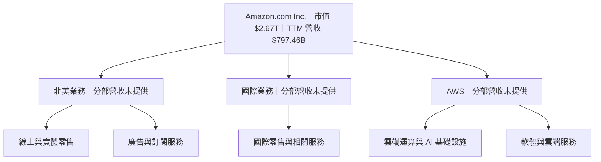
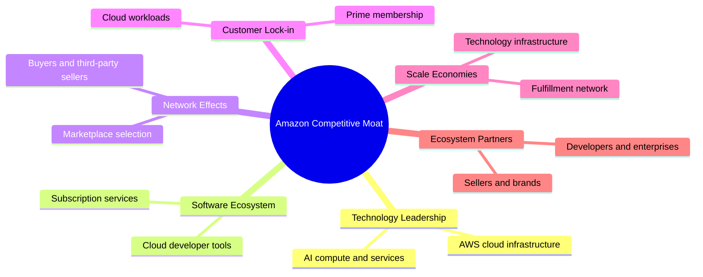
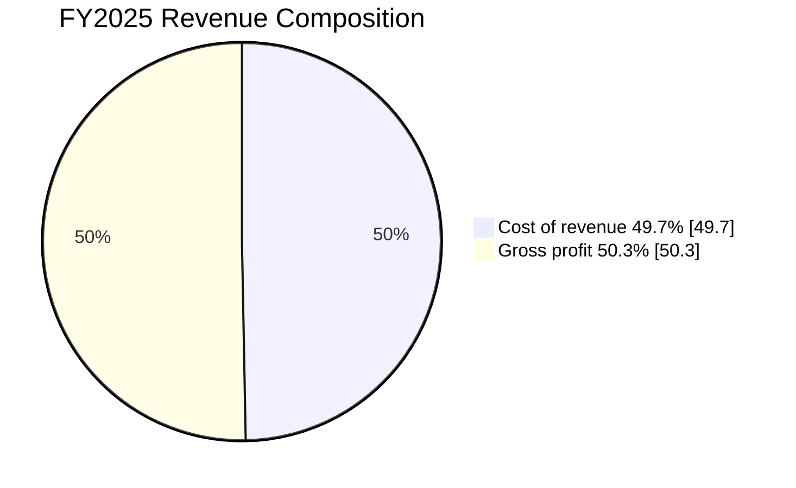
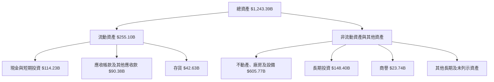
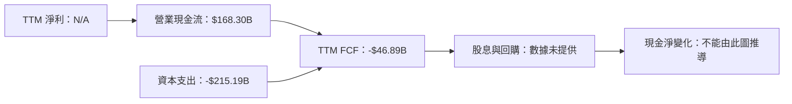
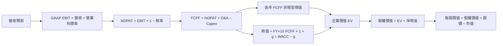
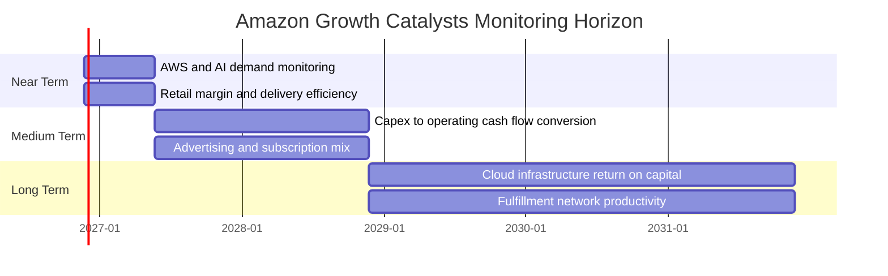
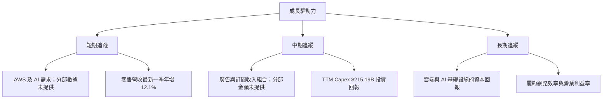
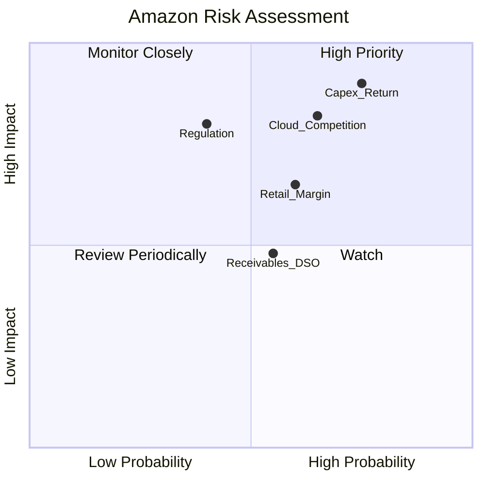
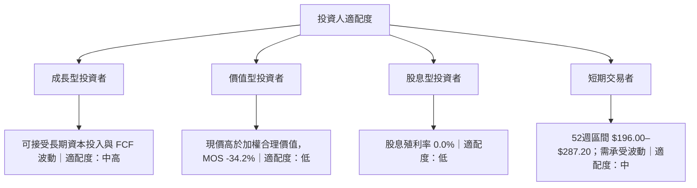

# AMZN 基本面深度分析報告
> **報告日期**：2026-11-22 ｜ **語言**：繁體中文 ｜ **數據來源**：SEC 申報資料 (XBRL)、Yahoo Finance、Finviz、StockAnalysis、Roic.ai ｜ **分析師**：CFA 級機構研究

> **口徑說明**：關鍵 TTM 財務數據、ROIC、FCF、現金與債務採用 SEC 申報資料及程式計算值。其他彙整來源的部分欄位與 SEC 口徑不一致，例如現金流、總債務、ROE；下文涉及核心估值與評級時以 SEC 口徑為準，並在相關位置指出差異。金額除另有說明外均為美元。

## 目錄

| # | 章節 | 核心結論 |
|---|------|----------|
| 1 | 執行摘要 | 賣出；加權合理價值 $183.88；MOS -34.2% |
| 2 | 公司概覽與商業模式 | 零售、廣告、訂閱與 AWS 形成多元業務，分部收入未提供 |
| 3 | 損益表深度分析 | TTM 營收 $797.46B、年增 15.4%；TTM 營業利益率 13.1% |
| 4 | 資產負債表分析 | 淨負債 $65.73B；DSO 升至 45 天 |
| 5 | 現金流量深度分析 | TTM FCF -$46.89B，主因資本支出高於營運現金流 |
| 6 | 獲利能力與資本效率 | ROIC 11.9% 高於 WACC 10.92%，價差有限 |
| 7 | 相對估值分析 | AMZN 的 P/E 低於部分同業，但 P/S 高於自身五年中位數 |
| 8 | DCF 內在價值評估 | 基準 DCF $55.81；終值佔 EV 98.5%，高度依賴長期假設 |
| 9 | 成長催化劑 | AWS、廣告與 AI 投資可支持成長，但資本回收速度是關鍵 |
| 10 | 風險矩陣 | 資本支出回報、雲端競爭與零售營運槓桿為主要風險 |
| 11 | 投資建議 | 不宜追價；以加權價值及可量化營運里程碑作為再評估依據 |

---

## 1. 執行摘要

AMZN 2026-11-20 收盤價為 **$246.82**；SEC 口徑 TTM 營收 **$797.46B**、年增 **15.4%**，TTM 營業利益率 **13.1%**，ROIC **11.9%**，高於 WACC **10.92%**。但 TTM 營業現金流 **$168.30B** 小於資本支出 **$215.19B**，使 FCF 為 **-$46.89B**；DCF 基準價值為 **$55.81**，加權合理價值為 **$183.88**，MOS 為 **-34.2%**。依 MOS 門檻評級為**賣出**；營運成長與資本效率提供支持，但現價相對加權價值仍有明顯溢價。

### 1.0 一頁式投資儀表板（Portfolio Manager 30 秒速讀）

| 項目 | 內容 |
|------|------|
| **投資論點（3 句）** | ① TTM 營收年增 15.4%，最新一季年增 12.1%，業務仍在擴張。② ROIC 11.9% 高於 WACC 10.92%，目前仍略為創造股東價值。③ TTM FCF -$46.89B，資本支出已超過營運現金流，現價 $246.82 高於加權合理價值 $183.88。 |
| **綜合評分** | **6.2/10**（引用 1.1 評分卡） |
| **財務健康** | 🟡 現金與短期投資 $114.23B，但總債務 $179.95B、淨負債 $65.73B |
| **ROIC vs WACC** | **11.9% vs 10.92%**，目前創造價值，但僅高出 0.98 個百分點 |
| **FCF 趨勢** | TTM FCF 為負；FCF Yield **-1.76%** |
| **估值** | Forward P/E **22.59x**（Yahoo Finance 彙整值）｜ EV/EBITDA **15.0x**（五年估值資料口徑）｜ FCF Yield **-1.76%** |
| **DCF 內在價值（基準）** | **$55.81**｜現價相對 DCF 溢價 **+342.2%**，折溢價基準為 DCF 基準值 |
| **安全邊際（MOS）** | **-34.2%**＝($183.88 − $246.82) ÷ $183.88，基準為加權合理價值 $183.88｜🔴 <10% 無 |
| **預期報酬（基準情境 12M）** | DCF 基準情境相對現價 **-77.4%**；這是模型情境價值與現價的比較，不是獨立的 12 個月市場目標 |
| **關鍵風險（前二）** | 資本支出持續高於 OCF、AWS 成長與 AI 資本投資回報不及預期 |
| **評級 + 信心度** | 🔴 **賣出**｜信心：中；DCF 終值佔比高，且近期 FCF 受到高資本支出影響 |

### 1.1 綜合評分卡（全報告唯一）

| 維度 | 評分（1–10） | 主要依據（引用數字與其來源章節） |
|------|--------------|----------------------------------|
| 成長性 | 8.0 | TTM 營收成長 15.4%、最新一季年增 12.1%（第 3 章） |
| 獲利能力 | 7.0 | TTM 營業利益率 13.1%，ROIC 11.9% 高於 WACC 10.92%；F-Score 4/8（第 3、6 章） |
| 財務健康 | 5.5 | 淨負債 $65.73B；Piotroski 流動比率測試未通過，DSO 45 天（第 4、6 章） |
| 估值 | 2.0 | MOS -34.2%；P/S 3.4x 高於五年中位數 3.0x（第 7、8 章） |
| 護城河 | 8.5 | 零售履約規模、AWS 服務生態、廣告與訂閱交叉銷售；分部數據未提供（第 2 章） |
| 管理層與資本配置 | 6.0 | FY2025 SBC $19.47B；FY2025 資本支出 $131.82B，TTM FCF 為負（第 3、5 章） |
| **綜合評分** | **6.2** | 六項算術平均：(8.0 + 7.0 + 5.5 + 2.0 + 8.5 + 6.0) ÷ 6 = **6.2** |

### 1.2 五大投資論點 + 三大核心風險

| 類型 | 項目 | 具體依據 | 信心度 |
|------|------|----------|--------|
| 🟢 **投資論點①** | 多元收入與規模 | TTM 營收 $797.46B，TTM 成長 15.4%；零售、廣告、訂閱及 AWS 分散收入來源，分部佔比未提供 | 🟢 高 |
| 🟢 **投資論點②** | 獲利率改善 | FY2022 營業利益 $12.25B，FY2025 $79.97B；營業利益率由約 2.4% 升至約 11.2% | 🟢 高 |
| 🟢 **投資論點③** | 資本回報略高於資金成本 | TTM ROIC 11.9% 對 WACC 10.92%，價差 +0.98pp | 🟡 中 |
| 🟢 **投資論點④** | AWS 與 AI 的長期選擇權 | 公司提供雲端與 AI 基礎設施；AWS 分部收入與利潤本次數據未提供，不能量化其單獨貢獻 | 🟡 中 |
| 🟢 **投資論點⑤** | 過去數年營收保持成長 | FY2022–FY2025 營收由 $513.98B 增至 $716.92B，三年 CAGR 約 11.7% | 🟢 高 |
| 🟡 **風險①** | 資本支出侵蝕自由現金流 | TTM Capex $215.19B，高於 OCF $168.30B，FCF -$46.89B | 🔴 高衝擊 |
| 🔴 **風險②** | 現價高於估值支持 | 加權合理價值 $183.88，低於現價 $246.82；MOS -34.2% | 🔴 高 |
| 🟡 **風險③** | 應收帳款天數上升 | DSO 由一年前 32 天升至 45 天，增加 13 天 | 🟡 中 |

### 1.3 快速統計卡片

| 指標 | 公司實際值（期間） | 同業中位數 | 狀態 |
|------|--------------------|------------|------|
| 營收成長（TTM） | **15.4%** | — | 🟢 |
| 營收成長（最新一季年增） | **12.1%** | 18.8% | 🟡 |
| 毛利率（TTM） | **51.4%** | 60.9% | 🟡 |
| 營業利益率（TTM） | **13.1%** | — | 🟢 |
| ROIC（TTM） | **11.9%** | — | 🟡 |
| Forward P/E | **22.59x** | 20.0x | 🟡 |
| FCF Yield（TTM） | **-1.76%** | — | 🔴 |
| Piotroski F-Score | **4 / 8** | — | 🟡 |

> 同業中位數依 MSFT、GOOG、WMT 的 Peer multiples 計算；不同商業模式令毛利率與 P/E 比較僅供相對參考。

### 1.4 投資結論

```text
╔══════════════════════════════════════════════════════════════════╗
║                    📊 投資結論摘要                               ║
╠══════════════════════════════════════════════════════════════════╣
║  評級：賣出（MOS -34.2%，依規則 20）                             ║
║  價格（2026-11-20 收盤）：$246.82                                ║
║  DCF 內在價值（基準）：$55.81（現價溢價 +342.2%）                ║
║  安全邊際 MOS：-34.2%（以加權合理價值 $183.88 為分母）          ║
║  加權合理價值（8.8）：$183.88                                    ║
║  DCF 情境價值：                                                   ║
║    悲觀情境：$12.58（-94.9%）                                    ║
║    基準情境：$55.81（-77.4%）                                    ║
║    樂觀情境：$128.52（-47.9%）                                   ║
║  綜合評分：6.2/10（引用 1.1）                                    ║
║  適合投資人：可承受資本支出波動的長線成長型投資人；不適合以現金   ║
║  殖利率或低估值為首要條件的投資人                                ║
╚══════════════════════════════════════════════════════════════════╝
```

---

## 2. 公司概覽與商業模式

### 2.1 業務結構與收入來源

公司總營收與分部營收拆分是兩種不同資料層級：TTM 總營收為 $797.46B，但最新資料沒有提供北美、國際與 AWS 各自的營收金額及比例，因此不填入分部數字。



商業模式包含商品零售、第三方賣家服務、廣告、訂閱及雲端服務。零售業務的價值不只在商品毛利，也在流量、履約網路與賣家服務；雲端和廣告則可能帶來不同於第一方零售的收入與利潤特徵，但本次沒有足夠分部數據來定量比較。

### 2.2 市場份額

市場份額數據未提供，財務資料與新聞摘要也沒有可引用的市場份額數字，因此不提供市場份額圖表或自行估算比例。以營收規模而言，AMZN TTM 營收為 $797.46B，最新一季營收年增 12.1%；其規模與增長顯示平台覆蓋面廣，但不能單憑公司營收推導零售或雲端市場份額。

### 2.3 競爭護城河分析



### 2.4 護城河強度

| 護城河項目 | 強度（強／中／弱） | 證據 | 會削弱它的情況 |
|------------|--------------------|------|----------------|
| 技術與雲端基礎設施 | 強 | AWS 為公司三大業務板塊之一，且公司提供雲端與 AI 服務；AWS 分部收入與利潤未提供 | 雲端價格競爭、AI 投資回報低於資本成本 |
| 軟體與服務生態 | 中至強 | 雲端服務、訂閱與裝置形成多產品接觸點；訂閱數據未提供 | 客戶轉向多雲或替代服務、訂閱留存下降 |
| 雙邊平台網絡 | 中至強 | 線上商店與第三方賣家形成供需平台，賣家規模數據未提供 | 賣家費率上升造成供給流失、競爭平台導流 |
| 客戶鎖定 | 中 | Prime、雲端工作負載及履約服務可能提升轉換成本；客戶留存資料未提供 | 服務體驗下降、價格上升、企業客戶重新架構 |
| 規模效應 | 強 | TTM 營收 $797.46B，履約和雲端資本投入具規模特徵 | 固定成本擴張快於需求、資本回收期拉長 |
| 生態夥伴 | 中 | 第三方賣家、開發者與企業客戶共同擴展服務供給 | 監管限制、平台政策改變或夥伴依賴競爭者 |

**1.1「護城河」評分 8.5/10**，理由是零售平台、履約規模、雲端服務與生態夥伴構成多層競爭優勢；但分部營收、留存率及市場份額數據缺漏，限制了證據強度。

---

## 3. 損益表深度分析

### 3.1 年度收入成長趨勢（近 4 年）

年度營收與同比增速採公司年度損益表；營收由 FY2022 的 $513.98B 增至 FY2025 的 $716.92B，三年累計成長約 39.5%。

```text
╔══════════════════════════════════════════════════════════════════╗
║              Amazon 年度收入趨勢（FY2022-FY2025）                ║
╠══════════════════════════════════════════════════════════════════╣
║  FY2022  $513.98B  ███████████████░░░░░░░░░░░  YoY: 基期        ║
║  FY2023  $574.78B  █████████████████░░░░░░░░░  YoY: +11.8% 🟢   ║
║  FY2024  $637.96B  ███████████████████░░░░░░░  YoY: +11.0% 🟢   ║
║  FY2025  $716.92B  █████████████████████░░░░░  YoY: +12.4% 🟢   ║
║                                                                  ║
║  FY2022–FY2025 營收 CAGR：($716.92B ÷ $513.98B)^(1/3) − 1       ║
║                              ≈ 11.7%                             ║
╚══════════════════════════════════════════════════════════════════╝
```

FY2025 營收年增 12.4%，高於 FY2024 的 11.0%；這與最新一季仍維持雙位數年增相互呼應，但需持續觀察增長是否伴隨更高促銷、履約成本或資本投入。

### 3.2 季度收入趨勢分析

| 季度 | 營收（$B） | QoQ 成長 | YoY 成長 | 備註 |
|------|------------|----------|----------|------|
| 2025 Q4 | 213.386 | +18.4% | +13.6% | 季節性旺季；QoQ 對照 2025 Q3 |
| 2026 Q1 | 181.519 | -14.9% | +16.6% | 旺季後回落，仍高於去年同期 |
| 2026 Q2 | 200.606 | +10.5% | +19.6% | QoQ 回升；來源表顯示該季收入 |
| 2026 Q3 | 201.944 | +0.7% | +12.1% | 最新一季營收仍成長，但同比增速低於前兩季 |

QoQ 對比受零售季節性影響，不宜直接解讀為需求加速或減速。最新一季同比成長 12.1% 低於 Q1、Q2 的 16.6%、19.6%，顯示後續需要觀察雲端與零售各自的分部增速；分部明細未提供，無法判別減速來源。

### 3.3 利潤率演變分析

| 利潤率指標 | FY2022 | FY2023 | FY2024 | FY2025 | 趨勢 | 評估 |
|------------|--------|--------|--------|--------|------|------|
| **毛利率** | 43.8% | 47.0% | 48.9% | 50.3% | 連續提升 | 🟢 |
| **營業利益率** | 2.4% | 6.4% | 10.8% | 11.2% | 大幅改善後升幅放緩 | 🟢 |
| **淨利率** | -0.5% | 5.3% | 9.3% | 10.8% | 由虧轉盈並擴大 | 🟢 |

計算口徑為年度毛利／營收、營業利益／營收及淨利／營收。FY2025 營收 $716.92B、營業利益 $79.97B、淨利 $77.67B。營業利益率提升反映前期成本效率改善與營運規模擴大；但 TTM 營業利益率 13.1% 高於 FY2025 的約 11.2%，不應假設未來仍以同樣速度擴張。競爭、配送費用、工資與 AI 基礎設施成本都是邊際利潤率的制約。

### 3.4 費用結構分析

FY2025 可直接取得營收與毛利，故以「營業成本」和「毛利」展示收入的初步拆分；這不是公司全部營業費用分類，亦不代表淨利或營業利益分配。



```text
╔══════════════════════════════════════════════════════════════════╗
║                   FY2025 收入初步拆分                            ║
╠══════════════════════════════════════════════════════════════════╣
║  營收       $716.92B  ██████████████████████████████             ║
║  毛利       $360.51B  ███████████████                            ║
║  營業成本   $356.41B  ███████████████                            ║
║                                                                  ║
║  營業成本 = $716.92B − $360.51B = $356.41B                       ║
╚══════════════════════════════════════════════════════════════════╝
```

### 3.5 季度 EPS 趨勢與盈餘品質（Quality of Earnings）

#### EPS 表現

| 季度 | EPS 實際值 | YoY EPS 成長 | 超預期／不及預期 |
|------|------------|--------------|------------------|
| 2025 Q4 | $1.95 | +5.0% | N/A；EPS 預估值缺漏 |
| 2026 Q1 | $2.78 | +74.8% | N/A；EPS 預估值缺漏 |
| 2026 Q2 | $5.75 | +242.3% | N/A；EPS 預估值缺漏 |
| 2026 Q3 | $1.89 | -3.1% | N/A；EPS 預估值缺漏 |

EPS 歷史表中四季 EPS Est 均為 NaN，因此不能可靠判斷超預期或不及預期。Q2 EPS 與淨利數字相對突出，季度利潤波動大；Q3 EPS 年減 3.1%，即使營收仍年增 12.1%，顯示營收增長並未等比例轉化為每股盈餘。

#### 盈餘品質量化

| 盈餘品質項目 | 數值／佔比 | 評估 |
|--------------|-----------|------|
| 股權薪酬 SBC / 營收 | FY2025：$19.47B ÷ $716.92B = **2.7%** | 🟡 SBC 是實質股東成本；FY2025 同時有股數稀釋測試未通過 |
| SBC / 營業現金流 | FY2025：$19.47B ÷ $139.51B = **14.0%** | 🟡 規模不可忽略；這是完整年度比率，非 TTM |
| FCF / 淨利（現金轉換率） | TTM：-$46.89B ÷ $134.779B = **-34.8%** | 🔴 高資本支出使 FCF 明顯低於會計淨利；淨利來源為 StockAnalysis TTM |
| 一次性／非經常性損益 | 缺乏足夠細項，**N/A** | 🟡 不能判斷季度盈餘是否受一次性項目重大影響 |
| 有效稅率異常 | 本次 TTM 實際有效稅率 **N/A**；DCF 採用 21.0% | 🟡 未能量化本期稅率對淨利的影響 |
| 資本化支出 vs 費用化 | TTM Capex $215.19B；資本化項目明顯影響當期 FCF | 🟡 資本化資產未來透過折舊反映成本；應觀察投資回報及折舊攀升 |

**盈餘品質結論**：GAAP 淨利為正，但 TTM FCF 為負、FY2025 SBC 約佔營收 2.7%，表示當前會計盈餘尚未轉化為同等規模的股東可用現金。高資本支出可能為成長投資，不等同於永久性獲利惡化；但若新增資產不能推升未來 OCF，DCF 估值需下修。

---

## 4. 資產負債表分析

### 4.1 資產結構分解

最新 TTM 資產負債表資料中，總資產為 $1,243.39B；個別列示項目無法完全加總到總資產，因此圖中保留未列示的其他資產，不反推差額分類。



### 4.2 流動性與營運資金分析

| 指標 | 最新值 | 歷史值 | 評估 |
|------|--------|--------|------|
| 現金 + 短期投資 | $114.23B | FY2025 $123.03B | 🟡 仍有大額流動性資產，但較 FY2025 年末減少 |
| 流動比率 | 0.989x | — | 🟡 低於 1；零售營運需連同供應商信用及現金循環判斷 |
| 速動比率 | 0.793x | — | 🟡 低於 1，較依賴營運現金流及庫存周轉 |
| Piotroski 流動比率測試 | 未通過 | — | 🔴 相較一年前流動比率下降 |

**營運資金天數（照抄品質指標）**

| 指標 | 最新 TTM | 一年前 TTM | 變化 | 解讀 |
|------|----------|------------|------|------|
| DSO 應收帳款天數 | 45 天 | 32 天 | +13 天 | 收款週期延長；可能反映業務組合或付款條款變化，須追蹤壞帳及應收帳款增速 |
| DIO 存貨天數 | N/A | N/A | N/A | 缺少可計算項目 |
| DPO 應付帳款天數 | N/A | N/A | N/A | 缺少可計算項目 |
| CCC 現金轉換週期 | N/A | N/A | N/A | DIO、DPO 未提供，不能補算 |

### 4.3 債務結構分析

```text
╔══════════════════════════════════════════════════════════════════╗
║                   Amazon 債務健康診斷                            ║
╠══════════════════════════════════════════════════════════════════╣
║  總債務：        $179.95B  ████████████████████                  ║
║  現金+短期投資： $114.23B  █████████████                          ║
║  淨負債：         $65.73B  ███████                                ║
║                                                                  ║
║  淨現金計算：$114.23B − $179.95B = -$65.73B                     ║
║  淨負債狀態：🟡 有能力支撐資本投入，但非淨現金公司              ║
║  Debt/EBITDA：N/A（採用的 EBITDA 與債務口徑不一致）              ║
║  Interest Coverage：N/A（利息費用資料不足）                      ║
╚══════════════════════════════════════════════════════════════════╝
```

同一彙整資料中另有總債務 $304.84B、淨負債 $190.61B 等數字，與 SEC 口徑不一致；本文資產負債表分析採用 SEC 計算的總債務 $179.95B 與淨負債 $65.73B，避免混用不同債務定義。

### 4.4 股東權益趨勢

| 年度 | 股東權益（$B） | 年增 |
|------|----------------|------|
| 2022 | 146.04 | — |
| 2023 | 201.88 | +38.2% |
| 2024 | 285.97 | +41.7% |
| 2025 | 411.06 | +43.7% |

```text
╔══════════════════════════════════════════════════════════════════╗
║                 股東權益趨勢（年度）                             ║
╠══════════════════════════════════════════════════════════════════╣
║  2022  $146.04B  ███████░░░░░░░░░░░░░                            ║
║  2023  $201.88B  ██████████░░░░░░░░░░                            ║
║  2024  $285.97B  ██████████████░░░░░                             ║
║  2025  $411.06B  ████████████████████                             ║
╚══════════════════════════════════════════════════════════════════╝
```

股東權益增加可由盈利累積及資產負債表擴張共同推動；但權益增加本身不代表每股價值提升，仍要考察稀釋股數與資本回報。Piotroski 股數測試未通過，表示稀釋未能完全被回購抵銷。

---

## 5. 現金流量深度分析

### 5.1 現金流量瀑布圖

TTM 淨利分部不完整，且股息與回購金額未提供，因此圖中不填入未披露金額。



### 5.2 FCF 轉換率趨勢

| 年度 | FCF（$B） | 淨利（$B） | FCF / 淨利 | 解讀 |
|------|-----------|------------|------------|------|
| 2022 | -16.89 | -2.72 | N/M | 淨利為負，比率不具可比性 |
| 2023 | 32.22 | 30.43 | 105.9% | 現金轉換高於會計淨利 |
| 2024 | 32.88 | 59.25 | 55.5% | 利潤增長高於自由現金流增長 |
| 2025 | 7.70 | 77.67 | 9.9% | Capex 上升壓低 FCF |
| 最新 TTM | -46.89 | 134.779 | -34.8% | 資本支出遠超 OCF；淨利取 StockAnalysis TTM |

### 5.3 自由現金流趨勢

```text
╔══════════════════════════════════════════════════════════════════╗
║               自由現金流趨勢（實際）                              ║
╠══════════════════════════════════════════════════════════════════╣
║  FY2022   -$16.89B  ◀████████░░░░░░░░░░░░  FCF Yield：N/A       ║
║  FY2023   +$32.22B   ████████████████░░░░  FCF Yield：N/A       ║
║  FY2024   +$32.88B   ████████████████░░░░  FCF Yield：N/A       ║
║  FY2025    +$7.70B   ████░░░░░░░░░░░░░░░░  FCF Yield：N/A       ║
║  最新TTM  -$46.89B  ◀████████████████████  FCF Yield：-1.76%    ║
╠══════════════════════════════════════════════════════════════════╣
║  TTM FCF = OCF $168.30B − Capex $215.19B = -$46.89B             ║
╚══════════════════════════════════════════════════════════════════╝
```

歷史年度 FCF 與最新 TTM FCF 來自不同期間口徑；FY2025 年度 FCF 為 $7.70B，最新 TTM 已降至 -$46.89B。主要解釋是近期資本支出增加，而不是可以直接推論營運現金流崩落；但若資本投入長期無法帶來相應 OCF 增長，負 FCF 會降低股權現金流的安全墊。

### 5.4 資本配置評估

沒有可直接核實的回購、投資、股息與留存的同期完整分配金額，因此不製作比例圓餅圖。

| 資本配置項目 | 已知數據 | 評估 |
|--------------|----------|------|
| 資本支出 | TTM $215.19B；FY2025 $131.82B | 🟡 高投入可能支持履約、雲端與 AI，但回報期長 |
| 股息 | 股息殖利率 0.0% | 🟡 現金優先用於營運投資與其他資本配置 |
| SBC | FY2025 $19.47B | 🟡 對股東有稀釋成本 |
| 回購、併購與其他投資 | 缺少同期完整數據 | N/A；不推算比例 |

---

## 6. 獲利能力與資本效率

### 6.1 ROE / ROA / ROIC 趨勢

| 指標 | 最新可用數據 | 歷史／比較資料 | 評估 |
|------|--------------|----------------|------|
| ROE（TTM） | 22.0% | 品質指標口徑 | 🟢 正向，但受槓桿與資產週轉共同影響 |
| ROA（TTM） | 6.6% | 彙整來源；非品質指標計算值 | 🟡 資產密集型業務下需連續觀察 |
| ROIC（TTM） | 11.9% | SEC 計算口徑 | 🟢 略高於 WACC |
| ROIC vs WACC | 11.9% vs 10.92% | 價差 +0.98pp | 🟡 價值創造幅度有限 |

未提供一致口徑的歷年 ROIC、ROA、ROE 及行業均值系列，因此不列缺乏來源的年度對照或行業均值。

### 6.2 ROIC vs WACC 分析（核心價值創造判斷）

```text
╔══════════════════════════════════════════════════════════════════╗
║                ROIC vs WACC 深度分析                            ║
╠══════════════════════════════════════════════════════════════════╣
║  WACC（採用 Cost of capital 資料）：                             ║
║  ├── 無風險利率（10Y美債）：      4.91%                          ║
║  ├── 市場風險溢酬（ERP）：         5.00%                          ║
║  ├── 原始 Beta：                  1.50                           ║
║  ├── 調整後 Beta：                1.34                           ║
║  ├── Ke：                         11.59%                         ║
║  ├── 稅前債務成本：               1.26%                          ║
║  ├── 稅後債務成本：               1.26% × (1−21%) = 1.00%        ║
║  ├── 股權／債務權重：             93.7%／6.3%                    ║
║  └── ✅ WACC：                    10.92%                         ║
║                                                                  ║
║  ROIC（TTM，SEC 計算值）：       11.9%                           ║
║  EVA spread = ROIC − WACC：      11.9% − 10.92% = +0.98pp       ║
║                                                                  ║
║  ROIC 11.9%  ▓▓▓▓▓▓▓▓▓▓▓▓░░░░░░░░  略高於資本成本               ║
║  WACC 10.92% ▓▓▓▓▓▓▓▓▓▓▓░░░░░░░░  資本成本基準                   ║
║                                                                  ║
║  結論：ROIC 高於 WACC，現階段創造股東價值；但價差不足 1pp，       ║
║  若資本支出回報下降，ROIC 有可能跌破 WACC。                       ║
╚══════════════════════════════════════════════════════════════════╝
```

WACC 組成採官方計算值，不另行改算。CAPM 以已提供的調整後 Beta 及 Rf、ERP 展示時，4.91% + 1.34 × 5.00% = 11.61%，與資料給定 Ke 11.59% 相差 0.02pp，應是輸入精度或四捨五入差異；估值折現仍採提供的 **WACC 10.92%**。ROIC 高於 WACC 0.98pp，表示仍在創造價值，但不代表現價具估值吸引力。

### 6.3 杜邦三因素分解

| 因素 | 數值（TTM） | 解讀 |
|------|-------------|------|
| 淨利率 | 16.9% | 依品質指標原值；與其他彙整損益口徑可能不同 |
| 資產週轉率 | 0.64 | 資產規模大，營收相對資產周轉較慢 |
| 權益乘數 | 2.03 | 財務槓桿有貢獻，但非唯一 ROE 來源 |
| **ROE** | **22.0%** | 品質指標原值；三因素按未四捨五入數據計算後回報 22.0% |

上述數值以品質指標計算結果為準，不與彙整來源另列 ROE 27.4% 混用。ROE 由 16.9% 淨利率、0.64 資產週轉率及 2.03 權益乘數共同構成。

### 6.4 財務體質：Piotroski F-Score

**Piotroski F-Score：4 / 8**。毛利率測試因缺少輸入而未納入分母；此處照用品質指標結果，不另行重算。

| 測試 | 結果 | 解讀 |
|------|------|------|
| ROA > 0 | ✅ 通過 | TTM 資產報酬為正 |
| 營業現金流 > 0 | ✅ 通過 | TTM OCF 為正 |
| ROA 高於一年前 | ✅ 通過 | 資產獲利能力改善 |
| 營業現金流 > 淨利（應計品質） | ✅ 通過 | 依該項品質測試口徑通過；不等同 FCF 為正 |
| 長期負債 ÷ 總資產低於一年前 | ❌ 未通過 | 槓桿指標未改善 |
| 流動比率高於一年前 | ❌ 未通過 | 短期流動性相對轉弱 |
| 稀釋股數未增加 | ❌ 未通過 | 股數稀釋可能攤薄每股權益 |
| 毛利率高於一年前 | — 無法判定 | 缺少該項所需比較輸入 |
| 資產週轉率高於一年前 | ❌ 未通過 | 資產增長尚未帶來足夠周轉改善 |

---

## 7. 相對估值分析

### 7.1 同業估值比較表格

同業倍數取 Yahoo Finance 的 Peer multiples；AMZN 本身倍數取公司估值資料及歷史估值資料。Peer multiples 中沒有提供同業 Forward P/E 以外的 EPS 預估，故不額外推算。

| 估值指標 | **AMZN** | **MSFT** | **GOOG** | **WMT** | AMZN 評估 |
|----------|----------|---------|---------|---------|-----------|
| **Trailing P/E** | 20.0x | 25.3x | 13.8x | 46.4x | 🟡 高於 GOOG、低於 MSFT 與 WMT |
| **Forward P/E** | 22.59x | 20.0x | 17.3x | 39.6x | 🟡 高於三家同業中位數 20.0x |
| **P/S Ratio** | 3.4x | 10.4x | 6.9x | 1.4x | 🟡 位於同業分布中間偏高 |
| **EV/EBITDA** | 15.0x | 17.8x | 17.0x | 22.4x | 🟢 低於三家同業倍數 |
| **最新季度營收年增** | 12.1% | 18.8% | 24.7% | 5.2% | 🟡 成長高於 WMT、低於 MSFT 與 GOOG |
| **TTM 毛利率** | 51.4% | 67.7% | 60.9% | 25.3% | 🟡 高於 WMT、低於科技平台同業 |

同業跨越雲端、搜尋與零售，商業模式與利潤結構差異較大。AMZN 的 P/E 與 EV/EBITDA 不宜只做單一倍數結論，應同時考慮高資本支出造成的 FCF 壓力。

### 7.2 歷史估值區間分析

```text
╔══════════════════════════════════════════════════════════════════╗
║            AMZN 五年歷史估值位置（TTM 倍數）                     ║
╠══════════════════════════════════════════════════════════════════╣
║  P/E        區間 2.6x ├──────────────────────┤ 251.9x           ║
║             中位數 32.2x｜現值 20.0x｜百分位 30%                ║
║                                                                  ║
║  P/S        區間 0.2x ├──────────────────────┤ 3.7x             ║
║             中位數 3.0x｜現值 3.4x｜百分位 71%                  ║
║                                                                  ║
║  EV/EBITDA  區間 0.7x ├──────────────────────┤ 22.7x           ║
║             中位數 17.3x｜現值 15.0x｜百分位 19%                ║
╚══════════════════════════════════════════════════════════════════╝
```

P/E 現值低於五年中位數，但歷史區間受特殊年份低盈利與高倍數影響；P/S 位於自身五年分布的 71 百分位，顯示相對自身歷史並不便宜；EV/EBITDA 位於 19 百分位，則相對較低。

### 7.3 情境價值（照抄 DCF MODEL 的 Scenarios）

| 情境 | 第 1 年營收成長 | 期末營業利潤率 | WACC | 每股價值 | 相對現價 | 機率 | 會發生的條件 |
|------|----------------|----------------|------|----------|----------|------|--------------|
| 🔴 悲觀 | 7.7% | 9.1% | 11.92% | $12.58 | -94.9% | 25% | AWS 與零售增長放緩，投入成本未能轉成營業槓桿，資金成本偏高 |
| 🟡 基準 | 15.4% | 10.8% | 10.92% | $55.81 | -77.4% | 50% | 按模型基準增長，利潤率收斂至長期歷史中位數 |
| 🟢 樂觀 | 23.0% | 11.8% | 9.92% | $128.52 | -47.9% | 25% | 雲端及 AI 帶動較快增長，利潤率下滑較少，折現率降低 |

三情境均為 DCF 模型輸出，並非獨立目標價建議。即使樂觀情境，模型價值仍低於 $246.82 現價；這表示現價要求的營運結果高於所列三種模型情境。

### 7.4 相對估值隱含價格區間

```text
╔══════════════════════════════════════════════════════════════════╗
║                   估值方法隱含價格                               ║
╠══════════════════════════════════════════════════════════════════╣
║  $55.81 DCF ───── $218.75 Forward P/E ── $246.82 現價           ║
║                 ───── $296.86 EV/EBITDA ───── $326.51 共識       ║
╚══════════════════════════════════════════════════════════════════╝
```

- **DCF 基準 $55.81**：10 年 FCFF、WACC 10.92%、終值成長率 3.0%。
- **同業 Forward P/E $218.75**：MSFT、GOOG、WMT 同業中位數 20.0x × AMZN Forward EPS $10.93。
- **同業 EV/EBITDA $296.86**：同業 EV/EBITDA 中位數 17.8x × AMZN TTM EBITDA，並按方法加入淨現金／淨負債橋接。
- **分析師共識 $326.51**：60 位分析師平均目標價；屬市場預期參考，不是本報告的 DCF 模型輸出。

---

## 8. DCF 內在價值評估（Discounted Cash Flow）

> 本章完全採用程式計算的 DCF MODEL。金額單位為美元十億，除每股價值外。表格數值照錄；底層未四捨五入輸入未提供，故部分以展示數值重算會有小幅尾差，不能以展示精度假裝完全精確。

### 8.0 估值推理鏈（Thinking Logic）

**Step 1 — 價值由哪些變數決定？**

AMZN 價值可概括為零售與履約現金流底盤、AWS 雲端及 AI 成長、廣告與訂閱等服務收入的長期貢獻。公司只提供合併 TTM 營收 $797.46B，未提供各板塊分部營收比重，因此不能可靠地將總營收拆成分部百分比。模型中最主導估值的是**長期 FCF 與終值**：終值現值佔企業價值 98.5%，敏感度矩陣亦顯示 WACC 與永續成長率 g 的變動造成重大影響。

**Step 2 — 模型選擇**

| 決策點 | 本報告採用 | 理由（含數字） | 曾考慮但否決 | 否決理由 |
|--------|-----------|----------------|--------------|----------|
| 現金流定義 | FCFF | 以企業自由現金流折現至 EV，再加淨現金／減淨負債；公司 TTM 淨負債 $65.73B | FCFE | FCFE 對未來融資及債務變動較敏感 |
| 預測期 N | 10 年 | DCF 模型固定 N=10；公司業務包含長期資本投資 | 較短預測期 | 會使尚在形成中的投資現金流更快落入終值，降低明確預測期資訊 |
| 終值方法 | Gordon Growth | 模型採 g=3.0%，WACC=10.92%，WACC 大於 g | 單一退出倍數 | DCF 輸出未提供退出倍數；不另造倍數 |
| EBIT 基礎 | GAAP EBIT | DCF 模型明確採 GAAP EBIT，TTM 營業利益率 13.1% | 非 GAAP EBIT | 會加回已入帳的 SBC，需另行扣除，模型未採用 |

**Step 3 — 關鍵假設的推導鏈**

- **營收成長**：錨點＝最新 TTM 營收年增 15.4%；調整＝模型第一年維持現有 TTM 成長，之後線性降至第十年 3.0%；採用第 1 年 15.4%、第 10 年 3.0%；替代值若將 15.4% 維持十年會忽略成熟化，因此模型採遞減路徑。
- **期末營業利潤率**：錨點＝TTM 13.1%；調整＝模型向近五年財年中位數收斂；採用第 1 年 13.1%、第 10 年 10.8%；不採用長期維持 13.1%，因模型歷史中位數低於當前 TTM。
- **永續成長率 g**：錨點＝模型假設 3.0%；採用 3.0%，低於 WACC 10.92%，符合 Gordon Growth 的數學條件；不採用等於或高於 WACC 的 g，因公式會失效。
- **預測期 N**：錨點＝模型 N=10 年；採用 10 年；較短期間會提前把成熟期現金流併入終值，但超出模型的替代期間不重建。
- **Capex／營收**：錨點＝TTM Capex／TTM 營收約 215.19÷797.46=27.0%；採用第 1 年 27.0%、第 10 年 10.9%，向 1.1 倍 D&A 收斂；不採用固定 27.0% 至第十年，因模型假設投資強度隨成熟度下降。
- **D&A／營收**：錨點＝模型 TTM 10.0%；採用固定 10.0%；模型未提供其他歷史平均，故不另調整。
- **有效稅率**：錨點＝模型預設 21.0%；採用 21.0%；最新實際 TTM 有效稅率未提供，不以估計替代。
- **EBIT 與 SBC**：採用組合 **(A) GAAP EBIT + 固定股數**。GAAP EBIT 已含 SBC 費用，FCFF 不再扣 SBC；股數不再逐年稀釋，SBC 影響只計入一次。
- **ΔWC**：模型明確不建模營運資金變動，採用模型設定為不計入，而不是以未知數反推；若應收帳款天數繼續上升，實際現金流可能低於模型。
- **WACC**：採用提供的 10.92%，由 6.2 節資本成本輸入推導；不自行另算或調整。
- **終值方法**：採 Gordon Growth，模型給定第十年 FCFF 與 g=3.0%；未提供退出倍數法輸出，不另造比較倍數。

**Step 4 — 最脆弱環節**

最脆弱的是資本支出率由第 1 年 27.0% 向第 10 年 10.9% 下降的假設；若 AI、雲端與履約投資維持高強度，FCFF 將低於基準模型，價值向下偏移。

**Step 5 — 計算路徑圖**



### 8.1 模型假設總表（Model Inputs）

| 假設項目 | 採用值 | 依據／來源 | 敏感度 |
|----------|--------|-------------|--------|
| 預測期長度 **N** | 10 年 | DCF MODEL 固定假設 | 🟡 中 |
| 營收成長 | 第 1 年 15.4% → 第 10 年 3.0% | 第 1 年錨定 TTM 年增 15.4%，之後線性下降 | 🔴 高 |
| 營業利潤率 | 第 1 年 13.1% → 第 10 年 10.8% | 起點為 TTM；期末向近五年財年中位數收斂 | 🔴 高 |
| 有效稅率 | 21.0% | 模型預設值；實際 TTM 有效稅率未提供 | 🟢 低 |
| Capex／營收 | 第 1 年 27.0% → 第 10 年 10.9% | 第 1 年為 TTM；向 1.1 倍 D&A 收斂 | 🟡 中 |
| D&A／營收 | 10.0% | 模型所列 TTM 比例，固定 | 🟢 低 |
| 營運資金變動 | 未建模 | DCF MODEL 指明 Working capital is not modelled | 🟢 低 |
| EBIT 基礎 | GAAP | DCF MODEL 明定 GAAP EBIT | 🟡 中 |
| SBC 處理 | 不再額外扣除 | GAAP EBIT 已含 SBC 費用 | 🟡 中 |
| 年稀釋率 | 0%；不再調整股數 | 組合 (A)：GAAP EBIT + 固定股數 | 🟡 中 |
| 永續成長率 g | 3.0% | DCF MODEL 假設；低於 WACC 10.92% | 🔴 高 |
| 終值方法 | Gordon Growth | DCF MODEL 給定終值公式及結果 | 🔴 高 |
| WACC | 10.92% | Cost of capital 計算結果 | 🔴 高 |

FCFF 定義為 **FCFF = NOPAT + D&A − Capex**，模型不包含 ΔWC。採用 **(A) GAAP EBIT + 固定股數**，因此 EBIT 已反映 SBC，FCFF 不再扣 SBC，股數亦不額外稀釋。

### 8.2 折現率推導（WACC）

```text
╔══════════════════════════════════════════════════════════════════╗
║                    WACC 推導（折現率）                           ║
╠══════════════════════════════════════════════════════════════════╣
║  股權成本 Ke（CAPM）：                                           ║
║  ├── 無風險利率 Rf（10Y 美債）：      4.91%                      ║
║  ├── 市場風險溢酬 ERP：               5.00%                      ║
║  ├── 原始 Beta：                      1.50                       ║
║  ├── 調整後 Beta：                    1.34                       ║
║  ├── Beta 調整：2/3 × 1.50 + 1/3      = 1.34                    ║
║  └── Ke（提供值）：                  11.59%                      ║
║                                                                  ║
║  債務成本 Kd：                                                    ║
║  ├── 稅前 Kd（利息／債務）：          1.26%                      ║
║  ├── 稅率：                           21.0%                      ║
║  └── 稅後 Kd：1.26% × (1−21.0%)       = 1.00%                    ║
║                                                                  ║
║  資本結構（提供的市值權重）：                                     ║
║  ├── 股權權重 E：                     93.7%                      ║
║  ├── 債務權重 D：                      6.3%                      ║
║  └── ✅ WACC：                         10.92%                     ║
╚══════════════════════════════════════════════════════════════════╝
```

逐步演算：

1. **Ke（CAPM）**：Rf + β × ERP = 4.91% + 1.34 × 5.00% = 11.61%；提供的 Ke 為 **11.59%**，差異 0.02pp，視為未四捨五入輸入差異，後續採用提供值。
2. **稅前 Kd**：提供值為 **1.26%**；利息費用與平均計息負債的完整絕對金額未提供，故不能重建分子與分母。
3. **稅後 Kd**：1.26% × (1 − 21.0%) = 0.9954% ≈ **1.00%**。
4. **權重**：E 權重 93.7%；D 權重 6.3%；93.7% + 6.3% = **100.0%**。來源直接提供市場價值權重，未提供可以核對計息債務範圍的明細。
5. **WACC**：93.7% × 11.59% + 6.3% × 0.9954% = 10.85983% + 0.06271% = **10.92254% ≈ 10.92%**。

Rf 採用成本資本資料的 10 年期美債利率 4.91%；其觀察日期未提供。ERP 5.00% 為模型假設。原始 Beta 1.50 經 2/3 原始 Beta 加 1/3 的調整方式，得到調整後 Beta 1.34。WACC 與第 6.2 節相同，均使用 10.92%。

### 8.3 逐年自由現金流預測（基準情境）

**四捨五入規則**：金額以 $B 顯示至小數點後兩位，百分比至一位，折現因子至三位；模型原始輸出數字照錄。下列 ΔWC 不列為零值，因模型明確表示未建模。

| 年度 | FY+1 | FY+2 | FY+3 | FY+4 | FY+5 | FY+6 | FY+7 | FY+8 | FY+9 | FY+10 |
|------|------|------|------|------|------|------|------|------|------|-------|
| 營收 | 919.87 | 1,048.46 | 1,180.63 | 1,313.26 | 1,442.76 | 1,565.24 | 1,676.64 | 1,772.96 | 1,850.48 | 1,905.99 |
| 營收 YoY | 15.4% | 14.0% | 12.6% | 11.2% | 9.9% | 8.5% | 7.1% | 5.7% | 4.4% | 3.0% |
| 營業利潤率 | 13.1% | 12.8% | 12.6% | 12.3% | 12.0% | 11.8% | 11.5% | 11.3% | 11.0% | 10.8% |
| 營業利益 EBIT（GAAP） | 120.39 | 134.49 | 148.39 | 161.65 | 173.84 | 184.54 | 193.32 | 199.83 | 203.76 | 204.93 |
| − 稅 | (25.28) | (28.24) | (31.16) | (33.95) | (36.51) | (38.75) | (40.60) | (41.96) | (42.79) | (43.04) |
| = NOPAT | 95.11 | 106.25 | 117.22 | 127.70 | 137.34 | 145.79 | 152.73 | 157.86 | 160.97 | 161.90 |
| + D&A | 91.53 | 104.33 | 117.48 | 130.68 | 143.57 | 155.75 | 166.84 | 176.42 | 184.14 | 189.66 |
| − Capex | (248.23) | (264.24) | (276.51) | (284.17) | (286.48) | (282.91) | (273.16) | (257.26) | (235.53) | (208.63) |
| = FCFF | -61.59 | -53.66 | -41.80 | -25.79 | -5.58 | 18.63 | 46.40 | 77.03 | 109.58 | 142.93 |
| 折現因子 | 0.902 | 0.813 | 0.733 | 0.661 | 0.596 | 0.537 | 0.484 | 0.436 | 0.393 | 0.355 |
| FCFF 現值 PV | -55.52 | -43.61 | -30.63 | -17.04 | -3.32 | 10.01 | 22.46 | 33.62 | 43.12 | 50.70 |

**預測期 FCF 現值合計**：

-$55.52 − $43.61 − $30.63 − $17.04 − $3.32 + $10.01 + $22.46 + $33.62 + $43.12 + $50.70 = **$9.79B**；模型報告的 Sum of PV 為 **$9.78B**。兩者相差 $0.01B，屬逐年輸出四捨五入尾差；估值橋接照用模型原值 $9.78B。

**FY+1 逐步演算（模型展示精度）**

1. **營收** = TTM 基期 $797.46B × (1 + 15.4%) = **$919.87B**（模型輸出；用已四捨五入基期與成長率重算有微小尾差）。
2. **EBIT** = $919.87B × 13.1% = **$120.39B**（依模型未四捨五入利潤率計算；展示至兩位）。
3. **稅** = $120.39B × 21.0% = **$25.28B**（模型輸出，未四捨五入輸入有尾差）。
4. **NOPAT** = $120.39B − $25.28B = **$95.11B**。
5. **D&A** = $919.87B × 10.0% = **$91.53B**（模型輸出）。
6. **Capex** = $919.87B × 27.0% = **$248.23B**（模型輸出）。
7. **ΔWC** = **未建模**。
8. **FCFF** = $95.11B + $91.53B − $248.23B = **-$61.59B**。
9. **PV** = 模型折現因子 0.902 × FCFF，使用未四捨五入折現因子計算，模型 PV 為 **-$55.52B**；展示折現因子四捨五入後直接相乘會有小額差異。

**合理性自檢**

- 歷史 FCF 近三個完整年度由 FY2022 -$16.89B、FY2023 $32.22B、FY2024 $32.88B，到 FY2025 $7.70B，波動過大，不適合計算穩健的正值歷史 FCF CAGR；模型第十年 FCFF $142.93B，遠高於最新 TTM -$46.89B，依賴資本支出率下降及營運增長。
- FY+10 FCFF 利潤率 = $142.93B ÷ $1,905.99B ≈ **7.5%**；目前 TTM FCF 利潤率 = -$46.89B ÷ $797.46B ≈ **-5.9%**。同業最佳值未提供，不能判斷是否超過同業最佳。
- FY+1 至 FY+5 FCFF 為負，是因模型前段 Capex 高於 NOPAT 加 D&A；負現金流拉低明確預測期 PV，但不會使模型停止，後段現金流轉正及終值支撐模型總 EV。

```text
╔══════════════════════════════════════════════════════════════════╗
║            自由現金流：歷史實際 vs 模型預測                      ║
╠══════════════════════════════════════════════════════════════════╣
║  FY2023(實)   $32.22B  ████████░░░░░░░░░░░░  FCF                ║
║  FY2024(實)   $32.88B  ████████░░░░░░░░░░░░  FCF                ║
║  FY2025(實)    $7.70B  ██░░░░░░░░░░░░░░░░░░  FCF                ║
║  最新TTM(實)  -$46.89B ◀████████████░░░░░░░░  FCF Yield -1.76%  ║
║  FY+1 (預)   -$61.59B ◀████████████████░░░░  模型輸出           ║
║  FY+10 (預)  $142.93B  ████████████████████  模型輸出           ║
╠══════════════════════════════════════════════════════════════════╣
║  模型前段為負，至 FY+6 才轉正；終值依賴長期現金流而非近期 FCF。  ║
╚══════════════════════════════════════════════════════════════════╝
```

### 8.4 終值計算（Terminal Value）

**適用性檢查**：WACC **10.92%** vs g **3.0%** → **WACC > g ✅**

| 方法 | 計算式 | 終值 TV | TV 現值 | 佔總 EV 比重 |
|------|--------|---------|---------|--------------|
| Gordon Growth | FY+10 FCFF × (1+g) ÷ (WACC−g) | $1,858.87B | $659.42B | 98.5% |
| 退出倍數法 | N/A | N/A（模型未提供退出倍數或 FY+10 EBITDA） | N/A | N/A |

逐步演算：

1. **FY+N FCFF** = FY+10 FCFF **$142.93B**。
2. **分子** = $142.93B × (1 + 3.0%)；以模型未四捨五入輸入計算，模型輸出 **$1,858.87B**。
3. **分母** = 10.92% − 3.0% = **7.92%**；以未四捨五入現金流及折現率計算的模型終值為 **$1,858.87B**。用展示精度 $142.93B 直接重算會有小幅尾差。
4. **PV(TV)** = 模型 TV × 第十年未四捨五入折現因子；模型輸出 **$659.42B**。
5. **終值佔比** = $659.42B ÷ $669.20B = **98.5%**。

本估值高度依賴終值假設，明確預測期 FCF 現值貢獻有限。模型沒有退出倍數輸出，不能額外補出一個倍數作交叉驗證。

### 8.5 企業價值 → 每股內在價值（Bridge）

```text
╔══════════════════════════════════════════════════════════════════╗
║              企業價值 → 每股內在價值 橋接表                      ║
╠══════════════════════════════════════════════════════════════════╣
║  預測期 FCF 現值合計            +$9.78B                           ║
║  終值現值 PV(TV)               +$659.42B                         ║
║  ─────────────────────────────────────────────                  ║
║  = 企業價值 EV                   $669.20B                        ║
║  + 淨現金（負值即淨負債）        -$65.73B                         ║
║  = 股權價值                      $603.48B                        ║
║  ÷ 隱含流通股數                  10.81B 股                       ║
║  ─────────────────────────────────────────────                  ║
║  ★ 每股內在價值                  $55.81                          ║
║    當前股價                      $246.82                         ║
║    折溢價（現價÷DCF價值−1）       +342.2%（溢價）                ║
╚══════════════════════════════════════════════════════════════════╝
```

逐步演算：

1. **EV** = $9.78B + $659.42B = **$669.20B**。
2. **股權價值** = $669.20B − $65.73B = **$603.47B**；模型輸出股權價值為 **$603.48B**，差 $0.01B，來自未四捨五入輸入。
3. **每股內在價值**：模型原式為股權價值 × 股價 ÷ 市值；按模型輸出為 **$55.81**。股數近似為市值 $2.67T 對應的約 10.81B 股，採用最新流通股數口徑。
4. **折溢價** = $246.82 ÷ $55.81 − 1 = **+342.2%**。此處衡量現價相對 DCF 內在價值的溢價。
5. **本節不計算 MOS**；MOS 僅於 8.8 以加權合理價值為分母計算一次。

現金及債務取最新 SEC 10-Q 所列現金與短期投資 $114.23B、總債務 $179.95B，淨負債為 $65.73B。DCF 使用 **(A) GAAP EBIT + 固定股數**，不額外調整股數稀釋。

### 8.6 敏感性分析（WACC × 永續成長率）

下表每股價值照錄模型矩陣；括號為相對 2026-11-20 收盤價 $246.82 的上行空間，按「每股價值÷現價−1」計算。基準格為模型原值 $55.81。

| g（列）／WACC（欄） | 8.92% | 9.92% | **10.92%（基準）** | 11.92% | 12.92% |
|-----------|------|------|------------------|------|-------|
| **2.0%** | $79.71 (-67.7%) | $61.88 (-74.9%) | $48.45 (-80.4%) | $38.06 (-84.6%) | $29.86 (-87.9%) |
| **2.5%** | $86.60 (-64.9%) | $66.68 (-73.0%) | $51.91 (-79.0%) | $40.63 (-83.5%) | $31.81 (-87.1%) |
| **3.0%（基準）** | $94.67 (-61.6%) | $72.17 (-70.8%) | **$55.81 (-77.4%)** | $43.48 (-82.4%) | $33.95 (-86.2%) |
| **3.5%** | $104.21 (-57.8%) | $78.52 (-68.2%) | $60.24 (-75.6%) | $46.68 (-81.1%) | $36.32 (-85.3%) |
| **4.0%** | $115.70 (-53.1%) | $85.95 (-65.2%) | $65.30 (-73.5%) | $50.28 (-79.6%) | $38.95 (-84.2%) |

**逐步演算說明**：矩陣非基準格重算所需的各年度未折現 FCFF、完整未四捨五入折現因子及每一格的中間值未提供。依嚴格資料規則，不能另建模型或假裝逐步重算；表中逐格沿用程式的矩陣結果。基準格與 8.5 DCF 基準價值一致，均為 **$55.81**。

#### 三情境 DCF（改變營運假設）

| 情境 | 營收成長設定 | 期末營業利潤率 | g | WACC | 每股內在價值 | 相對現價 | 主觀機率 |
|------|------------|----------------|---|------|--------------|----------|----------|
| 🔴 悲觀 | 第 1 年 7.7% | 9.1% | 3.0%（模型基準假設） | 11.92% | $12.58 | -94.9% | 25% |
| 🟡 基準 | 第 1 年 15.4% | 10.8% | 3.0% | 10.92% | $55.81 | -77.4% | 50% |
| 🟢 樂觀 | 第 1 年 23.0% | 11.8% | 3.0%（模型基準假設） | 9.92% | $128.52 | -47.9% | 25% |
| **機率加權** | — | — | — | — | **$63.18** | **-74.4%** | **100%** |

三情境每年營收路徑、FY+10 FCFF 及終值逐項值未在模型輸出中列示，不能獨立重建完整推導鏈；此處按 Scenarios 原值引用。機率加權為 **$12.58 × 25% + $55.81 × 50% + $128.52 × 25% = $63.18**（以未四捨五入情境價值計算，展示值有小額尾差）。8.8 估值仍採基準 DCF $55.81，而非機率加權值。

**敏感度結論**

- **g 每 +1pp**：在 WACC 10.92% 下，$48.45（g=2.0%）→ $65.30（g=4.0%），價值增加 **$16.85 / 34.8%**；這是跨 2pp 的矩陣端點比較，不應誤作單一 +1pp。
- **WACC 每 +1pp**：在 g=3.0% 下，WACC 9.92% 的 $72.17 → WACC 10.92% 的 $55.81，減少 **$16.36 / 22.7%**。
- **期末營業利潤率每 +1pp**：敏感度矩陣沒有提供此維度，**N/A**，不能自行估算。
- 最重要的模型風險是終值與折現率；這與 8.0 指出的長期 FCF／終值主導估值一致。

### 8.7 反推 DCF（Reverse DCF：市場在預期什麼）

被固定的基準輸入：WACC **10.92%**、稅率 **21.0%**、Capex 按模型第 1 年 27.0% 至第 10 年 10.9% 變化、營運資金不建模、預測期 **10 年**、固定股數。模型只提供兩項反推結果：

| 求解的變數（一次一個） | 其餘變數設定 | 市場隱含值（令 DCF = 現價） | 公司歷史實際／基準 | 判斷 |
|------------------------|--------------|------------------------------|--------------------|------|
| 第 1 年營收成長率 | 其他參數固定於基準值 | **47.0%** | TTM 成長 15.4%；基準 15.4% | 🔴 顯著高於當前增速 |
| 固定營業利潤率 | 其他參數固定於基準值 | **26.8%** | 當前 TTM 13.1%；模型第 1 年 13.1% | 🔴 約為現有利潤率兩倍 |
| 永續成長率 g | 未提供反推結果 | 未計算 | 基準 g=3.0% | N/A |
| 預測期長度 N | 未提供反推結果 | 未計算 | 基準 N=10 年 | N/A |

程式提供的反推數值沒有逐步迭代軌跡及每次試算中間值，因此不補造收斂表。就現有反推結果而言，若只靠增長變數解釋現價，需要第 1 年成長 47.0%，高於 TTM 15.4%；若只靠利潤率解釋，固定營業利益率需 26.8%，也遠高於目前 13.1%。這代表現價包含顯著高於基準模型的成長或獲利預期。

### 8.8 估值三角驗證與安全邊際

| 估值方法 | 隱含每股價值 | 上行空間（÷現價） | 權重 | 說明 |
|----------|--------------|-------------------|------|------|
| DCF（基準） | $55.81 | -77.4% | 40% | 10 年 FCFF，WACC 10.92%，g 3.0% |
| 同業 Forward P/E | $218.75 | -11.4% | 25% | 同業中位數 20.0x × Forward EPS $10.93 |
| 同業 EV/EBITDA | $296.86 | +20.3% | 25% | 同業中位數 17.8x × TTM EBITDA，加回淨現金／扣除淨負債 |
| 分析師共識目標價 | $326.51 | +32.3% | 10% | 60 位分析師平均目標價 |
| **加權合理價值** | **$183.88** | **-25.5%** | **100%** | — |

加權合理價值算式：

**$55.81 × 40% + $218.75 × 25% + $296.86 × 25% + $326.51 × 10%  
= $22.324 + $54.6875 + $74.215 + $32.651  
= $183.8775 ≈ $183.88**

此權重對應程式列示的 **profitable** 公司類型；四種方法均保留，沒有因主觀判斷剔除方法。尾差來自每股價值四捨五入，未對加權結果作額外調整。

```text
╔══════════════════════════════════════════════════════════════════╗
║                  估值區間與安全邊際                              ║
╠══════════════════════════════════════════════════════════════════╣
║  $12.58 ─── $55.81 ─── $183.88 ─── $246.82 ─── $326.51         ║
║  悲觀DCF    基準DCF    加權合理值     現價       分析師共識       ║
║                                                                  ║
║  MOS = ($183.88 − $246.82) ÷ $183.88 = -34.2%                   ║
║  MOS 評估：🔴 <10% 無                                            ║
║  上行空間 = ($183.88 − $246.82) ÷ $246.82 = -25.5%             ║
║                                                                  ║
║  建議買入區間：依 MOS ≥10% 推算，上限約 $165.49；                ║
║  現價 $246.82 高於該價位。低端需由投資人自行設定風險承受度，      ║
║  不以模型外整數目標價替代估值。                                  ║
║  合理持有區間：未提供獨立模型依據，N/A                           ║
║  減碼考慮區間：現價已高於加權合理價值與基準估值支持               ║
╚══════════════════════════════════════════════════════════════════╝
```

MOS 對應的 10% 安全邊際價格上限為 $183.88 × (1−10%) = **$165.49**。評級依 MOS -34.2% 為賣出，且未作質化調級。

> 🔎 **程式複算（Python，依本節各項自動重算）**
>
> 加權合理價值 = $55.81 × 40% + $218.75 × 25% + $296.86 × 25% + $326.51 × 10% = **$183.88**（權重合計 100%）
>
> 以價格 $246.82 計：MOS = **-34.2%**，上行空間 = **-25.5%**
>
> ✅ 與本節所寫數值一致。

### 8.9 DCF 模型的局限與失效條件

- **終值依賴度**：終值現值佔企業價值 **98.5%**，表示估值主要由 FY+10 之後的現金流假設決定，短期現金流貢獻有限。
- **最脆弱假設**：其一，Capex／營收從第 1 年 27.0% 降至第 10 年 10.9%；其二，利潤率在第 10 年仍維持 10.8%。若投資強度下降慢於模型預期，DCF 價值會下修；敏感度矩陣中 g=3.0%、WACC=11.92% 時價值為 $43.48，WACC=12.92% 時為 $33.95，但這是折現率敏感度，不是 Capex 壓力的單獨估值。
- **負 FCF 限制**：最新 TTM FCF 為 -$46.89B，並且模型 FY+1 至 FY+5 的 FCFF 為負，表示公司處於高再投資階段；DCF 的可靠度低於成熟、穩定現金流企業。應配合 EV/Sales、分部估值（SOTP）與投資回報追蹤。
- **與第 10 章風險連結**：AI／雲端資本支出回報不及預期會影響 Capex、FCFF 與期末利潤率；雲端競爭會影響營收成長及利潤率；監管或平台政策改變可能影響零售與廣告現金流。
- **估值精度限制**：模型原始未四捨五入輸入及敏感度格的中間計算未提供；本章照錄模型輸出，沒有另行建立替代 DCF。

### 8.10 複算檢核表（Audit Trail）

| # | 檢核項目 | 檢查方式 | 結果 |
|---|----------|----------|------|
| 1 | 所有高／中敏感度輸入均說明推理鏈 | 對照 8.0 Step 3 與 8.1 | ✅ 已逐項說明 |
| 2 | 每個假設均列出來源或依據 | 核對 8.1 | ✅ 已列；實際稅率及 ΔWC 明確標示缺漏／未建模 |
| 3 | WACC 五步算式及權重核對 | 權重 93.7%+6.3%=100%；採用輸出 10.92% | ⚠️ Ke 依展示值重算為 11.61%，與提供 11.59% 相差 0.02pp，依要求沿用原值 |
| 4 | Kd 分母與債務權重為同範圍計息負債 | 利息費用及計息債務完整明細未提供 | ⚠️ 無法獨立核實範圍，沿用給定 Kd 與權重 |
| 5 | WACC 與第 6.2 節一致 | 兩處比對 | ✅ 均為 10.92% |
| 6 | 預測年度數等於 N，沒有省略 | FY+1 至 FY+10 | ✅ 10 欄 |
| 7 | FY+1 代表年度計算可核對 | 依模型輸出列算式；展示精度有尾差 | ⚠️ 未四捨五入輸入未提供 |
| 8 | 預測期 PV 逐項相加 | 展示值加總 $9.79B，模型合計 $9.78B | ⚠️ $0.01B 尾差；估值橋接照用原模型值 |
| 9 | WACC > g | 10.92% > 3.0% | ✅ |
| 10 | 終值以 FY+10 FCFF 為基礎並折現 10 期 | 檢查 DCF 模型輸出 | ✅ 模型列示 |
| 11 | 橋接 EV 至每股價值 | $9.78B+$659.42B=$669.20B | ⚠️ 淨負債橋接有 $0.01B 展示尾差；沿用模型股權價值 |
| 12 | SBC 組合合法 | GAAP EBIT、無 SBC 扣除列、固定股數 | ✅ 符合 (A) |
| 13 | 敏感度矩陣基準格與 8.5 相同 | $55.81 對 $55.81 | ✅ |
| 14 | 矩陣示範格的完整中間值可核查 | 未提供未四捨五入矩陣輸入 | ⚠️ 不另建模型，照錄矩陣 |
| 15 | 三情境機率合計 | 25%+50%+25%=100% | ✅ |
| 16 | 反推 DCF 每列只放開一個變數 | 已列兩項模型提供的解；其餘 N/A | ✅ 無補造未提供解 |
| 17 | MOS 以 8.8 加權合理值為分母 | ($183.88−$246.82)÷$183.88 | ✅ -34.2%；折溢價另以 DCF $55.81 為基準 |
| 18 | 報告完整至第 11 章 | 核對章節 | ✅ |
| 19 | 加權合理價值等於方法加權之和 | 逐項乘權重後加總 | ✅ $183.8775，四捨五入 $183.88 |
| 20 | 評級符合 MOS 門檻 | MOS -34.2% < -25% | ✅ 賣出 |

---

## 9. 成長催化劑

### 9.1 催化劑時間軸

以下為分析追蹤期間，不代表公司已公布的財測時程。



### 9.2 TAM 市場規模分析

**N/A（TAM 數據未提供）**。AMZN TTM 營收為 $797.46B、年增 15.4%，最新一季年增 12.1%，顯示仍有擴張空間；但沒有可引用的市場規模、來源年份或滲透率，故不推算 TAM。

### 9.3 成長驅動力結構圖



---

## 10. 風險矩陣

### 10.1 風險評分矩陣

機率與衝擊位置為分析師定性判斷，不是公司提供的財務預測。



### 10.2 風險清單詳細分析

機率與評分為分析師估計，非程式提供的財務數據；財務衝擊以敏感變數及可能傳導方向描述，不虛構營收衝擊百分比。

| # | 風險項目 | 發生機率 | 財務衝擊 | 風險評分 | 緩解措施 |
|---|----------|----------|----------|----------|----------|
| 1 | 🔴 **資本支出回報不足** | 中高（約 60–75%，分析師估計） | 高；TTM Capex $215.19B 高於 OCF $168.30B，若投資回報不足會延長負 FCF | 🔴 8.5/10 | 追蹤 Capex/營收、OCF、FCF 及新增投資的營業利潤貢獻；若資本支出高增而 OCF 不增，降低估值假設 |
| 2 | 🔴 **AWS／AI 競爭與價格壓力** | 中高（約 55–70%，分析師估計） | 高；可能同時壓低雲端增長、價格與營業利潤率 | 🔴 8.0/10 | 按季跟蹤 AWS 分部成長、利潤率、資本支出及客戶需求；目前缺少分部數據，需以公司披露補足 |
| 3 | 🟡 **零售利潤率及履約成本波動** | 中（約 50–65%，分析師估計） | 中高；營收成長可能被工資、配送及促銷費用抵銷 | 🟡 7.0/10 | 追蹤營業利益率、履約成本和庫存周轉，並比較增長與利潤率方向 |
| 4 | 🟡 **平台監管與反壟斷風險** | 中（約 35–50%，分析師估計） | 高；可能限制平台政策、第三方服務費或廣告做法 | 🟡 7.0/10 | 關注訴訟、監管裁決及平台規則調整；以合規成本與賣家留存作監測 |
| 5 | 🟡 **應收帳款天數上升** | 中（約 45–60%，分析師估計） | 中；DSO 已由 32 天升至 45 天，現金回收速度下降 | 🟡 5.5/10 | 追蹤 DSO、應收款增速、壞帳及營收增速的差距 |

---

## 11. 投資建議

### 11.1 最終評級與評分

**評級為賣出**：加權合理價值 $183.88 對照現價 $246.82，MOS 為 -34.2%，低於賣出門檻 -25%，因此未作質化調級。1.1 的綜合評分為 **6.2/10**，六項分數為成長性 8.0、獲利能力 7.0、財務健康 5.5、估值 2.0、護城河 8.5、管理層與資本配置 6.0。

### 11.2 合理價值與隱含報酬率

| 估值依據 | 每股價值 | 相對現價 | 機率／權重 |
|----------|----------|----------|------------|
| 加權合理價值 | $183.88 | -25.5% | 權重合計 100% |
| DCF 悲觀情境 | $12.58 | -94.9% | 25% |
| DCF 基準情境 | $55.81 | -77.4% | 50% |
| DCF 樂觀情境 | $128.52 | -47.9% | 25% |
| DCF 機率加權值 | $63.18 | -74.4% | 僅供情境參考，不替代 8.8 加權合理價值 |

### 11.3 買入時機與觸發因素

```text
╔══════════════════════════════════════════════════════════════════╗
║                  ✅ 買入觸發因素 Checklist                      ║
╠══════════════════════════════════════════════════════════════════╣
║  現價不符合買入評級下的估值條件；先等待以下證據：                ║
║  ☐ 股價回到加權合理價值 MOS≥10% 的價位附近，約不高於 $165.49     ║
║  ☐ TTM FCF 回正，且不是單季營運資金波動造成                       ║
║  ☐ Capex 成長放緩時，營業現金流仍維持正成長                      ║
║                                                                  ║
║  加碼觸發條件（需同時檢視估值與營運）：                          ║
║  ☐ TTM 營業利益率維持在 13.1% 附近或以上                         ║
║  ☐ ROIC 持續高於 WACC 10.92%，且差距不再收窄                     ║
║  ☐ DSO 回落至接近一年前 32 天，或應收帳款增速低於營收增速        ║
║                                                                  ║
║  減碼／退出觸發條件：                                             ║
║  ☐ ROIC 跌破 WACC 10.92%                                         ║
║  ☐ TTM FCF 持續為負且 Capex/營收未按模型方向下降                  ║
║  ☐ 營業利益率持續低於 TTM 13.1%，同時營收年增率低於 12.1%         ║
╚══════════════════════════════════════════════════════════════════╝
```

### 11.4 投資人適配度分析



### 11.5 每季財報監控清單（Quarterly Watch List）

| 監控指標 | 最新基準 | 加碼觀察條件 | 減碼／重新評估條件 |
|----------|----------|--------------|--------------------|
| 合併營收年增 | 最新一季 12.1%；TTM 15.4% | 年增維持 12.1% 或以上，且利潤率沒有惡化 | 連續兩季低於 12.1% |
| TTM 營業利益率 | 13.1%；最新一季 13.9% | 維持在 13.1% 以上 | 低於 13.1% 且連續收縮 |
| 營業現金流 | TTM $168.30B | OCF 增長並逐步覆蓋 Capex | OCF 下降或與營收長期背離 |
| 資本支出 | TTM $215.19B | Capex 強度下降，同時 OCF 保持增長 | Capex 維持高位、FCF 持續走弱 |
| FCF／FCF Yield | -$46.89B／-1.76% | TTM FCF 回正 | FCF 持續負值且回報指標下降 |
| DSO | 45 天；一年前 32 天 | DSO 停止上升並回落 | DSO 進一步增加，應收增速高於營收 |
| AWS／AI 分部表現 | 分部金額未提供 | 以後續公司披露的 AWS 成長、利潤率及投資回報判斷 | 成長放緩且資本支出增加 |
| 股數與 SBC | FY2025 SBC $19.47B；F-Score 股數測試未通過 | 稀釋下降或回購抵銷 SBC | 稀釋加速、每股現金流未改善 |
| 管理層財測 | 本次資料未提供 | 實際數字符合或高於指引 | 指引下修或資本回報延後 |

### 11.6 反面論證：什麼會證明論點錯誤（What Would Change My Mind）

```text
╔══════════════════════════════════════════════════════════════════╗
║              ⚠️ 論點失效條件（Disconfirming Evidence）           ║
╠══════════════════════════════════════════════════════════════════╣
║  本報告的成長論點若遇到下列情況，應重新檢視估值與持倉：          ║
║  ☐ 合併營收年增連續兩季低於最新一季的 12.1%                      ║
║  ☐ TTM 營業利益率由 13.1% 持續收縮，且公司無法說明改善路徑       ║
║  ☐ TTM FCF 持續低於零，且 Capex/營收未從模型起始 27.0% 下行      ║
║  ☐ ROIC 跌破 WACC 10.92%，代表新增資本開始摧毀股東價值           ║
║  ☐ DSO 持續高於 45 天並惡化，應收帳款增長快於營收                ║
║  ☐ 股數稀釋持續，而 SBC 未轉化成可驗證的營運效率或增長           ║
║  ☐ AWS／AI 投資投入增加，但分部成長與利潤率均走弱                 ║
╚══════════════════════════════════════════════════════════════════╝
```

> **免責聲明**：本報告為 AI 自動生成，僅供研究參考，不構成個人化投資建議。市場價格、財務數據及估值假設可能變動；投資有風險，入市需謹慎。

---

## 資料與來源

| 項目 | 內容 |
|------|------|
| 價格 | 246.82 USD，2026-11-20 收盤（Yahoo Finance 日線） |
| 財務報表 | SEC 10-Q filed 2026-10-30，最新季度 2026-09-30（FY2026 Q3） |
| 有回應的資料來源 | SEC 申報資料 (XBRL)、Yahoo Finance、Finviz、StockAnalysis、Roic.ai |
| 由程式計算 | TTM 數字、WACC、DCF 模型、估值方法與權重、加權合理價值、MOS、評級門檻、F-Score、杜邦分解、營運資金天數、綜合評分 |
| 撰寫模型 | openai / gpt-6-luna |

> 本區塊由產生報告的程式依實際取得的資料填寫，非模型撰寫。「由程式計算」的數字不是模型的估計；其餘判斷（評分、情境、策略）是模型的分析。
