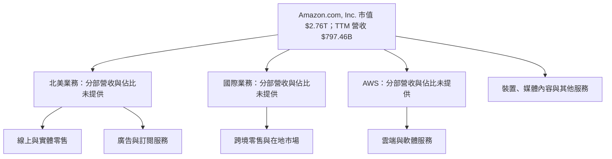
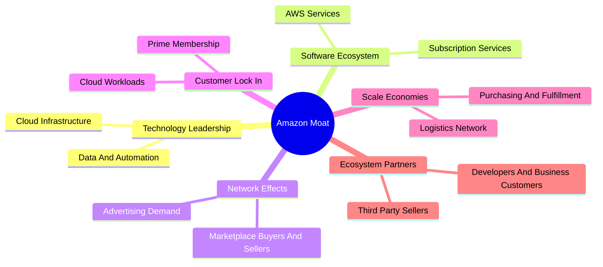
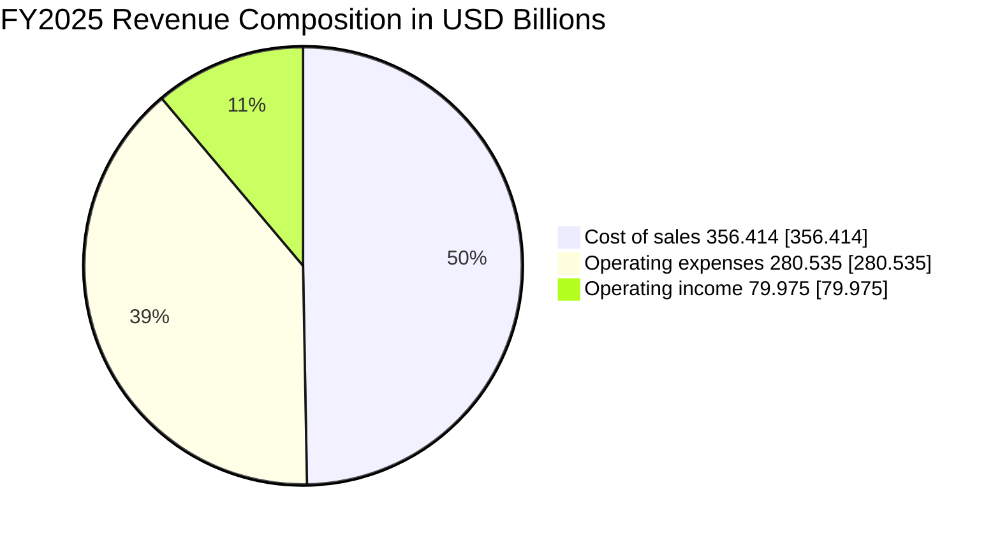
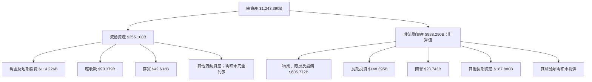
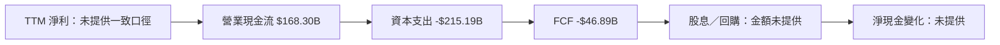
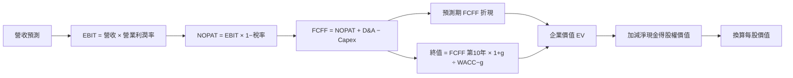
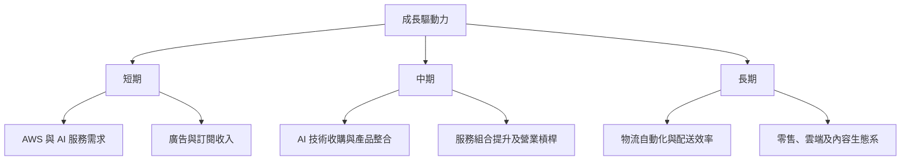
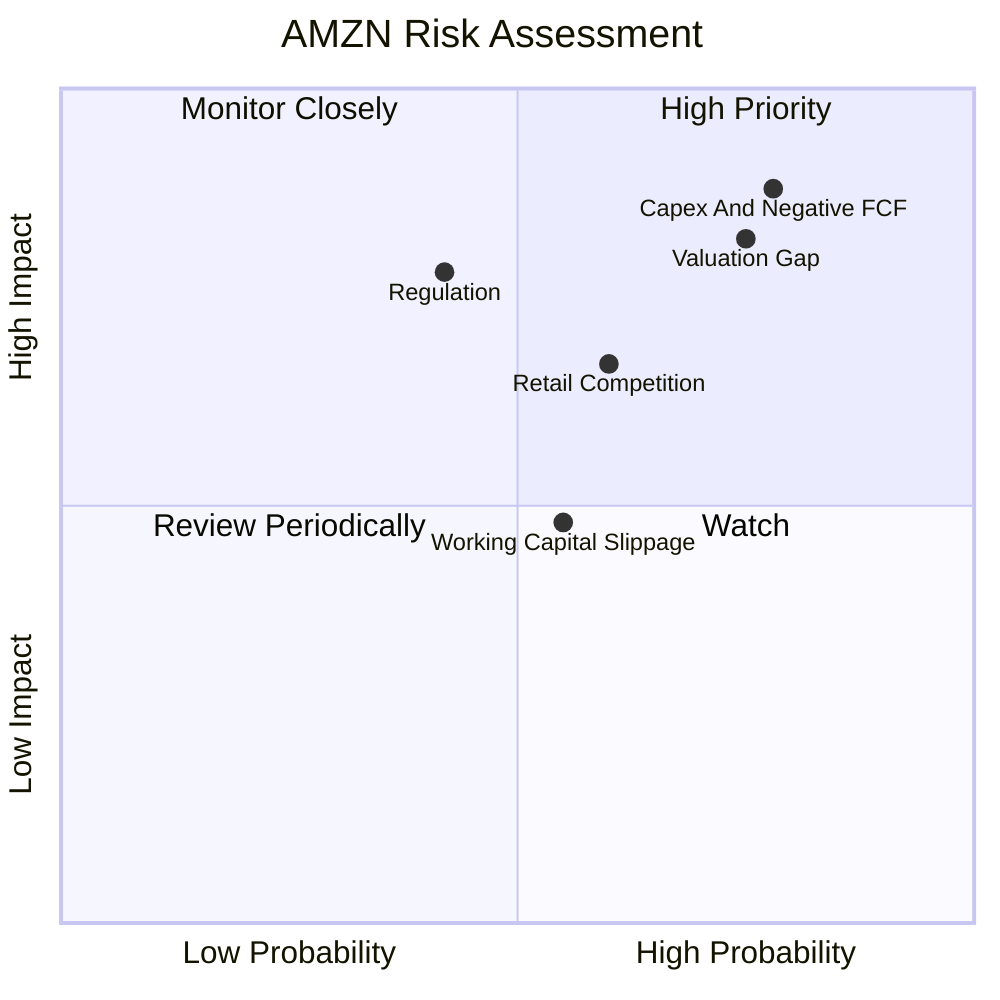
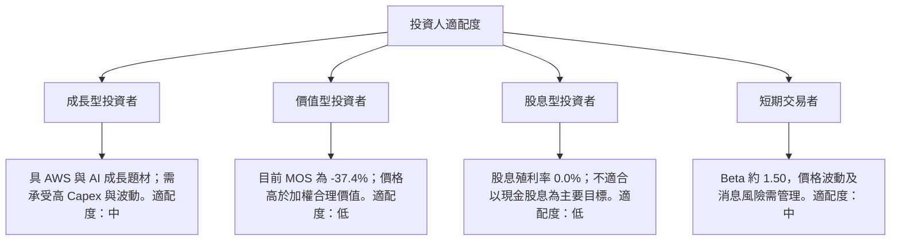

# AMZN 基本面深度分析報告
> **報告日期**：2026-11-24 ｜ **語言**：繁體中文 ｜ **數據來源**：SEC 申報資料 (XBRL)、Yahoo Finance、Finviz、StockAnalysis、Roic.ai ｜ **分析師**：CFA 級機構研究

## 目錄

| # | 章節 | 核心結論 |
|---|------|----------|
| 1 | 執行摘要 | 賣出；加權合理價值 $185.91，MOS -37.4% |
| 2 | 公司概覽與商業模式 | 零售、廣告、訂閱與 AWS 的多元平台；業務別營收明細未提供 |
| 3 | 損益表深度分析 | TTM 營收 $797.46B、年增 15.4%；TTM 營業利益率 13.1% |
| 4 | 資產負債表分析 | 淨負債 $65.73B；流動資產高，但流動比率低於 1 |
| 5 | 現金流量深度分析 | TTM FCF -$46.89B，主因資本支出高於營業現金流 |
| 6 | 獲利能力與資本效率 | ROIC 11.9% 高於 WACC 10.95%，但利差僅 0.95 個百分點 |
| 7 | 相對估值分析 | 相對歷史 P/E 偏低，但 P/S 接近五年區間上緣 |
| 8 | DCF 內在價值評估 | 基準 DCF $55.43；加權合理價值 $185.91 |
| 9 | 成長催化劑 | AWS、廣告、AI 及自動化是主要質化催化劑；TAM 數字未提供 |
| 10 | 風險矩陣 | 資本支出與 FCF、估值落差、競爭與監管為主要風險 |
| 11 | 投資建議 | 依 MOS 為賣出；等待價格或現金流改善再重新評估 |

---

## 1. 執行摘要

截至 2026-11-23，AMZN 收盤價為 **$255.39**。TTM 營收 **$797.46B**、年增 **15.4%**，TTM 營業利益率 **13.1%**，ROIC **11.9%**，略高於 **10.95% WACC**；然而 TTM 營業現金流 **$168.30B** 低於資本支出 **$215.19B**，形成 TTM FCF **-$46.89B**。以 DCF 基準價值 **$55.43** 及固定權重的估值方法計算，加權合理價值為 **$185.91**，MOS 為 **-37.4%**。因此，依規則 20 評級為 **🔴 賣出**：現價顯著高於加權合理價值，且負 FCF 增加估值下行風險。

### 1.0 一頁式投資儀表板（Portfolio Manager 30 秒速讀）

| 項目 | 內容 |
|------|------|
| **投資論點（3 句）** | ① TTM 營收年增 **15.4%**，零售、AWS、廣告等多元業務支撐成長。② TTM 營業利益率 **13.1%**、ROIC **11.9%**，高於 **10.95% WACC**，但價值利差不大。③ TTM FCF **-$46.89B**，資本支出 **$215.19B** 高於營業現金流 **$168.30B**，且加權合理價值低於現價。 |
| **綜合評分** | **5.8/10**（引用 1.1） |
| **財務健康** | 🟡 現金與短期投資 **$114.23B**，但淨負債 **$65.73B**、流動比率 **0.989**，TTM FCF 為負。 |
| **ROIC vs WACC** | **11.9% vs 10.95%**；目前略為創造價值，利差 **0.95 個百分點**。 |
| **FCF 趨勢** | TTM FCF 為負；FCF Yield **-1.70%**。 |
| **估值** | Forward P/E **23.4x**（市場資料）；EV/EBITDA **16.1x**（市場資料）；FCF Yield **-1.70%**。 |
| **DCF 內在價值（基準）** | **$55.43**；相對現價折溢價 **+360.7%**（DCF 基準價值，來自第 8 章）。 |
| **安全邊際（MOS）** | **-37.4%＝($185.91 − $255.39) ÷ $185.91**；🔴 低於 10%，無安全邊際。 |
| **預期報酬（基準情境 12M）** | 12 個月報酬數據未提供；基準 DCF 價值相對現價為 **-78.3%**，是模型價值差而非 12 個月價格預測。 |
| **關鍵風險（前二）** | 高資本支出持續壓低 FCF；現價高於加權合理價值。 |
| **評級 + 信心度** | 🔴 **賣出** ｜ 信心：中（估值與現金流方向清楚，但資料來源有部分口徑差異，且 DCF 終值比重高）。 |

### 1.1 綜合評分卡（全報告唯一）

| 維度 | 評分（1–10） | 主要依據（引用數字與其來源章節） |
|------|--------------|----------------------------------|
| 成長性 | 7 | TTM 營收年增 **15.4%**、最新一季年增 **12.1%**（第 3 章），成長仍為正，但最新季增速較 TTM 低。 |
| 獲利能力 | 8 | TTM 營業利益率 **13.1%**；ROIC **11.9%** 高於 WACC **10.95%**；Piotroski **4/8**（第 6 章）。 |
| 財務健康 | 5 | 現金與短期投資 **$114.23B**，淨負債 **$65.73B**；流動比率 **0.989**；DSO 由 **32 天**升至 **45 天**（第 4 章）。 |
| 估值 | 2 | 加權合理價值 **$185.91**、MOS **-37.4%**；現價 **$255.39**（第 8 章）。 |
| 護城河 | 8 | 多邊平台、物流規模、AWS 與訂閱服務形成互補；財務規模可驗證，但分部營收與市場份額未提供（第 2 章）。 |
| 管理層與資本配置 | 5 | 2025 年資本支出 **$131.82B**、SBC **$19.47B**；稀釋股數未通過 F-Score 測試，資本回報與稀釋需持續監控（第 3、5、6 章）。 |
| **綜合評分** | **5.8** | 六項算術平均：**(7 + 8 + 5 + 2 + 8 + 5) ÷ 6 = 5.8**。 |

### 1.2 五大投資論點 + 三大核心風險

| 類型 | 項目 | 具體依據 | 信心度 |
|------|------|----------|--------|
| 🟢 **投資論點①** | 營收仍維持雙位數成長 | TTM 營收 **$797.46B**，TTM 年增 **15.4%**；最新一季年增 **12.1%**，但增速低於 TTM。 | 🟢 高 |
| 🟢 **投資論點②** | 利潤率較 2022 年改善 | 年營業利益由 2022 年 **$12.25B** 升至 2025 年 **$79.97B**；營業利益率由約 **2.4%** 升至 **11.2%**。 | 🟢 高 |
| 🟢 **投資論點③** | ROIC 略高於資本成本 | TTM ROIC **11.9%**、WACC **10.95%**，利差 **+0.95pp**。 | 🟡 中 |
| 🟢 **投資論點④** | 產品與服務組合多元 | 線上與實體零售、廣告、訂閱、AWS、裝置及媒體內容均在公司業務描述中；分部營收數字未提供。 | 🟡 中 |
| 🟢 **投資論點⑤** | 相對自身歷史 P/E 不高 | P/E **20.6x**，五年中位數 **32.2x**，目前位於歷史百分位 **35%**。 | 🟡 中 |
| 🟡 **風險①** | 資本支出侵蝕現金回報 | TTM Capex **$215.19B**、OCF **$168.30B**，TTM FCF **-$46.89B**。 | 🔴 高衝擊 |
| 🔴 **風險②** | 估值與內在價值差距大 | 加權合理價值 **$185.91**，較現價 **$255.39** 低 **27.2%**；DCF 基準值 **$55.43**。 | 🔴 高衝擊 |
| 🟡 **風險③** | 應收帳款天數上升 | DSO 從一年前 **32 天**增至 **45 天**；原因可能涉及業務組合或收款週期，但現有資料不足以拆解。 | 🟡 中 |

### 1.3 快速統計卡片

同業中位數以 MSFT、GOOG、WMT 的最新季營收年增及 TTM 毛利率計算；僅呈現有完整同業數據的項目。

| 指標 | 公司實際值（期間） | 同業中位數 | 狀態 |
|------|--------------------|------------|------|
| 營收成長（TTM） | **15.4%** | — | 🟢 |
| 營收成長（最新一季年增） | **12.1%** | **18.8%** | 🟡 |
| 毛利率（TTM） | **51.4%** | **60.9%** | 🟡 |
| 營業利益率（TTM） | **13.1%** | — | 🟢 |
| ROIC（TTM） | **11.9%** | — | 🟢 |
| Forward P/E | **23.4x** | **20.4x** | 🟡 |
| FCF Yield（TTM） | **-1.70%** | — | 🔴 |
| Piotroski F-Score | **4 / 8** | — | 🟡 |

### 1.4 投資結論

```text
╔══════════════════════════════════════════════════════════════════╗
║                    📊 投資結論摘要                               ║
╠══════════════════════════════════════════════════════════════════╣
║  評級：🔴 賣出（依 MOS 門檻）                                    ║
║  價格（2026-11-23 收盤）：$255.39                                ║
║  DCF 內在價值（基準）：$55.43（現價溢價 360.7%）                ║
║  安全邊際 MOS：-37.4%（＝($185.91−$255.39)÷$185.91）            ║
║  加權合理價值（8.8）：$185.91                                    ║
║  DCF 情境價值：                                                  ║
║    悲觀情境：$12.42（-95.1%）                                    ║
║    基準情境：$55.43（-78.3%）                                    ║
║    樂觀情境：$127.72（-50.0%）                                   ║
║  綜合評分：5.8/10（引用 1.1）                                    ║
║  適合投資人：能承受高波動、持有期限長，且重視 AWS/AI 成長者；   ║
║              但目前估值不適合以安全邊際為主要原則的新買進者。   ║
╚══════════════════════════════════════════════════════════════════╝
```

---

## 2. 公司概覽與商業模式

### 2.1 業務結構與收入來源

公司概況提供三個主要分部：北美、國際及 AWS；另有廣告、訂閱、實體與線上零售、裝置和媒體內容。財務資料未提供各分部營收，因此不虛構分部金額或營收佔比。



**軟體／服務收入**：AWS、廣告、訂閱等服務具有服務型收入特徵，但各自金額與毛利率未提供，不能量化服務收入佔比。

### 2.2 市場份額

市場份額數據未提供，因此不繪製比例圖。公司 TTM 營收 **$797.46B**，規模明顯龐大；但最新一季營收年增 **12.1%**，低於資料中 MSFT、GOOG 的 **18.8%**、**24.7%**，也高於 WMT 的 **5.2%**。此比較反映公司規模與增長的相對位置，不等同於市場份額。

### 2.3 競爭護城河分析



### 2.4 護城河強度

| 護城河項目 | 強度（強／中／弱） | 證據（引用數字或事實） | 會削弱它的情況 |
|------------|--------------------|------------------------|----------------|
| 技術與雲端基礎設施 | 強 | AWS 為公司明列的主要業務分部；但 AWS 單獨營收與市佔數據未提供。 | 雲端價格競爭、客戶自建或多雲轉移、AI 投資回報不足。 |
| 軟體生態系統 | 中至強 | AWS 提供雲端服務，訂閱服務與媒體內容形成服務組合；個別用戶數與留存率未提供。 | 訂閱取消增加、服務差異化降低。 |
| 網路效應 | 中 | 市集連結買家與第三方賣家，廣告亦受商品流量支撐；交易量與活躍賣家數未提供。 | 賣家轉移、平台費用上升引發多平台經營。 |
| 客戶鎖定 | 中至強 | AWS 工作負載遷移成本，以及零售會員與配送整合可形成黏著度；客戶流失率未提供。 | 企業雲端遷移工具改善、消費者對會員價值感下降。 |
| 規模效應 | 強 | TTM 營收 **$797.46B**，員工 **1,638,000**；實際單位配送成本未提供。 | 勞動、履約、能源與基建成本上升。 |
| 生態夥伴 | 中 | 第三方賣家、開發者及商業客戶是平台參與者；合作夥伴數據未提供。 | 監管限制平台自營與第三方交易整合。 |

護城河評分 **8/10**：營收規模、AWS、物流與平台業務提供質化支持，但分部營收、留存率與單位經濟數據未提供，故不作更高評分。

---

## 3. 損益表深度分析

### 3.1 年度收入成長趨勢（近 4 年）

2022–2025 年營收及年度增幅如下；金額取年度損益表，成長率依相鄰年度收入計算。

```text
╔══════════════════════════════════════════════════════════════════╗
║              Amazon 年度收入趨勢（FY2022-FY2025）               ║
╠══════════════════════════════════════════════════════════════════╣
║  FY2022  $513.98B  ██████████████████░░░░░░░  YoY：—            ║
║  FY2023  $574.78B  ████████████████████░░░░░  YoY：+11.8% 🟢     ║
║  FY2024  $637.96B  ██████████████████████░░░  YoY：+11.0% 🟢     ║
║  FY2025  $716.92B  █████████████████████████  YoY：+12.4% 🟢     ║
╠══════════════════════════════════════════════════════════════════╣
║  FY2022-FY2025 營收 CAGR：約 11.7%                              ║
╚══════════════════════════════════════════════════════════════════╝
```

計算：**($716.92B ÷ $513.98B)^(1/3) − 1 ≈ 11.7%**。FY2025 營收年增 **12.4%**，較 FY2024 的 **11.0%** 加快，顯示收入擴張仍具延續性；但此年度增幅不能直接視為未來成長保證。

### 3.2 季度收入趨勢分析

最近四季收入採 StockAnalysis 季度列示。QoQ 以本季除以前季減一計算；YoY 使用同季年增率。Q2、Q3 2026 收入與 2025 同季數據均有提供。

| 季度 | 營收 | QoQ | YoY | 備註 |
|------|------|-----|-----|------|
| 2025 Q4 | $213.386B | +18.4% | +13.6% | 假期季節性令營收高於前季。 |
| 2026 Q1 | $181.519B | -14.9% | +16.6% | 相較假期季回落，但高於 2025 Q1。 |
| 2026 Q2 | $200.606B | +10.5% | +19.6% | 季增與年增均上升。 |
| 2026 Q3 | $201.944B | +0.7% | +12.1% | 年增率較 Q2 放緩；QoQ 成長趨平。 |

最新一季單季營收年增 **12.1%**，較 TTM 營收年增 **15.4%** 低 **3.3 個百分點**。此差距提示近季成長有降溫，不應把 TTM 成長速度機械外推。

### 3.3 利潤率演變分析

| 利潤率指標 | FY2022 | FY2023 | FY2024 | FY2025 | 趨勢 | 評估 |
|------------|--------|--------|--------|--------|------|------|
| **毛利率** | 43.8% | 47.0% | 48.9% | 50.3% | 連續改善 | 🟢 |
| **營業利益率** | 2.4% | 6.4% | 10.8% | 11.2% | 顯著恢復後增幅收斂 | 🟢 |
| **淨利率** | -0.5% | 5.3% | 9.3% | 10.8% | 2022 虧損後回升 | 🟢 |

年度毛利率由 **43.8%** 升至 **50.3%**，營業利益率由 **2.4%** 升至 **11.2%**。改善與費用紀律、履約及營運效率、較高毛利服務組合等可能因素相符；但現有資料沒有分部獲利拆分，無法精確量化各項因素貢獻。最新 TTM 營業利益率為 **13.1%**，最新一季為 **13.9%**（以 SEC 10-Q 及驗證數據期間定義為準），顯示近期利潤率高於 2025 全年。

### 3.4 費用結構分析

依 FY2025 收入 **$716.924B**、毛利 **$360.510B** 及營業利益 **$79.975B**，可將收入拆為銷貨成本、營業費用及營業利益。以下為該三項的年度金額分解，不代表現金支出結構。



```text
╔══════════════════════════════════════════════════════════════════╗
║              FY2025 收入與營業項目（USD B）                     ║
╠══════════════════════════════════════════════════════════════════╣
║  收入             $716.924B  █████████████████████████          ║
║  銷貨成本         $356.414B  ████████████░░░░░░░░░░░             ║
║  營業費用         $280.535B  ██████████░░░░░░░░░░░░░             ║
║  營業利益          $79.975B  ███░░░░░░░░░░░░░░░░░░░░             ║
╚══════════════════════════════════════════════════════════════════╝
```

計算方式：銷貨成本 = **$716.924B − $360.510B = $356.414B**；營業費用 = **$360.510B − $79.975B = $280.535B**。分部費用、廣告成本及 AWS 成本明細未提供，不再細拆。

### 3.5 季度 EPS 趨勢與盈餘品質（Quality of Earnings）

四季 EPS 實際值有列示，但 EPS 預估值與驚喜幅度均為 `nan`，因此無法可靠判定季度超預期或不及預期。2026 Q3 EPS **$1.89**，Q2 **$5.75**，Q1 **$2.78**，2025 Q4 **$1.95**；季度間波動明顯，且最新 Q3 EPS 年增 **-3.1%**。

| 盈餘品質項目 | 數值/佔比 | 評估 |
|--------------|-----------|------|
| 股權薪酬 SBC / 營收 | FY2025：**$19.47B ÷ $716.92B = 2.72%** | 🟡 SBC 是實際稀釋成本；儘管 GAAP 已費用化，股數增加仍會稀釋每股價值。 |
| SBC / 營業現金流 | FY2025：**$19.47B ÷ $139.51B = 14.0%** | 🟡 比例不低；需留意以 SBC 作為非現金加回時，經濟成本是否被低估。 |
| FCF / 淨利（現金轉換率） | TTM FCF **-$46.89B**；TTM 淨利口徑不同來源，無法一致計算 | 🔴 FCF 為負，資本投入使現金轉換短期偏弱；不以不同來源的淨利數據反推比率。 |
| 一次性／非經常性損益 | 未提供可核對明細 | 🟡 無法判斷當期淨利是否受一次性項目重大影響。 |
| 有效稅率異常 | 模型採用稅率 **21.0%**；實際 TTM 有效稅率未提供 | 🟡 無法判定近期 GAAP 盈利是否受到特殊稅務項目影響。 |
| 資本化支出 vs 費用化 | TTM Capex **$215.19B**；資本化與費用化明細未提供 | 🟡 資本支出會在未來透過折舊逐期進損益；不能據此推斷有不當資本化。 |

**盈餘品質結論**：TTM 營業獲利與營業現金流為正，但 **-$46.89B** 的 TTM FCF 顯示高再投資對可分配現金的壓力。FY2025 SBC 為營收的 **2.72%**，是需納入股東回報考量的稀釋成本。由於有效稅率與非經常損益明細未提供，不能斷言 GAAP 淨利被高估或低估；目前估值應更重視資本支出回報與 FCF 恢復速度。

---

## 4. 資產負債表分析

### 4.1 資產結構分解

截至 2026-09-30，總資產為 **$1,243.390B**，流動資產 **$255.100B**，非流動資產合計依總額減流動資產計算為 **$988.290B**。部分非流動資產項目沒有完整分類，以下只列可引用項目。



非流動資產分項未能與非流動資產總額完全勾稽，原因是部分分類資料未完整提供；不以差額反推未列項目。

### 4.2 流動性與營運資金分析

流動比率等歷史數值採年度資產負債表資料；營運資金天數則依 QUALITY FIGURES 原列，不重算。

| 指標 | 最新 TTM | 一年前 TTM | 變化 | 解讀 |
|------|----------|------------|------|------|
| DSO 應收帳款天數 | **45 天** | **32 天** | **+13 天** | 應收天數增加，代表收款週期拉長或收入組合改變；需追蹤應收帳款與營收增幅是否持續背離。 |
| DIO 存貨天數 | N/A | N/A | N/A | 數據未提供可計算的營運成本餘額。 |
| DPO 應付帳款天數 | N/A | N/A | N/A | 數據未提供可計算的營運成本餘額。 |
| CCC 現金轉換週期 | N/A | N/A | N/A | 因 DIO、DPO 未提供，CCC 不計算。 |

| 流動性指標 | 最新可用值 | 歷史參考 | 評估 |
|------------|------------|----------|------|
| 流動比率 | **0.989** | FY2025 流動資產 **$229.08B**／流動負債 **$218.00B**，約 **1.05** | 🟡 最新比率略低於 1，短期流動性需監控。 |
| 速動比率 | **0.793** | — | 🟡 扣除存貨等後，流動資產覆蓋短期負債較弱。 |
| 現金與短期投資 | **$114.23B** | FY2025 **$123.03B** | 🟢 現金資源仍大，但較 FY2025 下降。 |

### 4.3 債務結構分析

依驗證財務數據，現金及短期投資 **$114.23B**、總債務 **$179.95B**、淨負債 **$65.73B**。其他資料源列出的總債務與淨負債口徑不同，本節依一致的 VERIFIED FIGURES 口徑。

```text
╔══════════════════════════════════════════════════════════════════╗
║                   Amazon 債務健康診斷                            ║
╠══════════════════════════════════════════════════════════════════╣
║  總債務：          $179.95B  ████████████████░░░░  🟡            ║
║  現金+短期投資：   $114.23B  ██████████░░░░░░░░░░  🟢            ║
║  淨負債：           $65.73B  ██████░░░░░░░░░░░░░░  🟡            ║
║                                                                  ║
║  Debt/EBITDA：N/A（同一期、同口徑 EBITDA 未提供）                ║
║  利息保障倍數：N/A（利息支出未提供）                             ║
║  結論：現金部位提供緩衝，但公司並非淨現金狀態。                 ║
╚══════════════════════════════════════════════════════════════════╝
```

### 4.4 股東權益趨勢

| 財年 | 股東權益 | 年變動 |
|------|----------|--------|
| 2022 | $146.04B | — |
| 2023 | $201.88B | +38.2% |
| 2024 | $285.97B | +41.7% |
| 2025 | $411.06B | +43.7% |

```text
╔══════════════════════════════════════════════════════════════════╗
║                 股東權益變化（USD B）                            ║
╠══════════════════════════════════════════════════════════════════╣
║  2022  $146.04B  ████████░░░░░░░░░░░░░                          ║
║  2023  $201.88B  ██████████░░░░░░░░░░░                          ║
║  2024  $285.97B  ███████████████░░░░░░                          ║
║  2025  $411.06B  ██████████████████████                          ║
╚══════════════════════════════════════════════════════════════════╝
```

股東權益快速增加與公司獲利累積及財務狀況變化一致；但 2026-09-30 權益數據未提供於同一品質指標區塊，故不外推最新季度權益。

---

## 5. 現金流量深度分析

### 5.1 現金流量瀑布圖

TTM 現金流路徑依驗證數據為：營業現金流 **$168.30B** 減資本支出 **$215.19B**，得到 FCF **-$46.89B**。同口徑 TTM 淨利、股息及回購金額未提供，不納入金額節點。



### 5.2 FCF 轉換率趨勢

| 財年 | OCF | Capex | FCF | 淨利 | FCF / 淨利 |
|------|-----|-------|-----|------|------------|
| 2022 | $46.75B | $63.65B | -$16.89B | -$2.72B | 不具可比性（淨利為負） |
| 2023 | $84.95B | $52.73B | $32.22B | $30.43B | 約 **105.9%** |
| 2024 | $115.88B | $83.00B | $32.88B | $59.25B | 約 **55.5%** |
| 2025 | $139.51B | $131.82B | $7.70B | $77.67B | 約 **9.9%** |
| TTM 至 2026-09-30 | $168.30B | $215.19B | -$46.89B | N/A | N/A |

FY2025 FCF 大幅低於淨利，TTM 更轉負，主要是資本支出高於 OCF；這表示會計獲利增加沒有同步轉化成可自由運用現金。

### 5.3 自由現金流趨勢

```text
╔══════════════════════════════════════════════════════════════════╗
║              FCF 歷史實際與 TTM（USD B）                         ║
╠══════════════════════════════════════════════════════════════════╣
║  FY2022  -$16.89B  ░░░░░░░░░░░░░░░░░░░░░  Yield：N/A            ║
║  FY2023   $32.22B  ███████████████░░░░░░  Yield：N/A            ║
║  FY2024   $32.88B  ███████████████░░░░░░  Yield：N/A            ║
║  FY2025    $7.70B  ████░░░░░░░░░░░░░░░░░  Yield：N/A            ║
║  TTM      -$46.89B ░░░░░░░░░░░░░░░░░░░░░  Yield：-1.70%         ║
╠══════════════════════════════════════════════════════════════════╣
║  註：年度 FCF Yield 未提供相同市值基準，故不反推或填列。          ║
╚══════════════════════════════════════════════════════════════════╝
```

TTM FCF Yield 使用驗證數據 **-1.70%**；市場資料另列 **-1.36%**，兩者口徑存在差異，本報告採用要求指定的驗證數據值。

### 5.4 資本配置評估

年度現金流資料可量化的資本配置項目主要是 Capex 與營業現金流；回購、留存、股息及各類投資的完整金額未提供，因此不繪製資本配置比例圖。

| 項目 | FY2025 | 評估 |
|------|--------|------|
| 營業現金流 | $139.51B | 較 FY2024 的 $115.88B 上升約 **20.4%**。 |
| 資本支出 | $131.82B | 相當於 FY2025 OCF 約 **94.5%**，壓縮自由現金流空間。 |
| FCF | $7.70B | 大幅低於 FY2024 的 $32.88B。 |
| 股權薪酬 | $19.47B | 是員工薪酬的重要形式，也是股東稀釋成本。 |
| 股息與回購 | 金額未提供 | 公司股息殖利率 **0.0%**；回購金額資料未提供。 |

---

## 6. 獲利能力與資本效率

### 6.1 ROE / ROA / ROIC 趨勢

歷史 ROE、ROA、ROIC 具可比口徑的完整年度序列未提供；以下列出可用最新值，不以不同來源混合補齊。

| 指標 | 最新可用值 | 歷史趨勢資料 | 評估 |
|------|------------|----------------|------|
| ROE | **22.0%**（品質指標，TTM） | 年度可比序列 N/A | 🟢 盈利對帳面權益有正回報，但應連同槓桿看。 |
| ROA | **TTM 數值未提供於品質指標**；市場資料另列 6.6% | 年度可比序列 N/A | 🟡 採用口徑不一致，避免混用。 |
| ROIC | **11.9%**（TTM） | 歷史序列 N/A | 🟢 高於 WACC **10.95%**，但超額回報不大。 |

### 6.2 ROIC vs WACC 分析（核心價值創造判斷）

資本成本使用驗證值：無風險利率 **4.92%**、ERP **5.00%**、調整後 Beta **1.34**、Ke **11.59%**、稅前 Kd **1.26%**、稅率 **21.0%**、股權／債務權重 **93.9%／6.1%**、WACC **10.95%**。公司 ROIC **11.9%**，高於 WACC **0.95pp**，代表目前仍略有正經濟利潤。

```text
╔══════════════════════════════════════════════════════════════════╗
║                ROIC vs WACC 深度分析                            ║
╠══════════════════════════════════════════════════════════════════╣
║  WACC（程式計算，採用驗證值）：10.95%                            ║
║  ├── 無風險利率（10Y 美債）：       4.92%                       ║
║  ├── ERP（假設值）：                5.00%                       ║
║  ├── 原始 Beta：                    1.50                        ║
║  ├── 調整後 Beta：                  1.34                        ║
║  ├── 股權成本 Ke（採用值）：        11.59%                      ║
║  ├── 稅前債務成本：                 1.26%                       ║
║  ├── 稅後 Kd = 1.26%×(1−21%)：      1.00%                       ║
║  ├── E / D 權重：                   93.9% / 6.1%                ║
║  └── 採用 WACC：                    10.95%                      ║
║                                                                  ║
║  ROIC（TTM）：                      11.9%                       ║
║  EVA spread = ROIC − WACC：         +0.95pp                     ║
║                                                                  ║
║  ROIC 11.9%  ▓▓▓▓▓▓▓▓▓▓▓▓▓▓▓▓▓▓▓▓▓▓░░░░░░                     ║
║  WACC 10.95% ▓▓▓▓▓▓▓▓▓▓▓▓▓▓▓▓▓▓▓░░░░░░░                       ║
║                                                                  ║
║  結論：目前創造股東價值，但利差薄；若 ROIC 下跌超過 0.95pp，    ║
║        或資本成本上升，價值創造可能轉為價值摧毀。               ║
╚══════════════════════════════════════════════════════════════════╝
```

原始 Beta **1.50** 調整方式：**(2/3 × 1.50) + (1/3 × 1.00) = 1.33**，資料列示調整後 Beta 為 **1.34**，本報告照錄。另依同一組輸入直接計算 CAPM 得 **4.92% + 1.34 × 5.00% = 11.62%**，與資料列示 Ke **11.59%** 有 **0.03pp** 差異；本報告不另改算 WACC，仍採用指定 **10.95%**。利息費用與計息負債平均餘額未提供，不能獨立重建稅前 Kd；WACC 權重亦照錄既有資本成本資料。

### 6.3 杜邦三因素分解

| 因素 | 數值（TTM） | 解讀 |
|------|-------------|------|
| 淨利率 | **16.9%** | 獲利率是 ROE 的主要正向來源；須注意該品質指標與其他市場資料來源的淨利口徑差異。 |
| 資產週轉率 | **0.64** | 大型零售與雲端基建資產形成的收入轉換效率。 |
| 權益乘數 | **2.03** | 代表有一定財務槓桿，但 ROE 並非只靠高槓桿形成。 |
| **ROE** | **22.0%** | **16.9% × 0.64 × 2.03 = 21.95% ≈ 22.0%**。 |

### 6.4 財務體質：Piotroski F-Score

Piotroski F-Score 為 **4/8**；毛利率測試因資料缺漏不計入，因此可判定測試數為 8，而非 9。

| 測試 | 結果 | 解讀 |
|------|------|------|
| ROA > 0 | ✅ 通過 | TTM 獲利為正。 |
| 營業現金流 > 0 | ✅ 通過 | TTM OCF 為 **$168.30B**。 |
| ROA 高於一年前 | ✅ 通過 | 資產獲利能力較前期改善。 |
| 營業現金流 > 淨利 | ✅ 通過 | 支持應計品質，但不代表扣除高額 Capex 後 FCF 為正。 |
| 長期負債 ÷ 總資產低於一年前 | ❌ 未通過 | 槓桿指標未改善。 |
| 流動比率高於一年前 | ❌ 未通過 | 短期流動性相對走弱。 |
| 稀釋股數未增加 | ❌ 未通過 | 股數增加對每股回報形成稀釋。 |
| 毛利率高於一年前 | — 無法判定 | 資料缺漏，未納入分母。 |
| 資產週轉率高於一年前 | ❌ 未通過 | 資產運用效率未改善。 |

4/8 表示經營獲利與營業現金流部分測試通過，但負債、流動性、稀釋及資產週轉率測試未通過；整體財務趨勢並非全面改善。

---

## 7. 相對估值分析

### 7.1 同業估值比較

同業倍數採 Yahoo Finance 指定數據；同業中位數取 MSFT、GOOG、WMT 三家公司。

| 估值指標 | **AMZN** | **MSFT** | **GOOG** | **WMT** | 本公司評估 |
|----------|----------|---------|---------|---------|-----------|
| **Trailing P/E** | **20.6x** | 25.7x | 14.6x | 46.9x | 🟡 低於 MSFT、WMT，高於 GOOG。 |
| **Forward P/E** | **23.4x** | 20.4x | 18.3x | 40.1x | 🟡 高於同業中位數 **20.4x**。 |
| **P/S Ratio** | **3.5x** | 10.6x | 7.3x | 1.4x | 🟢 低於科技平台公司，高於零售型 WMT。 |
| **EV/EBITDA** | **16.1x** | 18.1x | 18.0x | 22.6x | 🟢 低於三家同業；不同業務組合限制可比性。 |
| **最新季營收年增** | **12.1%** | 18.8% | 24.7% | 5.2% | 🟡 低於 MSFT、GOOG，高於 WMT。 |
| **毛利率（TTM）** | **51.4%** | 67.7% | 60.9% | 25.3% | 🟡 低於軟體／搜尋平台，高於零售型 WMT。 |

AMZN 不是純零售公司：零售、AWS、廣告與訂閱服務的盈利模式不同。因此同業 P/E 與 EV/EBITDA 只作多方法參照，不能忽略業務組合差異。

### 7.2 歷史估值區間分析

| 指標 | 目前 | 五年中位數 | 五年區間 | 目前百分位 |
|------|------|------------|----------|------------|
| P/E | **20.6x** | 32.2x | 2.6x–251.9x | 35% |
| P/S | **3.5x** | 3.0x | 0.2x–3.7x | 90% |
| EV/EBITDA | **15.6x** | 17.3x | 0.7x–22.7x | 29% |

```text
╔══════════════════════════════════════════════════════════════════╗
║           AMZN 五年估值區間及目前位置                            ║
╠══════════════════════════════════════════════════════════════════╣
║  P/E       2.6x ├──────────────●────────────────────────┤ 251.9x ║
║                            20.6x；百分位 35%                     ║
║  P/S       0.2x ├──────────────────────────────────●───┤   3.7x ║
║                                                  3.5x；百分位90% ║
║  EV/EBITDA 0.7x ├──────────────●───────────────────────┤  22.7x ║
║                           15.6x；百分位 29%                      ║
╚══════════════════════════════════════════════════════════════════╝
```

P/E 與 EV/EBITDA 低於五年中位數，但 P/S 位於五年區間 **90 百分位**，顯示市場仍為營收規模給予高估值。歷史估值區間不能替代現金流分析，尤其目前 TTM FCF 為負。

### 7.3 情境價值（Bear / Base / Bull，依 DCF 模型）

| 情境 | 第 1 年營收成長 | 期末營業利潤率 | WACC | 每股價值 | 相對現價 | 機率 | 會發生的條件 |
|------|----------------|----------------|------|----------|----------|------|--------------|
| 🔴 悲觀 | 7.7% | 9.1% | 11.95% | **$12.42** | **-95.1%** | 25% | 零售與雲端增長降速、資本支出效率不足、利潤率下行。 |
| 🟡 基準 | 15.4% | 10.8% | 10.95% | **$55.43** | **-78.3%** | 50% | 起始成長等於 TTM 成長率，長期利潤率回落至近五年中位數。 |
| 🟢 樂觀 | 23.0% | 11.8% | 9.95% | **$127.72** | **-50.0%** | 25% | 高成長延續、利潤率維持相對高位，且資本成本下降。 |

三種情境的價值均低於現價。即使樂觀情境成立，模型價值 **$127.72** 仍較現價低 **50.0%**；這是估值模型結果，不等同於短期價格預測。

### 7.4 相對估值隱含價格區間

```text
╔══════════════════════════════════════════════════════════════════╗
║              相對估值與現價（每股 USD）                         ║
╠══════════════════════════════════════════════════════════════════╣
║  DCF 基準             $55.43                                     ║
║  同業 Forward P/E    $222.35                                     ║
║  現價                $255.39                                     ║
║  同業 EV/EBITDA      $302.06                                     ║
║  分析師共識目標價    $326.34                                     ║
╚══════════════════════════════════════════════════════════════════╝
```

- **同業 Forward P/E：$222.35**，以同業中位數 **20.4x** 乘上 AMZN Forward EPS **$10.93**。
- **同業 EV/EBITDA：$302.06**，以同業中位數 **18.1x** 乘 TTM EBITDA 並加回淨現金；該估值方法沿用既有程式計算結果。
- 分析師共識均值 **$326.34**，來自 **60 位分析師**的平均目標價，作為參考，不視為獨立現金流估值。

---

## 8. DCF 內在價值評估（Discounted Cash Flow）

### 8.0 估值推理鏈（Thinking Logic）

**Step 1 — 價值由哪些變數決定？**  
模型價值主要由零售及國際業務的收入基礎、AWS／廣告等服務業務的利潤，以及未來資本支出強度構成。公司分部營收佔比未提供，無法量化各業務權重；模型最敏感的假設是 **WACC 與永續成長率 g**，因基準終值現值佔企業價值 **98.6%**。

**Step 2 — 模型選擇**

| 決策點 | 本報告採用 | 理由（含數字） | 曾考慮但否決 | 否決理由 |
|--------|-----------|----------------|--------------|----------|
| 現金流定義 | FCFF | 以 GAAP EBIT、NOPAT 推導，並由 WACC 折現至企業價值。 | FCFE | 資本結構及營運投資仍會變化，FCFF 與 WACC 配對較合適。 |
| 預測期 N | 10 年 | DCF 模型固定採 10 年，讓收入及資本支出逐步收斂。 | 5 年 | 高再投資業務若只看短期，可能無法呈現投資週期。 |
| 終值方法 | Gordon Growth | 已提供永續成長率 **3.0%**，且 WACC **10.95%** 大於 g。 | 退出倍數 | DCF 模型未提供終值退出倍數，不能自行建立。 |
| EBIT 基礎 | GAAP EBIT | 模型明確以 GAAP 營業利益預測。 | 非 GAAP EBIT | 避免把 SBC 加回後漏計股東稀釋成本。 |

**Step 3 — 高／中敏感度輸入推導鏈**

- **營收成長路徑**：錨點＝TTM 年增 **15.4%** → 模型由 FY+1 **15.4%** 線性降至 FY+10 **3.0%**，反映基期提高及成熟期收斂 → 採用該路徑 → 不採用十年維持 15.4%，因現有資料沒有支持十年固定高成長的證據。
- **期末營業利潤率**：錨點＝TTM **13.1%**；FY+10 取最近五個財年的中位數，含 TTM → 模型採 **10.8%** → 不採用永久維持 13.1%，避免把目前較高利潤率無限延伸。
- **永續成長率 g**：錨點＝模型取 **3.0%**，位於長期名目成熟成長假設範圍內，且低於 WACC **10.95%** → 採用 **3.0%** → 不採用高於 WACC 的假設，避免 Gordon Growth 公式失效。
- **預測期 N**：錨點＝模型明列 **10 年** → 採用 **10 年** → 不自行縮短或延長，因模型數值已按該期間計算。
- **Capex／營收**：錨點＝TTM 約 **27.0%** → 逐步下滑至 **10.9%**，等於約 **1.1 × D&A／營收 10.0%** → 採用模型線性收斂路徑 → 不假設長期 Capex 仍固定 27.0%，因長期投資強度若不下降會使 FCFF 持續為負。
- **終值方法**：錨點＝模型提供 Gordon Growth 結果，WACC **10.95%**、g **3.0%** → 採用 Gordon Growth 為主 → 不補入未提供的退出倍數。
- **WACC**：錨點＝指定資本成本資料 **10.95%** → 直接採用，不自行改算 → 不另設折現率，避免與模型敏感度矩陣不一致。
- **EBIT 基礎、SBC 與稀釋**：採 **組合 (A)**：GAAP EBIT 已含 SBC 費用，FCFF 不再扣 SBC，股數不再逐年稀釋；模型已明確採「GAAP EBIT、不另扣 SBC、不再稀釋」→ 不採「加回 SBC 並不稀釋」的組合，以免漏算股東成本。
- **有效稅率**：錨點及採用值均為 **21.0%**；實際 TTM 稅率未提供，故採模型指定值。
- **D&A／營收**：錨點為 TTM **10.0%**，模型固定採用 **10.0%**。
- **ΔWC／營收增額**：模型未建模營運資金變動，故不加入 FCFF；此處不假設 ΔWC 為任何正負金額。

**Step 4 — 最脆弱的一環**  
最脆弱的是資本支出比率由 TTM 約 **27.0%** 降至第十年 **10.9%** 的收斂假設；若基建投資長期維持高檔，FCFF 將低於基準路徑，且由於終值佔 EV **98.6%**，價值可能大幅低於基準 DCF。

**Step 5 — 計算路徑圖**



### 8.1 模型假設總表（Model Inputs）

| 假設項目 | 採用值 | 依據／來源 | 敏感度 |
|----------|--------|------------|--------|
| 預測期長度 N | **10 年** | DCF 模型指定。 | 🟡 中 |
| 營收成長路徑 | FY+1 **15.4%**，FY+10 **3.0%**，線性遞減 | FY+1 錨定 TTM 年增 **15.4%**；FY+10 採成熟期假設。 | 🔴 高 |
| 營業利潤率 | FY+1 **13.1%**，FY+10 **10.8%** | 起點為 TTM 營業利益率，終點為近五財年中位數（含 TTM）。 | 🔴 高 |
| 有效稅率 | **21.0%** | DCF 模型預設；非公司實際 TTM 稅率。 | 🟢 低 |
| Capex／營收 | FY+1 **27.0%** 至 FY+10 **10.9%** | TTM 約 **27.0%**，逐步下降至約 **1.1 × D&A**。 | 🔴 高 |
| D&A／營收 | **10.0%** | TTM 模型錨點並固定。 | 🟢 低 |
| ΔWC／營收增額 | 未建模 | DCF 模型明示 working capital not modelled。 | 🟢 低 |
| EBIT 基礎 | GAAP EBIT | DCF 模型採 GAAP EBIT。 | 🟡 中 |
| 股權薪酬 SBC 處理 | GAAP 已費用化；FCFF 不再扣 SBC | 模型明示 SBC 已在 GAAP EBIT 費用化。 | 🟡 中 |
| 年稀釋率 | **0%（模型固定股數）** | 採組合 (A)，以 GAAP EBIT 已反映 SBC 費用，不再加算股數稀釋。 | 🟡 中 |
| 永續成長率 g | **3.0%** | DCF 模型指定；小於 WACC。 | 🔴 高 |
| 終值方法 | Gordon Growth | 模型已有終值；未提供退出倍數。 | 🔴 高 |
| WACC | **10.95%** | 資本成本資料指定值；計算組成見 8.2。 | 🔴 高 |

本模型使用 **FCFF = NOPAT + D&A − Capex**；不列 ΔWC，因模型未建模。**本模型採用 (A)，故 SBC 影響已計入一次**：使用 GAAP EBIT、不另扣 SBC、股數固定。

### 8.2 折現率推導（WACC）

```text
╔══════════════════════════════════════════════════════════════════╗
║                    WACC 推導（折現率）                           ║
╠══════════════════════════════════════════════════════════════════╣
║  股權成本 Ke（CAPM，採用資料列值）：                             ║
║  ├── 無風險利率 Rf：                  4.92%                      ║
║  ├── 股權風險溢酬 ERP（假設值）：     5.00%                      ║
║  ├── 原始 Beta：                      1.50                       ║
║  ├── 調整後 Beta：                    1.34                       ║
║  └── 資料列 Ke：                     11.59%                     ║
║                                                                  ║
║  債務成本 Kd：                                                    ║
║  ├── 稅前 Kd：                        1.26%                      ║
║  ├── 稅率：                           21.0%                      ║
║  └── 稅後 Kd：                        1.00%                      ║
║                                                                  ║
║  資本權重：股權 93.9%；債務 6.1%                                 ║
║  採用 WACC：                       10.95%                        ║
╚══════════════════════════════════════════════════════════════════╝
```

逐步演算：

1. **Ke**：原始 Beta **1.50** 調整為資料列 **1.34**；依公式計算 **4.92% + 1.34 × 5.00% = 11.62%**。資本成本資料所列 Ke 為 **11.59%**，兩者相差 **0.03pp**；因要求採用指定成本資本輸入，本模型保留資料列 **11.59%**，不以自行重算值替代。
2. **稅前 Kd**：指定值 **1.26%**。利息支出及計息負債平均餘額的原始金額未提供，無法獨立還原「利息 ÷ 平均計息負債」。
3. **稅後 Kd**：**1.26% × (1 − 21.0%) = 0.9954% ≈ 1.00%**。
4. **權重**：指定股權權重 **93.9%**、債務權重 **6.1%**；**93.9% + 6.1% = 100.0%**。市值與債務權重底層未提供可供本報告獨立重算的未四捨五入金額。
5. **WACC**：以指定組成重算，**93.9% × 11.59% + 6.1% × 0.9954% = 10.944% ≈ 10.95%**。第 6.2 與本章使用同一指定 WACC **10.95%**。

無風險利率日期與 ERP 設定依資本成本資料列；未提供 ERP 的外部引用方法，故視為假設值。無規模或國別溢酬資料，本報告不另加。

### 8.3 逐年自由現金流預測（基準情境）

以下金額單位為 **USD B**，逐年數字照 DCF 模型列示；ΔWC 未建模、不另列。折現因子為模型輸出並取三位小數。

| 年度 | FY+1 | FY+2 | FY+3 | FY+4 | FY+5 | FY+6 | FY+7 | FY+8 | FY+9 | FY+10 |
|------|------:|------:|------:|------:|------:|------:|------:|------:|------:|-------:|
| 營收 | 919.87 | 1,048.46 | 1,180.63 | 1,313.26 | 1,442.76 | 1,565.24 | 1,676.64 | 1,772.96 | 1,850.48 | 1,905.99 |
| 營收 YoY | 15.4% | 14.0% | 12.6% | 11.2% | 9.9% | 8.5% | 7.1% | 5.7% | 4.4% | 3.0% |
| 營業利潤率 | 13.1% | 12.8% | 12.6% | 12.3% | 12.0% | 11.8% | 11.5% | 11.3% | 11.0% | 10.8% |
| EBIT（GAAP） | 120.39 | 134.49 | 148.39 | 161.65 | 173.84 | 184.54 | 193.32 | 199.83 | 203.76 | 204.93 |
| − 稅 | (25.28) | (28.24) | (31.16) | (33.95) | (36.51) | (38.75) | (40.60) | (41.96) | (42.79) | (43.04) |
| = NOPAT | 95.11 | 106.25 | 117.22 | 127.70 | 137.34 | 145.79 | 152.73 | 157.86 | 160.97 | 161.90 |
| + D&A | 91.53 | 104.33 | 117.48 | 130.68 | 143.57 | 155.75 | 166.84 | 176.42 | 184.14 | 189.66 |
| − Capex | (248.23) | (264.24) | (276.51) | (284.17) | (286.48) | (282.91) | (273.16) | (257.26) | (235.53) | (208.63) |
| **= FCFF** | **-61.59** | **-53.66** | **-41.80** | **-25.79** | **-5.58** | **18.63** | **46.40** | **77.03** | **109.58** | **142.93** |
| 折現因子 @10.95% | 0.901 | 0.812 | 0.732 | 0.660 | 0.595 | 0.536 | 0.483 | 0.436 | 0.393 | 0.354 |
| **FCFF 現值 PV** | **-55.51** | **-43.59** | **-30.61** | **-17.02** | **-3.32** | **9.99** | **22.43** | **33.55** | **43.03** | **50.58** |

預測期 PV 合計的逐項算式為：  
**-$55.51 − $43.59 − $30.61 − $17.02 − $3.32 + $9.99 + $22.43 + $33.55 + $43.03 + $50.58 = $9.53B**。

**FY+1 逐步演算**（採模型列示數值；表格金額四捨五入至 $0.01B，因而個別行可能有 $0.01B 尾差）：

1. **營收** = $797.46B × (1 + 15.4%) = **$919.87B**。
2. **EBIT** = $919.87B × 13.1% = **$120.39B**（模型列示）。
3. **稅** = $120.39B × 21.0% = **$25.28B**。
4. **NOPAT** = $120.39B − $25.28B = **$95.11B**。
5. **D&A** = $919.87B × 10.0% = **$91.53B**（模型列示）。
6. **Capex** = $919.87B × 27.0% = **$248.23B**（模型列示）。
7. **ΔWC** = **未建模**，因此模型未列入扣項。
8. **FCFF** = $95.11B + $91.53B − $248.23B = **-$61.59B**。
9. **折現因子** = 1 ÷ (1 + 10.95%)^1 = **0.901**；PV = **-$61.59B × 0.901 ≈ -$55.51B**（使用未四捨五入模型值計算）。

**合理性自檢**

- 預測 FCFF 由 FY+1 **-$61.59B** 增至 FY+10 **$142.93B**，因起始值為負，不能計算有意義的正值 CAGR；歷史 FY2022–FY2025 FCF 亦經歷負值至低正值，不能用單一 CAGR 對比。
- FY+10 FCF 利潤率 = **$142.93B ÷ $1,905.99B = 7.5%**；目前 TTM FCF 利潤率 = **-$46.89B ÷ $797.46B = -5.9%**；同業最佳值未提供，故不作同業排名。
- FY+1 至 FY+5 FCFF 為負，表示模型假設高投資期持續；後期轉正，對估值的正貢獻主要落在遠期，需特別注意折現及終值風險。

```text
╔══════════════════════════════════════════════════════════════════╗
║            自由現金流：歷史實際 vs 模型預測                      ║
╠══════════════════════════════════════════════════════════════════╣
║  FY2023(實)   $32.22B  █████░░░░░░░░░░░░░░░  FCF 為正           ║
║  FY2024(實)   $32.88B  █████░░░░░░░░░░░░░░░  FCF 為正           ║
║  FY2025(實)    $7.70B  █░░░░░░░░░░░░░░░░░░░  FCF 下降           ║
║  FY+1 (預)   -$61.59B  負值；Capex 高於 NOPAT+D&A               ║
║  FY+10 (預)  $142.93B  正值；Capex 比率收斂至 10.9%             ║
╠══════════════════════════════════════════════════════════════════╣
║  模型主假設：資本支出率由 27.0% 逐步降至 10.9%；若不降，估值受壓║
╚══════════════════════════════════════════════════════════════════╝
```

### 8.4 終值計算（Terminal Value）

**適用性檢查**：`WACC 10.95% vs g 3.0% → WACC > g？✅`

| 方法 | 計算式 | 終值 TV | TV 現值 | 佔總 EV 比重 |
|------|--------|---------|---------|--------------|
| Gordon Growth | $142.93 × (1 + 3.0%) ÷ (10.95% − 3.0%) | **$1,852.63B** | **$655.62B** | **98.6%** |
| 退出倍數法 | N/A | N/A（模型未提供退出倍數） | N/A | N/A |

逐步演算：

1. **FY+N FCFF** = FY+10 **$142.93B**。
2. **分子** = $142.93B × (1 + 3.0%) = **$147.2179B**。
3. **分母** = 10.95% − 3.0% = **7.95%**；TV = **$147.2179B ÷ 7.95% = $1,852.43B**，而 DCF 模型列示 **$1,852.63B**。兩者約 **0.01%** 差異來自表格中 FCFF、WACC 的四捨五入，報告的估值採用模型列示值 **$1,852.63B**。
4. **PV(TV)** = 模型列示 **$1,852.63B** × 未四捨五入的第十年折現因子 ≈ **$655.62B**；表格折現因子 **0.354** 僅顯示三位小數，不適合直接作精確乘數。
5. **終值佔比** = **$655.62B ÷ $665.15B = 98.6%**。

本估值高度依賴終值假設，短期現金流貢獻有限。模型沒有提供終值退出倍數，故不以同業倍數另建一套 DCF 終值。

### 8.5 企業價值 → 每股內在價值（Bridge）

```text
╔══════════════════════════════════════════════════════════════════╗
║              企業價值 → 每股內在價值 橋接表                      ║
╠══════════════════════════════════════════════════════════════════╣
║  預測期 FCF 現值合計               +$9.53B                       ║
║  終值現值 PV(TV)                  +$655.62B                      ║
║  ─────────────────────────────────────────────                  ║
║  = 企業價值 EV                     $665.15B                      ║
║  + 淨現金（淨負債）                -$65.73B                      ║
║  ─────────────────────────────────────────────                  ║
║  = 股權價值                        $599.43B                      ║
║  每股換算：模型列示                 $55.43                        ║
║  當前股價                          $255.39                        ║
║  折溢價：現價÷DCF價值−1            +360.7% 溢價                  ║
╚══════════════════════════════════════════════════════════════════╝
```

1. **EV** = **$9.53B + $655.62B = $665.15B**。
2. **股權價值** = **$665.15B − $65.73B = $599.42B**；模型列示為 **$599.43B**，差額為四捨五入尾差。
3. **每股價值**：DCF 模型列示換算公式為「股權價值 × 報價 ÷ 市值」，結果 **$55.43**。模型底層未四捨五入市值未完整提供，因此不以市場資料列示的近似市值另行替代模型結果。
4. **折溢價** = **$255.39 ÷ $55.43 − 1 = +360.7%**，表示現價相對 DCF 基準值溢價。
5. **本節不計算 MOS**；MOS 固定以 8.8 加權合理價值為分母。

現金、債務及淨負債取自驗證數據截至 **2026-09-30** 的口徑；模型每股值照錄 DCF 基準結果。市場資料列示流通股數約 **10.81B**，但模型換算採用市值比例法，不能把市場資料的四捨五入股數替換進 DCF 算式。

### 8.6 敏感性分析（WACC × 永續成長率）

下表依 DCF 模型輸出照錄；括號為相對現價 **$255.39** 的上行空間。

| g（列）／WACC（欄） | 8.95% | 9.95% | **10.95%（基準）** | 11.95% | 12.95% |
|-----------|------:|------:|--------------------:|-------:|-------:|
| **2.0%** | $79.16 (-69.0%) | $61.47 (-75.9%) | $48.13 (-81.2%) | $37.82 (-85.2%) | $29.67 (-88.4%) |
| **2.5%** | $85.98 (-66.3%) | $66.23 (-74.1%) | $51.57 (-79.8%) | $40.37 (-84.2%) | $31.60 (-87.6%) |
| **3.0%** | $93.96 (-63.2%) | $71.67 (-71.9%) | **$55.43 (-78.3%)** | $43.20 (-83.1%) | $33.73 (-86.8%) |
| **3.5%** | $103.40 (-59.5%) | $77.95 (-69.5%) | $59.82 (-76.6%) | $46.37 (-81.8%) | $36.08 (-85.9%) |
| **4.0%** | $114.74 (-55.1%) | $85.30 (-66.6%) | $64.84 (-74.6%) | $49.93 (-80.4%) | $38.69 (-84.8%) |

指定的 DCF 模型已提供各格每股價值，但未提供敏感性計算中各 WACC 下逐年折現 PV 的未四捨五入中間值，因此不另造一格的企業價值拆分。矩陣有效格均符合 **WACC > g**；基準格與 DCF 基準值均為 **$55.43**。

**三情境 DCF（模型輸出）**

| 情境 | 營收成長假設 | 期末營業利潤率 | g | WACC | 每股內在價值 | 相對現價 | 主觀機率 |
|------|-------------|----------------|---|------|--------------|----------|----------|
| 🔴 悲觀 | 第一年 7.7% | 9.1% | 3.0%（模型未另列，按基準） | 11.95% | **$12.42** | **-95.1%** | 25% |
| 🟡 基準 | 第一年 15.4% | 10.8% | 3.0% | 10.95% | **$55.43** | **-78.3%** | 50% |
| 🟢 樂觀 | 第一年 23.0% | 11.8% | 3.0%（模型未另列，按基準） | 9.95% | **$127.72** | **-50.0%** | 25% |
| **機率加權** | — | — | — | — | **$62.75** | **-75.4%** | 100% |

情境模型僅提供起始營收成長、期末營業利潤率、WACC、每股價值及機率，沒有提供各情境逐年營收、期末 FCFF 與終值明細，因此不虛構情境推導鏈。機率加權核對：**$12.42 × 25% + $55.43 × 50% + $127.72 × 25% = $62.75**（依未四捨五入模型值計算；按已顯示數字計算為 $62.75）。

**敏感度量化**

- **g +1pp**（基準 WACC 10.95%）：由 g **3.0%** 時 **$55.43** 增至 g **4.0%** 時 **$64.84**，即 **+$9.41／+17.0%**。
- **WACC +1pp**（g 3.0%）：由 WACC **10.95%** 時 **$55.43** 降至 **11.95%** 時 **$43.20**，即 **-$12.23／-22.1%**。
- **期末營業利潤率每 +1pp**：模型未提供單一變數敏感度，故 **N/A**，不以情境間差異冒充單變量測試。
- 矩陣顯示在已列測試範圍內 WACC 的影響大於 g；這與 8.0 指出折現率與終值主導估值一致。

### 8.7 反推 DCF（Reverse DCF：市場在預期什麼）

模型提供的反推結果為「一次解一個變數」：營收成長與固定營業利潤率各自求解，其他輸入維持基準。模型未提供各次試算的逐步迭代表，也未提供反推 g 或預測年數的結果；不編造試算軌跡。

| 求解的變數（一次一個） | 其餘變數設定 | 市場隱含值 | 公司歷史實際 | 判斷 |
|------------------------|--------------|--------------|--------------|------|
| 第一年營收成長率 | 其餘基準假設固定 | **48.0%** | TTM 年增 **15.4%** | 🔴 顯著高於當前成長。 |
| 固定營業利潤率 | 其餘基準假設固定 | **27.6%** | TTM **13.1%**；模型期末 **10.8%** | 🔴 隱含利潤率遠高於目前與模型基準。 |
| 永續成長率 g | 未提供可解結果 | 未計算 | — | N/A |
| 預測期長度 N | 未提供可解結果 | 未計算 | 基準 **10 年** | N/A |

反推的市場價格需要遠高於 TTM 的營收增長或營業利潤率，才能在其餘基準輸入固定時由模型解釋；逐步迭代軌跡與對應 FY+N 數字未提供，故不能聲稱某個具體收斂過程或盈利里程碑。

### 8.8 估值三角驗證與安全邊際

| 估值方法 | 隱含每股價值 | 上行空間（÷現價） | 權重 | 說明 |
|----------|--------------|-------------------|------|------|
| DCF（基準） | **$55.43** | **-78.3%** | 40% | 10 年 FCFF、WACC 10.95%、g 3.0%。 |
| 同業 Forward P/E | **$222.35** | **-12.9%** | 25% | 同業中位數 **20.4x** × Forward EPS **$10.93**。 |
| 同業 EV/EBITDA | **$302.06** | **+18.3%** | 25% | 同業中位數 **18.1x** × TTM EBITDA，並加回淨現金。 |
| 分析師共識目標價 | **$326.34** | **+27.8%** | 10% | 60 位分析師目標價平均。 |
| **加權合理價值** | **$185.91** | **-27.2%** | **100%** | 四種方法的加權總和。 |

逐步演算：  
**$55.43 × 40% + $222.35 × 25% + $302.06 × 25% + $326.34 × 10%**  
**= $22.172 + $55.5875 + $75.515 + $32.634 = $185.9085 ≈ $185.91**。

方法權重對應公司類型 **profitable**，採固定權重；四種方法均有估值輸出，無方法被剔除。

- **MOS** = (**$185.91 − $255.39**) ÷ **$185.91** = **-$69.48 ÷ $185.91 = -37.4%**。
- **上行空間** = (**$185.91 − $255.39**) ÷ **$255.39** = **-$69.48 ÷ $255.39 = -27.2%**。
- **折溢價**以 DCF 基準計：**$255.39 ÷ $55.43 − 1 = +360.7%**。

```text
╔══════════════════════════════════════════════════════════════════╗
║                  估值區間與安全邊際                              ║
╠══════════════════════════════════════════════════════════════════╣
║  $12.42 ───── $185.91 ───── [$255.39] ───── $326.34            ║
║  悲觀DCF       加權合理值       現價           共識目標價         ║
║                                                                  ║
║  MOS = ($185.91−$255.39)÷$185.91 = -37.4%                       ║
║  評估：🔴 無安全邊際                                              ║
║  上行空間 = ($185.91−$255.39)÷$255.39 = -27.2%                  ║
║                                                                  ║
║  MOS ≥ 10% 的價格上限：$185.91 × 90% = $167.32                 ║
║  現價高於 MOS 買入上限；模型未提供合理買入區間下限。             ║
╚══════════════════════════════════════════════════════════════════╝
```

> 🔎 **程式複算（Python，依本節各項自動重算）**
>
> 加權合理價值 = $55.43 × 40% + $222.35 × 25% + $302.06 × 25% + $326.34 × 10% = **$185.91**（權重合計 100%）
>
> 以價格 $255.39 計：MOS = **-37.4%**，上行空間 = **-27.2%**
>
> ✅ 與本節所寫數值一致。

### 8.9 DCF 模型的局限與失效條件

- **終值依賴度**：終值現值佔 EV **98.6%**，代表企業價值主要由 FY+10 之後的現金流假設決定，短期預測期 PV 僅 **$9.53B**。
- **最脆弱假設**：Capex／營收由 **27.0%** 降至 **10.9%**；若無法收斂，FCFF 及終值都可能低於基準。第二項是長期 g **3.0%**，模型對 g 有顯著敏感度。
- **不適用情境**：TTM FCF 為 **-$46.89B**，公司處於高再投資期，傳統 FCFF DCF 的可靠度低於成熟、資本需求穩定的公司。可同步參考同業 Forward P/E、EV/EBITDA，以及分部資料完整後的 SOTP；不得把任何一種方法視為單一確定答案。
- **與第 10 章連結**：AI／雲端基建投資回收不及預期，會使 Capex／營收維持高檔；零售價格競爭會壓低營業利潤率；利率上升會提高 WACC，三者都會降低 DCF 價值。

### 8.10 複算檢核表（Audit Trail）

| # | 檢核項目 | 檢查方式 | 結果 |
|---|----------|----------|------|
| 1 | 高／中敏感度假設有完整推導 | 對照 8.0 Step 3 | ✅ |
| 2 | 每個假設有來歷 | 8.1 列出模型值與依據；未提供項標明 N/A | ✅ |
| 3 | WACC 五步與乘加計算 | WACC 採指定值；Ke 有 **0.03pp** 來源差異註記 | ⚠️ |
| 4 | Kd 分母與債務權重範圍可核對 | 平均計息負債及底層市值未提供，不能獨立核驗 | ⚠️ |
| 5 | WACC 與第 6.2 節相同 | 兩處均為 **10.95%** | ✅ |
| 6 | 逐年數量等於 N 且無省略 | FY+1 至 FY+10，共 10 年 | ✅ |
| 7 | FY+1 FCFF 及 PV | 依模型列示值演算；金額四捨五入有尾差 | ✅ |
| 8 | 預測期 PV 加總 | 十年逐項相加 = **$9.53B** | ✅ |
| 9 | WACC > g | **10.95% > 3.0%** | ✅ |
| 10 | 終值基於 FY+N 並折現 N 期 | 使用 FY+10 FCFF，折現十期 | ✅ |
| 11 | Bridge 算式可複算 | 顯示至 $0.01B，存在 $0.01B 四捨五入尾差 | ✅ |
| 12 | SBC 組合一致 | 組合 A：GAAP EBIT、無 −SBC 列、股數不再稀釋 | ✅ |
| 13 | 矩陣基準格等於 DCF 基準 | 均為 **$55.43** | ✅ |
| 14 | 矩陣格符合 WACC > g | 全部列示格均有效 | ✅ |
| 15 | 三情境機率與加權值 | **25% + 50% + 25% = 100%**；加權值 **$62.75** | ✅ |
| 16 | Reverse DCF 一次解一個變數及軌跡 | 只提供兩個反推結果，未提供迭代軌跡；不補造 | ⚠️ |
| 17 | MOS 與折溢價基準一致 | MOS 用 8.8 **$185.91**；折溢價用 8.5 **$55.43** | ✅ |
| 18 | 報告完整至第 11 章 | 全章節列示 | ✅ |
| 19 | 加權合理價值未事後調整 | 加總 **$185.9085 ≈ $185.91** | ✅ |
| 20 | 評級符合 MOS 門檻 | MOS **-37.4%**，對應賣出 | ✅ |

說明：Ke 由原始 CAPM 輸入直接計算與成本資本資料列值相差 **0.03pp**；Kd 的利息與平均計息負債、未四捨五入權重底層資料及 Reverse DCF 迭代路徑未提供，均已標示，沒有另造數字。

---

## 9. 成長催化劑

### 9.1 催化劑時間軸

現有財務資料與新聞未提供可核對的催化劑落地日期、投資金額及量化目標，因此不虛構日期版 Gantt。已知近期新聞提及 Amazon 收購 Decart 的 AI 最佳化技術；此消息可視為 AI 能力建設線索，但收購價格、預期效益與整合時間表未提供。

| 時間 | 催化劑 | 可追蹤數據 |
|------|--------|------------|
| 近期 | AI 最佳化技術與雲端服務整合 | AWS 營收成長、營業利益率、AI 相關 Capex 與客戶需求；分項數據未提供。 |
| 中期 | 廣告與訂閱服務擴張 | 廣告、訂閱收入及利潤率；分項數據未提供。 |
| 長期 | 物流網路自動化與零售效率 | 營業利益率、Capex／營收與履約費用；細項未提供。 |

### 9.2 TAM 市場規模分析

**N/A（TAM 數據未提供）**。公司 TTM 營收 **$797.46B**、年增 **15.4%**，最新一季年增 **12.1%**，可見目前仍有收入擴張，但缺乏可引用的市場總額、滲透率及分部市場規模，不能自行填入 TAM 或滲透率。

### 9.3 成長驅動力結構圖



上述驅動因素屬質化方向；可量化驗證應以分部營收、分部營業利益、Capex 回報及 FCF 為準。

---

## 10. 風險矩陣

### 10.1 風險評分矩陣

以下機率與衝擊座標為研究判斷的風險排序，不是財務報表提供的機率統計。



### 10.2 風險清單詳細分析

| # | 風險項目 | 發生機率 | 財務衝擊 | 風險評分 | 緩解措施 |
|---|----------|----------|----------|----------|----------|
| 1 | 🔴 **資本支出持續高於現金生成** | 高（定性估計） | 高；TTM FCF **-$46.89B** | 🔴 8.5/10（研究評估） | 每季監控 Capex／營收、OCF、FCF 及雲端建設回報；若 Capex 持續高於 OCF，重新評估估值。 |
| 2 | 🔴 **估值高於合理價值區間** | 高（以當前估值差距判斷） | 高；加權合理價值 **$185.91**，低於現價 **27.2%** | 🔴 8.5/10（研究評估） | 以加權合理價值及 FCF 改善情況作為買入門檻，不以分析師目標價替代現金流估值。 |
| 3 | 🟡 **零售競爭與價格壓力** | 中至高（定性估計） | 中至高；可能壓低營業利益率 | 🟠 7.0/10（研究評估） | 跟蹤零售收入成長、毛利率、履約成本及分部營業利益。 |
| 4 | 🟡 **監管與平台治理風險** | 中（定性估計） | 高；可能改變平台費用、賣家政策及業務整合方式 | 🟠 7.0/10（研究評估） | 追蹤監管案件、訴訟進度與合規成本；注意第三方賣家留存變化。 |
| 5 | 🟡 **應收帳款天數上升** | 中（觀察到 DSO 變化） | 中；DSO 由 **32 天**升至 **45 天** | 🟡 5.5/10（研究評估） | 每季比對應收款增速、營收增速及信用損失準備。 |
| 6 | 🟡 **SBC 與股數稀釋** | 中（F-Score 未通過） | 中；FY2025 SBC **$19.47B** | 🟡 5.5/10（研究評估） | 監控稀釋股數、SBC／營收、回購與員工股權薪酬抵銷效果。 |

表中風險評分是風險排序，不是第二張公司評分卡；發生機率屬定性研究判斷，非公司披露的統計機率。

---

## 11. 投資建議

### 11.1 最終評級與評分

依加權合理價值 **$185.91** 與 2026-11-23 收盤價 **$255.39** 計算，MOS 為 **-37.4%**，符合規則 20 的 **🔴 賣出**門檻；本報告未作一級質化調整。綜合評分為 **5.8/10**，引用 1.1：成長性 **7**、獲利能力 **8**、財務健康 **5**、估值 **2**、護城河 **8**、管理層與資本配置 **5**。

### 11.2 合理價值與隱含報酬率

| 估值基準 | 每股價值 | 相對現價變動 | 機率 |
|----------|----------|--------------|------|
| 加權合理價值 | **$185.91** | **-27.2%** | — |
| 悲觀 DCF 情境 | **$12.42** | **-95.1%** | 25% |
| 基準 DCF 情境 | **$55.43** | **-78.3%** | 50% |
| 樂觀 DCF 情境 | **$127.72** | **-50.0%** | 25% |
| 機率加權 DCF（參考） | **$62.75** | **-75.4%** | 100% |

DCF 情境值與 12 個月目標價不是同一概念。現有資料未提供模型明確的 12 個月價格預測，因此不把情境價值描述為 12 個月報酬承諾。

### 11.3 買入時機與觸發因素

```text
╔══════════════════════════════════════════════════════════════════╗
║                  ✅ 買入觸發因素 Checklist                      ║
╠══════════════════════════════════════════════════════════════════╣
║  立即重新評估買進條件（多數符合）：                              ║
║  ☐ 股價回到加權合理價值 MOS≥10% 的上限 $167.32 以下             ║
║  ☐ TTM FCF 由負值轉正，並由營業現金流實際支撐                   ║
║  ☐ Capex／營收呈持續下降，且 AWS／廣告等分部仍有增長            ║
║                                                                  ║
║  加碼觸發條件：                                                  ║
║  ☐ ROIC 維持高於 WACC 10.95%，且利差未收斂至負值               ║
║  ☐ TTM 營業利益率維持約 13.1% 或更高，FCF 同步改善             ║
║  ☐ 應收帳款增速回落，DSO 由 45 天趨穩或下降                     ║
║                                                                  ║
║  減碼／退出觸發條件：                                            ║
║  ☐ ROIC 跌破 WACC 10.95%                                        ║
║  ☐ Capex 長期高於營業現金流，FCF 持續深度為負                   ║
║  ☐ 營業利益率持續低於模型 FY+10 假設 10.8%                      ║
║  ☐ 零售與雲端增長放緩，且資本支出回報未改善                     ║
╚══════════════════════════════════════════════════════════════════╝
```

### 11.4 投資人適配度分析



### 11.5 每季財報監控清單（Quarterly Watch List）

| 監控指標 | 最新基準 | 觸發加碼條件 | 觸發減碼／重新評估條件 |
|----------|----------|--------------|-------------------------|
| 營收年增 | TTM **15.4%**；最新季 **12.1%** | 最新季增長回升並持續高於 **12.1%**，且利潤率未惡化 | 核心營收年增連續兩季低於 **10%** |
| 營業利益率 | TTM **13.1%**；最新季 **13.9%** | TTM 維持 **13.1%** 或更高且 FCF 改善 | TTM 低於模型長期假設 **10.8%**，或季度持續下滑 |
| AWS／廣告成長及利潤 | 分部明細未提供 | 分部收入及利潤率持續提高 | 分部增長減速且投入回報下降 |
| 資本支出 | TTM **$215.19B** | Capex 增幅低於 OCF 增幅、Capex／營收下降 | Capex 持續高於 OCF，或 Capex／營收無法接近模型收斂路徑 |
| FCF | TTM **-$46.89B** | 轉正並持續改善 | FCF 維持負值且連續季度惡化 |
| DSO | **45 天**；一年前 **32 天** | 回落或應收款增速低於營收增速 | DSO 持續上升並伴隨壞帳或回款問題 |
| 稀釋股數與 SBC | FY2025 SBC **$19.47B**；稀釋股數測試未通過 | SBC／營收下降或稀釋股數趨穩 | 股數持續增加，且回購未抵銷稀釋 |
| ROIC 與 WACC | **11.9% vs 10.95%** | ROIC 維持高於 WACC | ROIC 跌破 WACC |
| 財測與投資回報 | 管理層財測未提供 | 財測上修且投資能帶動營業利潤及 FCF | 財測下修、投資增加而營運回報未改善 |

### 11.6 反面論證：什麼會證明論點錯誤（What Would Change My Mind）

```text
╔══════════════════════════════════════════════════════════════════╗
║              ⚠️ 論點失效條件（Disconfirming Evidence）           ║
╠══════════════════════════════════════════════════════════════════╣
║  本投資論點應在下列條件成立時重新檢視：                          ║
║  ☐ 核心營收年增連續兩季低於 10%                                  ║
║  ☐ TTM 營業利益率跌破 10.8%，並非短期季節性因素                 ║
║  ☐ TTM FCF 持續為負，或資本支出連續高於營業現金流               ║
║  ☐ ROIC 跌破 WACC 10.95%，代表資本投入不再創造價值              ║
║  ☐ DSO 超過 45 天後仍連續攀升，且應收款增速高於營收             ║
║  ☐ 稀釋股數持續增加，SBC／營收未下降                            ║
║  ☐ AWS、廣告或 AI 投資無法帶動營業利益與 FCF                    ║
╚══════════════════════════════════════════════════════════════════╝
```

> **免責聲明**：本報告為 AI 自動生成，僅供研究參考，不構成投資建議。投資有風險，入市需謹慎。

---

## 資料與來源

| 項目 | 內容 |
|------|------|
| 價格 | 255.39 USD，2026-11-23 收盤（Yahoo Finance 日線） |
| 財務報表 | SEC 10-Q filed 2026-10-30，最新季度 2026-09-30（FY2026 Q3） |
| 有回應的資料來源 | SEC 申報資料 (XBRL)、Yahoo Finance、Finviz、StockAnalysis、Roic.ai |
| 由程式計算 | TTM 數字、WACC、DCF 模型、估值方法與權重、加權合理價值、MOS、評級門檻、F-Score、杜邦分解、營運資金天數、綜合評分 |
| 撰寫模型 | openai / gpt-6-luna |

> 本區塊由產生報告的程式依實際取得的資料填寫，非模型撰寫。「由程式計算」的數字不是模型的估計；其餘判斷（評分、情境、策略）是模型的分析。
